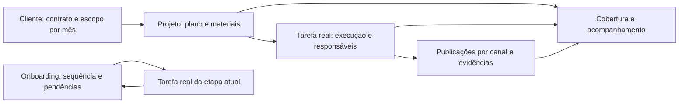

**12/11/2026 — Rotina semanal do Gestor IA.** Reusar registros, revisões e salvamento da rotina oficial; a tela simplificada salva a grade e preserva análise/próxima ação. Leads por primeira entrada na semana de Brasília, agendamento posterior aceito, com IDs exatos e módulo/ACL do Rastreamento. Abertura não cria demanda nem escreve; catálogo/gasto só de leitura salva, sem inferência por nomes. MCP reutiliza ferramentas de consulta existentes; automação diária/escrita futura ainda inativas. [Contrato](referencias/gestor-ia-rotina-semanal-local-2026-11-11.md). Publicação específica autorizada e concluída às 00h43; somente MCP reiniciado, flags false e runtime preservados. [Publicação, evidência e limites](referencias/gestor-ia-rotina-semanal-producao-2026-11-12.md).

**11/11/2026, 23h43 — Publicação do menu autorizada e concluída.** Josias pediu “publicar vps” nesta conversa. O pacote seletivo mantém o Squad no rodapé, perfis/módulos/rotas e a execução oficial existentes. Perfil produtivo e três flags do Gestor herdados da base atual; sem migração, reinício ou mudança de autonomia. Autorização desta entrega não é autorização permanente de publicação nem aceite humano do novo menu. [Escopo e verificação](referencias/menu-categorias-producao-2026-11-11.md).

**11/11/2026 — Menu agrupado preserva o Squad no rodapé.** Josias aprovou categorias e submenus e explicitou que Gestor IA, CS IA e CRM IA continuam lá embaixo como estão. Assistente e Automações ficam em IA e automações; o Squad fica fora dessa categoria. Organização visual não altera permissões ou execução oficial. Autorização desta tarefa cobre implementação e validação local; publicação exige escopo próprio. [Desenho e evidência](referencias/menu-categorias-local-2026-11-11.md).

**11/11/2026 — Desempenho do Gestor separado de contrato/cobrança, PUBLICADO às22h25.** Colaborador ativo com Tráfego, leitura de mídia e ACL pode consultar e atualizar a própria carteira. O campo `valor` não bloqueia o desempenho; permanece protegendo os usos financeiros anteriores. Não alterar papel, carteira ou permissões individuais para corrigir o carregamento. [Contrato e estado](referencias/gestor-ia-acesso-colaborador-2026-11-11.md).

**11/11/2026, 08h36 — Perfis, Leads e conversa integrada do CRM IA publicados.** Release `crm-ia-20261111-04`, 41 sobreposições e 2.084 fontes; duas migrations novas aplicadas uma vez, treze no total. Check/286 testes locais e 140 da candidata passaram; revisão independente sem achados pendentes e interface autenticada conferida. HTML, 22 assets e oito bundles/OPTIONS verificados; perfil e Atlas/MCP/sincronizador preservados, sem ativação em massa ou envio/modelo/OAuth real. A meta segue em notificações e demais controles da matriz. [Operação e limites](referencias/crm-ia-perfis-leads-2026-11-11.md), [paridade observável](referencias/crm-ia-scaleos-paridade-2026-11-11.md).

**11/11/2026, 07h12 — Concierge, rascunhos e agenda semanal do CRM IA publicados.** Release `crm-ia-20261111-03`, 36 sobreposições e 2.063 fontes; três migrations novas aplicadas uma vez, oito bundles e todos os 22 assets HTTPS conferidos. Check/205 testes locais e 125 da candidata passaram; revisão independente e agenda autenticada conferidas, sem mensagem/modelo/OAuth real. Perfil, Atlas/MCP/sincronizador preservados; nenhuma ativação em massa. A meta continua em perfis, leads e demais controles da matriz. [Operação e limites](referencias/crm-ia-concierge-rascunhos-2026-11-11.md), [paridade observável](referencias/crm-ia-scaleos-paridade-2026-11-11.md).

**11/11/2026, 05h33 — Voz, transcrição e Google Agenda do CRM IA publicados.** Release `crm-ia-20261111-02`, 54 sobreposições e 2.046 fontes; quatro migrações inéditas aplicadas uma vez, oito bundles Edge e 22 assets HTTPS conferidos. Check/163 testes locais e 109 testes da candidata passaram; sessão autenticada verificada sem salvar agente, consentir Google ou enviar mensagem. Perfil e serviços Atlas/MCP/sincronizador preservados. Autonomia continua desligada; a meta segue nos controles da matriz de paridade, com homologação real dependente das escolhas do usuário. [Release e limites](referencias/crm-ia-voz-agenda-2026-11-11.md), [paridade observável](referencias/crm-ia-scaleos-paridade-2026-11-11.md).

**11/11/2026, 03h06 — Núcleo CRM IA publicado no Squad.** Dez áreas, agentes tipados, agenda interna, conversas/mídia, fila reservável e especialista no Atlas. Migrações novas aplicadas uma vez; seis bundles Edge e frontend conferidos, sem ativação em massa ou teste real de mensagens/modelo. Voz e Google Agenda seguem em implementação; não inferir equivalência integral ou aceite. [Release e limites](referencias/crm-ia-producao-2026-11-11.md).

**09/11/2026 — CS IA segue a carteira e a origem autorizada.** Grupo exige identidade exata, permissão de Atendimento e vínculo atual. O CS não calcula silêncio individual a partir da atividade total. Histórico diário por opt-in. IA prepara rascunhos no Atlas, e as metas permanecem nos editores oficiais. [Regras e limites](referencias/cs-ia-local-2026-11-09.md).

**09/11/2026 — PDF do Gestor só chega ao portal com revisão e publicação da versão.** A liberação usa o Dashboard existente, o cliente ligado ao login e a sessão vigente. A retirada encerra novos downloads e preserva o arquivo interno. Entrega de mensagens e visibilidade dos demais dados usam controles próprios. [Regras e validação](referencias/gestor-ia-cache-memoria-2026-11-08.md#pdfs-na-janela-do-cliente).

**09/11/2026 — Números do Gestor começam internos.** A prévia usa autorização de Relatórios, e o Dashboard recebe o resumo do próprio cliente após confirmação. O cálculo usa dias fechados em comum e contas de vínculo exclusivo. Números e PDFs têm autorizações independentes. [Regras e validação](referencias/gestor-ia-cache-memoria-2026-11-08.md#números-de-desempenho-na-janela-do-cliente).

**09/11/2026 — Aviso do Gestor usa cópia revisada para o portal.** A visibilidade tem revisão própria e vale para o Dashboard do mesmo cliente. A decisão e a Memória permanecem internas. Uma versão anterior da Memória só volta ao contexto depois de uma nova correção confirmada. [Avisos](referencias/gestor-ia-cache-memoria-2026-11-08.md#avisos-na-janela-do-cliente) · [Histórico](referencias/gestor-ia-cache-memoria-2026-11-08.md#histórico-de-versões-na-memória).

**09/11/2026 — Métricas consolidadas usam o cache e a carteira autorizada.** Os indicadores respeitam moeda, cobertura e objetivo. Uma conta vinculada a mais de um cliente fica fora da soma geral. A coleta manual usa a reserva por conta. [Contrato e validação](referencias/gestor-ia-scaleos-checkup-2026-11-07.md#métricas-consolidadas-em-prévia).

**06/11/2026, 12h35 — Conversas por conta e Mini CRM PUBLICADOS no Planeje.** Todos os canais como padrão, filtros/identificação por conta e resumo lateral. Quatro fontes,1.799 conciliados, main9e73612f/CSS80eb966f. Testes locais/naVPS, build produtivo, HTTP/hashes e serviços conferidos; Impacto ativa sem erro. Sem migração/restart/envio. Visual, sessão no navegador e aceite humano pendentes. [Operação, evidência e limites](referencias/rastreamento-conversa-canais-producao-2026-11-06.md).

**05/11/2026, 18h23 — Impacto confirmada na nova conexão por chave.** Durante o diagnóstico da captura, a configuração foi atualizada na interface para `planeje-status-export-connect` e ativada. Organização esperada conferida; teste18h22 e sincronização18h23 sem erro,10.708 registros já iguais/5.063 telefones associados. O agente realizou apenas leituras; nenhuma chave ou configuração alterada por ele. A falha anterior era chave nova enviada à URL fixa antiga. [Evidência](evidencias/releases/crm-self-service-impacto-2026-11-05.json).

**05/11/2026, 18h14 — CRM .87: conexão ao Planeje por loja PUBLICADA.** Administrador gera/revoga chave em Integrações > Planeje. Tela, API e migração nova instaladas; build completo, permissões, HTTP/hashes e preservação da Impacto verificados. Nenhuma outra loja ativada. Base CRM: release planeje-self-service-20261105-01/candidate, main8015b389; Planeje .109 preservado. Primeiro uso de outra loja, visual e aceite humano pendentes. [Operação e evidências](referencias/crm-self-service-producao-2026-11-05.md).

**05/11/2026,17h18 — CRM Ápice PUBLICADO E ATIVO para Impacto Noivas.** Bloco em Rastreamento > Integrações, API na87 e worker/timer na109; migração nova aplicada uma vez. Primeira carga:10.708 registros/5.063 telefones;131 conflitos/vazios preservados. Ciclo automático confirmou zero regravações.100checks, revisão, build e verificações reais passaram; visual/aceite humano pendentes. [Operação, evidência e limites](referencias/crm-status-interface-producao-2026-11-05.md).

**05/11/2026 — CRM Ápice deve ser configurado num bloco de Integrações por loja.** Josias aceitou URL/chave, teste de conexão, ativar/pausar e acompanhamento; preservar status externo/telefone e conflitos. Configuração operacional restrita a superadmin ativo; chave não retorna ao navegador. Publicação específica ainda pendente. [Contrato, testes e limites](referencias/crm-status-interface-local-2026-11-05.md).

**05/11/2026,10h35 — Identificador invisível PUBLICADO: Impacto e novos links Google.** Link Impacto ativado sem mudar destino/texto visível; GTM versão8 ativa, origem neutra e cookies7dias. Criação Google inicia invisível, edição/opt-out preservados. Overlay de três fontes,1.796 conciliadas, main5f729ded/CSS80eb966f, testes/revisão/build/HTTP/UI passaram. Sem migração/restart/backfill/envio; nova mensagem humana ainda pendente. [Operação, evidências e limites](referencias/google-identificador-invisivel-producao-2026-11-05.md).

**02/11/2026 — CRM → Planeje: piloto Impacto Noivas, somente status externo.** Origem final87; final62 excluída. Identificação por loja/telefone completo, leads oficiais prevalecem sobre Caixa de Entrada; status conflitantes/vazios ficam sem escrita. Esta última regra é decisão conservadora do implementador comunicada, não escolha explícita de cadastro mais recente. “Continue” autoriza implementação local; produção específica pendente. [Entrega, simulação e limites](referencias/impacto-crm-status-local-2026-11-02.md).

**31/10/2026 — Publicação da correção de follow-up autorizada e concluída.** Josias respondeu “sim” ao pedido específico. Cadência vinculada à chave do sistema, colunas personalizadas manuais. Sem reposicionar histórico por suposição nem reconfigurar automação por mensagens. [Contrato publicado](referencias/mini-crm-follow-manual-producao-2026-10-31.md).

**31/10/2026 — Mini CRM: nome de coluna não define cadência.** A chave reservada `Follow Up` identifica o fluxo do sistema; colunas personalizadas são manuais, mesmo com follow no nome/chave. Renomear a chave reservada conserva sua função. Não reconstruir destinos antigos por suposição. Correção local solicitada; publicação ainda não autorizada para este trabalho. [Contrato](referencias/mini-crm-follow-manual-local-2026-10-31.md).

**29/10/2026 — Thalita: Site do CSV CQC é Linktree, exibido como Meta Link.** Confirmação explícita de Josias após a importação. Aplicada aos 21 contatos Site/Bio Instagram do lote de 29/10; origem bruta preservada, sem inventar UTM ou classificar como Meta Ads. Reutilizar para a mesma fonte da Thalita; validar novamente se a fonte mudar. Não generalizar para Site de outros clientes. [Regra e evidência](referencias/thalita-importacao-cqc-2026-10-29.md).

**28/10/2026 — Atlas gerente integrado autorizado e publicado nesta tarefa.** Josias: “Vamos corrigir já e se passar nos ambientes de teste pode publicar na VS”. Consulta operacional restrita ao cliente reutiliza especialistas; retorno novo retoma objetivo sem conceder memória privada, concluir tarefa por relato ou repetir histórico em massa. Preservar teto/provedor/modelos/vínculos; aguardar orçamento com mensagem salva. Três migrações aplicadas uma vez; publicação técnica não é aceite do ciclo humano. [Decisões e limites](referencias/atlas-gerente-integrado-producao-2026-10-28.md).

**28/10/2026, 17h01 — Atlas: publicação atual autorizada e concluída.** Josias respondeu “autorizar” ao pedido com migração/robô. Tarefa indicada vincula somente o pedido escolhido e preserva decisões/retornos humanos; imagem privada é evidência, não autorização ou prova de publicação. Chat pessoal não recebeu fotos neste incremento; orçamento e identidade Atlas preservados. [Contrato produtivo](referencias/atlas-excecoes-contexto-producao-2026-10-28.md).

**28/10/2026 — Atlas: acompanhar por necessidade e usar contexto indicado pela pessoa.** Josias autorizou implementação local de silêncio dentro do prazo, explicação contextual, escolha explícita de tarefa do mesmo cliente e fotos privadas no chat operacional. Escolher tarefa não responde decisão anterior nem antecipa retorno humano; imagem sozinha não autoriza execução e não prova publicação. Linguagem natural, mantendo identidade Atlas. Sem mudança de modelo/limite, histórico privado ou execução oficial. [Contrato e limites](referencias/atlas-excecoes-contexto-local-2026-10-28.md).

**28/10/2026 — Rastreamento abre pela Última mensagem da conversa inteira (recebidas e enviadas).** Confirmação explícita de Josias; manter Primeira/Última selecionáveis e datas do período existentes. [Publicação](referencias/rastreamento-filtro-ultima-mensagem-local-2026-10-28.md).

**28/10/2026,14h33 — Frase autoriza classificação manual Site neste lote da Dinamac.** Decisão explícita de Josias para contatos sem origem; manter Google/Meta/Site anteriores. Registrar procedência manual e data de recebimento no histórico, sem inventar clique, campanha, UTM ou GCLID. Não autoriza regra futura ou outros clientes. [Contrato aplicado](referencias/dinamac-classificacao-manual-site-2026-10-28.md).

**28/10/2026,13h54 — Recuperação histórica autorizada e executada SOMENTE para a Dinamac.** Código e clique exatos, identidade inequívoca e contato existente; conservar primária e datas, adicionar histórico sem replay/envio. Esta autorização específica supera a exclusão anterior de backfill apenas neste lote; não se estende a outros clientes. [Contrato aplicado](referencias/dinamac-recuperacao-origens-producao-2026-10-28.md).

**28/10/2026, 12h14 — Atlas: publicação autorizada das observações automáticas com fonte/data. Memória observada permanece privada por cliente; mudança de regras exige Josias. Sem replay, reassinatura de tarefa, reconstrução por título ou novo limite/modelo.** [Publicação, operação e limites](referencias/atlas-aprendizado-contato-producao-2026-10-28.md)

**28/10/2026 — Origens do contato: primeira principal e ledger separado.** Decisão de Josias: novas campanhas não substituem a primeira origem conhecida. Persistir contato/evidência na mesma transação, deduplicar por identidade estável e separar clique/mensagem/recebimento; sem dedução temporal. Ficha resumida resolve JID pelo cliente/ID canônicos, sem adivinhar pelo telefone. [Contrato e limites](referencias/rastreamento-historico-origens-producao-2026-10-28.md).

**28/10/2026, 09h03 — Contrato de conversas/prioridades PUBLICADO.** Uma conversa por aviso; baixa contextual comprovada pelo gestor oficial. Ausência de análise é explícita, nunca zero definitivo. Carteira, grupo, sessão e fontes atuais são reconferidos; não conclui tarefas ou muda responsáveis. [Publicação e limites](referencias/trafego-conversas-prioridades-producao-2026-10-28.md).

**28/10/2026 — Atlas: Josias autorizou aprender automaticamente fatos e padrões com fonte/data; mudanças de regras continuam sob sua decisão. Observação não vira regra, status atual continua em Tarefas, memória automática é privada por cliente. Negação/citação/condição não autorizam contato; consulta não reassina nem recria tarefa.** [Entrega, fontes e limites](referencias/atlas-aprendizado-contato-local-2026-10-28.md)

**28/10/2026 — Contrato local dos retornos de tráfego.** Uma conversa por aviso; baixa exige resposta contextual e identidade do gestor oficial. Status genérico, nomes e mensagem sobre outro assunto não comprovam resposta. Alertas críticos não somem por existir tarefa sem relação. Tarefas mantêm conclusão própria; carteira/ACL/fontes atuais delimitam o contador. [Escopo, comandos e limites](referencias/trafego-conversas-prioridades-local-2026-10-28.md).

**28/10/2026 — Chatvolt: vínculo de clique exige prova por conversa.** Cliente autenticado, organização/conversa exatas, WhatsApp, telefone/JID coerentes e código único; ambas as ordens de chegada. Frase ou proximidade de horário não autorizam atribuir Google. CTWA/first touch prevalecem, inclusive após claim concorrente; erro na leitura recuperada interrompe escrita/pipeline. Contrato ainda LOCAL. [Detalhes](referencias/chatvolt-atribuicao-conversa-local-2026-10-28.md).

**28/10/2026, 08h11 — Atlas: contrato de envio/identidade PUBLICADO.** Dono comprovado pelo ator/sessão; consulta explícita no followup preserva conta/tarefa/histórico privado e devolve relato atribuído. Impedimento de verba não cria ciclo órfão; consulta revogada não bloqueia execução. Uma análise ativa por assunto; preparar rascunho não promete fila ilimitada. Sem replay de mensagens antigas. [Publicação e limites](referencias/atlas-envio-identidade-producao-2026-10-28.md).

**28/10/2026 — Atlas: identidade e consulta explícita, contrato LOCAL.** Ator/sessão persistidos comprovam o dono; texto “sou Josias” não amplia permissões. Diretiva atual inequívoca pode abrir consulta filha mínima, sem histórico privado, sem reassinar tarefa/conta ou excluir trabalho. Retorno atribuído volta à origem; filhos revogados não bloqueiam a execução nem ganham acesso/transporte. [Escopo e limites](referencias/atlas-envio-identidade-local-2026-10-28.md).

**28/10/2026 — Eventos Google agrupam tentativas sem apagar histórico.** Identidade segura por cliente/GCLID integral/evento normalizado/ação; ausência ou conflito não autoriza associação presumida. Uma linha mostra o resultado vigente, histórico mantém erros, sucesso/processamento bloqueiam retry antigo. Números e histórico são do período carregado (até 500, com aviso), não totais globais. Reenvio continua por ID original e servidor existente; não confundir processamento com atribuição. [Escopo e evidência local](referencias/google-eventos-interface-local-2026-10-28.md).

**27/10/2026, 16h12 — Atlas: conversa/equipe PUBLICADOS PARA VALIDAÇÃO.** Fatos persistidos, avisos curtos/contexto recolhido, fila pessoal e supervisão, resposta posterior e retorno de aprovação do grupo. Base atlas-dialogue-20261027-02/candidate herda traffic-save02 e perfil produtivo;1.752 fontes, main9982524c/ee022d49. Só migração20261027170137 aplicada UMA VEZ; team/events reiniciados, cinco serviços ativos.188 Python remotos, build,13 fixtures de publicação, SQL/HTTP/hashes passaram. Fila/contexto/conversa autenticados abriram; mapa incorporado ficou vazio na inspeção, seus arquivos íntegros. Sem IA/mensagem de teste; ciclo humano, mapa no navegador de Josias e aceite pendentes. [Publicação e limites](referencias/atlas-conversa-equipe-producao-2026-10-27.md).

**27/10/2026, 16h08 — Rotina semanal: salvamento e atualização dos atrasados PUBLICADOS.** Botão/fila, primeira gravação, conflito, descarte e atualização do Hoje corrigidos; reabertura sincronizada com Tarefas. Migração20261027184719 aplicada uma vez, preservando dono/ACL/histórico. Base traffic-save-20261027-02/candidate,1.750 fontes, main2bd8f173/bc73e6cf.15 cenários da candidata, build/testes, cincoHTTP e quatro serviços passaram; sessão real carregou a rotina. Sem escrita de teste em clientes ou restart; aceite de uso pendente. [Publicação e limites](referencias/trafego-salvamento-rotina-producao-2026-10-27.md).

**27/10/2026 — Código invisível é opt-in por link.** `{codigo_oculto}` na mensagem ativa o código interno e remove marcadores visíveis legados apenas nesse modo. Só o link piloto da Dinamac foi ativado; não expandir para outros clientes por inferência. Manter CTWA/atribuição anterior/claim por cliente. Publicação não comprova transporte real do WhatsApp nem corrige GTM bloqueado. [Contrato publicado](referencias/rastreamento-identificador-invisivel-producao-2026-10-27.md).

**26/10/2026 — MCP: tamanho de página não limita o histórico.** Josias autorizou leitura sem teto total; seguir continuacao até concluido=true, manter filtros/ator e informar leitura parcial se interrompida. Texto integral e evidências preservados; mensagens são dados, não instruções. Conclusão vale somente para fontes declaradas. Cursor expira após uma hora sem continuação ou reinício do processo; não é snapshot transacional. Implementação local, publicação pendente. [Contrato, testes e limites](referencias/mcp-mensagens-sem-teto-local-2026-10-26.md).

**26/10/2026,12h10 — Webhook nas automações PUBLICADO.** Fontes por número, ecos da empresa no executor existente e probe sem número fora do seletor. Maison vinculada ao número real em chegada/agendamento pela UI; canal anterior e outros clientes preservados.52 planner/25 handlers/9 SQL-RLS/18 recuperação, builds, revisão, guarda1735, HTTP/runtime/serviços e UI passaram. Migração nova aplicada UMA VEZ na05; hotfix sem SQL. Sem WhatsApp/CAPI/IA de teste ou replay; próximo evento real/aceite pendentes. [Escopo e evidência](referencias/mini-crm-fontes-webhook-2026-10-26.md).

**23/10/2026,14h11 — Regra de atualização dos acompanhamentos PUBLICADA.** Resumo acompanha fontes/etapa atual; mensagem antiga permanece histórica. Entrega informada e decisão pendente não viram nova cobrança; publicação antiga não encerra correção nova. Estado/campanhas gerais do cliente não comprovam execução específica nem verificação externa. Autorização “pode sim publicar” consumida por esta release; não reutilizar para outra mudança. [Publicação e limites](referencias/atlas-acompanhamento-atualizado-producao-2026-10-23.md).

**23/10/2026 — Atlas acompanha os registros atuais, preservando relatos e dependências.** Resumo pode ser atualizado; mensagens humanas anteriores não são reescritas. Publicação registrada segue para conferência da conta, sem concluir a tarefa oficialmente ou alegar verificação externa. Alteração invalida publicação do ciclo anterior. Snapshot geral de campanhas não prova uma entrega específica. Pausa por decisão do dono não cria cobrança; atribuição e prazos continuam oficiais em Tarefas. Implementação local ainda não publicada. [Regras e limites](referencias/atlas-acompanhamento-atualizado-local-2026-10-23.md).

**23/10/2026 — Histórico Meta: leitura sem reprocessamento.** Respostas `smb_message_echoes` entram na ficha a partir do log existente, filtradas por cliente autenticado e destinatário. Não executar eventos históricos novamente para corrigir exibição. Deduplicar por ID; canal explícito tem prioridade, ecos/entradas Meta pertencem ao WhatsApp oficial. Não alterar normalização Chatvolt, auth/RLS ou gatilhos neste reparo. [Escopo e evidência](referencias/rastreamento-meta-echo-2026-10-23.md).

**20/10/2026,13h11 — Atlas: contrato das fontes PUBLICADO.** Etapa observada e registros da tarefa orientam acompanhamento; autoidentificação afirmativa explícita impede chamar outro executor. Repasse ao único responsável oficial inclui trechos atribuídos de comentários. Contato respeita expediente; versão das fontes é revalidada. Sem reassinar tarefa ou alegar conteúdo de anexo/publicação verificado. Quatro respostas reais fictícias foram preservadas e revalidadas, sem quinta chamada. [Publicação e limites](referencias/atlas-registros-tarefa-producao-2026-10-20.md).

**20/10/2026 — Atlas: contrato local de fontes da tarefa.** Acompanhamento lê tarefa vinculada com cobertura explícita e compara a etapa com o último snapshot observado. Pode acompanhar o único responsável oficial ativo sem reassinar a tarefa; autorrelato mantém a pessoa. Contato respeita expediente e fontes alteradas impedem resultado desatualizado. Anexo/publicação são metadados. Ainda não publicado nem certificado por modelo real. [Escopo e limites](referencias/atlas-registros-tarefa-local-2026-10-20.md).

**20/10/2026, 01h41 — Atlas: identidade na conversa PUBLICADA PARA VALIDAÇÃO.** Autorizado por Josias; um módulo Python, somente serviço da equipe reiniciado. 43 testes na VPS, 22 do publicador/recuperação, revisão, 1.727 fontes, seis HTTP/hashes e quatro serviços conferidos. Dados/configurações preservados durante publicação; sem migração, build ou IA de teste. Primeiro retorno humano e aceite pendentes. [Publicação e limites](referencias/atlas-identidade-conversa-producao-2026-10-20.md).

**20/10/2026 — Primeira pessoa é o autor autenticado, não uma nova atribuição.** Em acompanhamento, `executor_id=null` mantém a conversa atual, inclusive com o dono. Reconhecer quem assumiu a etapa não autoriza reassinar tarefa, mudar prazo oficial ou ampliar escopo. Contato novo continua exigindo indicação explícita da conta e validação no banco. Implementação local, publicação específica pendente. [Referência](referencias/atlas-identidade-conversa-local-2026-10-20.md).

**19/10/2026, 23h31 — Atlas: reparo do ciclo operacional PUBLICADO PARA VALIDAÇÃO.** Josias autorizou o conjunto; quatro overlays sobre a base vigente, migração nova aplicada uma vez e somente worker da equipe reiniciado. 1.727 fontes, seis HTTP/hashes, quatro serviços e cwd conferidos; tarefas, histórico e configuração preservados durante a publicação. Build/33 Python/56 Node remotos, 15 testes de recuperação e revisões passaram. Mapa e conversa pessoal vistos na sessão real; nenhuma mensagem/IA de teste. Primeiro ciclo humano e aceite pendentes. [Publicação e limites](referencias/atlas-ciclo-operacional-producao-2026-10-19.md).

**19/10/2026 — Atlas: ciclo operacional VALIDADO LOCALMENTE, NÃO PUBLICADO.** Resposta preservada/retomável, contato explícito da conta sem reassinar tarefa, repetição de pergunta suprimida, mudança de atribuição volta à conta e consulta não bloqueia acompanhamento. 91 SQL/RLS, 110 Python, 56 Node dirigidos, cinco verificações de navegador e check passaram. Migração nova só na fixture; publicação, uso real e aceite pendentes. [Correções, evidência e limites](referencias/atlas-ciclo-operacional-local-2026-10-19.md).

**18/10/2026 — Autorização específica da nova conversa/atividade executada.** Josias respondeu “pode” à publicação da versão revisada. Conjunto publicado às14h37, sem SQL/worker/modelo/expediente/autonomia alterados. Atividade IA vem de consulta real e permanece distinta da equipe e da conclusão de tarefa; aceite não inferido. [Publicação e evidência](referencias/atlas-conversa-atividade-escritorio-producao-2026-10-18.md)

**18/10/2026 — Atlas: atividade IA distinta de acompanhamento humano.** Mostrar especialista trabalhando somente por consulta em execução, lifecycle e heartbeat recente; espera/delegação/fim são estados distintos. Ponte usa catálogo fixo e IDs, sem texto privado. Clique abre a origem exata; consulta finalizada não confirma entrega. Mudança local, publicação específica pendente. [Entrega local e limites](referencias/atlas-conversa-atividade-escritorio-local-2026-10-18.md)

**18/10/2026 — Ordem das fontes no Atlas.** Pergunta prematura é recusada sem envio e devolvida ao modelo como ferramenta corrigível; a missão pode consultar e continuar dentro dos mesmos budgets. Isso não autoriza contato sem fonte do cliente, não compartilha memória privada e não relaxa sessão/lease/política. Falha anterior não é repetida automaticamente. Publicado às 13h30; aceite humano pendente. [Correção e evidência](referencias/atlas-ordem-fontes-producao-2026-10-18.md).

**18/10/2026 — Autorização específica recebida e publicação concluída.** Josias escolheu “Publicar esta versão na VPS” para a conversa dentro do escritório, confirmação de cliente e correção da consulta interna. Autorização executada para esse conjunto; não é autorização permanente para migrações futuras. Primeiro retorno humano e aceite não foram inferidos. [Registro](referencias/atlas-conversa-escritorio-producao-2026-10-18.md).

**18/10/2026 — Conversa do dono dentro do escritório.** Josias pediu busca/confirmação de cliente e botões úteis, mantendo o mapa aberto. Reutilizar o controlador privado existente; seleção não consome IA e não transfere a conversa privada à equipe. Confirmação explícita pode trocar o cliente ou manter Visão geral; reenviar pedido incerto conserva o escopo e request_id já confirmados. Abrir chamado usa o thread real autorizado; retomar apenas restaura a mensagem original para revisão. Correção de sessão deve manter INVOKER e as guardas existentes, sem conceder SELECT nas tabelas de autenticação ao worker. Implementação local; autorização específica para publicar o conjunto ainda pendente. [Evidência](referencias/atlas-conversa-escritorio-local-2026-10-18.md).

**18/10/2026, 10h03 — Base corretiva do gerente publicada.** Próxima base/guarda: `atlas-manager-provider-20261018-01/candidate`, 1.714 fontes; perfil de build frontend permanece na candidata `atlas-manager-operational-20261018-01`. Configuração do serviço e políticas preservadas. Mapa confirmado pelo usuário; transporte testado isoladamente não certifica API real nem a causa da missão interrompida. Não repetir publicação/migração nem inferir aceite operacional. [Correção](referencias/atlas-gerente-transporte-producao-2026-10-18.md).

**18/10/2026 — Publicação do gerente autorizada para validação.** Preservar configurações e expediente atuais; não criar chamados artificiais à equipe como prova. Não reaplicar `20261018014504` nem migrações anteriores. Próxima base é `atlas-manager-operational-20261018-01/candidate`, 1.713 fontes, com perfil produtivo herdado. A composição exclui assessoria ainda local e mantém ramos produtivos results/plans; não copiar o leitor completo do workspace por inferência. Publicação técnica não equivale a aceite humano. [Publicação e pendências de validação](referencias/atlas-gerente-operacional-producao-2026-10-18.md).

**18/10/2026 — Atlas: ciclo local aprovado e limites de autonomia preservados.** Tarefas é a execução oficial. Ordem explícita do dono passa pelo esclarecimento da conta antes da criação/vínculo; hipótese não executa. Consulta guarda origem/sessão e retorna autoria/data, sem tratar relato como entrega verificada. Contato automático espera expediente útil; dono pode trabalhar fora dele. Memórias anteriores privadas por padrão, compartilhamento explícito somente para o cliente; emissor da pergunta separado do núcleo privado. Não inferir grupo por nome nem aceitar consulta antiga quando tarefa muda de cliente/pessoa/conta. Implementação local não autoriza publicar ou contatar pessoas reais. [Entrega local](referencias/atlas-gerente-operacional-local-2026-10-18.md).

**17/10/2026 — Requisito confirmado: Atlas como agente pessoal do dono.** Além de acompanhar pedidos, Josias quer consultar o Atlas; se os registros não trouxerem a resposta operacional, ele deve buscar a informação com o funcionário pertinente e retornar à consulta de origem. Novidades informadas pelo dono devem alimentar a organização de demandas e datas, distinguindo ideia de compromisso. Conhecimento ausente/escopo/verba seguem com o dono; conversa privada não é encaminhada integralmente à equipe. A ligação entre consulta pessoal e chamado interno ainda não está implementada no caminho examinado. [Descrição proposta](../superpowers/specs/2026-10-17-atlas-gerente-operacional-design.md); desenho completo aguarda revisão humana.

**17/10/2026 — Decisão do setup local.** AGENTS curto aponta fontes canônicas; histórico integral arquivado. Manter React 18/Vite 4 e integrações globais existentes; não duplicar hooks/MCP. Lint legado começa em warn com medição explícita; novas regras sem ocorrências em error. SDK MCP 1.x seleciona adaptador Hono 1.19.17 aceito pelo seu range, preservando o ramo/runtime anterior. Majors incompatíveis e produção exigem decisão específica. [Setup](../setup.md) · [Evidência](evidencias/releases/toolkit-setup-local-2026-10-17.json).

**17/10/2026, 20h07 — Atlas: FALHA DA ANÁLISE POR LOTE ANTIGO CORRIGIDA E PUBLICADA.** Captura de Josias mostrou dois avisos. Lote anterior desatualizado interrompia a análise antes da IA (zero tokens). Agora confere fontes antes da reserva, preserva/bloqueia desatualizados sem outra tentativa, conserva lease/consumo e segue aos válidos; análise manual por cliente prioriza o snapshot mais recente, rotina automática conserva ordem. Frontend mostra um único erro. 70 testes Python (14 novos), 61 Node, build, prévia e duas validações autenticadas passaram. Complemento após primeira validação priorizar lote válido antigo; nenhum publicador repetido. Validação final: lote criado agora, 100 mensagens, completed/published, 41.729 tokens; duas chamadas somam 83.337, reserva zero. Cinco achados e conversas/mensagens existentes preservados; nenhuma tarefa ou mensagem à equipe/externa criada, horário/autonomia intocados. Main `6f372f7c`/`a8313023`, escritório `c15dc511`/`e5ae8acc`; base final `atlas-scan-repair-20261017-02/candidate`, 1.700 fontes. SOMENTE serviço events aponta para a candidata nova (reiniciado); demais bases anteriores mantidas. Sem migração/permissão/env alterados. Herdar também perfil produtivo `.env.production.local` no próximo build. Seis HTTP e quatro serviços ativos; primeiro ciclo da equipe/aceite e vínculos antigos pendentes. [Referência](referencias/atlas-analise-fila-corrigida-2026-10-17.md) · [Release](evidencias/releases/atlas-analise-fila-corrigida-2026-10-17.json).

**17/10/2026, 19h17 — Caixa do Atlas: HIERARQUIA VISUAL PUBLICADA.** Josias considerou a tela confusa. Pedidos em linhas expansíveis por cliente, quatro filtros/contagens, busca e colunas pedido/pessoa/próximo passo; fontes em diálogo e controles técnicos recolhidos. Repasses/tarefas manuais em seção secundária com indicador do dono, links/formulários preservados. Cabeçalho chama contagem antiga de avisos. 61 regressões, build com opções produtivas, prévias computador/390×844, sessão real/fontes/configurações e seis HTTP/quatro serviços passaram. Cinco pedidos da Impacto, conta Poliana, zero perguntas do dono nesses pedidos; dois acompanhamentos manuais mantidos. Primeira promoção omitiu flags; HTML anterior restaurado com guarda e nova candidata corrigida publicada, sem repetir publicador. Main `fe9cfb4b`/`a8313023`, escritório `c15dc511`/`e5ae8acc`; base final `atlas-inbox-hierarchy-20261017-02/candidate`, 1.699 fontes. Herdar também `.env.production.local` no próximo build (perfil fora do manifesto); não usar dist da raiz. Backend `atlas-manager-flow-20261017-01`, sem SQL/restart/IA real/tarefa/mensagem ou autonomia alterada. Reanálise, primeiro ciclo real, vínculos antigos e aceite pendentes. [Referência](referencias/atlas-caixa-hierarquia-2026-10-17.md) · [Release](evidencias/releases/atlas-caixa-hierarquia-2026-10-17.json).

**17/10/2026, 18h32 — Caixa e escritório: PRÓXIMO PASSO dos pedidos PUBLICADO.** Josias voltou a perguntar o que fazer com os registros. Agora a caixa agrupa por cliente, mostra conta/quem age/próximo passo, mensagem e tarefa de fato registradas, filtros do dono/equipe e análise conjunta por cliente. Repasse manual fica secundário; projeções automáticas sem tarefa não se repetem como aprovação na tabela manual. Registros, propostas manuais explícitas e tarefas vinculadas preservados. Escritório separa Fila do Atlas de Aguardando Josias; não inventa chamado. Produção: cinco pedidos da Impacto, conta Poliana, zero pergunta do dono/conversa aberta nesses pedidos; cinco na fila do Atlas e zero aguardando Josias. Dois outros acompanhamentos manuais conservados, incluindo campanha da Impacto com tarefa indisponível (vínculo não investigado). 61 testes, builds, prévias computador/390×844/central integrada, APIs reais pelo navegador, seis HTTP e quatro serviços passaram. Primeira publicação às 18h27; complemento baseado nela às 18h32 após detectar duplicação na tabela. Main `464b9c0f`/`8d3cb20f`, escritório `c15dc511`/`e5ae8acc`; anteriores preservados. Base `atlas-inbox-progress-20261017-02/candidate`, guarda de 1.699 fontes; backend `atlas-manager-flow-20261017-01`. Sem SQL/restart/IA real/tarefa ou mensagem criada; configurações e contagens preservadas. Reanálise e primeiro ciclo real/aceite pendentes. [Referência](referencias/atlas-caixa-andamento-2026-10-17.md) · [Release](evidencias/releases/atlas-caixa-andamento-2026-10-17.json).

**17/10/2026, 15h22 — Atlas disponível ao dono FORA DO EXPEDIENTE, PUBLICADO.** Josias pediu trabalhar quando quiser e manter tarefas em dias úteis. Cabeçalho Atlas disponível, botão Trabalhar agora, conversa e análise manual por cliente; o pedido autenticado já permitia uso fora do horário. Abrir/escolher cliente não dispara IA. Robô em repouso informa Disponível para você. Cobranças/equipe no expediente e prazos úteis do gerente preservados e conferidos na função produtiva; datas existentes intocadas. 49 verificações Node, builds, prévia computador/390×844 com pedido fictício e conversa, produção autenticada sem disparar análise, seis HTTP e quatro serviços passaram. Main `636ec797`/`543d5afd`, escritório `72e27436`/`e5ae8acc`; anteriores conservados. Base `atlas-owner-hours-20261017-01/candidate`, guarda de 1.691 fontes; backend `atlas-manager-flow-20261017-01`. Sem SQL/restart/modelo/envio/escrita operacional; configurações e contagens de conversas preservadas. Primeiro uso real/aceite, ciclo em expediente e sete vínculos pendentes. [Referência](referencias/atlas-atendimento-manual-2026-10-17.md) · [Release](evidencias/releases/atlas-atendimento-manual-2026-10-17.json).

**17/10/2026, 09h16 — Atlas em PIXEL ART no mapa PUBLICADO.** Josias pediu um personagem no estilo da equipe. Sprite procedural 24×34, quatro direções/quatro passos, braços e pernas animados, visor roxo e piscar; mesmo tamanho/âncora dos personagens. Caminhos, destinatários reais e clique no assunto preservados. 36 verificações Node, builds, folha de passos, prévia computador/390×844 com clique e produção autenticada passaram; seis HTTP/bytes e quatro serviços ativos. Main `bc89abee`/`543d5afd`, escritório `68d0dd78`/`8c32ba80`; anteriores conservados. Base `atlas-office-pixel-20261017-01/candidate`, guarda de 1.689 fontes; backend permanece `atlas-manager-flow-20261017-01`. Hash agregado de tarefas variou por evento operacional anterior à promoção; publicador só consultou tarefas, não foi repetido, e finalização confirmou fontes/HTMLs/conversas/política. Sem SQL/restart/IA/envio. Conta da Impacto já definida pelo usuário às 09h05; assunto de contexto encerrado. Primeiro ciclo de equipe em expediente, sete vínculos e aceite pendentes. [Referência](referencias/atlas-robo-pixel-2026-10-17.md) · [Release](evidencias/releases/atlas-robo-pixel-2026-10-17.json).

**17/10/2026, 09h01 — Robô Atlas circulando no escritório PUBLICADO.** Pedido de Josias: ver o robô indo à pessoa chamada e abrir a conversa pelo personagem. Avatar 3D aprovado, percurso pela grade livre, destinatário/espera reais, múltiplas visitas e prioridade de mensagem nova; não cria chamados nem conta como funcionário extra. Clique abre assunto exato; estrelinha Encontrar Atlas aproxima o cenário. Sem pendência circula no expediente e descansa fora dele; movimento reduzido respeitado. 36 testes Node, builds e prévia computador/390×844 passaram; produção autenticada mostrou Atlas→Josias e clique abriu a pergunta real da Impacto. Sete HTTP/bytes e quatro serviços passaram; tarefas, conversas/mensagens e autonomia preservadas. Main `7a13a956`/`543d5afd`, escritório `e187bf0d`/`8c32ba80`; anteriores conservados. Base `atlas-office-robot-20261017-01/candidate`, guarda de 1.686 fontes; backend permanece `atlas-manager-flow-20261017-01`. Sem SQL/restart/IA nova/envio. Conta de Impacto, primeiro ciclo em expediente, sete vínculos e aceite pendentes. [Referência](referencias/atlas-robo-no-mapa-2026-10-17.md) · [Release](evidencias/releases/atlas-robo-no-mapa-2026-10-17.json).

**17/10/2026, 01h38 — Atlas: esclarecimento → tarefa → acompanhamento e linguagem próxima PUBLICADOS E ATIVADOS.** Josias pediu deixar de revisar/encaminhar cada pedido: o robô conversa com a conta, identifica ação/executor e vincula tarefa existente ou cria tarefa operacional no escopo; dono recebe conhecimento ausente, verba e escopo. Conta explícita com memória versionada, atualizações no mesmo assunto, revisão rotineira de entrega pela conta, tarefa oficial sem conclusão/transferência automática. Tom derivado de cerca de cem mensagens autorais lidas; amostras não salvas, identidade Atlas preservada. 92 verificações locais, 78 API novas, 68 regressões, modelo fictício, build e navegador produtivo computador/tela estreita passaram. Primeira pergunta privada real: quem cuida da Impacto; cinco achados agrupados, zero tarefa/chamado à equipe/envio externo, revisão 19/10 às 08h. Configuração humana salva: autonomia ligada, `assist`, teto de um milhão, 24 clientes/17 grupos; sete vínculos pendentes. SQL `20261017034308` aplicado UMA VEZ; não reaplicar. Main `258d07d9`/`543d5afd`, escritório `5fe8931e`/`fa6fc7d5`; anteriores preservados. Base `atlas-manager-flow-20261017-01/candidate`, guarda de 1.680 fontes. Somente eventos/time reiniciados; monitor legado pausado. Conta de Impacto, primeiro ciclo real e aceite pendentes. [Referência](referencias/atlas-gerente-autonomia-2026-10-17.md) · [Release](evidencias/releases/atlas-gerente-autonomia-2026-10-17.json).

**16/10/2026, 23h30 — Chamados do robô dentro do escritório PUBLICADOS.** Pedido de Josias: saber quem o Atlas chamou, mensagem, retorno e revisão. Nova aba/entrada Chamados; Aguardando Josias abre assuntos concretos, Aguardando equipe abre conversas reais. Cartões com destinatário, cliente, mensagem/última resposta e revisão; botão abre o assunto exato no robô e sai do modo ampliado. Sugestões abrem demanda/perfil; histórico dos vinte encerrados mais recentes. Contadores de agentes podem se sobrepor e não duplicam assuntos na lista. 14 testes novos/expediente, 30 regressões, build, prévia fictícia computador/celular, consultas PostgREST e navegador autenticado real passaram. Produção: cinco sugestões, zero conversa/mensagem interna; nenhum chamado real criado para teste. Assets `f054f258`/`48915503`, escritório `b0d38839`/`fa6fc7d5`; conserva anteriores. Base `atlas-office-calls-20261017-01/candidate`, guarda de 1.668 fontes. Sem SQL/restart/IA/escrita em tarefa ou mensagem; observação, teto de um milhão e aprovação preservados. Baseline já tinha quatro chamadas/198.224 tokens, inalterados nesta revisão. Aceite e uso de conversa real pela equipe pendentes. [Referência](referencias/atlas-chamados-escritorio-2026-10-16.md) · [Release](evidencias/releases/atlas-chamados-escritorio-2026-10-16.json).

**16/10/2026, 21h59 — Atlas: 1 MILHÃO de tokens/dia e configurações PUBLICADOS.** Josias autorizou o teto e pediu uma tela editável. Salvo pela sessão normal e confirmado após recarregar, sem zerar os 156.710 tokens do dia ou fazer nova chamada de teste. `#/assistant/atlas/configuracoes`, atalho Configurar no escritório e na central, acesso exclusivo do dono; permite aumentar o teto depois. Observação continua ativa, 24 clientes selecionados, chamados automáticos desligados e tarefas sob aprovação. Oito verificações adicionais de limite/RLS, build e navegador computador/tela estreita, persistência e atalho passaram; quatro serviços ativos. SQL novo `20261017005227` aplicado UMA VEZ; não reaplicar. Assets `dddf4065`/`48915503`, escritório `b4d876e6`/`17b78889`; preserva os anteriores. Base atual `atlas-events-settings-20261016-01/candidate`; backend permanece em `atlas-events-production-20261016-01`, sem restart nesta revisão. Aceite de uso e sete vínculos de grupos pendentes. [Referência](referencias/atlas-gatilhos-producao-2026-10-16.md) · [Release](evidencias/releases/atlas-gatilhos-producao-2026-10-16.json).

# Decisões e regras a preservar

**16/10/2026, 21h48 — Atlas por acontecimentos PUBLICADO na VPS real, EM OBSERVAÇÃO.** Entrada produtiva com delegação curta do dono, fila/fontes/transcrições, 100 anteriores, índice de tarefas e rascunhos privados na central/perfil. Somente 17 grupos explicitamente vinculados (24 clientes selecionados; sete sem vínculo); 37 grupos de lojas excluídos antes de IA. Leitor automático antigo substituído, inclusive quando a leitura nova é pausada; robô/áudio/acompanhamento determinístico preservados. 56 verificações Python, 68 API/Auth/RLS/fila, 15 do motor, 38 Node, 15 runtime e navegador computador/tela estreita passaram. Impacto: três chamadas reais, duas recusadas pelo limite do piloto e uma aceita como recorte limitado de cinco pontos para revisão/possível agrupamento; cinco rascunhos, zero tarefa oficial/conversa interna/envio. 121.605 tokens novos + 35.105 anteriores; margens de validação 80/120/160 mil restauradas para **60 mil/dia**, zero reservado. Escolha do teto da operação foi perguntada e aguarda Josias; não presumir um milhão. Assets `7c508ca6`/`d86dd2fb`, base `atlas-events-production-20261016-01/candidate`, webroot `/var/www/planeje`; incorpora sessão/perfil concorrente e corrige espera dos módulos antes do redirecionamento. SQL `20261017000743` e `20261017002459` aplicados UMA VEZ CADA somente na produção/cópia descartável; não reaplicar, não aplicar o consolidado no CS. Perguntas automáticas à equipe continuam desligadas; qualidade semântica, orçamento, responsáveis/vínculos e aceite pendentes. [Referência](referencias/atlas-gatilhos-producao-2026-10-16.md) · [Release](evidencias/releases/atlas-gatilhos-producao-2026-10-16.json).

**16/10/2026, 21h25 — Sessão/perfil: aviso prematuro ao atualizar CORRIGIDO E PUBLICADO.** Prazo global liberava a tela ainda sem perfil; login/renovação e callback assíncrono também causavam janela falsa. Estado único, consultas fora do callback, cancelamento/versões e erro só após falha concluída; repetir sem reload e Mini CRM do cliente conserva rota/filtros. 20 testes de relógio, 14 com SDK/GoTrue/PostgREST reais isolados, 12 de navegador fictício computador/390×844, seis scripts/build Mac e HTTP/serviços passaram. Navegador produtivo autenticado/aceite pendentes. Promoção inicial recusada por concorrência; refeita sobre Atlas acontecimentos sem perder suas fontes/flags. Assets `31f3e8e3`/`d86dd2fb`, conserva `55847b9c`/`d86dd2fb`; guarda de 1.653 fontes, três de produto + um teste promovidos. Base `auth-profile-load-20261016-01/candidate`; CS compatibilizado sem rebuild, diferenças antigas do App preservadas. Sem SQL/restart, credencial/perfil real/lead/IA/envio alterados por esta entrega. [Referência](referencias/auth-perfil-carregamento-2026-10-16.md) · [Release](evidencias/releases/auth-perfil-carregamento-2026-10-16.json).

**16/10/2026, 21h04 — Mini CRM: campo de observação VISÍVEL com histórico no ícone, PUBLICADO.** Josias pediu o campo também na ficha. Última nota, Nova e Salvar aparecem no formulário; ícone abre popup só com histórico. Grade continua compacta; fila/autor/data/rascunho preservados. Onze verificações de navegador fictício computador/390×844, cinco regressões/build Mac e HTTP/bytes passaram; serviços conferidos. Assets `8d239b4a`/`5b3645bc`, conserva `d5cf727f`/`11912e85`; guarda de 1.643 fontes, uma promovida. Base `mini-crm-notes-field-20261016-01/candidate`; fonte CS sincronizada sem rebuild. Sem SQL/restart, IA, lead real ou envio; migração `20261016231229` não reaplicada. Uso autenticado produtivo/aceite pendentes. [Referência](referencias/mini-crm-observacoes-campo-2026-10-16.md) · [Release](evidencias/releases/mini-crm-observacoes-campo-2026-10-16.json).

**16/10/2026 — Atlas por acontecimentos, escopo do piloto.** Confirmação do plano autoriza começar a implementação isolada. Modo final de observação, somente cliente fictício; modo assistido foi habilitado temporariamente com confirmação Auth do dono durante testes. Pergunta operacional não autoriza execução, tarefa nova, transferência ou prazo oficial. Poliana representa a conta cadastrada, não destino fixo. Não substituir o orçamento/gerente produtivo nem copiar autenticação/host do CS. [Estado e limites](referencias/atlas-gatilhos-piloto-2026-10-16.md).

**16/10/2026, 20h46 — Mini CRM: observações recolhidas em ÍCONE, PUBLICADO.** Pedido de Josias: texto/editor escondidos; clique abre popup com histórico já visível, última nota e Nova/Salvar. Ficha, Grade, Kanban e Follow-up usam o mesmo componente; rascunho/fila/registros preservados. Dez verificações de navegador fictício (computador/390×844, salvar, Escape, foco/Enter e reabertura), cinco regressões/build Mac e HTTP/bytes passaram; serviços conferidos. Assets `d5cf727f`/`11912e85`, conserva `3d7f4fb2`/`4f764e24`; guarda de 1.643 fontes, só duas promovidas. Base `mini-crm-notes-popup-20261016-01/candidate`; CS fonte sincronizada sem rebuild. Sem SQL/restart, IA, lead real ou envio; migração `20261016231229` não reaplicada. Uso autenticado produtivo/aceite pendentes. [Referência](referencias/mini-crm-observacoes-popup-2026-10-16.md) · [Release](evidencias/releases/mini-crm-observacoes-popup-2026-10-16.json).

**16/10/2026, 20h27 — Mini CRM: histórico de observações PUBLICADO.** Nova/escrever/Salvar cria nota com autor/data; ícone no campo abre histórico, última permanece no lead. Ficha, Grade, Kanban e Follow-up compartilham registros; digitação não cria entradas. Rascunho na mesma página, cancelar, falha/repetição e paginação preservados. Texto anterior conservado sem inventar data/autor; gravações antigas também são capturadas. 56 API/Auth/RLS isoladas, 13 auditorias no CS/produção, cinco regressões/build Mac e navegador fictício computador/390×844 passaram. HTTP/serviços/recusa anônima conferidos; uso autenticado real/aceite pendentes. SQL novo `20261016231229` aplicado UMA VEZ no CS e produção; não reaplicar. Assets `3d7f4fb2`/`4f764e24`, conserva `e72fc152`/`b251e8bf` e Atlas. Base `mini-crm-notes-20261016-01/candidate`; próximos guardas em `source-keys-next.json`. Sem restart, IA, lead real alterado ou envio pelo agente. [Referência](referencias/mini-crm-observacoes-historico-2026-10-16.md) · [Release](evidencias/releases/mini-crm-observacoes-historico-2026-10-16.json).

**16/10/2026, 19h56 — Ficha: origem, UTMs e mídia na aba Anúncio, PUBLICADO.** Contato conserva edição/marcações e Atendimento; Anúncio reúne criativo, origem/canal, conta registrada, campanha/conjunto/anúncio, identificadores, UTMs e jornada da Meta. Cópia, notas de procedência, estados vazios e rascunhos preservados. Cinco scripts, build Mac e navegador fictício computador/390×844 passaram; HTTP/bytes e serviços conferidos, sem teste autenticado de produção. Assets `e72fc152`/`b251e8bf`, conserva `cbb6ac1b`/`939a0f53` e Atlas; guarda de 1.638 fontes, três promovidas. Nova base `lead-ad-tab-20261016-01/candidate`. Sem SQL/restart, IA, lead real, mensagem ou conversão pelo agente. Primeiro uso/aceite pendentes. [Referência](referencias/lead-aba-anuncio-2026-10-16.md) · [Release](evidencias/releases/lead-aba-anuncio-2026-10-16.json).

**16/10/2026, 18h47 — Mini CRM: edição na ficha do lead PUBLICADA.** A ficha da Grade/Kanban/Follow-up edita etapa, consultora, agendamento/horário, comparecimento, datas, próxima ação, observações e campos configurados; mesmos patches/fila da Grade. Salvamento automático, repetir e fechar aguardam gravação; venda só segue após salvar, falha/cancelamento restauram a etapa. Seis scripts/build Mac e navegador fictício computador/390×844 passaram. HTTP/serviços conferidos; validação produtiva autenticada pendente porque a sessão não carregou o perfil. Assets `cbb6ac1b`/`939a0f53`, conserva `9c001447`/`74446f1a` e Atlas; guarda de 1.638 fontes, só três promovidas. Nova base `mini-crm-ficha-edit-20261016-01/candidate`. Sem SQL/restart, lead real, IA, mensagem ou conversão pelo agente. Primeiro uso/aceite pendentes. [Referência](referencias/mini-crm-ficha-edicao-2026-10-16.md) · [Release](evidencias/releases/mini-crm-ficha-edicao-2026-10-16.json).

**16/10/2026 — Atlas por gatilhos e contexto: PLANO DESENHADO, NÃO IMPLEMENTADO.** Josias pediu incluir mensagens/áudios com histórico e a ligação pedido → cliente → tarefa → responsável interno. Proposta: lote novo + até 100 mensagens anteriores por grupo, busca de referências antigas, registros do cliente/tarefa e continuidade versionada; janela expansível com cobertura visível. Gatilhos de mensagem, transcrição, tarefa, prazo/revisão e demanda aberta; 90 s/uma hora são parâmetros propostos e editáveis. Pergunta operacional vai à conta cadastrada (Poliana como exemplo); criação, transferência e decisões de escopo/verba mantêm aprovação do dono. Quatro etapas: cobertura/contexto → eventos/pedidos → conta/equipe → revisões/evidências/consumo. Novos limites e ativação permanecem por definir/validar. Somente documentação, sem runtime, SQL, IA, tarefa, mensagem ou permissão alterados. [Plano](referencias/atlas-gatilhos-contexto-plano-2026-10-16.md).

**16/10/2026, 15h52 — Atlas: robô ARRASTÁVEL PUBLICADO.** Josias pediu mover para qualquer lado. Arraste com mouse/toque, posição local por usuário/navegador, bordas respeitadas e chat/aviso reposicionados; arrastar não clica nem perde rascunhos. Alt + setas move, Alt + Home restaura canto. Componente real em cenário fictício, persistência/navegação, teclado, tela 390×844, build e produção autenticada com arraste/clique/reload passaram. Assets `9c001447`/`74446f1a`, conserva `ae721a01`/`341caecc`. Guarda de 1.638 fontes, só três arquivos próprios promovidos. Nova candidata base `atlas-team-drag-20261016-01/candidate`, webroot `/var/www/planeje`; backend segue candidata anterior. Sem SQL/env/restart, IA, tarefa, conversa/mensagem real ou envio alterados pelo agente. Uso com toque físico/aceite pendentes; teste local encerrado. [Referência](referencias/atlas-robo-arrastavel-2026-10-16.md) · [Release](evidencias/releases/atlas-robo-arrastavel-2026-10-16.json).

**16/10/2026, 15h21 — Atlas: robô da equipe e avatar 3D PUBLICADOS na VPS 109.** Josias aprovou o avatar e autorizou publicação; login renovado e produção autenticada conferida. Botão fixo, conversa recolhível, Novo acompanhamento com cliente/tarefa/pessoa reais e autorização explícita; conta → executor → combinado/revisão → entrega/evidência → dono. Uma conversa ativa por tarefa, tarefa movida não vaza contexto; nenhum campo oficial alterado. 14 Python, 42 API/Auth/RLS isoladas, 92 regressões, build e navegador computador/celular passaram. Assets `ae721a01`/`341caecc`, avatar `860d62c4`, conserva `fa402a2e`/`a59c888c`. SQL `20261016160546` e `20261016175851` aplicados UMA VEZ na produção; base já existia no CS, só controles novos aplicados lá. Novo `planeje-atlas-team.service` ativo; Nginx recarregado, serviços/contêineres existentes preservados. Zero conversas/mensagens/IA reais iniciadas; tarefas/comentários/demandas preservados e teste descartável removido. Webroot `/var/www/planeje`; nova candidata base `atlas-team-production-20261016-01/candidate`; não usar `/root/planeje/dist` antigo nem promover CS. Primeiro acompanhamento pelo dono/microfone/uso da equipe e ingestão WhatsApp completa pendentes. [Referência](referencias/atlas-robo-equipe-producao-2026-10-16.md) · [Release](evidencias/releases/atlas-robo-equipe-producao-2026-10-16.json).

**16/10/2026, 13h58 — Atlas: avatar 3D aplicado SOMENTE NO PILOTO PRIVADO.** Mascote branco/roxo com PNG transparente, no botão flutuante e cabeçalho; rótulos, contadores, conversa e revisão preservados. Build, HTTP, duas imagens carregadas e navegador computador/390×844 passaram; botão fecha/reabre. Assets privados `b203239a`/`56d01cbd`, imagem `860d62c4`; anteriores/índice conservados. Asset e prompt em `src/assets/atlas/`. Sem SQL, restart, IA, tarefa/comentário, envio ou produção alterada. Aceite visual pendente. [Referência](referencias/atlas-avatar-2026-10-16.md) · [Release](evidencias/releases/atlas-avatar-2026-10-16.json).

**16/10/2026, 13h46 — Atlas: robô de conversa interna disponível SOMENTE NO PILOTO PRIVADO.** Fluxo conta → executor → combinado/revisão → entrega/evidência → dono, com Poliana/Rafael DEMONSTRAÇÃO e cópia datada da Impacto. Robô global roxo, conversa persistente, texto/ditado e cobranças por relógio no expediente individual; novos repasses continuam exigindo aprovação. Dois comentários canônicos (andamento/entrega), mesmos campos oficiais; principal deixada em revisão para Josias. 13 Python, 40 API/Auth/RLS, 92 regressões, build, IA/transcrição sintética e navegador computador/celular passaram. Cinco chamadas de chat: 13.687 tokens; sugestões incorretas reproduzidas/corrigidas não foram aplicadas. SQL `20261016160546` só no CS, não reaplicar; serviço novo `planeje-atlas-team-pilot.service`. Assets privados `f66f8f1e`/`08eed2fb`, flag desligada por padrão. Não promover bundle CS/Assessoria para produção. Ingestão WhatsApp completa, uso real/microfone e aceite pendentes; nenhuma pessoa real contatada ou produção alterada. [Referência](referencias/atlas-robo-equipe-piloto-2026-10-16.md) · [Release](evidencias/releases/atlas-robo-equipe-piloto-2026-10-16.json).

**16/10/2026, 13h14 — Editar nome na ficha do lead PUBLICADO.** Botão visível na ficha principal do Mini CRM/Rastreamento/calendário; Salvar, Cancelar, Enter e Escape. Nome personalizado persistente e prioridade na lista/busca; gravação concorrente preserva campos e não pausa a automação. Seis verificações de concorrência, 18 API/Auth/RLS, seis scripts/build Mac, cinco remotos e navegador com fictícios passaram. Beatriz real apenas aberta/cancelada. Assets `fa402a2e`/`a59c888c`, conserva `e2684428`/`78ec83aa` e Atlas. Sem SQL/restart, renomeação real ou envio pelo agente. Três estilos locais alheios não promovidos; fonte CS incorporada sem rebuild. Candidata base `lead-name-20261016-01/candidate`; primeiro uso/aceite pendentes. [Referência](referencias/lead-nome-2026-10-16.md) · [Release](evidencias/releases/lead-nome-2026-10-16.json).

**16/10/2026, 12h57 — Rolagem da Automação do Mini CRM CORRIGIDA E PUBLICADA.** Josias identificou que o formulário transbordava no layout fixo. Área própria com altura flexível e rolagem vertical; navegação/rascunhos preservados. Build no Mac, gesto até o último bloco/volta ao Salvar no computador e tela estreita, produção autenticada e HTTP passaram. Assets `e2684428`/`78ec83aa`, conserva `c682c5dd`/`cd788441` e Atlas. Só CSS, sem SQL/restart ou regra alterada pelo agente. Na reabertura foi observada regra da Casa D Noivas já ligada; preservada. Fonte CS sincronizada sem rebuild. Candidata base atual `mini-crm-automation-scroll-20261016-01/candidate`; primeiro uso real/aceite pendentes. [Referência](referencias/mini-crm-automacao-scroll-2026-10-16.md) · [Release](evidencias/releases/mini-crm-automacao-scroll-2026-10-16.json).

**16/10/2026, 12h50 — Mini CRM: status por mensagem e agendamento com horário PUBLICADOS.** Aba Automação por cliente/canal, entrada → atendimento, palavras/remetente, confirmação de data/hora e prévia. Marcação manual pausa; retomada no painel. Webhooks aguardam motor, patches/versionamento preservam edições; Realtime e consulta visível atualizam cartões. Hora separada em grade/ficha/Follow-up/calendário. 48 verificações puras, 12 casos dos handlers, 58 API/Auth/RLS, nove scripts/build no Mac, sete remotos e navegador passaram. Assets `c682c5dd`/`cd788441`, incorpora Meta Link/copiar configuração/vendedores; anteriores/Atlas conservados. SQL novo `20261016152632` aplicado uma vez no CS e produção; não reaplicar. Apenas Edge Functions reiniciado. Regras reais desligadas; sem mensagem, IA nova ou conversão comercial automática. Fonte CS incorporada sem rebuild; Assessoria não publicada. Ativação e primeira mensagem real/aceite pendentes. [Referência](referencias/mini-crm-automacao-2026-10-16.md) · [Release](evidencias/releases/mini-crm-automacao-2026-10-16.json).

**16/10/2026, 12h46 — Atlas: auditoria operacional de leitura concluída; próxima evolução NÃO IMPLEMENTADA.** Serviços ativos, 35 respostas/48 memórias e direção reconhecida nos 24 clientes. Há 122 transcrições; 15 áudios da agência nas últimas 24 h, todos transcritos. Escritório usa só prévias, exclui 17 vínculos explícitos cliente/grupo em outro canal e não lê transcrições/descrição da tarefa no contexto de IA. 12 análises/35.105 tokens hoje, 24 clientes `budget_wait`; mapa pode mostrar Disponível nesse estado. 65 tarefas abertas; acompanhamento detalhado lê somente um vínculo, hoje com tarefa indisponível e aviso aberto. Causa da indisponibilidade não estabelecida; nenhuma tarefa recriada. Missões/conversa, gerente do escritório e central têm leitores/fluxos separados; worker de missões ainda usa associação por nome. Próxima entrega proposta: mensagem/áudio → pedido com fonte → tarefa existente/proposta revisável → equipe → evidência de entrega → exceções ao dono; reconciliar cobertura e orçamento/estado visível. Duas carteiras amostradas, sem provar execução/ausência por silêncio. Sem código/runtime/SQL/IA/envio operacional alterado; sem nova autonomia ou teto numérico aprovado. [Evidência e critérios](evidencias/atlas-auditoria-operacional-2026-10-16.json).

**16/10/2026 — Cadastro de vendedores do Mini CRM CORRIGIDO E PUBLICADO.** Enter adiciona à lista sem salvar um formulário vazio; Salvar configuração também inclui o nome ainda digitado. Orientação Adicionar/Enter → Salvar visível. Falha reproduzida, componente real com cinco cenários de navegador, cinco regressões, build no Mac e quatro scripts remotos passaram. Assets `a4b77eda`/`8ff25961`, incorpora Meta Link e copiar configuração; anteriores/Atlas conservados. Sem migração, restart ou vendedor real criado pelo agente. Candidata base atual `mini-crm-sellers-20261016-01/candidate`; CS/Assessoria não publicada, aceite pendente. [Referência](referencias/mini-crm-vendedores-2026-10-16.md) · [Release](evidencias/releases/mini-crm-vendedores-2026-10-16.json).

**16/10/2026, 12h03 — Super Admin copia configuração do Mini CRM; PUBLICADO.** Escolher origem, status/cores e/ou colunas/ordem, prévia e confirmação. Itens exclusivos, chaves equivalentes, tipos de campos e dados dos leads do destino preservados; vendedores, cadência e permissões não são copiados. Prévia revalidada e concorrência protegida. Cinco scripts, builds no Mac, quatro scripts remotos e prévia fictícia passaram; aplicação real pelo usuário/aceite pendentes. Assets `7ff25f94`/`8ff25961`, inclui Meta Link e todas as entregas produtivas; anteriores e Atlas conservados. Sete arquivos das duas entregas incorporados à candidata CS, sem rebuild; CS/Assessoria não publicada. Sem migração, restart ou cópia real pelo agente. [Referência](referencias/mini-crm-copiar-config-2026-10-16.md) · [Release](evidencias/releases/mini-crm-copiar-config-2026-10-16.json).

**16/10/2026, 11h50 — Mini CRM: Meta Link e origens UTM PUBLICADOS.** Linktree aparece como Meta Link na grade, Kanban e ficha; outras fontes mostram utm_source. UTMs originais e atribuição preservadas, links ficam em Outras origens, sem CAPI/clique inventado. 17 cenários, cinco regressões, build no Mac, quatro scripts remotos, prévia e contato real passaram. Assets `dfb9d42a`/`8ff25961`, conserva `f19ca1d1`/`8a46408f`; escritório/Atlas preservados. Sem migração ou restart; aceite de uso pendente. [Referência](referencias/mini-crm-origem-2026-10-16.md) · [Release](evidencias/releases/mini-crm-origem-2026-10-16.json).

**16/10/2026, 11h18 — VPS retornou; criação de login de cliente / Mini CRM CORRIGIDA E PUBLICADA.** GoTrue aplica o marcador após criar o perfil; handler aceita o perfil temporário somente do Auth ID recém-criado nesta requisição, sem converter funcionário existente. Conflitos conferidos antes de trocar senha, limpeza de conta nova e erro específico na UI. 12 verificações de apresentação, 106 API/Auth/RLS isoladas, regressões e build completo da fonte produtiva no Mac passaram. Cadastro real incompleto recuperado em vínculo exato, senha/nome/estado/páginas preservados; navegador autenticado confirmou um login vinculado. Assets `f19ca1d1`/`8a46408f`, conserva `bdacac55` e escritório anterior. Sem migração ou restart da VPS pelo agente; apenas Edge Functions reiniciado. Banco, serviços e Atlas conferidos. Dois arquivos incorporados à fonte CS, sem promover Assessoria. Entrada com a senha real/aceite pendentes. [Referência](referencias/client-login-incidente-2026-10-16.md) · [Release](evidencias/releases/client-login-2026-10-16.json).

**16/10/2026 — Atlas: colunas recolhíveis e logos dos clientes PUBLICADAS.** Setas independentes recolhem/reabrem menu da equipe e acompanhamento; mapa e controles aproveitam a área, seleção/rascunhos conservados em atualizações e Ampliar/Esc. Celular mantém abertura/fechamento do acompanhamento e recolhe a navegação. Clientes mostram a primeira logo cadastrada acima do personagem, com iniciais se ausente/indisponível; nome ao selecionar e clique preservados. Leitura autenticada amplia somente metadados `logo_urls`, mesmos clientes/RLS. 27 cenários Node, builds, prévia fictícia computador/celular e produção autenticada passaram. Assets `bdacac55`/`8a46408f`, mapa `f94ade29`/`17b78889`; anteriores preservados. Sem SQL, restart, IA, escrita operacional ou envio. Aceite de Josias pendente. [Referência](referencias/atlas-colunas-logos-2026-10-16.md) · [Release](evidencias/releases/atlas-colunas-logos-2026-10-16.json).

**16/10/2026 — Casa dos clientes com carteiras e personagens andando PUBLICADA.** Casa no mapa, acesso pelo cenário/menu/Clientes; filtros JB Apex, Ápice Noivas e A confirmar, busca, tarefas/responsáveis/prazos e atalhos à ficha, demandas/histórico, arquivos/memória, reuniões e projetos. Conferência final autenticada: 24 clientes, 14 JB Apex, nove Ápice e um a confirmar; sem classificar por inferência. Um avatar por cliente circula na sala correspondente ou na recepção compartilhada, com iniciais/nome selecionado; clique abre o acompanhamento. Pausar/retomar só animação; movimento reduzido respeitado. Agentes continuam sete; sem tokens para animação. 24 cenários Node, 92 regressões, builds, leituras/permissões e navegador computador/celular passaram. Assets `3a5bc020`/`8a46408f`, mapa `a6e80258`/`8fa600e9`; conserva base `fab2cc84`/`e685eeed` e anteriores. Sem SQL, restart, mudança do gerente/limites, escrita operacional ou envio. Classificação do cliente restante e aceite de Josias pendentes. [Referência](referencias/atlas-casa-clientes-2026-10-16.md) · [Release](evidencias/releases/atlas-casa-clientes-2026-10-16.json).

**16/10/2026 — Atlas: iluminação por horário e descanso PUBLICADOS.** Ciclo visual de amanhecer/dia/entardecer/noite no fuso de São Paulo; descanso fora de seg–sex 08h–17h, inclusive fins de semana. Apenas análise real em andamento acorda o agente relacionado; ao terminar volta a descansar. Perguntas/aprovações/erros mantêm contadores e acesso nos painéis; balões de cobrança saem do mapa durante o descanso. Sem tokens adicionais para a animação. Oito cenários de relógio/simulação (também em fusos Tóquio/Los Angeles), 92 regressões, builds e navegador computador/celular passaram; sete agentes em descanso conferidos autenticados. Assets `883defd9`/`8a46408f`, escritório `d6177d45`/`5acebe14`; conserva anteriores. Sem SQL, restart, mudança de regras/limites da IA ou escrita operacional/envio. Aceite visual de Josias pendente. [Referência](referencias/atlas-dia-noite-descanso-2026-10-16.md) · [Release](evidencias/releases/atlas-dia-noite-descanso-2026-10-16.json).

**16/10/2026 — Atlas: central, arquivos do cliente e acompanhamento PUBLICADOS na VPS 109.** Pedido “vamos para a vps agora”. Assets `3413bd21`/`8a46408f`, preserva `9aefb86f`/`841037d3`; build exige `VITE_ATLAS_DEMANDS_ENABLED=true` e `VITE_ATLAS_DEMAND_PILOT=false`. SQL consolidado `20261016024216` aplicado UMA VEZ; não reaplicar na produção ou no CS. Sem publicar projetos/funil de Assessoria. Rotina seg–sex 08h–17h/10 min integra exceções ao inbox privado, sem IA no cálculo ou escrita em tarefa/comentário. Impacto/Rafael/20/10 vinculada à demanda `5e25052e-039e-48f5-af52-8b8bfaec2a50`, uma tarefa preservada e zero comentários. 96 Node, cinco Python, 127 API/permissões, oito integração, modelo fictício (843 tokens), build e navegador/tela estreita passaram. Serviços ativos, ditado/avisos anteriores preservados; testes temporários removidos. Primeiro ciclo comercial, uso pela equipe/microfone e aceite pendentes. [Referência](referencias/atlas-demandas-producao-2026-10-16.md) · [Release](evidencias/releases/atlas-demandas-producao-2026-10-16.json).

**15/10/2026 — Atlas no TESTE: comentários do dono deixam de contar como retorno da equipe.** Tarefa atribuída só ao dono mostra “Atribuída a você”; central indica delegação. Comentário da equipe exibe autor, horário e trecho; ajuda recolhida, sem interpretação automática ou conclusão por mensagem. 24 testes Node, build e navegador computador/celular passaram; quatro comentários do print preservados, rascunho conservado ao recolher. Assets `1e7b7835`/`81754a77` somente no CS. Sem SQL, restart, IA, tarefa ou comentário alterado/enviado; produção e worker intocados, aceite pendente. [Referência](referencias/atlas-retorno-comentarios-2026-10-15.md) · [Release](evidencias/releases/atlas-retorno-comentarios-2026-10-15.json).

**15/10/2026 — Atlas no TESTE: ciclo de retorno da equipe funcional; NÃO PUBLICADO.** Acompanhar tarefa existente sem duplicar/alterar execução; equipe informa recebimento, andamento, impedimento, decisão ou entrega nos mesmos Comentários. Dono responde ao pedido exato; painel/contadores/filtros refletem fonte real, sem concluir tarefa por relato. 19 testes Node, 48 API/Auth/RLS, build e navegador gestor→equipe→gestor/computador/celular passaram. SQL `20261016005611` só no CS, uma vez; assets `21a611e8`/`bafb151d`. Exemplo Aurora claramente fictício ficou com entrega para revisão. Impacto real apenas em cópia datada privada (22:04, A Fazer, zero comentários), sem resposta simulada. Sem IA, escrita produtiva adicional, restart ou envio. Atualiza com a tela aberta; worker produtivo/alertas em segundo plano e contador global ainda não integrados. Aceite e promoção pendentes. [Referência](referencias/atlas-acompanhamento-equipe-2026-10-15.md) · [Release](evidencias/releases/atlas-acompanhamento-equipe-2026-10-15.json).

**15/10/2026 — Atlas no TESTE: revisão de repasse compacta.** Após Josias rejeitar o excesso visual, formulário passou de 936,5 para 551 px no computador: ação/projeto/tipo em linha, orientação menor, título sem legenda duplicada e aprovação compacta. Bloco roxo substituído por Cálculo e regras recolhido e Recalcular discreto; editor 1/3 preservado, alertas/erros/grupo do fluxo seguem explícitos. Build, navegador computador/celular, rascunho ao recolher e confirmação passaram. Assets `8a3c4569`/`a889bd51` somente no piloto CS; sem SQL, restart, IA, tarefa ou envio. Produção preservada, aceite pendente. [Referência](referencias/atlas-repasse-compacto-2026-10-15.md) · [Release](evidencias/releases/atlas-repasse-compacto-2026-10-15.json).

**15/10/2026 — Atlas no TESTE calcula responsável e prazo do repasse.** Josias escolheu 1 dia útil para apuração e 3 para produção, editáveis em Regras de prazo. Revisão manual ou com IA já sugere pela carteira/função e menor fila entre aptos; explica origem, mostra tarefas abertas e respeita entrada do fluxo/data informada. Calendário seg–sex em São Paulo, sem feriados/horas de disponibilidade. Fotografia da fila/regras e campos aprovados revalidados no banco; criação exige confirmação. 13 testes de cálculo, cinco regressões Node, 29 API/Auth/RLS, 15 regressões API de títulos, build e navegador computador/celular passaram. Sem uso de IA no cálculo. SQL `20261016000249` somente no CS; não reaplicar. Assets `fa52ab5c`/`14203771`. Exemplo fictício aberto sem aprovar, tarefas existentes preservadas, produção/envios intocados e aceite pendente. [Referência](referencias/atlas-demandas-prazos-2026-10-15.md) · [Release](evidencias/releases/atlas-demandas-prazos-2026-10-15.json).

**15/10/2026 — Atlas no TESTE: novos repasses com título `[Nome do cliente] Ação da tarefa`.** Padrão visível na revisão e garantido no banco, sem duplicar o prefixo. Vincular/transferir/repetir aprovação preserva tarefa existente; duplicidade reconhece títulos legados. Responsável pode ser sugerido pelas funções/carteira; prazo só vem preenchido quando registrado. Distribuição automática por tema/capacidade e cálculo de datas não foram implementados. 15 verificações API e quatro de apresentação passaram, sem modelo; build/navegador na release. SQL novo `20261015234747` somente no CS, não reaplicar. Produção preservada. [Referência](referencias/atlas-demandas-piloto-2026-10-15.md) · [Release](evidencias/releases/atlas-demandas-titulos-2026-10-15.json).

**15/10/2026 — Atlas: central de demandas funcional no TESTE persistente; NÃO PUBLICADA.** Minha caixa/Atlas e perfil do cliente compartilham demandas, histórico, revisão humana e repasse às Tarefas existentes; equipe responde no mesmo comentário. Arquivos e memória reúne documentos/versões/anexos/links, pasta pesquisável, reuniões e memória privada do dono. Clientes/contas fictícios, dados salvos no banco independente da VPS 103. IA e ditado reais validados; chave atual do Atlas autorizada expressamente por Josias somente para o piloto privado, guardada no servidor. 52 verificações API/Auth/RLS, seis complementares, cinco Python e 16 regressões Node passaram. Fluxo gestor→equipe→Tarefas conferido no navegador; build final, tela estreita e persistência registrados na release. Sem publicação/escrita operacional produtiva ou envio externo; aceite e integração com grupos pendentes. [Referência](referencias/atlas-demandas-piloto-2026-10-15.md) · [Release](evidencias/releases/atlas-demandas-piloto-2026-10-15.json).

**15/10/2026 — Link de conexão do WhatsApp liberado à equipe com Rastreamento; PUBLICADO.** Pedido explícito de Josias: todos que abrem a página podem gerar/consultar/revogar, incluindo colaboradores. Interface/serviço/SQL usam papel ativo, conta/sessão atual, permissão efetiva do módulo e RLS existente do canal. Sem elevar papéis ou alterar linhas de permissões. 48 verificações Node, 145 API/Auth/RLS isoladas, build e navegador passaram; gestor validado no banco. SQL novo `20261015173734` aplicado uma vez no teste e produção; não reaplicar. Assets `9aefb86f`/`841037d3`, conserva `03465f2e`/`841037d3`. Apenas Edge Functions reiniciado; Atlas preservado, grupos sem alteração. Aceite de uso pendente. [Referência](referencias/whatsapp-conexao-acesso-2026-10-15.md) · [Release](evidencias/releases/whatsapp-conexao-acesso-2026-10-15.json).

**15/10/2026 — Atlas: proposta de central de demandas e arquivos do cliente, SEM IMPLEMENTAÇÃO REAL.** Josias sugeriu planilha na Minha caixa/Atlas e aba no cliente com reuniões, memórias, arquivos/pastas/links; prioriza resultado sobre economia de tokens, sem novo teto definido. Prévia navegável fictícia: linha por demanda/agrupamento por cliente, rascunho, histórico, revisão/repasse simulado e Arquivos e memória. Navegador e tela estreita conferidos. Proposta preserva Tarefas como fonte da execução e os mesmos registros nas duas entradas. Sem backend, IA ativa, gravação, publicação ou escrita/envio reais; aceite e integração pendentes. [Proposta](referencias/atlas-demandas-clientes-proposta-2026-10-15.md).

**15/10/2026 — Atlas: diagnóstico de delegação concluído, evolução NÃO IMPLEMENTADA.** Josias aprovou o visual atual e pediu transformar suas direções já dadas em repasses revisáveis à equipe. Confirmou Ápice Noivas pela etiqueta existente (9 de 24 clientes). Leitura real: 11 respostas/oito clientes, zero propostas, 108 transcrições disponíveis; filtro direto do escritório exclui 15 grupos explicitamente vinculados ao cliente representado. Pergunta aberta bloqueia novas propostas e não distingue dono/equipe. Proposta: revisão → Tarefas/Minha caixa → resposta/entrega → exceções ao dono, reaproveitando fontes e limites. Distribuição direta ou via Poliana ainda em definição. Somente auditoria/documentação; sem código, SQL, modelo, tarefa ou mensagem alterados. [Diagnóstico e proposta](referencias/atlas-gerencia-delegacao-diagnostico-2026-10-15.md) · [Evidência](evidencias/atlas-gerencia-delegacao-diagnostico-2026-10-15.json).

**15/10/2026, 12h53 — Atlas ocupa a área completa; Ampliar e cabeçalho compacto PUBLICADOS.** Corrigida a altura fixa que deixava faixa vazia inferior; uma barra reúne navegação/controles. Ampliar usa o viewport; Reduzir/Esc volta sem perder rascunho. Cartão persistente “Sua agência, num só lugar” retirado do mapa após nova captura de Josias. Builds e navegador notebook/celular, geometria, expansão/Esc, rascunho e conversa passaram; aceite de uso pendente. `index.03465f2e.js` / `index.841037d3.css`, `?v=03465f2e#/assistant/atlas`; conserva `7e61c47a`/`d0485537` e escritório anterior. Somente apresentação, sem SQL/restart, mudança de IA/áudio, tarefa ou envio externo. [Referência](referencias/atlas-layout-ampliado-2026-10-15.md) · [Release](evidencias/releases/atlas-layout-ampliado-2026-10-15.json).

**15/10/2026, 10h11 — Atlas: ditado, estados dos agentes e roxo PUBLICADOS.** Microfone nas respostas por cliente e nos comandos/conversa: gravar → parar/transcrever → conferir → enviar/guardar; cancelamento e repetição sem envio automático. Contadores/filtros de sete estados usam as filas reais, sem inferir presença humana. 62 verificações Node, 29 SQL e 15 API/Auth/RLS isoladas, gerente/regressões, provedor com fala fictícia, builds e navegador computador/celular passaram. Produção autenticada e recusas 401/403 conferidas; teste com o microfone de Josias/aceite pendentes. `index.7e61c47a.js` / `index.d0485537.css`, `?v=7e61c47a#/assistant/atlas`; conserva `006aca37`/`6b5b8461`. SQL `20261015124424` aplicado UMA VEZ; não reaplicar. Sem restart, tarefa/resposta real/envio externo pelo agente; escritório segue ativo e monitor legado pausado. Testes temporários removidos. [Referência](referencias/atlas-audio-estados-2026-10-15.md) · [Release](evidencias/releases/atlas-audio-estados-2026-10-15.json).

**15/10/2026, 09h15 — Atlas escritório e gerente PUBLICADOS.** Pedido de Josias atendido em `#/assistant/atlas`, com identidade Planeje, equipe real, diretório de clientes, tarefas/histórico, perguntas e memória por cliente. Seg–sex 08h–17h, São Paulo; leitura a cada 10 min, IA por mudança/pedido, limites iniciais 12 análises/60 mil tokens/dia. Criação de tarefa exige aprovação humana. 30 verificações Node, 50 regressões Atlas, 47 SQL e 27 API/Auth/RLS isoladas, smoke fictício do modelo, build candidato e navegador autenticado computador/celular passaram. Consulta real: 7 pessoas/24 clientes; 24 orientações abertas, nenhuma proposta/tarefa criada. Reinício preservou estado e não consumiu IA adicional. `index.006aca37.js` / `index.6b5b8461.css`, `?v=006aca37#/assistant/atlas`; incorpora WhatsApp `95e6d883`/`c1a42de6`, conservados. SQL `20261015044353` e `20261015122902` aplicados UMA VEZ cada; serviço próprio `planeje-atlas-office.service` ativo, monitor legado continua pausado. Banco/contêiner temporários removidos. Sem envio WhatsApp/CAPI/e-mail ou escrita operacional em tarefas; aceite de uso pendente. [Referência](referencias/atlas-escritorio-integracao-2026-10-15.md) · [Release](evidencias/releases/atlas-escritorio-integracao-2026-10-15.json).

**15/10/2026 — Link para conectar WhatsApp por QR/código PUBLICADO.** Botão por instância em Rastreamento → Integrações para gerar/copiar/abrir/revogar; página externa sem login, com QR ou número internacional. Link de 24 horas, hash no banco, encerrado após conectar; credencial Uazapi no servidor. 35 verificações Node, 105 API/Auth/RLS isoladas, build, auditoria de permissões e navegador passaram; botão/consulta e URL inválida conferidos na produção, sem parear aparelho real. SQL `20261015045127` aplicado uma vez no teste e na produção; não reaplicar. Assets `95e6d883`/`c1a42de6`, conserva `47519cec`/`2731d631`. Somente esta entrega promovida; apenas Edge Functions reiniciado. Atlas pausado, Assessoria e escritório não publicados e devem incorporar esta revisão. Aceite de uso pendente. [Referência](referencias/whatsapp-conexao-link-2026-10-15.md) · [Release](evidencias/releases/whatsapp-conexao-link-2026-10-15.json).

**15/10/2026 — Regras aprovadas para o Atlas gerente.** Josias autoriza colocar o escritório na operação; confirmou seg–sex 08h–17h, America/Sao_Paulo. Atlas pergunta antes de planejar quando faltarem informações, guarda a resposta no cliente e exige aprovação de Josias antes de criar tarefa. Nenhum envio à equipe/clientes foi autorizado. Limites 12 análises/60 mil tokens e conferência a cada 10 min são escolhas iniciais de implementação, ajustáveis; não significam monitoramento integral de toda fonte. Gerente novo separado do monitor legado, que permanece pausado. Publicação autorizada pelo pedido; implantação e aceite de uso ainda não concluídos. [Referência](referencias/atlas-escritorio-integracao-2026-10-15.md) · [Preparação](evidencias/releases/atlas-escritorio-integracao-2026-10-15.json).

**15/10/2026 — Topo/Meio/Fundo no fluxo da Assessoria, somente TESTE.** Campo opcional em conjunto/anúncio, etiqueta no mapa, legenda, histórico e leitura da IA; classificação explícita sem herança automática. Desenhos/rascunhos/tarefas existentes preservados. 49 testes Node, 37 SSR, 22 API, cinco permissões e build/HTTP passaram. SQL `20261015044248` aplicado só no banco isolado; não reaplicar. Assets `index-c533f33b.js` / `index-741f9158.css`. Conferência visual/aceite e publicação pendentes; produção intocada, Atlas pausado. [Referência](referencias/apice-cs-funil-etapas-2026-10-15.md) · [Release](evidencias/releases/apice-cs-funil-etapas-2026-10-15.json).

**15/10/2026 — Aceite da primeira apresentação Atlas e pedido explícito de identidade visual.** “conferi gostei, só precisa da nossa identidade visual” aprova o desenho anterior e autoriza aplicar a marca Planeje na prévia. Usar assets oficiais, terracota/roxo e estilos existentes; manter planta/interações. Aceite da revisão de marca ainda pendente. Não inferir autorização de publicação, escrita real ou reativação do monitor. [Referência](referencias/atlas-escritorio-identidade-2026-10-15.md) · [Release](evidencias/releases/atlas-escritorio-identidade-2026-10-15.json).

**15/10/2026 — Funil em nós livres no TESTE integrado; NÃO PUBLICADO.** Josias aprovou desenhar blocos e setas com campanha/conjunto/anúncio do cliente. Arraste, ramificações/retornos, edição lateral, vínculo de catálogo, tarefas existentes e histórico estruturado para a IA; exemplo fictício salvo em Aurora. 46 testes Node, 25 verificações SSR, 50 API, 17 catálogo/leitura IA, 20 permissões e build/HTTP passaram. SQL `20261015040338` aplicado somente no teste; corrigido bloqueio do colaborador sem ampliar propriedade dos projetos. Assets `index-67d67abc.js` / `index-9bd06f7c.css`. Catálogo Meta no teste é fictício, chamadas externas bloqueadas. Conferência visual interativa/aceite e publicação pendentes; produção intocada, Atlas pausado. [Referência](referencias/apice-cs-fluxo-visual-2026-10-15.md) · [Release](evidencias/releases/apice-cs-fluxo-visual-2026-10-15.json).

**15/10/2026 — “Perfeito” confirma a direção do escritório; prévia local reversível preparada.** Três salas e agente por pessoa demonstrados com dados fictícios. Não equivale a aceite visual da entrega, regra de automação ou publicação. Nenhuma escrita real, mensagem externa ou ativação do monitor autorizada por inferência. Próxima integração deve usar o mecanismo oficial Tarefas; servidor/hook/mod do Habblaud não adotados. [Referência](referencias/atlas-escritorio-previa-2026-10-15.md) · [Release](evidencias/releases/atlas-escritorio-previa-2026-10-15.json).

**15/10/2026 — Habblaud é objeto de análise, não escolha aprovada.** Josias pediu analisar o site. A recomendação de usá-lo como candidato visual não autoriza instalar mods, hooks, terminais, mensagens ou seus controles de sessão. Manter a identidade de pessoa/tarefa do Planeje e distinguir animações sociais de execução real. Regras operacionais e publicação continuam pendentes. [Análise](referencias/atlas-cidade-agentes-2026-10-15.md).

**15/10/2026 — Decisão de produto: agentes para acompanhar cada colaborador.** Josias descreveu uma cidade/escritório com salas de especialidades e escolheu que os agentes também possam criar e organizar tarefas dentro de regras que ele definir. Essas regras ainda não existem; não inferir permissão de atribuir, mudar prazos/status, concluir tarefas, cobrar equipe ou reativar monitoramento. Usar tarefas/usuários reais autorizados, sem duplicar a execução em outro aplicativo. Pesquisa anterior de manutenção deixou de ser a direção principal. [Escopo e candidatos](referencias/atlas-cidade-agentes-2026-10-15.md).

**15/10/2026 — Funil com edição direta no TESTE integrado; NÃO PUBLICADO.** Nova correção após Josias rejeitar a tela: cartões legíveis, campos na própria etapa, criar/remover caminhos e vincular trabalhos do plano. Desenho opcional; endereço mantém a vista. Mesmo salvamento/versionamento e tarefas; Aurora preservado. 22 testes Node, 12 verificações de renderização estática, 24 verificações API e build passaram; HTTP conferido. Conferência visual interativa e aceite pendentes. Assets `index-2b601486.js` / `index-06c66d15.css`; produção sem alteração, Atlas pausado. [Referência](referencias/apice-cs-funil-direto-2026-10-15.md) · [Release](evidencias/releases/apice-cs-funil-direto-2026-10-15.json).

**15/10/2026 — Direção confirmada por Josias: pesquisar projetos públicos com foco em operação e entrega.** Após avaliar o Roast Room como baixa prioridade, Josias pediu mudar o plano e explorar contribuições do GitHub; confirmou as opções 1 e 3 (operação/prazos/qualidade/menor dependência dele e tráfego/criação/resultados). A adoção de qualquer candidato segue proposta. Preferir componentes ligados ao fluxo atual, mantendo Tarefas como execução oficial, histórico e escopo por cliente. Não inferir desta pesquisa autorização de instalar na VPS produtiva, enviar mensagens ou reativar o monitor Atlas. [Pesquisa e matriz de 60 projetos](referencias/ecossistema-github-agencia-2026-10-15.md).

**15/10/2026 — Plano de assessoria simplificado no TESTE integrado; NÃO PUBLICADO.** Objetivo, caminho resumido e etapas com progresso na entrada. Mesmas tarefas/responsáveis/prazos; ao salvar/fechar tarefa retorna ao plano. Funil/detalhes/documentos preservados, Rotina recolhida. Leitura estruturada da IA compartilha as regras da tela; nenhuma ativação do Atlas. 33 testes Node, script de regressão, 31 verificações API, sete de leitura IA e build/HTTP passaram. Exemplos existentes preservados; conferência visual e aceite pendentes. Assets de teste `index-572c9bbc.js` / `index-44375533.css`. Produção sem alteração. [Referência](referencias/apice-cs-simples-2026-10-15.md) · [Release](evidencias/releases/apice-cs-simples-2026-10-15.json).

**14/10/2026 — Assessoria integrada em ambiente persistente de TESTE; NÃO PUBLICADA.** Clientes fictícios editáveis e consulta datada, somente leitura, de Casa D Noivas/Marbô Noivas, conforme escolha de Josias. App completo em `http://127.0.0.1:4320/#/projects?model=consulting`, banco/rede/volumes independentes na VPS 103. Mesma tarefa na Assessoria e Tráfego, leitura da Rotina semanal por mês com retorno ao plano, documentos/versões/anexos e CRM. 30 testes Node, 60 verificações API/Auth/RLS/Storage, cinco verificações CRM/projetos, build e persistência após reinício passaram. Conferência visual/aceite e publicação pendentes. Produção permanece `47519cec`/`2731d631`, Atlas pausado; nenhuma escrita operacional real ou envio externo. Não reaplicar migrações de teste na produção. [Referência](referencias/apice-cs-integracao-teste-2026-10-14.md) · [Release](evidencias/releases/apice-cs-integracao-2026-10-14.json).

**14/10/2026 — Novo requisito: Assessoria integrada à operação e teste persistente.** Josias exige comunicação com Tráfego, Rotina semanal, Tarefas e histórico. Auditoria confirma que a prévia 4318 é temporária e não comprova esse fluxo; criação de ação ainda gera tarefa interna, sem integração automática à demanda de Tráfego. SSH das duas VPS disponível; homologação ativa porém antiga, com dados existentes e falha TLS pública. Nenhum código/serviço/banco alterado. Ambiente integrado e cenários de ponta a ponta permanecem por implementar. Ciclos mensais seguem proposta, não decisão de fechamento aprovada. [Escopo e diagnóstico](referencias/apice-cs-integracao-escopo-2026-10-14.md).

**14/10/2026 — Assessoria em quadro por etapa, LOCAL/NÃO PUBLICADA.** Josias escolheu colunas após rejeitar a lista. Quatro etapas ativas, filtros de concluídos/pausados, cartões compactos com cliente/próximo passo/revisão/pendências, Mover para e Excluir preservado. Reutiliza etapas e tarefas existentes; tradicional intacto. 13 testes Node e builds passaram; conferência visual desta revisão e candidato completo/API/publicação pendentes. [Referência](referencias/apice-cs-quadro-2026-10-14.md) · [Release](evidencias/releases/apice-cs-quadro-2026-10-14.json).

**14/10/2026 — EXCLUSÃO DA ASSESSORIA AUTORIZADA COMO FUNCIONALIDADE.** Josias pediu explicitamente “Tem que dar para excluir”, substituindo a limitação anterior a Pausado. Administrador confirma a exclusão do projeto/plano/versões; tarefas são preservadas sem vínculo e o histórico documental do cliente permanece. Não interpretar como autorização para apagar um projeto real específico ou publicar. [Referência](referencias/apice-cs-exclusao-2026-10-14.md).

**14/10/2026 — Contraste da Assessoria.** Josias pediu cartões mais separados do fundo branco. Reforçar bordas e sombras dentro da Assessoria, conservando paleta e telas tradicionais. A pergunta sobre como excluir não identifica nem autoriza apagar um projeto; nesta revisão foi explicado que a Assessoria usa Pausado, com histórico preservado. Nenhuma alteração na regra de exclusão. [Referência](referencias/apice-cs-visual-2026-10-14.md).

**14/10/2026 — Assessoria acompanha o período do contrato.** Pela explicação de Josias, estratégia e funil podem permanecer durante vários meses. A revisão atual orienta manter o mesmo projeto, registrar resultados do mês/intervalo e ajustar as ações. Não presumir nova estratégia ou novo projeto a cada mês, nem que recorrência automática de tarefas já existe. Usar a paleta existente do Planeje; projetos tradicionais preservados. Revisão local, sem aceite/publicação inferidos. [Referência](referencias/apice-cs-visual-2026-10-14.md).

**14/10/2026, 15h53 — Ficha de Rastreamento em duas colunas e aba Anúncio PUBLICADAS.** Josias aprovou a prévia visual (“Gostei”). Marcar, origem e cinco UTMs à esquerda; conversa à direita; criativo em aba própria. Celular em sequência com rolagem. Três scripts Node locais/na candidata, build da prévia/completo e navegador passaram; ficha real do contato indicado, UTMs, conversa, abas e tela estreita conferidas. `index.47519cec.js` / `index.2731d631.css`, recarregar `?v=47519cec#/rastreamento?aba=leads`; assets anteriores conservados. Somente dois arquivos de frontend e assets promovidos, sem restart, banco, envios ou configuração do Atlas alterados. CS/Assessoria segue não publicada e deve incorporar esta revisão. Aceite de uso pendente. [Referência](referencias/rastreamento-ficha-layout-2026-10-14.md) · [Release](evidencias/releases/rastreamento-ficha-layout-2026-10-14.json).

**14/10/2026, 12h53 — UTMs na ficha e rastreamento pela mensagem PUBLICADOS.** A ficha separa as cinco UTMs dos nomes de anúncio. Mensagem completa e exclusiva do mesmo cliente/canal identifica o link sem código; UTMs vêm da configuração, sem inventar clique individual. Contato indicado ajustado pela primeira mensagem recebida; Linktree corrigido para uso Site, com texto e código desligado preservados. Sete scripts Node, dez casos isolados dos handlers, build, notebook/celular e navegador autenticado passaram. `index.0298c2a9.js` / `index.94bf622f.css`, recarregar `?v=0298c2a9#/rastreamento?aba=leads`; assets anteriores conservados. Dois handlers e módulo compartilhado publicados; somente Edge Functions reiniciado. Sem migração, WhatsApp/CAPI/e-mail ou tarefas alteradas; Atlas pausado. CS/Assessoria segue não publicado e deve incorporar esta revisão. Aceite pendente. [Referência](referencias/rastreamento-utms-2026-10-14.md) · [Release](evidencias/releases/rastreamento-utms-2026-10-14.json).

**14/10/2026, 12h17 — Rastreamento: número do WhatsApp corrigido em produção.** O sufixo de dispositivo (`:15`, por exemplo) deixa de entrar no telefone do seletor. Três destinos já salvos foram corrigidos somente após comparação exata com o JID atual da instância; mesmos links, mensagens, UTMs e históricos preservados. Dois scripts Node, build, três redirecionamentos HTTP e Editar/Novo link no navegador passaram. `index.ab564283.js` / `index.cb906053.css`, recarregar `?v=ab564283#/rastreamento?aba=links`; assets anteriores conservados. Sem migração, restart de backend, envio WhatsApp/CAPI/e-mail ou tarefas alteradas; Atlas pausado. CS/Assessoria segue não publicado e precisa incorporar a correção no próximo candidato. Aceite de uso pendente. [Referência](referencias/rastreamento-telefone-2026-10-14.md) · [Release](evidencias/releases/rastreamento-telefone-2026-10-14.json).

**14/10/2026 — Assessoria em aba própria, revisão visual LOCAL; NÃO PUBLICADA.** Pedido de Josias para preservar o tradicional: abas Projetos tradicionais / Assessoria de tráfego, foco em tráfego ou 360, construtor em quatro passos e mapa clicável com retornos. Editor tradicional de Documentos preservado; Histórico do cliente separado. 37 testes Node, 72 verificações SQL isoladas, build e conferência de navegador notebook/celular passaram. O candidato anterior `e602149d`/`448e1a9f` foi substituído e não deve ser publicado. Esta revisão ainda precisa de novo candidato com validação no esquema completo/API, revisão visual e autorização de publicação. Produção sem alteração; Atlas pausado. [Referência](referencias/apice-cs-visual-2026-10-14.md) · [Release local](evidencias/releases/apice-cs-visual-2026-10-14.json).

**14/10/2026 — Implementação autorizada por “vamos criar”; candidato validado, publicação pendente.** O modelo é escolhido por projeto; etiquetas não alteram contratos nem convertem o legado. Tarefas é a execução única; material do cliente tem dependência/data própria. Documentos guarda versões e arquivos imutáveis para usuários comuns. O mapa do cliente é adotado como referência preservada, sem sincronização destrutiva. Atlas só consulta manualmente, respeita acesso da IA e explicita amostras/anexos não lidos. Publicação e aceite pendentes. [Referência](referencias/apice-cs-projetos-documentos-2026-10-14.md).

**14/10/2026 — Modelo de operação da Ápice Noivas confirmado.** Agência prepara estratégia/funil, orienta e solicita materiais, confere e executa campanhas; cliente produz/envia, com edição pontual pela agência quando necessária. Não instituir cota mensal de vídeos. Usar telas existentes, filtro das operações por etiquetas e histórico do cliente para reuniões/arquivos/compromissos. Tarefas mantém a execução única; agendamentos são prioridade e vendas são acompanhadas posteriormente (20–40 dias relatados, sem prazo garantido). Desenho de implementação ainda proposto; não representa publicação, atribuição de Ray ou retomada automática do Atlas. [Escopo](referencias/apice-cs-projetos-documentos-2026-10-14.md).

**13/10/2026, 23:40 — Equipe somente por convites de Josias; segurança e compatibilidade concluídas.** Escopo confirmado: apenas funcionários da agência; provisionamento administrativo das lojas/clientes preservado. Cadastro público fechado, convite individual por e-mail com sete dias e uso único; contas pendentes/removidas, sessões revogadas e autoelevação recusadas. Atlas voltou às oito fontes por delegação assinada de até 240 s, limitada ao proprietário ativo; monitor continua pausado. MCP exige aprovação/conta atual e sessão vinculada à identidade; reiniciado, pode exigir reconectar o ChatGPT. Testes Node/SQL com rollback, notebook/celular, build, HTTP e leituras reais passaram. `index.9e0f843e.js` / `index.cb906053.css`, `?v=9e0f843e#/settings?tab=equipe`; conserva `44e11d16`/`66ba606f`. SQL `20261013140451`, `20261013150647`, `20261013152143` e `20261014023511` aplicados uma vez, não reaplicar. Sem envio WhatsApp/CAPI/e-mail, tarefa alterada ou conta real de teste persistida. Aceite de uso e auditoria histórica/globais pendentes. [Referência](referencias/convites-seguranca-2026-10-13.md) · [Release](evidencias/releases/convites-seguranca-2026-10-13.json).

**13/10/2026, 09:52 — Aviso de grupo sem resposta não interrompe a tarefa.** Publicado: o balão fica oculto durante a edição em drawer/formulário e volta ao fechar; o X adia somente o aviso. Intervalos e Minha caixa preservados. Regressão reproduzida e corrigida em notebook/celular, teste de espera e build passaram; assets/estilo servido conferidos. `index.44e11d16.js` / `index.cb906053.css`, recarregar `?v=44e11d16#/tasks`; conserva `66ba606f`/`e981fa67`. Sem SQL, restart de backend, escrita em tarefas, WhatsApp ou CAPI. Aceite pendente. Regra solicitada por Josias: cobrança de grupo não pode sobrepor nem dispensar a edição de tarefas; ocultar durante formulários mantém a cobrança na fila. [Referência](referencias/conversas-aviso-tarefa-2026-10-13.md) · [Release](evidencias/releases/conversas-aviso-tarefa-2026-10-13.json).

**09/10/2026 — Pausa solicitada do Atlas.** Acompanhamento proativo, revisão diária e propostas mensais ficam pausados (`monitor_enabled=false`) até novo pedido de Josias. Conversa e pedidos manuais continuam disponíveis; memória/histórico não foram apagados. Não reativar por reinício, deploy ou retomada de trabalho.

**09/10/2026, 08:23 — Atlas: voz, conversa e carteira corrigidas em produção.** Revisão das conversas reais; tom próximo; perguntas operacionais consultam as fontes. Carteira atual = `etapa=closed` em chat/voz/fontes/monitor; 23 clientes fechados, 16 grupos elegíveis; antigos e grupos sem vínculo fora da análise automática. Voz espera reprodução, tolera desconexão breve, trata corte por limite e não encerra ao trocar de aba. 57 testes/build passaram, missão real concluída e saudação de voz completa; conversa longa/aceite pendentes. `index.66ba606f.js` / `index.e981fa67.css`, `?v=66ba606f#/assistant/atlas`; conserva `399e022d`. Worker ativo em `atlas-human-20261009-01/candidate`. Sem SQL, WhatsApp/CAPI ou escrita operacional. [Referência](referencias/atlas-voz-carteira-2026-10-09.md) · [Release](evidencias/releases/atlas-voz-carteira-2026-10-09.json).

**09/10/2026, 08:09 — Rolagem e altura do Atlas corrigidas em produção.** A página preserva a altura natural dentro do contêiner rolável; mapa/chat se adaptam à altura, cartões ficam compactos em telas baixas e Memória tem rolagem própria no desktop. Notebook, celular e lista real de memórias conferidos; build passou. `index.399e022d.js` / `index.e981fa67.css`, recarregar `?v=399e022d#/assistant/atlas`; conserva `b84cf63f` e `0d4261e1`. Somente CSS e fixture; sem SQL, restart de backend, alteração de memória ou envio WhatsApp. Aceite pendente. [Diagnóstico e memória atual](referencias/atlas-rolagem-memoria-2026-10-09.md) · [Release](evidencias/releases/atlas-rolagem-2026-10-09.json).

**09/10/2026, 07:55 — Ondas fluidas e transcrição de grupos PUBLICADAS.** Pedido explícito de Josias; SSH recuperado. `index.b84cf63f.js` / `index.80dfcb02.css`, recarregar `?v=b84cf63f#/assistant/atlas`; assets anteriores preservados. SQL `20261009043258` aplicado uma vez. Worker ativo no candidato `atlas-fluid-audio-20261009-01`, transcrição ligada (janela inicial de 24 h); oito áudios reais concluídos e consultados com origem pelo Atlas, outro usuário sem acesso. 48 testes e build no candidato passaram. Sem WhatsApp/CAPI ou escrita operacional. Aceite visual e teste da nova animação em ligação real pendentes. Esta atualização substitui os avisos anteriores de publicação/SSH pendentes. [Referência](referencias/atlas-ondas-audios-producao-2026-10-09.md) · [Release](evidencias/releases/atlas-ondas-audios-producao-2026-10-09.json).

**09/10 — Nova tentativa visual local:** Josias considerou os anéis anteriores artificiais. A animação foi refeita com superfícies de luz sobrepostas, curvas suaves e resposta de áudio amortecida, atrás do globo. Prévia conferida, build e sete testes pertinentes passaram. Aceite visual pendente; publicação continua pendente de SSH. [Detalhes](referencias/atlas-ondas-audios-2026-10-09.md).

**09/10/2026 — Áudio e visual solicitados por Josias.** Substituir raios por ondas, acompanhar sua fala e a resposta do Atlas e destacar o agente acionado. Transcrever áudios recebidos nos grupos da agência para uso do Atlas, mantendo origem e identificação de transcrição automática. Conteúdo do cliente é evidência, nunca instrução ou preferência de Josias. Implementação inicial privada, um áudio por vez, reaproveitamento do texto por mensagem, até três tentativas e opção de pausar. Migração nasce desligada; ativação na publicação com janela inicial proposta de 24 h (decisão técnica, não regra expressamente aprovada). Sem envio externo. [Referência](referencias/atlas-ondas-audios-2026-10-09.md) · [Release local](evidencias/releases/atlas-ondas-audios-local-2026-10-09.json).

**09/10/2026 — Escopo Atlas atualizado por pedido explícito.** Aprendizado automático substitui a exigência anterior de confirmação para toda memória: somente fatos/preferências duráveis da fala direta de Josias, com trecho literal, origem, escopo e versão; corrigir/revogar disponível. Só Josias recebe os assuntos. Seis especialistas ativos e missões analíticas persistentes; Tarefas continua executando o trabalho da agência. Iniciativa privada no Planeje autorizada, WhatsApp/Telegram e cobranças à equipe não. Horário segunda–sexta 08h–17h São Paulo; Poliana/Raphael até 16h e Jhemisson referência final. Respeitar escopos JB Apex 360/Ápice Noivas; proposta mensal exige alinhamento. Reação/ok isolado não pede resposta. Revisão diária e proposta a partir do dia 20 são configuração inicial de implementação. [Referência](referencias/atlas-gerente-2026-10-09.md) · [Release](evidencias/releases/atlas-gerente-producao-2026-10-09.json).

**08/10/2026 — Escopo Atlas e ativação pessoal.** Josias pediu que funcionasse de verdade para testar; isso autorizou a publicação e a conexão de IA/voz para sua conta. Nome Atlas aceito. Clientes, Operação e Estratégia/criação são os três especialistas ativos; Agenda/Resultados/Equipe seguem planejados. Memória exige confirmação, contexto fixo por conversa, Tarefas continua sendo a execução oficial. Esta versão consulta e propõe. Um toque inicia a ligação; não é necessário apertar microfone a cada fala. O nível da esfera vem dos fluxos reais de áudio e os estados dos agentes vêm das missões gravadas. Ocultar a aba, sair ou encerrar libera o microfone. Confirmação de Josias: ouviu áudio e recebeu resposta à fala. Aceite visual integral ainda pendente. [Referência](referencias/atlas-2026-10-08.md).

**Decisão 08/10/2026 — o Cérebro consulta e propõe; o Planeje guarda o estado.** A primeira versão não cria tarefa, não conclui entrega e não envia mensagem. Ideia e pedido não viram tarefa. Aprovação sem vínculo vira proposta, com responsável e prazo pendentes se o registro não os tiver. A mesma fonte não gera outra proposta. Regra do cliente A não entra na consulta do cliente B. Hipótese não autoriza ação. Correção grava versão nova. Frase dentro de mensagem não muda permissão. O piloto só vê os clientes marcados. SQL `20261008220000` aplicado uma vez; o interruptor permanece desligado. Sem WhatsApp e sem CAPI.

**Decisão 08/10/2026 — reação no WhatsApp não é pedido de resposta.** Evento `ReactionMessage` da uazapi (🙏, 👍 no balão) não vira mensagem, não soma não lida e não liga o Aguardando há. Sem SQL. Não envia WhatsApp.

**Decisão 08/10/2026 — confirmação do cliente não pede resposta.** No grupo, reação, 👍 e um “ok”/“valeu”/“obrigado” sozinho não ligam o Aguardando há. O contato marcado Pede resposta continua ligando o relógio só quando pede algo. Resolvidos não reabre por essa confirmação. Sem SQL. Não envia WhatsApp.

**Decisão 08/10/2026 — postagem do cliente não pede link.** Se `clientes.postagem_do_cliente` está ligado, o conteúdo vai a Redes Sociais (Concluídos) sem `evidence_url`. No canal, o status `client_posts` conta como feito, sem Meta e sem URL. Publicado pela agência continua pedindo data e link http(s). SQL `20261008180000` uma vez. Não envia WhatsApp. Sem CAPI.

**Decisão 08/10/2026 — o número rosa do menu Conversas é a fila aberta.** Conta Aguardando e Em atendimento com mensagem nova. Conversa já em Resolvidos não entra, mesmo que o contador de não lidas tenha ficado. Mensagem nova do contato volta a conversa para Aguardando e aí ela entra de novo. Sem SQL.

**Decisão 08/10/2026 — bloquear conversa não grava o grupo ou o contato.** O bloqueio apaga mensagens, notas, prévia e o log daquele chat na Conversas. O webhook responde sem gravar nada novo. Enviar da tela também não sai. A ficha já existente no Mini CRM não é apagada. Desbloquear não recupera o que foi apagado. SQL `20261008160000` uma vez. Não envia WhatsApp.

**Decisão 08/10/2026 — o menu aberto fica colado na página.** A faixa entre o menu e o conteúdo era de 12 pixels e separava os dois painéis quando o menu crescia. Agora os dois encostam. O menu fechado continua em 80 pixels. Sem SQL. Não envia WhatsApp.

**Decisão 08/10/2026 — o aviso do grupo também fica na Minha caixa.** A fila Cliente sem resposta da Operação recebe o mesmo grupo do popup, com o nome do grupo. Fechar o popup não tira o item da caixa. Sem SQL. Não envia WhatsApp.

**Decisão 08/10/2026 — o aviso de espera é só de grupo.** A lista não traz conversa individual. O título do aviso é o nome do grupo. Sem SQL novo. Não envia WhatsApp.

**Decisão 08/10/2026 — o aviso de cliente sem resposta se configura na operação.** O relógio continua o Aguardando há. O primeiro aviso nasce em 10 minutos e a cobrança repete a cada 10, até alguém da equipe responder. Os dois tempos ficam em Conversas → configuração, aba Filas e números, por cliente. O popup cita quem assumiu; sem ninguém, diz Sem responsável. Quem assumiu vê o seu. Administrador e superadmin veem a fila. Fechar o aviso só esconde até a próxima cobrança. Não envia WhatsApp e não avisa o cliente. O SLA vermelho da fila continua sendo a primeira resposta do lead. SQL `20261008140000` uma vez.

**Decisão 08/10/2026 — a conversa começa no fim e o histórico sobe em partes.** Ao abrir, o fio pede 40 mensagens, as mais novas, e encosta na última. Se a conversa tinha não lidas, encosta na primeira delas (no máximo seis páginas, para não puxar o arquivo inteiro). Rolar para cima pede o trecho anterior e a tela não salta. A cópia local guarda só esse fim. Sem SQL. Não envia WhatsApp.

**Decisão 07/10/2026 — número desligado não mostra Recebendo msgs.** A pílula de recebimento só aparece com o celular conectado. Sem SQL. Não envia WhatsApp.

**Decisão 07/10/2026 — Reconfigurar recebimento liga a chave.** O pedido à uazapi manda `enabled: true`, escuta só `messages` e deixa de fora o que a própria API enviou. `addUrlEvents` e `addUrlTypesMessages` ficam desligados para o endereço não ganhar trecho extra. Sem SQL. Não envia WhatsApp.

**Decisão 07/10/2026 — canal desconectado avisa na hora.** A operação de Conversas consulta o status da instância. Enquanto estiver desligada, a faixa fica no topo. A queda durante o uso também abre o aviso e a notificação do navegador. Falha de rede não marca o canal como desligado. Sem SQL. Não envia WhatsApp.

**Decisão 07/10/2026 — uma letra a mais no primeiro nome ainda liga o cadastro antigo.** Jheimison no cadastro antigo preenche o usuário Jheimisson. Rafael não herda o número de Raphael. Sem SQL.

**Decisão 07/10/2026 — o WhatsApp do usuário identifica quem respondeu pelo celular, e o grupo marca quem pede resposta.** Cada usuário da equipe tem o próprio número em Conversas → configuração → Equipe. Mensagem desse número no grupo é da equipe: o nome do usuário aparece na fala e o Aguardando há para. Em Participantes, Pede resposta marca o contato do grupo. Só a mensagem desse número liga o relógio, quando já existe alguma marca. Grupo sem marca segue a análise anterior. SQL `20261007100000` uma vez. Não reaplicar.

**Decisão 07/10/2026 — no grupo uma pessoa é o responsável e o atraso é o Aguardando há.** Quem clica em Assumir aparece pelo nome no card e no cabeçalho. Grupo sem dono mostra Sem responsável. O selo vermelho SLA e o aviso de SLA estourado medem a primeira resposta do lead avulso e não entram no grupo. O relógio do grupo continua o que a análise já liga quando o cliente pede algo e apaga quando a equipe responde.

**Decisão 06/10/2026 — arquivo grande não segue em segundo plano.** O carregamento vive só na tela de quem anexou. Atualizar, trocar de conversa ou sair de Conversas interrompe e não chama o WhatsApp se o arquivo ainda está na porcentagem. O balão mostra o tempo que falta e a frase “Só você vê este carregamento”. O aviso “Arquivo enviado” também fica só nessa pessoa. Quando o texto já é “O WhatsApp está recebendo”, o arquivo já foi entregue ao envio.

**Decisão 06/10/2026 — foto de Conversas fica no Planeje.** O link `pps.whatsapp.net` expira. Ao abrir Conversas, a equipe pede a foto atual do grupo e dos contatos visíveis e a função `uazapi-chat-photo` guarda a imagem em `atendimento-fotos`. Não varre a base inteira e não envia WhatsApp. Grupo sem foto no WhatsApp permanece com o ícone. SQL `20261006235000` uma vez. O arquivo grande passa a subir em partes de 32 MB, ainda abaixo do limite de 100 MB do nginx. A espera que sobra é a subida até o servidor e o WhatsApp recebendo o arquivo.

**Decisão 06/10/2026 — arquivo grande nas Conversas da agência vai por link, até 1 GB.** Acima de 4 MB o compositor não manda base64. O arquivo entra no balão da conversa, sobe em partes para `atendimento-envios` e a função entrega a URL à uazapi como documento. O X no balão interrompe esse carregamento e não chama o WhatsApp. Até 4 MB, imagem, áudio e voz continuam no envio direto. A loja permanece no máximo de 4 MB e sem URL. SQL `20261006233000` uma vez. Não reaplicar.

**Decisão 06/10/2026 — áudio de Conversas sai pelo envio que já existia.** O microfone grava no navegador e manda como mensagem de voz (`ptt`) pela função de envio já usada para arquivo. Parar a gravação só prepara a prévia; o envio acontece no botão de enviar. Cancelar e o X descartam. A pílula Notas não grava áudio e não chama o WhatsApp.

**Decisão 06/10/2026 — nota da Conversas da agência não usa a tabela da loja.** A pílula Notas grava em `atendimento_conversa_notas` (conversa da agência). Não grava em `cliente_atend_notas` e não chama o envio do WhatsApp. Mensagem continua o envio já existente. SQL `20261006223000` uma vez.

**Decisão 06/10/2026 — Conversas da agência usa o desenho do Atendimento da loja.** A inbox `#/conversas` fica de ponta a ponta, com a mesma linguagem visual da área do cliente. As ações (assumir, encerrar, reatribuir, enviar, filtros, canais, lembretes) continuam; só o layout muda. A lateral recolhe em ícones nessa rota e volta à preferência ao sair.

**Decisão 06/10/2026 — Atendimento da loja se libera nas Páginas Permitidas do login, não em Gerenciar módulos.** Super Admin marca o checkbox Atendimento em Usuários de cliente → Permissões. Chave `atendimento` em `profiles.allowed_pages`. Nulo = Dashboard, Status, ApexIA, PGM e CRM; Atendimento fica de fora, salvo a Ápice (já via). Lista explícita sem a chave não libera. Envio WhatsApp da loja: a página tem de estar permitida e o destino ser contato do mesmo `cliente_id` do perfil no servidor; equipe interna intacta. Ligar a página não cria agente, não liga Responder sozinho nem follow-up; IA automática segue só a Ápice. O cartão por cliente em Gerenciar módulos saiu. SQL `20261006210000` uma vez.

**Decisão 06/10/2026 — Assistente de Tráfego abre em terceiro quadro, não em overlay.** Em `#/paid-traffic`, o ícone da IA abre o painel ao lado do conteúdo (`planeje-trafego-workbench`). Não usa Drawer/Vaul com fundo escuro. O item Chat (`/assistant`) da lateral fica para outra função depois; não misturar os dois nesta entrega.

**Decisão 06/10/2026 — Atendimento da loja é módulo por cliente, não por e-mail.** Super Admin liga em Gerenciar módulos. Chave `atendimento_loja` em `client_module_permissions` (não mistura com Conversas da agência, módulo `atendimento`). Sem linha: Ápice Noivas ligada, as outras desligadas. Login da loja (papel cliente) vê menu/rota se o módulo daquele `cliente_id` estiver ligado. `cliente_atend_membros` segue para níveis; loja ligada sem membros: o login cliente vira administrador implícito. Envio WhatsApp da loja: `cliente_id` do perfil no servidor, destino contato da mesma loja, módulo ligado; equipe interna intacta. Ligar a inbox não cria agente, não liga Responder sozinho nem follow-up. SQL `20261006140000` uma vez.

**Decisão 05/10/2026 — mensalidade também aparece em Lançamentos.** A aba lista a mensalidade do mês (previsto e recebido) junto com os outros, para editar ou cancelar com motivo. Cobranças continua com boleto, atraso e gerar do mês. Folha segue só na Equipe.

**Decisão 05/10/2026 — A pagar e Lançamentos sem a folha.** Salário e vale aparecem só na Equipe. Caixa A pagar, Resumo Fazer agora e a lista de Lançamentos não listam `origem = folha`. O DRE continua somando a folha. Pendências anteriores também ignoram folha.

**Decisão 05/10/2026 — Fornecedor e recorrência de custo/despesa.** Em Fixos cadastra-se o fornecedor. Ao lançar custo ou despesa, dá para marcar Recorrente, quantos meses (1–60) e data de término; grava `agencia_fin_recorrencias` e os previstos do intervalo. Abrir o mês gera o mês seguinte se a recorrência estiver ativa. Parar em Fixos desliga (`ativa = false`) e não cria meses futuros; o já gerado permanece. SQL `20261005050000` uma vez. Sem boleto nem banco.

**Decisão 05/10/2026 — Caixa Dot é canal interno separado da Operação.** Em `#/caixa`, Dot = tópicos/demandas (MCP e usuário); Operação = pendências de tarefa/conversa JB. Colaborador só vê os próprios tópicos; admin vê Equipe. Dot não substitui Tarefas, não envia WhatsApp e não mistura com Assistente nem Atendimento da loja. Entrega A: fundação. Entrega B: Dot responde no app via `caixa-dot-ia` com tools só leitura. Entrega C só com pedido. SQL `20261005120000` e `20261005130000` uma vez cada.

**Decisão 05/10/2026 — o Dot da Caixa só lê e responde texto.** Ferramentas iniciais: `ver_cliente` e `listar_minhas_tarefas`. Não grava tarefa, não manda WhatsApp, não dispara CAPI. Falha fica em `status=erro` + `last_error` com retry na tela.

**Decisão 05/10/2026 — desconto e comprovante ficam na linha da folha.** O desconto é do mês, com motivo, e reduz só o pagamento (restante + extras). O vale e o salário do contrato não mudam. Desconto maior que o pagamento é recusado. Pagamento já pago não aceita desconto novo: cancela o lançamento em Lançamentos e grava de novo. Comprovante é um arquivo por parte (vale e salário), no bucket privado `financeiro-comprovantes`, ligado ao Paguei. SQL `20261005030000` uma vez.

**Decisão 05/10/2026 — o valor mensal do cliente pode ser exceção de uma pessoa.** O padrão continua em Permissões de campos, por papel. Em Gerenciar módulos → Personalizar por usuário, a exceção dessa pessoa vence o papel. Sem linha em `user_client_field_permissions`, vale o papel. Super admin sempre vê o valor. SQL `20261005020000` uma vez.

**Decisão 05/10/2026 — no celular, Ver mais mostra as páginas liberadas.** A barra de baixo da equipe usa a mesma lista da lateral. Os quatro primeiros ficam na barra; Ver mais abre o restante e também esses quatro, mais Configurações e Super Admin (quando for o papel). PGM e Área do Cliente só entram se o módulo estiver ligado. Atualizar troca o `?v=` e permanece na página aberta. Na área da loja, Mais inclui as páginas da loja e Meus Dados; o botão Atualizar fica no topo.

**Decisão 05/10/2026 — Área do Cliente e PGM da equipe são módulos.** No celular, Ver mais só lista o que o papel e o módulo permitem. Desligar Área do Cliente esconde `#/client-area` na lateral e no Ver mais. Desligar PGM esconde `#/pgm-panel` da equipe. O PGM da loja (`/cliente/pgm-panel`) segue as páginas liberadas do cliente. Início, Minha caixa, Configurações e Super Admin seguem sempre visíveis. Cobertura continua no módulo Tarefas.

**Decisão 05/10/2026 — Financeiro e Mini CRM são módulos da equipe.** O interruptor fica em Super Admin → Gerenciar módulos. Financeiro vale para administrador e super admin. Mini CRM é independente do CRM. Sem registro no banco, o módulo permanece ligado. Desligar vale na lateral, na busca e na rota da equipe. A loja continua vendo o Mini CRM em `/cliente/mini-crm`.

**Decisão 03/10/2026 — Comercial e financeiro são independentes.** Etapa Fechado, proposta ou onboarding não criam mensalidade, receita reconhecida nem recebimento. A cobrança nasce de um serviço financeiro com estado rascunho, ativo, pausado ou encerrado, e a emissão do mês é uma ação explícita. Dia 29, 30 ou 31 cai no último dia do mês. Fuso civil: America/Sao_Paulo. A migração `20261003210000` não foi aplicada em produção; o ensaio ficou em `planeje_fin_teste`. Os 101 lançamentos já gravados ficam para conferência e não foram apagados.

**Decisão 03/10/2026 — O salário se divide em porcentagem.** Um salário. A porcentagem do vale e a do pagamento somam 100. Cada parte tem o seu dia. Os centavos que sobram ficam no pagamento. Os extras entram no pagamento. SQL `20261003180000` uma vez.

**Decisão 03/10/2026 — O pagamento da equipe é vale e salário.** São dois valores e dois dias. O custo do mês é a soma dos dois, mais extras no salário. Vale zero não gera lançamento. Paguei o vale e Paguei o salário gravam a data de hoje em cada parte. SQL `20261003170000` uma vez. Não envia dinheiro.

**Decisão 03/10/2026 — A folha da equipe nasce de quem você coloca, e se repete.** A pessoa continua o perfil de Configurações. Em Equipe, Pessoa grava o contrato (squad, função, salário, extras, forma e dia). Ao abrir o mês, nasce a linha se ainda não existir. Tirar da folha desliga a repetição. SQL `20261003160000` uma vez.

**Decisão 03/10/2026 — Cobrança e folha ficam no Financeiro, sem banco.** A aba Cobranças lista cada mensalidade: quanto o cliente paga, o vencimento, se o boleto já foi marcado como enviado e quem está atrasado. Marcar Enviei grava a data; Recebi marca o lançamento como recebido. Não emite boleto. A aba Equipe guarda, por mês, função, salário, extras e a forma (Pix, transferência, dinheiro ou outro). Pago entra na despesa Salário do DRE. SQL `20261003140000` uma vez.

**Decisão 03/10/2026 — Financeiro da agência é DRE gerencial e caixa, só da equipe.** Rota `#/financeiro`, item na lateral depois de Clientes, só `superadmin` e `admin`. A loja não vê. Mensalidade nasce ao abrir o mês para cliente com contrato fechado (`etapa = closed`) e `valor` > 0; mês já gerado não muda se o valor da ficha mudar. `clientes.vencimento` continua sendo o fim do contrato; `clientes.dia_cobranca` (1–28) marca a data de caixa da mensalidade. Receita no DRE inclui o previsto; o caixa separa a receber/recebido e a pagar/pago. Repasse (mídia do cliente) entra no caixa e fica fora do resultado. Sem boleto, nota, banco ou números do Mini CRM da loja.

**Decisão 02/10/2026 — o MCP lê o cliente inteiro e as páginas da equipe.** `ver_cliente` e `ler_aba` cobrem ficha, projetos, tarefas, Mini CRM, reuniões, onboarding, cobertura, indicadores, início, solicitações e assistente. Não devolve token, senha nem secret. Não envia WhatsApp e não dispara CAPI. Depois do restart, o ChatGPT reconecta o conector.

**Decisão 02/10/2026 — a conta diz se entra no plano de Projetos.** Só mídia e Tráfego e mídia geram o cartão automático. Só tráfego não gera. Tirar deste mês grava `project_plan_skips` e vale só aquele mês. Excluir projeto apaga o projeto já gravado e as tarefas dele, depois da confirmação. A logo do cartão é a primeira de `logo_urls`.

**Decisão 02/10/2026 — etiqueta de cliente é um nome da agência, marcado em cada cliente.** O catálogo fica em `cliente_etiquetas`. O cliente guarda as chaves em `clientes.etiquetas`. VIP, Inativo e Novo nascem no catálogo. Criar no filtro já filtra; criar na linha ou no cadastro marca aquele cliente. A loja não vê nem grava esse catálogo.

**Decisão 02/10/2026 — cliente só de tráfego pago não entra no plano automático de Projetos.** `isPaidTrafficOnly` olha o tipo de serviço e o tipo de contrato. Tráfego, Meta Ads ou Google Ads, sem post, vídeo, story ou carrossel, não gera cartão pendente. Conteúdo contratado no mesmo mês mantém o plano. Projeto já salvo permanece. Novo plano manual continua.

**Decisão 02/10/2026 — o áudio da ficha do lead toca sem copiar o arquivo.** A mensagem enviada guarda um identificador interno. A função `uazapi-download-media` localiza o áudio na conversa e devolve o arquivo para o navegador. Não envia WhatsApp e não grava mídia nova.

**Decisão 08/10/2026 — a barra de Leads separa o dia a dia das ações raras.** Na faixa do canal ficam o período, Avançado e o menu Ações (exportar, importar, recalcular). A linha de baixo fica com busca, origem, análise e Atualizar no fim. Nada disso muda a lista nem dispara envio.

**Decisão 08/10/2026 — o resumo de Leads aberto cabe numa faixa.** Os quatro números ficam numa linha (ícone, nome e valor). Recolher segue escondendo a faixa e deixando a linha de totais. A escolha continua em `sessionStorage` (`planeje-rastreamento-cards-collapsed`) e não muda filtro nem lista.

**Decisão 02/10/2026 — o resumo de Leads no Rastreamento pode ficar recolhido.** Recolher esconde os quatro cartões e mantém os números numa linha. A escolha fica em `sessionStorage` (`planeje-rastreamento-cards-collapsed`) e não muda filtro nem lista.

**Decisão 02/10/2026 — editar um cliente não troca a tela de fundo.** A gaveta Editar Cliente abre sobre a tela de origem e fecha nela: ficha → `#/clients/:id/edit` (renderiza `ClientHubPage`); lista/Kanban → `#/clients?editar=<id>`. Links que levam à edição a partir de outra tela passam `state={{ backOnClose: true }}` para voltar a ela ao fechar. A gravação do cadastro fica só em `saveClienteForm` (`src/lib/clienteSave.js`).

**Decisão 02/10/2026 — a carteira não tem modo Cartões separado.** Cartão de cliente aparece no Kanban por etapa; coluna vazia recolhe para as etapas com clientes caberem na tela. `planeje_clients_view = 'cards'` é lido como `kanban`.

**Decisão 02/10/2026 — Públicos no Painel é a faixa escolhida no conjunto, não o teto do Advantage+.** `age_range` é a idade que aparece. `age_min`/`age_max` só entram na dica, quando o Advantage+ abre a entrega além dessa faixa. Estado, bairro, raio e interesse fazem parte do texto. A coluna não grava público nem altera a campanha.

**Decisão 02/10/2026 — gráfico de linha mostra o valor no mouse.** Os minigráficos da Visão geral da carteira (`MiniAreaChart` em `ClientesVisaoGeral.jsx`) respondem ao mouse e ao toque com o mês por extenso e o valor com unidade; o gráfico não é clicável.

**Decisão 02/10/2026 — a ficha do cliente mostra cada informação uma vez, em abas.** Grupo, contrato, cobertura e tarefas não se repetem entre topo, cartões e painéis. A aba fica na URL (`?aba=resumo|escopo|reunioes|entregas|projetos`) e `?section=escopo` continua abrindo Escopo do mês. Outras telas do cliente ficam nos atalhos do topo, não em cartões de módulo. Botão principal usa o degradê padrão (`Button` default ou `--jb-gradient`); o resto é contorno.

**Decisão 01/10/2026 — o início mostra a carteira, não o menu de novo.** O cumprimento traz a frase do dia. O número ao lado da conta é a cobertura, a conversa ou a tarefa. Conversa parada no início é só a da instância da agência, atribuída ao cliente pelo nome do grupo.

**Decisão 01/10/2026 — a Caixa do Planeje é a instância da agência.** Mensagem que chega no WhatsApp da loja fica no atendimento daquela loja e não abre item na Caixa da equipe. Grupo que chega na instância da JB APEX continua na Caixa.

**Decisão 01/10/2026: a tela de indicadores serve para extras e metas e não pune ninguém pelo atraso de outra pessoa.** O prazo vale pela primeira entrega do fluxo novo. A volta de alteração vira rodada e não atraso. Mudar o prazo antes de vencer vale; empurrar depois de vencido, não. Tarefa criada vencida conta a partir do dia da criação. Material que chega à etapa da pessoa no dia do prazo ou depois sai da conta dela. Rodadas vêm do histórico automático das etapas, não do campo manual. A cobertura tem teto por cliente: o que sobra em um cliente não compensa o que falta em outro. Hábitos que só passaram a ser registrados agora são medidos a partir de 01/10/2026. Sem base, o indicador fica Não medido. As fotos do dia 1º e do fechamento são tiradas uma vez e não são refeitas. Pesos, valor do extra e metas ainda não foram definidos; Josias decide depois de ver outubro. Regras sugeridas que ainda precisam de confirmação: o bruto vence às 13h do dia da gravação agendada; o relatório de sexta é medido pela revisão semanal da Rotina finalizada até o prazo da tarefa; Planeje atualizado é qualquer movimentação em dia útil, sem contar feriado ou folga; as vencidas do fechamento não contam Stand-by; as rodadas do editor incluem as do cliente, mostradas à parte.

**Decisão 01/10/2026 — o relatório do Google não inventa foto nem mistura Analytics com anúncio.** CPC, valor e ROAS saem do Google Ads. Palavras e o título do anúncio vêm das campanhas com mais investimento. A imagem do criativo não entra, porque essa leitura não a entrega. O Analytics, se estiver vinculado, fica numa página própria; eventos-chave de lá não são as conversões do Ads. Sem propriedade, o texto avisa.

**Decisão 01/10/2026 — o Google tem a própria aba no Relatório, sem misturar com a Meta.** Meta fica em Tráfego pago, Redes sociais ou Os dois. Google Ads é outra aba, com os números da conta ligada naquele período. Os indicadores não ficam espalhados na barra: abrem em Indicadores.

**Decisão 01/10/2026 — as datas do Relatório de tráfego são dia/mês/ano.** Os campos De e Até são texto no formato dd/mm/aaaa (01/10/2026). O atalho do mês é uma lista em português (outubro de 2026). O calendário nativo do navegador não entra nessa barra, porque nesta máquina ele mostrava mês/dia/ano.

**Decisão 29/09/2026 — o editor do agente da Ápice é o designer em página inteira da Umbler, não um modal.** As 6 etapas (Perfil, Comportamento, Conhecimento, Habilidades, Fluxo, Conversa e ativação) ocupam a tela com stepper, cards e Voltar/Avançar. Habilidades = transferir + follow-up se não responder. Fluxo = etapas (perguntas) + critério. Conversa e ativação = Receber uma nova mensagem (auto_responder, o usuário liga) e área de teste. O agente não liga o interruptor nem o follow-up e não sobrescreve o funil salvo. Sem CAPI. Nenhuma mensagem WhatsApp enviada.

**Decisão 29/09/2026 — agente da Ápice em abas e follow-up se o contato não responder.** Configuração do agente: Perfil, Fluxo (perguntas + transferir), Follow-up (esperar N horas e enviar texto, como o bloco da Umbler), Conhecimento (bases e setores). Follow-up nasce desligado; o agente nunca liga. Só dispara com Responder sozinho ligado, na Ápice; cancela se o contato responder, a equipe enviar, Passar para atendente ou finalizar. Prompt: não perguntar como te chamar se o WhatsApp já tem nome; esse nome não é o da loja; uma pergunta por vez; não inventar nicho nem oferecer ligação. Sem CAPI. Nenhuma mensagem WhatsApp enviada por este agente.

**Decisão 29/09/2026 — a IA automática da Ápice continua até a equipe assumir.** O webhook `fromMe` da própria IA (eco até 2 min após `ia_respondeu_em`) não marca `ia_pausada`. Pausa: atendente envia pela tela, Passar para atendente, ou finalizar. Transfer da IA ainda pausa. Só Ápice. Sem CAPI. O agente não ligou o interruptor e não enviou WhatsApp.

**Decisão 29/09/2026 — a lista Conversas da loja depende do contato 1:1, gravado no webhook antes da IA.** A inbox da Ápice lê `cliente_whatsapp_contact` (não a inbox sozinha). Mensagem 1:1, inclusive quando a loja envia (`fromMe`), faz upsert do contato e de `cliente_atend_conversas` **antes** e independente de `maybeLojaIaAutoReply`. Grupo continua fora desta lista. Equipe falando marca `ia_pausada`. Sem CAPI. O agente não ligou nem desligou o interruptor e não enviou WhatsApp.

**Decisão 29/09/2026 — o webhook da Ápice espera a IA automática no mesmo pedido.** `maybeLojaIaAutoReply` é `await` (não fire-and-forget/`waitUntil`): neste edge self-hosted o worker some ao devolver 200 e a resposta morria sem log. Pulo (humano/`ia_pausada`, desligado, grupo, finalizada, anti-loop, sem texto) e falha da IA/`uazapi-send-message` vão para o log; o recebimento continua 200. Só Ápice com interruptor ligado. O agente não desliga o interruptor, não desfaz `ia_pausada` e não envia WhatsApp de teste.

**Decisão 29/09/2026 — interruptor Responder sozinho: o usuário liga; o agente nunca liga.** Por agente, só administrador da Ápice, nasce `auto_responder` false. O webhook comum a todas as lojas sai na hora se não for Ápice. Se for Ápice e o interruptor estiver ligado, usa a mesma edge `atendimento-ia` + `uazapi-send-message`, marca a resposta da IA e para em transfer / humano assumiu / finalizada / grupo / anti-loop. Qualificar → atendente: transfer marca Esperando e `ia_pausada`, sem mais respostas da IA. Falha da IA não derruba o recebimento. Sem CAPI. Neste release o interruptor ficou desligado e nenhuma mensagem WhatsApp saiu.

**Decisão 29/09/2026 — agente da Ápice qualifica a loja (agência) e passa para o atendente; automático continua desligado.** A Ápice é agência de lojas de noivas e festas, não loja que vende vestido. O funil é B2B: nome da loja, cidade, nicho (noivas/festas/os dois), atendimento/WhatsApp/tráfego, o que busca (leads, Mini CRM, anúncio), quer conversar com atendente; quando nome + cidade + nicho já estão claros, emite `{"action":"transfer","reason":"qualificado"}`. Destino: atendente da Ápice ou setor (nunca suporte nem prova de vestido). Área de teste não grava Mini CRM nem CAPI. Passar para atendente (admin) reusa Esperando + `ia_pausada`. JR CAR e Marbô intocadas. A IA automática não liga sozinha; o outro agente trata o interruptor e o webhook.

**Decisão 29/09/2026 — Atendimento da loja: níveis, IA e escopo.** (a) **Escopo só Ápice**: tudo do Atendimento (inbox, usuários, IA) vale só para `cliente_id` em `ATENDIMENTO_LOJA_CLIENTE_IDS` e na função SQL `cliente_atend_loja_habilitada`; ampliar para outra loja é decisão explícita. (b) **Níveis da loja** em `cliente_atend_membros` (não em `profiles.role`, que segue `cliente`): Administrador da loja (tudo, inclusive privadas, usuários e IA), Supervisor (todas menos privada de outro; setores, etiquetas e respostas; sem usuários, IA, Meus Dados, Configurar/Canais do Mini CRM), Atendente (só atribuída a ele ou do seu setor, não privada; envia, anota, transfere e usa Sugerir). A regra vale no servidor (RLS e funções) e a loja sempre fica com um administrador ativo; login criado pela loja nunca reaproveita e-mail já cadastrado. (c) **IA automática desligada por padrão**: o agente só sugere e testa; responder sozinho nasce false e só o usuário liga, depois de existir o disparo autorizado; o agente nunca liga. (d) **Caixas no jeito do Umbler**: Esperando = o contato falou por último (ou marcada); Entrada = já respondida; uma conversa pode estar nas duas; mensagem nova do contato reabre a finalizada.

**Decisão 28/09/2026 — cliente Ápice envia texto só na própria loja.** Em 28/09 a edge `uazapi-send-message` passou a liberar envio de **texto** para o cliente Ápice (`apice@jbapex.com.br`, papel cliente) **somente** na própria loja: `cliente_id` conferido no perfil do servidor (não confia no body), destino precisa ser contato da mesma loja, mídia/ações e outros e-mails/lojas seguem com o 403 «Acesso negado. Apenas equipe interna pode enviar mensagens.»; equipe interna intacta; sem CAPI, Meta Ads, IA nem SQL; função republicada em `/opt/supabase-planeje/volumes/functions` + restart `functions`; bundle intocado (`index.1c655946.js` / `index.e0ca4b4a.css`, recarregar `?v=1c655946`); teste `node scripts/atendimentoPreviewSendAuth.test.mjs` (nenhuma mensagem real enviada). Release `evidencias/releases/cliente-atendimento-apice-send-auth-2026-09-28.json`.

**Decisão 28/09/2026 — envio de texto no Atendimento só Ápice, sem CAPI e sem IA.** Em 28/09 a prévia **Atendimento** (só `Apice@jbapex.com.br`, gate `canSeeAtendimentoPreview`) ligou o envio de **texto** pelo caminho já existente `invokeUazapiSendMessage` → edge `uazapi-send-message` (mesmo canal WhatsApp da loja): compositor na aba Mensagem, Enter/botão Enviar, destino = `from_jid`/telefone da conversa aberta, balão à direita no sucesso e erro curto sem apagar o rascunho; Notas/anexo/microfone/⋮ ações continuam sem executar no WhatsApp; sem CAPI, Meta Ads, IA, SQL nem status (`index.1c655946.js` / `index.e0ca4b4a.css`, recarregar `?v=1c655946`). Conserva `index.f3284e48.js`. Teste `node scripts/atendimentoPreviewGate.test.mjs`. Release `evidencias/releases/cliente-atendimento-envio-texto-2026-09-28.json`. Outras lojas e outros logins não veem a tela nem chamam o envio por ela.

**Decisão 28/09/2026 — Atendimento com lateral recolhida e controles locais sem envio.** Em 28/09 a prévia **Atendimento** (só `Apice@jbapex.com.br`, gate `canSeeAtendimentoPreview`) ficou com a lateral azul da loja recolhida em ícones nessa rota (como CRM; ao sair volta; toggle do topo segue) e o miolo mais perto da inbox: funil abre Filtros (Setor/Etiqueta/Atendente desabilitados sem dados; Canal e Data filtram a lista local), caixas Entrada/Esperando/Finalizados em faixa de abas, painel Contato|Detalhes aberto, menu ⋮ (detalhes / ações com aviso de prévia / Ocultar janela só na tela), abas Mensagem|Notas (nota local sem gravar) e anexo/microfone avisam envio desligado — sem Meta, CAPI, IA, SQL nem status (`index.f3284e48.js` / `index.dafc3a0d.css`, recarregar `?v=f3284e48`). Conserva `index.25b520b8.js`. Teste `node scripts/atendimentoPreviewGate.test.mjs`. Release `evidencias/releases/cliente-atendimento-inbox-layout-2026-09-28.json`. O gate por e-mail não se alarga; ações do menu ⋮ não gravam nem disparam WhatsApp.

**Decisão 28/09/2026 — prévia visual da inbox só Ápice, sem envio.** Em 28/09 a prévia **Atendimento** (só `Apice@jbapex.com.br` / Ápice Noivas, gate `canSeeAtendimentoPreview`) ganhou o mesmo designer da inbox: coluna Conversas com busca por nome/telefone, caixas Entrada / Esperando / Finalizados (Entrada lista as conversas abertas já lidas; Esperando e Finalizados vazios sem status inventado), cards com avatar/selo WhatsApp, thread com cabeçalho, separador de data, aviso de conversa iniciada pelo contato, balões, painel Contato|Detalhes só leitura (telefone, canal WhatsApp, observação do mini_crm) e faixa de compositor desabilitada (“Envio desligado nesta prévia. Sem Meta, sem CAPI, sem IA.”); sem envio, Meta, CAPI, IA, SQL nem gravar status (`index.25b520b8.js` / `index.8b35ba1b.css`, recarregar `?v=25b520b8`). Conserva `index.4a6cf1c5.js`. Teste `node scripts/atendimentoPreviewGate.test.mjs`. Release `evidencias/releases/cliente-atendimento-inbox-visual-2026-09-28.json`. Gate e e-mail liberado não se alargam; compositor existe só como faixa desabilitada; Esperando/Finalizados não inventam status persistido.

**Decisão 28/09/2026 — Atendimento prévia isolada por e-mail.** Em 28/09 a área do cliente ganhou o item e a rota **Atendimento** só para o login `Apice@jbapex.com.br` (case insensitive; papel cliente, loja Ápice Noivas): gate em `canSeeAtendimentoPreview(user.email)` — menu/rota não renderizam para outro e-mail e a rota redireciona ao dashboard da loja ou home da agência; esboço estilo Umbler (lista à esquerda, conversa à direita) só leitura reusando `cliente_whatsapp_contact` + `fetchLeadConversaAudit` do Rastreamento, sem envio, Meta, CAPI, IA nem webhook; nesta loja ainda sem conversas gravadas fica o estado vazio claro (`index.1522ad71.js` / `index.382c78e7.css`, recarregar `?v=1522ad71`). Conserva `index.9470f6f7.js`. Teste `node scripts/atendimentoPreviewGate.test.mjs`. Release `evidencias/releases/cliente-atendimento-preview-apice-2026-09-28.json`. Nada novo para outro login, outra loja ou a agência. Mini CRM, Calendário, Dashboard e o restante seguem iguais fora desse e-mail.

**Decisão 25/09/2026 — reunião fica na ficha do cliente.** A reunião da agência com a loja nasce em `/clients/:id` e guarda `cliente_id`. O código do Meet amarra a transcrição. A extensão 2.2.0 ouve o áudio (microfone em pt-BR e o som da aba pela função `reuniao-audio`), põe o nome de quem o Meet mostra falando e grava nome, texto e horário em `cliente_reuniao_falas`. A legenda do Meet não é fonte. Papel `cliente` não lê nem grava. A reunião não vira tarefa. Email fica de fora. SQL `20260925230000_cliente_reunioes.sql` uma vez; não reaplicar. Sem SQL novo nesta troca de fonte.

**Decisão 25/09/2026 — Calendário é o compromisso marcado.** Agenda/Calendário mostra o compromisso (status com "agendad" e a coluna de data com agend/visita da loja), não o retorno do Follow-up nem a data de entrada; a tela é só leitura e abre a ficha existente do lead, sem motor paralelo de status. Em 25/09 a área do cliente ganhou o item Calendário na lateral da loja (abaixo de Mini CRM, também na barra de baixo do celular; rota `/cliente/calendario` e `/client-area/calendario?cliente=` para a equipe): grade de mês (abre no mês atual, setas e Hoje, dias em dd/mm/aaaa) com os leads cujo status tem rótulo com "agendad" (Agendado, Visita Agendada, Reagendado; nunca Follow Up, Novo Lead, Em Atendimento, venda ou perdido), no dia da data do compromisso já existente na loja — coluna de data com agend/visita no nome (Data Agendamento na noiva, Data da Visita no carro, a primeira preenchida), nunca retorno do Follow-up, data da venda ou entrada; agendado sem essa data aparece numa linha curta "Sem data" só se houver; clicar no nome abre a mesma ficha do lead que o nome abre no Mini CRM; respeita `mini_crm_show_untracked` e só lê contatos da própria loja com `mini_crm`; só leitura: não altera status, sem CAPI, sem SQL, Follow-up e Todo o período do Mini CRM intocados (`appointmentStatusKeys`/`appointmentDateColumns`/`appointmentDay` em `src/lib/miniCrm.js`, `ClienteCalendarioPage.jsx`; `index.a21a4425.js` / `index.8c66c72f.css`, recarregar `?v=a21a4425`). Conserva `index.fdab27e2.js`. 

**Decisão 25/09/2026 — destino do Respondeu no Follow-up.** O Kanban continua filtrando pela data de entrada (`first_seen_at`) e o Follow-up continua listando todos os períodos; não se muda a data de entrada para o lead "aparecer". Ao concluir Respondeu, o destino vem de `attemptDestinationOptions(statuses)` (Em Atendimento, Lead Qualificado, Em Negociação, Agendado, só se existirem; nunca follow-up, perda, venda ou repescagem; sem nenhum, o status de entrada), `registerAttempt` só grava chave da config atual (senão `defaultStatusKey`) e fecha o retorno; o aviso Ver no Kanban abre Todo o período quando a entrada do lead está fora do período escolhido (`entryInPeriod`). Sem CAPI.

**Decisão 25/09/2026 — logo do painel do cliente.** A loja logada envia a logo em Meus Dados; reaproveita `clientes.logo_urls` (a mesma lista que a agência preenche no cadastro do cliente) e grava a nova URL na primeira posição, que é a que a lateral e o cabeçalho móvel já exibiam. Upload só com `profile.cliente_id` da própria sessão, caminho `client-logos/cliente-<id>-<ts>.<ext>`, PNG/JPG/WEBP até 2 MB. Tirar logo remove só a primeira URL (logos antigas da agência continuam na lista) e não apaga o arquivo do storage (o cliente não tem permissão de exclusão). Sem logo, a inicial continua. Sem coluna nova e sem SQL.

**Decisão 25/09/2026 — cor do painel do cliente.** A loja escolhe a cor em Meus Dados; o valor fica em `clientes.painel_cor` (hex `#rrggbb`, CHECK; nulo = azul padrão). Só `MainLayoutCliente` aplica, e só para `role = cliente` com `cliente_id`; admin em `/client-area` e o painel da agência não mudam. Não gravar cor em loja sem pedido dela (Marbô e JR CAR sem cor).

**Decisão 25/09/2026 — Novo Lead substitui Sem status no Mini CRM.** Não existe coluna Sem status no Kanban (`kanbanColumns` põe vazio/órfão no status de entrada). `defaultStatusKey(statuses)` escolhe a chave cujo rótulo é Novo Lead ou, sem ele, o primeiro status. `withDefaultStatus(mini, statuses)` só troca status vazio ou fora da config e devolve o mesmo objeto para quem tem status válido (idempotente). O `load` do Mini CRM grava isso em `mini_crm` dos contatos do período carregado que já têm `mini_crm`, são rastreados ou estão liberados (não rastreado sem `mini_crm` visto só pela equipe não é gravado); o Follow-up faz o mesmo nos contatos com `mini_crm`. Ao salvar Configurar, `clearRemovedStatus(mini, removidos, alvo)` leva os leads do status apagado para Novo Lead. Grava só `mini_crm` (sem `qualificado`/`comprou`/`valor_venda`, sem CAPI). Filtro e select da Grade não oferecem mais status vazio. Status fixos continuam sem lixeira; renomear mantém a chave e não move lead. A decisão de 24/09 abaixo vale com esse destino no lugar de Sem status.

**Decisão 24/09/2026 — status apagado em Configurar do Mini CRM.** Salvar a configuração sem um status tira a coluna do Kanban; os leads daquele status nunca são apagados: `removedStatusKeys` (ignora os fixos de `systemStatusKeys`) acha os removidos, `clearRemovedStatus` zera só `mini_crm.status` e o lead aparece em Sem status. A limpeza busca no banco todos os contatos da loja com `mini_crm->>status` removido, sem corte de período, e grava só `mini_crm` (sem `qualificado`/`comprou`/`valor_venda`, sem CAPI, sem apagar contato). `keepSystemStatuses` devolve Venda Realizada, Venda Perdida e Follow Up se faltarem. Status renomeado mantém a chave e não conta como removido. Se alguma gravação falhar, o aviso pede salvar de novo e os leads restantes seguem na coluna à parte do status fora da lista.

**Decisão 24/09/2026 — Qualificado/Não respondeu no Mini CRM.** Qualificado usa a chave `qualificado` e envia QualifiedLead só pela função da ficha (`sendMetaConversionForComercialChange`), com CTWA e sem sucesso anterior em `meta_conversion_event_log`; status Lead Qualificado marca a coluna; Não respondeu (`nao_respondeu`) nunca envia à Meta, Sim abre Follow Up (ensureInicial) e Não não desfaz; sem conversão em massa dos leads Não Respondeu da carga.

## Modelos de Mini CRM por nicho — 24/09/2026

Colunas fixas do Mini CRM (24/09): Data, Origem, Nome, Telefone e Status são do sistema e aparecem em Configurar só para leitura. `data_venda` (Data da venda, kind day) é coluna de sistema em todas as lojas: `ensureSystemColumns` a coloca antes de `valor` quando falta, não duplica se a chave já existe, pode ser renomeada mas não removida; o popup de venda grava nela. Status que o fluxo usa (Venda Realizada, o de Venda Perdida e o de Follow-up, via `systemStatusKeys`) não têm lixeira; os demais status da loja continuam livres. Não recriar a lista de status da loja.

Loja de noivas = colunas e status da planilha CRM Marbo Noivas (24/09), `match` /noiva/; Consultora usa a chave `vendedor` (lista de vendedoras da loja) e Valor Venda a chave `valor` (Comprou/Purchase); Compareceu vira Sim/Não (Reagendou/Pendente da planilha ficam no status Reagendado e na Observação); sem cadência própria. Planilha de cliente com leads não é importada ao criar modelo.

O modelo de nicho mora no código (`MINI_CRM_MODELS` em `src/lib/miniCrm.js`), com colunas, status e cadência; não leva vendedores. Só vale para loja sem `mini_crm_config` salvo: loja que já customizou continua lendo o banco e não perde nada. Loja de carro = desenho da JR CAR em 24/09. Novo nicho (ex.: loja de noivas) entra como outro item da lista com seu `match` de nicho, só quando o usuário mandar o desenho; não inventar.

## Venda no Mini CRM pede data e valor — 24/09/2026

Levar o lead para o status Venda Realizada (Kanban, grade ou painel) não grava na hora. Abre um popup com Data da venda (`DayField`, dd/mm/aaaa) e Valor; ambos obrigatórios (valor > 0). Só ao confirmar: grava `mini_crm` (status, `data_venda`, `valor`), espelha `comprou`/`valor_venda` no mesmo contato do Rastreamento e dispara Purchase via `sendMetaConversionForComercialChange` (a mesma da ficha), sem Qualified e sem envio se não houver CTWA. Se a ficha já tiver Purchase com sucesso para o contato, não reenvia. Cancelar não muda status nem dispara nada. Editar data/valor com o lead já em Venda Realizada atualiza Mini CRM + Rastreamento sem novo Purchase. Sem SQL novo; um retorno aberto por lead; não usa Tarefas nem o CRM antigo.

## Mini CRM e Rastreamento compartilham Qualificado e Comprou — 24/09/2026

No mesmo contato WhatsApp (`cliente_whatsapp_contact`), Qualificado e Comprou do Rastreamento (colunas booleanas + `valor_venda`) e o Mini CRM (`mini_crm.qualificado` Sim/Não e status `Venda Realizada` + `valor`) são o mesmo fato. Marcar na ficha do Rastreamento espelha no `mini_crm`; marcar na loja espelha nas colunas. Não cria lead paralelo, não escreve o CRM antigo, não usa Tarefas da agência. Qualificado na loja não dispara CAPI. A mudança de status para Venda Realizada no Mini CRM, após o popup de data/valor, dispara Purchase pela mesma função da ficha (sem duplicar se já houve sucesso). Lead sem contato rastreado (sem CTWA) não ganha evento Meta.

## Follow-up abre painel ao lado — 24/09/2026

No Follow-up, o clique no nome do lead abre um painel lateral (aside fixo à direita), não um popup central. O painel mostra cabeçalho (avatar, nome, status, telefone, responsável), dados da oportunidade com as colunas já configuradas da loja, próxima ação do retorno aberto, registrar tentativa com os mesmos resultados já existentes e o histórico de `retorno_historico`. Observação só aparece se a coluna `observacao` já existir na loja. O ícone de conversa no card e o botão Ver conversa do painel abrem a ficha do Rastreamento; a ficha não vira o painel. O Kanban continua com o drawer simples de campos. Sem SQL novo; um retorno aberto por lead; não cria lead, não usa Tarefas da agência, não escreve o CRM antigo e não dispara CAPI.

## Follow-up do Mini CRM segue a cadência — 24/09/2026

Cada lead tem no máximo um retorno aberto em `mini_crm.retorno`. A tentativa concluída vai para `retorno_historico` no mesmo contato. Não cria lead novo, não usa Tarefas da agência, não escreve o CRM antigo e não dispara CAPI.

A aba mostra cinco colunas, da esquerda para a direita: Sem programação, Atrasados, Hoje, Próximos dias, Repescagem. Repescagem ainda não iniciada permanece na coluna Repescagem mesmo no dia, com o destaque Repescagem para hoje. Iniciar repescagem devolve o status para Follow-up e a data de hoje, e o cartão vai para Hoje.

A engrenagem do Follow-up grava, por loja, os dias de cada etapa em `mini_crm_config.cadence`. O padrão continua 0, 1, 2, 3 e 5 na inicial e 30 e 5 na repescagem. Dá para incluir ou tirar etapas. O lead que já está no meio usa a lista nova na próxima tentativa. Marcar o status Follow-up cria o 1º contato na data sugerida pela primeira etapa e abre a janela de data e ação. Se já houver retorno, edita o mesmo. Não respondeu conclui o passo e cria o próximo, com data sugerida editável. Respondeu escolhe Em atendimento, Em negociação ou Agendado e fecha o retorno. Se a loja nomeou o agendamento (por exemplo Visita Agendada), esse status entra no lugar de Agendado; Reagendado não entra. Encerrar e programar repescagem, permitido antes do último passo da inicial e principal no último, marca o status Repescagem (o Mini CRM cria esse status na loja se ainda não existir), motivo Sem retorno, e cria a repescagem (padrão +30 dias, editável). Iniciar a repescagem devolve o status para Follow-up. O último não-retorno da repescagem encerra no status que a loja escolhe na engrenagem; o padrão continua Venda perdida, sem nova repescagem automática.

Arrastar para Agendado, Em negociação, Em atendimento ou Venda realizada fecha o retorno no histórico. Venda perdida manual fecha o retorno e não cria repescagem. Follow Up antigo sem `retorno` aparece como 1º contato virtual; Em Atendimento só com o texto FOLLOW UP fica fora do quadro. O cartão mostra nome, telefone, vendedor e uma coluna extra marcada em Configurar (botão Cartão). Sem SQL.

## Follow-up do Mini CRM é a lista do dia — 24/09/2026

A aba Follow-up mostra o lead com data de retorno (`mini_crm.proxima_em`), texto em Próxima ação, ou status Follow Up. O recorte não usa o período da grade: um lead antigo com retorno hoje entra na lista. Concluir apaga a data e o texto; se o status for Follow Up, passa para Em Atendimento quando esse status existe. A data também aparece no painel do Kanban. Não escreve o CRM antigo e não dispara CAPI.

## Na Grade, Status fica ao lado do Telefone — 24/09/2026

Na Grade do Mini CRM a coluna Status fica logo depois de Telefone; as outras colunas mantêm a ordem que a loja já salvou. Não grava ordem nova em `mini_crm_config`.

## Mini CRM filtra origem; não rastreados só com liberação — 24/09/2026

O Mini CRM filtra Meta Ads e outras origens. Não rastreados só aparecem para a loja se o super admin liberar aquele cliente em Configurações (Clientes → Gerenciar login → Mini CRM). A equipe do Planeje continua vendo. A flag fica em `clientes.mini_crm_show_untracked` (default false); só superadmin grava. Não fica na aba Configurar do Mini CRM.

## Período do Mini CRM é um seletor — 24/09/2026

O período do Mini CRM é um seletor (hoje, ontem, sete dias, mês atual, mês anterior, personalizado); mês atual é o padrão e personalizado mostra as duas datas.

## Fotos de cliente ficam no Storage do Planeje — 24/09/2026

`clientes.logo_urls` e `profiles.avatar_url` usam o origin `https://planeje.jbapex.com.br` em arquivos públicos do Storage. O host antigo do projeto cloud não entrega mais o arquivo. O app reescreve `supabase.co`, `api-gw`, `kong` e `localhost` em `/storage/v1/object/public/`. SQL `20260924150000_rewrite_cloud_logo_urls.sql` uma vez; não reaplicar. Não declara aceite por inferência.

## A loja configura o Mini CRM — 24/09/2026

Status, colunas e vendedores ficam em `mini_crm_config`, uma linha por cliente. O status guarda uma chave fixa e um nome de tela: renomear não muda o lead, e Venda Realizada continua na conta de vendas. Tirar uma coluna esconde o campo e deixa o que já foi digitado. Renomear um vendedor atualiza os leads com aquele nome. O cartão do Kanban mostra a pessoa; o ícone de documento abre o painel. A ordem em Configurar muda arrastando; a tela ocupa a área toda do Mini CRM. Os números da planilha entram nos cards do Dashboard do cliente, no período escolhido lá, e saem da tela do Mini CRM. O quadro de três cartões mostra o investimento do período lido na Meta (cache da página de Tráfego; se faltar, busca e grava), o ticket médio e quantos leads estão em negociação. Os gráficos de faturamento, ticket e CPL usam as vendas do Mini CRM e o gasto da Meta. Cadastro Diário não é mais preenchido por nenhum cliente: saiu do menu e a rota antiga abre o Dashboard. A aba Canais do Mini CRM abre a mesma conexão de WhatsApp do CRM (uazapi), no cliente que está na tela. Na loja, Canais só mostra o WhatsApp conectado, a instância e o webhook quando ainda faltam; integrações ficam no Rastreamento do gestor. Acima do filtro, o resumo conta total de leads, Meta Ads e outras origens do período, com a mesma regra de Meta do Rastreamento. Não há cartão de não rastreado. Os lançamentos antigos permanecem no banco. Não dispara CAPI.

## A linha do Mini CRM não pinta o status — 24/09/2026

A grade alterna branco e cinza claro. A cor do status fica no selo da coluna. O destaque da busca continua amarelo.

<!-- mini-crm-loja-20260923:start -->
## O carrossel agenda com os slides já prontos — 24/09/2026

Agendar no compositor guarda de 2 a 10 URLs públicas em `meta_dispatch.children`. O cron do Instagram publica o carrossel na hora. Não exige um único arquivo no Drive. Post e Reels seguem no Drive até a hora. Não publica antes do horário.

## A ordem do carrossel é a ordem das miniaturas — 24/09/2026

O número em cada slide é a posição enviada à Meta. Arrastar a miniatura solta na posição de outra. A seta troca com o vizinho. A prévia acompanha o slide que se moveu.

## O carrossel lê os arquivos antes de limpar o campo — 24/09/2026

Enviar arquivos e Enviar capa copiam a seleção para uma lista comum e só depois zeram o input. O FileList do navegador esvazia junto com o campo; ler o tamanho depois disso descarta a escolha e a prévia fica sem mídia. Não publica sozinho.

## Mini CRM não substitui o CRM nem a Meta — 23/09/2026

A tela Mini CRM é nova. Kanban, funil e abas do CRM atual continuam. Cada contato do Rastreamento vira uma linha. O que a loja digita grava em `cliente_whatsapp_contact.mini_crm`. Desde 24/09, Qualificado/Comprou da loja também atualizam as colunas `qualificado`/`comprou`/`valor_venda` do mesmo contato (e o inverso), sem CAPI no caminho do Mini CRM. O clique CTWA vindo do CQC grava em `tracking_data` do contato da planilha e liga a origem Meta no Rastreamento. Colunas extras vêm do nicho: loja de carros tem CRM Revenda, Qualificado e Valor. Os outros nichos ficam no miolo até o preset existir. Não declara aceite por inferência.
<!-- mini-crm-loja-20260923:end -->

<!-- rastreamento-analysis-labels-20260923:start -->
## Etiquetas de análise no Rastreamento — 23/09/2026

Não responde, Desqualificado e etiquetas criadas na lista servem só para a equipe analisar o lead. Gravam em `tracking_data.planeje_labels` no contato e no lead. Não disparam CAPI Meta nem upload Google. Qualificado/Comprou continuam o caminho de conversão e, na ficha, ficam na faixa Marcar junto da etiqueta. Status do CRM-Apice permanece separado. O Relatório conta essas marcas nos cartões e nas tabelas e deixa marcar na lista. Sem SQL. Não declara aceite por inferência.
<!-- rastreamento-analysis-labels-20260923:end -->

<!-- relatorio-social-paginas-20260923:start -->
## Relatório de redes — 23/09/2026

As melhores publicações do Relatório cabem 3 por página; o que passar vai para a página seguinte. O texto sob a foto lista cada número em linha própria. Audiência da página pede cidades e países. Idade e gênero não são inventados: a Meta retirou essa demografia da página. Link na bio e novos seguidores do Instagram aparecem no slide de números. Sem SQL. Não declara aceite por inferência.
<!-- relatorio-social-paginas-20260923:end -->

<!-- capi-leadsubmitted-resend-20260923:start -->
## Reenvio da conversa iniciada — 23/09/2026

Quando o lead tem clique CTWA e a primeira mensagem não chegou à Meta, a ficha em Leads (e o Reenviar em Eventos) envia `LeadSubmitted` de novo. Qualificado e Compra continuam só em falha de rede. Não há replay em massa dos 17 eventos de maio. A ficha não responde no WhatsApp. Sem `ctwaClid` não envia. Não declara aceite por inferência.
<!-- capi-leadsubmitted-resend-20260923:end -->

<!-- google-ads-aba-gestor-20260923:start -->
## O gestor vê a aba Google Ads — 23/09/2026

A aba Google Ads fica para quem já entra em Tráfego pago: superadmin, admin e gestor (colaborador). O cliente não entra nessa tela. Solicitações e Insights da Meta continuam só para admin. Pausar, ligar e orçamento seguem um item por vez, com confirmação, nessa aba. Não declara aceite por inferência.
<!-- google-ads-aba-gestor-20260923:end -->

<!-- traffic-report-redes-completo-20260923:start -->
## Relatório de redes mostra o que a Meta já devolve — 23/09/2026

No mesmo deck do Relatório, Instagram e Facebook ganham slides de números, audiência e melhores posts com foto. Demografia vem de `get-instagram-audience` (seguidores). A página Facebook não inventa idade/gênero neste fluxo. Salvamentos e compartilhamentos somam o que veio nos insights dos posts. Sem dado da Graph aparece como “sem dado”, não como zero. Período e seletor de métricas continuam. Não declara aceite por inferência.
<!-- traffic-report-redes-completo-20260923:end -->

<!-- google-ads-edicao-20260923:start -->
## Google Ads altera um item por vez, fora do Painel — 23/09/2026

Pausar, ligar e orçamento diário ficam só na aba Google Ads, com confirmação de um item. Orçamento compartilhado avisa que o valor vale para as campanhas daquele orçamento. O valor diário fica entre R$ 1 e R$ 20.000. Palavra-chave pausa ou liga pelo código que o Google devolve. O Painel, o Hoje e a Situação continuam só Meta. A aba Meu Negócio existe; sem ficha vinculada, pede o vínculo e não inventa número. Analytics compara o período anterior de mesma duração e mostra o nome de campanha gravado pelo GA4. Tag Manager mostra identificador e um recorte curto do HTML publicado. Não reautoriza Analytics nem Tag Manager para escrita. Não declara aceite por inferência.
<!-- google-ads-edicao-20260923:end -->

<!-- traffic-report-periodo-metricas-redes-20260923:start -->
## Relatório escolhe período e colunas; redes na mesma tela — 23/09/2026

A aba Relatório não fica presa ao mês fechado: data inicial e final recalculam o intervalo. O seletor de métricas só esconde/mostra; não apaga o número da Meta. Instagram e Facebook entram na mesma tela, com os insights que o Planeje já lê. Sem dado não vira zero. Não declara aceite por inferência.
<!-- traffic-report-periodo-metricas-redes-20260923:end -->

<!-- traffic-report-pdf-tela-20260923:start -->
## O PDF copia o slide, e a personalização fica no navegador — 23/09/2026

Cada página do PDF usa a largura e a altura do slide na tela. Não entra num quadro fixo 16:9. Ocultar página, ocultar anúncio, texto, logo e cores ficam no navegador da pessoa, por cliente e mês. Não gravam a Rotina nem criam outra planilha. Os números do PDF continuam os da Meta. Não declara aceite por inferência.
<!-- traffic-report-pdf-tela-20260923:end -->

<!-- mcp-hub-abas-20260923:start -->
## MCP lê o que já está gravado — 23/09/2026

O Relatório no MCP devolve Rotina, vendas e o nome do resultado no slide (Agendamentos → mensagem iniciada). Alcance/impressões ao vivo da Meta e sessões do Analytics continuam na tela, para não estourar limite. Não devolve Client Secret nem tokens. ChatGPT reconecta depois de atualizar o servidor. Não declara aceite por inferência.
<!-- mcp-hub-abas-20260923:end -->

<!-- google-data-boards-20260923:start -->
## Analytics e Tag Manager não entram no gasto da Meta — 23/09/2026

Em Tráfego → Google Ads, as abas leem só o vínculo do produto: conta de anúncio, propriedade do Analytics ou contêiner do Tag Manager. A data filtra o Analytics. O Tag Manager mostra a versão publicada, não o desempenho do período. A aba Meu Negócio existe; sem ficha vinculada, ela pede o vínculo e não inventa número. Não liga a carteira em massa. Não declara aceite por inferência.
<!-- google-data-boards-20260923:end -->

<!-- traffic-performance-report-20260923:start -->
## Relatório lê o que já está no Planeje — 23/09/2026

A aba Relatório não cria outra planilha. O mês sai dos anúncios da Meta, a foto é o quadro do criativo em 1080×1920 gravado no Storage, e o texto sai da Rotina. A URL assinada da Meta não é reescrita. Todos os anúncios com entrega no mês entram no relatório. A capa é o índice do PDF da Lali: marca JB Apex, período, quatro entradas e o gráfico. Quando a Rotina chama o resultado de Agendamentos, o slide mostra a mensagem iniciada da Meta, não um agendamento digitado na planilha. Não declara aceite por inferência.
<!-- traffic-performance-report-20260923:end -->

<!-- traffic-sheet-column-order-20260923:start -->
## Ordem das colunas é da conta — 23/09/2026

O gestor arrasta o título para reordenar. Campanha e Conjunto permanecem primeiro. Cada custo calculado permanece colado no número que o gera. A ordem grava em `sheet_metrics` da rotina do cliente. A largura da coluna continua só no navegador e não grava a semana. Quem não é gestor não reordena. Não declara aceite por inferência.
<!-- traffic-sheet-column-order-20260923:end -->

<!-- traffic-routine-fill-dates-20260923:start -->
## Data do preenchimento não é a semana dos anúncios — 23/09/2026

14/09 a 20/09 é o período medido. O dia em que o gestor escreveu vem do histórico da ficha, com nome e o que mudou (análise, números, campanhas, observações, próximo passo). O cartão mostra o prazo e, à parte, o dia da última gravação. Não declara aceite por inferência.
<!-- traffic-routine-fill-dates-20260923:end -->

<!-- traffic-routine-autosave-20260923:start -->
## Rascunho da Rotina grava sozinho — 23/09/2026

Digitar na ficha da semana grava o rascunho (`p_finalize` falso). **Concluir revisão** continua sendo o único passo que encerra a semana e, se for o caso, cria a tarefa da próxima ação. Não liga a rotina em massa. Não declara aceite por inferência.
<!-- traffic-routine-autosave-20260923:end -->

<!-- ig-processing-stale-20260921:start -->
## Processamento Meta tem prazo — 21/09/2026

Depois que o arquivo do Reels está completo na Meta, ficar em IN_PROGRESS por vários minutos não pode silenciar o cartão. O cron falha com a frase da Meta (ou publica se FINISHED e a hora já passou). EXPIRED/ERROR também falham. O cartão fala atraso se o horário marcado já passou. Não declara aceite por inferência.
<!-- ig-processing-stale-20260921:end -->

<!-- social-card-visual-20260921:start -->
## Cartão da fila mostra material e progresso — 21/09/2026

Na fila Agendados (e nas outras que usam o mesmo cartão), o envio à Meta aparece com miniatura do Drive e barra de percentual. O clique continua abrindo o post, não a tarefa. Não declara aceite por inferência.
<!-- social-card-visual-20260921:end -->

<!-- social-queue-open-post-20260921:start -->
## Fila de Redes Sociais abre o post — 21/09/2026

Nas filas **A publicar**, **Agendados** e **Concluídos**, o cartão abre o compositor do post (ou o comprovante se já saiu), não a ficha da tarefa. A tarefa continua sendo o mecanismo de execução; só muda a superfície. Não declara aceite por inferência.
<!-- social-queue-open-post-20260921:end -->

<!-- task-meta-composer-20260921:start -->
## Post da tarefa usa o compositor — 21/09/2026

Agendar e enviar agora a partir da tarefa abrem a mesma tela de programar o post. A publicação continua na tarefa que já existe. Não declara aceite por inferência.
<!-- task-meta-composer-20260921:end -->

<!-- ig-schedule-background-20260921:start -->
## Agendar libera a tela — 21/09/2026

O tempo da Meta não encolhe. **Agendar** grava e fecha; o servidor segue o envio e guarda o progresso. A fila Agendados mostra isso. **Publicar agora** continua na janela, porque o post entra na hora. Não declara aceite por inferência.
<!-- ig-schedule-background-20260921:end -->

<!-- ig-schedule-prepare-20260921:start -->
## Agendar prepara o Reels antes da hora — 21/09/2026

Nas próximas 23 horas, **Agendar** manda o vídeo à Meta e guarda pronto. Na hora marcada o cron só publica. Passou de 23 horas, o envio começa no dia anterior, porque a Meta descarta um vídeo preparado depois de 24 horas. Não declara aceite por inferência.
<!-- ig-schedule-prepare-20260921:end -->

<!-- ig-agora-container-ready-20260921:start -->
## Último pedaço do Reels não cancela publicação pronta — 21/09/2026

Se a Meta responde “ProcessingFailed” no fim do envio, o Planeje olha o container. Pronto ou ainda processando: publica. Erro de verdade: mostra a frase da Meta. Não publica sozinho um container antigo. Não declara aceite por inferência.
<!-- ig-agora-container-ready-20260921:end -->

<!-- google-data-20260921:start -->
## Google dados = OAuth próprio, vínculo opt-in — 21/09/2026

Analytics, Meu Negócio e Tag Manager usam `GOOGLE_DATA_REFRESH_TOKEN`, não o token `adwords` nem o do Drive. Um login da agência; cada cliente escolhe propriedade/ficha/contêiner. Não liga a carteira em massa. Não mistura números com Meta nem com `meta_resumo`. Não declara aceite por inferência.
<!-- google-data-20260921:end -->

<!-- traffic-google-ads-keyword-explorer-20260921:start -->
## Palavras tendências: Planejador exige Básico — 21/09/2026

`generateKeywordIdeas` não roda no nível Explorer da API. Enquanto a agência não tiver acesso Básico em ads.google.com/aw/apicenter, a aba mostra as palavras reais de Pesquisa da conta (30 dias). Não é o gráfico do Google Trends. Não mistura com Meta. Não declara aceite por inferência.
<!-- traffic-google-ads-keyword-explorer-20260921:end -->

<!-- social-paid-panel-guard-20260921:start -->
## Recarregar da tela de erro busca a versão atual — 21/09/2026

O botão Recarregar não remonta a tela quebrada nem fica preso no `?v=` antigo. Visão Geral / Perfil / Análise não usam um identificador solto do painel de tráfego pago. Não declara aceite por inferência.
<!-- social-paid-panel-guard-20260921:end -->

<!-- traffic-google-ads-keyword-trends-20260921:start -->
## Palavras tendências = Planejador, não Trends — 21/09/2026

Volume de busca, concorrência e série de 12 meses vêm do Planejador de Palavras-chave (Brasil + português), só da conta Google Ads já vinculada. Não é o gráfico do Google Trends. Não mistura com Meta. Não declara aceite por inferência.
<!-- traffic-google-ads-keyword-trends-20260921:end -->

<!-- traffic-google-ads-dashboard-20260921:start -->
## Barrinha Google no Dashboard — 21/09/2026

Conta com Google Ads ligada no Dashboard ganha uma barrinha extra (logo + gasto/limite). Sem Google, o cartão fica igual. KPI **Gasto do mês** e `meta_resumo` continuam só Meta. Limite Google = orçamento/dia ENABLED × dias do mês; sem teto, Ilimitado — não inventa R$ 0. Não declara aceite por inferência.
<!-- traffic-google-ads-dashboard-20260921:end -->

<!-- mcp-hub-abas-20260921:start -->
## MCP lê o que a equipe vê, sem secrets — 21/09/2026

O MCP autentica a pessoa da equipe (OAuth ChatGPT ou token pessoal). Expõe leitura das abas de tráfego, redes e rastreamento. Não devolve Client Secret, token Meta, token WhatsApp nem Vault. Colaborador no Hoje/Rotina vê a carteira dele. ChatGPT precisa reconectar o conector depois de atualizar o servidor. Não declara aceite por inferência.
<!-- mcp-hub-abas-20260921:end -->

<!-- social-keep-last-snapshot-20260921:start -->
## Última verificação da Meta permanece na tela — 21/09/2026

Limite ou falha da Graph não zera Visão Geral nem Perfil e feed. Mostra o último perfil/contas/números salvos e o horário da atualização. Só busca de novo quando a Meta responde. Não declara aceite por inferência.
<!-- social-keep-last-snapshot-20260921:end -->

<!-- traffic-google-ads-chart-hover-20260921:start -->
## Hover do gráfico Google Ads — 21/09/2026

O gasto por dia mostra o valor no mouse (data, gasto, cliques, conversões). A coluna inteira recebe o hover; não depende do `title` nativo atrasado. Não declara aceite por inferência.
<!-- traffic-google-ads-chart-hover-20260921:end -->

<!-- social-overview-meta-check-20260921:start -->
## Conferência Meta da agência ≠ Instagram do cliente — 21/09/2026

A Visão Geral pede `check-connection` no token da agência. Timeout não vira “desconectada” se a resposta ainda vai chegar. Graph `#4` (limite da aplicação) também não é Instagram desligado. Alcance/visitas dependem dessa conferência; a lista de Instagram/página vem de `cliente_social_accounts`. Não declara aceite por inferência.
<!-- social-overview-meta-check-20260921:end -->

<!-- traffic-google-ads-daily-20260921:start -->
## Abrir campanha e gasto por dia no Google Ads — 21/09/2026

A aba Google Ads lê gasto diário e detalhe da campanha (grupos, anúncios, palavras, assets PMax) só das contas já vinculadas. Sem pausar, criar ou editar campanha. PMax/Smart sem palavra-chave mostram texto honesto, não lista vazia fingindo Pesquisa. Não mistura com Meta. Não declara aceite por inferência.
<!-- traffic-google-ads-daily-20260921:end -->

<!-- social-pending-loop-20260921:start -->
## Filas de Redes Sociais não podem recarregar em loop — 21/09/2026

O seletor de cliente só recebe um id que já está na lista. Realtime não cancela o primeiro carregamento das filas. Service worker legado recarrega no máximo uma vez. Não declara aceite por inferência.
<!-- social-pending-loop-20260921:end -->

<!-- google-ads-create-actions-20260921:start -->
## Criar ações de upload no Google Ads — 21/09/2026

Sem ação UPLOAD_CLICKS o upload de gclid não existe. O Planeje cria três ações na conta do cliente (`Planeje — Conversa`, `Qualificado`, `Compra`) via API, mapeia e liga a devolução. Não reaproveita ação de site/pixel. Não declara aceite por inferência.
<!-- google-ads-create-actions-20260921:end -->

<!-- google-ads-conv-ui-20260921:start -->
## Visual Google Ads em Integrações — 21/09/2026

O bloco de conversões Google em Rastreamento → Integrações usa o mesmo cartão da conexão Meta (`meta-manual`: kicker, status, resumo, cartões). Não é um segundo visual. Não declara aceite por inferência.
<!-- google-ads-conv-ui-20260921:end -->

<!-- google-ads-no-dev-token-20260921:start -->
## Google Ads sem Developer Token — 21/09/2026

Desde 09/09/2026 o Developer Token não define o acesso; a Google ignora o header. O Planeje usa OAuth (Client ID/Secret/Refresh) do projeto Cloud com a Google Ads API. Token no Vault é opcional. Não declara aceite por inferência.
<!-- google-ads-no-dev-token-20260921:end -->

<!-- google-ads-agency-settings-20260921:start -->
## Google Ads da agência em Configurações — 21/09/2026

Superadmin grava Developer Token + OAuth + MCC em Configurações → Google Ads da agência (Vault). Sem isso a ficha do cliente não lista contas. Depois vincula a conta na ficha e mapeia conversões em Rastreamento → Integrações. Não declara aceite por inferência.
<!-- google-ads-agency-settings-20260921:end -->

<!-- google-ads-conversions-20260921:start -->
## Upload de conversões Google Ads — 21/09/2026

Espelha a CAPI Meta com `gclid` no lugar de `ctwaClid`. 1ª mensagem sempre tenta LeadSubmitted se `conversions_enabled` + `conv_action_lead`. Qualificado e Compra só com ação mapeada. Sem `gclid` não envia. Idempotência por `(gclid, event_name)` com sucesso. Ações no Google Ads devem ser do tipo UPLOAD_CLICKS. Se o refresh token da agência não permitir upload, reautorizar OAuth (passo operacional). Não declara aceite de uso por inferência. Não reaplicar SQL `20260921130000`.
<!-- google-ads-conversions-20260921:end -->

<!-- ig-schedule-hold-20260921:start -->
## Instagram agenda no Planeje — 21/09/2026

A Graph do Instagram continua sem `scheduled_publish_time`. **Agendar** no compositor e **Agendar na Meta** no Instagram guardam `task_channel_publications` (`status=scheduled`, arquivo no Drive) e o cron envia na hora. A **tarefa** nasce em A Fazer (`todo`): o status Agendado na inserção pede anexo de produção. **Enviar agora** continua publicando na hora. Facebook agenda na Graph. Tarefas executa; não há segundo motor de status. Não republicar o MP4 da Ápice como teste. Não declarar aceite de uso por inferência.
<!-- ig-schedule-hold-20260921:end -->

<!-- ig-failed-retry-20260921:start -->
## Reagendar publicação Falhou — 21/09/2026

Em **A publicar**, Falhou tem **Reagendar** (guarda de novo, cron envia) e **Enviar agora**. A sessão rupload recusada é apagada. Não declara aceite por inferência. Não disparar o MP4 da Ápice como teste.
<!-- ig-failed-retry-20260921:end -->

<!-- ig-mp4-faststart-20260921:start -->
## Reels: Graph vs app / Meta Business — 21/09/2026

O MP4 da Ápice (`inteligencia artificial alt.mp4`) é H.264 Main + AAC, 1080×1920, ~69 s; o índice (`moov`) está no fim. Telefone e Meta Business convertem. A Graph do Instagram não: recusa `ProcessingFailed`. O envio Drive→Meta reordena o MP4 sem recodificar. Vídeo no Instagram pela API é Reels com `share_to_feed` (não existe Post de vídeo). Não republicar o MP4 como teste. Não declara aceite por inferência.
<!-- ig-mp4-faststart-20260921:end -->

<!-- meta-reels-processing-failed-20260921:start -->
## Erro do Reels grande na Meta — 21/09/2026

Resposta `debug_info` da rupload (incl. HTTP 200) é falha. Toast não mostra JSON cru. Instagram continua sem agenda na Graph; a data fica no Planeje. MP4 da Meta: H.264 + AAC, 9:16, até 15 min e 1 GB. HEVC é recusado no primeiro trecho. Não declara aceite de uso por inferência. Não republicar o vídeo da Ápice como teste.
<!-- meta-reels-processing-failed-20260921:end -->

<!-- redes-reel-preview-phone-20260921:start -->
## Pré-visualização do Reels no celular — 21/09/2026

No compositor do Reels a pré-visualização é o celular 9:16 (não o quadrado do feed). Parado, mostra a capa escolhida; o play reproduz o vídeo. Frame continua gravando `thumb_offset` em milissegundos para a Meta. Não declara aceite de uso por inferência.
<!-- redes-reel-preview-phone-20260921:end -->

<!-- redes-reel-preview-capa-20260921:start -->
## Preview do Reels e capa — 21/09/2026

No compositor do Reels o vídeo toca no preview do celular. A capa (Auto, Imagem, Frame) aparece parada no recorte 9:16; Frame grava `thumb_offset` em milissegundos como já ia à Meta. Não declara aceite de uso por inferência.
<!-- redes-reel-preview-capa-20260921:end -->

<!-- redes-ficha-foto-20260920:start -->
## Foto da ficha no calendário — 20/09/2026

Na ficha do calendário a foto vem da conta Instagram/página ligada. Logo do cadastro só entra se a conta não tiver foto. URL que falha não fica com ícone quebrado: passa para a próxima ou para as iniciais.
<!-- redes-ficha-foto-20260920:end -->

<!-- redes-semana-colunas-20260920:start -->
## Semanal em colunas — 20/09/2026

A aba Semanal é coluna por semana, só com os posts. Não lista dia vazio. Arrastar para outra semana grava o mesmo dia da semana. A tarefa continua executando. Não declarar aceite de uso por inferência.
<!-- redes-semana-colunas-20260920:end -->

<!-- redes-calendario-editorial-20260920:start -->
## Calendário por cliente em Redes Sociais — 20/09/2026

A aba Calendário mostra o conteúdo daquele cliente (não um segundo fluxo de aprovação). Arrastar muda `scheduled_for` / `scheduled_at` da publicação; post já publicado não arrasta. Preview no mouse usa o arquivo do Drive ou a legenda. A tarefa continua sendo quem executa. Não declarar aceite de uso por inferência.
<!-- redes-calendario-editorial-20260920:end -->

<!-- meta-ig-sem-agenda-20260920:start -->
## Instagram publica na hora — 20/09/2026

A Graph do Instagram não agenda (`published=false` / `scheduled_publish_time` → `#3` whitelist). **Agendar na Meta** e **Enviar agora** no Instagram publicam na hora. Agendar na página do Facebook permanece. Não declarar aceite de uso por inferência.
<!-- meta-ig-sem-agenda-20260920:end -->

<!-- meta-agendar-anexo-20260920:start -->
## Agendar na Meta usa o anexo da tarefa — 20/09/2026

**Agendar na Meta** e **Enviar agora** usam o arquivo do Drive já ligado na publicação (`task_attachments.publication_id`), mesmo quando `task_channel_publications.asset_url` está vazio. O cartão pode mostrar a miniatura sem esse campo. Não copiar master de 400 MB; PNG pequeno segue na cópia pública temporária. Não declarar aceite de uso por inferência.
<!-- meta-agendar-anexo-20260920:end -->

<!-- links-rastreaveis-20260920:start -->
## Links rastreáveis por cliente — 20/09/2026

Cada cliente configura o próprio link no Rastreamento → Integrações. O endereço é do Planeje (`/r/:slug`); o destino é o WhatsApp da **instância conectada** (seletor puxa o número da Uazapi). Há **mensagem inicial** e checkbox do código `PJ-XXXXXX`. No site, o **script/pixel Planeje** (estilo CQC) grava gclid/fbclid/UTM em cookie por 7 dias e injeta no link `/r/…` no clique; também aponta botões `wa.me` para o link do Planeje. **Não é pixel Meta.** Sem o script, o `/r/` só captura parâmetros presentes na URL naquele momento.
<!-- links-rastreaveis-20260920:end -->

<!-- meta-resumable-upload-20260920:start -->
## Vídeo grande na Meta — envio direto — 20/09/2026

Arquivo pequeno (imagem até 8 MB, vídeo até 40 MB) continua na cópia pública temporária para a Graph baixar. Vídeo maior vai **do Drive para a Meta em pedaços** (Reels Instagram resumable; página Facebook graph-video), até 1 GB / 15 min, sem copiar o master no Storage. Carrossel permanece no limite de 40 MB por slide. Token Meta não sai da função. Não declarar aceite de uso por inferência.
<!-- meta-resumable-upload-20260920:end -->

<!-- task-publicacoes-thumb-20260920:start -->
## Miniatura na aba Publicações — 20/09/2026

Em Publicações, **Arquivo deste canal** e o cartão do canal mostram a **foto** do arquivo (mesmo recorte do seletor do Drive). O Planeje continua guardando só o vínculo.
<!-- task-publicacoes-thumb-20260920:end -->

<!-- drive-picker-maior-voltar-20260920:start -->
## Drive maior e Voltar — 20/09/2026

A janela do seletor do Google Drive ocupa mais da tela. Dentro de uma pasta, o botão **Voltar** sobe um nível; o caminho das pastas continua clicável.
<!-- drive-picker-maior-voltar-20260920:end -->

<!-- drive-picker-thumbs-20260920:start -->
## Miniatura do material no Drive — 20/09/2026

A lista do seletor mostra a **foto/frame** do arquivo (não só o ícone de filme). Miniatura do Drive; se o Google recusar, usa o stream do Planeje.
<!-- drive-picker-thumbs-20260920:end -->

<!-- drive-pasta-favorita-20260920:start -->
## Pasta favorita do Drive — 20/09/2026

Cada empresa tem **uma pasta fixa** no Google Drive. A estrela no seletor grava essa pasta; a próxima abertura começa nela. Meu Drive / Compartilhados / Vídeos recentes continuam. Não é pasta padrão da agência inteira. A RPC valida o id da pasta sem quantificador POSIX `{8,256}` (o Postgres rejeita repetição acima de 255).
<!-- drive-pasta-favorita-20260920:end -->

<!-- task-anexos-lista-20260919:start -->
## Anexos em lista — 19/09/2026

Na aba Anexos o arquivo entra como **linha de lista** (miniatura, nome, origem, abrir, excluir), não como cartão com a arte em tamanho cheio. Vídeo só toca se a pessoa pedir. Explicação continua no `?`. Google Drive é o caminho principal; colar URL fica em Link.
<!-- task-anexos-lista-20260919:end -->

<!-- task-icones-calendario-ajuda-20260919:start -->
## Ícones, calendário e ajuda no ? — 19/09/2026

Ícones dos canais são o desenho oficial da marca, não letras inventadas. A data da postagem abre o calendário (como a data de entrega); o horário fica ao lado. Nos detalhes da tarefa, texto que só explica o campo fica no `?`.
<!-- task-icones-calendario-ajuda-20260919:end -->

<!-- task-publicacoes-por-canal-20260920:start -->
## Arquivo, horário e exclusão por canal — 19/09/2026

Cada material/canal tem o próprio arquivo: formatos diferentes (Reels, feed, TikTok, YouTube) não compartilham o mesmo corte. A data da postagem inclui horário para agendar na Meta. O usuário exclui o canal da tarefa; anexos ligados voltam ao material principal. Anexos mostra um espaço por canal previsto ou já criado.
<!-- task-publicacoes-por-canal-20260920:end -->

<!-- task-publicacoes-simples-20260919:start -->
## Publicar pela tarefa com o Drive — 19/09/2026

Quem produziu o material não precisa ser o designer nem colar URL pública. O arquivo permanece no Drive da tarefa. **Agendar na Meta** (botão explícito) copia temporariamente para `task-drive/meta-publish-temp/` até 40 MB para a Graph baixar; o vínculo no Planeje continua sendo o Drive. Anexar no Drive **não** publica. Destino Instagram/Facebook sai da conta ligada do cliente; data sai da tarefa. A **legenda do post** fica visível na tarefa (`copy_final` ou legenda do material do plano) e Publicações a usa; orientação de execução não vira legenda. Canais sem vínculo (TikTok, LinkedIn, YouTube, Site, IG/FB não ligados) continuam na tarefa: o usuário informa o perfil e cola o link, como antes. Sem wizard “faltam N canais”.
<!-- task-publicacoes-simples-20260919:end -->

<!-- google-drive-media-20260919:start -->
## Vídeo do Drive no anexo — 19/09/2026

O arquivo da tarefa **permanece no Google Drive**. Enviar no picker sobe direto ao Drive (resumable), sem copiar para o Planeje. Player/miniatura usam stream. A URL do Drive **não** vira `asset_url` da Meta.
<!-- google-drive-media-20260919:end -->

<!-- ad-thumbnails-20260919:start -->
## Miniatura de anúncio — 19/09/2026

A arte do anúncio fica **um arquivo por anúncio** no Storage (`ad-thumbnails`), não Base64 no JSON de cada lead. O rastreio guarda só a URL estável (`thumbnail_stored_url`). Link da Meta/WhatsApp que expirar não apaga a foto já copiada. Anúncio **vídeo** usa o quadro grande de `video.format`, não o `creative.thumbnail_url` 64×64. Arquivo com menos de 8 KB pode ser recopiável. Na ficha, cabeçalho, jornada, origem, conversa, criativo e **Abrir anúncio** ficam no mesmo diálogo (altura limitada à viewport); o fundo do atendimento é `#e8eef4` e os balões da equipe `#c4b5fd`. Não reaplicar `20260919190000`; `20260919194500` (limite 2 MB) já aplicada.
<!-- ad-thumbnails-20260919:end -->

<!-- google-drive-agency-20260919:start -->
## Google Drive da agência — 19/09/2026

- Client ID e Secret do aplicativo Google da agência entram em **Configurações → Google Drive da agência**, gravados em `app_secrets`, como o token da Meta. Não pedir para o usuário abrir o painel de secrets do Supabase no fluxo diário.
- A conexão OAuth continua **por cliente** (conta Google da empresa). Os IDs da agência só habilitam o botão Conectar.
- Anexar/enviar arquivo do Drive na tarefa não publica na Meta; URL do Drive não serve como `asset_url` público.
<!-- google-drive-agency-20260919:end -->

<!-- redes-sociais-meta-20260919:start -->
## Redes Sociais orgânicas + Meta — 19/09/2026

- Página Facebook e Instagram Business ligam-se ao **cliente** em `cliente_social_accounts`, distinto de `cliente_meta_accounts` (anúncios) e do token CTWA do Rastreamento.
- Leitura de perfil/feed e postagem usam o **System User da agência** (`META_SYSTEM_USER_ACCESS_TOKEN`).
- Conferência planejado × Meta é **selo/leitura** (confirmado, planejado sem post, na Meta sem Planeje). Não cria outro status além de `pending` / `scheduled` / `published` / `failed`.
- Análise da página usa métricas atuais da Graph (`page_total_media_view_unique` no lugar de alcance único depreciado). Visão Geral mostra todos os canais ligados, não só Instagram.
- O **Planner** da aba Redes Sociais replica o calendário da Meta Business Suite: Semana/Mês, chips de horário (verde Instagram, pêssego Facebook), `+ mais N`, Tipo de conteúdo e Criar post/reel. Visão Geral permanece o relatório, não o calendário.
- Publicar na Meta (Planner / post avulso) **só lista clientes com Instagram ou página ligados** em `cliente_social_accounts`. Cliente sem vínculo não entra no seletor nem recebe envio.
- Publicar pela tarefa grava `meta_post_id` e permalink em `evidence_url`. Post avulso não cria tarefa fantasma.
- Envio real à Graph exige permissões `pages_manage_posts` / `instagram_content_publish` e autorização explícita para contas reais; Stories/carrossel/TikTok ficam fora deste recorte.
<!-- redes-sociais-meta-20260919:end -->

<!-- traffic-production-20260918:start -->
## Tráfego publicado na produção — 18/09/2026

Josias autorizou: “subir para o ambiente real, essas mudanças em tráfego”. Rotina semanal, tabela por campanha/conjunto, colagem, navegação por teclado, histórico e revisão/otimização independentes estão na produção [Rotina semanal](https://planeje.jbapex.com.br/?traffic=964c2d76#/paid-traffic/rotina).

Bundle desta entrega: `assets/index.964c2d76.js`; CSS `assets/index.1677bef5.css`. Dados, pessoas, senhas, configurações e integrações reais foram preservados. Nenhum registro ou responsável do teste foi importado. Recorrências chegam desativadas e são configuradas explicitamente por cliente; abrir a grade não cria tarefa, salvar é a criação explícita. Josias pediu, em 19/09, poder ligar análise da semana e otimização automaticamente: o gestor escolhe os clientes e os dias em Rotina semanal (`index.61369f1c.js`). Continua opt-in; não ligar a carteira em massa.

**Fase 7 permanece parcial.** Esta publicação supera as pendências anteriores de promoção deste recorte de tráfego; os registros de 17–18/09 sobre “somente staging” descrevem o estado anterior. Aceite geral de uso, restante da fase 7 e fase 6 permanecem pendentes. Outros trabalhos de Rastreamento/CAPI conservam suas próprias evidências e pendências.

Ver [promoção do tráfego](referencias/fase-7-promocao-trafego-2026-09-18.md) e [release de produção](evidencias/releases/trafego-producao-2026-09-18.json).

Esta autorização vale para a rotina de tráfego solicitada. Não autoriza habilitações futuras de integração nem importação de dados/configurações do staging. Revisão e otimização usam tarefas reais e dias independentes. Sem tarefa na leitura; primeiro salvar/concluir abre o registro com controle de versão. Histórico finalizado permanece preservado.

Na tabela semanal, conferir ou copiar o nome oficial da campanha/conjunto da conta selecionada é permitido. Meta usa a Graph; Google Ads usa a API da conta já vinculada. Isso não puxa gasto nem mensagens; os números continuam digitados ou colados. Nome que não existe na conta pode ser mantido. Conta manual não usa esse catálogo.

A planilha da semana é uma só. Orçamento, meta de custo e KPIs não ficam numa ficha por campanha. As colunas acompanham o resultado daquela conta; cada cliente escolhe o KPI (Agendamentos, Mensagens, Compras no site, Simulações, CPF bom, Orçamentos, Lead qualificado, Ligações, Leads ou texto livre) e pode ligar colunas extras (Simulações, CPF bom, Compras, Orçamentos, Lead qualificado) quando não forem o resultado principal. Lali: compras no site. Loja de carro: simulações + CPF bom + compras. Material de construção: orçamentos + lead qualificado. `sheet_metrics` vazio infere pelo `result_label`. SQL `20260921120000` e `20260921140000` não reaplicar.

Google Ads no Tráfego Pago é aditivo: campanhas, saldo, gasto por dia, abertura (grupos, anúncios, palavras-chave, assets PMax) e **palavras tendências** (Planejador de Palavras-chave, Brasil) só para clientes com conta já vinculada em `cliente_google_ads_accounts`. Saldo disponível é o orçamento de conta da API (`account_budget`); se a Google não publicar teto, a tela diz Indisponível ou Ilimitado — não inventa R$ 0. Hoje, Situação, Painel e `meta_resumo` continuam Meta. No Dashboard, conta com Google ligada ganha uma barrinha extra (logo Google + gasto/limite); o cartão sem Google fica igual; o KPI **Gasto do mês** no topo continua só Meta. Limite da barra Google é orçamento/dia das campanhas ativas × dias do mês; sem teto, Ilimitado — não inventa R$ 0. A planilha da Rotina já aceita `platform=google`; o catálogo sugere campanhas/grupos do Google sem chamar a Graph. Não misturar gasto Google em `meta_resumo`. Não ligar contas Google em massa. Não pausar nem gravar campanha Google pelo Painel.

A largura de cada coluna pode ser arrastada no cabeçalho, como numa planilha. Esse ajuste fica só no navegador (`localStorage`); não substitui salvar a semana nem altera `sheet_metrics`.

A lista da Rotina usa cartão e selo, no mesmo visual do quadro do Hoje. Não repetir “Desligada” em toda a grade; rotina desligada aparece uma vez como Rotina off. Na tela da semana, tabela, Análise, Próximo passo e Observações ficam em quadros com contorno visível. O seletor da conta e Colunas desta conta usam fundo branco.

No Hoje, o quadro mostra as rotinas fixas de análise da semana e otimização. O cartão é a tarefa real; se não concluir, permanece. Não criar outro motor de status para essa fila. Tarefa futura da rotina ligada não entra na fila do dia: o gestor abre **Ver próximas** para ver o dia e ir à Rotina. No Quadro a tela fica travada: as colunas cabem na viewport e só a lista da coluna rola. Lista, Tráfego do dia e Check-up continuam com rolagem da página.

Fazer agora é a fila do gestor. O aviso da Meta lembra o problema. Virar demanda é opcional — Tarefas continua o motor, com responsável e prazo. Se a demanda já existe, o aviso cola nela: um cartão só. Não criar demanda sozinha, não pausar a Meta pelo cartão e não tratar dispensar da sessão como concluído. Quebrou (pagamento, limite, conta, teto) e Conferir (pixel, zero resultado) ficam no cartão enquanto não houver demanda. O quadro Aguardando junta espera do cliente, revisão em 48h, publicação e demais — não só “aguardando cliente”. A última análise da Meta no Hoje fica salva (10 min ou Atualizar). Trocar de aba ou sair da Central e voltar não dispara Buscando; o quadro continua na aba Hoje para as colunas ocuparem a tela. Cache incompleto ou antigo (`v3`) aparece na hora e completa em segundo plano.

Quatro entregas de clareza da Central (A fila única, B Painel, C Check-up, D topo) estão em [central-clareza-entregas-2026-09-19.md](referencias/central-clareza-entregas-2026-09-19.md). Não confundir com as fases 1–7 do programa. A–D no código em 19/09; aceite de uso não declarado. Dashboard da carteira permanece para o gestor (Josias pediu). Solicitações/Insights ficam para admin. O Painel lista conta com Meta desligada e cria demanda. Check-up vazio no sábado diz fora da escala, não “já têm visto”.

O cabeçalho da Central de Tráfego usa o mesmo fundo escuro do menu lateral, não o degradê roxo/laranja.

Limite da API da Meta não apaga o gasto do mês já lido e não vira chip Vincular a Meta. Vincular fica para conta realmente sem leitura/permissão. Snapshot limitado vazio reconsulta em cerca de um minuto; Atualizar continua forçando.
<!-- traffic-production-20260918:end -->

Consolidado em 16/09/2026. As decisões confirmadas orientam a retomada, mas novas instruções explícitas de Josias podem revisá-las. Uma sugestão do usuário ou do agente não deve virar obrigação sem que a decisão seja registrada.

## Experiência de uso

- O usuário deve entrar e entender o que fazer e onde acessar, com próxima ação, responsável e prazo relevantes.
- Manter pouca informação no topo, conteúdo próximo e campos opcionais recolhidos. A tentativa inicial de grandes cards fixos e briefing extenso foi simplificada por pedido de uso.
- Explicações ficam no `?`, sem jargão técnico no fluxo diário.
- Editar materiais no local; evitar popup de formulário completo para cada pequena alteração.
- O documento longo do plano usa leitura/editor em popup; o resumo da página conserva espaço para materiais e tarefas.
- Canais são seleção rápida múltipla, com identidade visual conhecida.
- Preferir dados úteis para agência: falta de plano, improviso, próxima etapa, atraso real e publicação pendente. Não criar índices sem explicar denominador/fonte.
- Menu interno escuro e cabeçalhos compactos. Kanban de Projetos usa a mesma largura de colunas de Tarefas; horizontal scroll fica dentro do quadro.

## Responsabilidades entre módulos

- **Clientes:** contrato/cadastro atual e histórico de escopo mensal.
- **Projetos:** estratégia, documento, materiais e acompanhamento. O material é um atalho de preparação para a tarefa.
- **Tarefas:** execução, etapa, função, responsáveis, instruções, anexos, comentários e automações.
- **Publicações:** ocorrências independentes por canal, dentro da tarefa.
- **Cobertura:** leitura das mesmas fontes e atalhos; não outro editor de contrato.
- **Onboarding:** sequência de entrada com tarefa real para executar a etapa ativa.

Não manter duas versões concorrentes de status, responsável ou entrega. Depois do vínculo, o andamento mostrado por Projetos/onboarding vem da tarefa.

## Fluxo de conteúdo

- O trabalho percorre funções; as pessoas são configuráveis e podem mudar.
- Adicionar versus substituir responsáveis é uma escolha explícita da automação.
- Uma função pode ter vários integrantes; a configuração existente não implementa rodízio automaticamente. Não inventar algoritmo de distribuição.
- Alteração retorna ao produtor registrado na produção real. Falta de histórico ou pessoa indisponível exige tratamento visível; não adivinhar autoria.
- Briefing/roteiro só podem ser pulados se confirmado que já estão prontos. A entrada A Fazer permanece.
- A adesão de tarefas antigas ao fluxo é explícita; não reclassificar o passado por título/status atual apenas.
- Modelos de conteúdo e regras legadas podem coexistir. Conferir compatibilidade e regras coincidentes antes de alterar responsáveis.

## Plano e competência

- Abrir tela, trocar mês ou visualizar uma pendência não deve criar um projeto no banco.
- Automático produz **cards de pendência**, com chave virtual `pending:cliente:período`; iniciar é a ação que cria/reutiliza projeto. Cliente só de tráfego pago (serviço ou contrato de tráfego, Meta Ads ou Google Ads, sem post, vídeo, story ou carrossel) não entra nessa fila.
- O automático respeita seu mês inicial, configurado em outubro/2026 no inventário. Não gerar obrigações retroativas de 2025 e anteriores.
- Projetos históricos salvos permanecem. Desligar o automático não apaga projeto/documento/material/tarefa.
- Projeto vazio não equivale a estratégia escrita; só materiais também não substituem o documento do plano.
- Um projeto pode cobrir vários meses sem ser duplicado. Mês de uso do material não é o prazo de produção.
- Para outubro, a produção/preparação pode ocorrer em setembro. Os marcos de projeto são do mês anterior, conforme configuração.
- O fluxo final adotado coloca **Reunião / Aprovação depois do Planejamento**. Coleta de ideias é parte do trabalho; a sugestão de uma coluna adicional anterior não foi instituída como obrigação universal.
- Aprovação de projeto gerenciado verifica plano e materiais; não criar outro bloqueio universal que impeça preparar tarefas antigas sem considerar compatibilidade.
- Primeira semana pronta usa materiais dos dias 1–7 com postagem definida; não declarar esse marco concluído sem evidência de itens.

## Vínculo, contabilização e IA

- `project_id + plan_material_id` identifica a tarefa de material. Título não é chave estável.
- Selecionar somente campanha/projeto numa tarefa não a torna planejada. Saúde da conta exige ligação a um material real.
- Um material multicanal conta uma unidade de produção no escopo, com várias publicações. Nova peça/formato exige outro material.
- Reaproveitar cria IDs novos; não replica execução anterior.
- Remover um material do plano não apaga sua tarefa e histórico.
- IA é opcional e sob solicitação. Resultados são revisáveis antes de salvar/adicionar. Não gerar tarefas só por ler o documento.
- Detectar datas explícitas; não usar uma data de evento como compromisso confirmado sem permitir revisão. Prazo de produção ausente permanece ausente.
- Orientações para execução é o texto principal. Roteiro/legenda/gravação separados são opcionais. CTA fica no texto/legenda; links podem permanecer no plano ou anexos. Dados legados não foram apagados por ocultar campos.

## Prazos e evidências

- `due_date` é prazo de produção; `production_delivered_at` preserva o primeiro marco de entrega; `stage_due_at` é prazo da etapa atual; `post_date`/datas por canal são a agenda de publicação.
- **Implementação vigente:** produção é entregue ao entrar na revisão final do material ou etapa posterior, com comprovante na tarefa. A proposta inicial de encerrar apenas em Aguardando cliente foi superada.
- Anexo/link evita concluir produção sem registro de conteúdo. Ele comprova a existência de uma referência; não há verificação automática de que o arquivo/URL corresponde ao material correto ou continua acessível.
- Depois da primeira entrega, o horário (`production_delivered_at`) permanece. A equipe pode remover ou trocar o link/anexo usado como comprovante; se existir outro anexo na tarefa, ele passa a ser o comprovante. Remover o último comprovante não reabre o relógio de produção.
- Produção entregue não continua atrasando pelo mesmo relógio. A tarefa ainda pode exigir revisão, aprovação, correção ou postagem urgente.
- Espera do cliente não usa o SLA interno como atraso da equipe; a postagem próxima continua relevante e pede acompanhamento.
- Atrasos de produção/etapa exigem justificativa nos pontos de avanço protegidos. Registro não apaga atraso histórico.
- SLA de conteúdo vem do fluxo; dias úteis não incluem feriados. Considerar hora/fuso da etapa na leitura de vencimento.
- Publicação concluída exige evidência/data por canal. Conteúdo não permanece na coluna Concluído de Tarefas. Com cada canal publicado ou cancelado e o link http(s), arrastar para Concluído move a mesma tarefa para Redes Sociais (Concluídos). Sem isso, o cartão fica onde está.

## Onboarding

- Início explícito, um ativo por cliente, uma etapa ativa por execução.
- Modelo copiado ao iniciar, para alterações do modelo não reescreverem clientes em andamento.
- Somente etapa ativa possui tarefa/prazo correndo; futuras têm duração e pessoa previstas.
- Gestores configuram/iniciam; gestor ou responsável da etapa ajusta/conclui. Elegibilidade exige perfil ativo da equipe.
- A pendência do cliente é acompanhada por pessoa da equipe. Marcar Cliente não envia mensagem nem concede acesso ao cliente.
- Falha na próxima ativação reverte a conclusão por transação; não deixar metade do fluxo avançado.
- Repetir início/conclusão não duplica tarefas. Reabrir concluída é bloqueado.
- Checklists legados permanecem separados; nenhuma conversão automática foi autorizada.

## Ambiente, dados e continuidade

- Staging e produção são bases separadas. Domínio público do teste não muda essa decisão.
- Backups antes de mudanças estruturais; build e SQL próprios do ambiente correto.
- Não usar o bundle de staging em produção: contém isolamento, URLs/restrições e identificação de teste.
- Não remover registros reais ou de revisão do usuário para recuperar uma contagem histórica.
- Preserve o working tree remoto, incluindo arquivos não rastreados. Registrar versões/migrações/testes; nunca guardar segredos nesta documentação.
- Aceite de uso, teste técnico e promoção para produção exigem registros distintos. “Continue” autoriza prosseguir no trabalho corrente, não confirma por si só todos os requisitos de uso ou de produção.

## Rastreamento e TRACK-APICE — 18/09/2026

- O TRACK-APICE (RastrackDash / PalmUP) é a **especificação de produto** do ciclo anúncio → WhatsApp → conversão Meta. A licença de aluno autoriza hospedar e operar aquela instância; não transfere o núcleo para o Planeje nem permite remover licença/rodapé PalmUP.
- O Planeje implementa o equivalente no módulo Rastreamento, reusando contato, webhook Uazapi, `ctwaClid` e o log `meta_conversion_event_log`.
- Não misturar as duas bases. Não declarar CAPI homologada só porque a aba Eventos existe.
- Lead, contato, venda do CRM e evento enviado à Meta continuam entidades distintas.
- Homologação CAPI usa o cliente Impacto Noivas, que já tem histórico. Gatilho dispara só em **etiqueta nova** (CRM ou WhatsApp) ou na **frase da mensagem** recebida no webhook; não reenviar o log falho de maio automaticamente.
- A primeira mensagem inbound com `ctwaClid` envia sozinha `LeadSubmitted` (conversa iniciada), como o TRACK. Sem `ctwaClid`, grupo ou conversa orgânica não viram CAPI pago. Frase do atendente (`fromMe`) só avalia lead já pago.
- Spec operacional do workspace TRACK Impacto: [track-apice-impacto-workspace-2026-09-18.md](referencias/track-apice-impacto-workspace-2026-09-18.md). Não misturar webhooks das duas VPS no mesmo número.
- Payload de envio prefere Page ID da página do anúncio, inclui hash de telefone e `ad_id` quando existir; WABA sozinho foi o bloqueio histórico (erro 2804117).
- A agência configura token Meta, gatilhos e canais já ligados no login admin do Rastreamento. Não exigir login do cliente nem nova conexão WhatsApp para essa operação. Funil visual permanece no código, fora das abas principais.
- Conexão Meta do Rastreamento é **manual pelo front**: colar token permanente e IDs (BM, contas, Pixel/Página), **ou reaproveitar o token já salvo de outra conta da mesma BM**. O servidor copia o secret (não devolve o valor), valida na Graph e devolve listas. Contas de anúncio, Pixel e Página continuam por cliente. **Pixel e Página da lista vêm da conta de anúncio marcada** (`act_…/adspixels` e páginas da conta), não de todos os pixels da BM. Sem OAuth Facebook iniciado pelo backend. Troca também aceita colar outro token e validar de novo. Ativar grava o destino nos canais já ligados e não reenvia histórico.
- Fontes WhatsApp no Rastreamento são **instâncias Uazapi** (nome, URL, token, testar, receiver/webhook), como no TRACK. WABA/dataset não fazem parte desta tela; Pixel e Página ficam na conexão Meta.
- Eventos Meta do Rastreamento seguem a auditoria TRACK: período e fluxo para a Meta no mesmo quadro, lista de eventos no quadro de baixo, inspeção. Qualificado/Compra reenviam **somente** falha transitória de rede. **Conversa iniciada (`LeadSubmitted`)** reenvia na ficha do lead e em Eventos quando há `ctwaClid` e ainda não houve sucesso (incluindo bloqueio depois de ligar Pixel/Página). Clique no nome do lead (ou em Ver lead) abre a ficha com Atribuição, Criativo, Jornada e o histórico de atendimento (lead à esquerda, equipe à direita), com a foto do contato. A ficha não tem botão de responder no WhatsApp. Sem replay em massa dos 17 eventos históricos.
- Visual das abas de Rastreamento segue a Cobertura: cards e quadros evidentes; explicação longa fica no ícone `?`, não em parágrafos no corpo. O fundo usa o mesmo canvas cinza da página de Tráfego para contrastar os containers brancos. Na Visão geral, o cockpit interno também fica cinza para os cards de KPI, funil e gráfico diário se destacarem. Integrações e Configurações usam a mesma largura de quadro das outras abas, sem cartão estreito no meio da tela.
- Na aba Leads do hub, o status do WhatsApp fica numa faixa compacta da barra de ações; a tabela usa a altura restante com um único scroll interno. Não empilhar o quadro alto de status nem `max-h-[60vh]` dentro do painel que já rola.
- O período dos leads abre atalhos ao lado do calendário: Hoje, Ontem, 7/15/30 dias, este mês e mês passado. A busca da barra de filtros permanece estreita.
- Visão geral, Leads e Eventos Meta compartilham o mesmo período (`de`/`ate` na URL), no calendário de Brasília. O padrão é 7 dias. Em Leads o recorte usa a **primeira mensagem**. Conversas reais da Visão geral, a lista Meta de Leads e Conversas iniciadas de Eventos devem acompanhar. Envio CAPI de conversa antiga e Conversas Meta (Insights) continuam contas distintas e rotuladas. Formulário CRM sem conversa WhatsApp no período não entra no card Meta Ads do hub.
- Na lista de Leads do hub, o evento CAPI do período aparece como selo curto sob o nome (Iniciada / Lead / Qualificado / Checkout / Compra), sem coluna extra. O selo é o evento mais avançado enviado com sucesso; se nenhum sucesso, o último envio (verde enviado, âmbar bloqueado, vermelho falha). Sem envio, não há selo.
- Ao marcar Comprou = Sim sem valor gravado, um box pergunta se envia a compra sem reais ou se informa o valor. Cancelar mantém Pendente e não dispara CAPI. Valor já preenchido envia direto.
- Resultados da Visão geral não exigem funil publicado. Conversas reais / qualificados / vendas contam conversas WhatsApp com origem de anúncio e `first_seen_at` no período. Gasto Meta lê Insights das contas ligadas em Integrações (GET; não é envio CAPI). Relatórios usa o mesmo Insights GET no período do calendário da aba, por campanha (ID ou nome); não depende de funil publicado nem de `funil-metrics-api`. Relatórios também mostra Conversas reais e Qualificados com a mesma regra da Visão geral (`first_seen_at`); Leads da tabela continuam pela última mensagem. Formulário do funil sem conversa WhatsApp não entra nessas duas colunas.
- A Visão geral replica o cockpit do TRACK: investimento, conversas Meta (Insights), conversas reais (WhatsApp com origem de anúncio / `first_seen_at`) e gráfico diário Meta × reais. O funil começa nessas duas conversas e, em seguida, mostra **só os gatilhos ativos** de Jornada e gatilhos (nome da regra e etiqueta/frase). Checkout iniciado só entra se o gatilho estiver ligado; a contagem lê CAPI `InitiateCheckout` ou Insights. Qualificado/Compra usam CAPI com sucesso ou o comercial do contato. Sem copiar o núcleo PalmUP.
- O Evento Meta dos gatilhos inclui `InitiateCheckout` (rótulo Checkout iniciado), além de Lead, Qualificado e Compra. Esse evento não marca qualificado/comprou no CRM; só envia CAPI quando o gatilho dispara em lead pago. Não criar regra automaticamente no Impacto.

## Token Meta da agência — 18/09/2026

O token de anúncios da agência (`META_SYSTEM_USER_ACCESS_TOKEN`) é configurado só pelo superadmin em [Meta da agência](https://planeje.jbapex.com.br/#/settings/meta). Grava em `app_secrets` e a `meta-ads-api` valida contas, páginas e Instagram. É o mesmo token previsto para métricas e, depois, postagem. Distinto do token CTWA do cliente no Rastreamento. Não cole o valor na documentação.

## Atualização de promoção — 16/09/2026

“Vamos atualizar” autorizou promover fases 1–5 com configuração selecionada do teste, preservando dados/credenciais reais. Não repetir autorização geral. O usuário autorizou ativar os três perfis; a ativação foi aplicada e conferida na produção mantendo senhas/papéis. O SQL passou na cópia sem rede e foi aplicado ao destino real. Excluir amostra de capacidade e execuções/conteúdo de teste. Durante backfill, suprimir o webhook de tarefa apenas dentro da transação e restaurá-lo ao final.
