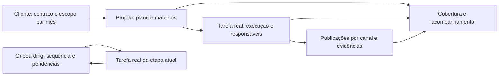

**28/10/2026, 08h11 — Atlas: envio e identidade PUBLICADOS PARA VALIDAÇÃO.** Enter/Shift+Enter, mensagem imediata e consulta indicada pelo dono com retorno à origem. Base atlas-send-owner-20261028-02/candidate herda Google07h33/perfil;1.754 fontes, main da5e64ea/0828c836. Só migração20261027193803 aplicada uma vez, team/events reiniciados; cinco serviços ativos.200 Python remotos,19 fixtures de publicação, oito HTTP/hashes e SQL/ACL/índice passaram. Sessão real confirmou campo/atalho/Shift+Enter sem envio; modelo/equipe real, mapa incorporado e aceite pendentes. [Publicação e limites](referencias/atlas-envio-identidade-producao-2026-10-28.md).

**28/10/2026 — Atlas: Enter, envio imediato e consulta indicada pelo dono, SOMENTE LOCAL.** Testes e revisão concluídos; reconhecimento usa identidade autenticada, retorno isolado preserva conta/tarefa e origem. 200 Python/244 SQL/28 grupos UI/check passaram. Não publicado; migração nova e autorização atual pendentes. [Estado canônico e limites](referencias/atlas-envio-identidade-local-2026-10-28.md).

**27/10/2026, 16h12 — Atlas: conversa/equipe PUBLICADOS PARA VALIDAÇÃO.** Fatos persistidos, avisos curtos/contexto recolhido, fila pessoal e supervisão, resposta posterior e retorno de aprovação do grupo. Base atlas-dialogue-20261027-02/candidate herda traffic-save02 e perfil produtivo;1.752 fontes, main9982524c/ee022d49. Só migração20261027170137 aplicada UMA VEZ; team/events reiniciados, cinco serviços ativos.188 Python remotos, build,13 fixtures de publicação, SQL/HTTP/hashes passaram. Fila/contexto/conversa autenticados abriram; mapa incorporado ficou vazio na inspeção, seus arquivos íntegros. Sem IA/mensagem de teste; ciclo humano, mapa no navegador de Josias e aceite pendentes. [Publicação e limites](referencias/atlas-conversa-equipe-producao-2026-10-27.md).

**18/10/2026, 14h37 — Atlas: conversa com robô e atividade no cenário PUBLICADAS PARA VALIDAÇÃO.** Josias autorizou “pode”. Painel claro/avatar, detalhes recolhidos, especialistas por consulta real e clique na origem exata; atualização continua durante envio e para ao concluir/falhar. 51 Node locais/remotos, check/builds, 32 verificações locais (dez repetidas), revisão e 12 fixtures locais/remotas passaram. Seis HTTP/hashes, 1.726 fontes e quatro serviços ativos; sessão real mostrou mapa e novo chat. Main dbe714f9/828bc4c4, mapa 1ed69416/59ec53c3; nova base/perfil atlas-office-live-chat-20261018-01/candidate herda Calendário 14h05. Sem SQL/Edge/restart/IA/mensagem/tarefa de teste; consulta humana real/aceite pendentes. [Publicação e evidência](referencias/atlas-conversa-atividade-escritorio-producao-2026-10-18.md)

**18/10/2026 — Atlas: conversa com avatar e consultas no cenário, VALIDADO LOCALMENTE; NÃO PUBLICADO.** Painel claro com controles recolhidos; personagens IA e robô pixelado refletem passos reais, espera, fim e falha. Clique abre a consulta exata; atualização continua durante outro envio. 51 Node, 32 verificações de navegador, check, builds e revisão sem achados abertos. Sem produção, IA ou mensagem real. Publicação/aceite pendentes; preservar a base concorrente do Calendário das 14h05 e o worker source-order. [Entrega local e limites](referencias/atlas-conversa-atividade-escritorio-local-2026-10-18.md)

**18/10/2026, 13h30 — Atlas: consulta interna corrigida em produção.** Mapa e cliente apareceram no teste humano; primeira tentativa de perguntar sem fonte terminava a missão. Agora deve consultar e continuar dentro dos mesmos controles. Publicação restrita ao worker principal, nova base source-order com 1.720 fontes; frontend/Edge/SQL preservados. 42 Node, oito fixtures, check e probe RLS sem IA/envio passaram. Retomar pedido → Enviar e primeiro retorno humano/aceite pendentes. [Correção e evidência](referencias/atlas-ordem-fontes-producao-2026-10-18.md).

**Atualização 18/10/2026, 12h49:** [conversa interativa no escritório publicada para validação](referencias/atlas-conversa-escritorio-producao-2026-10-18.md), base/guarda/perfil atlas-office-conversation-20261018-01/candidate. Não repetir migração/publicador; retorno humano e conferência visual do mapa na produção ainda pendentes.

# Planeje — contexto completo para continuidade

Atualização de 18/09/2026: rotina/tabela/histórico de tráfego publicados na produção, com autorização específica. Este arquivo reúne os documentos atuais 01–10. Evidências e referências históricas ficam na pasta de continuidade. Fases 1–5 promovidas em 16/09; fase 6 planejada; fase 7 parcial. Aceite geral de uso e publicação são estados distintos. Código e banco atuais devem ser conferidos antes de retomar. Credenciais e dados privados não são incluídos.

# Estado atual e ponto de retomada

**14/10/2026, 12h17 — Rastreamento: número do WhatsApp corrigido em produção.** O sufixo de dispositivo (`:15`, por exemplo) deixa de entrar no telefone do seletor. Três destinos já salvos foram corrigidos somente após comparação exata com o JID atual da instância; mesmos links, mensagens, UTMs e históricos preservados. Dois scripts Node, build, três redirecionamentos HTTP e Editar/Novo link no navegador passaram. `index.ab564283.js` / `index.cb906053.css`, recarregar `?v=ab564283#/rastreamento?aba=links`; assets anteriores conservados. Sem migração, restart de backend, envio WhatsApp/CAPI/e-mail ou tarefas alteradas; Atlas pausado. CS/Assessoria segue não publicado e precisa incorporar a correção no próximo candidato. Aceite de uso pendente. [Referência](referencias/rastreamento-telefone-2026-10-14.md) · [Release](evidencias/releases/rastreamento-telefone-2026-10-14.json).

**14/10/2026 — Assessoria em aba própria, revisão visual LOCAL; NÃO PUBLICADA.** Pedido de Josias para preservar o tradicional: abas Projetos tradicionais / Assessoria de tráfego, foco em tráfego ou 360, construtor em quatro passos e mapa clicável com retornos. Editor tradicional de Documentos preservado; Histórico do cliente separado. 37 testes Node, 72 verificações SQL isoladas, build e conferência de navegador notebook/celular passaram. O candidato anterior `e602149d`/`448e1a9f` foi substituído e não deve ser publicado. Esta revisão ainda precisa de novo candidato com validação no esquema completo/API, revisão visual e autorização de publicação. Produção sem alteração; Atlas pausado. [Referência](referencias/apice-cs-visual-2026-10-14.md) · [Release local](evidencias/releases/apice-cs-visual-2026-10-14.json).

**14/10/2026 — CS da Ápice: candidato validado na VPS; NÃO PUBLICADO.** Acesso à VPS 109 recuperado, fontes reconciliadas e versão pronta nas telas existentes: etiquetas por operação, plano de consultoria/funil, tarefas reais e Documentos com versões/anexos privados. 51 testes Node, 61 verificações SQL locais, 62 no esquema completo com permissões, 27 testes de API/Storage/Atlas e build do candidato passaram; navegador notebook/celular já conferido. Candidato `index.e602149d.js` / `index.448e1a9f.css`. Banco e contêineres temporários removidos. Produção permanece `9e0f843e`/`cb906053`; SQL `20261014043345` NÃO aplicado, Atlas continua pausado. Publicação e aceite de uso pendentes. [Referência](referencias/apice-cs-projetos-documentos-2026-10-14.md) · [Release candidata](evidencias/releases/apice-cs-candidato-2026-10-14.json).

**13/10/2026, 23:40 — Equipe somente por convites de Josias; segurança e compatibilidade concluídas.** Escopo confirmado: apenas funcionários da agência; provisionamento administrativo das lojas/clientes preservado. Cadastro público fechado, convite individual por e-mail com sete dias e uso único; contas pendentes/removidas, sessões revogadas e autoelevação recusadas. Atlas voltou às oito fontes por delegação assinada de até 240 s, limitada ao proprietário ativo; monitor continua pausado. MCP exige aprovação/conta atual e sessão vinculada à identidade; reiniciado, pode exigir reconectar o ChatGPT. Testes Node/SQL com rollback, notebook/celular, build, HTTP e leituras reais passaram. `index.9e0f843e.js` / `index.cb906053.css`, `?v=9e0f843e#/settings?tab=equipe`; conserva `44e11d16`/`66ba606f`. SQL `20261013140451`, `20261013150647`, `20261013152143` e `20261014023511` aplicados uma vez, não reaplicar. Sem envio WhatsApp/CAPI/e-mail, tarefa alterada ou conta real de teste persistida. Aceite de uso e auditoria histórica/globais pendentes. [Referência](referencias/convites-seguranca-2026-10-13.md) · [Release](evidencias/releases/convites-seguranca-2026-10-13.json).

**13/10/2026, 09:52 — Aviso de grupo sem resposta não interrompe a tarefa.** Publicado: o balão fica oculto durante a edição em drawer/formulário e volta ao fechar; o X adia somente o aviso. Intervalos e Minha caixa preservados. Regressão reproduzida e corrigida em notebook/celular, teste de espera e build passaram; assets/estilo servido conferidos. `index.44e11d16.js` / `index.cb906053.css`, recarregar `?v=44e11d16#/tasks`; conserva `66ba606f`/`e981fa67`. Sem SQL, restart de backend, escrita em tarefas, WhatsApp ou CAPI. Aceite pendente. [Referência](referencias/conversas-aviso-tarefa-2026-10-13.md) · [Release](evidencias/releases/conversas-aviso-tarefa-2026-10-13.json).

**09/10/2026, 20:38 — Atlas: acompanhamento e missões automáticas pausados.** Pedido explícito de Josias: “pausar por hora a missão do altas”. Produção com `monitor_enabled=false`, Atlas habilitado e zero missões em fila/execução. Não retomar automaticamente. [Registro](referencias/atlas-pausa-2026-10-09.md).

**09/10/2026, 08:23 — Atlas: voz, conversa e carteira corrigidas em produção.** Revisão das conversas reais; tom próximo; perguntas operacionais consultam as fontes. Carteira atual = `etapa=closed` em chat/voz/fontes/monitor; 23 clientes fechados, 16 grupos elegíveis; antigos e grupos sem vínculo fora da análise automática. Voz espera reprodução, tolera desconexão breve, trata corte por limite e não encerra ao trocar de aba. 57 testes/build passaram, missão real concluída e saudação de voz completa; conversa longa/aceite pendentes. `index.66ba606f.js` / `index.e981fa67.css`, `?v=66ba606f#/assistant/atlas`; conserva `399e022d`. Worker ativo em `atlas-human-20261009-01/candidate`. Sem SQL, WhatsApp/CAPI ou escrita operacional. [Referência](referencias/atlas-voz-carteira-2026-10-09.md) · [Release](evidencias/releases/atlas-voz-carteira-2026-10-09.json).

**09/10/2026, 08:09 — Rolagem e altura do Atlas corrigidas em produção.** A página preserva a altura natural dentro do contêiner rolável; mapa/chat se adaptam à altura, cartões ficam compactos em telas baixas e Memória tem rolagem própria no desktop. Notebook, celular e lista real de memórias conferidos; build passou. `index.399e022d.js` / `index.e981fa67.css`, recarregar `?v=399e022d#/assistant/atlas`; conserva `b84cf63f` e `0d4261e1`. Somente CSS e fixture; sem SQL, restart de backend, alteração de memória ou envio WhatsApp. Aceite pendente. [Diagnóstico e memória atual](referencias/atlas-rolagem-memoria-2026-10-09.md) · [Release](evidencias/releases/atlas-rolagem-2026-10-09.json).

**09/10/2026, 07:55 — Ondas fluidas e transcrição de grupos PUBLICADAS.** Pedido explícito de Josias; SSH recuperado. `index.b84cf63f.js` / `index.80dfcb02.css`, recarregar `?v=b84cf63f#/assistant/atlas`; assets anteriores preservados. SQL `20261009043258` aplicado uma vez. Worker ativo no candidato `atlas-fluid-audio-20261009-01`, transcrição ligada (janela inicial de 24 h); oito áudios reais concluídos e consultados com origem pelo Atlas, outro usuário sem acesso. 48 testes e build no candidato passaram. Sem WhatsApp/CAPI ou escrita operacional. Aceite visual e teste da nova animação em ligação real pendentes. Esta atualização substitui os avisos anteriores de publicação/SSH pendentes. [Referência](referencias/atlas-ondas-audios-producao-2026-10-09.md) · [Release](evidencias/releases/atlas-ondas-audios-producao-2026-10-09.json).

**09/10 — Nova tentativa visual local:** Josias considerou os anéis anteriores artificiais. A animação foi refeita com superfícies de luz sobrepostas, curvas suaves e resposta de áudio amortecida, atrás do globo. Prévia conferida, build e sete testes pertinentes passaram. Aceite visual pendente; publicação continua pendente de SSH. [Detalhes](referencias/atlas-ondas-audios-2026-10-09.md).

**09/10/2026 — Pedido de ondas e áudios de grupos implementado LOCALMENTE.** Quatro ondas orgânicas reagem ao áudio real por canal; animações indicam agentes realmente acionados, inclusive missões simultâneas, e param ao concluir/cancelar. Novo worker de transcrição privada e leitura pelo especialista Clientes; transcrição expansível na mensagem recebida, só para o proprietário do Atlas. Sem publicação, sem áudio real transcrito nesta entrega e sem aceite inferido. Produção permanece `index.ccb5ae8e.js` / `index.208b174a.css`. [Referência](referencias/atlas-ondas-audios-2026-10-09.md) · [Release local](evidencias/releases/atlas-ondas-audios-local-2026-10-09.json).

**09/10/2026 — Atlas evoluído para gerente pessoal.** Pedido explícito de colocar em uso real com aprendizado e agentes em segundo plano. Publicação seletiva da fonte produtiva, seis especialistas, memória automática, inbox privada, monitor/revisão diária e proposta mensal a partir do dia 20. Missão real delegou a Clientes e Operação (8 chamadas, 10 ferramentas) e concluiu; diálogo paralelo recuperou horários/operações. Memória mostra 11 registros, um aprendido na conversa. Bundle `index.ccb5ae8e.js` / `index.208b174a.css`; anteriores preservados. SQL `20261009030813` e `20261009032640` uma vez. Serviço ativo; primeira execução comercial programada ainda não observada, pois publicação ocorreu de madrugada. Aceite do usuário desta versão pendente. [Referência](referencias/atlas-gerente-2026-10-09.md) · [Release](evidencias/releases/atlas-gerente-producao-2026-10-09.json).

**08/10/2026 — Atlas publicado em produção para a conta de Josias.** Pedido explícito de funcionamento real para testar; fonte atual reconciliada, backup privado e promoção seletiva. Rota `#/assistant/atlas`; migração `20261009004301` aplicada uma vez; owner exato conferido e habilitado. `index.a946ca4c.js` / `index.3fd6e9d2.css`; anterior preservado `index.6a03e9e6.js` / `index.bc0451e4.css`. Consulta real delegou para Operação, leu tarefas e concluiu; fala real entrou no histórico, retornou áudio e moveu a esfera. Josias confirmou **“Ouvi e ele respondeu”**. Isso confirma o teste de voz, não aceite integral do visual ou de todas as habilidades. [Detalhes](referencias/atlas-2026-10-08.md).

**Atualização de 08/10/2026: Atualizar ficou na linha da busca.** Em Rastreamento → Leads o botão fica depois de Desqualificado, na mesma linha de Pesquisar, origem e análise. `index.6a03e9e6.js` / `index.bc0451e4.css`, recarregar `?v=6a03e9e6`. Conserva `index.1daea5e7.js`. Sem SQL, sem CAPI, nenhuma mensagem WhatsApp enviada.

**Atualização de 08/10/2026: a barra de Leads usa o vão da direita.** Período, Avançado e Ações ficam na faixa do WhatsApp. A linha de baixo fica com a busca, a origem e a análise. Exportar, importar e recalcular datas entram em Ações. `index.1daea5e7.js` / `index.24a4b031.css`, recarregar `?v=1daea5e7`. Conserva `index.a72afcd0.js`. Sem SQL, sem CAPI, nenhuma mensagem WhatsApp enviada.

**Atualização de 08/10/2026: o resumo de Leads ocupa uma faixa.** Em Rastreamento → Leads, Contatos, Meta Ads, Outras / Google e Não rastreada ficam numa linha, com o número ao lado do nome. A lista de leads sobe. Recolher continua e deixa só a linha de totais. `index.a72afcd0.js` / `index.b0db6ea9.css`, recarregar `?v=a72afcd0`. Conserva `index.12c95261.js`. Sem SQL, sem CAPI, nenhuma mensagem WhatsApp enviada.

**Atualização de 08/10/2026: primeira versão do Cérebro IA no ar, piloto desligado.** Em `#/assistant/cerebro` o coordenador consulta com os agentes Clientes e Operação: combinado sem tarefa, bloqueio, entrega prevista e decisão. A resposta traz fonte, horário da consulta e próximo passo. Memória confirmada fica por cliente, com versão. SQL `20261008220000` aplicado uma vez em `supabase-db`; `brain_settings.ativo` falso e lista de piloto vazia. A consulta lê `tarefas.created_at`. O bundle vigente é `index.a72afcd0.js` / `index.b0db6ea9.css`, recarregar `?v=a72afcd0`. Conserva `index.12c95261.js`. Sem função nova, sem cron, sem CAPI, nenhuma mensagem WhatsApp enviada. Aceite pendente.

**Atualização de 08/10/2026: a resposta da equipe entra no atendimento do lead.** A fala enviada pelo Chatvolt (agente, pessoa e follow-up) aparece no fio, no canal em que foi mandada. O lead continua do lado dele. `index.ea7e00bc.js` / `index.e03d1171.css`, recarregar `?v=ea7e00bc`. Conserva `index.d79297d1.js`. Sem SQL, sem CAPI, nenhuma mensagem WhatsApp enviada.

**Atualização de 08/10/2026: a foto da conversa abre na ficha.** O Chatvolt manda o arquivo no payload. Na conversa do lead a foto aparece e o clique abre o arquivo. O PDF abre do mesmo jeito. A foto de perfil do lead continua ausente. `index.d79297d1.js` / `index.e03d1171.css`, recarregar `?v=d79297d1`. Conserva `index.775760b9.js`. Sem SQL, sem CAPI, nenhuma mensagem WhatsApp enviada.

**Atualização de 08/10/2026: a conversa do lead separa os dois canais.** Quando a mesma pessoa falou no WhatsApp oficial e no Zapper, a ficha mostra um botão para cada canal. O fio troca ao clicar. Os eventos do Chatvolt continuam chegando. `index.775760b9.js` / `index.d5ebc1cd.css`, recarregar `?v=775760b9`. Conserva `index.458accdb.js`. Sem SQL, sem CAPI, nenhuma mensagem WhatsApp enviada.

**Atualização de 08/10/2026: a lista do Chatvolt ficou curta.** Os payloads recebidos cabem numa faixa com rolagem. Cada linha mostra o canal (WhatsApp oficial ou Zapper), se é fala ou agente, e o número do lead. O JSON não traz a foto do lead nem o telefone da linha. Na ficha, a foto só aparece se o canal mandar; estes leads ficam com o ícone. O canal aparece ao lado do telefone. `index.458accdb.js` / `index.a88d137e.css`, recarregar `?v=458accdb`. Conserva `index.6a453c4c.js`. Sem SQL, sem CAPI, nenhuma mensagem WhatsApp enviada.

**Atualização de 08/10/2026: eventos do Chatvolt no mesmo caminho da Uazapi.** A fala do cliente (`USER_MESSAGE_RECEIVED` e `AGENT_USER_MESSAGE`) entra em Leads. A resposta do agente e o follow-up não abrem lead novo. A conversa iniciada na Meta só dispara se o payload trouxer `ctwaClid`, como na Uazapi; os payloads já recebidos vieram com `ctwaAttributions` vazio, então o lead fica Não identificado e nada foi enviado à Meta. `index.6a453c4c.js` / `index.3ea67fe7.css`, recarregar `?v=6a453c4c`. Conserva `index.1c5ce837.js`. Função `crm-ingress-webhook` republicada. Sem SQL. Nenhuma mensagem WhatsApp enviada.

**Atualização de 08/10/2026: webhook do Chatvolt no Rastreamento.** Em Integrações, no cliente aberto, abaixo das instâncias, a URL para o Chatvolt e a lista dos payloads. A fala do lead entra em Leads. O teste da URL responde na hora. Sem SQL, sem CAPI, nenhuma mensagem WhatsApp enviada. `index.1c5ce837.js` / `index.a0ead83f.css`, recarregar `?v=1c5ce837`. Conserva `index.991ce0fb.js`. Função `crm-ingress-webhook` republicada.

**Atualização de 08/10/2026: reação no WhatsApp não é mensagem e não conta o Aguardando.** O 🙏 do Heriton no jaralcon MKT era reação na fala do Rai (`ReactionMessage`), gravada como texto. Agora a reação fica no balão original, não liga o relógio e não reabre a fila. O jaralcon já aberto saiu do Aguardando. `index.991ce0fb.js` / `index.992098f3.css`, recarregar `?v=991ce0fb`. Conserva `index.51fe723a.js`. Funções republicadas. Sem SQL novo, sem CAPI, nenhuma mensagem WhatsApp enviada.

**Atualização de 08/10/2026: curtida ou ok do cliente não liga o Aguardando.** No grupo, 👍, reação e “ok”/“valeu”/“obrigado” do contato (mesmo o Pede resposta) não pedem resposta da equipe e não reabrem Resolvidos. Neste já aberto, Encerrar. Sem SQL, sem CAPI, nenhuma mensagem WhatsApp enviada. Funções `atendimento-group-analyze` e `uazapi-inbox-webhook` republicadas. Bundle intocado `index.51fe723a.js`.

**Atualização de 08/10/2026: quem o cliente publica conclui sem link.** No cadastro, **O cliente publica** vale para todas as tarefas de conteúdo daquela loja. Na tarefa, o canal ganha **Cliente publica** (sem URL, sem Meta). Arrastar para Concluído vai para Redes Sociais → Concluídos. SQL `20261008180000` uma vez. `index.51fe723a.js` / `index.992098f3.css`, recarregar `?v=51fe723a`. Conserva `index.66b697ef.js`. Sem CAPI, nenhuma mensagem WhatsApp enviada.

**Atualização de 08/10/2026: o número do menu Conversas conta só a fila aberta.** Aguardando entra, e Em atendimento entra quando há mensagem nova. Resolvida com contador antigo fica de fora. `index.66b697ef.js` / `index.589bd5a1.css`, recarregar `?v=66b697ef`. Conserva `index.426ccc22.js`. Sem SQL, sem CAPI, nenhuma mensagem WhatsApp enviada.

**Atualização de 08/10/2026: Conversas bloqueia grupo ou contato.** Bloquear apaga as mensagens já salvas daquela conversa e o recebimento deixa de gravar o que chegar. Não envia WhatsApp. A ficha do Mini CRM continua. Desbloquear fica em Bloqueados. SQL `20261008160000` uma vez. `index.426ccc22.js` / `index.589bd5a1.css`, recarregar `?v=426ccc22`. Conserva `index.d55328c1.js`. Sem CAPI.

**Atualização de 08/10/2026: o menu aberto encosta na página.** A faixa cinza entre o menu e o conteúdo saiu. Fechado, o menu continua na faixa estreita. `index.d55328c1.js` / `index.589bd5a1.css`, recarregar `?v=d55328c1`. Conserva `index.900fe3b1.js`. Sem SQL, sem CAPI, nenhuma mensagem WhatsApp enviada.

**Atualização de 08/10/2026: o aviso do grupo também entra na Minha caixa.** Na Operação, a fila Cliente sem resposta mostra o nome do grupo. O popup continua. `index.900fe3b1.js` / `index.93a8ddee.css`, recarregar `?v=900fe3b1`. Conserva `index.8e752f12.js`. Sem SQL, sem CAPI, nenhuma mensagem WhatsApp enviada.

**Atualização de 08/10/2026: o aviso de espera lista só grupos.** O popup mostra o nome do grupo e quem assumiu. Conversas individuais ficam de fora. `index.8e752f12.js` / `index.93a8ddee.css`, recarregar `?v=8e752f12`. Conserva `index.326cb627.js`. Sem SQL novo, sem CAPI, nenhuma mensagem WhatsApp enviada.

**Atualização de 08/10/2026: o aviso de espera se configura.** Em Conversas → configuração, na aba Filas e números, dá para ligar o aviso, escolher o primeiro minuto e de quanto em quanto ele volta. O popup fica na tela da equipe, cita quem assumiu (ou Sem responsável) e some quando alguém responde. Fechar só adia até a próxima cobrança. Não envia WhatsApp. SQL `20261008140000` uma vez. `index.326cb627.js` / `index.93a8ddee.css`, recarregar `?v=326cb627`. Conserva `index.7a2a26e8.js`. Sem CAPI.

**Atualização de 08/10/2026: a conversa abre na última mensagem.** O fio pede as 40 falas mais novas e encosta nelas. Se havia não lidas, para na primeira delas, com a faixa Não lidas. Rolar para cima busca o histórico anterior. Não puxa o histórico inteiro de uma vez. `index.8061f37f.js` / `index.747292f1.css`, recarregar `?v=8061f37f`. Conserva `index.ed64d15c.js`. Sem SQL, sem CAPI, nenhuma mensagem WhatsApp enviada.

**Atualização de 07/10/2026: a lista destaca no mouse e o fundo da conversa ficou só bege.** O passe do mouse pinta a linha de azul, diferente da zebra. Os ícones saíram do fundo. `index.ed64d15c.js` / `index.1cd447ee.css`, recarregar `?v=ed64d15c`. Conserva `index.817d2dc3.js`. Sem SQL, sem CAPI, nenhuma mensagem WhatsApp enviada.

**Atualização de 07/10/2026: a conversa do atendimento ganhou fundo.** O miolo da conversa, em Conversas e no Atendimento da loja, usa a foto de rabiscos enviada. Cabeçalho e compositor ficam por cima. `index.fbfb32af.js` / `index.39aa3491.css`, recarregar `?v=fbfb32af`. Conserva `index.c4c3f1c6.js`. O fundo é um desenho próprio, no jeito da foto, e repete sem ampliar. Sem SQL, sem CAPI, nenhuma mensagem WhatsApp enviada.

**Atualização de 07/10/2026: a página de conectar números ficou visual.** Três cartões de passo com ícone, faixa de cor no número e bloco do QR. `index.78f0827c.js` / `index.183b6fbf.css`, recarregar `?v=78f0827c`. Conserva `index.d7b9aa9b.js`. Sem SQL, sem CAPI, nenhuma mensagem WhatsApp enviada.

**Atualização de 07/10/2026: Reconfigurar recebimento liga a chave.** O botão grava o endereço e deixa Habilitado ligado na uazapi. O canal Raphael já está com a chave ligada. `index.949989bf.js`, recarregar `?v=949989bf`. Conserva `index.e6570aff.js`. Sem SQL, sem CAPI, nenhuma mensagem WhatsApp enviada.

**Atualização de 07/10/2026: aviso de canal desconectado.** A equipe vê uma faixa âmbar enquanto um número do WhatsApp da operação está desligado. Se cair com a tela aberta, também aparece o aviso e a notificação do navegador. A consulta é a cada 2 minutos e ao voltar para a aba. `index.e6570aff.js`, recarregar `?v=e6570aff`. Conserva `index.24a28dda.js`. Função `uazapi-instance-status`. Sem SQL, sem CAPI, nenhuma mensagem WhatsApp enviada.

**Atualização de 07/10/2026: o cartão reconhece Jheimison.** O cadastro antigo do WhatsApp está como Jheimison e o usuário é Jheimisson; o campo já vem preenchido. Rafael e Raphael continuam separados. `index.24a28dda.js`, recarregar `?v=24a28dda`. Conserva `index.51a32721.js`. Sem SQL, sem CAPI, nenhuma mensagem WhatsApp enviada.

**Atualização de 07/10/2026: número do usuário e contato do grupo.** Em Conversas → configuração, aba Equipe, cada usuário ganha o WhatsApp dele. Se essa pessoa responder pelo celular, o grupo mostra o nome dela e o Aguardando há para. No grupo, em Participantes, **Pede resposta** marca o contato: a mensagem desse número liga o Aguardando há. Número sem a marca não liga, quando o grupo já tem alguém marcado. Grupo sem marca continua na análise de antes. `index.51a32721.js` / `index.0a864e15.css`, recarregar `?v=51a32721`. Conserva `index.aecb799a.js`. SQL `20261007100000` uma vez. Função `atendimento-group-analyze`. Sem CAPI, nenhuma mensagem WhatsApp enviada.

**Atualização de 07/10/2026: o grupo mostra quem é o responsável.** No card e no cabeçalho de Conversas, o grupo aberto traz o nome de quem clicou em Assumir. Sem ninguém, fica **Sem responsável**. O atraso do grupo continua o **Aguardando há**. O selo vermelho SLA deixa de aparecer no grupo. Lead avulso segue com o SLA. `index.aecb799a.js` / `index.1ebf5b19.css`, recarregar `?v=aecb799a`. Conserva `index.d2d89a4c.js`. Sem SQL, sem CAPI, nenhuma mensagem WhatsApp enviada.

**Atualização de 06/10/2026: o carregamento do arquivo grande para ao sair.** Atualizar a página, abrir outra conversa ou ir para outra tela do Planeje interrompe o envio. Ele não continua em segundo plano. No balão, só quem anexou vê a porcentagem, o tempo que falta e “Só você vê este carregamento”. Quando termina, essa pessoa vê “Arquivo enviado”. `index.d2d89a4c.js` / `index.5c610f81.css`, recarregar `?v=d2d89a4c`. Conserva `index.00c09e73.js`. Sem SQL, sem CAPI, nenhuma mensagem WhatsApp enviada.

**Atualização de 06/10/2026: fotos de Conversas e envio mais largo.** A lista, o cabeçalho e quem fala no grupo pedem a foto de novo e guardam uma cópia no bucket `atendimento-fotos`, porque o link do WhatsApp expira e o navegador mostrava as iniciais. Grupo sem foto no WhatsApp continua com o ícone. Arquivo grande sobe em partes de 32 MB. `index.00c09e73.js` / `index.64ef2671.css`, recarregar `?v=00c09e73`. Conserva `index.d0b5f730.js`. SQL `20261006235000` uma vez. Função `uazapi-chat-photo`. Sem CAPI, nenhuma mensagem WhatsApp enviada.

**Atualização de 06/10/2026: arquivo grande entra na conversa.** Ao enviar, o documento sai do compositor e o carregamento fica no balão, com a porcentagem. O X no ícone interrompe e não manda no WhatsApp. Dá para continuar escrevendo enquanto sobe. `index.77d852a6.js` / `index.64ef2671.css`, recarregar `?v=77d852a6`. Conserva `index.9d91eba9.js`. Sem SQL novo, sem CAPI, nenhuma mensagem WhatsApp enviada.

**Atualização de 06/10/2026: o Assistente mostra o que está fazendo, uma vez.** Depois do envio, uma faixa só no fio diz Lendo as conversas do período, depois Pensando na resposta e, quando o texto começa, Escrevendo a resposta. A cópia acima do campo saiu. `index.9d91eba9.js` / `index.44d4dade.css`, recarregar `?v=9d91eba9`. Conserva `index.2ece3494.js`. Sem SQL, sem CAPI, nenhuma mensagem WhatsApp enviada.

**Atualização de 06/10/2026: Conversas da agência aceita arquivo até 1 GB.** O clipe deixava de anexar acima de 4 MB porque o arquivo inteiro ia em base64. Arquivo maior sobe em partes de 6 MB para o bucket `atendimento-envios` e o WhatsApp recebe o link, como documento. Foto, áudio e voz até 4 MB seguem no envio direto. A loja continua em 4 MB. `index.c21ecaeb.js` / `index.d74cb8cf.css`, recarregar `?v=c21ecaeb`. Conserva `index.1430f898.js`. SQL `20261006233000` uma vez. Storage `FILE_SIZE_LIMIT` 1 GB. Sem CAPI, nenhuma mensagem WhatsApp enviada.

**Atualização de 06/10/2026: sugestões do Assistente enviam e ele lê as falas.** Os três botões do estado vazio ficam na cor do painel e, ao clicar, a pergunta já sai. A resposta começa com a leitura das falas (visita, casamento, dúvida ou recusa), sem repetir a lista de nomes, e os cartões continuam embaixo, com o botão de preencher. `index.1430f898.js` / `index.b22a5b00.css`, recarregar `?v=1430f898`. Conserva `index.46addf08.js`. Sem SQL, sem CAPI, nenhuma mensagem WhatsApp enviada.

**Atualização de 06/10/2026: Conversas sem barra para o lado.** A faixa cinza em cima do compositor era a rolagem horizontal dos botões da mensagem, que ficavam para fora do fio. Agora a conversa só rola para baixo. `index.bf1b97cb.js` / `index.c5d0e4fc.css`, recarregar `?v=bf1b97cb`. Conserva `index.f2026d09.js`. Sem SQL, sem CAPI, nenhuma mensagem WhatsApp enviada.

**Atualização de 06/10/2026: Assistente da Rotina com o desenho do painel.** O período fica num cartão, as datas em dia/mês/ano e a escolha Só o que está na tela / Pesquisar tudo numa faixa. Saíram da Rotina o selo da Meta, a fila do Hoje e o Deep Research. A lista de agendamentos usa cartão, trecho e o botão de preencher em destaque. `index.bf1b97cb.js` / `index.c5d0e4fc.css`, recarregar `?v=bf1b97cb`. Conserva `index.f2026d09.js`. Sem SQL, sem CAPI, nenhuma mensagem WhatsApp enviada.

**Atualização de 06/10/2026: período do Assistente em dia/mês/ano.** De e Até mostram 28/09/2026. Digitar e o calendário em português continuam valendo. `index.b26a71ca.js` / `index.1f42b946.css`, recarregar `?v=b26a71ca`. Conserva `index.baf19706.js`. Sem SQL, sem CAPI, nenhuma mensagem WhatsApp enviada.

**Atualização de 06/10/2026: áudio de Conversas espera confirmação.** Parar a gravação não envia. O áudio fica na prévia para ouvir; o botão de enviar é que manda. O X descarta. Vai no mesmo bundle do período do Assistente: `index.b26a71ca.js` / `index.1f42b946.css`, recarregar `?v=b26a71ca`. Conserva `index.015e5c0b.js`. Sem SQL, sem CAPI, nenhuma mensagem WhatsApp enviada nesta publicação.

**Atualização de 06/10/2026: Conversas grava áudio.** No compositor, o microfone fica ao lado de enviar. Gravar mostra o tempo, Cancelar descarta e Parar e enviar manda o áudio no WhatsApp pelo envio que já existia. Em Notas o microfone não aparece. `index.3c0e4355.js` / `index.cfdb7977.css`, recarregar `?v=3c0e4355`. Conserva `index.d2d51958.js`. Backup `/var/www/planeje/index.html.bak-d2d51958`. Sem SQL, sem CAPI, nenhuma mensagem WhatsApp enviada nesta publicação.

**Atualização de 06/10/2026: Conversas — estado vazio e notas internas.** Sem conversa aberta, o miolo mostra os cartões sobrepostos e o texto «Selecione uma conversa», no lugar de «Suas conversas» e do botão roxo Nova conversa. No compositor, as pílulas **Mensagem** e **Notas**: Mensagem segue para o WhatsApp; Notas grava em `atendimento_conversa_notas` e aparece no fio em cartão amarelo, sem enviar. SQL `20261006223000_atendimento_conversa_notas.sql` uma vez. `index.d2d51958.js` / `index.73aa7fa3.css`, recarregar `?v=d2d51958`. Conserva `index.9199de90.js`. Backup `/var/www/planeje/index.html.bak-9199de90`. Sem CAPI, nenhuma mensagem WhatsApp enviada.

**Atualização de 06/10/2026: Assistente escolhe o período da pesquisa.** No chat da Rotina, De e Até vêm preenchidos com a semana da tela. Dá para trocar as datas. **Só o que está na tela** limita às campanhas da ficha e, se o período for o da semana, o botão Colocar N em Agendamentos continua. **Pesquisar tudo** lê o Rastreamento inteiro do período, inclusive quem não está na ficha, e não preenche a Rotina. `index.9199de90.js` / `index.81af37c3.css`, recarregar `?v=9199de90`. Conserva `index.4f662f0b.js`. Sem SQL, sem CAPI, nenhuma mensagem WhatsApp enviada.

**Atualização de 06/10/2026: Assistente da Rotina mostra a lista uma vez.** O texto do modelo repetia os mesmos nomes que os cartões. Agora a resposta é só a lista, com **Colocar N em Agendamentos** no topo. `index.4f662f0b.js` / `index.caabc5d2.css`, recarregar `?v=4f662f0b`. Conserva `index.3fb42446.js`. Sem SQL, sem CAPI, nenhuma mensagem WhatsApp enviada.

**Atualização de 06/10/2026: Conversas no layout do Atendimento da loja.** A inbox da agência (`#/conversas`) fica de ponta a ponta, no mesmo desenho da área do cliente: lista branca com busca e caixas em pílula azul, conversa no fundo cinza, balão verde na saída, compositor em caixa branca e ações do cabeçalho em ícone. A lateral recolhe em ícones nessa rota. Canais, lembretes, envios e nova conversa continuam. Sem SQL, sem CAPI, nenhuma mensagem WhatsApp enviada. `index.3fb42446.js` / `index.a7156c39.css`, recarregar `?v=3fb42446`. Conserva `index.c4f3f97a.js`. Backup `/var/www/planeje/index.html.bak-c4f3f97a`. Release `evidencias/releases/conversas-layout-atendimento-2026-10-06.json`.

**Atualização de 06/10/2026: Atendimento nas Páginas Permitidas do login.** Super Admin → Equipe e acesso → Usuários de cliente → Gerenciar Login → Permissões. Checkbox Atendimento (ícone + rótulo) junto de Dashboard, Status das Campanhas, ApexIA, Painel PGM e CRM. `allowed_pages` nulo = páginas clássicas; Atendimento só com a chave, salvo a Ápice (quem já via). Outra loja fica off até o Super Admin marcar nesse login. O cartão Atendimento da loja saiu de Gerenciar módulos. Envio: página permitida + contato do mesmo `cliente_id` do perfil no servidor; equipe interna intacta. IA automática, Responder sozinho e follow-up da Ápice intocados. SQL `20261006210000_atendimento_pagina_permitida.sql` uma vez (UPDATE de arrays da Ápice: 0 linhas). `index.5fe0b226.js` / `index.6aa9877b.css`, recarregar `?v=5fe0b226`. Conserva `index.c1b52e96.js`. Backup `/var/www/planeje/index.html.bak-c1b52e96`. Funções `_shared/atendimentoLojaAcesso.ts` e `uazapi-send-message` republicadas. Sem CAPI, nenhuma mensagem WhatsApp enviada. Release `evidencias/releases/atendimento-pagina-permitida-2026-10-06.json`.

**Atualização de 06/10/2026: Abrir conversa no Assistente abre a ficha.** O botão abre o mesmo popup do Rastreamento, com a conversa, sem sair da Rotina. Quem está fora da ficha não aparece como agendamento. `index.4501e653.js` / `index.c898b24d.css`, recarregar `?v=4501e653`. Conserva `index.c4f3f97a.js`. Sem SQL, sem CAPI, nenhuma mensagem WhatsApp enviada.

**Atualização de 06/10/2026: agendamento da Rotina só com horário marcado.** “Pode ser”, “quero agendar” e a data do casamento deixam de contar. O botão soma só os conjuntos da ficha. Quem não marcou vira uma linha de contagem. Fora da ficha não entra no número. `index.7e81a6ca.js` / `index.51ac5f5f.css`, recarregar `?v=7e81a6ca`. Conserva `index.babc78cc.js`. Sem SQL, sem CAPI, nenhuma mensagem WhatsApp enviada.

**Atualização de 06/10/2026: Assistente preenche no jeito da Rotina.** Lê a semana e as linhas de campanha e conjunto que estão na ficha. Para cada conjunto, conta as mensagens reconhecidas no Rastreamento e lista nome, telefone, se agendou, o trecho e o botão Abrir conversa. Conjunto sem agendamento diz "Não teve agendamento". `index.babc78cc.js` / `index.51ac5f5f.css`, recarregar `?v=babc78cc`. Conserva `index.c055f214.js`. Sem SQL, sem CAPI, nenhuma mensagem WhatsApp enviada.

**Atualização de 06/10/2026: Assistente lê as falas do Rastreamento.** O modelo não abre o WhatsApp. Antes ia só um trecho de 140 caracteres e a instrução dizia que a leitura tinha estourado. Agora cada lead da lista leva as últimas falas do lead e da loja. `index.c055f214.js` / `index.d2c5eb5d.css`, recarregar `?v=c055f214`. Conserva `index.9fe35b78.js`. Sem SQL, sem CAPI, nenhuma mensagem WhatsApp enviada.

**Atualização de 06/10/2026: lista do Assistente segue Integrações.** Ao abrir, lê de novo os modelos salvos (o Gemini que estava só na configuração entra). O menu mostra o nome, sem o texto longo nem o cifrão errado. `index.9fe35b78.js` / `index.d2c5eb5d.css`, recarregar `?v=9fe35b78`. Conserva `index.9f3a77b6.js`. Sem SQL, sem CAPI, nenhuma mensagem WhatsApp enviada.

**Atualização de 06/10/2026: Assistente puxa os modelos do OpenRouter.** Com a chave `sk-or-` salva, o seletor deixa o GPT-4o mini e usa a lista de Configurações (padrão Claude Haiku 4.5). `index.9f3a77b6.js` / `index.d2c5eb5d.css`, recarregar `?v=9f3a77b6`. Conserva `index.485cfb08.js`. Sem SQL, sem CAPI, nenhuma mensagem WhatsApp enviada.

**Atualização de 06/10/2026: chave do OpenRouter em Configurações.** Super Admin → Configurações → Integrações → cartão Chave do OpenRouter. Texto que não começa com `sk-` (ambiente ou tabela) é ignorado; a chave colada na tela passa a valer sem republicar função. Chave recusada cai na OpenAI. `index.485cfb08.js` / `index.d2c5eb5d.css`, recarregar `?v=485cfb08`. Conserva `index.f5ad2cca.js`. Sem SQL, sem CAPI, nenhuma mensagem WhatsApp enviada.

**Atualização de 06/10/2026: Assistente da Rotina mostra o modelo que responde e separa agendamento.** A chave do OpenRouter neste servidor não é `sk-`, então o painel fica em GPT-4o mini (o seletor não anuncia Claude) e a resposta não abre com aviso de chave. Agendado conta só o status do Mini CRM; conversa que fala de dia ou horário entra em outro número e não soma no campo da Rotina. Campanha sem nome no rastreamento vai para o fim. `index.f5ad2cca.js` / `index.d2c5eb5d.css`, recarregar `?v=f5ad2cca`. Conserva `index.f8d454c0.js`. Função `openrouter-chat` republicada. Sem SQL, sem CAPI, nenhuma mensagem WhatsApp enviada.

**Atualização de 06/10/2026: Assistente da Rotina lê o Rastreamento.** Com o cliente aberto na Rotina, o chat consulta os contatos da semana (entrada ou última mensagem), campanha, conjunto, se agendou e a data, se houve venda, e quantas mensagens. Cada lead tem **Abrir mensagens** (`/rastreamento?cliente_id&from&to&fone=`). **Colocar N em Agendamentos** preenche o resultado e os contatos da ficha. `index.3604929d.js` / `index.2df21c84.css`, recarregar `?v=3604929d`. Conserva `index.5fe0b226.js`. Sem SQL, sem CAPI, nenhuma mensagem WhatsApp enviada.

**Atualização de 06/10/2026: Assistente de Tráfego em terceiro quadro.** O ícone da IA em `#/paid-traffic` abre o Assistente **só na lateral** (nunca tela inteira). Com o painel aberto a página trava na altura da tela: Rotina rola no miolo, o agente cabe inteiro. Clique usa estado local; a Rotina preserva `?assistant=`. Celular: painel fixo à direita, sem cobrir tudo. O Chat da lateral/menu (`/assistant`) não muda. `index.5fe0b226.js` / `index.6aa9877b.css`, recarregar `?v=5fe0b226`. Conserva `index.c1b52e96.js`. Sem SQL, sem CAPI, nenhuma mensagem WhatsApp enviada. Release `evidencias/releases/assistente-trafego-dock-2026-10-06.json`.

**Atualização de 06/10/2026: Rotina — puxar gasto dos conjuntos.** Botão **Puxar gasto dos conjuntos**: campanha + conjunto preenche o gasto daquele conjunto na semana; só campanha lista os conjuntos com gasto (uma linha cada). Não usa total da campanha. `index.4228a91d.js` / `index.377e5c85.css`, recarregar `?v=4228a91d`. Conserva `index.46dc36fc.js`. Sem SQL, sem CAPI, nenhuma mensagem WhatsApp enviada. Release `evidencias/releases/rotina-puxar-gasto-meta-2026-10-06.json`.

**Atualização de 06/10/2026: Rotina — puxar gasto da Meta por conjunto (1ª versão).** `index.b4eb0dc7.js` — substituída pela correção acima.

**Atualização de 06/10/2026: Rotina semanal — rota, edição e autosave.** Abrir um cliente grava a rota `#/paid-traffic/rotina?cliente=&semana=&tipo=` (e `review=` quando há id). Quem pode editar altera mesmo depois de Concluir; o rascunho grava e reabre até concluir de novo. Autosave não fica preso em “Salvando…” por linha de campanha incompleta (só bloqueia no Concluir); conflito de revisão tenta de novo; watchdog de 20 s. SQL `20261006190000_traffic_weekly_edit_after_finalize.sql` uma vez. `index.bd52907d.js` / `index.377e5c85.css`, recarregar `?v=bd52907d`. Conserva `index.8d92335a.js`. Backup `/var/www/planeje/index.html.bak-8d92335a.js`. Sem CAPI, nenhuma mensagem WhatsApp enviada. Release `evidencias/releases/rotina-semanal-rota-autosave-2026-10-06.json`.

**Atualização de 06/10/2026: Atendimento da loja vira módulo por cliente.** Super Admin liga e desliga em Gerenciar módulos (cartão Atendimento da loja). Chave `atendimento_loja` em `client_module_permissions`. Sem linha: Ápice Noivas ligada, as outras desligadas. O login da loja vê o menu se o módulo estiver ligado para aquele `cliente_id` (papel cliente); `cliente_atend_membros` continua para atendentes; loja sem membros usa admin implícito. Conversas da agência permanece no módulo `atendimento`. Envio `uazapi-send-message` segue o mesmo gate (`cliente_id` do perfil no servidor, destino contato da loja). Ligar não ativa IA, Responder sozinho nem follow-up. SQL `20261006140000_atendimento_loja_modulo.sql` uma vez. `index.8d92335a.js` / `index.377e5c85.css`, recarregar `?v=8d92335a`. Conserva `index.6af8bb7e.js`. Backup `/var/www/planeje/index.html.bak-6af8bb7e.js`. Funções republicadas + restart `supabase-edge-functions`. Sem CAPI, nenhuma mensagem WhatsApp enviada. Release `evidencias/releases/atendimento-loja-modulo-2026-10-06.json`.

**Atualização de 06/10/2026: ChatGPT OAuth vê tools da Caixa Dot.** O manifesto MCP listava ~86 nomes, mas o ChatGPT só habilita ~55; `criar_demanda_caixa` / `listar_demandas_caixa` sumiam do conjunto executável. Em sessão OAuth o `planeje-mcp` aplica orçamento (`chatgptToolBudget.ts`: 53 tools, Caixa no núcleo) e registra as tools da Caixa cedo. PM2 `planeje-mcp` reiniciado — reconectar o ChatGPT e abrir chat novo. Quem responde em `#/caixa` → Dot continua sendo a edge `caixa-dot-ia` (OpenAI), não o ChatGPT. Sem SQL, sem CAPI, nenhuma mensagem WhatsApp enviada. Release `evidencias/releases/mcp-chatgpt-oauth-caixa-tools-2026-10-06.json`.

**Atualização de 05/10/2026: correção crash Minha caixa.** `Cannot access before initialization` em useCaixaDot (askDot usava reload antes de declarar). `index.6af8bb7e.js` / `index.3a81002a.css`, recarregar `?v=6af8bb7e`. Conserva `index.b487b304.js`. Backup `/var/www/planeje/index.html.bak-b487b304.js`. Sem SQL. Sem CAPI. MCP instruções Caixa reforçadas (2.7.0).

**Atualização de 05/10/2026: Caixa Dot Entrega B.** Ao enviar mensagem no Dot, a edge `caixa-dot-ia` responde no app (tools só leitura: cliente e tarefas). Estados `aguardando_dot` / `respondido` / `erro` com Tentar de novo. Sem WhatsApp. `index.b487b304.js` / `index.3a81002a.css`, recarregar `?v=b487b304`. Conserva `index.54317bb1.js`. Backup `/var/www/planeje/index.html.bak-54317bb1.js`. SQL `20261005130000_caixa_dot_erro.sql` uma vez. Função em `/opt/supabase-planeje/volumes/functions/caixa-dot-ia` + restart `supabase-edge-functions`. Sem CAPI, nenhuma mensagem WhatsApp enviada. Spec: [referencias/caixa-dot-2026-10-05.md](referencias/caixa-dot-2026-10-05.md). Release `evidencias/releases/caixa-dot-entrega-b-2026-10-05.json`.

**Atualização de 05/10/2026: mensalidades em Lançamentos.** A lista do mês inclui mensalidade do cliente (a receber e recebido); dá para editar ou cancelar com motivo. Cobranças segue com boleto/atraso. `index.54317bb1.js` / `index.3a81002a.css`, recarregar `?v=54317bb1`. Conserva `index.1a682a19.js`. Backup `/var/www/planeje/index.html.bak-1a682a19`. Sem SQL. Sem CAPI, nenhuma mensagem WhatsApp enviada.

**Atualização de 05/10/2026: Fixos no Financeiro e A pagar sem folha.** Salário/vale saem de A pagar (Caixa/Resumo) e da lista de Lançamentos — ficam na Equipe. Aba Fixos: fornecedores e recorrências com Parar. Em Lançamentos (custo/despesa), Fornecedor e Recorrente (meses + término). SQL `20261005050000` uma vez. `index.1a682a19.js` / `index.3a81002a.css`, recarregar `?v=1a682a19`. Conserva `index.f5851d7f.js`. Backup `/var/www/planeje/index.html.bak-f5851d7f`. Sem CAPI, nenhuma mensagem WhatsApp enviada. Release `evidencias/releases/agencia-financeiro-fixos-2026-10-05.json`.

**Atualização de 05/10/2026: Caixa Dot Entrega A.** `#/caixa` ganhou abas Dot (tópicos + chat) e Operação (pendências iguais). Admin vê resumo Equipe. MCP 2.7.0: `criar_demanda_caixa` e `listar_demandas_caixa`. Sem IA nesta entrega. `index.f5851d7f.js` / `index.3a81002a.css`, recarregar `?v=f5851d7f`. Conserva `index.209426b5.js`. Backup `/var/www/planeje/index.html.bak-209426b5.js`. SQL `20261005120000_caixa_dot.sql` uma vez. PM2 `planeje-mcp` reiniciado — reconectar o ChatGPT. Sem CAPI, nenhuma mensagem WhatsApp enviada. Spec: [referencias/caixa-dot-2026-10-05.md](referencias/caixa-dot-2026-10-05.md). Release `evidencias/releases/caixa-dot-entrega-a-2026-10-05.json`.

**Atualização de 05/10/2026: a equipe abre na Minha caixa.** A raiz `#/` e rotas desconhecidas da equipe vão para `#/caixa` (antes admin/super admin iam para Conversas). `index.209426b5.js` / `index.af5bb48c.css`, recarregar `?v=209426b5`. Conserva `index.181b75c3.js`. Backup `/var/www/planeje/index.html.bak-181b75c3`. Sem SQL. Sem CAPI, nenhuma mensagem WhatsApp enviada.

**Atualização de 05/10/2026: Área do Cliente e PGM viram módulos no celular.** Em Gerenciar módulos dá para desligar Área do Cliente e PGM da equipe. O Ver mais do celular deixa de mostrar o que estiver desligado. Configurações e Super Admin continuam. A loja não usa esses interruptores. `index.181b75c3.js` / `index.af5bb48c.css`, recarregar `?v=181b75c3`. Conserva `index.a969a001.js`. Backup `/var/www/planeje/index.html.bak-a969a001`. Sem SQL. Sem CAPI, nenhuma mensagem WhatsApp enviada.

**Atualização de 05/10/2026: desconto e comprovante na folha.** Em Financeiro → Equipe, Editar grava desconto e motivo do mês (sai só do pagamento; o vale fica igual). A linha mostra o abatimento. No Paguei do vale e do salário dá para anexar PDF ou foto (bucket privado). `index.41e9da15.js` / `index.af5bb48c.css`, recarregar `?v=41e9da15`. Conserva `index.c26ebe6a.js`. Backup `/var/www/planeje/index.html.bak-c26ebe6a`. SQL `20261005030000_agencia_fin_folha_desconto_comprovante.sql` uma vez. Sem CAPI, nenhuma mensagem WhatsApp enviada.

**Atualização de 05/10/2026: valor mensal do cliente por usuário.** Em Super Admin → Gerenciar módulos, Personalizar por usuário lista quem vê o valor mensal na página de clientes e grava uma exceção só para aquela pessoa. Sem linha, continua o padrão de Permissões de campos. Super admin sempre vê. `index.c26ebe6a.js` / `index.7fe6cdc1.css`, recarregar `?v=c26ebe6a`. Conserva `index.112b6333.js`. Backup `/var/www/planeje/index.html.bak-112b6333`. SQL `20261005020000_user_client_field_permissions.sql` uma vez. Sem CAPI, nenhuma mensagem WhatsApp enviada.

**Atualização de 05/10/2026: celular mostra as páginas liberadas e atualiza a tela.** No celular, Ver mais lista todas as páginas que o papel e o módulo permitem (a mesma lista da lateral), com Configurações, Super Admin e PGM. O botão Atualizar fica no topo do celular e dentro de Ver mais; na área da loja fica no topo e em Mais, que também traz Meus Dados. Recarregar troca o `?v=` e conserva a página aberta. `index.112b6333.js` / `index.7fe6cdc1.css`, recarregar `?v=112b6333`. Conserva `index.e74e03f4.js`. Backup `/var/www/planeje/index.html.bak-e74e03f4`. Sem SQL. Sem CAPI, nenhuma mensagem WhatsApp enviada.

**Atualização de 05/10/2026: Financeiro e Mini CRM no gerenciamento de módulos.** Super Admin → Gerenciar módulos passa a listar Financeiro (administrador e super admin) e Mini CRM, separado do CRM. Os dois nascem ligados: sem linha em `module_settings` ou `user_module_permissions` a página continua visível. Desligar esconde o item na lateral, na busca e bloqueia `#/financeiro` ou `#/mini-crm`. A área da loja (`/cliente/mini-crm` e `/client-area/mini-crm`) não usa esse interruptor. `index.e74e03f4.js` / `index.4200ff9f.css`, recarregar `?v=e74e03f4`. Conserva `index.6a4a4d4f.js`. Backup `/var/www/planeje/index.html.bak-6a4a4d4f`. Sem SQL. Sem CAPI, nenhuma mensagem WhatsApp enviada. O catálogo do MCP no código inclui os dois; o processo `planeje-mcp` não foi reiniciado.

**Atualização de 03/10/2026: correção carga Financeiro (clientes).** Publicado `index.18096b87.js` / `index.49273089.css`, recarregar `?v=18096b87`; conserva `index.e67a19e5.js`; backup `index.html.bak-e67a19e5`. Select de clientes sem `updated_at` (coluna inexistente em produção). Sem SQL. Sem CAPI, nenhuma mensagem WhatsApp enviada.

**Atualização de 03/10/2026: gráficos anuais no Resumo do Financeiro.** Publicado `index.e67a19e5.js` / `index.49273089.css`, recarregar `?v=e67a19e5`; conserva `index.7dfc1e42.js`; backup `index.html.bak-7dfc1e42`. Evolução em {ano}: faturamento, resultado e clientes (contratos fechados + carteira); lê lançamentos do ano e `created_at` dos clientes. Sem SQL. Sem CAPI, nenhuma mensagem WhatsApp enviada.

**Atualização de 03/10/2026: Resumo visual do Financeiro.** Publicado `index.7dfc1e42.js` / `index.951b6648.css`, recarregar `?v=7dfc1e42`; conserva `index.b3706be8.js`; backup `index.html.bak-b3706be8`. Barras de competência e caixa, fila Fazer agora. Sem SQL. Sem CAPI, nenhuma mensagem WhatsApp enviada.

**Atualização de 03/10/2026: UX do Financeiro por aba.** Publicado `index.b3706be8.js` / `index.a19c6ee8.css`, recarregar `?v=b3706be8`; conserva `index.a78abad5.js`; backup `index.html.bak-a78abad5`. Resumo com destaque e atalhos; busca em Cobranças e Lançamentos; equipe em cards; dica em cada aba. Regras iguais; sem SQL. Sem CAPI, nenhuma mensagem WhatsApp enviada.

**Atualização de 03/10/2026: polimento do Financeiro.** Publicado `index.a78abad5.js` / `index.98a255ef.css`, recarregar `?v=a78abad5`; conserva `index.8ad7fae6.js`; backup `index.html.bak-8ad7fae6`. Visual mais leve (cartões, chips, cobranças sem grade SAP). Regras e cálculos iguais; abrir o mês não grava. 101 lançamentos. Migração `20261003210000` não aplicada. Sem CAPI, nenhuma mensagem WhatsApp enviada.

**Atualização de 03/10/2026: visual do Financeiro.** Publicado `index.8ad7fae6.js` / `index.1e55c0ff.css`, recarregar `?v=8ad7fae6`; conserva `index.96f241bb.js`; backup `index.html.bak-96f241bb`. Sem hero preto e sem gráfico. Cartões de competência e de caixa ficam separados das pendências anteriores. Abrir o mês continua sem gravar; a folha nasce no botão. Produção segue com 101 lançamentos. A migração `20261003210000` não foi aplicada. Sem CAPI, nenhuma mensagem WhatsApp enviada.

**Atualização de 03/10/2026: Fotos no resumo.** A receber mostra a logo do cliente e a pagar a foto da pessoa. Saiu o rótulo Mensalidade e Despesa. As listas seguem a data, da mais próxima para a mais distante. `index.2e03c3d9.js` / `index.04c396f5.css`, recarregar `?v=2e03c3d9`. Conserva `index.9a0379f3.js`. Sem SQL, sem CAPI, nenhuma mensagem WhatsApp enviada.

**Atualização de 03/10/2026: Equipe com folha que se repete.** Em Equipe, Pessoa escolhe quem já existe em Configurações e entra na folha; Squads agrupa. O salário, a função, os extras e o dia se repetem ao abrir o mês. Tirar da folha para o próximo mês. SQL `20261003160000` uma vez. `index.5aa179dc.js` / `index.f0049523.css`, recarregar `?v=5aa179dc`. Conserva `index.fb8db08c.js`. Sem CAPI, nenhuma mensagem WhatsApp enviada.

**Atualização de 03/10/2026: Recebi grava a data de hoje.** Em Cobranças e Lançamentos, Recebi o pagamento põe a data de caixa no dia do clique e a linha mostra Recebido com essa data. `index.fb8db08c.js` / `index.d5bfffc6.css`, recarregar `?v=fb8db08c`. Conserva `index.8f96f614.js`. Sem SQL, sem CAPI, nenhuma mensagem WhatsApp enviada.

**Atualização de 03/10/2026: Lançamentos sem repetir a mensalidade.** A aba mostra só o que não é mensalidade. As cobranças dos clientes ficam num aviso que abre Cobranças. `index.8f96f614.js` / `index.d5bfffc6.css`, recarregar `?v=8f96f614`. Conserva `index.8be01f71.js`. Sem SQL, sem CAPI, nenhuma mensagem WhatsApp enviada.

**Atualização de 03/10/2026: Cobranças edita o valor e o boleto tem nome.** Clicar no valor grava a cobrança do mês e o valor da ficha. O botão é Enviar boleto; depois fica Boleto enviado com a data. O outro botão é Recebi o pagamento. `index.8be01f71.js` / `index.030ea869.css`, recarregar `?v=8be01f71`. Conserva `index.112e14f4.js`. Sem SQL, sem CAPI, nenhuma mensagem WhatsApp enviada. Não emite boleto no banco.

**Atualização de 03/10/2026: Cobranças com foto do cliente.** A lista virou colunas (cliente, valor, vencimento, boleto, situação) e mostra a logo da ficha; sem logo, as iniciais. Quem não tem dia de cobrança aparece como Sem dia. `index.112e14f4.js` / `index.790838f3.css`, recarregar `?v=112e14f4`. Conserva `index.c2ab5bb9.js`. Sem SQL, sem CAPI, nenhuma mensagem WhatsApp enviada.

**Atualização de 03/10/2026: abas do Financeiro em pílula.** A faixa separa o dia a dia (Resumo, Cobranças, Equipe) das contas (DRE, Caixa, Lançamentos, Categorias). A aba aberta fica branca; Cobranças mostra quantos estão atrasados e Equipe quantos salários faltam pagar. `index.c2ab5bb9.js` / `index.2ce71a79.css`, recarregar `?v=c2ab5bb9`. Conserva `index.548bc89e.js`. Sem SQL, sem CAPI, nenhuma mensagem WhatsApp enviada.

**Atualização de 03/10/2026: Cobranças deixou de quebrar.** A lista chamava o mapa de nomes como função (`W is not a function`). `index.548bc89e.js`, recarregar `?v=548bc89e`. Conserva `index.3a002e20.js`. Sem SQL, sem CAPI, nenhuma mensagem WhatsApp enviada.

**Atualização de 03/10/2026: Cobranças e equipe no Financeiro.** Aba Cobranças: quanto cada cliente paga, vencimento, boleto a enviar ou já enviado, atrasado e o que já entrou. Aba Equipe: função, salário, extras, como paga e se já foi pago, por mês. SQL `20261003140000` uma vez. `index.3a002e20.js` / `index.15fd2bfd.css`, recarregar `?v=3a002e20`. Conserva `index.4c7a7162.js`. Sem CAPI, nenhuma mensagem WhatsApp enviada, sem boleto de banco. Aceite de Josias pendente.

**Atualização de 03/10/2026: Financeiro mais direto.** Quadro do Resumo só com o valor do resultado, receita, a receber e o anel — sem frase longa. `index.4c7a7162.js` / `index.9a45f445.css`, recarregar `?v=4c7a7162`. Conserva `index.71a1877a.js`. Sem SQL, sem CAPI, nenhuma mensagem WhatsApp enviada. Aceite de Josias pendente.

**Atualização de 03/10/2026: Financeiro no tom da Cobertura.** Hero do resultado com fundo `#111214`, brilho fuchsia/laranja e anel conic `#d946ef`/`#fb7185` (mesmo jeito do cartão Saúde do planejamento). Resultado e A receber no canto; % receita no anel. `index.71a1877a.js` / `index.49e66b38.css`, recarregar `?v=71a1877a`. Conserva `index.1f805c0f.js`. Sem SQL, sem CAPI, nenhuma mensagem WhatsApp enviada. Release `evidencias/releases/agencia-financeiro-cobertura-cor-2026-10-03.json`. Aceite de Josias pendente.

**Atualização de 03/10/2026: Financeiro mais acabado.** Hero escuro do resultado (como a Cobertura), abas com linha, cartões brancos com faixa e listas com iniciais do cliente. `index.1f805c0f.js` / `index.720d2861.css`, recarregar `?v=1f805c0f`. Conserva `index.01b36740.js`. Sem SQL, sem CAPI, nenhuma mensagem WhatsApp enviada. Aceite de Josias pendente.

**Atualização de 03/10/2026: Financeiro em abas.** Resumo, DRE, Caixa, Lançamentos e Categorias em páginas separadas (`?aba=`). Resultado do mês em destaque no Resumo. `index.01b36740.js` / `index.b510c636.css`, recarregar `?v=01b36740`. Conserva `index.af90a084.js`. Sem SQL, sem CAPI, nenhuma mensagem WhatsApp enviada. Aceite de Josias pendente.

**Atualização de 03/10/2026: Financeiro da agência.** Item **Financeiro** na lateral (`#/financeiro`), só admin/superadmin. DRE do mês (receita, custos, despesas, resultado), caixa (a receber, recebido, a pagar, pago), lançamentos e categorias. Ao abrir o mês, cria a mensalidade dos clientes ativos com valor. Campo **Dia da cobrança (1–28)** na ficha do cliente; o vencimento do contrato continua separado. Repasse de mídia no caixa, fora do resultado. Sem boleto, nota ou banco. SQL `20261003120000_agencia_financeiro.sql` uma vez. `index.af90a084.js` / `index.dd51b6a1.css`, recarregar `?v=af90a084`. Conserva `index.0d09ce04.js`. Sem CAPI, nenhuma mensagem WhatsApp enviada. Release `evidencias/releases/agencia-financeiro-2026-10-03.json`. Aceite de Josias pendente.

**Atualização de 02/10/2026: o Onboarding mostra só cliente ativo.** O mesmo recorte do card Ativos em Clientes: contrato fechado (`etapa` closed). Quem está perdido ou em prospecção sai das colunas, de Por data e da Timeline. A ordem pelo prazo continua. `index.0d09ce04.js` / `index.0e17679f.css`, recarregar `?v=0d09ce04`. Conserva `index.5deff766.js`. Sem SQL, sem CAPI, nenhuma mensagem WhatsApp enviada. Release `evidencias/releases/onboarding-so-ativos-2026-10-02.json`. Aceite de Josias pendente.

**Atualização de 02/10/2026: as colunas do Onboarding seguem o prazo.** Quem tem tarefa vencida ou mais perto de vencer fica à esquerda. Dentro da coluna, a tarefa aberta mais antiga aparece primeiro. Quem só tem item concluído fica no fim. `index.5deff766.js` / `index.0e17679f.css`, recarregar `?v=5deff766`. Conserva `index.01f11c34.js`. Sem SQL, sem CAPI, nenhuma mensagem WhatsApp enviada. Release `evidencias/releases/onboarding-colunas-ordem-2026-10-02.json`. Aceite de Josias pendente.

**Atualização de 02/10/2026: Onboarding abre no checklist em colunas.** A tela é a lista por cliente (Colunas, Por data, Timeline), com responsável, prazo e “Adicionar tarefa”. O ícone da linha **Virar tarefa** cria a tarefa real e guarda o vínculo; marcar a linha concluída conclui essa tarefa. Itens antigos não foram convertidos. **Por etapas** continua com Ápice Noivas e Casa D Noivas. O MCP 2.6.0 faz o mesmo na lista: `listar_checklist_onboarding`, `adicionar_item_checklist`, `ajustar_item_checklist`, `virar_tarefa_checklist`. `index.01f11c34.js` / `index.0e17679f.css`, recarregar `?v=01f11c34`. Conserva `index.8e831ac3.js`. Sem SQL novo, sem CAPI, nenhuma mensagem WhatsApp enviada. Reconectar o ChatGPT no MCP. Release `evidencias/releases/onboarding-colunas-2026-10-02.json`. Aceite de Josias pendente.

**Atualização de 02/10/2026: Onboarding em checklist.** A tela deixou o Kanban e mostra o checklist do cliente. A linha espera sem tarefa. **Virar tarefa** abre a tarefa real, com responsável e prazo a partir de agora. Concluir a tarefa marca o item e não abre a próxima. A entrada só termina quando todas as linhas estão concluídas. O MCP 2.5.0 faz o mesmo: `iniciar_onboarding`, `virar_tarefa_onboarding`, `ajustar_etapa_onboarding`, `concluir_etapa_onboarding`. Ápice Noivas e Casa D Noivas seguem na primeira etapa já aberta; as outras três linhas de cada uma continuam sem tarefa. SQL `20261002140000_onboarding_checklist_virar_tarefa.sql` uma vez. `index.8e831ac3.js` / `index.0e17679f.css`, recarregar `?v=8e831ac3`. Conserva `index.262a7f45.js`. Sem CAPI, nenhuma mensagem WhatsApp enviada. Reconectar o ChatGPT no MCP. Release `evidencias/releases/onboarding-checklist-2026-10-02.json`. Aceite de Josias pendente.

**Atualização de 02/10/2026: o MCP lê a ficha do cliente, projetos, tarefas e as outras páginas.** Versão 2.4.0. `ver_cliente` devolve cadastro (sem tokens), projetos, tarefas, Mini CRM, reuniões, onboarding, cobertura e solicitações. `listar_projetos` lista o quadro. `ler_aba` cobre Clientes (lista, kanban, resumo, escopo, reuniões, entregas, projetos), Projetos, Tarefas, Indicadores, Onboarding, Cobertura, Mini CRM, Início, Solicitações, Assistente e Automações, além do que já lia em Tráfego, Redes e Rastreamento. 53 abas no catálogo. Processo PM2 `planeje-mcp` reiniciado. OAuth em memória: reconectar o ChatGPT e abrir um chat novo. Sem SQL, sem bundle, sem CAPI, nenhuma mensagem WhatsApp enviada. Release `evidencias/releases/mcp-dossie-paginas-2026-10-02.json`. Aceite de Josias pendente.

**Atualização de 02/10/2026: a etiqueta na lista de clientes ficou discreta.** Saiu a pílula colorida. Agora é um selo pequeno, com um ponto da cor e o nome em cinza. O clique continua marcando e tirando. `index.262a7f45.js` / `index.b8020b02.css`, recarregar `?v=262a7f45`. Conserva `index.50a69404.js`. Sem SQL, sem CAPI, nenhuma mensagem WhatsApp enviada. Release `evidencias/releases/clientes-etiquetas-discretas-2026-10-02.json`. Aceite de Josias pendente.

**Atualização de 02/10/2026: o cartão de Projetos mostra a logo e dá para tirar ou marcar a conta.** O ⋯ do cartão marca a conta como Só mídia, Só tráfego ou Tráfego e mídia. Só tráfego sai do plano automático. Plano que ainda não foi iniciado tem Tirar deste mês e não volta naquele mês. Projeto já gravado tem Excluir projeto, com a confirmação de sempre. A logo do cliente fica no cartão; sem logo, ficam as iniciais. O mesmo tipo de serviço está no cadastro do cliente. SQL `20261002050000_project_plan_skips.sql` uma vez. `index.50a69404.js` / `index.61d022a8.css`, recarregar `?v=50a69404`. Conserva `index.fd6afc75.js`. Sem CAPI, nenhuma mensagem WhatsApp enviada. Release `evidencias/releases/projetos-logo-conta-excluir-2026-10-02.json`. Aceite de Josias pendente.

**Atualização de 02/10/2026: etiquetas de cliente se criam e filtram a lista.** Em Clientes, o botão Etiquetas ganhou o campo Nova etiqueta. Criar grava o nome e já filtra a lista. No cliente, clicar na coluna Etiquetas marca ou tira a etiqueta; a mesma criação existe no cadastro. VIP, Inativo e Novo continuam. SQL `20261002040000_cliente_etiquetas.sql` uma vez. `index.fd6afc75.js` / `index.228b05c7.css`, recarregar `?v=fd6afc75`. Conserva `index.e5c49fef.js`. Sem CAPI, nenhuma mensagem WhatsApp enviada. Release `evidencias/releases/clientes-etiquetas-2026-10-02.json`. Aceite de Josias pendente.

**Atualização de 02/10/2026: cliente só de tráfego pago não ganha plano automático em Projetos.** O cartão "Plano do mês" deixa de aparecer para quem o cadastro marca como tráfego (tipo de serviço ou tipo de contrato com tráfego, Meta Ads ou Google Ads) e não tem post, vídeo, story nem carrossel no mês. Encanto, Marbô Festas, Marbô Noivas, Thalita e DB Ternos saem da fila automática. Quem também contrata conteúdo continua. Projeto já gravado não é apagado. Novo plano manual segue no botão. `index.e5c49fef.js` / `index.f0326773.css`, recarregar `?v=e5c49fef`. Conserva `index.3146fb06.js`. Sem SQL, sem CAPI, nenhuma mensagem WhatsApp enviada. Release `evidencias/releases/projetos-sem-automatico-trafego-2026-10-02.json`. Aceite de Josias pendente.

**Atualização de 02/10/2026: a ficha do lead toca o áudio do atendimento.** Em Atendimento, o balão Áudio vira Ouvir áudio. O arquivo continua no WhatsApp por 35 dias; a ficha pede o áudio na hora e não grava cópia. Depois de 35 dias aparece Áudio expirado. Está no bundle atual `index.3146fb06.js` / `index.f0326773.css`, recarregar `?v=3146fb06`. Conserva `index.243eb2ce.js`. Sem SQL, sem CAPI, nenhuma mensagem WhatsApp enviada. Release `evidencias/releases/rastreamento-ouvir-audio-2026-10-02.json`. Aceite de Josias pendente.

**Atualização de 02/10/2026: postagem fora da Meta mais curta.** O link se cola depois que o post já está no ar. A data da postagem vem da tarefa (Postagem). O perfil fica opcional. Guardar no Planeje marca o canal como Publicado e não envia para a Meta. `index.3146fb06.js` / `index.f0326773.css`, recarregar `?v=3146fb06`. Conserva `index.243eb2ce.js`. Sem SQL, sem CAPI, nenhuma mensagem WhatsApp enviada. Release `evidencias/releases/tarefas-postagem-simples-2026-10-02.json`. Aceite de Josias pendente.

**Atualização de 02/10/2026: canal postado fora da Meta.** Na aba Publicações, **Já foi postado** marca o canal como Publicado usando o link já colado e a data da postagem. Não envia nada para a Meta. Sem o link http(s), a tela pede o link e abre a edição. Guardar no Planeje com o link também marca o canal. `index.851fb371.js` / `index.287f0e30.css`, recarregar `?v=851fb371`. Conserva `index.c1659d83.js`. Sem SQL, sem CAPI, nenhuma mensagem WhatsApp enviada. Release `evidencias/releases/tarefas-ja-foi-postado-2026-10-02.json`. Aceite de Josias pendente.

**Atualização de 02/10/2026: conteúdo em Concluído vai para Redes Sociais.** Arrastar vídeo, carrossel ou arte para a coluna Concluído, com cada canal publicado ou cancelado e o link http(s) da publicação, move a mesma tarefa para Redes Sociais (Concluídos) e ela sai do quadro de Tarefas. Sem o link ou com canal pendente, o cartão fica onde está. Conteúdo não permanece na coluna Concluído. SQL `20261002030000_content_social_archive.sql` uma vez. `index.c1659d83.js` / `index.287f0e30.css`, recarregar `?v=c1659d83`. Conserva `index.91d67715.js`. Sem CAPI, nenhuma mensagem WhatsApp enviada. Release `evidencias/releases/tarefas-concluir-redes-2026-10-02.json`. Aceite de Josias pendente.

**Atualização de 02/10/2026: no Rastreamento dá para recolher os cartões do resumo.** Em Leads, acima de Contatos, Meta Ads, Outras/Google e Não rastreada, o botão Recolher esconde os quatro cartões e deixa uma linha com os mesmos números (contatos, Meta, outras e sem origem). Expandir devolve os cartões. A escolha fica nesta aba do navegador. `index.91d67715.js` / `index.287f0e30.css`, recarregar `?v=91d67715`. Conserva `index.e128a704.js`. Sem SQL, sem CAPI, nenhuma mensagem WhatsApp enviada. Release `evidencias/releases/rastreamento-recolher-cards-2026-10-02.json`. Aceite de Josias pendente.

**Atualização de 02/10/2026: Editar cliente abre sobre a tela de onde saiu.** Antes, `#/clients/:id/edit` montava a lista de clientes atrás da gaveta, e ao fechar ia para a ficha, então a pessoa pulava entre duas telas. Agora `#/clients/:id/edit` é a própria ficha (`ClientHubPage`, sem recarregar) com a gaveta `ClientForm` por cima. Fechar ou salvar volta para a mesma ficha e a mesma aba (ex.: `?aba=escopo`); salvar recarrega a ficha em silêncio e limpa o cache da lista. Na lista e no Kanban, Editar usa `#/clients?editar=<id>`: a gaveta abre sobre a lista, e fechar ou salvar fica na lista. Novo cliente (`#/clients/new`) segue igual e, ao salvar, abre a ficha nova. "Vincular no cadastro" do Tráfego volta ao Tráfego ao fechar. A gravação foi para `src/lib/clienteSave.js` (mesma regra de antes). `index.e128a704.js` / `index.e74a7796.css`, recarregar `?v=e128a704`. Conserva `index.2434f685.js`. Sem SQL, sem CAPI, nenhuma mensagem WhatsApp enviada. Release `evidencias/releases/clientes-editar-contexto-2026-10-02.json`. Aceite de Josias pendente.

**Atualização de 02/10/2026: em Clientes, o modo Cartões virou o Kanban.** A tela `#/clients` tem três modos: Visão geral, Lista e Kanban. O Kanban usa o cartão completo que antes ficava na grade (logo, contato e cidade, valor e tipo de contrato, saúde, resumo do tráfego Meta, atalhos, Progresso e o menu ⋯ com Abrir conta, Editar, Documento, Gerenciar login, Copiar link do chat e Excluir para admin). Colunas com clientes dividem a largura; coluna vazia vira uma faixa fina com o nome em pé e reabre enquanto se arrasta um cliente, para receber o card. Arrastar muda a etapa como antes (só superadmin/admin). Quem tinha Cartões salvo no navegador abre no Kanban. O menu ⋯ saiu para `ClientCardMenu.jsx`; `ClientesCards.jsx` foi removido. `index.2434f685.js` / `index.e74a7796.css`, recarregar `?v=2434f685`. Conserva `index.a5d9638a.js`. Sem SQL, sem CAPI, nenhuma mensagem WhatsApp enviada. Release `evidencias/releases/clientes-kanban-cartoes-2026-10-02.json`. Aceite de Josias pendente.

**Atualização de 02/10/2026: a coluna Públicos do Painel mostra o público de cada conjunto.** A Meta, com Advantage+, devolve `age_min`/`age_max` quase sempre 18–65 e guarda a faixa escolhida em `age_range`. A coluna usava o 18–65, listava só as primeiras cidades e deixava estado, bairro, raio e interesse de fora — por isso Lovato, JR CAR e as lojas de noiva pareciam o mesmo público. Agora a idade é a faixa escolhida (Lovato 26–65, não 18–65). O estado entra antes das cidades (Minas Gerais no conjunto PR + MG). Cidade com raio mostra o quilômetro (Franca 35 km e Franca 30 km). Bairro e ponto no mapa entram. Interesse e público salvo aparecem no começo da célula. O texto completo, com a nota de que o Advantage+ pode entregar fora da faixa, fica ao passar o mouse. `index.92edbcd7.js` / `index.461bc952.css`, recarregar `?v=92edbcd7`. Conserva `index.a5d9638a.js`. Sem SQL, sem CAPI, nenhuma mensagem WhatsApp enviada. Release `evidencias/releases/painel-publicos-2026-10-02.json`. Aceite de Josias pendente.

**Atualização de 02/10/2026: os gráficos da Visão geral da carteira mostram o mês ao passar o mouse.** Em Clientes → Visão geral, os cards Clientes no mês, Novos clientes e Churn (perdidos) marcam o mês mais perto do cursor com uma linha tracejada e um ponto maior, e abrem um balão com o mês por extenso e o valor (ex.: "janeiro de 2026 · 6 novos clientes"). Nos pontos altos o balão abre abaixo para não cobrir o título. Clicar no gráfico não muda de tela. Só exibição; as contas são as mesmas de `buildMonthlySeries`. `index.a5d9638a.js` / `index.461bc952.css`, recarregar `?v=a5d9638a`. Conserva `index.9e560abc.js`. Sem SQL, sem CAPI, nenhuma mensagem WhatsApp enviada. Release `evidencias/releases/carteira-graficos-dica-2026-10-02.json`. Aceite de Josias pendente.

**Atualização de 02/10/2026: a ficha do cliente (`#/clients/:id`) virou abas com um só visual.** O topo em degradê virou um cartão branco com logo, nome, a saúde com o nome dela ("Saúde 22 · Risco operacional"), o responsável e a etapa. Os botões são Abrir grupo (principal, só quando há grupo), Editar cadastro e Atualizar. Abaixo ficam os atalhos para Tarefas, Projetos, CRM, Tráfego, Rastreamento, Cobertura e Assistente, no lugar dos oito cartões de módulo. A barra de abas fica presa no topo ao rolar: Resumo, Escopo do mês, Reuniões, Entregas (com a contagem) e Projetos (com a contagem). A aba fica na URL (`?aba=`). O link antigo `?section=escopo`, usado por Cobertura e pelo projeto, abre direto Escopo do mês. A aba já aberta não recarrega ao voltar. Resumo traz os quatro números, os cartões do grupo e do Meta Ads e as cinco entregas mais urgentes. Escopo traz o contrato e o escopo mensal. Entregas traz todas as atrasadas e de hoje. Projetos traz todos. Saíram as repetições: o painel "WhatsApp desta conta", os cartões de módulo e os chips de contrato no topo. Cartões com o mesmo canto e a mesma borda; o "Nova reunião" usa o mesmo degradê dos outros botões principais; o Abrir grupo do cartão virou contorno. `index.9e560abc.js` / `index.a0b7371d.css`, recarregar `?v=9e560abc`. Conserva `index.eea6ddb5.js`. Sem SQL, sem CAPI, nenhuma mensagem WhatsApp enviada. Release `evidencias/releases/ficha-cliente-abas-2026-10-02.json`. Aceite de Josias pendente.


**Atualização de 01/10/2026: o início ficou mais claro.** Saiu o menu repetido do topo (Conversas, Tráfego, Tarefas, Cobertura, Clientes) e o percentual sem explicação. A frase do dia fica logo abaixo do cumprimento. Os quatro números continuam, com uma faixa de cor em vez de tudo vermelho. Na lista, o número da direita é a cobertura, a conversa ou a tarefa — não mais um índice sem nome. Conversas paradas contam só a instância da agência e ligam o grupo ao cliente pelo nome. A fila do WhatsApp da loja deixa de aparecer como centenas de chats pendentes. `index.eea6ddb5.js` / `index.ec69c89b.css`, recarregar `?v=eea6ddb5`. Conserva `index.a8165bf3.js`. Sem SQL, sem CAPI, nenhuma mensagem WhatsApp enviada. Release `evidencias/releases/dashboard-inicio-2026-10-01.json`. Aceite de Josias pendente.

**Atualização de 01/10/2026: a Caixa do Planeje deixou de abrir mensagem das instâncias das lojas.** A Caixa lia qualquer conversa de atendimento atribuída à equipe, inclusive o WhatsApp da própria loja (Impacto, JR CAR, Ana Júlia, Lovato, Ápice). Agora só entra conversa da instância da agência (JB APEX). As 280 pendências abertas das lojas foram arquivadas; ficaram 9 na instância Raphael. A rotina diária e a reatribuição de grupo sem dono também ficam só na agência. O atendimento de cada loja continua gravando a mensagem dela. SQL `20261001230000_caixa_so_instancia_agencia.sql` uma vez. Sem bundle novo, sem CAPI, nenhuma mensagem WhatsApp enviada. Recarregar a Caixa. Release `evidencias/releases/caixa-so-instancia-agencia-2026-10-01.json`. Aceite de Josias pendente.

**Atualização de 01/10/2026: Relatórios virou Indicadores do mês por colaborador.** Em `#/reports` cada pessoa tem um cartão em três camadas: Disciplina, Entrega e Resultado. Os indicadores combinados são: Poliana (gestão), Ray (design), Gabriel (roteiro e gravação), Samuel (edição) e Rafael (tráfego). Cada número abre a lista das tarefas que entraram na conta e mostra como foi calculado; o nome abre a tarefa. O prazo é medido pela primeira entrega do material no fluxo novo, contra o prazo da tarefa. Alteração depois disso conta como rodada. Prazo empurrado depois de vencido não vale. Tarefa criada depois do prazo conta a partir do dia da criação. Se o material chega à etapa da pessoa no dia do prazo ou depois, o item não conta contra ela. O fluxo antigo fica fora e aparece só como contagem. Evidência da publicação, registro diário, gravação agendada, bruto até 13h e regravação só contam a partir de 01/10/2026. Indicador sem base aparece como Não medido, com o motivo, e nunca como zero. Não há nota ponderada: os pesos ficam para depois de ver um mês. Em Configurar (só administrador) ficam o perfil de cada pessoa e as metas do mês. CPL e CPA ficam no cadastro do cliente; leads, agendamentos e vendas ficam por mês. A tarefa de vídeo ou reels ganhou Gravação agendada para e Registrar regravação, com motivo. A cobertura do dia 1º e as vencidas do último dia viram uma foto automática às 23h55. A foto não é refeita. SQL `20261001170000_indicadores_colaborador.sql` aplicado uma vez, com a base de 1.711 prazos. Bundle `index.a8165bf3.js` / `index.a5c65a82.css`, recarregar `?v=a8165bf3`. Publicado no mesmo bundle do Relatório Google (canal) às 12:31; esse deploy não deixou `index.4b9989fc.js` nem backup do `index.html`. Sem CAPI e nenhuma mensagem WhatsApp enviada. Aceite de Josias pendente.

**Atualização de 01/10/2026: dia a dia, tipo da campanha, grupos, canal e origem.** No relatório do Google entram o gasto por dia, o tipo da campanha (Pesquisa, Performance Max e os outros) e os grupos das campanhas de maior investimento. No Analytics, a página De onde veio mostra canal com a parte das sessões, origem (fonte / mídia), dispositivo e cidade. A foto do criativo continua de fora. `index.a8165bf3.js` / `index.a5c65a82.css`, recarregar `?v=a8165bf3`. Publicado no mesmo bundle do Relatório Google (canal) às 12:31; esse deploy não deixou `index.4b9989fc.js` nem backup do `index.html`. Sem SQL, sem CAPI, nenhuma mensagem WhatsApp enviada. Release `evidencias/releases/relatorio-google-canal-2026-10-01.json`. Aceite de Josias pendente.

**Atualização de 01/10/2026: relatório do Google com mais números, palavras, texto do anúncio e Analytics.** Na aba Google entram CPC, valor das conversões e ROAS, além de impressões, cliques, CTR, investimento, conversões e custo. As campanhas de maior investimento trazem as palavras e o título do anúncio. A foto do criativo não vem nessa leitura. Se o cliente tem Analytics vinculado, entra uma página à parte (sessões, usuários, engajamento, canais e páginas). Eventos-chave do Analytics não são as conversões do Google Ads. Sem vínculo, o relatório diz isso em vez de inventar zero. `index.4b9989fc.js` / `index.f0a9b9bc.css`, recarregar `?v=4b9989fc`. Conserva `index.ea07872f.js`. Sem SQL, sem CAPI, nenhuma mensagem WhatsApp enviada. Release `evidencias/releases/relatorio-google-analytics-2026-10-01.json`. Aceite de Josias pendente.

**Atualização de 01/10/2026: Relatório com aba Google e indicadores no painel.** O Relatório da Meta continua sem Google. Na mesma tela, Meta e Google são abas. No Google, Montar relatório pede as campanhas do período (impressões, cliques, CTR, investimento, conversões e custo por conversão) e monta a capa, os resultados e a tabela de campanhas. Os indicadores saíram da grade solta e abrem em Indicadores, em duas colunas alinhadas. `index.ea07872f.js` / `index.0b812fab.css`, recarregar `?v=ea07872f`. Conserva `index.8938d410.js`. Sem SQL, sem CAPI, nenhuma mensagem WhatsApp enviada. Release `evidencias/releases/relatorio-google-kpis-2026-10-01.json`. Aceite de Josias pendente.

**Atualização de 01/10/2026: barra do Relatório mais limpa, datas em dia/mês/ano.** Cliente, período e mês ficam numa linha; Tráfego pago, Redes e Os dois numa pílula; Montar relatório é o botão cheio e PDF/Personalizar ficam contornados. As métricas entram no mesmo cartão. As datas saem do calendário do navegador (que mostrava mês/dia/ano, como 10/31/2026) e passam a dia/mês/ano, por exemplo 01/10/2026 e 31/10/2026. O mês é uma lista em português. `index.8938d410.js` / `index.e855f1fe.css`, recarregar `?v=8938d410`. Conserva `index.2a73bfde.js`. Sem SQL, sem CAPI, nenhuma mensagem WhatsApp enviada. Release `evidencias/releases/relatorio-barra-datas-2026-10-01.json`. Aceite de Josias pendente.

**Atualização de 01/10/2026: relatório no 1º dia útil e no dia 15, e resumo de segunda no grupo.** A demanda de relatório de tráfego deixa o dia 16 e passa a nascer no 1º dia útil do mês e no dia 15 (se cair no fim de semana, na segunda). Hoje, 01/10, é o 1º dia útil: ao abrir Hoje ou a Rotina a tarefa «Relatório de tráfego» entra em A fazer. Toda segunda, cliente com grupo vinculado ganha a demanda «Resumo da semana no grupo», com o texto da semana anterior pronto. Nenhuma mensagem de WhatsApp foi enviada. Na lista da Rotina cada cliente mostra Relatório e, se tiver grupo, Grupo. SQL `20261001120000_traffic_report_days_and_group.sql` uma vez. `index.2a73bfde.js` / `index.1c21e3cb.css`, recarregar `?v=2a73bfde`. Conserva `index.2483cf60.js`. Sem CAPI. Release `evidencias/releases/rotina-relatorio-grupo-2026-10-01.json`. Aceite de Josias pendente.

**Atualização de 01/10/2026: janela da rotina do cliente cabe na tela.** A configuração (engrenagem) cabe na altura da janela: o título e Salvar ficam fixos e só o miolo rola, sem arrastar a ficha atrás. Análise e otimização ficam na mesma linha do dia. A data de início some quando a rotina já existe. Nas colunas, Agendamentos deixa de aparecer duas vezes: a outra opção se chama Conversões. `index.2483cf60.js` / `index.1c21e3cb.css`, recarregar `?v=2483cf60`. Conserva `index.299fd730.js`. Sem SQL, sem CAPI, nenhuma mensagem WhatsApp enviada. Release `evidencias/releases/rotina-janela-config-2026-10-01.json`. Aceite de Josias pendente.

**Atualização de 01/10/2026: topo da Rotina em duas linhas.** A busca ficou na mesma linha de Rotina, Histórico, Comigo e Atualizar. Na linha de baixo ficam os filtros (Todas, Atrasadas, Análise, Otimização) e, à direita, Abrir a semana e Ligar análise e otimização. Saíram os contadores soltos (análises, otimizações, para revisar, para conferir), que repetiam os filtros. `index.299fd730.js` / `index.d654a86e.css`, recarregar `?v=299fd730`. Conserva `index.f7b7061a.js`. Sem SQL, sem CAPI, nenhuma mensagem WhatsApp enviada. Release `evidencias/releases/rotina-topo-2026-10-01.json`. Aceite de Josias pendente.

**Atualização de 01/10/2026: Rotina semanal em lista com a logo.** Os cartões em duas colunas viraram uma linha por cliente: logo (ou as iniciais, se a loja não tiver imagem), nome, gestor, análise, otimização e Abrir/Histórico. As faixas Atrasadas, Para fazer, Próximas e Desligadas e os filtros Todas, Atrasadas, Análise e Otimização continuam. A logo é a primeira de `clientes.logo_urls`, lida à parte do quadro. `index.f7b7061a.js` / `index.1cf384a7.css`, recarregar `?v=f7b7061a`. Conserva `index.78d0ab2d.js`. Sem SQL, sem CAPI, nenhuma mensagem WhatsApp enviada. Release `evidencias/releases/rotina-lista-logo-2026-10-01.json`. Aceite de Josias pendente.

**Atualização de 01/10/2026: Rotina semanal mais fácil de achar.** A lista saiu da grade única. Filtros Todas, Atrasadas, Análise e Otimização. Faixas Atrasadas (a mais antiga primeiro), Para fazer, Próximas e Desligadas. Em cada cliente, análise e otimização ficam em linhas (tipo, situação, data). O seletor Abrir a semana de usa os mesmos grupos. `index.78d0ab2d.js` / `index.04398d41.css`, recarregar `?v=78d0ab2d`. Conserva `index.4095c5b2.js`. Sem SQL, sem CAPI, nenhuma mensagem WhatsApp enviada. Release `evidencias/releases/rotina-organizar-lista-2026-10-01.json`. Aceite de Josias pendente.

**Atualização de 01/10/2026: PDF do Relatório de tráfego e quadro de vendas.** Baixar PDF quebrava no Chromium atual (`unsupported color function` em `color(srgb)` e `oklch`). A captura agora converte essas cores para rgb. A seção «O que foi feito» saiu do relatório e do PDF. Performance de vendas não mostra mais «Valor e quantidade vieram dos anúncios. Ainda não há venda lançada neste período.»; o quadro tem total e valor em destaque e ticket, retorno e investimento em cartões. `index.4095c5b2.js` / `index.8db9300b.css`, recarregar `?v=4095c5b2`. Conserva `index.50cc7c1e.js`. Sem SQL, sem CAPI, nenhuma mensagem WhatsApp enviada. Release `evidencias/releases/relatorio-pdf-vendas-2026-10-01.json`. Aceite de Josias pendente.

**Atualização de 01/10/2026: Onboarding em Kanban.** As colunas Com a equipe, Aguardando cliente e Concluídos ficam lado a lado e ocupam a altura da tela; a lista rola dentro da coluna. Antes, abaixo de 1024 px, as três faixas empilhavam. No celular as colunas deslizam na horizontal. Continuar etapa, Tarefa, modelos e checklists anteriores iguais. `index.50cc7c1e.js` / `index.f4eb6268.css`, recarregar `?v=50cc7c1e`. Conserva `index.92820099.js`. Sem SQL, sem CAPI, nenhuma mensagem WhatsApp enviada. Release `evidencias/releases/onboarding-kanban-2026-10-01.json`. Aceite de Josias pendente.

**Atualização de 29/09/2026: designer do agente em página inteira no jeito da Umbler.** O editor deixou o modal de 40 rem e passou a ocupar a tela: stepper 1–6 (Perfil / Comportamento / Conhecimento / Habilidades / Fluxo / Conversa e ativação), cards, empty dashed, Voltar/Avançar, teste na última etapa. Fluxo e follow-up iguais; o agente não sobrescreveu o funil do APice/Qualifica. `index.ce127164.js` / `index.72287d15.css`, recarregar `?v=ce127164`. Conserva `index.205666ce.js`. Sem CAPI. Nenhuma mensagem WhatsApp enviada. Rascunho Preview Planeje na Umbler não publicado. Release `evidencias/releases/atendimento-loja-ia-designer-2026-09-29.json`. Aceite de Josias pendente.

**Atualização de 29/09/2026: editor do agente em abas e follow-up se o contato não responder.** A conversa de teste (Josias) repetia o nome do WhatsApp, inventava «loja de festas» e oferecia ligação. O prompt agora cumprimenta pelo nome já conhecido e não pergunta como te chamar; uma pergunta por vez; não inventa nicho nem oferece ligação; mensagem com *Atendente:* no histórico vira nota de humano. O editor do agente ficou em abas Perfil / Fluxo / Follow-up / Conhecimento, no jeito da Umbler. Follow-up: se o contato não responder, envia as mensagens configuradas (horas + texto); nasce desligado; cancela se ele responder, a equipe assumir ou finalizar; só Ápice e só com Responder sozinho ligado; o cron já existente `atendimento-planejamento-scheduler` dispara. SQL `20260929160000_cliente_atend_ia_followup.sql` uma vez. `index.205666ce.js` / `index.cce28602.css`, recarregar `?v=205666ce`. Conserva `index.d02977fb.js`. Funções republicadas. Sem CAPI. O agente não ligou o follow-up e não enviou WhatsApp. Release `evidencias/releases/atendimento-loja-ia-followup-2026-09-29.json`. Aceite de Josias pendente.

**Atualização de 29/09/2026: a IA automática da Ápice continua depois da primeira mensagem.** O eco `fromMe` da própria IA no webhook marcava `ia_pausada` e a segunda fala do contato era pulada (`humano`). Agora esse eco (até 2 min após `ia_respondeu_em`) não pausa; quem pausa é a equipe enviando pela tela, Passar para atendente ou finalizar. Faixa amarela **Liberar IA** na conversa pausada. `index.d02977fb.js` / `index.a89e5736.css`, recarregar `?v=d02977fb`. Conserva `index.2dc8e96c.js`. Funções republicadas. Sem CAPI, sem SQL, nenhuma mensagem WhatsApp enviada. Release `evidencias/releases/atendimento-loja-ia-eco-2026-09-29.json`. Aceite de Josias pendente.

**Atualização de 29/09/2026: lista Conversas da Ápice voltou a mostrar o WhatsApp.** A tela lia só `cliente_whatsapp_contact` e a Ápice estava com 0 contatos (12 mensagens na inbox e 15 enviadas no JID do Josias, último dígito 9; ficha `cliente_atend_conversas` também 0). O webhook gravava a inbox mas pulava o contato quando a loja enviava (`fromMe`) e só criava a ficha depois da IA. Agora o upsert do contato 1:1 e a ficha da inbox acontecem ANTES e independente da IA; INSERT pontual restaurou Josias em Entrada. Poll da lista a cada 10 s. Sem CAPI, sem ligar/desligar IA, nenhuma mensagem WhatsApp enviada. `index.2dc8e96c.js` / `index.92564d4d.css`, recarregar `?v=2dc8e96c`. Conserva `index.b8d6be1c.js`. Funções republicadas. Release `evidencias/releases/atendimento-loja-lista-conversas-2026-09-29.json`. Aceite de Josias pendente.

**Atualização de 29/09/2026: Responder sozinho da Ápice passou a esperar a IA no webhook.** O pedido devolve 200 só depois de `atendimento-ia` + `uazapi-send-message` (ou do pulo logado); o `waitUntil` fire-and-forget neste edge self-hosted matava a resposta em silêncio. APice / Qualifica segue Ligado, sem horário, setor Todos, canal WhatsApp da loja; Luna (teste) desligada. O «Bom dia» da madrugada no contato Josias já existente chegou e foi pulado com motivo humano (`ia_pausada`: a equipe já tinha falado nesse número). Nenhum JID novo chegou na Ápice. Falha da IA agora vai para o log. Sem CAPI, sem SQL, sem bundle novo (`index.b8d6be1c.js`). Funções republicadas. Nenhuma mensagem WhatsApp enviada por este agente. Release `evidencias/releases/atendimento-loja-ia-auto-await-2026-09-29.json`. Aceite de Josias pendente.

**Atualização de 29/09/2026: interruptor Responder sozinho da IA da Ápice.** Só administrador da Ápice liga e desliga por agente (nasce desligado). O webhook comum sai na hora se não for Ápice; se for Ápice e o interruptor estiver ligado, responde com `atendimento-ia` + `uazapi-send-message`, marca que foi a IA e para em transfer/humano/finalizada/grupo/anti-loop. Qualificar → atendente: se a IA devolver transfer, para, marca Esperando e `ia_pausada`. Falha da IA não derruba o recebimento. JR CAR e Marbô iguais. O agente **não ligou** o interruptor e **não enviou** WhatsApp. Na publicação o banco estava desligado; na conferência da tela o agente APice / Qualifica já aparecia Ligado (não foi este clique). SQL `20260929140000_cliente_atend_ia_auto_log.sql` uma vez (coluna `auto_responder` já existia). `index.b8d6be1c.js` / `index.92564d4d.css`, recarregar `?v=b8d6be1c`. Conserva `index.486bb3ad.js`. Release `evidencias/releases/atendimento-loja-ia-auto-2026-09-29.json`. Aceite de Josias pendente.

**Atualização de 29/09/2026: agente da Ápice qualifica a loja (agência) e passa para o atendente.** A Ápice é agência de lojas de noivas e festas: o cliente é a loja, o lead no WhatsApp pode ser dono ou interessado no serviço — não é loja que vende vestido. Perguntas padrão editáveis: nome da loja, cidade, nicho (noivas/festas/os dois), já tem atendimento/WhatsApp/tráfego, o que busca (leads, Mini CRM, anúncio), quer conversar com atendente; critério fecha com nome da loja + cidade + nicho. Destino: atendente da Ápice (nunca suporte nem prova de vestido). Área de teste não grava lead nem CAPI. JR CAR e Marbô intocadas. Automático desligado; webhook e edge `atendimento-ia` não republicados. SQL `20260929120000_cliente_atend_ia_funil.sql` uma vez. `index.486bb3ad.js` / `index.92564d4d.css`, recarregar `?v=486bb3ad`. Conserva `index.9ba2398b.js`, `index.30db5bc2.js` e `index.658504ea.js`. Release `evidencias/releases/atendimento-loja-ia-funil-2026-09-29.json`. Aceite de Josias pendente.

**Atualização de 29/09/2026: Atendimento da Ápice no jeito do Umbler (fases A, B e C).** Só a loja Ápice Noivas (`cliente_id` a2396b48…); nenhuma outra loja ganha tela, envio ou IA. **A — botões da inbox** (`index.02c7c741.js`): caixas Entrada/Esperando/Finalizados gravadas em `cliente_atend_conversas` (Esperando = o contato falou por último ou foi marcada; Entrada = já respondida; mensagem nova reabre a finalizada), Finalizar/Reabrir/Esperando/Atribuir/Privar/Transferir/Ocultar, notas internas, emoji, respostas rápidas com `/atalho` e `{nome}`, anexo/imagem/figurinha/áudio pelo `uazapi-send-message` (base64 até 4 MB, loja conferida no servidor), setores, etiquetas, filtros e painel do contato (etiquetas, observação, e-mail); Agendar envio fica só como aviso (não há agendador seguro); sem Bloquear/Excluir. **B — usuários por nível** (`index.14dc79aa.js`): Configurações do atendimento → Atendentes cria login (via `admin-client-user`, ações `loja_criar`/`loja_senha`, só administrador ativo da loja, e-mail já cadastrado é recusado), edita nível/setores/ativo e mostra a matriz; Administrador da loja vê tudo; Supervisor vê tudo menos privada de outro e configura setores/etiquetas/respostas; Atendente vê só o que é dele ou do seu setor; regras no servidor (RLS também em contato/inbox/enviados), não administrador não grava `clientes` nem lê `cliente_whatsapp_config`, membro não troca o próprio papel/páginas, supervisor e atendente entram só em Atendimento, Mini CRM (sem Configurar/Canais) e Calendário. **C — agentes de IA** (`index.223c0b22.js` / `index.be1500fa.css`, recarregar `?v=223c0b22`): aba Agentes de IA (só administrador) com agentes, bases de conhecimento e área de teste; botão Sugerir no compositor escreve a sugestão no campo e a pessoa envia; função nova `atendimento-ia` (OpenAI direto com a chave do servidor; a chave OpenRouter atual volta 401); **responder sozinho continua desligado** (`auto_responder` false, sem interruptor) até haver disparo no recebimento autorizado. SQL uma vez: `20260928230000_cliente_atend_inbox.sql`, `20260929010000_cliente_atend_niveis.sql`, `20260929020000_cliente_atend_canal_token.sql`, `20260929030000_cliente_atend_supervisor_privado.sql`, `20260929040000_cliente_atend_ia.sql`. Usuário de teste `atendente.teste.apice@teste.jbapex.com.br` (desativado). Conserva `index.1a520528.js`, `index.fdc7fd4e.js`, `index.02c7c741.js`, `index.14dc79aa.js`. Releases `evidencias/releases/atendimento-loja-fase-a-2026-09-28.json`, `atendimento-loja-fase-b-2026-09-29.json`, `atendimento-loja-fase-c-2026-09-29.json`. Aceite de Josias pendente.

**Atualização de 28/09/2026: Atendimento layout Umbler.** Em 28/09 a prévia **Atendimento** (só `Apice@jbapex.com.br`) ganhou o designer tipo Umbler Talk na inbox: compositor em caixa branca (interruptor+nome+lápis à esquerda, pílulas Mensagem/Notas à direita, placeholder «Digite sua mensagem ou arraste um arquivo…», ícones de anexo/emoji/rápidas/galeria/figurinha com aviso curto, mic sem gravar e botão redondo de enviar texto); thread com balão verde à direita na saída e claro à esquerda na entrada, separador Hoje e «Conversa iniciada pelo contato»; cabeçalho com avatar/selo WA/tag e ícones das ações já existentes; lista Conversas com abas e card; lateral recolhida; envio de texto mantido; sem faixa grátis/marca Umbler, sem CAPI/IA/SQL (`index.fdc7fd4e.js` / `index.11017f69.css`, recarregar `?v=fdc7fd4e`). Conserva `index.37130818.js` e `index.1c655946.js`. Testes `node scripts/atendimentoPreviewGate.test.mjs` e `node scripts/atendimentoPreviewSendAuth.test.mjs` (nenhuma mensagem real enviada no browser). Release `evidencias/releases/cliente-atendimento-umbler-layout-2026-09-28.json`.

**Atualização de 28/09/2026: Ápice envia texto na própria loja.** Em 28/09 a edge `uazapi-send-message` passou a liberar envio de **texto** para o cliente Ápice (`apice@jbapex.com.br`, papel cliente) **somente** na própria loja: `cliente_id` conferido no perfil do servidor (não confia no body), destino precisa ser contato da mesma loja, mídia/ações e outros e-mails/lojas seguem com o 403 «Acesso negado. Apenas equipe interna pode enviar mensagens.»; equipe interna intacta; sem CAPI, Meta Ads, IA nem SQL; função republicada em `/opt/supabase-planeje/volumes/functions` + restart `functions`; bundle intocado (`index.1c655946.js` / `index.e0ca4b4a.css`, recarregar `?v=1c655946`); teste `node scripts/atendimentoPreviewSendAuth.test.mjs` (nenhuma mensagem real enviada). Release `evidencias/releases/cliente-atendimento-apice-send-auth-2026-09-28.json`.

**Atualização de 28/09/2026: Atendimento envio de texto.** Em 28/09 a prévia **Atendimento** (só `Apice@jbapex.com.br`, gate `canSeeAtendimentoPreview`) ligou o envio de **texto** pelo caminho já existente `invokeUazapiSendMessage` → edge `uazapi-send-message` (mesmo canal WhatsApp da loja): compositor na aba Mensagem, Enter/botão Enviar, destino = `from_jid`/telefone da conversa aberta, balão à direita no sucesso e erro curto sem apagar o rascunho; Notas/anexo/microfone/⋮ ações continuam sem executar no WhatsApp; sem CAPI, Meta Ads, IA, SQL nem status (`index.1c655946.js` / `index.e0ca4b4a.css`, recarregar `?v=1c655946`). Conserva `index.f3284e48.js`. Teste `node scripts/atendimentoPreviewGate.test.mjs`. Release `evidencias/releases/cliente-atendimento-envio-texto-2026-09-28.json`.

**Atualização de 28/09/2026: Atendimento lateral recolhida + inbox.** Em 28/09 a prévia **Atendimento** (só `Apice@jbapex.com.br`, gate `canSeeAtendimentoPreview`) ficou com a lateral azul da loja recolhida em ícones nessa rota (como CRM; ao sair volta; toggle do topo segue) e o miolo mais perto da inbox: funil abre Filtros (Setor/Etiqueta/Atendente desabilitados sem dados; Canal e Data filtram a lista local), caixas Entrada/Esperando/Finalizados em faixa de abas, painel Contato|Detalhes aberto, menu ⋮ (detalhes / ações com aviso de prévia / Ocultar janela só na tela), abas Mensagem|Notas (nota local sem gravar) e anexo/microfone avisam envio desligado — sem Meta, CAPI, IA, SQL nem status (`index.f3284e48.js` / `index.dafc3a0d.css`, recarregar `?v=f3284e48`). Conserva `index.25b520b8.js`. Teste `node scripts/atendimentoPreviewGate.test.mjs`. Release `evidencias/releases/cliente-atendimento-inbox-layout-2026-09-28.json`.

**Atualização de 28/09/2026: Atendimento inbox visual.** Em 28/09 a prévia **Atendimento** (só `Apice@jbapex.com.br` / Ápice Noivas, gate `canSeeAtendimentoPreview`) ganhou o mesmo designer da inbox: coluna Conversas com busca por nome/telefone, caixas Entrada / Esperando / Finalizados (Entrada lista as conversas abertas já lidas; Esperando e Finalizados vazios sem status inventado), cards com avatar/selo WhatsApp, thread com cabeçalho, separador de data, aviso de conversa iniciada pelo contato, balões, painel Contato|Detalhes só leitura (telefone, canal WhatsApp, observação do mini_crm) e faixa de compositor desabilitada (“Envio desligado nesta prévia. Sem Meta, sem CAPI, sem IA.”); sem envio, Meta, CAPI, IA, SQL nem gravar status (`index.25b520b8.js` / `index.8b35ba1b.css`, recarregar `?v=25b520b8`). Conserva `index.4a6cf1c5.js`. Teste `node scripts/atendimentoPreviewGate.test.mjs`. Release `evidencias/releases/cliente-atendimento-inbox-visual-2026-09-28.json`.

**Atualização de 28/09/2026: Atendimento prévia só Apice.** Em 28/09 a área do cliente ganhou o item e a rota **Atendimento** só para o login `Apice@jbapex.com.br` (case insensitive; papel cliente, loja Ápice Noivas): gate em `canSeeAtendimentoPreview(user.email)` — menu/rota não renderizam para outro e-mail e a rota redireciona ao dashboard da loja ou home da agência; esboço estilo Umbler (lista à esquerda, conversa à direita) só leitura reusando `cliente_whatsapp_contact` + `fetchLeadConversaAudit` do Rastreamento, sem envio, Meta, CAPI, IA nem webhook; nesta loja ainda sem conversas gravadas fica o estado vazio claro (`index.1522ad71.js` / `index.382c78e7.css`, recarregar `?v=1522ad71`). Conserva `index.9470f6f7.js`. Teste `node scripts/atendimentoPreviewGate.test.mjs`. Release `evidencias/releases/cliente-atendimento-preview-apice-2026-09-28.json`.

**Atualização de 26/09/2026: nome e telefone do lead editáveis no Mini CRM.** Em 26/09 o nome e o telefone do lead passaram a ser editáveis no cabeçalho do painel do Mini CRM (painel do Kanban e painel do Follow-up): clicar no nome ou no telefone vira campo, Enter ou sair do campo grava, Esc cancela sem gravar e sem fechar o painel; grava no contato (`cliente_whatsapp_contact.sender_name`/`phone`) e numa cópia em `mini_crm.contato_nome`/`contato_telefone`, que o webhook do WhatsApp não regrava (ele regrava `sender_name`/`phone` a cada mensagem), e `rowFromContact`/Calendário usam essa cópia (`nomeDoLead`/`telefoneDoLead` em `src/lib/miniCrm.js`), então Grade, Kanban, Follow-up e Calendário mostram o nome novo; espaço no nome entra enquanto digita (só o valor gravado é aparado), nome vazio e telefone sem DDD são recusados com aviso, telefone gravado em dígitos com 55; `from_jid` intocado, sem apagar lead, sem mudar status, sem CAPI, sem SQL (`index.9470f6f7.js` / `index.f37ae04f.css`, recarregar `?v=9470f6f7`). Conserva `index.ba8ec5c7.js`.

**Atualização de 26/09/2026: digitar no Mini CRM sem tranco na tela.** Em 26/09 digitar na Observação (e nos outros campos do painel do lead do Kanban, Grade e Follow-up) deixou de dar tranco na tela: a causa não era o foco do textarea nem perda de scroll (o painel é fixo e o campo não remonta), e sim o aviso "Salvando…" da loja, um parágrafo no fluxo acima das abas que aparecia 400 ms após cada pausa (início da gravação) e sumia ao terminar, empurrando cabeçalho, RESUMO e Kanban ~25 px para baixo e para cima; agora ele fica sobreposto à direita do cabeçalho, fora do fluxo (na equipe só troca a visibilidade), e o scrollIntoView do card destacado (Ver no Kanban/?fone=) roda uma vez por destino em vez de a cada tecla; gravação com o mesmo debounce, espaço segue entrando, sem SQL, sem CAPI (`index.ba8ec5c7.js` / `index.580011b2.css`, recarregar `?v=ba8ec5c7`). Conserva `index.de7d1730.js`.

**Atualização de 26/09/2026: espaço nos textos do Mini CRM.** Em 26/09 os campos de texto livre do Mini CRM (Observação, Carro, Próxima Ação, CRM Revenda e os outros de texto no painel do lead do Kanban, na Grade e no Follow-up) voltaram a aceitar espaço: a causa não era atalho de teclado nem o pan/arraste, e sim o `edit` de `MiniCrmPage.jsx`, que devolvia ao campo o valor já aparado por `patchMiniCrm` (trim) a cada tecla, então o espaço digitado no fim sumia na hora; agora o campo mostra o texto como digitado e só o valor gravado segue aparado; pan do Kanban, arraste do card, datas e dinheiro iguais, sem SQL, sem CAPI (`index.de7d1730.js` / `index.56757e3c.css`, recarregar `?v=de7d1730`). Conserva `index.34c49f60.js`. Release `evidencias/releases/mini-crm-texto-espaco-2026-09-26.json`.

**Atualização de 25/09/2026: transcrição da reunião pelo áudio.** Painel Reuniões (26/09, `index.34c49f60.js` / `index.56757e3c.css`, backup `index.html.bak-09d54442`, conserva `index.8ea71489.js`): lista à esquerda e conversa agrupada por pessoa à direita; lixo antigo e repetição de legenda escondidos só na exibição, banco intocado. Extensão 2.2.0: com o microfone mudo no Meet solta o microfone e não grava você. Extensão 2.1.0 (26/09): as falas dos outros vêm da legenda do Meet ligada sozinha e escondida (nome certo de quem fala, como o Tactiq); o microfone segue na transcrição própria; a função descarta trecho de baixa confiança (logprobs) ou em outra língua e ganhou `apagar` para tirar a fala do microfone que repetiu a de outra pessoa; áudio da aba só entra se a legenda não abrir em 20 s. Base 2.0.0: uma fila só para microfone e áudio da sala, em ordem de horário, com nova tentativa sozinha quando a rede falha; falas guardadas no Chrome até gravar; nome do microfone pelo Meet ou pelo perfil do Planeje; cada reunião recebe uma chave de 8 horas da função `reuniao-audio` (ações `chave`, `transcrever`, `fala`, `status`), então a gravação não para quando a sessão do Planeje (1 hora) vence; Parar espera a fila acabar antes de encerrar; ruído sem voz ou em outro alfabeto não vira texto; `supabase-edge-functions` reiniciado para carregar a função. Sem SQL. A 1.7.0 deixa a coluna arrastar e recolher, e tira o texto “Português do Brasil” que vazava na fala. A 1.6.0 grava o microfone de quem fala e transcreve a frase inteira, sem o reconhecimento rápido do Chrome e sem descartar trecho. Antes, a 1.5.1 deixou de ler a legenda do Meet, separa a fala pelo nome de quem o Meet mostra falando e só grava a frase inteira (não corta no meio nem descarta o trecho). A fala de quem está no computador entra pelo reconhecimento de voz em português; a fala dos outros entra pelo áudio da aba, em trechos, na função `reuniao-audio` (só agência com perfil ativo, sem CAPI). A coluna Transcrição ao vivo continua na sala e as falas seguem em `cliente_reuniao_falas`. Sem SQL novo. Zip `/downloads/planeje-meet-extensao.zip` (recarregar a extensão e a aba do Meet). A ficha deixa de pedir a legenda (`index.8ea71489.js` / `index.3950ba6e.css`, recarregar `?v=8ea71489`). Conserva `index.a69b7ede.js`. Aceite de Josias não declarado.

**Atualização de 25/09/2026: reuniões na ficha do cliente.** Na ficha da agência (`/clients/:id`) a seção Reuniões cria o encontro daquele cliente, abre a sala do Meet ou grava um link colado, e a extensão Planeje Reuniões lê a legenda (nome, texto e horário) em `cliente_reunioes` / `cliente_reuniao_falas`. A loja não vê. Sem email e sem CAPI. SQL `20260925230000_cliente_reunioes.sql` uma vez. Extensão em `/downloads/planeje-meet-extensao.zip`. Teste `node scripts/clienteReunioes.test.mjs`. A faixa do Meet mostra as falas ao vivo (extensão 1.1.0). Nesta sala Ápice Noivas / `tkk-jhcz-bix` a gravação encerrou com 0 falas porque a legenda não entregou texto. Publicado `index.a69b7ede.js` (recarregar `?v=a69b7ede`). Conserva `index.960c0b90.js`. Aceite de Josias não declarado.

**Atualização de 25/09/2026: Calendário do cliente ocupa a tela.** Em 25/09 a tela do Calendário do cliente (#/cliente/calendario e /client-area/calendario) ficou travada: enquanto se está nela, `html`/`body` recebem `planeje-scroll-locked` (overflow hidden) e o `main` da área do cliente ganha `planeje-workspace-main--locked` (desktop ≥768 px: overflow hidden e sem o padding de 80 px embaixo que fazia a página rolar ~70 px; celular: rola só na vertical dentro da área, sem arrastar para o lado); o quadro do mês agora é medido pela área útil do `main` (topo do quadro até 16 px antes do fim, mínimo 360 px, semanas com mínimo 2,5rem) e a seletora de cliente da equipe deixou de ocupar 240 px de altura no cabeçalho; ao sair (Mini CRM, Dashboard, Meus Dados) as classes saem e a rolagem volta; dia com muitos nomes continua rolando dentro da célula; quem aparece e as datas não mudaram, sem SQL, sem CAPI (`MainLayoutCliente.jsx`, `planeje-brand.css`, `ClienteCalendarioPage.jsx/.css`; `index.960c0b90.js` / `index.3950ba6e.css`, recarregar `?v=960c0b90`). Conserva `index.bbe85d69.js`. Em 25/09 a grade do Calendário do cliente (#/cliente/calendario) passou a ocupar a altura útil da tela no desktop: o quadro do mês é medido do topo até 16 px antes do fim da janela (mínimo 560 px, refaz ao redimensionar) e as semanas dividem essa altura por igual (ex.: janela 931 px, Outubro/2026 com 5 semanas de ~154 px, quadro terminando em 915 px), sem a faixa vazia embaixo; dia com muitos nomes rola dentro da célula; no celular (<768 px) a altura é livre e a página rola; quem aparece e as datas não mudaram, sem SQL, sem CAPI (`ClienteCalendarioPage.jsx/.css`; `index.bbe85d69.js` / `index.07275c2c.css`, recarregar `?v=bbe85d69`). Conserva `index.a21a4425.js`. Em 25/09 a área do cliente ganhou o item Calendário na lateral da loja (abaixo de Mini CRM, também na barra de baixo do celular; rota `/cliente/calendario` e `/client-area/calendario?cliente=` para a equipe): grade de mês (abre no mês atual, setas e Hoje, dias em dd/mm/aaaa) com os leads cujo status tem rótulo com "agendad" (Agendado, Visita Agendada, Reagendado; nunca Follow Up, Novo Lead, Em Atendimento, venda ou perdido), no dia da data do compromisso já existente na loja — coluna de data com agend/visita no nome (Data Agendamento na noiva, Data da Visita no carro, a primeira preenchida), nunca retorno do Follow-up, data da venda ou entrada; agendado sem essa data aparece numa linha curta "Sem data" só se houver; clicar no nome abre a mesma ficha do lead que o nome abre no Mini CRM; respeita `mini_crm_show_untracked` e só lê contatos da própria loja com `mini_crm`; só leitura: não altera status, sem CAPI, sem SQL, Follow-up e Todo o período do Mini CRM intocados (`appointmentStatusKeys`/`appointmentDateColumns`/`appointmentDay` em `src/lib/miniCrm.js`, `ClienteCalendarioPage.jsx`; `index.a21a4425.js` / `index.8c66c72f.css`, recarregar `?v=a21a4425`). Conserva `index.fdab27e2.js`. 

**Atualização de 25/09/2026: Mini CRM abre em Todo o período.** Em 25/09 o Mini CRM (Grade e Kanban, mesmo seletor) abre em Todo o período em vez de Mês atual: o estado inicial do período é `aberto` (sem corte de data) para qualquer loja; o período não fica em sessionStorage/localStorage, então recarregar ou entrar de novo sempre volta a Todo o período; Hoje, Ontem, Sete dias, Mês atual, Mês anterior e Personalizado continuam; Follow-up igual; Dashboard da loja (Mês Atual do valor vendido) intocado; datas de leads intocadas, sem SQL, sem CAPI; Marbô abre com 177 leads (`index.fdab27e2.js` / `index.63a54385.css`, recarregar `?v=fdab27e2`). Conserva `index.1549e3f0.js`. Em 25/09 no Follow-up do Mini CRM, Respondeu → destino deixou de fazer o lead "sumir": a causa era o período do Kanban (filtra pela data de entrada `first_seen_at`, e o Follow-up lista leads de qualquer data, ex.: Marbô com entradas de julho/agosto), não status apagado — a Marbô tem Em Atendimento (chave `em_atendimento`) e 0 leads com status fora da config, nenhum dado corrigido; o diálogo "Para onde este lead segue" usa `attemptDestinationOptions` (só Em Atendimento, Lead Qualificado, Em Negociação e Agendado que existirem na loja, nunca Follow Up/Venda Perdida/Venda Realizada/Repescagem; sem nenhum, Novo Lead), `registerAttempt` troca destino fora da config por Novo Lead e fecha o retorno, e ao concluir aparece o aviso "Lead foi para X" com Ver no Kanban, que abre o Kanban em Todo o período quando a entrada está fora do período escolhido e destaca o card; `first_seen_at` intocado, sem SQL, sem CAPI (`index.1549e3f0.js` / `index.63a54385.css`, recarregar `?v=1549e3f0`). Conserva `index.4c07f8c3.js`.

**Atualização de 25/09/2026: mensalidade fora de Meus Dados do cliente.** Em 25/09 em Meus Dados do cliente (/cliente/cadastros) saiu o campo Valor Mensal (R$) de Informações de Contrato: o cliente não vê nem edita a mensalidade, e salvar os dados não envia mais esse campo; o valor no banco e o cadastro da agência (ClientForm) seguem iguais; Cor do painel, Logo, Mini CRM e fundo do Dashboard sem mudança (`index.4c07f8c3.js` / `index.63a54385.css`, recarregar `?v=4c07f8c3`). Conserva `index.13dbb51a.js`. **Antes: ajuda com ? em Configurar do Mini CRM.** Em 25/09 em Configurar do Mini CRM os parágrafos explicativos de Status, Colunas e Vendedores viraram um ícone ? ao lado do título: o mesmo texto aparece numa dica ao passar o mouse e fixa ao clicar (clicar de novo ou fora fecha); arrastar, cor, lixeira, Cartão e Salvar iguais, degradê da aba ativa e faixa a 18% preservados (`index.13dbb51a.js` / `index.63a54385.css`, recarregar `?v=13dbb51a`). Conserva `index.1e6e79bc.js` e `index.c96bc24a.js`.

**Atualização de 25/09/2026: valor e soma no Kanban do Mini CRM.** Em 25/09 a aba ativa do Mini CRM (Grade, Kanban, Follow-up, Configurar, Canais) deixou a pílula branca e usa o degradê forte da lateral (`--jb-gradient` do `painel_cor`) com ícone e texto brancos (grafite se a cor for clara); a faixa segue lavada a 18% (`rgba(cor, 0.18)`), inativas em grafite, sem cor salva continua cinza + pílula branca, lateral/logo/`painel_cor` intocados (`index.c96bc24a.js` / `index.efb8c41f.css`, recarregar `?v=c96bc24a`). Conserva `index.8ff5e181.js`. Em 25/09 a barra de abas do Mini CRM passou a usar a cor do cliente lavada (fundo `rgba(cor, 0.18)` em `--jb-client-tabs-bg`), com a aba ativa em pílula branca e texto na cor do cliente, inativas em grafite `rgba(30,41,59,0.86)` (claro no modo escuro) e hover branco translúcido; lateral segue na cor cheia, sem cor salva continua cinza, agência intocada e `clientes.painel_cor` não é alterado (`index.8ff5e181.js` / `index.b65aa8dc.css`, recarregar `?v=8ff5e181`). Conserva `index.2ab9e9db.js`. Em 25/09 a cor do cliente (`clientes.painel_cor`, Meus Dados) também pinta o fundo da barra de abas do Mini CRM (Grade, Kanban, Follow-up, Configurar, Canais): `MainLayoutCliente` marca `.planeje-cliente-app` com `data-client-color` quando há cor salva e `buildClientPanelVars` expõe `--jb-client-tabs-*`; a faixa usa a cor, a aba ativa fica em pílula branca com o texto na cor escurecida e as inativas ganham texto branco (cor escura) ou grafite (cor clara, pela luminância); sem cor salva continua o cinza atual; agência não muda, sem SQL e sem gravar cor de ninguém (`index.2ab9e9db.js`, recarregar `?v=2ab9e9db`). Conserva `index.5c9794ed.js`. Em 25/09 a loja também envia a própria logo em Meus Dados (`/cliente/cadastros`, cartão Logo do painel logo abaixo da Cor do painel: Escolher imagem PNG/JPG/WEBP até 2 MB, prévia, Salvar logo, Desfazer e Tirar logo); o arquivo vai para o storage público já usado pelas logos de cliente (`client-logos/cliente-<id>-<ts>`) e a URL fica na primeira posição de `clientes.logo_urls` (campo existente, sem SQL novo), então `SidebarCliente` e o cabeçalho móvel mostram a imagem no lugar da inicial e atualizam na hora; sem logo continua a inicial; Tirar logo remove só a primeira URL (`index.5c9794ed.js`, recarregar `?v=5c9794ed`). Conserva `index.bbc8eb0d.js`. Em 25/09 a loja escolhe a cor do próprio painel em Meus Dados (`/cliente/cadastros`, cartão Cor do painel: tons prontos + color picker + prévia, Salvar/Desfazer); grava em `clientes.painel_cor` (hex, nulo = azul padrão) e `MainLayoutCliente` troca só as variáveis da `.planeje-cliente-app` (gradiente da lateral, botão ativo, cabeçalho móvel, indicador da barra de baixo), sem pintar o painel da agência nem outra loja; Marbô e JR CAR seguem no azul (`index.bbc8eb0d.js`, recarregar `?v=bbc8eb0d`). Conserva `index.6d684803.js`. SQL `20260925010000_cliente_painel_cor.sql` uma vez. Em 25/09 o Kanban do Mini CRM mostra o valor da venda (chave `valor`, formatMoneyBr, ex.: R$ 9.300,00) em verde no cartão de qualquer lead com valor preenchido, abaixo do telefone e além do campo Cartão, e a soma R$ dos cards visíveis (período e filtros) no cabeçalho de cada coluna que tenha valor, ao lado da contagem; coluna sem valor não ganha R$ 0; só exibição, sem SQL, sem CAPI, sem mover lead (`index.6d684803.js`, recarregar `?v=6d684803`). Conserva `index.204b2aa7.js`. 

**Atualização de 25/09/2026: Mini CRM sem coluna Sem status.** Em 25/09 o Kanban do Mini CRM de qualquer loja não tem mais a coluna Sem status: lead sem status, com status apagado em Configurar ou com status que não existe mais na config vai para Novo Lead daquela loja (a chave cujo rótulo é Novo Lead; sem esse nome, o primeiro status da lista), gravado em `mini_crm.status` ao carregar (só vazios/órfãos, idempotente, quem tem status válido não muda) e ao salvar Configurar, preservando colunas, retorno, histórico, qualificado e valor, sem CAPI e sem apagar contato; status fixos seguem sem lixeira e renomear não move lead (`index.204b2aa7.js` / `index.17582421.css`, recarregar `?v=204b2aa7`). Conserva `index.eac05904.js` e `index.939c3cba.js`. Antes: **Atualização de 24/09/2026: status apagado sai do Kanban do Mini CRM.** Em 24/09 apagar um status em Configurar do Mini CRM e salvar tira a coluna do Kanban: os leads daquele status (em qualquer período) não são apagados, vão para Sem status, e só o campo status do mini_crm fica vazio, preservando colunas, retorno, histórico, qualificado e valor, sem CAPI e sem mexer no contato; status fixos (Venda Realizada, Venda Perdida, Follow Up) continuam sem lixeira e voltam à lista se faltarem (`index.eac05904.js` / `index.17582421.css`, recarregar `?v=eac05904`). Conserva `index.939c3cba.js`. Antes: **lead se movendo no Kanban do Mini CRM.** Em 24/09 ao arrastar um lead no Kanban do Mini CRM uma cópia do card (nome, telefone, origem) segue o mouse inclinada e com sombra, o original fica tracejado e claro no lugar e a coluna sob o cursor ganha contorno na cor dela; ao soltar em outra coluna o card entra nela (Venda Realizada continua abrindo o popup e só grava ao confirmar), soltar na mesma coluna, fora ou apertar Esc faz o fantasma voltar ao lugar sem gravar (`index.939c3cba.js` / `index.17582421.css`, recarregar `?v=939c3cba`). Conserva `index.18b87554.js` / `index.ff85dda1.css`. Antes: **calendário de um dia no Mini CRM.** Em 24/09 o campo de uma data do Mini CRM (DayField: programar/reprogramar retorno no Follow-up, data da próxima tentativa e da repescagem, Data da venda do popup Registrar venda e as colunas de data da grade/painel/card, como Data Agendamento e Data da venda) abre um calendário em português de um mês ao clicar; um clique escolhe o dia, fecha e grava dd/mm/aaaa; digitar continua valendo, rodapé com Hoje e Limpar; o calendário de intervalo do período Personalizado segue igual; só frontend, sem SQL/CAPI (`index.18b87554.js`, recarregar `?v=18b87554`). Conserva `index.496342fe.js`. Em 24/09 arrastar o card no Kanban do Mini CRM não seleciona mais o texto (nome/telefone): o card tem user-select: none, o pointerdown do mouse faz preventDefault, a seleção é limpa e o body recebe `mini-crm-dragging` durante o arraste; pan da mãozinha, clique no nome, popup de Venda Realizada e gravação de status seguem iguais; só frontend, sem SQL/CAPI (`index.496342fe.js`, recarregar `?v=496342fe`). Conserva `index.1b7708e3.js`.

**Atualização de 24/09/2026: Qualificado e Não respondeu na Loja de noivas.** Em 24/09 a Loja de noivas (preset e config salva da Marbô) ganhou as colunas Qualificado (`qualificado`, sim/não, mesma chave da JR CAR) e Não respondeu (`nao_respondeu`, sim/não) antes de Consultora, e o status Follow Up antes de Não Respondeu; Qualificado = Sim no Mini CRM (ou status Lead Qualificado, que marca a coluna) grava o mini_crm, espelha `qualificado` do contato e pede QualifiedLead pela mesma `sendMetaConversionForComercialChange` da ficha, só com CTWA e sem sucesso anterior no log; Não não envia e nunca dispara Purchase; Não respondeu é marca de análise sem Meta: Sim leva a Follow Up e abre o 1º retorno sem duplicar, Não não tira Follow-up; leads antigos em Não Respondeu não foram convertidos; JR CAR intocada; UPDATE pontual só na mini_crm_config da Marbô (`index.1b7708e3.js`, recarregar `?v=1b7708e3`). Conserva `index.51248124.js`. 

**Atualização de 24/09/2026: calendário no período Personalizado do Mini CRM.** Em 24/09 o período Personalizado do Mini CRM (Grade e Kanban) abre um calendário em português com dois meses: o primeiro clique marca o início, o segundo o fim (troca se vier antes), o intervalo fica destacado e o calendário fecha aplicando o filtro; o botão mostra 01/09/2026 – 24/09/2026 e não se digita mais a data (DayField dos outros campos intocado; sem SQL/CAPI) (`index.51248124.js`, recarregar `?v=51248124`). Conserva `index.389c71f3.js`.

**Atualização de 24/09/2026: colunas fixas no Configurar do Mini CRM.** Em 24/09 Configurar do Mini CRM mostra as colunas fixas do sistema (Data, Origem, Nome, Telefone, Status) com cadeado e Data da venda (`data_venda`, data) virou coluna fixa em todas as lojas, antes de Valor venda, sem lixeira; Venda Realizada, Venda Perdida e o status de Follow-up ficam sem lixeira; na Marbô a config ganhou `data_venda` sem apagar colunas nem leads, JR CAR sem duplicar (`index.389c71f3.js`, recarregar `?v=389c71f3`). Conserva `index.8cb24126.js`. Sem migração. Release: `evidencias/releases/mini-crm-colunas-fixas-2026-09-24.json`.

**Atualização de 24/09/2026: valor em R$ no Mini CRM.** Em 24/09 a coluna de dinheiro do Mini CRM (Valor venda/`valor`, kind money) aparece em reais na Grade e no painel do Follow-up: 9300 vira R$ 9.300,00 fora de foco; ao clicar volta ao número para digitar; vazio fica vazio e zero gravado vira R$ 0,00; banco, CAPI e dados da JR CAR intocados (`formatMoneyBr`/`moneyAmount` em `src/lib/miniCrm.js`, testado em `scripts/miniCrm.test.mjs`; `index.8cb24126.js` / `index.e76e8f3c.css`, recarregar `?v=8cb24126`). Conserva `index.ff019027.js`; backup `index.html.bak-ff019027`.

**Atualização de 24/09/2026: carga da planilha Marbô Noivas.** Em 24/09 a Marbô Noivas recebeu a carga da aba CRM da planilha no Mini CRM: 197 linhas viraram 177 leads novos (20 linhas repetidas do mesmo telefone unidas, nenhuma pulada, nenhum contato já existia), 12 vendas com Comprou/valor no Rastreamento sem CAPI, config Loja de noivas gravada nesse cliente (3 consultoras, cadência padrão) e `mini_crm_show_untracked` ligado só para ela, porque os leads entram como não rastreados com a origem da planilha em `tracking_data.sheet_origem` (`scripts/import-mini-crm-marbo-noivas.py`; sem SQL de migração, sem bundle novo, segue `index.ff019027.js`, recarregar `?v=ff019027`). Datas de entrada de 06/07 a 21/09/2026: no período padrão (mês atual) só aparecem as de setembro; as demais em Todo o período. “Pendente” em Compareceu ficou vazio (campo Sim/Não); não havia Reagendou. Aceite de Josias pendente.

**Atualização de 24/09/2026: modelo Loja de noivas no Mini CRM.** Publicado: `assets/index.ff019027.js` / CSS `assets/index.99ea3851.css` (`?v=ff019027`). Em 24/09 a planilha CRM Marbo Noivas virou o modelo Loja de noivas do Mini CRM, ao lado de Loja de carro em `MINI_CRM_MODELS` (`src/lib/miniCrm.js`, nicho com “noiva”): colunas Consultora (chave `vendedor`), Data Agendamento (no cartão do Follow-up, em dd/mm/aaaa), Compareceu, Valor Venda, Próxima Ação, Observação; status Novo Lead, Em Atendimento, Lead Qualificado, Agendado, Em Negociação, Venda Realizada, Venda Perdida, Não Respondeu, Não Compareceu, Reagendado, Lead Desqualificado; cadência padrão do Mini CRM. Vale só para loja de noivas sem config salva; consultoras e os 85 leads da planilha não foram importados; JR CAR e o modelo de carro intactos (`index.ff019027.js`, recarregar `?v=ff019027`). Conserva `index.124bb977.js`. Sem SQL. A planilha (abas Dashboard, CRM, Configurações oculta, Agenda, Relatórios) tem leads reais: só o desenho (colunas, status, ordem) entrou no código. Sem Follow Up entre os status da planilha, a aba Follow-up do nicho depende da cadência/retorno. Aceite de Josias pendente.

**Atualização de 24/09/2026: modelo Loja de carro no Mini CRM.** Publicado: `assets/index.124bb977.js` / CSS `assets/index.99ea3851.css` (`?v=124bb977`). Em 24/09 a configuração ao vivo da JR CAR virou o modelo Loja de carro do Mini CRM (`MINI_CRM_MODELS` em `src/lib/miniCrm.js`): colunas Data da Visita, Qualificado, Compareceu, Carro, Vendedor, Data da venda, Valor venda, CRM Revenda +, Observação (nenhuma no cartão); status Novo Lead, Em Atendimento, Em Negociação, Visita Agendada, Reagendado, Venda Realizada, Follow Up, Venda Perdida com as cores da loja; cadência 1-1-2-3-5-7 / repescagem 30-5 / sem resposta → Venda Perdida. Vale só para loja de carro sem config salva; vendedores ficam na loja; a config da JR CAR no banco não foi tocada. Modelo de loja de noivas aguarda o usuário (`index.124bb977.js`, recarregar `?v=124bb977`). Conserva `index.9a73c5fe.js`. Sem SQL. `presetForNicho` agora percorre `MINI_CRM_MODELS` (casa pelo `nicho` do cliente); `resolveMiniCrmSetup` usa status/cadência do modelo só quando não há `mini_crm_config`. A outra loja de carro sem config (sem contatos) passa a abrir com este modelo. Aceite de Josias pendente.

**Atualização de 24/09/2026: erro curto da conversa iniciada na ficha do lead.** Publicado: `assets/index.9a73c5fe.js` / CSS `assets/index.99ea3851.css` (`?v=9a73c5fe`). Em `RastreamentoLeadFicha.jsx` a lista laranja da Jornada mostra uma linha por evento: só a última falha, com “repetiu N vezes” quando o mesmo texto se repete; o erro Meta de `ctwa_clid`/`page_id` vira “Conversa iniciada recusada: o clique e a página não são o mesmo par.” e outros erros ficam no trecho inicial (até 90 caracteres, uma linha com reticências; texto completo no tooltip). O aviso CTWA e o botão Reenviar continuam. Só exibição: sem SQL, sem CAPI, sem mudar envio nem histórico. Conserva `index.55ada9e5.js`. Aceite pendente. Ver [release](evidencias/releases/rastreamento-ficha-erro-curto-2026-09-24.json).

**Atualização de 24/09/2026: mãozinha de arraste horizontal no Kanban do Mini CRM.** Publicado: `assets/index.55ada9e5.js` / CSS `assets/index.ff7afd11.css` (`?v=55ada9e5`). No quadro Kanban, mousedown no fundo/área vazia rola `scrollLeft` com cursor grab/grabbing — mesmo gesto de `src/components/tasks/KanbanView.jsx`. Clique em `.mini-crm-card`, botões ou inputs não inicia o pan; o drag de status do lead continua. Preserva RESUMO recolhível, Todo o período, Recebido em e popup de venda. Sem SQL. Conserva `index.1f6886ab.js`. Aceite de uso não declarado. Ver [release](evidencias/releases/mini-crm-kanban-pan-2026-09-24.json).

**Atualização de 24/09/2026: RESUMO recolhível e Todo o período no Mini CRM.** Publicado: `assets/index.1f6886ab.js` / CSS `assets/index.1b3f8983.css` (`?v=1f6886ab`). No Grade/Kanban, o quadro RESUMO tem botão Recolher/Expandir (estado em `sessionStorage`); recolhido fica só a faixa fina. O seletor de período ganha **Todo o período** (sem corte por `first_seen_at`); Mês atual continua o padrão; Personalizado segue com De/Até. Preserva Recebido em no Follow-up e o popup de venda. Sem SQL. Conserva `index.e2a364f4.js`. Aceite de uso não declarado. Ver [release](evidencias/releases/mini-crm-resumo-periodo-2026-09-24.json).

**Atualização de 24/09/2026: data de recebimento no painel do Follow-up.** Publicado: `assets/index.e2a364f4.js` / CSS `assets/index.cabeb020.css` (`?v=e2a364f4`). No cabeçalho do aside do Follow-up (ao lado de telefone e vendedor) aparece **Recebido em** com `formatWhenParts(row.data)` — `row.data` vem de `cliente_whatsapp_contact.first_seen_at`, o mesmo da coluna Data da grade/kanban. Sem SQL. Conserva `index.74dacf4e.js`. Aceite de uso não declarado. Ver [release](evidencias/releases/mini-crm-follow-recebido-2026-09-24.json).

**Atualização de 24/09/2026: popup de data e valor na venda do Mini CRM.** Publicado: `assets/index.74dacf4e.js` / CSS `assets/index.cabeb020.css` (`?v=74dacf4e`). Arrastar ou escolher Venda Realizada abre popup (data dd/mm/aaaa + valor); só ao confirmar grava Mini CRM, espelha Comprou/valor no Rastreamento e dispara Purchase pela mesma função da ficha. Cancelar não muda o status. Sem SQL. Conserva `index.90b9105a.js`. Aceite de uso não declarado. Ver [release](evidencias/releases/mini-crm-venda-popup-2026-09-24.json).

**Atualização de 24/09/2026: Mini CRM ↔ Rastreamento (Qualificado e Comprou).** Publicado: `assets/index.90b9105a.js` / CSS `assets/index.4b332378.css` (`?v=90b9105a`). No mesmo `cliente_whatsapp_contact`, as colunas `qualificado` / `comprou` / `valor_venda` do Rastreamento entram no Mini CRM (coluna Qualificado e status Venda Realizada); marcar na loja grava de volta nas colunas, sem disparar CAPI. A ficha, ao salvar, refresca a linha do Mini CRM. Sem SQL. Conserva `index.0e45f1a7.js`. Aceite de uso não declarado. Ver [release](evidencias/releases/mini-crm-rastreamento-sync-2026-09-24.json).

**Atualização de 24/09/2026: painel lateral do Follow-up.** Publicado: `assets/index.0e45f1a7.js` / CSS `assets/index.4b332378.css` (`?v=0e45f1a7`; bundle vigente inclui sync em `90b9105a`). No Follow-up, o clique no nome do lead abre um aside fixo à direita (não modal): cabeçalho com avatar, status, telefone e responsável; dados da oportunidade (colunas da loja); próxima ação com reprogramar; registrar tentativa (mesmos resultados de antes); histórico de `retorno_historico`. Ver conversa abre a ficha do Rastreamento. O Kanban mantém o drawer simples. Sem SQL novo. Conserva `index.c8110f21.js`. Aceite de uso não declarado. Ver [release](evidencias/releases/mini-crm-follow-2026-09-24.json).


**Atualização de 24/09/2026: cadência configurável.** Publicado: `assets/index.c8110f21.js` / CSS `assets/index.64d8c121.css` (`?v=c8110f21`). A engrenagem do Follow-up grava os dias de cada etapa da inicial e da repescagem em `mini_crm_config.cadence`. Dá para incluir ou tirar etapas. Enquanto espera na coluna Repescagem, o status do lead vira Repescagem; o Mini CRM cria esse status se a loja não tiver. Iniciar a retomada devolve Follow-up. Se não responder a repescagem, o lead vai para o status escolhido na engrenagem; o padrão é Venda Perdida. As datas do Mini CRM aparecem como dia/mês/ano. O ícone de conversa no cartão do Follow-up abre a ficha do Rastreamento. O 1º contato conta a partir do dia em que o status vira Follow-up. O clique no lead abre o painel que a loja já usa, com os campos configurados e o histórico das tentativas; Ver conversa abre a ficha do Rastreamento. SQL `20260924183000_mini_crm_cadence.sql` uma vez; não reaplicar. Conserva `index.cc58c662.js`. Aceite de uso não declarado.

**Atualização de 24/09/2026: cadência do Follow-up.** Publicado: `assets/index.4763aeb1.js` / CSS `assets/index.adfdc0f6.css` (`?v=4763aeb1`). A aba Follow-up tem cinco colunas: Sem programação, Atrasados, Hoje, Próximos dias e Repescagem. Um retorno aberto por lead em `mini_crm.retorno`; tentativas concluídas ficam em `retorno_historico`. Cadência inicial de 5 passos (hoje, +1, +2, +3, +5) e repescagem de 2 (padrão +30, depois +5). Marcar Follow-up cria o 1º contato; Não respondeu avança o passo; Respondeu fecha o retorno no destino (Agendado casa com Visita Agendada); Encerrar e programar repescagem marca Venda perdida com motivo Sem retorno. Arrastar para outro status fecha o retorno e não cria repescagem. Sem SQL. Conserva `index.306ce4f5.js`. Aceite de uso não declarado. Ver [release](evidencias/releases/mini-crm-follow-2026-09-24.json).

**Atualização de 24/09/2026: Follow-up em colunas.** Publicado: `assets/index.7be02c25.js` / CSS `assets/index.5e3ea2c5.css` (`?v=7be02c25`). A aba Follow-up mostra Atrasados, Hoje, Próximos e Sem data em quatro colunas. A data fica em `mini_crm.proxima_em`. Concluir apaga a data e o texto; no status Follow Up passa para Em Atendimento. Sem SQL. Conserva `index.7365de6e.js`. Aceite de uso não declarado. Ver [release](evidencias/releases/mini-crm-follow-2026-09-24.json).

**Atualização de 24/09/2026: Status ao lado do Telefone na Grade.** Publicado: `assets/index.6b62f070.js` / CSS `assets/index.acbe5d94.css` (`?v=6b62f070`). Na Grade do Mini CRM a coluna Status fica logo depois de Telefone; as outras colunas seguem a ordem já salva da loja, sem gravar em `mini_crm_config`. Sem SQL. Conserva `index.13c1311a.js`. Aceite de uso não declarado. Snapshot `dist-mini-crm-status-coluna-20260924`. Ver [release](evidencias/releases/mini-crm-zebra-2026-09-24.json).

**Atualização de 24/09/2026: gráfico Evolução de CPL no Dashboard.** Publicado: `assets/index.13c1311a.js` / CSS `assets/index.14d8fdaf.css` (`?v=13c1311a`). As barras do CPL sobem do zero dentro do cartão; semanas sem custo ficam sem barra; o tooltip mostra o valor em R$ preso ao cartão. Sem SQL. Conserva `index.10e5e1eb.js`. Aceite de uso não declarado. Snapshot `dist-dashboard-cpl-20260924`. Ver [release](evidencias/releases/mini-crm-zebra-2026-09-24.json).

**Atualização de 24/09/2026: filtro de origem no Mini CRM.** Publicado: `assets/index.10e5e1eb.js` / CSS `assets/index.a04a967a.css` (`?v=10e5e1eb`). Na barra, ao lado do status, o filtro de origem traz Todos, Meta Ads e Outras origens. Não rastreados só aparece para a loja se o super admin liberar aquele cliente em Clientes → Gerenciar login → Mini CRM (“Mostrar leads não rastreados no Mini CRM”). Equipe continua vendo. SQL `20260924151500_mini_crm_show_untracked.sql` uma vez; não reaplicar. Conserva `index.022b7327.js`. Aceite de uso não declarado. Ver [release](evidencias/releases/mini-crm-zebra-2026-09-24.json).

**Atualização de 24/09/2026: período e busca do Mini CRM.** Publicado: `assets/index.022b7327.js` / CSS `assets/index.a04a967a.css` (`?v=022b7327`). A barra de filtro usa um seletor de período (Hoje, Ontem, Sete dias, Mês atual, Mês anterior, Personalizado); a busca fica estreita (~18rem). Mês atual continua o padrão; com `fone` na URL o período segue aberto. Sem SQL. Conserva `index.5ca6fd2d.js`. Aceite de uso não declarado. Ver [release](evidencias/releases/mini-crm-zebra-2026-09-24.json).

**Atualização de 24/09/2026: Configurar do Mini CRM em tela cheia com arraste.** Publicado: `assets/index.5ca6fd2d.js` / CSS `assets/index.99c66609.css` (`?v=5ca6fd2d`). Em Configurar, status, colunas e vendedores mudam de ordem arrastando pela alça; só grava ao clicar em Salvar configuração. Os três painéis ocupam a largura e a altura úteis; a lista rola dentro de cada um. Sem SQL. Conserva `index.78d0f4e8.js`. Aceite de uso não declarado.

**Atualização de 24/09/2026: topo do Mini CRM só com abas.** Publicado: `assets/index.78d0f4e8.js` / CSS `assets/index.99c66609.css` (`?v=78d0f4e8`). O cartão do topo da loja mostra só Grade, Kanban, Configurar e Canais, centralizadas; sumiram o ícone, o título Mini CRM e o nome da empresa na tela. A equipe mantém o seletor de cliente numa linha discreta. O `<title>` do Helmet continua Mini CRM. Sem SQL. Conserva `index.0706c17b.js`. Aceite de uso não declarado. Ver [release](evidencias/releases/mini-crm-zebra-2026-09-24.json).

**Atualização de 24/09/2026: Configurar do Mini CRM em tela cheia com arraste.** Publicado: `assets/index.0706c17b.js` / CSS `assets/index.861970ab.css` (`?v=0706c17b`). Em Configurar, status, colunas e vendedores mudam de ordem arrastando pela alça; só grava ao clicar em Salvar configuração. Os três painéis ocupam a largura e a altura úteis; a lista rola dentro de cada um. Sem SQL. Conserva `index.7e1a0311.js`. Aceite de uso não declarado.

**Atualização de 24/09/2026: fotos dos clientes.** Publicado: `assets/index.7e1a0311.js` / CSS `assets/index.6b2bf692.css` (`?v=7e1a0311`). As fotos da ficha saem do Storage do Planeje. O host antigo do projeto cloud não entregava mais o arquivo. SQL `20260924150000_rewrite_cloud_logo_urls.sql` uma vez; não reaplicar. Conserva `index.6d78300d.js`. Aceite de uso não declarado. Ver [release](evidencias/releases/fotos-clientes-2026-09-24.json).

**Atualização de 24/09/2026: Configurar do Mini CRM em tela cheia com arraste.** Publicado: `assets/index.6d78300d.js` / CSS `assets/index.6b2bf692.css` (`?v=6d78300d`). Em Configurar, status, colunas e vendedores mudam de ordem arrastando pela alça; só grava ao clicar em Salvar configuração. Os três painéis ocupam a largura e a altura úteis; a lista rola dentro de cada um. Sem SQL. Conserva `index.61f0302a.js`. Aceite de uso não declarado.

**Atualização de 24/09/2026: Canais simples no Mini CRM.** Publicado: `assets/index.61f0302a.js` / CSS `assets/index.600aed00.css` (`?v=61f0302a`). A aba Canais da loja mostra só o WhatsApp (conectado ou QR), a instância quando ainda falta, e o recebimento quando ainda não está ativo. Sem abas técnicas, passo a passo, integrações nem edição de token. O gestor segue em Rastreamento. Sem SQL. Conserva `index.e82c744d.js`. Aceite de uso não declarado.

**Atualização de 24/09/2026: resumo de origem no Mini CRM.** Publicado: `assets/index.e82c744d.js` / CSS `assets/index.600aed00.css` (`?v=e82c744d`). Acima do filtro de data e da busca, o Mini CRM mostra total de leads, Meta Ads e outras origens do período. Não há cartão de não rastreado. Sem SQL. Conserva `index.5bc0a404.js`. Aceite de uso não declarado.

**Atualização de 24/09/2026: aba Canais no Mini CRM.** Publicado: `assets/index.5bc0a404.js` / CSS `assets/index.d849e73e.css` (`?v=5bc0a404`). O menu do Mini CRM ganhou Canais, ao lado de Grade, Kanban e Configurar. A aba abre a conexão de WhatsApp já usada no CRM (QR da uazapi e recebimento). Sem SQL. Conserva `index.4ec787f9.js`. Aceite de uso não declarado.

**Atualização de 24/09/2026: quadro e gráficos.** Publicado: `assets/index.4ec787f9.js` / CSS `assets/index.9d70d93d.css` (`?v=4ec787f9`). O quadro do Dashboard lê o investimento do período na Meta, pelo cache da página de Tráfego; se não houver, busca e grava. No lugar do faturado entra o ticket médio, e no lugar do percentual entra quantos leads estão em negociação. Voltam os gráficos de faturamento, ticket médio e CPL, com as vendas do Mini CRM e o gasto da Meta. Sem SQL. Conserva `index.d7b24f80.js`. Aceite de uso não declarado.

**Atualização de 24/09/2026: uma linha no card.** Publicado: `assets/index.d7b24f80.js` / CSS `assets/index.86b7282d.css` (`?v=d7b24f80`). A faixa branca do Dashboard fica numa linha: leads gerados, qualificados, vendas fechadas e taxa de conversão. Sem SQL. Conserva `index.6ea3ca27.js`. Aceite de uso não declarado.

**Atualização de 24/09/2026: céu do Dashboard.** Publicado: `assets/index.6ea3ca27.js` / CSS `assets/index.cff493af.css` (`?v=6ea3ca27`). O card azul com o fundo estrelado voltou, com os números do Mini CRM. Abaixo seguem status, vendedor e semana. Sem SQL. Conserva `index.d41de3f7.js`. Aceite de uso não declarado.

**Atualização de 24/09/2026: Dashboard do Mini CRM.** Publicado: `assets/index.d41de3f7.js` / CSS `assets/index.cff493af.css` (`?v=d41de3f7`). O Dashboard do cliente com Mini CRM mostra os cards da planilha, o recorte por status, por vendedor e por semana. Sem o bloco de ROI zerado. Sem SQL. Conserva `index.5859797e.js`. Aceite de uso não declarado.

**Atualização de 24/09/2026: sem Cadastro Diário.** Publicado: `assets/index.5859797e.js` / CSS `assets/index.cff493af.css` (`?v=5859797e`). O menu do cliente não tem mais Cadastro Diário. A rota antiga volta ao Dashboard. Os lançamentos antigos ficam no banco. Os cards seguem o Mini CRM. Sem SQL. Conserva `index.4ee99143.js`. Aceite de uso não declarado.

**Atualização de 24/09/2026: cards do Dashboard.** Publicado: `assets/index.4ee99143.js` / CSS `assets/index.adc78a77.css` (`?v=4ee99143`). Os números da planilha entram nos cards que o Dashboard já tinha: valor vendido, leads, vendas, conversão, qualificados, não compareceu, agendamentos e ticket. Sem faixa extra. Sem SQL. Conserva `index.fba1ea2e.js`. Aceite de uso não declarado.

**Atualização de 24/09/2026: abas, ordem e resumo.** Publicado: `assets/index.fba1ea2e.js` / CSS `assets/index.30d2d87d.css` (`?v=fba1ea2e`). As abas Grade, Kanban e Configurar ficam no centro. Status, colunas e vendedores sobem e descem pelas setas. Os cartões do resumo saíram do Mini CRM; os números da planilha aparecem no Dashboard do cliente, no período escolhido lá. Sem SQL. Conserva `index.ed83b073.js`. Aceite de uso não declarado.

**Atualização de 24/09/2026: cabeçalho e cor do status.** Publicado: `assets/index.ed83b073.js` / CSS `assets/index.1c513f73.css` (`?v=ed83b073`). O Mini CRM usa o cabeçalho no jeito do Rastreamento. Em Configurar, cada status escolhe a cor. Sem SQL. Conserva `index.4cb6b3fc.js`. Aceite de uso não declarado.

**Atualização de 24/09/2026: ordem e painel do Mini CRM.** Publicado: `assets/index.4cb6b3fc.js` / CSS `assets/index.2f6fbd10.css` (`?v=4cb6b3fc`). Em Configurar, status e colunas mudam de ordem ao arrastar. O painel do lead é um formulário com campos em caixa. Sem SQL. Conserva `index.d180702a.js`. Aceite de uso não declarado.

**Atualização de 24/09/2026: ícone do cartão.** Publicado: `assets/index.d180702a.js` / CSS `assets/index.e500542f.css` (`?v=d180702a`). O cartão do Kanban abre o painel com um ícone de documento, menor que o lápis. Sem SQL. Conserva `index.721ed11c.js`. Aceite de uso não declarado.

**Atualização de 24/09/2026: configuração do Mini CRM.** Publicado: `assets/index.721ed11c.js` / CSS `assets/index.d3c9ee26.css` (`?v=721ed11c`). Configurar, dentro do Mini CRM, cria ou tira status, colunas e vendedores. O cartão do Kanban fica curto; o lápis abre o painel ao lado para preencher. Continua em `mini_crm`, sem envio à Meta. SQL `20260924021000_mini_crm_config.sql` aplicado uma vez. Conserva `index.5ca8cb0a.js`. Aceite de uso não declarado.

**Atualização de 24/09/2026: kanban do Mini CRM.** Publicado: `assets/index.5ca8cb0a.js` / CSS `assets/index.feb6a329.css` (`?v=5ca8cb0a`). No cartão do Kanban a loja preenche vendedor, qualificado, valor, data da venda e o restante, no mesmo `mini_crm` da grade, sem envio à Meta. O cabeçalho da coluna segue pintado com a cor do status. Sem SQL. Conserva `index.af387b80.js`. Aceite de uso não declarado.

**Atualização de 24/09/2026: texto normal na grade.** Publicado: `assets/index.41842b75.js` / CSS `assets/index.fec2f7d3.css` (`?v=41842b75`). Nome e data do Mini CRM saíram do negrito. Sem SQL. Conserva `index.a587ff32.js`. Aceite de uso não declarado.

**Atualização de 24/09/2026: faixa cinza mais clara.** Publicado: `assets/index.a587ff32.js` / CSS `assets/index.65d542ef.css` (`?v=a587ff32`). A linha cinza do Mini CRM ficou mais clara. Sem SQL. Conserva `index.dd46d450.js`. Aceite de uso não declarado.

**Atualização de 24/09/2026: linhas zebradas no Mini CRM.** Publicado: `assets/index.dd46d450.js` / CSS `assets/index.7d997e4d.css` (`?v=dd46d450`). A grade alterna linha branca e linha cinza clara. A cor do status fica só no selo. Sem SQL. Conserva `index.1ca3884f.js`. Aceite de uso não declarado. Ver [release](evidencias/releases/mini-crm-zebra-2026-09-24.json).

**Atualização de 24/09/2026: data da venda.** Publicado: `assets/index.1ca3884f.js` / CSS `assets/index.4f957854.css` (`?v=1ca3884f`). No Mini CRM da loja de carros, a coluna Data da venda fica ao lado do valor e grava no `mini_crm` do contato. Sem SQL. Conserva `index.b82d1ff8.js`. Aceite de uso não declarado.

**Atualização de 24/09/2026: carrossel agenda.** Publicado: `assets/index.b82d1ff8.js` / CSS `assets/index.4f957854.css` (`?v=b82d1ff8`). Agendar no carrossel guarda os slides já prontos e a função `social-publish-scheduler` publica no Instagram na hora marcada. Post e Reels continuam pedindo o arquivo no Drive. A cor da linha do Mini CRM segue neste bundle. Conserva `index.71af8766.js` e `index.1af52c0c.js`. Sem SQL. Aceite de uso não declarado. Ver [release](evidencias/releases/carousel-schedule-2026-09-24.json).

**Atualização de 24/09/2026: cor do status na linha.** Publicado: `assets/index.71af8766.js` / CSS `assets/index.c9b94326.css` (`?v=71af8766`). No Mini CRM a linha inteira usa a cor do status, bem clara. Sem SQL. Conserva `index.1af52c0c.js`. Aceite de uso não declarado.

**Atualização de 24/09/2026: ordem dos slides.** Publicado: `assets/index.1af52c0c.js` / CSS `assets/index.f341cdbe.css` (`?v=1af52c0c`). No carrossel, a miniatura arrasta para outra posição e as setas trocam com o vizinho. O número na foto é a ordem enviada ao Instagram. Conserva `index.8ba0a671.js`. Sem SQL. Aceite de uso não declarado. Ver [release](evidencias/releases/carousel-slide-order-2026-09-24.json).

**Atualização de 24/09/2026: carrossel puxa o arquivo local.** Publicado: `assets/index.8ba0a671.js` (`?v=8ba0a671`). CSS segue `assets/index.185675f0.css`. Em Publicar, formato Carrossel, Enviar arquivos copia a seleção antes de esvaziar o campo. Os slides entram na lista e na prévia. A capa do Reels usa o mesmo cuidado. Conserva `index.c57e65eb.js`. Sem SQL. Aceite de uso não declarado. Ver [release](evidencias/releases/carousel-local-files-2026-09-24.json).

**Atualização de 23/09/2026: mini CRM da loja.** Publicado: `assets/index.8ba0a671.js` / CSS `assets/index.185675f0.css` (`?v=8ba0a671`). O nome do lead no Mini CRM abre a mesma ficha do Rastreamento. O arquivo do CQC trouxe o horário da última fala, sem o texto; o histórico entra quando o WhatsApp estiver ligado. Conserva `index.dede4201.js`. A origem do Mini CRM fica no selo pequeno do Rastreamento, com o símbolo da Meta. Conserva `index.98a6d242.js`. O Mini CRM ocupa a tela e mostra cartões, status colorido e a grade. Conserva `index.98c2626c.js`. Tela nova em Mini CRM, ao lado do CRM atual. O lead do Rastreamento entra sozinho. A loja preenche vendedor, status e, no nicho loja de carros, CRM Revenda, qualificado e valor. Isso fica em `mini_crm` do contato e não vai para a Meta. SQL `20260923193000_contact_mini_crm.sql` uma vez. Os 300 leads da planilha do JR CAR entraram na grade (5 vendas, 38 qualificados). Em 100 deles o CSV do CQC trouxe o clique CTWA e o anúncio: passam a contar no Rastreamento como Meta Ads, sem marcar Qualificado/Comprou e sem enviar à Meta. O mês de setembro mostra 120; o período todo mostra os 300. Conserva `index.7f1c78e8.js` e `index.5b9c5c12.js`. Aceite de uso não declarado. Ver [release](evidencias/releases/mini-crm-loja-2026-09-23.json).

**Atualização de 23/09/2026: ficha marca Qualificado e Comprou.** Publicado: `assets/index.5b9c5c12.js` / CSS `assets/index.62205424.css` (`?v=5b9c5c12`). Na ficha do lead, Qualificado, Comprou, valor e etiqueta ficam na faixa Marcar. O quadro ficou um pouco mais estreito. Sem SQL. Conserva `index.e6bd52c4.js`. Aceite de uso não declarado. Ver [release](evidencias/releases/rastreamento-ficha-marcar-2026-09-23.json).

**Atualização de 23/09/2026: Relatório conta etiquetas de análise.** Publicado: `assets/index.465fa3eb.js` / CSS `assets/index.0033f120.css` (`?v=465fa3eb`). No Relatório de Rastreamento, Não responde e Desqualificado entram nos cartões, nas tabelas e na lista, e dá para marcar aí. Continua só para análise, sem Meta. Sem SQL. Conserva `index.a1827515.js` e `index.6203f964.js`. Aceite de uso não declarado. Ver [release](evidencias/releases/rastreamento-analysis-relatorio-2026-09-23.json).

**Atualização de 23/09/2026: etiquetas de análise no Rastreamento.** Publicado: `assets/index.6203f964.js` / CSS `assets/index.d35a362c.css` (`?v=6203f964`). Em Leads dá para marcar Não responde, Desqualificado ou outra etiqueta só para análise. Não envia à Meta nem ao Google. Filtro e contagem na lista; a ficha tem a mesma marcação. Função `uazapi-inbox-webhook` ignora essas duas no gatilho de etiqueta. Sem SQL. Conserva `index.d7970636.js`. Aceite de uso não declarado. Ver [release](evidencias/releases/rastreamento-analysis-labels-2026-09-23.json).

**Atualização de 23/09/2026: audiência da página.** Publicado: `assets/index.a1827515.js` / CSS `assets/index.d35a362c.css` (`?v=a1827515`). No Facebook, idade e gênero saem do slide quando a Meta não devolve; cidades e países ficam. Sem SQL. Conserva `index.d7970636.js`. Aceite de uso não declarado.

**Atualização de 23/09/2026: ícones do post no Relatório.** Publicado: `assets/index.d7970636.js` / CSS `assets/index.ce63fa8e.css` (`?v=d7970636`). Sob a foto, coração, salvamento e avião mostram o número, no jeito do Instagram. Sem SQL. Conserva `index.2493cddd.js`. Aceite de uso não declarado.

**Atualização de 23/09/2026: foto do post e cartões do Relatório.** Publicado: `assets/index.2493cddd.js` / CSS `assets/index.01fe1ff3.css` (`?v=2493cddd`). A publicação sai na proporção da foto, sem corte quadrado. Os números de Instagram e Facebook viram cartões com ícone. Função `meta-ads-api`. Sem SQL. Conserva `index.edf7d179.js`. Aceite de uso não declarado.

**Atualização de 23/09/2026: relatório de redes.** Publicado: `assets/index.edf7d179.js` / CSS `assets/index.2ff0a850.css` (`?v=edf7d179`). As melhores publicações passam para outra página (3 por slide) e o número fica em linhas sob a foto. O Facebook pede cidades e países de quem segue; idade e gênero a Meta não devolve. O Instagram mostra Link na bio e novos seguidores do período. Função `meta-ads-api`. Sem SQL. Conserva `index.defd8ced.js`. Aceite de uso não declarado. Ver [release](evidencias/releases/relatorio-social-paginas-2026-09-23.json).

**Atualização de 23/09/2026: reenvio da conversa iniciada.** Publicado: `assets/index.defd8ced.js` / CSS `assets/index.2ff0a850.css` (`?v=defd8ced`). Na ficha do lead em Rastreamento (Leads), se há clique CTWA e a conversa iniciada ainda não chegou à Meta, o botão envia `LeadSubmitted`. Em Eventos, Reenviar vale para essa conversa também. Qualificado/Compra continuam só em falha de rede. Funções `meta-ads-api` e `uazapi-inbox-webhook`. Sem SQL. Conserva `index.d3a94aa2.js`. Aceite de uso não declarado. Ver [release](evidencias/releases/capi-leadsubmitted-resend-2026-09-23.json).

**Atualização de 23/09/2026: gestor vê a aba Google Ads.** Publicado: `assets/index.d3a94aa2.js` / CSS `assets/index.7bb37690.css` (`?v=d3a94aa2`). Quem entra em Tráfego pago como gestor (papel colaborador) vê a aba Google Ads, com a mesma leitura e a mesma confirmação para pausar, ligar ou mudar orçamento. Solicitações e Insights da Meta continuam só para admin. Sem SQL. Conserva `index.61747ccb.js`. Aceite de uso não declarado. Ver [release](evidencias/releases/google-ads-aba-gestor-2026-09-23.json).

**Atualização de 23/09/2026: Relatório de redes com fotos e audiência.** Publicado: `assets/index.61747ccb.js` / CSS `assets/index.7bb37690.css` (`?v=61747ccb`). Em Tráfego → Relatório, no escopo Redes sociais ou Os dois, o deck traz números, demografia (idade/gênero/cidades) e melhores publicações com miniatura. Usa `get-instagram-audience`, mídia/posts e insights já existentes. Sem dado da Meta fica “sem dado”, sem inventar faixa. Sem SQL. Conserva `index.c9d44363.js`. Aceite de uso não declarado. Ver [release](evidencias/releases/traffic-report-redes-completo-2026-09-23.json).

**Atualização de 23/09/2026: edição no Google Ads e abas Meu Negócio, comparação e tag.** Publicado no mesmo bundle `assets/index.c9d44363.js` / CSS `assets/index.9f965e40.css` (`?v=c9d44363`). Em Tráfego → Google Ads dá para pausar, ligar ou mudar o orçamento de uma campanha, e pausar uma palavra, com confirmação. A aba Meu Negócio pede o vínculo quando a ficha não está ligada. O Analytics compara o período anterior e lista o nome de campanha que o GA4 gravou. O Tag Manager mostra o identificador e um recorte do HTML. Funções `google-ads-api` e `google-data-api`. Sem SQL. O Painel da Meta não escreve no Google. Aceite de uso não declarado. Ver [release](evidencias/releases/google-ads-edicao-2026-09-23.json).

**Atualização de 23/09/2026: Relatório com período, métricas e redes.** Publicado: `assets/index.c9d44363.js` / CSS `assets/index.9f965e40.css` (`?v=c9d44363`). Em Tráfego → Relatório o gestor escolhe data inicial e final, liga/desliga métricas do tráfego pago e das redes, e monta Instagram/Facebook na mesma tela (escopo Tráfego pago / Redes sociais / Os dois). Número ausente aparece como “sem dado”. Sem SQL. Conserva `index.23a9cae5.js`, `index.5dcd27f3.js` e `index.c6ce9662.js`. Aceite de uso não declarado. Ver [release](evidencias/releases/traffic-report-periodo-metricas-redes-2026-09-23.json).

**Atualização de 23/09/2026: PDF do Relatório no tamanho da tela.** Publicado: `assets/index.23a9cae5.js` / CSS `assets/index.753e366d.css` (`?v=23a9cae5`). Cada página do PDF fica na proporção do slide, sem achatar o conteúdo num quadro 16:9. Personalizar oculta página ou anúncio, edita texto, logo e cores neste navegador, sem gravar a Rotina. Sem SQL. Conserva `index.9ebb280b.js`. Aceite de uso não declarado. Ver [release](evidencias/releases/traffic-performance-report-2026-09-23.json).

**Atualização de 01/10/2026: MCP consulta qualquer linha de Tráfego e Rastreamento por cliente.** `planeje-mcp` 2.3.2. Tools `consultar_trafego`, `ver_painel_trafego`, `consultar_rastreamento` e `ver_mensagens_rastreamento`. O Painel traz campanha, conjunto e anúncio com gasto, resultados, custo por resultado, CTR, CPC, conversas, leads e compras, e `linha` filtra uma linha só. Aceita `inicio`/`fim`. Leads vêm com total, `offset`, `busca`, qualificado/comprou e o anúncio de origem. Eventos filtram por período e nome. A Visão conta o período inteiro. A Meta é buscada de novo quando o resumo tem mais de 10 min. Só leitura: sem WhatsApp, sem pausar, sem orçamento, sem tokens. Smoke real com Lali e JR CAR OK. Reconectar o conector. Aceite de uso não declarado. Ver [release](evidencias/releases/mcp-consulta-trafego-rastreamento-2026-09-30.json).

**Atualização de 23/09/2026: MCP lê Relatório e dados novos.** Serviço `planeje-mcp` versão 2.2.0 em `https://mcp.planeje.jbapex.com.br/mcp`. Tools `ver_relatorio_trafego` e `listar_google_dados`; `ler_aba` cobre Relatório, preenchimento da Rotina, Google Ads/Analytics/GTM e filas sociais com progresso de envio. Sem tokens. ChatGPT precisa reconectar o conector. Sem SQL e sem bundle do app. Aceite de uso não declarado. Ver [release](evidencias/releases/mcp-hub-abas-2026-09-23.json).

**Atualização de 23/09/2026: abas Google Ads, Analytics e Tag Manager.** Publicado: `assets/index.9ebb280b.js` / CSS `assets/index.3ebc51e4.css` (`?v=9ebb280b`). Em Tráfego → Google Ads, abaixo de cliente, conta e data, cada produto tem a própria aba. Analytics traz sessões por dia, canais, origem, páginas, dispositivos, cidades e eventos. Tag Manager lista tags, acionadores e variáveis da versão publicada. Função `google-data-api`. Sem SQL. Conserva `index.b9aff368.js`. Aceite de uso não declarado. Ver [release](evidencias/releases/google-data-boards-2026-09-23.json).

**Atualização de 23/09/2026: relatório de performance.** Publicado: `assets/index.b9aff368.js` / CSS `assets/index.0205c2f4.css` (`?v=b9aff368`). O botão Baixar PDF grava um arquivo, uma página por slide. Conserva `index.0582cf67.js`. Aceite de uso não declarado. Ver [release](evidencias/releases/traffic-performance-report-2026-09-23.json).

**Atualização anterior do resultado.** Publicado antes: `assets/index.bd041598.js` (`?v=bd041598`). O resultado chamado Agendamentos na Rotina aparece no slide como mensagem iniciada da Meta. A capa segue o PDF da Lali. Conserva `index.f56f0ef2.js`. Aceite de uso não declarado. Ver [release](evidencias/releases/traffic-performance-report-2026-09-23.json).

**Atualização anterior da capa.** Publicado antes: `assets/index.f56f0ef2.js` (`?v=f56f0ef2`). A capa segue o PDF da Lali: faixa amarela, marca JB Apex, índice com ícones e o gráfico. Os criativos seguem em 1080×1920. PDF pelo navegador. Sem SQL. Conserva `index.8f8c8381.js`. Aceite de uso não declarado. Ver [release](evidencias/releases/traffic-performance-report-2026-09-23.json).

**Atualização de 23/09/2026: ordem das colunas da Rotina.** Publicado: `assets/index.a76ca83d.js` / CSS `assets/index.feab514b.css` (`?v=a76ca83d`). O gestor arrasta o título da coluna para mudar a ordem. Campanha e Conjunto ficam no começo. A coluna de custo (R$/msg, R$/agend) acompanha o número. A ordem grava na conta; a largura continua só no navegador. Sem SQL. Conserva `index.7c64fe47.js`. Aceite de uso não declarado. Ver [release](evidencias/releases/traffic-sheet-column-order-2026-09-23.json).

**Atualização de 23/09/2026: data da Rotina mais discreta.** Publicado: `assets/index.7c64fe47.js` / CSS `assets/index.698702d2.css` (`?v=7c64fe47`). A data fica numa linha cinza abaixo da planilha e do card Análise. O detalhe das alterações abre em **Alterações**. Sem SQL. Conserva `index.8738f47c.js`. Aceite de uso não declarado.

**Atualização de 23/09/2026: data em que a Rotina foi preenchida.** Publicado: `assets/index.8738f47c.js` / CSS `assets/index.13f85065.css` (`?v=8738f47c`). Na ficha, **Quando foi preenchido** separa a semana dos anúncios do dia e da hora em que a pessoa escreveu, com o nome e o que mudou. No cartão, o prazo continua e a última gravação aparece como “alterada”. Sem SQL. Ana Júlia (14/09–20/09): preenchido em 22/09/2026 às 14:23 por Rafael. Conserva `index.42a06f99.js`. Aceite de uso não declarado. Ver [release](evidencias/releases/traffic-routine-fill-dates-2026-09-23.json).

**Atualização de 23/09/2026: Rotina grava sozinha.** Publicado: `assets/index.42a06f99.js` / CSS `assets/index.167f647a.css` (`?v=42a06f99`). Na ficha da semana, o rascunho grava enquanto se digita. Ir a outra aba no meio de “Salvando em instantes…” não perde o texto. **Concluir revisão** continua manual. Sem SQL. Conserva `index.c6ce9662.js`. Aceite de uso não declarado. Ver [release](evidencias/releases/traffic-routine-autosave-2026-09-23.json).

**Atualização de 21/09/2026: processando não fica eterno.** Publicado: `assets/index.c6ce9662.js` / CSS `assets/index.fc33c0f3.css` (`?v=c6ce9662`). Se a Meta não termina o vídeo ~15 min após o arquivo completo, o cron `social-publish-scheduler` marca **Falhou** com nota clara; se já está FINISHED e a hora passou, publica. Cartão em Agendados: “Horário passou — Meta ainda processa”. Caso Ápice (21:50 BRT): arquivo completo, Meta ainda IN_PROGRESS — falhou com nota; não publicou container antigo errado. Sem SQL. Conserva `index.8a060bae.js`. Aceite de uso não declarado. Ver [release](evidencias/releases/ig-processing-stale-2026-09-21.json).

**Atualização de 21/09/2026: cartão Agendados visual.** Publicado: `assets/index.8a060bae.js` / CSS `assets/index.fc33c0f3.css` (`?v=8a060bae`). Em **Agendados** (e no mesmo cartão das outras filas), miniatura do arquivo do Drive e barra real do envio (`meta_dispatch`: Enviando N% / processando / pronto). Realtime atualiza o percentual. Clique continua **Abrir post**. Sem SQL. Conserva `index.d3441855.js`. Aceite de uso não declarado. Ver [release](evidencias/releases/social-card-visual-2026-09-21.json).

**Atualização de 21/09/2026: fila Agendados abre o post.** Publicado: `assets/index.d3441855.js` / CSS `assets/index.904e90a3.css` (`?v=d3441855`). Em **Agendados**, **A publicar** e **Concluídos**, o cartão abre o compositor do post (prévia, legenda, Agora/Agendar), não a ficha da tarefa. Rodapé **Abrir post**. Publicado com comprovante abre o link. Vídeo grande consulta o tamanho no Drive. Sem SQL. Conserva `index.5a947c71.js`, `index.4ce07a36.js` e `index.66bc9b1f.js`. Aceite de uso não declarado. Ver [release](evidencias/releases/social-queue-open-post-2026-09-21.json).

**Atualização de 21/09/2026: tarefa abre a mesma tela de postar.** Publicado: `assets/index.5a947c71.js` / CSS `assets/index.904e90a3.css` (`?v=5a947c71`). Na tarefa, **Agendar na Meta** e **Enviar agora** abrem o compositor de Redes Sociais, com legenda, arquivo e horário. Não cria outra tarefa. Sem SQL. Conserva `index.e9355f01.js`. Aceite de uso não declarado. Ver [release](evidencias/releases/task-meta-composer-2026-09-21.json).

**Atualização de 21/09/2026: agendar não prende a tela.** Publicado: `assets/index.e9355f01.js` / CSS `assets/index.52e3d867.css` (`?v=e9355f01`). **Agendar** grava legenda, capa, arquivo e hora e fecha. O servidor continua o envio e grava o quanto já foi. A fila **Agendados** mostra a porcentagem. A Meta não processa mais rápido. **Publicar agora** ainda espera na janela. Função `social-publish-scheduler` envia por até 35 s a cada minuto. Sem SQL. Conserva `index.c1feb372.js`. O Reels da Ápice que já estava em processamento segue no cron. Aceite de uso não declarado. Ver [release](evidencias/releases/ig-schedule-background-2026-09-21.json).

**Atualização de 21/09/2026: agendar deixa o vídeo pronto antes.** Publicado: `assets/index.c1feb372.js` / CSS `assets/index.52e3d867.css` (`?v=c1feb372`). **Agendar** um Reels nas próximas 23 horas envia o vídeo à Meta na hora e só publica na hora marcada. Mais longe que isso, o envio começa no dia anterior. Função `social-publish-scheduler`. Sem SQL. Conserva `index.bc4e0a9c.js`. Não publiquei o Reels da Ápice. Aceite de uso não declarado. Ver [release](evidencias/releases/ig-schedule-prepare-2026-09-21.json).

**Atualização de 21/09/2026: Publicar agora no Reels.** O MP4 da Ápice (H.264 + AAC, 1080×1920) a Meta já tinha aceito; o último pedaço voltava “processando” e o Planeje marcava recusa antes de publicar. Agora, se o container está pronto ou ainda processando no fim do arquivo, o envio segue e publica. Funções `meta-ads-api` e `social-publish-scheduler`. Sem SQL e sem bundle novo. Não publiquei o Reels. Aceite de uso não declarado. Ver [release](evidencias/releases/ig-agora-container-ready-2026-09-21.json).

**Atualização de 21/09/2026: Google dados (Analytics, Meu Negócio, Tag Manager).** Publicado: `assets/index.bc4e0a9c.js` / CSS `assets/index.52e3d867.css` (`?v=bc4e0a9c`). Tela `#/settings/google-dados`. Função `google-data-api`. SQL `20260921180000_cliente_google_data_links.sql` uma vez; não reaplicar. Vínculo só na ficha do cliente / Integrações — não liga a carteira. Hoje/Situação/Painel/`meta_resumo` continuam Meta. Conserva `index.451a8a34.js`, `index.2f3c6b83.js` e `index.cd81375d.js`. Aceite de uso não declarado. Ver [release](evidencias/releases/google-data-2026-09-21.json).

**Atualização de 21/09/2026: Palavras tendências com fallback da conta.** Publicado: `assets/index.451a8a34.js` / CSS `assets/index.7eb9525e.css` (`?v=451a8a34`). O Planejador de Palavras-chave pede acesso Básico da API (nível Explorer). Na aba **Google Ads**, **Buscar** explica isso em português e lista as palavras reais da conta (30 dias). **Impacto / Aldieris**: `vestido de noiva curitiba` 3.337 impressões, 236 cliques, R$ 268,91. Não é o Google Trends. Hoje/Situação/Painel/`meta_resumo` continuam Meta. Função `google-ads-api`. Sem SQL. Conserva `index.2f3c6b83.js`, `index.cd81375d.js` e `index.4d613e45.js`. Aceite de uso não declarado. Ver [release](evidencias/releases/traffic-google-ads-keyword-explorer-2026-09-21.json).

**Atualização de 21/09/2026: Palavras tendências no Google Ads.** Publicado: `assets/index.2f3c6b83.js` / CSS `assets/index.7eb9525e.css` (`?v=2f3c6b83`). Na aba **Google Ads**, conta já vinculada mostra volume de busca no Brasil (Planejador), concorrência, CPC médio e os 12 meses. Não é o Google Trends. Hoje/Situação/Painel/`meta_resumo` continuam Meta. Função `google-ads-api` (`generate-keyword-ideas`). Sem SQL. Conserva `index.cd81375d.js`, `index.4d613e45.js` e `index.f2cf4646.js`. Aceite de uso não declarado. Ver [release](evidencias/releases/traffic-google-ads-keyword-trends-2026-09-21.json).

**Atualização de 21/09/2026: tela de erro em Redes Sociais.** Publicado: `assets/index.cd81375d.js` / CSS `assets/index.d6eac482.css` (`?v=cd81375d`). Abrir Visão Geral/Perfil/Análise de um cliente não derruba a página se o painel de tráfego pago falhar; **Recarregar** busca a versão atual e solta o `?v=` antigo. Este bundle também traz a barrinha Google do Dashboard e a última verificação da Meta. Sem SQL. Conserva `index.4d613e45.js`, `index.f2cf4646.js` e `index.3d19cdb6.js`. Não disparou o MP4 da Ápice. Aceite de uso não declarado. Ver [release](evidencias/releases/social-paid-panel-guard-2026-09-21.json).

**Atualização de 21/09/2026: barrinha Google no Dashboard.** Publicado: `assets/index.4d613e45.js` / CSS `assets/index.d6eac482.css` (`?v=4d613e45`). Conta com Google Ads ligada mostra logo Meta + barra e, embaixo, logo Google + gasto/limite do mês. Sem Google, o cartão fica igual. **Gasto do mês** no topo continua só Meta. Hoje/Situação/Painel/`meta_resumo` continuam Meta. Sem SQL. Conserva `index.f2cf4646.js`, `index.494e89a4.js` e `index.ecdce05b.js`. Aceite de uso não declarado. Ver [release](evidencias/releases/traffic-google-ads-dashboard-2026-09-21.json).

**Atualização de 21/09/2026: MCP lê as abas novas.** Serviço `planeje-mcp` versão 2.1.0 em `https://mcp.planeje.jbapex.com.br/mcp`. Tools `meus_modulos`, `listar_abas` e `ler_aba` cobrem Tráfego (Hoje/Rotina/Google Ads), Redes Sociais (calendário e filas) e Rastreamento (leads, eventos, links, integrações) sem devolver tokens. ChatGPT usa OAuth em `/authorize`; Claude/Cursor usam o token pessoal de Configurações → Conta. Reinício do PM2 invalida sessões OAuth em memória — reconectar o conector. Sem SQL e sem bundle do app. Aceite de uso não declarado. Ver [release](evidencias/releases/mcp-hub-abas-2026-09-21.json).

**Atualização de 21/09/2026: Redes Sociais guarda a última verificação.** Publicado: `assets/index.f2cf4646.js` / CSS `assets/index.3374cbf6.css` (`?v=f2cf4646`). Perfil, contas e números da Visão Geral / Perfil e feed ficam salvos; a tela mostra “Atualizado em…”. Limite da Meta não zera. Este bundle também traz o hover do gasto Google Ads. Sem SQL. Conserva `index.4b039644.js`, `index.494e89a4.js` e `index.3d19cdb6.js`. Não disparou o MP4 da Ápice. Aceite de uso não declarado. Ver [release](evidencias/releases/social-keep-last-snapshot-2026-09-21.json).

**Atualização de 21/09/2026: hover do gasto por dia no Google Ads.** Publicado: `assets/index.494e89a4.js` / CSS `assets/index.3e82d24f.css` (`?v=494e89a4`). No gráfico, o mouse no dia mostra data, gasto, cliques e conversões na hora. Sem SQL. Conserva `index.3d19cdb6.js`, `index.ecdce05b.js` e `index.b10db8b0.js`. Aceite de uso não declarado. Ver [release](evidencias/releases/traffic-google-ads-chart-hover-2026-09-21.json).

**Atualização de 21/09/2026: Visão Geral Meta “não conectada”.** Publicado: `assets/index.3d19cdb6.js` / CSS `assets/index.65028feb.css` (`?v=3d19cdb6`). A faixa vinha de `check-connection` no token da agência: timeout de 10s descartava sucesso, e a Graph `(#4) Application request limit reached` era tratada como desligada. Agora limite aparece como limite; a lista de contas ligadas não depende desse ping. Este bundle também traz o calendário (`SocialClientBoard`) e o Google Ads diário. Sem SQL. Conserva `index.db05dd4d.js`, `index.ecdce05b.js` e `index.b10db8b0.js`. Não disparou o MP4 da Ápice. Aceite de uso não declarado. Ver [release](evidencias/releases/social-overview-meta-check-2026-09-21.json).

**Atualização de 21/09/2026: gasto por dia e abertura Google Ads.** Publicado: `assets/index.ecdce05b.js` / CSS `assets/index.65028feb.css` (`?v=ecdce05b`). A aba **Google Ads** mostra gasto por dia e abre grupos, anúncios, palavras-chave e assets PMax, só contas vinculadas. Hoje/Situação/Painel continuam Meta. Função `google-ads-api` (`get-campaigns` com `daily`, `get-campaign-detail`). Sem SQL. Conserva `index.8b25585a.js`, `index.b10db8b0.js` e `index.e523a446.js`. Aceite de uso não declarado. Ver [release](evidencias/releases/traffic-google-ads-daily-2026-09-21.json).

**Atualização de 21/09/2026: Redes Sociais recarregava sozinha.** Publicado: `assets/index.b10db8b0.js` / CSS `assets/index.cf1835c5.css` (`?v=b10db8b0`). Faltava o import do calendário (`SocialClientBoard`); o ErrorBoundary recarregava a página em loop. Service worker também não dá mais reload sozinho. Sem SQL. Conserva `index.e523a446.js` e `index.5a099fab.js`. Não disparou o MP4 da Ápice. Aceite de uso não declarado. Ver [release](evidencias/releases/social-no-reload-loop-2026-09-21.json).

**Atualização de 21/09/2026: Redes Sociais parava em Carregando.** Publicado no bundle anterior `assets/index.e523a446.js` / CSS `assets/index.cf1835c5.css` (`?v=e523a446`). Em **A publicar** o seletor de cliente não usa um id que ainda não está na lista; o realtime não cancela o primeiro carregamento; o service worker só recarrega uma vez. **Reagendar** / **Enviar agora** seguem no cartão Falhou, com data e hora separados. Sem SQL. Conserva `index.41eea459.js` e `index.0c90b5f9.js`. Não disparou o MP4 da Ápice. Aceite de uso não declarado. Ver [release](evidencias/releases/social-pending-loop-2026-09-21.json).

**Atualização de 21/09/2026: saldo e extras do Google Ads.** Publicado: `assets/index.e523a446.js` / CSS `assets/index.cf1835c5.css` (`?v=e523a446`). A aba **Google Ads** mostra saldo disponível da conta, tipo, orçamento/dia, CTR, CPC, custo/conversão e valor. Só contas vinculadas. Hoje/Situação/Painel continuam Meta. Função `google-ads-api` (`get-campaigns`). Sem SQL. Conserva `index.41eea459.js`. Aceite de uso não declarado. Ver [release](evidencias/releases/traffic-google-ads-balance-2026-09-21.json).

**Atualização de 21/09/2026: Google Ads no Tráfego Pago (contas vinculadas).** Publicado: `assets/index.41eea459.js` / CSS `assets/index.0093339b.css` (`?v=41eea459`). A aba **Google Ads** lista campanhas e métricas só de `cliente_google_ads_accounts` ativas. Na Rotina, conta Google sugere campanha/grupo de anúncios. Hoje, Situação e Painel continuam Meta. Função `google-ads-api` (`list-campaign-catalog`). Sem SQL. Não ligou contas em massa. Conserva `index.0c90b5f9.js` e `index.96caeee8.js`. Aceite de uso não declarado. Ver [release](evidencias/releases/traffic-google-ads-catalog-2026-09-21.json).

**Atualização de 21/09/2026: Reagendar / Enviar agora no Falhou.** Publicado: `assets/index.0c90b5f9.js` / CSS `assets/index.0093339b.css` (`?v=0c90b5f9`). Em **A publicar**, o cartão Falhou tem data/hora, **Reagendar** (volta para Agendados; o cron envia) e **Enviar agora**. Limpa creation_id/offset da sessão que a Meta recusou. Sem SQL. Não disparou o MP4 da Ápice. Conserva `index.96caeee8.js` e `index.d4ee7e15.js`. Aceite de uso não declarado. Ver [release](evidencias/releases/ig-failed-retry-2026-09-21.json).

**Atualização de 21/09/2026: Pixel da conta de anúncio.** Publicado: `assets/index.96caeee8.js` / CSS `assets/index.bdd9150e.css` (`?v=96caeee8`). Em Integrações, Pixel/Página vêm da conta marcada (`act_…/adspixels`), não dos pixels da BM (Impacto). Conserva `index.d4ee7e15.js`. Função `meta-ads-api`. Sem SQL. Aceite de uso não declarado. Ver [release](evidencias/releases/meta-pixel-por-conta-2026-09-21.json).

**Atualização de 21/09/2026: envio do Reels com moov na frente.** Publicado: `assets/index.d4ee7e15.js` / CSS `assets/index.bdd9150e.css` (`?v=d4ee7e15`). O `inteligencia artificial alt.mp4` da Ápice é H.264 Main + AAC 9:16; a Graph recusou porque o índice (`moov`) estava no fim. O envio Drive→Meta reordena o MP4 sem recodificar. Instagram Graph não publica vídeo como Post, só Reels (`share_to_feed`). Cartão Falhou mostra a nota da Meta. Funções `meta-ads-api` e `social-publish-scheduler`. Sem SQL. Não republicou o MP4. Conserva `index.f81756bb.js`. Aceite de uso não declarado. Ver [release](evidencias/releases/ig-mp4-faststart-2026-09-21.json).

**Atualização de 21/09/2026: reaproveitar token Meta da mesma BM.** Publicado: `assets/index.f81756bb.js` / CSS `assets/index.bdd9150e.css` (`?v=f81756bb`). Em Integrações, conta sem token (ex.: Annah Dress) escolhe uma já conectada (ex.: Impacto Noivas) e o servidor copia o System User; a BM vem junto. Contas de anúncio, Pixel e Página continuam deste cliente. Conserva `index.af454efc.js` e `index.b1ff609a.js`. Sem SQL. Aceite de uso não declarado. Ver [release](evidencias/releases/meta-token-reuse-2026-09-21.json).

**Atualização de 21/09/2026: criar ações Google Ads pelo Planeje.** Publicado: `assets/index.b1ff609a.js` / CSS `assets/index.fa7c2a9c.css` (`?v=b1ff609a`). Conta sem UPLOAD_CLICKS deixa de ficar presa no seletor vazio: o Planeje cria **Planeje — Conversa / Qualificado / Compra** e liga a devolução. Função `google-ads-api` (`ensure-conversion-actions`). Conserva `index.4dc9ee0b.js`. Sem SQL. Aceite de uso não declarado. Ver [release](evidencias/releases/google-ads-create-actions-2026-09-21.json).

**Atualização de 21/09/2026: visual das conversões Google Ads.** Publicado: `assets/index.4dc9ee0b.js` / CSS `assets/index.68bdd0a1.css` (`?v=4dc9ee0b`). Em Rastreamento → Integrações o bloco Google passou ao cartão `meta-manual` (kicker, status, resumo da conta, três cartões Conversa / Qualificado / Compra). Conserva `index.4ca61909.js` e `index.f8304371.js`. Sem SQL. Aceite de uso não declarado. Ver [release](evidencias/releases/google-ads-conv-ui-2026-09-21.json).

**Atualização de 21/09/2026: Google Ads API v25.** Função `google-ads-api` passou de v20 (sunset) para v25 e lista contas filhas da MCC (`customer_client`). Sem SQL. Recarregar a tela de Configurações e clicar Atualizar; OAuth já salvo não precisa refazer.

**Atualização de 21/09/2026: Copiar URL Google Ads com ID salvo.** Publicado: `assets/index.f6024a99.js` (`?v=f6024a99`). Conserva `index.86eff53f.js`. Sem SQL.

**Atualização de 21/09/2026: troca automática do code OAuth Google Ads.** Publicado: `assets/index.86eff53f.js` (`?v=86eff53f`). Se colar `http://127.0.0.1:8080/?code=...` no campo, o Planeje troca pelo refresh token. Função `google-ads-api` (`exchange-oauth-code`). Conserva `index.4672155b.js`. Sem SQL.

**Atualização de 21/09/2026: Google Ads sem Developer Token obrigatório.** Publicado: `assets/index.4672155b.js` / CSS `assets/index.ced2bf0f.css` (`?v=4672155b`). Desde 09/09/2026 a Google ignora o token; o acesso é o da Google Ads API no projeto Cloud do OAuth. A tela `#/settings/google-ads` pede Client ID, Secret, Refresh Token e MCC; token fica opcional. Função `google-ads-api` atualizada. Conserva `index.9bf17bab.js`. Sem SQL. Aceite de uso não declarado.

**Atualização de 21/09/2026: Configurações Google Ads da agência.** Publicado: `assets/index.9bf17bab.js` / CSS `assets/index.ced2bf0f.css` (`?v=9bf17bab`). Superadmin grava OAuth e MCC em `#/settings/google-ads` (Vault). Conserva `index.de850be8.js`. Sem SQL. Aceite de uso não declarado.

**Atualização de 21/09/2026: upload de conversões Google Ads.** Publicado: `assets/index.de850be8.js` / CSS `assets/index.4505e9ee.css` (`?v=de850be8`). Com `gclid` no contato, a 1ª mensagem devolve LeadSubmitted ao Google se a conta tiver conversões ligadas e ação de conversa mapeada; Qualificado/Compra só com ação opcional. Log e reenvio em Eventos → Google. SQL `20260921130000_google_ads_conversion_upload.sql` aplicada uma vez; não reaplicar. Funções `google-ads-api`, `uazapi-inbox-webhook`, `apicebot-inbox-webhook`, `crm-ingress-webhook`. Conserva `index.7d4da7e5.js`. Aceite de uso não declarado. Ver [release](evidencias/releases/google-ads-conversions-2026-09-21.json).

**Atualização de 21/09/2026: Orçamentos e Lead qualificado na Rotina.** Publicado: `assets/index.7d4da7e5.js` / CSS `assets/index.4505e9ee.css` (`?v=7d4da7e5`). Material de construção escolhe **Orçamentos** e liga a coluna **Lead qualificado**. SQL `20260921140000_traffic_sheet_quotes_qualified.sql` aplicada uma vez; não reaplicar nem `20260921120000`. Conserva `index.8ab180f1.js`. Não liga a carteira. Aceite de uso não declarado. Ver [release](evidencias/releases/traffic-kpi-orcamentos-2026-09-21.json).

**Atualização de 21/09/2026: KPI por cliente na Rotina.** Bundle anterior: `assets/index.8ab180f1.js` / CSS `assets/index.05a9b23b.css` (`?v=8ab180f1`). Cada conta escolhe o resultado (Agendamentos, Mensagens, Compras no site, Simulações, CPF bom, Ligações, Leads ou texto livre) e liga colunas extras. Lali: Compras no site. Loja de carro: Simulações + CPF bom + Compras. SQL `20260921120000_traffic_sheet_extra_kpis.sql` aplicada uma vez; não reaplicar nem `20260918180000`. Conserva `index.239157d3.js` e `index.9fe04c0b.js`. Não liga a carteira inteira. Aceite de uso não declarado. Ver [release](evidencias/releases/traffic-kpi-por-cliente-2026-09-21.json).

**Atualização de 21/09/2026: conserto do Agendar Instagram.** Bundle anterior: `assets/index.239157d3.js` (`?v=239157d3`). A tarefa nasce em A Fazer (o status Agendado pedia anexo de produção e recusava). Horário 09:00 já passado sobe para a próxima hora. Sem SQL extra. Aceite de uso não declarado.

**Atualização de 21/09/2026: Instagram agenda no Planeje.** Publicado: `assets/index.9fe04c0b.js` / CSS `assets/index.d9affbf8.css` (`?v=9fe04c0b`). **Agendar** no Instagram não manda à Meta na hora: cria a tarefa, guarda o arquivo do Drive e o cron `social-publish-scheduler` envia em `scheduled_at`. Página Facebook continua agendando na Graph. SQL `20260921090000` aplicada uma vez; não reaplicar. Conserva `index.9d4f2ef5.js`. Não republicou o MP4 da Ápice. Aceite de uso não declarado. Ver [release](evidencias/releases/ig-schedule-hold-2026-09-21.json).

**Atualização de 21/09/2026: erro do Reels grande na Meta.** Publicado: `assets/index.9d4f2ef5.js` / CSS `assets/index.d9affbf8.css` (`?v=9d4f2ef5`). O envio em pedaços trata `ProcessingFailedError` da Meta (mesmo em HTTP 200), recusa HEVC/trecho incompleto e o toast fala em português. **Agendar** no Instagram avisa que publica na hora. Função `meta-ads-api/largeMediaUpload.ts` atualizada. Conserva a busca dos dropdowns do Avançado (`index.184d8716.js`). Sem SQL. Não republicou o MP4 da Ápice. Aceite de uso não declarado. Ver [release](evidencias/releases/meta-reels-processing-failed-2026-09-21.json).

**Atualização de 21/09/2026: busca nos dropdowns do filtro avançado.** Publicado: `assets/index.184d8716.js` / CSS `assets/index.d9affbf8.css` (`?v=184d8716`). Cada lista do Avançado (source, campaign, Meta etc.) tem campo Buscar. Sem SQL.

**Atualização de 21/09/2026: correção tela piscando em Leads.** Publicado: `assets/index.b1b9f303.js` / CSS `assets/index.2fc68452.css` (`?v=b1b9f303`). O filtro avançado lia estado antes de declarar (crash no React). Sem SQL. Aceite de uso não declarado.

**Atualização de 21/09/2026: filtro avançado em Leads.** Publicado: `assets/index.b7cb7895.js` / CSS `assets/index.2fc68452.css` (`?v=b7cb7895`). Botão **Avançado** filtra por utm_source, utm_medium, utm_campaign, utm_content, campanha Meta, conjunto e anúncio. Sem SQL. Aceite de uso não declarado. Ver [release](evidencias/releases/rastreamento-leads-filtro-avancado-2026-09-21.json).

**Atualização de 21/09/2026: pré-visualização do Reels no celular.** Publicado: `assets/index.ea3cbe31.js` / CSS `assets/index.3ccd0871.css` (`?v=ea3cbe31`). No Criar reel a pré-visualização é o celular 9:16: capa parada (Auto / Imagem / Frame) e o play reproduz o vídeo no recorte do Instagram, não no quadrado do feed. Sem SQL extra. Aceite de uso não declarado. Ver [release](evidencias/releases/redes-reel-preview-phone-2026-09-21.json).

**Atualização de 21/09/2026: preview do Reels e capa.** Publicado no mesmo bundle `assets/index.b3fea785.js` / CSS `assets/index.0a49bdd6.css` (`?v=b3fea785`). Conservado. No Criar reel o vídeo reproduz; Auto mostra o primeiro frame, Imagem o recorte 9:16 e Frame o momento arrastado. Sem SQL extra. Aceite de uso não declarado. Ver [release](evidencias/releases/redes-reel-preview-capa-2026-09-21.json).

**Atualização de 20/09/2026: mensagens do link + UTM padrão.** Publicado: `assets/index.b3fea785.js` / CSS `assets/index.0a49bdd6.css` (`?v=b3fea785`). Cada link mostra cliques e mensagens casadas; clicar em mensagens abre Leads com `planeje_link_id`. Editar/criar aceita UTM padrão (entra na URL e no clique se o site não mandar). SQL `20260920110000` aplicada uma vez; não reaplicar. Aceite de uso não declarado. Ver [release](evidencias/releases/rastreamento-links-msgs-utm-2026-09-20.json).

**Atualização de 20/09/2026: modais Editar e Pixel nos Links.** Publicado: `assets/index.3607d2ad.js` / CSS `assets/index.f46725ba.css` (`?v=3607d2ad`). Editar e Pixel abrem modal (como no CQC), com modo de abertura WhatsApp (auto/app/web). SQL `20260920100000` aplicada uma vez; não reaplicar. Aceite de uso não declarado. Ver [release](evidencias/releases/rastreamento-links-modais-2026-09-20.json).

**Atualização de 20/09/2026: lista de Links estilo CQC.** Publicado: `assets/index.7de7c8d2.js` / CSS `assets/index.d94a66d7.css` (`?v=7de7c8d2`). Aba Links com título, Pixel, Novo link e cartões (URL, número, empresa, cliques, mensagem, Instalar/editar/desativar). Sem SQL. Aceite de uso não declarado. Ver [release](evidencias/releases/rastreamento-links-ui-cqc-2026-09-20.json).

**Atualização de 20/09/2026: abas do Rastreamento numa linha.** Publicado: `assets/index.f723f5d7.js` / CSS `assets/index.d3ed61f9.css` (`?v=f723f5d7`). As 7 abas ficam numa só linha no desktop. Sem SQL. Aceite de uso não declarado. Ver [release](evidencias/releases/rastreamento-tabs-uma-linha-2026-09-20.json).

**Atualização de 20/09/2026: foto da ficha no calendário.** Publicado: `assets/index.e39e7f52.js` (`?v=e39e7f52`). A ficha pega a foto do Instagram/página; se a URL falhar, tenta o logo e mostra as iniciais. Sem SQL. Aceite de uso não declarado. Ver [release](evidencias/releases/redes-ficha-foto-2026-09-20.json).

**Atualização de 20/09/2026: aba Links no Rastreamento.** Publicado: `assets/index.5d3e4ae6.js` / CSS `assets/index.f6253cd6.css` (`?v=5d3e4ae6`). Links rastreáveis saem de Integrações e ficam na aba **Links** (`?aba=links`). Integrações mantém Meta, WhatsApp e CAPI, com atalho para Links. Sem SQL. Aceite de uso não declarado. Ver [release](evidencias/releases/rastreamento-aba-links-2026-09-20.json).

**Atualização de 20/09/2026: Semanal em colunas.** Publicado: `assets/index.31da7bcb.js` / CSS `assets/index.f6253cd6.css` (`?v=31da7bcb`). A aba Semanal mostra Semana 1…N com os posts empilhados (data, hora, status); arrastar para outra semana mantém o dia da semana. Sem SQL. Aceite de uso não declarado. Ver [release](evidencias/releases/redes-semana-colunas-2026-09-20.json).

**Atualização de 20/09/2026: calendário por cliente em Redes Sociais.** Publicado: `assets/index.31da7bcb.js` / CSS `assets/index.f6253cd6.css` (`?v=31da7bcb`). A aba Calendário abre a ficha do cliente, os botões Conteúdo / Perfil e feed / Visão geral, cartões na semana ou no mês, preview no mouse e arrastar o dia da publicação. Continua sendo a tarefa quem executa. Sem SQL. Aceite de uso não declarado. Ver [release](evidencias/releases/redes-calendario-editorial-2026-09-20.json).

**Atualização de 20/09/2026: Instagram publica na hora.** **Agendar na Meta** no Instagram ia à Graph com `scheduled_publish_time` e a Meta recusava `(#3) User must be on whitelist`. Esse parâmetro não existe para Instagram neste app; o PNG vai ao ar na hora. Página Facebook continua podendo agendar. Bundle vigente `assets/index.f5fc0e9c.js` / CSS `assets/index.3e5318b5.css` (`?v=f5fc0e9c`). Função `meta-ads-api` atualizada. Sem SQL. Aceite de uso não declarado. Ver [release](evidencias/releases/meta-ig-sem-agenda-2026-09-20.json).

**Atualização de 20/09/2026: Agendar na Meta usa o arquivo do Drive da tarefa.** O cartão já mostrava o PNG; o envio lia só `asset_url` vazio e recusava com “Escolha o arquivo do Drive”. Bundle vigente `assets/index.425b8340.js` / CSS `assets/index.3e5318b5.css` (`?v=425b8340`) junta este conserto e os links rastreáveis. Sem SQL. Aceite de uso não declarado. Ver [release](evidencias/releases/meta-agendar-anexo-2026-09-20.json).

**Atualização de 20/09/2026: links rastreáveis por cliente (Google e site).** Publicado no mesmo bundle `assets/index.425b8340.js` (`?v=425b8340`). Seletor **Número de destino** puxa o WhatsApp das instâncias Uazapi conectadas (como no concorrente). Clique grava gclid/fbclid/UTM e abre o WhatsApp com código `PJ-XXXXXX`. **Sem pixel do Planeje** no WordPress — o rastreio é o link; pixel Meta do cliente, se existir no site, continua o dele. SQL `20260920040000` não reaplicar. Aceite de uso não declarado. Ver [release](evidencias/releases/links-rastreaveis-2026-09-20.json).

**Atualização de 20/09/2026: vídeo grande vai à Meta.** Publicado: `assets/index.21490611.js` / CSS `assets/index.3e5318b5.css` (`?v=21490611`). Arquivo do Drive acima de 40 MB (até 1 GB, MP4 H.264, 15 min) segue em pedaços para a Graph, sem copiar o master no Storage. Cópia pública de até 40 MB continua para arquivo pequeno. Sem SQL. Aceite de uso não declarado. Ver [release](evidencias/releases/meta-resumable-upload-2026-09-20.json).

**Atualização de 20/09/2026: aviso de 40 MB (substituído pelo envio direto).** Publicado: `assets/index.2e36496e.js` (`?v=2e36496e`). Conservado. Sem SQL. Ver [release](evidencias/releases/meta-stage-limite-aviso-2026-09-20.json).

**Atualização de 20/09/2026: composer só com Meta ligada.** Publicado: `assets/index.5a6e9eb3.js` / CSS `assets/index.9c7f66eb.css` (`?v=5a6e9eb3`). Conservado. Criar post/reel no Planner lista só clientes com Instagram ou página ligados; **Postar em** mostra o perfil real. Sem SQL. Aceite de uso não declarado. Ver [release](evidencias/releases/redes-sociais-composer-meta-2026-09-20.json).

**Atualização de 20/09/2026: miniatura na aba Publicações.** Publicado: `assets/index.f7f94a93.js` / CSS `assets/index.de7d5d13.css` (`?v=f7f94a93`). Conservado. Em Publicações o arquivo do canal aparece com a foto, não só o ícone. Sem SQL. Aceite de uso não declarado. Ver [release](evidencias/releases/task-publicacoes-thumb-2026-09-20.json).

**Atualização de 20/09/2026: Drive maior e Voltar.** Publicado: `assets/index.b0b68248.js` (`?v=b0b68248`). Conservado. A janela do Google Drive ficou maior e, dentro de uma pasta, o botão Voltar sobe um nível. Sem SQL. Aceite de uso não declarado. Ver [release](evidencias/releases/drive-picker-maior-voltar-2026-09-20.json).

**Atualização de 20/09/2026: foto do material no Drive.** Publicado: `assets/index.223f78bd.js` / CSS `assets/index.b6bbf60c.css` (`?v=223f78bd`). Conservado. A lista do Google Drive mostra a miniatura do vídeo/foto. Sem SQL. Aceite de uso não declarado. Ver [release](evidencias/releases/drive-picker-thumbs-2026-09-20.json).

**Atualização de 20/09/2026: Planner estilo Meta Business.** Publicado: `assets/index.3bd4b589.js` / CSS `assets/index.b6bbf60c.css` (`?v=3bd4b589`). Conservado. A aba Planner de Redes Sociais mostra o mês como a Meta. Sem SQL. Aceite de uso não declarado. Ver [release](evidencias/releases/redes-sociais-meta-2026-09-19.json).

**Atualização de 20/09/2026: pasta favorita do Drive.** Publicado: `assets/index.0bdd3313.js` (`?v=0bdd3313`). A estrela fixa a pasta da empresa; o seletor abre nela, sem procurar de novo. SQL `20260920020000` e correção `20260920030000` aplicadas uma vez; não reaplicar. Conferido no navegador: estrela, chip e reabertura já na pasta. Aceite de uso não declarado. Ver [release](evidencias/releases/drive-pasta-favorita-2026-09-20.json).

**Atualização de 19/09/2026: Anexos em lista.** Publicado: `assets/index.34254bf2.js` (`?v=34254bf2`). O arquivo da tarefa aparece em linha (miniatura, nome, Drive), não no cartão com a arte enorme. Google Drive continua o caminho principal; colar link fica em Link. Sem SQL. Aceite de uso não declarado. Ver [release](evidencias/releases/task-anexos-lista-2026-09-19.json).

**Atualização de 19/09/2026: ícones reais, calendário e ajuda no ?.** Publicado: `assets/index.712de2ef.js` (`?v=712de2ef`). Os canais usam o desenho oficial; a data da postagem abre o calendário; explicações da tarefa ficam no `?`. Sem SQL. Aceite de uso não declarado. Ver [release](evidencias/releases/task-icones-calendario-ajuda-2026-09-19.json).

**Atualização de 19/09/2026: arquivo, horário e exclusão por canal.** Publicado: `assets/index.760221f5.js` (`?v=760221f5`). Cada canal da tarefa usa o próprio corte (Reels ≠ TikTok); a data da postagem tem horário para agendar; Excluir remove o canal. Em Anexos o arquivo vai para o canal se a tarefa já tiver canais. SQL `20260920010000` aplicada uma vez; não reaplicar. Aceite de uso não declarado. Ver [release](evidencias/releases/task-publicacoes-por-canal-2026-09-19.json).

**Atualização de 19/09/2026: legenda do post visível.** Publicado: `assets/index.a0abd9df.js` (`?v=a0abd9df`). A legenda fica na aba Tarefa (não em Conteúdo separado) e Publicações a copia. Sem SQL. Aceite de uso não declarado. Ver [release](evidencias/releases/task-legenda-visivel-2026-09-19.json).

**Atualização de 19/09/2026: canais sem vínculo e legenda visível.** Publicado: `assets/index.1b5671b2.js` (`?v=1b5671b2`). Publicações mostra Instagram, Facebook, LinkedIn, TikTok, YouTube, Site e os demais; se não estiver ligado, informa o perfil e cola o link. A legenda do post fica na aba Tarefa. Sem SQL. Aceite de uso não declarado.

**Atualização de 19/09/2026: quadro do Hoje de novo na tela cheia e mesma fila da Meta.** Publicado: `assets/index.b1e11264.js` / CSS `assets/index.c9bd8d74.css`. O keep-alive ficou na aba Hoje, então as colunas voltam a ocupar a altura da tela. Cache `v4`: o navegador mostra o que já tinha e completa Lali/Dinamais em segundo plano, sem Buscando. Recarregar sem cache (`?v=b1e11264`). JS anteriores conservados, inclusive `index.b7ab94e1.js`. Sem SQL. Aceite de uso não declarado. Ver [release](evidencias/releases/traffic-hoje-quadro-keepalive-20260919.json).

**Atualização de 19/09/2026: Hoje não busca a Meta de novo ao sair e voltar.** Bundle anterior: `assets/index.b7ab94e1.js` / CSS `assets/index.890c3dd3.css`. A última análise fica salva; trocar de aba ou sair da Central não dispara Buscando alertas de novo. Atualizar força busca nova. Recarregar sem cache (`?v=b1e11264`). JS anteriores conservados, inclusive `index.f1518423.js`. Sem SQL. Aceite de uso não declarado. Ver [release](evidencias/releases/traffic-hoje-meta-cache-remount-20260919.json).

<!-- task-publicacoes-simples-20260919:start -->
## Publicações da tarefa a partir do Drive — 19/09/2026

Josias pediu enxugar Publicações: o formulário canal a canal era longo e o material já está no Drive. Publicado: `assets/index.f1518423.js` / CSS `assets/index.890c3dd3.css`. Recarregar `?v=f1518423`. Destino vem da conta ligada; data da tarefa; arquivo dos Anexos/Drive; **Agendar na Meta** (cópia temporária até 40 MB). Anexar não publica. Sem SQL. Aceite de uso não declarado. Ver [release](evidencias/releases/task-publicacoes-simples-2026-09-19.json).
<!-- task-publicacoes-simples-20260919:end -->

<!-- google-drive-media-20260919:start -->
## Google Drive no anexo da tarefa — 19/09/2026

Josias tentou Enviar no Drive e a função devolveu erro genérico: o botão ainda mandava o arquivo pelo servidor (~8 MB). Agora o envio vai **direto ao Drive** (resumable). Recarregar `?v=ffd2db59`. SQL `20260919210000` não reaplicar. Sem postagem na Meta. Aceite de uso não declarado. Ver [release](evidencias/releases/google-drive-upload-2026-09-19.json).
<!-- google-drive-media-20260919:end -->

<!-- ad-thumbnails-20260919:start -->
## Miniatura do anúncio — ficha no mesmo quadro — 19/09/2026

Publicado: `assets/index.8f854fdc.js` / CSS `assets/index.9b989f32.css`. Fundo do atendimento `#e8eef4`; balões da equipe `#c4b5fd`. Recarregar `?v=8f854fdc`. Conferido na ficha da Maria (Impacto). Sem envio CAPI. Aceite de uso não declarado. Ver [release](evidencias/releases/planeje-phase7-rastreamento/release-ad-thumbnails-ficha-fundo-claro-20260919.json).
<!-- ad-thumbnails-20260919:end -->

<!-- google-drive-agency-20260919:start -->
## Google Drive da agência — 19/09/2026

Josias não conseguia conectar o Drive na tarefa: faltavam Client ID e Secret. Publicado: tela **Configurações → Google Drive da agência** (`#/settings/google-drive`). Em seguida o Google bloqueou o OAuth (`invalid_request`) porque a URI tinha query e o app é o Neuro Ápice. URI de retorno sem query; bundle `assets/index.37bfb5d8.js` (`?v=37bfb5d8`). Sem SQL. Aceite de uso não declarado. Ver [release](evidencias/releases/google-drive-agency-2026-09-19.json).
<!-- google-drive-agency-20260919:end -->

<!-- redes-sociais-meta-20260919:start -->
## Redes Sociais + Meta — 19/09/2026

Publicado na produção: Planner estilo Meta + Visão Geral com filtro Todos / Instagram / Facebook. Bundle: `assets/index.3bd4b589.js` / CSS `assets/index.b6bbf60c.css` (`?v=3bd4b589`). Aceite de uso não declarado. Ver [release](evidencias/releases/redes-sociais-meta-2026-09-19.json).
<!-- redes-sociais-meta-20260919:end -->

<!-- traffic-production-20260918:start -->
## Tráfego publicado na produção — 18/09/2026

Josias autorizou: “subir para o ambiente real, essas mudanças em tráfego”. Rotina semanal, tabela por campanha/conjunto, colagem, navegação por teclado, histórico e revisão/otimização independentes estão na produção [Rotina semanal](https://planeje.jbapex.com.br/?traffic=964c2d76#/paid-traffic/rotina).

Bundle desta entrega: `assets/index.37bfb5d8.js`; CSS `assets/index.1677bef5.css`. O índice atual passou a servir `assets/index.37bfb5d8.js` (mesmo CSS) ao publicar o hub admin do Rastreamento; o JS de tráfego anterior foi conservado. Dados, pessoas, senhas, configurações e integrações reais foram preservados. Nenhum registro ou responsável do teste foi importado. Recorrências chegam desativadas e são configuradas explicitamente por cliente; abrir a grade não cria tarefa, salvar é a criação explícita.

**Fase 7 permanece parcial.** Esta publicação supera as pendências anteriores de promoção deste recorte de tráfego; os registros de 17–18/09 sobre “somente staging” descrevem o estado anterior. Aceite geral de uso, restante da fase 7 e fase 6 permanecem pendentes. Outros trabalhos de Rastreamento/CAPI conservam suas próprias evidências e pendências.

Ver [promoção do tráfego](referencias/fase-7-promocao-trafego-2026-09-18.md) e [release de produção](evidencias/releases/trafego-producao-2026-09-18.json).
<!-- traffic-production-20260918:end -->

Referência: **18/09/2026**. A consolidação das fases 1–5 permanece a de **16/09/2026**. Nesta data o usuário autorizou elevar o **Rastreamento** do Planeje ao ciclo do TRACK-APICE (RastrackDash), sem copiar o núcleo PalmUP.

## Estado do programa

| Fase | Situação registrada |
| --- | --- |
| 1 — Base do fluxo operacional | Entregue, testada e usada para organizar o fluxo no clone. |
| 2 — Publicações por canal | Entregue e testada; refinamento de fluidez aceito no histórico de 14/09. |
| 3 — Detalhe operacional da tarefa | Entregue e validada tecnicamente; refinada depois na fase 4. |
| 4 — Escopo, planejamento, fila, capacidade e SLA | Entregue com sucessivos refinamentos e validações técnicas. O aceite geral de uso não deve ser presumido. |
| 5 — Onboarding controlado | Entregue e validada tecnicamente em 16/09; revisão/aceite de uso ainda a registrar. |
| 6 — Painéis, alertas e gestão | Planejada. Há componentes e indicadores anteriores para reaproveitar. |
| 7 — Tráfego, resultado comercial e financeiro | Parcial: rotina semanal/histórico e tabela por campanha/conjunto publicados na produção em 18/09, com autorização específica. Rastreamento/CAPI tem evidências próprias. Restante e aceite geral de uso pendentes. |

**Atualização de 19/09/2026: fundo dos botões da conta na Rotina.** Publicado: `assets/index.37bfb5d8.js` / CSS `assets/index.d26a21d1.css`. Na semana, o seletor da conta e Colunas desta conta ficam brancos, com borda visível. Recarregar sem cache (`?v=37bfb5d8`). JS anteriores conservados, inclusive `index.37bfb5d8.js` e `index.37bfb5d8.js`. Sem SQL. Aceite de uso não declarado. Ver [release](evidencias/releases/traffic-rotina-conta-botoes-20260919.json).

**Atualização de 19/09/2026: fundo sólido nos botões do cockpit.** Bundle anterior: `assets/index.37bfb5d8.js` / CSS `assets/index.ceb8650e.css`. Período (7 dias) e Atualizar na Visão geral/Eventos ficam brancos, sem fundo transparente. Recarregar sem cache (`?v=37bfb5d8`). JS anteriores conservados, inclusive `index.37bfb5d8.js`. Sem envio CAPI. Aceite de uso não declarado. Ver [release](evidencias/releases/planeje-phase7-rastreamento/release-botoes-solidos-20260919.json).

**Atualização de 19/09/2026: contorno dos quadros na semana da Rotina.** Publicado: `assets/index.37bfb5d8.js` / CSS `assets/index.925bab63.css`. Na tela da semana (tabela, Análise, Próximo passo, Observações), os quadros voltam a ter borda visível. Recarregar sem cache (`?v=37bfb5d8`). JS anteriores conservados, inclusive `index.37bfb5d8.js` e `index.37bfb5d8.js`. Sem SQL. Aceite de uso não declarado. Ver [release](evidencias/releases/traffic-rotina-contorno-quadros-20260919.json).

**Atualização de 19/09/2026: layout de Integrações e Configurações.** Bundle anterior: `assets/index.37bfb5d8.js` / CSS `assets/index.03e4bef1.css`. As duas abas usam a largura das outras (quadro, não cartão estreito). As seis abas cabem numa linha até 720px. Funções iguais. Recarregar sem cache (`?v=37bfb5d8`). JS anteriores conservados, inclusive `index.37bfb5d8.js`. Sem envio CAPI. Aceite de uso não declarado. Ver [release](evidencias/releases/planeje-phase7-rastreamento/release-hub-layout-20260919.json).

**Atualização de 19/09/2026: lista da Rotina em cartão.** Publicado: `assets/index.37bfb5d8.js` / CSS `assets/index.3fd56376.css`. A lista deixa a tabela de “Desligada”. Cartão com selo, como no Hoje; Ana mostra Análise Seg · 21/09. Recarregar sem cache (`?v=37bfb5d8`). JS anteriores conservados, inclusive `index.37bfb5d8.js`. Sem SQL. Aceite de uso não declarado. Ver [release](evidencias/releases/traffic-rotina-lista-visual-20260919.json).

**Atualização de 19/09/2026: Conversas reais e Qualificados no Relatórios.** Publicado: `assets/index.37bfb5d8.js` / CSS `assets/index.4b979fe8.css`. Por campanha e Por anúncio passam a ter as colunas de rastreamento; o card Qualificados conta as conversas reais (`first_seen_at`, WhatsApp com anúncio), como a Visão geral. Leads e CPL continuam pela última mensagem. Conferir no Impacto, Relatórios. Recarregar sem cache (`?v=37bfb5d8`). JS anteriores conservados, inclusive `index.37bfb5d8.js`. Sem envio CAPI. Aceite de uso não declarado. Ver [release](evidencias/releases/planeje-phase7-rastreamento/release-relatorio-tracking-20260919.json).

**Atualização de 19/09/2026: gasto da Meta no Relatórios.** Publicado: `assets/index.37bfb5d8.js` / CSS `assets/index.1e7a00de.css`. Relatórios lê Insights das contas ligadas em Integrações (GET), como a Visão geral; não depende de funil. Conferido no Impacto, setembro: Gasto (Meta API) R$ 6,6k e colunas por campanha. Recarregar sem cache (`?v=37bfb5d8`). JS anteriores conservados, inclusive `index.37bfb5d8.js`. Sem envio CAPI. Aceite de uso não declarado. Ver [release](evidencias/releases/planeje-phase7-rastreamento/release-relatorio-gasto-20260919.json).

**Atualização de 19/09/2026: prévia das próximas análises no Hoje.** Publicado: `assets/index.37bfb5d8.js` / CSS `assets/index.1e7a00de.css`. Josias perguntou se uma tarefa futura deveria aparecer. Não cria Tarefa antes do dia. Nas colunas Análise da semana e Otimização (e na lista Rotina fixa) há **Ver próximas (N)**; o cartão mudo mostra o dia e leva à Rotina. Recarregar sem cache (`?v=37bfb5d8`). JS anteriores conservados, inclusive `index.37bfb5d8.js`. Sem SQL. Aceite de uso não declarado. Ver [release](evidencias/releases/traffic-hoje-proximas-20260919.json).

**Atualização de 19/09/2026: ligar análise e otimização automáticas.** Bundle anterior: `assets/index.37bfb5d8.js` / CSS `assets/index.ba244e84.css`. Josias pediu tarefas automáticas de análise semanal e otimização. Em Rotina semanal o gestor marca os clientes e os dias; vira tarefa real no Hoje. Não liga a carteira inteira sozinho. Recarregar sem cache (`?v=37bfb5d8`). JS anteriores conservados, inclusive `index.37bfb5d8.js`. Sem SQL. Aceite de uso não declarado. Ver [release](evidencias/releases/traffic-rotina-auto-tarefas-20260919.json).

**Atualização de 19/09/2026: Dashboard não apaga gasto no limite da Meta.** Publicado: `assets/index.37bfb5d8.js` / CSS `assets/index.b4c3f09c.css`. Limite da API não grava R$ 0 nem mostra Vincular a Meta em conta já ligada. A leitura limitada vazia reconsulta em cerca de um minuto e não persiste zero. Dinamac e Rio Sul continuam Vincular (sem conta Meta). Recarregar sem cache (`?v=37bfb5d8`). JS anteriores conservados, inclusive `index.37bfb5d8.js` e `index.37bfb5d8.js`. Sem SQL. Aceite de uso não declarado. Ver [release](evidencias/releases/traffic-dashboard-meta-keep-20260919.json).

**Atualização de 19/09/2026: ficha sem Responder e com foto do lead.** Publicado: `assets/index.37bfb5d8.js` / CSS `assets/index.b4c3f09c.css`. A ficha de auditoria não leva ao Atendimento; o cabeçalho mostra a foto do contato quando o WhatsApp já gravou `profile_pic_url`. Conferido no navegador (Maria com foto; contato sem foto fica no placeholder). Recarregar sem cache (`?v=37bfb5d8`). JS anteriores conservados, inclusive `index.37bfb5d8.js`. Sem envio CAPI. Aceite de uso não declarado. Ver [release](evidencias/releases/planeje-phase7-rastreamento/release-lead-ficha-foto-20260919.json).

**Atualização de 19/09/2026: auditoria da conversa na ficha do lead.** Bundle anterior: `assets/index.37bfb5d8.js` / CSS `assets/index.809ba913.css`. A ficha mostra o que o lead mandou e o que a equipe respondeu, em leitura, a partir do WhatsApp já gravado. Recarregar sem cache (`?v=37bfb5d8`). JS anteriores conservados, inclusive `index.37bfb5d8.js` e `index.37bfb5d8.js`. Sem envio CAPI e sem envio WhatsApp pela ficha. Aceite de uso não declarado. Ver [release](evidencias/releases/planeje-phase7-rastreamento/release-lead-conversa-20260919.json).

**Atualização de 19/09/2026: última análise da Meta e um cartão na fila.** Bundle anterior: `assets/index.37bfb5d8.js` / CSS `assets/index.2483a183.css`. Recarregar sem cache (`?v=37bfb5d8`). Trocar de aba não puxa a Meta de novo. A última análise do Hoje fica salva (10 min ou botão Atualizar). Limite da API não apaga o Urgente. Demanda já criada absorve o aviso da Meta. Inclui a ficha do lead compacta. **Josias validou este recorte da Central em 19/09.** Não é aceite geral das fases 6–7. Ver [release](evidencias/releases/traffic-meta-cache-fila-20260919.json). JS anteriores conservados, inclusive `index.37bfb5d8.js` e `index.37bfb5d8.js`.

**Atualização de 19/09/2026: ficha do lead mais compacta.** Bundle anterior: `assets/index.37bfb5d8.js` / CSS `assets/index.2483a183.css`. Atribuição e criativo lado a lado; identificador de clique abreviado e copiável; jornada em passos Iniciada → Compra. Telefone no título quando o nome for só o número. Recarregar sem cache (`?v=37bfb5d8`). JS anteriores conservados, inclusive `index.37bfb5d8.js` e `index.37bfb5d8.js`. Sem envio CAPI. Aceite de uso não declarado. Ver [release](evidencias/releases/planeje-phase7-rastreamento/release-lead-ficha-ui-20260919.json).

**Atualização de 19/09/2026: Dashboard do gestor.** Bundle anterior: `assets/index.37bfb5d8.js` / CSS `assets/index.6c522796.css`. Recarregar sem cache (`?v=37bfb5d8`). Josias pediu o Dashboard de volta para o gestor. A aba e `#/paid-traffic/dashboard` ficam visíveis ao colaborador; a entrada do dia continua em Hoje. Solicitações/Insights seguem só para admin. Aceite de uso não declarado. Ver [release](evidencias/releases/traffic-dashboard-gestor-20260919.json). JS anteriores conservados, inclusive `index.37bfb5d8.js`.

**Atualização de 19/09/2026: clareza da Central em quatro entregas (A–D).** Não confundir com as fases 1–7 do programa. Josias autorizou criar as mudanças por fase. Bundle anterior: `assets/index.37bfb5d8.js` / CSS `assets/index.6c522796.css`. Recarregar sem cache (`?v=37bfb5d8`). A: fila única, chip Vincular a Meta no Dashboard, teto pelo gasto do mês. B: Painel lista Meta desligada, cria demanda e diz se o número é de hoje, 7 dias ou mês. C: Check-up vazio no sábado diz fora da escala, não “já têm visto”. D: lista de Solicitações não é mais a lista Meta; assistente fala da fila do Hoje; Dashboard do gestor restaurado no bundle `index.37bfb5d8.js`. Aceite de uso não declarado. Ver [plano](referencias/central-clareza-entregas-2026-09-19.md) e [release](evidencias/releases/traffic-clareza-abcd-20260919.json). JS anteriores conservados, inclusive `index.37bfb5d8.js`.

**Atualização de 19/09/2026: Fazer agora como fila do gestor.** Bundle anterior: `assets/index.37bfb5d8.js` / CSS `assets/index.56e00ffe.css`. No Hoje, o cartão da Meta diz o próximo passo e tem Painel + Criar demanda (quadro e lista). Quebrou fica vermelho; Conferir fica âmbar. Não cria demanda sozinha nem pausa a Meta pelo cartão. Recarregar sem cache (`?v=37bfb5d8`). JS anteriores conservados, inclusive `index.37bfb5d8.js`. Ver [release](evidencias/releases/traffic-hoje-fazer-agora-20260919.json).

**Atualização de 19/09/2026: selo CAPI na lista de Leads.** Bundle anterior: `assets/index.37bfb5d8.js` / CSS `assets/index.31cd1f5e.css`. Sob o nome, um selo curto mostra o evento disparado no período (Iniciada, Lead, Qualificado, Checkout, Compra), sem coluna nova. Sem selo se não houve envio. Recarregar sem cache (`?v=37bfb5d8`). JS anteriores conservados, inclusive `index.37bfb5d8.js`. Ver [release](evidencias/releases/planeje-phase7-rastreamento/release-leads-capi-chip-20260919.json).

**Atualização de 19/09/2026: conversas iniciadas = primeira mensagem.** Bundle anterior: `assets/index.37bfb5d8.js` / CSS `assets/index.afd536ac.css`. Eventos Meta deixa de contar envio CAPI de conversa antiga como conversa do dia. O card Meta Ads de Leads no hub deixa de somar formulário CRM sem conversa WhatsApp. Recarregar sem cache (`?v=37bfb5d8`). JS anteriores conservados, inclusive `index.37bfb5d8.js`. Ver [release](evidencias/releases/planeje-phase7-rastreamento/release-contagem-conversas-20260919.json).

**Atualização de 19/09/2026: período compartilhado Visão geral / Leads / Eventos.** Bundle anterior: `assets/index.37bfb5d8.js` / CSS `assets/index.afd536ac.css`. As três abas usam o mesmo recorte (`de`/`ate` na URL), padrão 7 dias em Brasília. Leads conta pela primeira mensagem. Eventos separa conversas iniciadas de envios CAPI. Recarregar sem cache (`?v=37bfb5d8`). JS anteriores conservados, inclusive `index.37bfb5d8.js`. Ver [release](evidencias/releases/planeje-phase7-rastreamento/release-periodo-compartilhado-20260919.json).

**Atualização de 19/09/2026: Eventos Meta em dois quadros.** Bundle anterior: `assets/index.37bfb5d8.js` / CSS `assets/index.389847c6.css`. Período e fluxo para a Meta (enviados/bloqueados/falhas) ficam no mesmo quadro; a lista de eventos é o quadro de baixo, com filtros no cabeçalho. Recarregar sem cache (`?v=37bfb5d8`). JS anteriores conservados, inclusive `index.37bfb5d8.js`. Ver [release](evidencias/releases/planeje-phase7-rastreamento/release-eventos-layout-20260919.json).

**Atualização de 19/09/2026: ficha do lead no TRACK.** Bundle anterior: `assets/index.37bfb5d8.js` / CSS `assets/index.dfdb0695.css`. Em Eventos Meta e na aba Leads, clicar no nome, em Ver lead ou no olho abre Atribuição, Criativo e Jornada. Recarregar sem cache (`?v=37bfb5d8`). JS anteriores conservados, inclusive `index.37bfb5d8.js` e `index.37bfb5d8.js`. Ver [release](evidencias/releases/planeje-phase7-rastreamento/release-lead-ficha-20260919.json).

**Atualização de 19/09/2026: funil segue os gatilhos ativos.** Bundle anterior: `assets/index.37bfb5d8.js` / CSS `assets/index.a92e8e02.css`. A Visão geral monta as etapas depois das conversas com as regras ativas de Jornada e gatilhos. Checkout só aparece se o gatilho estiver ligado. Recarregar sem cache (`?v=37bfb5d8`). JS anteriores conservados, inclusive `index.37bfb5d8.js` e `index.37bfb5d8.js`. Ver [release](evidencias/releases/planeje-phase7-rastreamento/release-funil-gatilhos-ativos-20260919.json).

**Atualização de 19/09/2026: Checkout iniciado nos gatilhos.** Bundle anterior: `assets/index.37bfb5d8.js` / CSS `assets/index.6e4ec456.css`. O Evento Meta em Configurações passa a listar Checkout iniciado (`InitiateCheckout`), além de Lead, Qualificado e Compra. SQL `20260919014500_rastreamento_conversion_initiate_checkout.sql` aplicada uma vez; não reaplicar `20260918140000`. Recarregar sem cache (`?v=37bfb5d8`). JS anteriores conservados, inclusive `index.37bfb5d8.js`. Nenhum gatilho novo foi criado no Impacto. Ver [release](evidencias/releases/planeje-phase7-rastreamento/release-gatilho-initiate-checkout-20260919.json).

**Atualização de 19/09/2026: Checkout iniciado no funil.** Bundle anterior: `assets/index.37bfb5d8.js` / CSS `assets/index.6e4ec456.css`. A etapa lê o InitiateCheckout dos Insights (incluindo o pixel da Meta) e fica antes das compras. Recarregar sem cache (`?v=37bfb5d8`). JS anteriores conservados, inclusive `index.37bfb5d8.js`. Ver [release](evidencias/releases/planeje-phase7-rastreamento/release-overview-checkout-insights-20260919.json).

**Atualização de 19/09/2026: números no hover do gráfico diário.** Bundle anterior: `assets/index.37bfb5d8.js` / CSS `assets/index.6e4ec456.css`. Ao passar o mouse no dia, aparecem Meta e conversas reais. Recarregar sem cache (`?v=37bfb5d8`). JS anteriores conservados, inclusive `index.37bfb5d8.js`. Ver [release](evidencias/releases/planeje-phase7-rastreamento/release-overview-daily-tooltip-20260919.json).

**Atualização de 19/09/2026: scroll do gráfico diário.** Bundle anterior: `assets/index.37bfb5d8.js` / CSS `assets/index.e238ce37.css`. A barra cinza do gráfico Meta × reais passa a rolar de verdade; há setas e arraste. Recarregar sem cache (`?v=37bfb5d8`). JS anteriores conservados, inclusive `index.37bfb5d8.js`. Ver [release](evidencias/releases/planeje-phase7-rastreamento/release-overview-daily-scroll-20260919.json).

**Atualização de 19/09/2026: contraste dos quadros na Visão geral.** Bundle anterior: `assets/index.37bfb5d8.js` / CSS `assets/index.056fd8cc.css`. O cockpit ganhou fundo cinza para os cards, funil e gráfico brancos aparecerem. Recarregar sem cache (`?v=37bfb5d8`). JS anteriores conservados, inclusive `index.37bfb5d8.js`. Ver [release](evidencias/releases/planeje-phase7-rastreamento/release-overview-cards-contraste-20260919.json).

**Atualização de 19/09/2026: funil da Visão geral no fundo claro.** Bundle anterior: `assets/index.37bfb5d8.js` / CSS `assets/index.425a6867.css`. As cinco etapas e o SVG em funil permanecem; o quadro preto saiu. Recarregar sem cache (`?v=37bfb5d8`). JS anteriores conservados, inclusive `index.37bfb5d8.js`. Ver [release](evidencias/releases/planeje-phase7-rastreamento/release-overview-funil-claro-20260919.json).

**Atualização de 19/09/2026: funil da Visão geral no padrão TRACK.** Bundle anterior: `assets/index.37bfb5d8.js` / CSS `assets/index.bb55b5e7.css`. O funil virou cinco etapas (Conversas Meta, Conversas reais iniciadas, Lead qualificado, Compras, Checkout iniciado), com custo por etapa em reais e o SVG em funil. Checkout lê `InitiateCheckout` com sucesso no log CAPI ou Insights GET. Recarregar sem cache (`?v=37bfb5d8`). JS anteriores conservados, inclusive `index.37bfb5d8.js`. Ver [release](evidencias/releases/planeje-phase7-rastreamento/release-overview-funil-20260919.json).

**Atualização de 19/09/2026: cockpit da Visão geral.** Bundle anterior: `assets/index.37bfb5d8.js` / CSS `assets/index.44f145ab.css`. A aba replica o dashboard do TRACK: investimento, conversas Meta, conversas reais, funil, gráfico diário e período. Recarregar sem cache (`?v=37bfb5d8`). JS anteriores conservados, inclusive `index.37bfb5d8.js`. Ver [release](evidencias/releases/planeje-phase7-rastreamento/release-overview-dashboard-20260919.json).

**Atualização de 19/09/2026: Resultados da Visão geral.** Bundle anterior: `assets/index.37bfb5d8.js` / CSS `assets/index.cf7f3061.css`. O painel deixa de depender do funil publicado: leads/qualificados/vendas vêm das conversas WhatsApp com mensagem nos últimos 30 dias; o gasto vem das contas Meta ligadas em Integrações (Insights GET). Recarregar sem cache (`?v=37bfb5d8`). JS anteriores conservados, inclusive `index.37bfb5d8.js`. Ver [release](evidencias/releases/planeje-phase7-rastreamento/release-resultados-20260919.json).

**Atualização de 19/09/2026: atalhos de período em Leads.** Bundle anterior: `assets/index.37bfb5d8.js` / CSS `assets/index.cf7f3061.css`. A busca ficou mais estreita; o calendário abre Hoje, Ontem, 7/15/30 dias, este mês e mês passado. Recarregar sem cache (`?v=37bfb5d8`). JS anteriores conservados, inclusive `index.37bfb5d8.js`. Ver [release](evidencias/releases/planeje-phase7-rastreamento/release-leads-period-20260919.json).

**Atualização de 18/09/2026: Leads compacto no Rastreamento.** Bundle anterior: `assets/index.37bfb5d8.js` / CSS `assets/index.8e888df1.css`. Status do WhatsApp vira faixa na barra de ações; a tabela preenche a altura restante com um único scroll. Recarregar sem cache (`?v=37bfb5d8`). JS anteriores conservados, inclusive `index.37bfb5d8.js`, `index.37bfb5d8.js`, `index.37bfb5d8.js`, `index.37bfb5d8.js` e `index.37bfb5d8.js`. Ver [release](evidencias/releases/planeje-phase7-rastreamento/release-leads-compact-20260918.json).

**Atualização de 18/09/2026: cabeçalho de Tráfego na cor do menu.** Bundle anterior: `assets/index.37bfb5d8.js` / CSS `assets/index.9b266d85.css`. O hero da Central de Tráfego usa o mesmo fundo escuro do menu lateral. Recarregar sem cache (`?v=37bfb5d8`). Ver [release](evidencias/releases/traffic-hero-menu-color-20260918.json).

**Atualização de 18/09/2026: fundo do Rastreamento no canvas de Tráfego.** Bundle anterior: `assets/index.37bfb5d8.js` / CSS `assets/index.532c8736.css`. O fundo cinza (`--jb-workspace-canvas`) contrasta os containers brancos, como na página de Tráfego. Recarregar sem cache (`?v=37bfb5d8`). JS anteriores conservados, inclusive `index.37bfb5d8.js`. Ver [release](evidencias/releases/planeje-phase7-rastreamento/release-canvas-20260918.json).

**Atualização de 18/09/2026: visual premium das abas de Rastreamento.** Incluído no bundle anterior `assets/index.37bfb5d8.js` / CSS `assets/index.161c9b8c.css`. Cards e quadros no padrão da Cobertura; textos longos ficam no ícone `?`. Entrega anterior só deste visual: `index.37bfb5d8.js`. Ver [release](evidencias/releases/planeje-phase7-rastreamento/release-premium-ui-20260918.json).

**Atualização de 18/09/2026: inspeção Envio Meta.** Bundle anterior: `assets/index.37bfb5d8.js` / CSS `assets/index.b40420d7.css`. A aba Envio Meta mostra o resumo do CAPI (sem JSON completo da Graph) e deixa de repetir o aviso vazio.

**Atualização de 18/09/2026: Eventos Meta no padrão TRACK.** Bundle anterior: `assets/index.37bfb5d8.js` / CSS `assets/index.a6a9fd58.css`. A aba filtra por período (7 dias), mostra saúde da entrega (enviados/bloqueados/falhas), lead/campanha, inspeção (resumo/entrada/resposta) e reenvio só de falha de rede. Recarregar sem cache (`?v=37bfb5d8`).

**Atualização de 18/09/2026: instâncias WhatsApp no padrão TRACK.** Bundle anterior: `assets/index.37bfb5d8.js` / CSS `assets/index.87ddf170.css`. Integrações lista instâncias Uazapi (nome, URL, token, Testar, webhook, Gerar receiver, Editar) e remove WABA/dataset desta tela. Pixel e Página ficam na Meta. Recarregar sem cache (`?v=37bfb5d8`).

**Atualização de 18/09/2026: Integrações Meta no padrão TRACK.** Bundle anterior: `assets/index.37bfb5d8.js` / CSS `assets/index.cf6a0e75.css`. Na aba Integrações o admin cola token, ID da BM, contas, Pixel e Página; o backend só valida na Graph e guarda. Sem OAuth/login Facebook no servidor. SQL `meta_rastreamento` aplicada uma vez; não reaplicar. CAPI ainda sem sucesso comprovado.

**Atualização de 18/09/2026: hub no formato TRACK.** Bundle anterior: `assets/index.37bfb5d8.js` / CSS `assets/index.743e4af6.css`. Abas: Visão geral, Leads, Relatórios, Eventos Meta, Integrações e Configurações. Integrações = Meta + WhatsApp já ligado + CAPI. Configurações = jornada/gatilhos. Leads = rastreados pelo WhatsApp pago. Eventos reenviam só falha de rede.

**Atualização de 18/09/2026: quadro do Hoje travado na tela.** Bundle anterior: `assets/index.37bfb5d8.js` / CSS `assets/index.161c9b8c.css`. No Quadro as quatro colunas preenchem a tela (sem rolagem da página); cartões extras rolam na coluna. Recarregar sem cache (`?v=37bfb5d8`). Ver [release](evidencias/releases/traffic-hoje-kanban-viewport-20260918.json).

**Atualização de 18/09/2026: quadro do Hoje no visual de kanban.** Bundle anterior: `assets/index.37bfb5d8.js` / CSS `assets/index.b2b4966c.css`. Colunas com cabeçalho colorido, cartão com sombra e altura até o fim da tela. Recarregar sem cache (`?v=37bfb5d8`). Ver [release](evidencias/releases/traffic-hoje-kanban-visual-20260918.json).

**Atualização de 18/09/2026: quadro do Hoje com análise e otimização.** Bundle anterior: `assets/index.37bfb5d8.js` / CSS `assets/index.77f146b4.css`. Em Hoje → Quadro as colunas são Urgente, Análise da semana, Otimização e Aguardando. O cartão da rotina semanal permanece até concluir a tarefa real. Recarregar sem cache (`?v=37bfb5d8`) se o quadro antigo aparecer. Ver [release](evidencias/releases/traffic-hoje-weekly-kanban-20260918.json).

**Atualização de 18/09/2026: colunas da rotina redimensionáveis.** Bundle anterior: `assets/index.37bfb5d8.js` / CSS `assets/index.406cd44b.css`. Na planilha, arraste a borda do cabeçalho (ou use as setas no separador) para alargar Campanha/Conjunto e as demais colunas. A largura fica no navegador; não grava a semana. Recarregar sem cache (`?v=37bfb5d8`) se a grade antiga aparecer. Ver [release](evidencias/releases/traffic-sheet-column-resize-20260918.json).

**Atualização de 18/09/2026: planilha única por cliente na rotina.** Bundle anterior: `assets/index.37bfb5d8.js` / CSS `assets/index.a6a9fd58.css`. A ficha “Detalhes das campanhas” saiu; orçamento, meta e KPIs estão nas colunas da mesma tabela. Cliente de agendamentos vê mensagens/agendamentos/meta, sem conversão genérica. Recarregar sem cache (`?v=37bfb5d8`) se a grade antiga aparecer. Ver [release](evidencias/releases/traffic-sheet-layout-20260918.json).

**Atualização de 18/09/2026: nomes da Meta na rotina semanal.** Bundle anterior: `assets/index.37bfb5d8.js` / CSS `assets/index.25b23f19.css`. Na tabela, campanha e conjunto sugerem os nomes oficiais da conta Meta, conferem o que foi digitado ou colado e gravam o ID. Gasto, mensagens e conversões continuam manuais. Recarregar sem cache (`?v=37bfb5d8`) se a grade antiga aparecer. Ver [release](evidencias/releases/traffic-sheet-meta-catalog-20260918.json).

**Atualização de 18/09/2026: token Meta da agência pelo front.** Bundle anterior: `assets/index.37bfb5d8.js` / CSS `assets/index.743e4af6.css`. Superadmin cola e testa em [Configurações → Meta da agência](https://planeje.jbapex.com.br/#/settings/meta). A função `inspect-agency-token` lista contas/páginas/Instagram sem mostrar o token. Recarregar sem cache (`?v=37bfb5d8`) se a tela antiga aparecer. O token da agência já estava salvo nesta sessão; Insights de anúncios continua um recorte separado.

**Atualização de 18/09/2026: hub admin + webhook de gatilhos.** Bundle servido: `assets/index.37bfb5d8.js` / CSS `assets/index.1677bef5.css`. No login da agência: busca de cliente (fica gravado), Integrações com token Meta, gatilhos e canais uazapi já ligados (cópia da URL do webhook). Funil saiu das abas principais. O webhook `uazapi-inbox-webhook` avalia etiqueta nova do WhatsApp e frase na mensagem e chama `send-ctwa-conversion` quando há `ctwa_clid`. Recarregar sem cache (`?v=37bfb5d8`) se a tela antiga aparecer. Os 17 eventos históricos **não** foram reenviados. CAPI ainda sem sucesso comprovado. Canal Amanda do Impacto aparece sem `webhook_secret` na tela; o outro canal está `disconnected`.

**Atualização de 18/09/2026: gatilhos + CAPI no Impacto Noivas.** Integrações ganhou gatilhos CRM (Lead / Qualificado / Compra). Payload CAPI passou a preferir `page_id`, telefone com hash e `ad_id`. SQL `rastreamento_conversion_rules` aplicado. Bundle `index.37bfb5d8.js` conservado.

**Atualização de 18/09/2026: remoção de anexo/link na tarefa.** O X da aba Anexos não apagava o link depois que a produção era entregue. Essa correção permanece no código atual. Assets anteriores (`index.37bfb5d8.js`, `index.37bfb5d8.js`, `index.37bfb5d8.js`) foram conservados.

**Atualização de 18/09/2026: hub Rastreamento publicado na produção** (`planeje.jbapex.com.br`). Abas principais: Visão geral, Leads, Relatórios, Eventos Meta e Integrações. Funil permanece acessível só por `?aba=funil`. `?aba=contatos` continua abrindo Leads.

**Atualização de 16/09/2026: fases 1–5 promovidas à produção**, com autorização “vamos atualizar” e seleção de funções, fluxos, prazos, planejamento e modelos do teste. Dados, senhas, papéis e serviços reais foram preservados. Jheimisson, Gabriel e Samuel tiveram somente o status do perfil ativado, com autorização específica. Fases 6–7 continuam planejadas. Aceite geral de uso/auditoria global não foram presumidos.

## Fonte e versão servida

- Fonte completa atual: **`root@2.25.216.103:/opt/planeje-staging/source`**.
- Branch remota observada: `feat/central-trafego-redesign`.
- HEAD observado: `d408e6306fcfd48891f3e55b34572a8543f50b76`.
- **Há mudanças rastreadas e arquivos não rastreados que fazem parte das entregas. HEAD sozinho não as reproduz.** Preserve o working tree e confira o inventário antes de reorganizar Git.
- Build servido: `assets/index.37bfb5d8.js`, CSS `assets/index.6e4ec456.css`. JS anteriores conservados, inclusive `index.37bfb5d8.js`, `index.37bfb5d8.js`, `index.37bfb5d8.js`, `index.37bfb5d8.js`, `index.37bfb5d8.js`, `index.37bfb5d8.js`, `index.37bfb5d8.js`, `index.37bfb5d8.js`, `index.37bfb5d8.js`, `index.37bfb5d8.js`, `index.37bfb5d8.js`, `index.37bfb5d8.js`, `index.37bfb5d8.js`, `index.37bfb5d8.js`, `index.37bfb5d8.js`, `index.37bfb5d8.js`, `index.37bfb5d8.js`, `index.37bfb5d8.js`, `index.37bfb5d8.js`, `index.37bfb5d8.js`, `index.37bfb5d8.js`, `index.37bfb5d8.js`, `index.37bfb5d8.js`, `index.37bfb5d8.js`, `index.37bfb5d8.js` e `index.37bfb5d8.js`.
- Build de origem da última entrega: `dist-onboarding-release-20260916`.
- Fonte local das entregas: `work/planeje-phase1`, `work/planeje-phase4-projects`, `work/planeje-ai-materials` e `work/planeje-phase5-onboarding`. São recortes/snapshots de momentos diferentes; a pasta da fase 5 contém somente arquivos da entrega, sem todo o aplicativo.
- Este workspace local `con` reúne documentação e artefatos; não é um repositório Git.

## Última entrega: onboarding

Na página Onboarding:

1. **Etapas e prazos** cria/edita modelos com sequência, instruções, parte de quem depende, responsável e dias úteis.
2. **Iniciar onboarding** escolhe cliente, modelo e responsável para etapas sem pessoa fixa.
3. Somente a etapa atual possui tarefa e prazo correndo. As futuras permanecem aguardando ativação.
4. Concluir pela tela do onboarding ou pela tarefa real avança a mesma execução e abre apenas uma tarefa seguinte.
5. A última etapa conclui o onboarding. Pendências aparecem em **Com a equipe** e **Aguardando cliente**; os encerrados, em **Concluídos**.
6. **Checklists anteriores** conserva o caminho anterior, sem conversão de históricos em tarefas.

Foi incluído um modelo editável, **Entrada de cliente**, com quatro etapas sugeridas. Nenhum cliente real foi iniciado automaticamente pela implantação. A aplicação já pode ser utilizada pelo usuário; não eliminar seus registros para retornar à amostra vazia de entrega.

## Medições: histórico não é estado imutável

Ao limpar exclusivamente os dados fictícios dos testes da fase 5, havia **43 clientes, 1.239 tarefas, 31 checklists/57 itens e nenhum onboarding iniciado**. No inventário desta documentação havia **43 clientes, 1.240 tarefas, 28 projetos, 31 checklists/57 itens, um modelo e um onboarding**.

Essas contagens são fotografias de momentos diferentes em uma homologação acessível ao usuário. Não são metas a restabelecer por exclusão, nem prova de regressão. Reconferir antes de uma migração e preservar alterações de uso posteriores. A documentação não inspecionou mensagens, instruções de clientes ou valores de credenciais para explicar a diferença.

Configuração de planejamento observada:

- Automático ligado; início em **outubro de 2026** (`2026-10-01`).
- Marcos sugeridos no mês anterior: iniciar dia **10**, plano pronto **15**, reunião/aprovação **20**, primeira semana pronta **28**.
- São configurações editáveis; não representam prazo contratado universal.

## Limites que continuam relevantes

- Calendário de onboarding: segunda a sexta em São Paulo; feriados não estão incluídos.
- A revisão de segurança do sistema legado é maior que as proteções adicionadas nas fases novas. Não declarar auditoria global concluída.
- SMTP, convites/recuperação por e-mail e cadastro público do staging estão desabilitados.
- Meta, Google, WhatsApp e transportes externos continuam isolados; a exceção de IA de texto está descrita no guia de ambiente.
- Fotos externas expiradas do WhatsApp não são necessariamente objetos perdidos no Storage.
- Existem tarefas legadas sem fluxo ou função. A adesão gradual é explícita; não inventar produtores ou marcos de entrega históricos.

## Implantação de produção — 16/09/2026, 20:26 de São Paulo

**Atualização de 16/09/2026: fases 1–5 promovidas à produção**, com autorização “vamos atualizar” e seleção de funções, fluxos, prazos, planejamento e modelos do teste. Dados, senhas, papéis e serviços reais foram preservados. Jheimisson, Gabriel e Samuel tiveram somente o status do perfil ativado, com autorização específica. Fases 6–7 continuam planejadas. Aceite geral de uso/auditoria global não foram presumidos.

- Produção: `root@72.60.14.109:/root/planeje`; frontend `/var/www/planeje`; domínio `https://planeje.jbapex.com.br`. Supabase próprio em `/opt/supabase-planeje`.
- Build servido e conferido por HTTP/navegador: `assets/index.37bfb5d8.js`, CSS `assets/index.f07a208f.css`. Os assets anteriores foram mantidos.
- Pacote privado completo: `/root/planeje-releases/phase1-5-20260916/candidate`. Não substitui o working tree corrente; preserve mudanças não commitadas nos dois ambientes.
- Backup imediatamente anterior: `/root/planeje-releases/phase1-5-20260916/before-apply-20260916T232440Z`; fonte/nginx também estão no backup `before`. Dumps/roles/arquivos privados não entram na documentação.
- Migração: 29 arquivos/importação numa transação; 45,06 segundos na produção. Comparação de quantidade e valores das colunas originais passou em 109 tabelas; exceções explícitas para configuração e três ativações autorizadas. Auth/catálogo Storage permaneceram iguais. Webhook legado reabilitado após o backfill.
- Antes/depois: 43 clientes, 1.278 tarefas, 24 projetos, 12 planos, 27 usuários Auth, 1.309 anexos e 31 checklists. Nenhuma tarefa/plano/cliente/execução de teste foi importada.
- Configuração: dez funções (oito ativas), dois fluxos/SLAs, treze regras reconciliadas, um modelo de onboarding. Automático desde outubro/2026 com marcos 10/15/20/28 no mês anterior. Amostra de capacidade excluída.
- Onboardings iniciados automaticamente na produção: **zero**. Checklists históricos mantidos.
- Evidência: 118 testes Node, build, restauração completa de dump em cópia sem rede, SQL de conteúdo/onboarding autenticado com rollback, verificação de ACL/HTTP/serviços reais e tela de login com bundle correto. Jornada autenticada de uso em produção ainda será acompanhada com o usuário; não houve reset de senha para testar.

Próximo passo: usuário entrar com a senha já existente, conferir uma tarefa/plano real e escolher primeiro uso do onboarding/fluxos. Registrar aceite ou ajuste de uso; depois delimitar fase 6. Ver documentos 06/07/10 e release JSON.


---

# As sete fases e suas entregas

**14/10/2026, 12h17 — Rastreamento: número do WhatsApp corrigido em produção.** O sufixo de dispositivo (`:15`, por exemplo) deixa de entrar no telefone do seletor. Três destinos já salvos foram corrigidos somente após comparação exata com o JID atual da instância; mesmos links, mensagens, UTMs e históricos preservados. Dois scripts Node, build, três redirecionamentos HTTP e Editar/Novo link no navegador passaram. `index.ab564283.js` / `index.cb906053.css`, recarregar `?v=ab564283#/rastreamento?aba=links`; assets anteriores conservados. Sem migração, restart de backend, envio WhatsApp/CAPI/e-mail ou tarefas alteradas; Atlas pausado. CS/Assessoria segue não publicado e precisa incorporar a correção no próximo candidato. Aceite de uso pendente. [Referência](referencias/rastreamento-telefone-2026-10-14.md) · [Release](evidencias/releases/rastreamento-telefone-2026-10-14.json).

**13/10/2026, 23:40 — Equipe somente por convites de Josias; segurança e compatibilidade concluídas.** Escopo confirmado: apenas funcionários da agência; provisionamento administrativo das lojas/clientes preservado. Cadastro público fechado, convite individual por e-mail com sete dias e uso único; contas pendentes/removidas, sessões revogadas e autoelevação recusadas. Atlas voltou às oito fontes por delegação assinada de até 240 s, limitada ao proprietário ativo; monitor continua pausado. MCP exige aprovação/conta atual e sessão vinculada à identidade; reiniciado, pode exigir reconectar o ChatGPT. Testes Node/SQL com rollback, notebook/celular, build, HTTP e leituras reais passaram. `index.9e0f843e.js` / `index.cb906053.css`, `?v=9e0f843e#/settings?tab=equipe`; conserva `44e11d16`/`66ba606f`. SQL `20261013140451`, `20261013150647`, `20261013152143` e `20261014023511` aplicados uma vez, não reaplicar. Sem envio WhatsApp/CAPI/e-mail, tarefa alterada ou conta real de teste persistida. Aceite de uso e auditoria histórica/globais pendentes. [Referência](referencias/convites-seguranca-2026-10-13.md) · [Release](evidencias/releases/convites-seguranca-2026-10-13.json).

**13/10/2026, 09:52 — Aviso de grupo sem resposta não interrompe a tarefa.** Publicado: o balão fica oculto durante a edição em drawer/formulário e volta ao fechar; o X adia somente o aviso. Intervalos e Minha caixa preservados. Regressão reproduzida e corrigida em notebook/celular, teste de espera e build passaram; assets/estilo servido conferidos. `index.44e11d16.js` / `index.cb906053.css`, recarregar `?v=44e11d16#/tasks`; conserva `66ba606f`/`e981fa67`. Sem SQL, restart de backend, escrita em tarefas, WhatsApp ou CAPI. Aceite pendente. Correção pontual de interface; não altera a conclusão ou o aceite das fases do programa. [Referência](referencias/conversas-aviso-tarefa-2026-10-13.md) · [Release](evidencias/releases/conversas-aviso-tarefa-2026-10-13.json).

<!-- traffic-production-20260918:start -->
## Tráfego publicado na produção — 18/09/2026

Josias autorizou: “subir para o ambiente real, essas mudanças em tráfego”. Rotina semanal, tabela por campanha/conjunto, colagem, navegação por teclado, histórico e revisão/otimização independentes estão na produção [Rotina semanal](https://planeje.jbapex.com.br/?traffic=964c2d76#/paid-traffic/rotina).

Bundle desta entrega: `assets/index.964c2d76.js`; CSS `assets/index.1677bef5.css`. Dados, pessoas, senhas, configurações e integrações reais foram preservados. Nenhum registro ou responsável do teste foi importado. Recorrências chegam desativadas e são configuradas explicitamente por cliente; abrir a grade não cria tarefa, salvar é a criação explícita.

**Fase 7 permanece parcial.** Esta publicação supera as pendências anteriores de promoção deste recorte de tráfego; os registros de 17–18/09 sobre “somente staging” descrevem o estado anterior. Aceite geral de uso, restante da fase 7 e fase 6 permanecem pendentes. Outros trabalhos de Rastreamento/CAPI conservam suas próprias evidências e pendências.

Ver [promoção do tráfego](referencias/fase-7-promocao-trafego-2026-09-18.md) e [release de produção](evidencias/releases/trafego-producao-2026-09-18.json).
<!-- traffic-production-20260918:end -->

Roteiro vigente: programa mestre de sete fases. Este registro consolida as entregas até 16/09/2026. Os detalhes técnicos e evidências estão nos documentos 04 e 09. Números de testes abaixo pertencem às respectivas entregas; não devem ser somados como uma única suíte atual.

## Preparação e diagnóstico — 09 a 11/09

- Leitura do código, banco e módulos existentes: tarefas, projetos, atendimento, clientes, automações, tráfego, CRM e relatórios.
- Comparação com a rotina da agência, requisitos e plano de implantação; identificação do que preservar e do que estava incompleto.
- Diagnóstico de acesso, integrações, rotinas, métricas, backups e riscos do legado. Esse diagnóstico não equivale à correção de todos os achados.
- Recuperação por snapshot confirmada pelo usuário; escolhida uma VPS separada para desenvolvimento.
- Preparado clone isolado em `2.25.216.103`, com Supabase próprio, Storage, frontend e bloqueios de saída/integrações. Túnel no Mac em `localhost:18080`.
- Definida a sequência: todas as fases e validação geral no teste antes de produção.

## Fase 1 — Base do fluxo operacional

**Entregue e testada em 11/09; configuração organizada no clone em 14/09.**

- Funções operacionais com integrantes configuráveis, sem conceder permissões de acesso por pertencer à função.
- Automação pode acrescentar ou substituir os responsáveis pelo destino de uma função.
- Devolução ao produtor a partir do histórico real de saída da etapa de produção; falta de histórico/destino inválido gera pendência visível.
- Conferência das regras que coincidem numa passagem e de conflitos de responsabilidade.
- Proteção do salvamento durante validação de status, preservação de cliente/projeto no retorno, correções de reconexão/cache e paginação em Social.
- Configurações → Equipe passou a editar situação do cadastro e permissão; desativar alguém não redistribui seu histórico automaticamente.
- As regras anteriores foram preservadas. Na organização de 14/09, regras antigas foram pausadas e o ciclo por funções foi configurado no clone; Publicado mantém o encaminhamento da mesma tarefa para Social.

O ciclo validado foi produção → revisão interna → validação interna → contato/aprovação do cliente → alteração para produtor → novas aprovações → agendamento/publicação. Pessoas são ocupantes configuráveis, não regras fixas do sistema.

Evidência da primeira entrega: 55 verificações de aplicação, 19 SQL e 15 com motor/API do clone, além de interface. O mecanismo legado de automações não foi convertido inteiro em uma única transação de banco. Execuções por outros pontos de entrada continuam exigindo revisão dirigida.

## Fase 2 — Publicações por canal

**Entregue e testada em 14/09; fluidez refinada e aceita no histórico.**

- Uma tarefa principal de produção, com publicações independentes por canal/destino.
- Cada publicação possui responsável, data prevista, estado, material/versão e comprovação.
- Publicado exige data real e evidência; pendência em outro canal continua aberta.
- Reagendamento/cancelamento preservam histórico. Cancelados não contam no denominador do progresso.
- Bloqueio de publicação final da tarefa enquanto houver canais pendentes.
- Calendário e Redes Sociais acompanham ocorrências por canal, em filas A publicar, Agendados e Concluídos.
- Seleção múltipla rápida de canais, troca de status dentro da tarefa, logos/progresso em Lista e Kanban.
- Anexos separados entre material principal e versões de cada canal.
- Campo simples Plataforma ocultado para conteúdo; valores legados preservados.
- Correção de atualização/cache que podia fechar a tarefa durante edição de canal.

Validação multicanal: Instagram e YouTube publicados com comprovação; Facebook reagendado e cancelado. A fase controla o trabalho e sua evidência; **não declara publicação externa automática nas plataformas**.

## Fase 3 — Detalhe operacional da tarefa

**Entregue e validada tecnicamente em 14/09, depois refinada em 15–16/09.**

- Áreas Tarefa, Publicações, Anexos, Comentários e Histórico.
- Contadores de canais/anexos e navegação responsiva.
- Resumo com etapa, prazo e responsáveis; acesso à publicação em um clique.
- Digitação e seleção em calendário para datas previstas/publicadas.
- Preservados salvamento, status, automações, tarefas antigas e anexos.
- Em 18/09, correção de uso: o link da aba Anexos voltou a poder ser removido depois da entrega da produção; o horário da primeira entrega continua preservado.

O primeiro desenho do resumo ocupava mais espaço. Os ajustes posteriores compactaram e reduziram repetições; não restaurar o layout inicial só para corresponder a uma captura antiga.

## Fase 4 — Escopo, planejamento, fila, capacidade e SLA

**Entregue no teste a partir de 14/09, com complementos até 16/09. Validação técnica registrada; aceite geral de uso ainda separado.**

### Escopo e capacidade

- Escopo mensal por cliente com quantidades de entregáveis, canais, serviço/produto, responsáveis, tráfego/verba/metas e exceções, com histórico.
- Ficha do cliente é o local de manutenção do contratado. Projetos e Cobertura consultam o mesmo período.
- Fila da equipe por função, carga semanal, atrasos, tarefas sem função e limite configurável. Sem capacidade cadastrada, não presumir sobrecarga.
- Paginação completa e abertura de tarefas gerais/Social no módulo correto.
- Controle de demanda recolhível: origem, urgência, SLA, promessa, replanejamento e rodadas de revisão.
- Replanejamento com tarefa deslocada exige motivo; terceira revisão gera alerta.
- Inferência de função somente quando há um único destino possível; ambiguidade permanece visível.

### Fluxos de conteúdo e visão de trabalho

- Modelos configuráveis para Arte/Carrossel e Vídeo/Reels, usando etapas e funções do mecanismo de Tarefas.
- Funções resolvem pessoas elegíveis; substituições futuras acompanham a configuração.
- Retorno para alteração usa a última produção real, preservando novo ciclo de revisão.
- Tarefas antigas não receberam fluxo presumido. Adesão explícita mantém compatibilidade.
- Entrada A Fazer; só pular briefing/roteiro quando o usuário confirma que já estão prontos.
- Visão pessoal por funções/atribuições e opção Visão da agência, com preferência por usuário.
- Barra das visões de Tarefas com a linguagem escura do menu; contêineres de Funções/Fluxos/Conferir passagem reorganizados.

### Documento, materiais e atalhos para Tarefas

- Projeto abre um resumo do documento; Visualizar plano mostra leitura formatada e Criar/Editar plano abre editor em popup.
- Editor visual, colagem com listas/tabelas/formatação, salvamento manual/automático, rascunho local e proteção contra sobrescrita concorrente.
- Materiais editáveis diretamente em O que será produzido; campos vazios/opcionais ficam recolhidos.
- Atalhos na linha para datas, canais e primeira etapa necessária.
- Ler plano com IA é opcional: prévia editável, texto completo, separação de conteúdo, canais/datas explícitas e retirada individual de sugestões.
- Abrir material não cria tarefa. **Enviar para A Fazer** cria/vincula uma única tarefa real.
- Identificação `[Cliente] Tipo Número - Nome`, numeração por tipo, compatibilidade com materiais antigos.
- Vínculo estável `project_id + plan_material_id`, idempotência e proteção contra duplicidade concorrente.
- Reaproveitar plano gera IDs novos e não duplica tarefas, datas ou responsáveis de execução.
- Remover material do plano preserva sua tarefa e histórico; tarefas históricas ficam diferenciadas das do plano atual.
- Depois do vínculo, tarefa é a fonte da execução; edição do plano não reescreve indiscriminadamente o trabalho já registrado.

### Cobertura e saúde da conta

- Comparação por tipo: contratado, planejado, sem tarefa, em execução, entregue e publicações.
- Um material multicanal conta uma unidade de produção; cada canal tem ocorrência de publicação. Novo formato/edição exige outro material.
- Saúde da conta distingue produção organizada, parcialmente planejada, improviso, plano vazio e ausência de produção.
- Ser tarefa de um projeto não basta: o vínculo a um material real do plano determina origem planejada.
- Topo voltado às decisões diárias: clientes para planejar, materiais sem tarefa, tarefas atrasadas e publicações pendentes.
- Busca/filtros e atalhos para plano, popup de tarefas e escopo do cliente.

### Prazos, entrega comprovada e justificativas

- Produção, etapa atual e publicação passaram a ter compromissos separados.
- Marco de produção entregue ao entrar na revisão final de material ou etapa posterior, com anexo/link da própria tarefa. A regra efetiva substituiu a proposta inicial de esperar até Aguardando cliente.
- O prazo histórico de produção fica neutro após entrega; SLA da etapa passa a orientar o trabalho restante.
- SLAs editáveis em Automações → Fluxos. Entrada na etapa inicia seu relógio; espera do cliente não cobra o mesmo SLA interno.
- Postagem próxima/vencida também gera urgência, inclusive antes da entrega e em tarefa sem data de produção.
- Entrega de produção atrasada e avanço de etapa atrasada exigem justificativa conforme os gates de banco; motivo e texto ficam no relatório/histórico.
- Conteúdo não pode usar o novo Concluído operacional para contornar a publicação evidenciada.
- Ordenação considera atraso real, prazo atual/próximo, hora de etapa e urgência. Cobertura foi ajustada para material já entregue.
- SQL de `post_date`, marcos e cobertura já faz parte destas entregas; não consta como migração ainda por fazer.

### Projetos do mês e períodos maiores

- Entrada compacta com clientes sem plano, projetos e conclusão dos materiais; Lista/Kanban e navegação de período.
- Etapas A fazer → Planejamento → Reunião / Aprovação → Execução → Concluídos; Pausados preservado.
- Clientes elegíveis sem projeto aparecem como cards de pendência, sem gravar projetos ao renderizar.
- Automático pode ser desligado e possui mês inicial persistido: outubro/2026 na medição desta documentação. Períodos anteriores mostram projetos salvos, sem gerar pendência retroativa.
- Iniciar plano cria ou reaproveita o projeto do cliente/período e abre o documento.
- Quatro marcos configuráveis no mês anterior: início, plano pronto, aprovação e primeira semana pronta. Projetos antigos aderem individualmente às novas regras.
- Aprovação de projeto gerenciado requer estratégia e materiais; conclusão respeita tarefas vinculadas concluídas.
- Projetos podem abranger mês inicial e final. O projeto é um só; materiais/progresso ficam organizados pelo mês de uso.
- Data de produzir pode estar no mês anterior. Postagem da tarefa vinculada prevalece no mês de uso; sem data, usa-se competência explícita do material.
- Visões Agora e Meus planos mostram preparação já necessária e trabalho do responsável, sem obrigar navegar somente pelo mês de publicação.
- Colunas com a mesma regra de largura de Tarefas (`20rem`, sem encolher), rolagem horizontal no quadro e altura aproveitando a área até o rodapé.

### Visual e ajustes de homologação

- Menu interno com base escura da Saúde do planejamento; seleção da marca e identidade da área do cliente preservadas.
- Cabeçalho compacto reutilizável nas páginas normais, canvas comum e ações concentradas. Conversas e CRM preservam suas estruturas próprias.
- Retirada de cabeçalho global redundante no desktop; online, tema e saída no perfil lateral; `⌘K` preservado.
- Formulário de tarefa: cliente/campanha, tipo/urgência, status/entrega/postagem próximos do topo, conteúdo principal sem blocos obrigatórios repetidos.
- Briefing principal convertido para Orientações para execução. Roteiro/legenda/gravação em Conteúdo separado opcional; CTA/referências não são campos principais separados. Dados antigos permanecem guardados.
- Domínio HTTPS `app.planeje.online` habilitado no staging, sem trocar produção.
- Ajustes de autenticação para a base própria, bloqueio de WebSocket externo sem derrubar a página, troca de senha própria em Configurações e reescrita de URLs de imagens para o Storage isolado. Fotos externas expiradas de contatos são uma pendência diferente.
- IA de texto habilitada com exceção controlada para `openai-chat`/`openrouter-chat`; outras integrações não foram liberadas por isso.

## Fase 5 — Onboarding controlado

**Autorizada por “vamos para fase 5”, entregue e validada tecnicamente em 16/09. Revisão de uso pendente.**

- Modelos editáveis de etapas, ordem, instruções, dependência equipe/cliente, responsável e prazo em dias úteis.
- Snapshot do modelo ao iniciar: mudanças futuras no modelo não alteram clientes em andamento.
- Uma execução ativa por cliente e uma etapa atual por execução.
- Somente a etapa atual cria uma tarefa operacional; próximas etapas não possuem prazo correndo.
- Edição na etapa e na tarefa usam o mesmo conteúdo/responsável/prazo.
- Conclusão pela tarefa ou onboarding avança de forma transacional, sem duplicar o próximo trabalho em repetições/concorrência.
- Última etapa conclui o onboarding; reabertura não cria outro caminho paralelo.
- Gestor configura/inicia; responsável ou gestor ajusta/conclui. Novas tabelas usam RLS e RPCs protegidas.
- Página com Com a equipe, Aguardando cliente, Concluídos e filtro Comigo agora.
- Tarefa de onboarding mostra somente campos pertinentes: sem campanha, postagem ou cobrança de comprovante de produção.
- 31 checklists e 57 itens anteriores preservados, sem migração automática.
- Modelo inicial sugerido: objetivos/escopo (2 dias), informações/acessos (3), organizar operação (2), confirmar início (2). Feriados não incluídos.

Validação: 14 testes Node, SQL autenticado com rollback, duas verificações concorrentes, jornada de interface até conclusão pela tarefa e regressão do fluxo de conteúdo da fase 4. Registros fictícios removidos ao entregar; não remover registros de uso posteriores.

## Fase 6 — Painéis, alertas e gestão

**Planejada; iniciar somente conforme o pedido seguinte do usuário.**

Escopo do mestre: Minha fila, cockpit operacional, painel executivo e alertas de atraso, revisão repetida, aprovação e publicação. Reaproveitar fila pessoal, capacidade, cobertura, marcos/SLA, cards Agora e onboarding atuais; não recriar esses controles como outro motor.

Os critérios recomendados para delimitar a próxima rodada estão no documento 07. São propostas de continuidade, não entregas nem regras novas já aprovadas.

## Fase 7 — Tráfego, resultado comercial e financeiro

**Planejada no programa atual.**

Escopo: rotina de tráfego auditável, pedido estruturado de impulsionamento, campanhas associadas a leads/vendas/receita, diagnóstico de gargalo e financeiro conforme permissões.

A fonte já contém Central de Tráfego, Meta/Google, CRM, PGM e módulos comerciais. Há roteiros/testes próprios com outros números de fase; não usar esses nomes para declarar a fase 7 concluída. A revisão deve conferir ID/período/fonte da atribuição, alçadas, deduplicação, falhas e vendas reais antes de habilitar ações externas.

### Elevação do Rastreamento — 18/09/2026 (início, não conclusão da fase 7)

Pedido: o Planeje deve fazer o mesmo ciclo do TRACK-APICE (RastrackDash), com o hub Rastreamento no mesmo nível de abas/funções, sem copiar o núcleo PalmUP.

Primeira fatia no código:

- Hub `/rastreamento` com Visão geral, Leads, Relatórios, Eventos Meta, Funil e Integrações.
- `?aba=contatos` continua abrindo Leads; a entrada sem `aba` abre Visão geral.
- Eventos Meta lêem `meta_conversion_event_log` e permitem reenviar a tentativa já existente.
- Integrações reúnem a configuração CAPI por canal (WABA, dataset, envio).
- Funil visual do Planeje permanece.

Segunda fatia (Impacto Noivas, 18/09):

- Tabela `rastreamento_conversion_rules` e card de gatilhos em Integrações.
- Marcar etiqueta nova no CRM dispara `Lead` / `QualifiedLead` / `Purchase` pelo caminho CTWA já existente.
- Payload CAPI alinhado ao TRACK: `page_id` preferido, `ph[]` (SHA-256 do telefone) e `custom_data.ad_id`.
- Três gatilhos e três etiquetas de catálogo semeados só no Impacto. Inventário: 4870 contatos, 5175 leads, 2 canais CAPI, 17 eventos históricos falhos — nenhum reenviado.

Ainda não: sucesso CAPI comprovado. Hub publicado em `index.ad437e4b.js`.

Terceira fatia (login da agência + webhook, 18/09):

- Integrações no login admin: token Meta, gatilhos e canais uazapi já existentes, com cópia da URL do webhook. Sem nova conexão WhatsApp.
- Cliente do hub com busca e persistência no navegador. Funil fora das abas principais (`?aba=funil` continua).
- Webhook `uazapi-inbox-webhook` dispara gatilho de etiqueta nova do WhatsApp e de frase na mensagem via `send-ctwa-conversion`.
- Bundle servido `index.6c7bc32d.js`. SQL desta fatia: nenhuma. Eventos históricos não reenviados.

## Atualização de promoção — 16/09/2026

Promoção seletiva 1–5 autorizada e tecnicamente ensaiada em 16/09. Aplicação real concluída, com três perfis ativados por autorização explícita. Não declarar fases 6–7 concluídas nem aceite geral. Ver documento 10.


---

# Decisões e regras a preservar

**14/10/2026, 12h17 — Rastreamento: número do WhatsApp corrigido em produção.** O sufixo de dispositivo (`:15`, por exemplo) deixa de entrar no telefone do seletor. Três destinos já salvos foram corrigidos somente após comparação exata com o JID atual da instância; mesmos links, mensagens, UTMs e históricos preservados. Dois scripts Node, build, três redirecionamentos HTTP e Editar/Novo link no navegador passaram. `index.ab564283.js` / `index.cb906053.css`, recarregar `?v=ab564283#/rastreamento?aba=links`; assets anteriores conservados. Sem migração, restart de backend, envio WhatsApp/CAPI/e-mail ou tarefas alteradas; Atlas pausado. CS/Assessoria segue não publicado e precisa incorporar a correção no próximo candidato. Aceite de uso pendente. [Referência](referencias/rastreamento-telefone-2026-10-14.md) · [Release](evidencias/releases/rastreamento-telefone-2026-10-14.json).

**14/10/2026 — Assessoria em aba própria, revisão visual LOCAL; NÃO PUBLICADA.** Pedido de Josias para preservar o tradicional: abas Projetos tradicionais / Assessoria de tráfego, foco em tráfego ou 360, construtor em quatro passos e mapa clicável com retornos. Editor tradicional de Documentos preservado; Histórico do cliente separado. 37 testes Node, 72 verificações SQL isoladas, build e conferência de navegador notebook/celular passaram. O candidato anterior `e602149d`/`448e1a9f` foi substituído e não deve ser publicado. Esta revisão ainda precisa de novo candidato com validação no esquema completo/API, revisão visual e autorização de publicação. Produção sem alteração; Atlas pausado. [Referência](referencias/apice-cs-visual-2026-10-14.md) · [Release local](evidencias/releases/apice-cs-visual-2026-10-14.json).

**14/10/2026 — Implementação autorizada por “vamos criar”; candidato validado, publicação pendente.** O modelo é escolhido por projeto; etiquetas não alteram contratos nem convertem o legado. Tarefas é a execução única; material do cliente tem dependência/data própria. Documentos guarda versões e arquivos imutáveis para usuários comuns. O mapa do cliente é adotado como referência preservada, sem sincronização destrutiva. Atlas só consulta manualmente, respeita acesso da IA e explicita amostras/anexos não lidos. Publicação e aceite pendentes. [Referência](referencias/apice-cs-projetos-documentos-2026-10-14.md).

**14/10/2026 — Modelo de operação da Ápice Noivas confirmado.** Agência prepara estratégia/funil, orienta e solicita materiais, confere e executa campanhas; cliente produz/envia, com edição pontual pela agência quando necessária. Não instituir cota mensal de vídeos. Usar telas existentes, filtro das operações por etiquetas e histórico do cliente para reuniões/arquivos/compromissos. Tarefas mantém a execução única; agendamentos são prioridade e vendas são acompanhadas posteriormente (20–40 dias relatados, sem prazo garantido). Desenho de implementação ainda proposto; não representa publicação, atribuição de Ray ou retomada automática do Atlas. [Escopo](referencias/apice-cs-projetos-documentos-2026-10-14.md).

**13/10/2026, 23:40 — Equipe somente por convites de Josias; segurança e compatibilidade concluídas.** Escopo confirmado: apenas funcionários da agência; provisionamento administrativo das lojas/clientes preservado. Cadastro público fechado, convite individual por e-mail com sete dias e uso único; contas pendentes/removidas, sessões revogadas e autoelevação recusadas. Atlas voltou às oito fontes por delegação assinada de até 240 s, limitada ao proprietário ativo; monitor continua pausado. MCP exige aprovação/conta atual e sessão vinculada à identidade; reiniciado, pode exigir reconectar o ChatGPT. Testes Node/SQL com rollback, notebook/celular, build, HTTP e leituras reais passaram. `index.9e0f843e.js` / `index.cb906053.css`, `?v=9e0f843e#/settings?tab=equipe`; conserva `44e11d16`/`66ba606f`. SQL `20261013140451`, `20261013150647`, `20261013152143` e `20261014023511` aplicados uma vez, não reaplicar. Sem envio WhatsApp/CAPI/e-mail, tarefa alterada ou conta real de teste persistida. Aceite de uso e auditoria histórica/globais pendentes. [Referência](referencias/convites-seguranca-2026-10-13.md) · [Release](evidencias/releases/convites-seguranca-2026-10-13.json).

**13/10/2026, 09:52 — Aviso de grupo sem resposta não interrompe a tarefa.** Publicado: o balão fica oculto durante a edição em drawer/formulário e volta ao fechar; o X adia somente o aviso. Intervalos e Minha caixa preservados. Regressão reproduzida e corrigida em notebook/celular, teste de espera e build passaram; assets/estilo servido conferidos. `index.44e11d16.js` / `index.cb906053.css`, recarregar `?v=44e11d16#/tasks`; conserva `66ba606f`/`e981fa67`. Sem SQL, restart de backend, escrita em tarefas, WhatsApp ou CAPI. Aceite pendente. Regra solicitada por Josias: cobrança de grupo não pode sobrepor nem dispensar a edição de tarefas; ocultar durante formulários mantém a cobrança na fila. [Referência](referencias/conversas-aviso-tarefa-2026-10-13.md) · [Release](evidencias/releases/conversas-aviso-tarefa-2026-10-13.json).

**09/10/2026 — Pausa solicitada do Atlas.** Acompanhamento proativo, revisão diária e propostas mensais ficam pausados (`monitor_enabled=false`) até novo pedido de Josias. Conversa e pedidos manuais continuam disponíveis; memória/histórico não foram apagados. Não reativar por reinício, deploy ou retomada de trabalho.

**09/10/2026, 08:23 — Atlas: voz, conversa e carteira corrigidas em produção.** Revisão das conversas reais; tom próximo; perguntas operacionais consultam as fontes. Carteira atual = `etapa=closed` em chat/voz/fontes/monitor; 23 clientes fechados, 16 grupos elegíveis; antigos e grupos sem vínculo fora da análise automática. Voz espera reprodução, tolera desconexão breve, trata corte por limite e não encerra ao trocar de aba. 57 testes/build passaram, missão real concluída e saudação de voz completa; conversa longa/aceite pendentes. `index.66ba606f.js` / `index.e981fa67.css`, `?v=66ba606f#/assistant/atlas`; conserva `399e022d`. Worker ativo em `atlas-human-20261009-01/candidate`. Sem SQL, WhatsApp/CAPI ou escrita operacional. [Referência](referencias/atlas-voz-carteira-2026-10-09.md) · [Release](evidencias/releases/atlas-voz-carteira-2026-10-09.json).

**09/10/2026, 08:09 — Rolagem e altura do Atlas corrigidas em produção.** A página preserva a altura natural dentro do contêiner rolável; mapa/chat se adaptam à altura, cartões ficam compactos em telas baixas e Memória tem rolagem própria no desktop. Notebook, celular e lista real de memórias conferidos; build passou. `index.399e022d.js` / `index.e981fa67.css`, recarregar `?v=399e022d#/assistant/atlas`; conserva `b84cf63f` e `0d4261e1`. Somente CSS e fixture; sem SQL, restart de backend, alteração de memória ou envio WhatsApp. Aceite pendente. [Diagnóstico e memória atual](referencias/atlas-rolagem-memoria-2026-10-09.md) · [Release](evidencias/releases/atlas-rolagem-2026-10-09.json).

**09/10/2026, 07:55 — Ondas fluidas e transcrição de grupos PUBLICADAS.** Pedido explícito de Josias; SSH recuperado. `index.b84cf63f.js` / `index.80dfcb02.css`, recarregar `?v=b84cf63f#/assistant/atlas`; assets anteriores preservados. SQL `20261009043258` aplicado uma vez. Worker ativo no candidato `atlas-fluid-audio-20261009-01`, transcrição ligada (janela inicial de 24 h); oito áudios reais concluídos e consultados com origem pelo Atlas, outro usuário sem acesso. 48 testes e build no candidato passaram. Sem WhatsApp/CAPI ou escrita operacional. Aceite visual e teste da nova animação em ligação real pendentes. Esta atualização substitui os avisos anteriores de publicação/SSH pendentes. [Referência](referencias/atlas-ondas-audios-producao-2026-10-09.md) · [Release](evidencias/releases/atlas-ondas-audios-producao-2026-10-09.json).

**09/10 — Nova tentativa visual local:** Josias considerou os anéis anteriores artificiais. A animação foi refeita com superfícies de luz sobrepostas, curvas suaves e resposta de áudio amortecida, atrás do globo. Prévia conferida, build e sete testes pertinentes passaram. Aceite visual pendente; publicação continua pendente de SSH. [Detalhes](referencias/atlas-ondas-audios-2026-10-09.md).

**09/10/2026 — Áudio e visual solicitados por Josias.** Substituir raios por ondas, acompanhar sua fala e a resposta do Atlas e destacar o agente acionado. Transcrever áudios recebidos nos grupos da agência para uso do Atlas, mantendo origem e identificação de transcrição automática. Conteúdo do cliente é evidência, nunca instrução ou preferência de Josias. Implementação inicial privada, um áudio por vez, reaproveitamento do texto por mensagem, até três tentativas e opção de pausar. Migração nasce desligada; ativação na publicação com janela inicial proposta de 24 h (decisão técnica, não regra expressamente aprovada). Sem envio externo. [Referência](referencias/atlas-ondas-audios-2026-10-09.md) · [Release local](evidencias/releases/atlas-ondas-audios-local-2026-10-09.json).

**09/10/2026 — Escopo Atlas atualizado por pedido explícito.** Aprendizado automático substitui a exigência anterior de confirmação para toda memória: somente fatos/preferências duráveis da fala direta de Josias, com trecho literal, origem, escopo e versão; corrigir/revogar disponível. Só Josias recebe os assuntos. Seis especialistas ativos e missões analíticas persistentes; Tarefas continua executando o trabalho da agência. Iniciativa privada no Planeje autorizada, WhatsApp/Telegram e cobranças à equipe não. Horário segunda–sexta 08h–17h São Paulo; Poliana/Raphael até 16h e Jhemisson referência final. Respeitar escopos JB Apex 360/Ápice Noivas; proposta mensal exige alinhamento. Reação/ok isolado não pede resposta. Revisão diária e proposta a partir do dia 20 são configuração inicial de implementação. [Referência](referencias/atlas-gerente-2026-10-09.md) · [Release](evidencias/releases/atlas-gerente-producao-2026-10-09.json).

**08/10/2026 — Escopo Atlas e ativação pessoal.** Josias pediu que funcionasse de verdade para testar; isso autorizou a publicação e a conexão de IA/voz para sua conta. Nome Atlas aceito. Clientes, Operação e Estratégia/criação são os três especialistas ativos; Agenda/Resultados/Equipe seguem planejados. Memória exige confirmação, contexto fixo por conversa, Tarefas continua sendo a execução oficial. Esta versão consulta e propõe. Um toque inicia a ligação; não é necessário apertar microfone a cada fala. O nível da esfera vem dos fluxos reais de áudio e os estados dos agentes vêm das missões gravadas. Ocultar a aba, sair ou encerrar libera o microfone. Confirmação de Josias: ouviu áudio e recebeu resposta à fala. Aceite visual integral ainda pendente. [Referência](referencias/atlas-2026-10-08.md).

**Decisão 08/10/2026 — o Cérebro consulta e propõe; o Planeje guarda o estado.** A primeira versão não cria tarefa, não conclui entrega e não envia mensagem. Ideia e pedido não viram tarefa. Aprovação sem vínculo vira proposta, com responsável e prazo pendentes se o registro não os tiver. A mesma fonte não gera outra proposta. Regra do cliente A não entra na consulta do cliente B. Hipótese não autoriza ação. Correção grava versão nova. Frase dentro de mensagem não muda permissão. O piloto só vê os clientes marcados. SQL `20261008220000` aplicado uma vez; o interruptor permanece desligado. Sem WhatsApp e sem CAPI.

**Decisão 08/10/2026 — reação no WhatsApp não é pedido de resposta.** Evento `ReactionMessage` da uazapi (🙏, 👍 no balão) não vira mensagem, não soma não lida e não liga o Aguardando há. Sem SQL. Não envia WhatsApp.

**Decisão 08/10/2026 — confirmação do cliente não pede resposta.** No grupo, reação, 👍 e um “ok”/“valeu”/“obrigado” sozinho não ligam o Aguardando há. O contato marcado Pede resposta continua ligando o relógio só quando pede algo. Resolvidos não reabre por essa confirmação. Sem SQL. Não envia WhatsApp.

**Decisão 08/10/2026 — postagem do cliente não pede link.** Se `clientes.postagem_do_cliente` está ligado, o conteúdo vai a Redes Sociais (Concluídos) sem `evidence_url`. No canal, o status `client_posts` conta como feito, sem Meta e sem URL. Publicado pela agência continua pedindo data e link http(s). SQL `20261008180000` uma vez. Não envia WhatsApp. Sem CAPI.

**Decisão 08/10/2026 — o número rosa do menu Conversas é a fila aberta.** Conta Aguardando e Em atendimento com mensagem nova. Conversa já em Resolvidos não entra, mesmo que o contador de não lidas tenha ficado. Mensagem nova do contato volta a conversa para Aguardando e aí ela entra de novo. Sem SQL.

**Decisão 08/10/2026 — bloquear conversa não grava o grupo ou o contato.** O bloqueio apaga mensagens, notas, prévia e o log daquele chat na Conversas. O webhook responde sem gravar nada novo. Enviar da tela também não sai. A ficha já existente no Mini CRM não é apagada. Desbloquear não recupera o que foi apagado. SQL `20261008160000` uma vez. Não envia WhatsApp.

**Decisão 08/10/2026 — o menu aberto fica colado na página.** A faixa entre o menu e o conteúdo era de 12 pixels e separava os dois painéis quando o menu crescia. Agora os dois encostam. O menu fechado continua em 80 pixels. Sem SQL. Não envia WhatsApp.

**Decisão 08/10/2026 — o aviso do grupo também fica na Minha caixa.** A fila Cliente sem resposta da Operação recebe o mesmo grupo do popup, com o nome do grupo. Fechar o popup não tira o item da caixa. Sem SQL. Não envia WhatsApp.

**Decisão 08/10/2026 — o aviso de espera é só de grupo.** A lista não traz conversa individual. O título do aviso é o nome do grupo. Sem SQL novo. Não envia WhatsApp.

**Decisão 08/10/2026 — o aviso de cliente sem resposta se configura na operação.** O relógio continua o Aguardando há. O primeiro aviso nasce em 10 minutos e a cobrança repete a cada 10, até alguém da equipe responder. Os dois tempos ficam em Conversas → configuração, aba Filas e números, por cliente. O popup cita quem assumiu; sem ninguém, diz Sem responsável. Quem assumiu vê o seu. Administrador e superadmin veem a fila. Fechar o aviso só esconde até a próxima cobrança. Não envia WhatsApp e não avisa o cliente. O SLA vermelho da fila continua sendo a primeira resposta do lead. SQL `20261008140000` uma vez.

**Decisão 08/10/2026 — a conversa começa no fim e o histórico sobe em partes.** Ao abrir, o fio pede 40 mensagens, as mais novas, e encosta na última. Se a conversa tinha não lidas, encosta na primeira delas (no máximo seis páginas, para não puxar o arquivo inteiro). Rolar para cima pede o trecho anterior e a tela não salta. A cópia local guarda só esse fim. Sem SQL. Não envia WhatsApp.

**Decisão 07/10/2026 — número desligado não mostra Recebendo msgs.** A pílula de recebimento só aparece com o celular conectado. Sem SQL. Não envia WhatsApp.

**Decisão 07/10/2026 — Reconfigurar recebimento liga a chave.** O pedido à uazapi manda `enabled: true`, escuta só `messages` e deixa de fora o que a própria API enviou. `addUrlEvents` e `addUrlTypesMessages` ficam desligados para o endereço não ganhar trecho extra. Sem SQL. Não envia WhatsApp.

**Decisão 07/10/2026 — canal desconectado avisa na hora.** A operação de Conversas consulta o status da instância. Enquanto estiver desligada, a faixa fica no topo. A queda durante o uso também abre o aviso e a notificação do navegador. Falha de rede não marca o canal como desligado. Sem SQL. Não envia WhatsApp.

**Decisão 07/10/2026 — uma letra a mais no primeiro nome ainda liga o cadastro antigo.** Jheimison no cadastro antigo preenche o usuário Jheimisson. Rafael não herda o número de Raphael. Sem SQL.

**Decisão 07/10/2026 — o WhatsApp do usuário identifica quem respondeu pelo celular, e o grupo marca quem pede resposta.** Cada usuário da equipe tem o próprio número em Conversas → configuração → Equipe. Mensagem desse número no grupo é da equipe: o nome do usuário aparece na fala e o Aguardando há para. Em Participantes, Pede resposta marca o contato do grupo. Só a mensagem desse número liga o relógio, quando já existe alguma marca. Grupo sem marca segue a análise anterior. SQL `20261007100000` uma vez. Não reaplicar.

**Decisão 07/10/2026 — no grupo uma pessoa é o responsável e o atraso é o Aguardando há.** Quem clica em Assumir aparece pelo nome no card e no cabeçalho. Grupo sem dono mostra Sem responsável. O selo vermelho SLA e o aviso de SLA estourado medem a primeira resposta do lead avulso e não entram no grupo. O relógio do grupo continua o que a análise já liga quando o cliente pede algo e apaga quando a equipe responde.

**Decisão 06/10/2026 — arquivo grande não segue em segundo plano.** O carregamento vive só na tela de quem anexou. Atualizar, trocar de conversa ou sair de Conversas interrompe e não chama o WhatsApp se o arquivo ainda está na porcentagem. O balão mostra o tempo que falta e a frase “Só você vê este carregamento”. O aviso “Arquivo enviado” também fica só nessa pessoa. Quando o texto já é “O WhatsApp está recebendo”, o arquivo já foi entregue ao envio.

**Decisão 06/10/2026 — foto de Conversas fica no Planeje.** O link `pps.whatsapp.net` expira. Ao abrir Conversas, a equipe pede a foto atual do grupo e dos contatos visíveis e a função `uazapi-chat-photo` guarda a imagem em `atendimento-fotos`. Não varre a base inteira e não envia WhatsApp. Grupo sem foto no WhatsApp permanece com o ícone. SQL `20261006235000` uma vez. O arquivo grande passa a subir em partes de 32 MB, ainda abaixo do limite de 100 MB do nginx. A espera que sobra é a subida até o servidor e o WhatsApp recebendo o arquivo.

**Decisão 06/10/2026 — arquivo grande nas Conversas da agência vai por link, até 1 GB.** Acima de 4 MB o compositor não manda base64. O arquivo entra no balão da conversa, sobe em partes para `atendimento-envios` e a função entrega a URL à uazapi como documento. O X no balão interrompe esse carregamento e não chama o WhatsApp. Até 4 MB, imagem, áudio e voz continuam no envio direto. A loja permanece no máximo de 4 MB e sem URL. SQL `20261006233000` uma vez. Não reaplicar.

**Decisão 06/10/2026 — áudio de Conversas sai pelo envio que já existia.** O microfone grava no navegador e manda como mensagem de voz (`ptt`) pela função de envio já usada para arquivo. Parar a gravação só prepara a prévia; o envio acontece no botão de enviar. Cancelar e o X descartam. A pílula Notas não grava áudio e não chama o WhatsApp.

**Decisão 06/10/2026 — nota da Conversas da agência não usa a tabela da loja.** A pílula Notas grava em `atendimento_conversa_notas` (conversa da agência). Não grava em `cliente_atend_notas` e não chama o envio do WhatsApp. Mensagem continua o envio já existente. SQL `20261006223000` uma vez.

**Decisão 06/10/2026 — Conversas da agência usa o desenho do Atendimento da loja.** A inbox `#/conversas` fica de ponta a ponta, com a mesma linguagem visual da área do cliente. As ações (assumir, encerrar, reatribuir, enviar, filtros, canais, lembretes) continuam; só o layout muda. A lateral recolhe em ícones nessa rota e volta à preferência ao sair.

**Decisão 06/10/2026 — Atendimento da loja se libera nas Páginas Permitidas do login, não em Gerenciar módulos.** Super Admin marca o checkbox Atendimento em Usuários de cliente → Permissões. Chave `atendimento` em `profiles.allowed_pages`. Nulo = Dashboard, Status, ApexIA, PGM e CRM; Atendimento fica de fora, salvo a Ápice (já via). Lista explícita sem a chave não libera. Envio WhatsApp da loja: a página tem de estar permitida e o destino ser contato do mesmo `cliente_id` do perfil no servidor; equipe interna intacta. Ligar a página não cria agente, não liga Responder sozinho nem follow-up; IA automática segue só a Ápice. O cartão por cliente em Gerenciar módulos saiu. SQL `20261006210000` uma vez.

**Decisão 06/10/2026 — Assistente de Tráfego abre em terceiro quadro, não em overlay.** Em `#/paid-traffic`, o ícone da IA abre o painel ao lado do conteúdo (`planeje-trafego-workbench`). Não usa Drawer/Vaul com fundo escuro. O item Chat (`/assistant`) da lateral fica para outra função depois; não misturar os dois nesta entrega.

**Decisão 06/10/2026 — Atendimento da loja é módulo por cliente, não por e-mail.** Super Admin liga em Gerenciar módulos. Chave `atendimento_loja` em `client_module_permissions` (não mistura com Conversas da agência, módulo `atendimento`). Sem linha: Ápice Noivas ligada, as outras desligadas. Login da loja (papel cliente) vê menu/rota se o módulo daquele `cliente_id` estiver ligado. `cliente_atend_membros` segue para níveis; loja ligada sem membros: o login cliente vira administrador implícito. Envio WhatsApp da loja: `cliente_id` do perfil no servidor, destino contato da mesma loja, módulo ligado; equipe interna intacta. Ligar a inbox não cria agente, não liga Responder sozinho nem follow-up. SQL `20261006140000` uma vez.

**Decisão 05/10/2026 — mensalidade também aparece em Lançamentos.** A aba lista a mensalidade do mês (previsto e recebido) junto com os outros, para editar ou cancelar com motivo. Cobranças continua com boleto, atraso e gerar do mês. Folha segue só na Equipe.

**Decisão 05/10/2026 — A pagar e Lançamentos sem a folha.** Salário e vale aparecem só na Equipe. Caixa A pagar, Resumo Fazer agora e a lista de Lançamentos não listam `origem = folha`. O DRE continua somando a folha. Pendências anteriores também ignoram folha.

**Decisão 05/10/2026 — Fornecedor e recorrência de custo/despesa.** Em Fixos cadastra-se o fornecedor. Ao lançar custo ou despesa, dá para marcar Recorrente, quantos meses (1–60) e data de término; grava `agencia_fin_recorrencias` e os previstos do intervalo. Abrir o mês gera o mês seguinte se a recorrência estiver ativa. Parar em Fixos desliga (`ativa = false`) e não cria meses futuros; o já gerado permanece. SQL `20261005050000` uma vez. Sem boleto nem banco.

**Decisão 05/10/2026 — Caixa Dot é canal interno separado da Operação.** Em `#/caixa`, Dot = tópicos/demandas (MCP e usuário); Operação = pendências de tarefa/conversa JB. Colaborador só vê os próprios tópicos; admin vê Equipe. Dot não substitui Tarefas, não envia WhatsApp e não mistura com Assistente nem Atendimento da loja. Entrega A: fundação. Entrega B: Dot responde no app via `caixa-dot-ia` com tools só leitura. Entrega C só com pedido. SQL `20261005120000` e `20261005130000` uma vez cada.

**Decisão 05/10/2026 — o Dot da Caixa só lê e responde texto.** Ferramentas iniciais: `ver_cliente` e `listar_minhas_tarefas`. Não grava tarefa, não manda WhatsApp, não dispara CAPI. Falha fica em `status=erro` + `last_error` com retry na tela.

**Decisão 05/10/2026 — desconto e comprovante ficam na linha da folha.** O desconto é do mês, com motivo, e reduz só o pagamento (restante + extras). O vale e o salário do contrato não mudam. Desconto maior que o pagamento é recusado. Pagamento já pago não aceita desconto novo: cancela o lançamento em Lançamentos e grava de novo. Comprovante é um arquivo por parte (vale e salário), no bucket privado `financeiro-comprovantes`, ligado ao Paguei. SQL `20261005030000` uma vez.

**Decisão 05/10/2026 — o valor mensal do cliente pode ser exceção de uma pessoa.** O padrão continua em Permissões de campos, por papel. Em Gerenciar módulos → Personalizar por usuário, a exceção dessa pessoa vence o papel. Sem linha em `user_client_field_permissions`, vale o papel. Super admin sempre vê o valor. SQL `20261005020000` uma vez.

**Decisão 05/10/2026 — no celular, Ver mais mostra as páginas liberadas.** A barra de baixo da equipe usa a mesma lista da lateral. Os quatro primeiros ficam na barra; Ver mais abre o restante e também esses quatro, mais Configurações e Super Admin (quando for o papel). PGM e Área do Cliente só entram se o módulo estiver ligado. Atualizar troca o `?v=` e permanece na página aberta. Na área da loja, Mais inclui as páginas da loja e Meus Dados; o botão Atualizar fica no topo.

**Decisão 05/10/2026 — Área do Cliente e PGM da equipe são módulos.** No celular, Ver mais só lista o que o papel e o módulo permitem. Desligar Área do Cliente esconde `#/client-area` na lateral e no Ver mais. Desligar PGM esconde `#/pgm-panel` da equipe. O PGM da loja (`/cliente/pgm-panel`) segue as páginas liberadas do cliente. Início, Minha caixa, Configurações e Super Admin seguem sempre visíveis. Cobertura continua no módulo Tarefas.

**Decisão 05/10/2026 — Financeiro e Mini CRM são módulos da equipe.** O interruptor fica em Super Admin → Gerenciar módulos. Financeiro vale para administrador e super admin. Mini CRM é independente do CRM. Sem registro no banco, o módulo permanece ligado. Desligar vale na lateral, na busca e na rota da equipe. A loja continua vendo o Mini CRM em `/cliente/mini-crm`.

**Decisão 03/10/2026 — Comercial e financeiro são independentes.** Etapa Fechado, proposta ou onboarding não criam mensalidade, receita reconhecida nem recebimento. A cobrança nasce de um serviço financeiro com estado rascunho, ativo, pausado ou encerrado, e a emissão do mês é uma ação explícita. Dia 29, 30 ou 31 cai no último dia do mês. Fuso civil: America/Sao_Paulo. A migração `20261003210000` não foi aplicada em produção; o ensaio ficou em `planeje_fin_teste`. Os 101 lançamentos já gravados ficam para conferência e não foram apagados.

**Decisão 03/10/2026 — O salário se divide em porcentagem.** Um salário. A porcentagem do vale e a do pagamento somam 100. Cada parte tem o seu dia. Os centavos que sobram ficam no pagamento. Os extras entram no pagamento. SQL `20261003180000` uma vez.

**Decisão 03/10/2026 — O pagamento da equipe é vale e salário.** São dois valores e dois dias. O custo do mês é a soma dos dois, mais extras no salário. Vale zero não gera lançamento. Paguei o vale e Paguei o salário gravam a data de hoje em cada parte. SQL `20261003170000` uma vez. Não envia dinheiro.

**Decisão 03/10/2026 — A folha da equipe nasce de quem você coloca, e se repete.** A pessoa continua o perfil de Configurações. Em Equipe, Pessoa grava o contrato (squad, função, salário, extras, forma e dia). Ao abrir o mês, nasce a linha se ainda não existir. Tirar da folha desliga a repetição. SQL `20261003160000` uma vez.

**Decisão 03/10/2026 — Cobrança e folha ficam no Financeiro, sem banco.** A aba Cobranças lista cada mensalidade: quanto o cliente paga, o vencimento, se o boleto já foi marcado como enviado e quem está atrasado. Marcar Enviei grava a data; Recebi marca o lançamento como recebido. Não emite boleto. A aba Equipe guarda, por mês, função, salário, extras e a forma (Pix, transferência, dinheiro ou outro). Pago entra na despesa Salário do DRE. SQL `20261003140000` uma vez.

**Decisão 03/10/2026 — Financeiro da agência é DRE gerencial e caixa, só da equipe.** Rota `#/financeiro`, item na lateral depois de Clientes, só `superadmin` e `admin`. A loja não vê. Mensalidade nasce ao abrir o mês para cliente com contrato fechado (`etapa = closed`) e `valor` > 0; mês já gerado não muda se o valor da ficha mudar. `clientes.vencimento` continua sendo o fim do contrato; `clientes.dia_cobranca` (1–28) marca a data de caixa da mensalidade. Receita no DRE inclui o previsto; o caixa separa a receber/recebido e a pagar/pago. Repasse (mídia do cliente) entra no caixa e fica fora do resultado. Sem boleto, nota, banco ou números do Mini CRM da loja.

**Decisão 02/10/2026 — o MCP lê o cliente inteiro e as páginas da equipe.** `ver_cliente` e `ler_aba` cobrem ficha, projetos, tarefas, Mini CRM, reuniões, onboarding, cobertura, indicadores, início, solicitações e assistente. Não devolve token, senha nem secret. Não envia WhatsApp e não dispara CAPI. Depois do restart, o ChatGPT reconecta o conector.

**Decisão 02/10/2026 — a conta diz se entra no plano de Projetos.** Só mídia e Tráfego e mídia geram o cartão automático. Só tráfego não gera. Tirar deste mês grava `project_plan_skips` e vale só aquele mês. Excluir projeto apaga o projeto já gravado e as tarefas dele, depois da confirmação. A logo do cartão é a primeira de `logo_urls`.

**Decisão 02/10/2026 — etiqueta de cliente é um nome da agência, marcado em cada cliente.** O catálogo fica em `cliente_etiquetas`. O cliente guarda as chaves em `clientes.etiquetas`. VIP, Inativo e Novo nascem no catálogo. Criar no filtro já filtra; criar na linha ou no cadastro marca aquele cliente. A loja não vê nem grava esse catálogo.

**Decisão 02/10/2026 — cliente só de tráfego pago não entra no plano automático de Projetos.** `isPaidTrafficOnly` olha o tipo de serviço e o tipo de contrato. Tráfego, Meta Ads ou Google Ads, sem post, vídeo, story ou carrossel, não gera cartão pendente. Conteúdo contratado no mesmo mês mantém o plano. Projeto já salvo permanece. Novo plano manual continua.

**Decisão 02/10/2026 — o áudio da ficha do lead toca sem copiar o arquivo.** A mensagem enviada guarda um identificador interno. A função `uazapi-download-media` localiza o áudio na conversa e devolve o arquivo para o navegador. Não envia WhatsApp e não grava mídia nova.

**Decisão 08/10/2026 — a barra de Leads separa o dia a dia das ações raras.** Na faixa do canal ficam o período, Avançado e o menu Ações (exportar, importar, recalcular). A linha de baixo fica com busca, origem, análise e Atualizar no fim. Nada disso muda a lista nem dispara envio.

**Decisão 08/10/2026 — o resumo de Leads aberto cabe numa faixa.** Os quatro números ficam numa linha (ícone, nome e valor). Recolher segue escondendo a faixa e deixando a linha de totais. A escolha continua em `sessionStorage` (`planeje-rastreamento-cards-collapsed`) e não muda filtro nem lista.

**Decisão 02/10/2026 — o resumo de Leads no Rastreamento pode ficar recolhido.** Recolher esconde os quatro cartões e mantém os números numa linha. A escolha fica em `sessionStorage` (`planeje-rastreamento-cards-collapsed`) e não muda filtro nem lista.

**Decisão 02/10/2026 — editar um cliente não troca a tela de fundo.** A gaveta Editar Cliente abre sobre a tela de origem e fecha nela: ficha → `#/clients/:id/edit` (renderiza `ClientHubPage`); lista/Kanban → `#/clients?editar=<id>`. Links que levam à edição a partir de outra tela passam `state={{ backOnClose: true }}` para voltar a ela ao fechar. A gravação do cadastro fica só em `saveClienteForm` (`src/lib/clienteSave.js`).

**Decisão 02/10/2026 — a carteira não tem modo Cartões separado.** Cartão de cliente aparece no Kanban por etapa; coluna vazia recolhe para as etapas com clientes caberem na tela. `planeje_clients_view = 'cards'` é lido como `kanban`.

**Decisão 02/10/2026 — Públicos no Painel é a faixa escolhida no conjunto, não o teto do Advantage+.** `age_range` é a idade que aparece. `age_min`/`age_max` só entram na dica, quando o Advantage+ abre a entrega além dessa faixa. Estado, bairro, raio e interesse fazem parte do texto. A coluna não grava público nem altera a campanha.

**Decisão 02/10/2026 — gráfico de linha mostra o valor no mouse.** Os minigráficos da Visão geral da carteira (`MiniAreaChart` em `ClientesVisaoGeral.jsx`) respondem ao mouse e ao toque com o mês por extenso e o valor com unidade; o gráfico não é clicável.

**Decisão 02/10/2026 — a ficha do cliente mostra cada informação uma vez, em abas.** Grupo, contrato, cobertura e tarefas não se repetem entre topo, cartões e painéis. A aba fica na URL (`?aba=resumo|escopo|reunioes|entregas|projetos`) e `?section=escopo` continua abrindo Escopo do mês. Outras telas do cliente ficam nos atalhos do topo, não em cartões de módulo. Botão principal usa o degradê padrão (`Button` default ou `--jb-gradient`); o resto é contorno.


**Decisão 01/10/2026 — o início mostra a carteira, não o menu de novo.** O cumprimento traz a frase do dia. O número ao lado da conta é a cobertura, a conversa ou a tarefa. Conversa parada no início é só a da instância da agência, atribuída ao cliente pelo nome do grupo.

**Decisão 01/10/2026 — a Caixa do Planeje é a instância da agência.** Mensagem que chega no WhatsApp da loja fica no atendimento daquela loja e não abre item na Caixa da equipe. Grupo que chega na instância da JB APEX continua na Caixa.

**Decisão 01/10/2026: a tela de indicadores serve para extras e metas e não pune ninguém pelo atraso de outra pessoa.** O prazo vale pela primeira entrega do fluxo novo. A volta de alteração vira rodada e não atraso. Mudar o prazo antes de vencer vale; empurrar depois de vencido, não. Tarefa criada vencida conta a partir do dia da criação. Material que chega à etapa da pessoa no dia do prazo ou depois sai da conta dela. Rodadas vêm do histórico automático das etapas, não do campo manual. A cobertura tem teto por cliente: o que sobra em um cliente não compensa o que falta em outro. Hábitos que só passaram a ser registrados agora são medidos a partir de 01/10/2026. Sem base, o indicador fica Não medido. As fotos do dia 1º e do fechamento são tiradas uma vez e não são refeitas. Pesos, valor do extra e metas ainda não foram definidos; Josias decide depois de ver outubro. Regras sugeridas que ainda precisam de confirmação: o bruto vence às 13h do dia da gravação agendada; o relatório de sexta é medido pela revisão semanal da Rotina finalizada até o prazo da tarefa; Planeje atualizado é qualquer movimentação em dia útil, sem contar feriado ou folga; as vencidas do fechamento não contam Stand-by; as rodadas do editor incluem as do cliente, mostradas à parte.

**Decisão 01/10/2026 — o relatório do Google não inventa foto nem mistura Analytics com anúncio.** CPC, valor e ROAS saem do Google Ads. Palavras e o título do anúncio vêm das campanhas com mais investimento. A imagem do criativo não entra, porque essa leitura não a entrega. O Analytics, se estiver vinculado, fica numa página própria; eventos-chave de lá não são as conversões do Ads. Sem propriedade, o texto avisa.

**Decisão 01/10/2026 — o Google tem a própria aba no Relatório, sem misturar com a Meta.** Meta fica em Tráfego pago, Redes sociais ou Os dois. Google Ads é outra aba, com os números da conta ligada naquele período. Os indicadores não ficam espalhados na barra: abrem em Indicadores.

**Decisão 01/10/2026 — as datas do Relatório de tráfego são dia/mês/ano.** Os campos De e Até são texto no formato dd/mm/aaaa (01/10/2026). O atalho do mês é uma lista em português (outubro de 2026). O calendário nativo do navegador não entra nessa barra, porque nesta máquina ele mostrava mês/dia/ano.

**Decisão 29/09/2026 — o editor do agente da Ápice é o designer em página inteira da Umbler, não um modal.** As 6 etapas (Perfil, Comportamento, Conhecimento, Habilidades, Fluxo, Conversa e ativação) ocupam a tela com stepper, cards e Voltar/Avançar. Habilidades = transferir + follow-up se não responder. Fluxo = etapas (perguntas) + critério. Conversa e ativação = Receber uma nova mensagem (auto_responder, o usuário liga) e área de teste. O agente não liga o interruptor nem o follow-up e não sobrescreve o funil salvo. Sem CAPI. Nenhuma mensagem WhatsApp enviada.

**Decisão 29/09/2026 — agente da Ápice em abas e follow-up se o contato não responder.** Configuração do agente: Perfil, Fluxo (perguntas + transferir), Follow-up (esperar N horas e enviar texto, como o bloco da Umbler), Conhecimento (bases e setores). Follow-up nasce desligado; o agente nunca liga. Só dispara com Responder sozinho ligado, na Ápice; cancela se o contato responder, a equipe enviar, Passar para atendente ou finalizar. Prompt: não perguntar como te chamar se o WhatsApp já tem nome; esse nome não é o da loja; uma pergunta por vez; não inventar nicho nem oferecer ligação. Sem CAPI. Nenhuma mensagem WhatsApp enviada por este agente.

**Decisão 29/09/2026 — a IA automática da Ápice continua até a equipe assumir.** O webhook `fromMe` da própria IA (eco até 2 min após `ia_respondeu_em`) não marca `ia_pausada`. Pausa: atendente envia pela tela, Passar para atendente, ou finalizar. Transfer da IA ainda pausa. Só Ápice. Sem CAPI. O agente não ligou o interruptor e não enviou WhatsApp.

**Decisão 29/09/2026 — a lista Conversas da loja depende do contato 1:1, gravado no webhook antes da IA.** A inbox da Ápice lê `cliente_whatsapp_contact` (não a inbox sozinha). Mensagem 1:1, inclusive quando a loja envia (`fromMe`), faz upsert do contato e de `cliente_atend_conversas` **antes** e independente de `maybeLojaIaAutoReply`. Grupo continua fora desta lista. Equipe falando marca `ia_pausada`. Sem CAPI. O agente não ligou nem desligou o interruptor e não enviou WhatsApp.

**Decisão 29/09/2026 — o webhook da Ápice espera a IA automática no mesmo pedido.** `maybeLojaIaAutoReply` é `await` (não fire-and-forget/`waitUntil`): neste edge self-hosted o worker some ao devolver 200 e a resposta morria sem log. Pulo (humano/`ia_pausada`, desligado, grupo, finalizada, anti-loop, sem texto) e falha da IA/`uazapi-send-message` vão para o log; o recebimento continua 200. Só Ápice com interruptor ligado. O agente não desliga o interruptor, não desfaz `ia_pausada` e não envia WhatsApp de teste.

**Decisão 29/09/2026 — interruptor Responder sozinho: o usuário liga; o agente nunca liga.** Por agente, só administrador da Ápice, nasce `auto_responder` false. O webhook comum a todas as lojas sai na hora se não for Ápice. Se for Ápice e o interruptor estiver ligado, usa a mesma edge `atendimento-ia` + `uazapi-send-message`, marca a resposta da IA e para em transfer / humano assumiu / finalizada / grupo / anti-loop. Qualificar → atendente: transfer marca Esperando e `ia_pausada`, sem mais respostas da IA. Falha da IA não derruba o recebimento. Sem CAPI. Neste release o interruptor ficou desligado e nenhuma mensagem WhatsApp saiu.

**Decisão 29/09/2026 — agente da Ápice qualifica a loja (agência) e passa para o atendente; automático continua desligado.** A Ápice é agência de lojas de noivas e festas, não loja que vende vestido. O funil é B2B: nome da loja, cidade, nicho (noivas/festas/os dois), atendimento/WhatsApp/tráfego, o que busca (leads, Mini CRM, anúncio), quer conversar com atendente; quando nome + cidade + nicho já estão claros, emite `{"action":"transfer","reason":"qualificado"}`. Destino: atendente da Ápice ou setor (nunca suporte nem prova de vestido). Área de teste não grava Mini CRM nem CAPI. Passar para atendente (admin) reusa Esperando + `ia_pausada`. JR CAR e Marbô intocadas. A IA automática não liga sozinha; o outro agente trata o interruptor e o webhook.

**Decisão 29/09/2026 — Atendimento da loja: níveis, IA e escopo.** (a) **Escopo só Ápice**: tudo do Atendimento (inbox, usuários, IA) vale só para `cliente_id` em `ATENDIMENTO_LOJA_CLIENTE_IDS` e na função SQL `cliente_atend_loja_habilitada`; ampliar para outra loja é decisão explícita. (b) **Níveis da loja** em `cliente_atend_membros` (não em `profiles.role`, que segue `cliente`): Administrador da loja (tudo, inclusive privadas, usuários e IA), Supervisor (todas menos privada de outro; setores, etiquetas e respostas; sem usuários, IA, Meus Dados, Configurar/Canais do Mini CRM), Atendente (só atribuída a ele ou do seu setor, não privada; envia, anota, transfere e usa Sugerir). A regra vale no servidor (RLS e funções) e a loja sempre fica com um administrador ativo; login criado pela loja nunca reaproveita e-mail já cadastrado. (c) **IA automática desligada por padrão**: o agente só sugere e testa; responder sozinho nasce false e só o usuário liga, depois de existir o disparo autorizado; o agente nunca liga. (d) **Caixas no jeito do Umbler**: Esperando = o contato falou por último (ou marcada); Entrada = já respondida; uma conversa pode estar nas duas; mensagem nova do contato reabre a finalizada.

**Decisão 28/09/2026 — cliente Ápice envia texto só na própria loja.** Em 28/09 a edge `uazapi-send-message` passou a liberar envio de **texto** para o cliente Ápice (`apice@jbapex.com.br`, papel cliente) **somente** na própria loja: `cliente_id` conferido no perfil do servidor (não confia no body), destino precisa ser contato da mesma loja, mídia/ações e outros e-mails/lojas seguem com o 403 «Acesso negado. Apenas equipe interna pode enviar mensagens.»; equipe interna intacta; sem CAPI, Meta Ads, IA nem SQL; função republicada em `/opt/supabase-planeje/volumes/functions` + restart `functions`; bundle intocado (`index.1c655946.js` / `index.e0ca4b4a.css`, recarregar `?v=1c655946`); teste `node scripts/atendimentoPreviewSendAuth.test.mjs` (nenhuma mensagem real enviada). Release `evidencias/releases/cliente-atendimento-apice-send-auth-2026-09-28.json`.

**Decisão 28/09/2026 — envio de texto no Atendimento só Ápice, sem CAPI e sem IA.** Em 28/09 a prévia **Atendimento** (só `Apice@jbapex.com.br`, gate `canSeeAtendimentoPreview`) ligou o envio de **texto** pelo caminho já existente `invokeUazapiSendMessage` → edge `uazapi-send-message` (mesmo canal WhatsApp da loja): compositor na aba Mensagem, Enter/botão Enviar, destino = `from_jid`/telefone da conversa aberta, balão à direita no sucesso e erro curto sem apagar o rascunho; Notas/anexo/microfone/⋮ ações continuam sem executar no WhatsApp; sem CAPI, Meta Ads, IA, SQL nem status (`index.1c655946.js` / `index.e0ca4b4a.css`, recarregar `?v=1c655946`). Conserva `index.f3284e48.js`. Teste `node scripts/atendimentoPreviewGate.test.mjs`. Release `evidencias/releases/cliente-atendimento-envio-texto-2026-09-28.json`. Outras lojas e outros logins não veem a tela nem chamam o envio por ela.

**Decisão 28/09/2026 — Atendimento com lateral recolhida e controles locais sem envio.** Em 28/09 a prévia **Atendimento** (só `Apice@jbapex.com.br`, gate `canSeeAtendimentoPreview`) ficou com a lateral azul da loja recolhida em ícones nessa rota (como CRM; ao sair volta; toggle do topo segue) e o miolo mais perto da inbox: funil abre Filtros (Setor/Etiqueta/Atendente desabilitados sem dados; Canal e Data filtram a lista local), caixas Entrada/Esperando/Finalizados em faixa de abas, painel Contato|Detalhes aberto, menu ⋮ (detalhes / ações com aviso de prévia / Ocultar janela só na tela), abas Mensagem|Notas (nota local sem gravar) e anexo/microfone avisam envio desligado — sem Meta, CAPI, IA, SQL nem status (`index.f3284e48.js` / `index.dafc3a0d.css`, recarregar `?v=f3284e48`). Conserva `index.25b520b8.js`. Teste `node scripts/atendimentoPreviewGate.test.mjs`. Release `evidencias/releases/cliente-atendimento-inbox-layout-2026-09-28.json`. O gate por e-mail não se alarga; ações do menu ⋮ não gravam nem disparam WhatsApp.

**Decisão 28/09/2026 — prévia visual da inbox só Ápice, sem envio.** Em 28/09 a prévia **Atendimento** (só `Apice@jbapex.com.br` / Ápice Noivas, gate `canSeeAtendimentoPreview`) ganhou o mesmo designer da inbox: coluna Conversas com busca por nome/telefone, caixas Entrada / Esperando / Finalizados (Entrada lista as conversas abertas já lidas; Esperando e Finalizados vazios sem status inventado), cards com avatar/selo WhatsApp, thread com cabeçalho, separador de data, aviso de conversa iniciada pelo contato, balões, painel Contato|Detalhes só leitura (telefone, canal WhatsApp, observação do mini_crm) e faixa de compositor desabilitada (“Envio desligado nesta prévia. Sem Meta, sem CAPI, sem IA.”); sem envio, Meta, CAPI, IA, SQL nem gravar status (`index.25b520b8.js` / `index.8b35ba1b.css`, recarregar `?v=25b520b8`). Conserva `index.4a6cf1c5.js`. Teste `node scripts/atendimentoPreviewGate.test.mjs`. Release `evidencias/releases/cliente-atendimento-inbox-visual-2026-09-28.json`. Gate e e-mail liberado não se alargam; compositor existe só como faixa desabilitada; Esperando/Finalizados não inventam status persistido.

**Decisão 28/09/2026 — Atendimento prévia isolada por e-mail.** Em 28/09 a área do cliente ganhou o item e a rota **Atendimento** só para o login `Apice@jbapex.com.br` (case insensitive; papel cliente, loja Ápice Noivas): gate em `canSeeAtendimentoPreview(user.email)` — menu/rota não renderizam para outro e-mail e a rota redireciona ao dashboard da loja ou home da agência; esboço estilo Umbler (lista à esquerda, conversa à direita) só leitura reusando `cliente_whatsapp_contact` + `fetchLeadConversaAudit` do Rastreamento, sem envio, Meta, CAPI, IA nem webhook; nesta loja ainda sem conversas gravadas fica o estado vazio claro (`index.1522ad71.js` / `index.382c78e7.css`, recarregar `?v=1522ad71`). Conserva `index.9470f6f7.js`. Teste `node scripts/atendimentoPreviewGate.test.mjs`. Release `evidencias/releases/cliente-atendimento-preview-apice-2026-09-28.json`. Nada novo para outro login, outra loja ou a agência. Mini CRM, Calendário, Dashboard e o restante seguem iguais fora desse e-mail.

**Decisão 25/09/2026 — reunião fica na ficha do cliente.** A reunião da agência com a loja nasce em `/clients/:id` e guarda `cliente_id`. O código do Meet amarra a transcrição. A extensão 2.2.0 ouve o áudio (microfone em pt-BR e o som da aba pela função `reuniao-audio`), põe o nome de quem o Meet mostra falando e grava nome, texto e horário em `cliente_reuniao_falas`. A legenda do Meet não é fonte. Papel `cliente` não lê nem grava. A reunião não vira tarefa. Email fica de fora. SQL `20260925230000_cliente_reunioes.sql` uma vez; não reaplicar. Sem SQL novo nesta troca de fonte.

**Decisão 25/09/2026 — Calendário é o compromisso marcado.** Agenda/Calendário mostra o compromisso (status com "agendad" e a coluna de data com agend/visita da loja), não o retorno do Follow-up nem a data de entrada; a tela é só leitura e abre a ficha existente do lead, sem motor paralelo de status. Em 25/09 a área do cliente ganhou o item Calendário na lateral da loja (abaixo de Mini CRM, também na barra de baixo do celular; rota `/cliente/calendario` e `/client-area/calendario?cliente=` para a equipe): grade de mês (abre no mês atual, setas e Hoje, dias em dd/mm/aaaa) com os leads cujo status tem rótulo com "agendad" (Agendado, Visita Agendada, Reagendado; nunca Follow Up, Novo Lead, Em Atendimento, venda ou perdido), no dia da data do compromisso já existente na loja — coluna de data com agend/visita no nome (Data Agendamento na noiva, Data da Visita no carro, a primeira preenchida), nunca retorno do Follow-up, data da venda ou entrada; agendado sem essa data aparece numa linha curta "Sem data" só se houver; clicar no nome abre a mesma ficha do lead que o nome abre no Mini CRM; respeita `mini_crm_show_untracked` e só lê contatos da própria loja com `mini_crm`; só leitura: não altera status, sem CAPI, sem SQL, Follow-up e Todo o período do Mini CRM intocados (`appointmentStatusKeys`/`appointmentDateColumns`/`appointmentDay` em `src/lib/miniCrm.js`, `ClienteCalendarioPage.jsx`; `index.a21a4425.js` / `index.8c66c72f.css`, recarregar `?v=a21a4425`). Conserva `index.fdab27e2.js`. 

**Decisão 25/09/2026 — destino do Respondeu no Follow-up.** O Kanban continua filtrando pela data de entrada (`first_seen_at`) e o Follow-up continua listando todos os períodos; não se muda a data de entrada para o lead "aparecer". Ao concluir Respondeu, o destino vem de `attemptDestinationOptions(statuses)` (Em Atendimento, Lead Qualificado, Em Negociação, Agendado, só se existirem; nunca follow-up, perda, venda ou repescagem; sem nenhum, o status de entrada), `registerAttempt` só grava chave da config atual (senão `defaultStatusKey`) e fecha o retorno; o aviso Ver no Kanban abre Todo o período quando a entrada do lead está fora do período escolhido (`entryInPeriod`). Sem CAPI.

**Decisão 25/09/2026 — logo do painel do cliente.** A loja logada envia a logo em Meus Dados; reaproveita `clientes.logo_urls` (a mesma lista que a agência preenche no cadastro do cliente) e grava a nova URL na primeira posição, que é a que a lateral e o cabeçalho móvel já exibiam. Upload só com `profile.cliente_id` da própria sessão, caminho `client-logos/cliente-<id>-<ts>.<ext>`, PNG/JPG/WEBP até 2 MB. Tirar logo remove só a primeira URL (logos antigas da agência continuam na lista) e não apaga o arquivo do storage (o cliente não tem permissão de exclusão). Sem logo, a inicial continua. Sem coluna nova e sem SQL.

**Decisão 25/09/2026 — cor do painel do cliente.** A loja escolhe a cor em Meus Dados; o valor fica em `clientes.painel_cor` (hex `#rrggbb`, CHECK; nulo = azul padrão). Só `MainLayoutCliente` aplica, e só para `role = cliente` com `cliente_id`; admin em `/client-area` e o painel da agência não mudam. Não gravar cor em loja sem pedido dela (Marbô e JR CAR sem cor).

**Decisão 25/09/2026 — Novo Lead substitui Sem status no Mini CRM.** Não existe coluna Sem status no Kanban (`kanbanColumns` põe vazio/órfão no status de entrada). `defaultStatusKey(statuses)` escolhe a chave cujo rótulo é Novo Lead ou, sem ele, o primeiro status. `withDefaultStatus(mini, statuses)` só troca status vazio ou fora da config e devolve o mesmo objeto para quem tem status válido (idempotente). O `load` do Mini CRM grava isso em `mini_crm` dos contatos do período carregado que já têm `mini_crm`, são rastreados ou estão liberados (não rastreado sem `mini_crm` visto só pela equipe não é gravado); o Follow-up faz o mesmo nos contatos com `mini_crm`. Ao salvar Configurar, `clearRemovedStatus(mini, removidos, alvo)` leva os leads do status apagado para Novo Lead. Grava só `mini_crm` (sem `qualificado`/`comprou`/`valor_venda`, sem CAPI). Filtro e select da Grade não oferecem mais status vazio. Status fixos continuam sem lixeira; renomear mantém a chave e não move lead. A decisão de 24/09 abaixo vale com esse destino no lugar de Sem status.

**Decisão 24/09/2026 — status apagado em Configurar do Mini CRM.** Salvar a configuração sem um status tira a coluna do Kanban; os leads daquele status nunca são apagados: `removedStatusKeys` (ignora os fixos de `systemStatusKeys`) acha os removidos, `clearRemovedStatus` zera só `mini_crm.status` e o lead aparece em Sem status. A limpeza busca no banco todos os contatos da loja com `mini_crm->>status` removido, sem corte de período, e grava só `mini_crm` (sem `qualificado`/`comprou`/`valor_venda`, sem CAPI, sem apagar contato). `keepSystemStatuses` devolve Venda Realizada, Venda Perdida e Follow Up se faltarem. Status renomeado mantém a chave e não conta como removido. Se alguma gravação falhar, o aviso pede salvar de novo e os leads restantes seguem na coluna à parte do status fora da lista.

**Decisão 24/09/2026 — Qualificado/Não respondeu no Mini CRM.** Qualificado usa a chave `qualificado` e envia QualifiedLead só pela função da ficha (`sendMetaConversionForComercialChange`), com CTWA e sem sucesso anterior em `meta_conversion_event_log`; status Lead Qualificado marca a coluna; Não respondeu (`nao_respondeu`) nunca envia à Meta, Sim abre Follow Up (ensureInicial) e Não não desfaz; sem conversão em massa dos leads Não Respondeu da carga.

## Modelos de Mini CRM por nicho — 24/09/2026

Colunas fixas do Mini CRM (24/09): Data, Origem, Nome, Telefone e Status são do sistema e aparecem em Configurar só para leitura. `data_venda` (Data da venda, kind day) é coluna de sistema em todas as lojas: `ensureSystemColumns` a coloca antes de `valor` quando falta, não duplica se a chave já existe, pode ser renomeada mas não removida; o popup de venda grava nela. Status que o fluxo usa (Venda Realizada, o de Venda Perdida e o de Follow-up, via `systemStatusKeys`) não têm lixeira; os demais status da loja continuam livres. Não recriar a lista de status da loja.

Loja de noivas = colunas e status da planilha CRM Marbo Noivas (24/09), `match` /noiva/; Consultora usa a chave `vendedor` (lista de vendedoras da loja) e Valor Venda a chave `valor` (Comprou/Purchase); Compareceu vira Sim/Não (Reagendou/Pendente da planilha ficam no status Reagendado e na Observação); sem cadência própria. Planilha de cliente com leads não é importada ao criar modelo.

O modelo de nicho mora no código (`MINI_CRM_MODELS` em `src/lib/miniCrm.js`), com colunas, status e cadência; não leva vendedores. Só vale para loja sem `mini_crm_config` salvo: loja que já customizou continua lendo o banco e não perde nada. Loja de carro = desenho da JR CAR em 24/09. Novo nicho (ex.: loja de noivas) entra como outro item da lista com seu `match` de nicho, só quando o usuário mandar o desenho; não inventar.

## Venda no Mini CRM pede data e valor — 24/09/2026

Levar o lead para o status Venda Realizada (Kanban, grade ou painel) não grava na hora. Abre um popup com Data da venda (`DayField`, dd/mm/aaaa) e Valor; ambos obrigatórios (valor > 0). Só ao confirmar: grava `mini_crm` (status, `data_venda`, `valor`), espelha `comprou`/`valor_venda` no mesmo contato do Rastreamento e dispara Purchase via `sendMetaConversionForComercialChange` (a mesma da ficha), sem Qualified e sem envio se não houver CTWA. Se a ficha já tiver Purchase com sucesso para o contato, não reenvia. Cancelar não muda status nem dispara nada. Editar data/valor com o lead já em Venda Realizada atualiza Mini CRM + Rastreamento sem novo Purchase. Sem SQL novo; um retorno aberto por lead; não usa Tarefas nem o CRM antigo.

## Mini CRM e Rastreamento compartilham Qualificado e Comprou — 24/09/2026

No mesmo contato WhatsApp (`cliente_whatsapp_contact`), Qualificado e Comprou do Rastreamento (colunas booleanas + `valor_venda`) e o Mini CRM (`mini_crm.qualificado` Sim/Não e status `Venda Realizada` + `valor`) são o mesmo fato. Marcar na ficha do Rastreamento espelha no `mini_crm`; marcar na loja espelha nas colunas. Não cria lead paralelo, não escreve o CRM antigo, não usa Tarefas da agência. Qualificado na loja não dispara CAPI. A mudança de status para Venda Realizada no Mini CRM, após o popup de data/valor, dispara Purchase pela mesma função da ficha (sem duplicar se já houve sucesso). Lead sem contato rastreado (sem CTWA) não ganha evento Meta.

## Follow-up abre painel ao lado — 24/09/2026

No Follow-up, o clique no nome do lead abre um painel lateral (aside fixo à direita), não um popup central. O painel mostra cabeçalho (avatar, nome, status, telefone, responsável), dados da oportunidade com as colunas já configuradas da loja, próxima ação do retorno aberto, registrar tentativa com os mesmos resultados já existentes e o histórico de `retorno_historico`. Observação só aparece se a coluna `observacao` já existir na loja. O ícone de conversa no card e o botão Ver conversa do painel abrem a ficha do Rastreamento; a ficha não vira o painel. O Kanban continua com o drawer simples de campos. Sem SQL novo; um retorno aberto por lead; não cria lead, não usa Tarefas da agência, não escreve o CRM antigo e não dispara CAPI.


## Follow-up do Mini CRM segue a cadência — 24/09/2026

Cada lead tem no máximo um retorno aberto em `mini_crm.retorno`. A tentativa concluída vai para `retorno_historico` no mesmo contato. Não cria lead novo, não usa Tarefas da agência, não escreve o CRM antigo e não dispara CAPI.

A aba mostra cinco colunas, da esquerda para a direita: Sem programação, Atrasados, Hoje, Próximos dias, Repescagem. Repescagem ainda não iniciada permanece na coluna Repescagem mesmo no dia, com o destaque Repescagem para hoje. Iniciar repescagem devolve o status para Follow-up e a data de hoje, e o cartão vai para Hoje.

A engrenagem do Follow-up grava, por loja, os dias de cada etapa em `mini_crm_config.cadence`. O padrão continua 0, 1, 2, 3 e 5 na inicial e 30 e 5 na repescagem. Dá para incluir ou tirar etapas. O lead que já está no meio usa a lista nova na próxima tentativa. Marcar o status Follow-up cria o 1º contato na data sugerida pela primeira etapa e abre a janela de data e ação. Se já houver retorno, edita o mesmo. Não respondeu conclui o passo e cria o próximo, com data sugerida editável. Respondeu escolhe Em atendimento, Em negociação ou Agendado e fecha o retorno. Se a loja nomeou o agendamento (por exemplo Visita Agendada), esse status entra no lugar de Agendado; Reagendado não entra. Encerrar e programar repescagem, permitido antes do último passo da inicial e principal no último, marca o status Repescagem (o Mini CRM cria esse status na loja se ainda não existir), motivo Sem retorno, e cria a repescagem (padrão +30 dias, editável). Iniciar a repescagem devolve o status para Follow-up. O último não-retorno da repescagem encerra no status que a loja escolhe na engrenagem; o padrão continua Venda perdida, sem nova repescagem automática.

Arrastar para Agendado, Em negociação, Em atendimento ou Venda realizada fecha o retorno no histórico. Venda perdida manual fecha o retorno e não cria repescagem. Follow Up antigo sem `retorno` aparece como 1º contato virtual; Em Atendimento só com o texto FOLLOW UP fica fora do quadro. O cartão mostra nome, telefone, vendedor e uma coluna extra marcada em Configurar (botão Cartão). Sem SQL.

## Follow-up do Mini CRM é a lista do dia — 24/09/2026

A aba Follow-up mostra o lead com data de retorno (`mini_crm.proxima_em`), texto em Próxima ação, ou status Follow Up. O recorte não usa o período da grade: um lead antigo com retorno hoje entra na lista. Concluir apaga a data e o texto; se o status for Follow Up, passa para Em Atendimento quando esse status existe. A data também aparece no painel do Kanban. Não escreve o CRM antigo e não dispara CAPI.

## Na Grade, Status fica ao lado do Telefone — 24/09/2026

Na Grade do Mini CRM a coluna Status fica logo depois de Telefone; as outras colunas mantêm a ordem que a loja já salvou. Não grava ordem nova em `mini_crm_config`.

## Mini CRM filtra origem; não rastreados só com liberação — 24/09/2026

O Mini CRM filtra Meta Ads e outras origens. Não rastreados só aparecem para a loja se o super admin liberar aquele cliente em Configurações (Clientes → Gerenciar login → Mini CRM). A equipe do Planeje continua vendo. A flag fica em `clientes.mini_crm_show_untracked` (default false); só superadmin grava. Não fica na aba Configurar do Mini CRM.

## Período do Mini CRM é um seletor — 24/09/2026

O período do Mini CRM é um seletor (hoje, ontem, sete dias, mês atual, mês anterior, personalizado); mês atual é o padrão e personalizado mostra as duas datas.

## Fotos de cliente ficam no Storage do Planeje — 24/09/2026

`clientes.logo_urls` e `profiles.avatar_url` usam o origin `https://planeje.jbapex.com.br` em arquivos públicos do Storage. O host antigo do projeto cloud não entrega mais o arquivo. O app reescreve `supabase.co`, `api-gw`, `kong` e `localhost` em `/storage/v1/object/public/`. SQL `20260924150000_rewrite_cloud_logo_urls.sql` uma vez; não reaplicar. Não declara aceite por inferência.

## A loja configura o Mini CRM — 24/09/2026

Status, colunas e vendedores ficam em `mini_crm_config`, uma linha por cliente. O status guarda uma chave fixa e um nome de tela: renomear não muda o lead, e Venda Realizada continua na conta de vendas. Tirar uma coluna esconde o campo e deixa o que já foi digitado. Renomear um vendedor atualiza os leads com aquele nome. O cartão do Kanban mostra a pessoa; o ícone de documento abre o painel. A ordem em Configurar muda arrastando; a tela ocupa a área toda do Mini CRM. Os números da planilha entram nos cards do Dashboard do cliente, no período escolhido lá, e saem da tela do Mini CRM. O quadro de três cartões mostra o investimento do período lido na Meta (cache da página de Tráfego; se faltar, busca e grava), o ticket médio e quantos leads estão em negociação. Os gráficos de faturamento, ticket e CPL usam as vendas do Mini CRM e o gasto da Meta. Cadastro Diário não é mais preenchido por nenhum cliente: saiu do menu e a rota antiga abre o Dashboard. A aba Canais do Mini CRM abre a mesma conexão de WhatsApp do CRM (uazapi), no cliente que está na tela. Na loja, Canais só mostra o WhatsApp conectado, a instância e o webhook quando ainda faltam; integrações ficam no Rastreamento do gestor. Acima do filtro, o resumo conta total de leads, Meta Ads e outras origens do período, com a mesma regra de Meta do Rastreamento. Não há cartão de não rastreado. Os lançamentos antigos permanecem no banco. Não dispara CAPI.

## A linha do Mini CRM não pinta o status — 24/09/2026

A grade alterna branco e cinza claro. A cor do status fica no selo da coluna. O destaque da busca continua amarelo.

<!-- mini-crm-loja-20260923:start -->
## O carrossel agenda com os slides já prontos — 24/09/2026

Agendar no compositor guarda de 2 a 10 URLs públicas em `meta_dispatch.children`. O cron do Instagram publica o carrossel na hora. Não exige um único arquivo no Drive. Post e Reels seguem no Drive até a hora. Não publica antes do horário.

## A ordem do carrossel é a ordem das miniaturas — 24/09/2026

O número em cada slide é a posição enviada à Meta. Arrastar a miniatura solta na posição de outra. A seta troca com o vizinho. A prévia acompanha o slide que se moveu.

## O carrossel lê os arquivos antes de limpar o campo — 24/09/2026

Enviar arquivos e Enviar capa copiam a seleção para uma lista comum e só depois zeram o input. O FileList do navegador esvazia junto com o campo; ler o tamanho depois disso descarta a escolha e a prévia fica sem mídia. Não publica sozinho.

## Mini CRM não substitui o CRM nem a Meta — 23/09/2026

A tela Mini CRM é nova. Kanban, funil e abas do CRM atual continuam. Cada contato do Rastreamento vira uma linha. O que a loja digita grava em `cliente_whatsapp_contact.mini_crm`. Desde 24/09, Qualificado/Comprou da loja também atualizam as colunas `qualificado`/`comprou`/`valor_venda` do mesmo contato (e o inverso), sem CAPI no caminho do Mini CRM. O clique CTWA vindo do CQC grava em `tracking_data` do contato da planilha e liga a origem Meta no Rastreamento. Colunas extras vêm do nicho: loja de carros tem CRM Revenda, Qualificado e Valor. Os outros nichos ficam no miolo até o preset existir. Não declara aceite por inferência.
<!-- mini-crm-loja-20260923:end -->

<!-- rastreamento-analysis-labels-20260923:start -->
## Etiquetas de análise no Rastreamento — 23/09/2026

Não responde, Desqualificado e etiquetas criadas na lista servem só para a equipe analisar o lead. Gravam em `tracking_data.planeje_labels` no contato e no lead. Não disparam CAPI Meta nem upload Google. Qualificado/Comprou continuam o caminho de conversão e, na ficha, ficam na faixa Marcar junto da etiqueta. Status do CRM-Apice permanece separado. O Relatório conta essas marcas nos cartões e nas tabelas e deixa marcar na lista. Sem SQL. Não declara aceite por inferência.
<!-- rastreamento-analysis-labels-20260923:end -->

<!-- relatorio-social-paginas-20260923:start -->
## Relatório de redes — 23/09/2026

As melhores publicações do Relatório cabem 3 por página; o que passar vai para a página seguinte. O texto sob a foto lista cada número em linha própria. Audiência da página pede cidades e países. Idade e gênero não são inventados: a Meta retirou essa demografia da página. Link na bio e novos seguidores do Instagram aparecem no slide de números. Sem SQL. Não declara aceite por inferência.
<!-- relatorio-social-paginas-20260923:end -->

<!-- capi-leadsubmitted-resend-20260923:start -->
## Reenvio da conversa iniciada — 23/09/2026

Quando o lead tem clique CTWA e a primeira mensagem não chegou à Meta, a ficha em Leads (e o Reenviar em Eventos) envia `LeadSubmitted` de novo. Qualificado e Compra continuam só em falha de rede. Não há replay em massa dos 17 eventos de maio. A ficha não responde no WhatsApp. Sem `ctwaClid` não envia. Não declara aceite por inferência.
<!-- capi-leadsubmitted-resend-20260923:end -->

<!-- google-ads-aba-gestor-20260923:start -->
## O gestor vê a aba Google Ads — 23/09/2026

A aba Google Ads fica para quem já entra em Tráfego pago: superadmin, admin e gestor (colaborador). O cliente não entra nessa tela. Solicitações e Insights da Meta continuam só para admin. Pausar, ligar e orçamento seguem um item por vez, com confirmação, nessa aba. Não declara aceite por inferência.
<!-- google-ads-aba-gestor-20260923:end -->

<!-- traffic-report-redes-completo-20260923:start -->
## Relatório de redes mostra o que a Meta já devolve — 23/09/2026

No mesmo deck do Relatório, Instagram e Facebook ganham slides de números, audiência e melhores posts com foto. Demografia vem de `get-instagram-audience` (seguidores). A página Facebook não inventa idade/gênero neste fluxo. Salvamentos e compartilhamentos somam o que veio nos insights dos posts. Sem dado da Graph aparece como “sem dado”, não como zero. Período e seletor de métricas continuam. Não declara aceite por inferência.
<!-- traffic-report-redes-completo-20260923:end -->

<!-- google-ads-edicao-20260923:start -->
## Google Ads altera um item por vez, fora do Painel — 23/09/2026

Pausar, ligar e orçamento diário ficam só na aba Google Ads, com confirmação de um item. Orçamento compartilhado avisa que o valor vale para as campanhas daquele orçamento. O valor diário fica entre R$ 1 e R$ 20.000. Palavra-chave pausa ou liga pelo código que o Google devolve. O Painel, o Hoje e a Situação continuam só Meta. A aba Meu Negócio existe; sem ficha vinculada, pede o vínculo e não inventa número. Analytics compara o período anterior de mesma duração e mostra o nome de campanha gravado pelo GA4. Tag Manager mostra identificador e um recorte curto do HTML publicado. Não reautoriza Analytics nem Tag Manager para escrita. Não declara aceite por inferência.
<!-- google-ads-edicao-20260923:end -->

<!-- traffic-report-periodo-metricas-redes-20260923:start -->
## Relatório escolhe período e colunas; redes na mesma tela — 23/09/2026

A aba Relatório não fica presa ao mês fechado: data inicial e final recalculam o intervalo. O seletor de métricas só esconde/mostra; não apaga o número da Meta. Instagram e Facebook entram na mesma tela, com os insights que o Planeje já lê. Sem dado não vira zero. Não declara aceite por inferência.
<!-- traffic-report-periodo-metricas-redes-20260923:end -->

<!-- traffic-report-pdf-tela-20260923:start -->
## O PDF copia o slide, e a personalização fica no navegador — 23/09/2026

Cada página do PDF usa a largura e a altura do slide na tela. Não entra num quadro fixo 16:9. Ocultar página, ocultar anúncio, texto, logo e cores ficam no navegador da pessoa, por cliente e mês. Não gravam a Rotina nem criam outra planilha. Os números do PDF continuam os da Meta. Não declara aceite por inferência.
<!-- traffic-report-pdf-tela-20260923:end -->

<!-- mcp-hub-abas-20260923:start -->
## MCP lê o que já está gravado — 23/09/2026

O Relatório no MCP devolve Rotina, vendas e o nome do resultado no slide (Agendamentos → mensagem iniciada). Alcance/impressões ao vivo da Meta e sessões do Analytics continuam na tela, para não estourar limite. Não devolve Client Secret nem tokens. ChatGPT reconecta depois de atualizar o servidor. Não declara aceite por inferência.
<!-- mcp-hub-abas-20260923:end -->

<!-- google-data-boards-20260923:start -->
## Analytics e Tag Manager não entram no gasto da Meta — 23/09/2026

Em Tráfego → Google Ads, as abas leem só o vínculo do produto: conta de anúncio, propriedade do Analytics ou contêiner do Tag Manager. A data filtra o Analytics. O Tag Manager mostra a versão publicada, não o desempenho do período. A aba Meu Negócio existe; sem ficha vinculada, ela pede o vínculo e não inventa número. Não liga a carteira em massa. Não declara aceite por inferência.
<!-- google-data-boards-20260923:end -->

<!-- traffic-performance-report-20260923:start -->
## Relatório lê o que já está no Planeje — 23/09/2026

A aba Relatório não cria outra planilha. O mês sai dos anúncios da Meta, a foto é o quadro do criativo em 1080×1920 gravado no Storage, e o texto sai da Rotina. A URL assinada da Meta não é reescrita. Todos os anúncios com entrega no mês entram no relatório. A capa é o índice do PDF da Lali: marca JB Apex, período, quatro entradas e o gráfico. Quando a Rotina chama o resultado de Agendamentos, o slide mostra a mensagem iniciada da Meta, não um agendamento digitado na planilha. Não declara aceite por inferência.
<!-- traffic-performance-report-20260923:end -->

<!-- traffic-sheet-column-order-20260923:start -->
## Ordem das colunas é da conta — 23/09/2026

O gestor arrasta o título para reordenar. Campanha e Conjunto permanecem primeiro. Cada custo calculado permanece colado no número que o gera. A ordem grava em `sheet_metrics` da rotina do cliente. A largura da coluna continua só no navegador e não grava a semana. Quem não é gestor não reordena. Não declara aceite por inferência.
<!-- traffic-sheet-column-order-20260923:end -->

<!-- traffic-routine-fill-dates-20260923:start -->
## Data do preenchimento não é a semana dos anúncios — 23/09/2026

14/09 a 20/09 é o período medido. O dia em que o gestor escreveu vem do histórico da ficha, com nome e o que mudou (análise, números, campanhas, observações, próximo passo). O cartão mostra o prazo e, à parte, o dia da última gravação. Não declara aceite por inferência.
<!-- traffic-routine-fill-dates-20260923:end -->

<!-- traffic-routine-autosave-20260923:start -->
## Rascunho da Rotina grava sozinho — 23/09/2026

Digitar na ficha da semana grava o rascunho (`p_finalize` falso). **Concluir revisão** continua sendo o único passo que encerra a semana e, se for o caso, cria a tarefa da próxima ação. Não liga a rotina em massa. Não declara aceite por inferência.
<!-- traffic-routine-autosave-20260923:end -->

<!-- ig-processing-stale-20260921:start -->
## Processamento Meta tem prazo — 21/09/2026

Depois que o arquivo do Reels está completo na Meta, ficar em IN_PROGRESS por vários minutos não pode silenciar o cartão. O cron falha com a frase da Meta (ou publica se FINISHED e a hora já passou). EXPIRED/ERROR também falham. O cartão fala atraso se o horário marcado já passou. Não declara aceite por inferência.
<!-- ig-processing-stale-20260921:end -->

<!-- social-card-visual-20260921:start -->
## Cartão da fila mostra material e progresso — 21/09/2026

Na fila Agendados (e nas outras que usam o mesmo cartão), o envio à Meta aparece com miniatura do Drive e barra de percentual. O clique continua abrindo o post, não a tarefa. Não declara aceite por inferência.
<!-- social-card-visual-20260921:end -->

<!-- social-queue-open-post-20260921:start -->
## Fila de Redes Sociais abre o post — 21/09/2026

Nas filas **A publicar**, **Agendados** e **Concluídos**, o cartão abre o compositor do post (ou o comprovante se já saiu), não a ficha da tarefa. A tarefa continua sendo o mecanismo de execução; só muda a superfície. Não declara aceite por inferência.
<!-- social-queue-open-post-20260921:end -->

<!-- task-meta-composer-20260921:start -->
## Post da tarefa usa o compositor — 21/09/2026

Agendar e enviar agora a partir da tarefa abrem a mesma tela de programar o post. A publicação continua na tarefa que já existe. Não declara aceite por inferência.
<!-- task-meta-composer-20260921:end -->

<!-- ig-schedule-background-20260921:start -->
## Agendar libera a tela — 21/09/2026

O tempo da Meta não encolhe. **Agendar** grava e fecha; o servidor segue o envio e guarda o progresso. A fila Agendados mostra isso. **Publicar agora** continua na janela, porque o post entra na hora. Não declara aceite por inferência.
<!-- ig-schedule-background-20260921:end -->

<!-- ig-schedule-prepare-20260921:start -->
## Agendar prepara o Reels antes da hora — 21/09/2026

Nas próximas 23 horas, **Agendar** manda o vídeo à Meta e guarda pronto. Na hora marcada o cron só publica. Passou de 23 horas, o envio começa no dia anterior, porque a Meta descarta um vídeo preparado depois de 24 horas. Não declara aceite por inferência.
<!-- ig-schedule-prepare-20260921:end -->

<!-- ig-agora-container-ready-20260921:start -->
## Último pedaço do Reels não cancela publicação pronta — 21/09/2026

Se a Meta responde “ProcessingFailed” no fim do envio, o Planeje olha o container. Pronto ou ainda processando: publica. Erro de verdade: mostra a frase da Meta. Não publica sozinho um container antigo. Não declara aceite por inferência.
<!-- ig-agora-container-ready-20260921:end -->

<!-- google-data-20260921:start -->
## Google dados = OAuth próprio, vínculo opt-in — 21/09/2026

Analytics, Meu Negócio e Tag Manager usam `GOOGLE_DATA_REFRESH_TOKEN`, não o token `adwords` nem o do Drive. Um login da agência; cada cliente escolhe propriedade/ficha/contêiner. Não liga a carteira em massa. Não mistura números com Meta nem com `meta_resumo`. Não declara aceite por inferência.
<!-- google-data-20260921:end -->

<!-- traffic-google-ads-keyword-explorer-20260921:start -->
## Palavras tendências: Planejador exige Básico — 21/09/2026

`generateKeywordIdeas` não roda no nível Explorer da API. Enquanto a agência não tiver acesso Básico em ads.google.com/aw/apicenter, a aba mostra as palavras reais de Pesquisa da conta (30 dias). Não é o gráfico do Google Trends. Não mistura com Meta. Não declara aceite por inferência.
<!-- traffic-google-ads-keyword-explorer-20260921:end -->

<!-- social-paid-panel-guard-20260921:start -->
## Recarregar da tela de erro busca a versão atual — 21/09/2026

O botão Recarregar não remonta a tela quebrada nem fica preso no `?v=` antigo. Visão Geral / Perfil / Análise não usam um identificador solto do painel de tráfego pago. Não declara aceite por inferência.
<!-- social-paid-panel-guard-20260921:end -->

<!-- traffic-google-ads-keyword-trends-20260921:start -->
## Palavras tendências = Planejador, não Trends — 21/09/2026

Volume de busca, concorrência e série de 12 meses vêm do Planejador de Palavras-chave (Brasil + português), só da conta Google Ads já vinculada. Não é o gráfico do Google Trends. Não mistura com Meta. Não declara aceite por inferência.
<!-- traffic-google-ads-keyword-trends-20260921:end -->

<!-- traffic-google-ads-dashboard-20260921:start -->
## Barrinha Google no Dashboard — 21/09/2026

Conta com Google Ads ligada no Dashboard ganha uma barrinha extra (logo + gasto/limite). Sem Google, o cartão fica igual. KPI **Gasto do mês** e `meta_resumo` continuam só Meta. Limite Google = orçamento/dia ENABLED × dias do mês; sem teto, Ilimitado — não inventa R$ 0. Não declara aceite por inferência.
<!-- traffic-google-ads-dashboard-20260921:end -->

<!-- mcp-hub-abas-20260921:start -->
## MCP lê o que a equipe vê, sem secrets — 21/09/2026

O MCP autentica a pessoa da equipe (OAuth ChatGPT ou token pessoal). Expõe leitura das abas de tráfego, redes e rastreamento. Não devolve Client Secret, token Meta, token WhatsApp nem Vault. Colaborador no Hoje/Rotina vê a carteira dele. ChatGPT precisa reconectar o conector depois de atualizar o servidor. Não declara aceite por inferência.
<!-- mcp-hub-abas-20260921:end -->

<!-- social-keep-last-snapshot-20260921:start -->
## Última verificação da Meta permanece na tela — 21/09/2026

Limite ou falha da Graph não zera Visão Geral nem Perfil e feed. Mostra o último perfil/contas/números salvos e o horário da atualização. Só busca de novo quando a Meta responde. Não declara aceite por inferência.
<!-- social-keep-last-snapshot-20260921:end -->

<!-- traffic-google-ads-chart-hover-20260921:start -->
## Hover do gráfico Google Ads — 21/09/2026

O gasto por dia mostra o valor no mouse (data, gasto, cliques, conversões). A coluna inteira recebe o hover; não depende do `title` nativo atrasado. Não declara aceite por inferência.
<!-- traffic-google-ads-chart-hover-20260921:end -->

<!-- social-overview-meta-check-20260921:start -->
## Conferência Meta da agência ≠ Instagram do cliente — 21/09/2026

A Visão Geral pede `check-connection` no token da agência. Timeout não vira “desconectada” se a resposta ainda vai chegar. Graph `#4` (limite da aplicação) também não é Instagram desligado. Alcance/visitas dependem dessa conferência; a lista de Instagram/página vem de `cliente_social_accounts`. Não declara aceite por inferência.
<!-- social-overview-meta-check-20260921:end -->

<!-- traffic-google-ads-daily-20260921:start -->
## Abrir campanha e gasto por dia no Google Ads — 21/09/2026

A aba Google Ads lê gasto diário e detalhe da campanha (grupos, anúncios, palavras, assets PMax) só das contas já vinculadas. Sem pausar, criar ou editar campanha. PMax/Smart sem palavra-chave mostram texto honesto, não lista vazia fingindo Pesquisa. Não mistura com Meta. Não declara aceite por inferência.
<!-- traffic-google-ads-daily-20260921:end -->

<!-- social-pending-loop-20260921:start -->
## Filas de Redes Sociais não podem recarregar em loop — 21/09/2026

O seletor de cliente só recebe um id que já está na lista. Realtime não cancela o primeiro carregamento das filas. Service worker legado recarrega no máximo uma vez. Não declara aceite por inferência.
<!-- social-pending-loop-20260921:end -->

<!-- google-ads-create-actions-20260921:start -->
## Criar ações de upload no Google Ads — 21/09/2026

Sem ação UPLOAD_CLICKS o upload de gclid não existe. O Planeje cria três ações na conta do cliente (`Planeje — Conversa`, `Qualificado`, `Compra`) via API, mapeia e liga a devolução. Não reaproveita ação de site/pixel. Não declara aceite por inferência.
<!-- google-ads-create-actions-20260921:end -->

<!-- google-ads-conv-ui-20260921:start -->
## Visual Google Ads em Integrações — 21/09/2026

O bloco de conversões Google em Rastreamento → Integrações usa o mesmo cartão da conexão Meta (`meta-manual`: kicker, status, resumo, cartões). Não é um segundo visual. Não declara aceite por inferência.
<!-- google-ads-conv-ui-20260921:end -->

<!-- google-ads-no-dev-token-20260921:start -->
## Google Ads sem Developer Token — 21/09/2026

Desde 09/09/2026 o Developer Token não define o acesso; a Google ignora o header. O Planeje usa OAuth (Client ID/Secret/Refresh) do projeto Cloud com a Google Ads API. Token no Vault é opcional. Não declara aceite por inferência.
<!-- google-ads-no-dev-token-20260921:end -->

<!-- google-ads-agency-settings-20260921:start -->
## Google Ads da agência em Configurações — 21/09/2026

Superadmin grava Developer Token + OAuth + MCC em Configurações → Google Ads da agência (Vault). Sem isso a ficha do cliente não lista contas. Depois vincula a conta na ficha e mapeia conversões em Rastreamento → Integrações. Não declara aceite por inferência.
<!-- google-ads-agency-settings-20260921:end -->

<!-- google-ads-conversions-20260921:start -->
## Upload de conversões Google Ads — 21/09/2026

Espelha a CAPI Meta com `gclid` no lugar de `ctwaClid`. 1ª mensagem sempre tenta LeadSubmitted se `conversions_enabled` + `conv_action_lead`. Qualificado e Compra só com ação mapeada. Sem `gclid` não envia. Idempotência por `(gclid, event_name)` com sucesso. Ações no Google Ads devem ser do tipo UPLOAD_CLICKS. Se o refresh token da agência não permitir upload, reautorizar OAuth (passo operacional). Não declara aceite de uso por inferência. Não reaplicar SQL `20260921130000`.
<!-- google-ads-conversions-20260921:end -->

<!-- ig-schedule-hold-20260921:start -->
## Instagram agenda no Planeje — 21/09/2026

A Graph do Instagram continua sem `scheduled_publish_time`. **Agendar** no compositor e **Agendar na Meta** no Instagram guardam `task_channel_publications` (`status=scheduled`, arquivo no Drive) e o cron envia na hora. A **tarefa** nasce em A Fazer (`todo`): o status Agendado na inserção pede anexo de produção. **Enviar agora** continua publicando na hora. Facebook agenda na Graph. Tarefas executa; não há segundo motor de status. Não republicar o MP4 da Ápice como teste. Não declarar aceite de uso por inferência.
<!-- ig-schedule-hold-20260921:end -->

<!-- ig-failed-retry-20260921:start -->
## Reagendar publicação Falhou — 21/09/2026

Em **A publicar**, Falhou tem **Reagendar** (guarda de novo, cron envia) e **Enviar agora**. A sessão rupload recusada é apagada. Não declara aceite por inferência. Não disparar o MP4 da Ápice como teste.
<!-- ig-failed-retry-20260921:end -->

<!-- ig-mp4-faststart-20260921:start -->
## Reels: Graph vs app / Meta Business — 21/09/2026

O MP4 da Ápice (`inteligencia artificial alt.mp4`) é H.264 Main + AAC, 1080×1920, ~69 s; o índice (`moov`) está no fim. Telefone e Meta Business convertem. A Graph do Instagram não: recusa `ProcessingFailed`. O envio Drive→Meta reordena o MP4 sem recodificar. Vídeo no Instagram pela API é Reels com `share_to_feed` (não existe Post de vídeo). Não republicar o MP4 como teste. Não declara aceite por inferência.
<!-- ig-mp4-faststart-20260921:end -->

<!-- meta-reels-processing-failed-20260921:start -->
## Erro do Reels grande na Meta — 21/09/2026

Resposta `debug_info` da rupload (incl. HTTP 200) é falha. Toast não mostra JSON cru. Instagram continua sem agenda na Graph; a data fica no Planeje. MP4 da Meta: H.264 + AAC, 9:16, até 15 min e 1 GB. HEVC é recusado no primeiro trecho. Não declara aceite de uso por inferência. Não republicar o vídeo da Ápice como teste.
<!-- meta-reels-processing-failed-20260921:end -->

<!-- redes-reel-preview-phone-20260921:start -->
## Pré-visualização do Reels no celular — 21/09/2026

No compositor do Reels a pré-visualização é o celular 9:16 (não o quadrado do feed). Parado, mostra a capa escolhida; o play reproduz o vídeo. Frame continua gravando `thumb_offset` em milissegundos para a Meta. Não declara aceite de uso por inferência.
<!-- redes-reel-preview-phone-20260921:end -->

<!-- redes-reel-preview-capa-20260921:start -->
## Preview do Reels e capa — 21/09/2026

No compositor do Reels o vídeo toca no preview do celular. A capa (Auto, Imagem, Frame) aparece parada no recorte 9:16; Frame grava `thumb_offset` em milissegundos como já ia à Meta. Não declara aceite de uso por inferência.
<!-- redes-reel-preview-capa-20260921:end -->

<!-- redes-ficha-foto-20260920:start -->
## Foto da ficha no calendário — 20/09/2026

Na ficha do calendário a foto vem da conta Instagram/página ligada. Logo do cadastro só entra se a conta não tiver foto. URL que falha não fica com ícone quebrado: passa para a próxima ou para as iniciais.
<!-- redes-ficha-foto-20260920:end -->

<!-- redes-semana-colunas-20260920:start -->
## Semanal em colunas — 20/09/2026

A aba Semanal é coluna por semana, só com os posts. Não lista dia vazio. Arrastar para outra semana grava o mesmo dia da semana. A tarefa continua executando. Não declarar aceite de uso por inferência.
<!-- redes-semana-colunas-20260920:end -->

<!-- redes-calendario-editorial-20260920:start -->
## Calendário por cliente em Redes Sociais — 20/09/2026

A aba Calendário mostra o conteúdo daquele cliente (não um segundo fluxo de aprovação). Arrastar muda `scheduled_for` / `scheduled_at` da publicação; post já publicado não arrasta. Preview no mouse usa o arquivo do Drive ou a legenda. A tarefa continua sendo quem executa. Não declarar aceite de uso por inferência.
<!-- redes-calendario-editorial-20260920:end -->

<!-- meta-ig-sem-agenda-20260920:start -->
## Instagram publica na hora — 20/09/2026

A Graph do Instagram não agenda (`published=false` / `scheduled_publish_time` → `#3` whitelist). **Agendar na Meta** e **Enviar agora** no Instagram publicam na hora. Agendar na página do Facebook permanece. Não declarar aceite de uso por inferência.
<!-- meta-ig-sem-agenda-20260920:end -->

<!-- meta-agendar-anexo-20260920:start -->
## Agendar na Meta usa o anexo da tarefa — 20/09/2026

**Agendar na Meta** e **Enviar agora** usam o arquivo do Drive já ligado na publicação (`task_attachments.publication_id`), mesmo quando `task_channel_publications.asset_url` está vazio. O cartão pode mostrar a miniatura sem esse campo. Não copiar master de 400 MB; PNG pequeno segue na cópia pública temporária. Não declarar aceite de uso por inferência.
<!-- meta-agendar-anexo-20260920:end -->

<!-- links-rastreaveis-20260920:start -->
## Links rastreáveis por cliente — 20/09/2026

Cada cliente configura o próprio link no Rastreamento → Integrações. O endereço é do Planeje (`/r/:slug`); o destino é o WhatsApp da **instância conectada** (seletor puxa o número da Uazapi). Há **mensagem inicial** e checkbox do código `PJ-XXXXXX`. No site, o **script/pixel Planeje** (estilo CQC) grava gclid/fbclid/UTM em cookie por 7 dias e injeta no link `/r/…` no clique; também aponta botões `wa.me` para o link do Planeje. **Não é pixel Meta.** Sem o script, o `/r/` só captura parâmetros presentes na URL naquele momento.
<!-- links-rastreaveis-20260920:end -->

<!-- meta-resumable-upload-20260920:start -->
## Vídeo grande na Meta — envio direto — 20/09/2026

Arquivo pequeno (imagem até 8 MB, vídeo até 40 MB) continua na cópia pública temporária para a Graph baixar. Vídeo maior vai **do Drive para a Meta em pedaços** (Reels Instagram resumable; página Facebook graph-video), até 1 GB / 15 min, sem copiar o master no Storage. Carrossel permanece no limite de 40 MB por slide. Token Meta não sai da função. Não declarar aceite de uso por inferência.
<!-- meta-resumable-upload-20260920:end -->

<!-- task-publicacoes-thumb-20260920:start -->
## Miniatura na aba Publicações — 20/09/2026

Em Publicações, **Arquivo deste canal** e o cartão do canal mostram a **foto** do arquivo (mesmo recorte do seletor do Drive). O Planeje continua guardando só o vínculo.
<!-- task-publicacoes-thumb-20260920:end -->

<!-- drive-picker-maior-voltar-20260920:start -->
## Drive maior e Voltar — 20/09/2026

A janela do seletor do Google Drive ocupa mais da tela. Dentro de uma pasta, o botão **Voltar** sobe um nível; o caminho das pastas continua clicável.
<!-- drive-picker-maior-voltar-20260920:end -->

<!-- drive-picker-thumbs-20260920:start -->
## Miniatura do material no Drive — 20/09/2026

A lista do seletor mostra a **foto/frame** do arquivo (não só o ícone de filme). Miniatura do Drive; se o Google recusar, usa o stream do Planeje.
<!-- drive-picker-thumbs-20260920:end -->

<!-- drive-pasta-favorita-20260920:start -->
## Pasta favorita do Drive — 20/09/2026

Cada empresa tem **uma pasta fixa** no Google Drive. A estrela no seletor grava essa pasta; a próxima abertura começa nela. Meu Drive / Compartilhados / Vídeos recentes continuam. Não é pasta padrão da agência inteira. A RPC valida o id da pasta sem quantificador POSIX `{8,256}` (o Postgres rejeita repetição acima de 255).
<!-- drive-pasta-favorita-20260920:end -->

<!-- task-anexos-lista-20260919:start -->
## Anexos em lista — 19/09/2026

Na aba Anexos o arquivo entra como **linha de lista** (miniatura, nome, origem, abrir, excluir), não como cartão com a arte em tamanho cheio. Vídeo só toca se a pessoa pedir. Explicação continua no `?`. Google Drive é o caminho principal; colar URL fica em Link.
<!-- task-anexos-lista-20260919:end -->

<!-- task-icones-calendario-ajuda-20260919:start -->
## Ícones, calendário e ajuda no ? — 19/09/2026

Ícones dos canais são o desenho oficial da marca, não letras inventadas. A data da postagem abre o calendário (como a data de entrega); o horário fica ao lado. Nos detalhes da tarefa, texto que só explica o campo fica no `?`.
<!-- task-icones-calendario-ajuda-20260919:end -->

<!-- task-publicacoes-por-canal-20260920:start -->
## Arquivo, horário e exclusão por canal — 19/09/2026

Cada material/canal tem o próprio arquivo: formatos diferentes (Reels, feed, TikTok, YouTube) não compartilham o mesmo corte. A data da postagem inclui horário para agendar na Meta. O usuário exclui o canal da tarefa; anexos ligados voltam ao material principal. Anexos mostra um espaço por canal previsto ou já criado.
<!-- task-publicacoes-por-canal-20260920:end -->

<!-- task-publicacoes-simples-20260919:start -->
## Publicar pela tarefa com o Drive — 19/09/2026

Quem produziu o material não precisa ser o designer nem colar URL pública. O arquivo permanece no Drive da tarefa. **Agendar na Meta** (botão explícito) copia temporariamente para `task-drive/meta-publish-temp/` até 40 MB para a Graph baixar; o vínculo no Planeje continua sendo o Drive. Anexar no Drive **não** publica. Destino Instagram/Facebook sai da conta ligada do cliente; data sai da tarefa. A **legenda do post** fica visível na tarefa (`copy_final` ou legenda do material do plano) e Publicações a usa; orientação de execução não vira legenda. Canais sem vínculo (TikTok, LinkedIn, YouTube, Site, IG/FB não ligados) continuam na tarefa: o usuário informa o perfil e cola o link, como antes. Sem wizard “faltam N canais”.
<!-- task-publicacoes-simples-20260919:end -->

<!-- google-drive-media-20260919:start -->
## Vídeo do Drive no anexo — 19/09/2026

O arquivo da tarefa **permanece no Google Drive**. Enviar no picker sobe direto ao Drive (resumable), sem copiar para o Planeje. Player/miniatura usam stream. A URL do Drive **não** vira `asset_url` da Meta.
<!-- google-drive-media-20260919:end -->

<!-- ad-thumbnails-20260919:start -->
## Miniatura de anúncio — 19/09/2026

A arte do anúncio fica **um arquivo por anúncio** no Storage (`ad-thumbnails`), não Base64 no JSON de cada lead. O rastreio guarda só a URL estável (`thumbnail_stored_url`). Link da Meta/WhatsApp que expirar não apaga a foto já copiada. Anúncio **vídeo** usa o quadro grande de `video.format`, não o `creative.thumbnail_url` 64×64. Arquivo com menos de 8 KB pode ser recopiável. Na ficha, cabeçalho, jornada, origem, conversa, criativo e **Abrir anúncio** ficam no mesmo diálogo (altura limitada à viewport); o fundo do atendimento é `#e8eef4` e os balões da equipe `#c4b5fd`. Não reaplicar `20260919190000`; `20260919194500` (limite 2 MB) já aplicada.
<!-- ad-thumbnails-20260919:end -->

<!-- google-drive-agency-20260919:start -->
## Google Drive da agência — 19/09/2026

- Client ID e Secret do aplicativo Google da agência entram em **Configurações → Google Drive da agência**, gravados em `app_secrets`, como o token da Meta. Não pedir para o usuário abrir o painel de secrets do Supabase no fluxo diário.
- A conexão OAuth continua **por cliente** (conta Google da empresa). Os IDs da agência só habilitam o botão Conectar.
- Anexar/enviar arquivo do Drive na tarefa não publica na Meta; URL do Drive não serve como `asset_url` público.
<!-- google-drive-agency-20260919:end -->

<!-- redes-sociais-meta-20260919:start -->
## Redes Sociais orgânicas + Meta — 19/09/2026

- Página Facebook e Instagram Business ligam-se ao **cliente** em `cliente_social_accounts`, distinto de `cliente_meta_accounts` (anúncios) e do token CTWA do Rastreamento.
- Leitura de perfil/feed e postagem usam o **System User da agência** (`META_SYSTEM_USER_ACCESS_TOKEN`).
- Conferência planejado × Meta é **selo/leitura** (confirmado, planejado sem post, na Meta sem Planeje). Não cria outro status além de `pending` / `scheduled` / `published` / `failed`.
- Análise da página usa métricas atuais da Graph (`page_total_media_view_unique` no lugar de alcance único depreciado). Visão Geral mostra todos os canais ligados, não só Instagram.
- O **Planner** da aba Redes Sociais replica o calendário da Meta Business Suite: Semana/Mês, chips de horário (verde Instagram, pêssego Facebook), `+ mais N`, Tipo de conteúdo e Criar post/reel. Visão Geral permanece o relatório, não o calendário.
- Publicar na Meta (Planner / post avulso) **só lista clientes com Instagram ou página ligados** em `cliente_social_accounts`. Cliente sem vínculo não entra no seletor nem recebe envio.
- Publicar pela tarefa grava `meta_post_id` e permalink em `evidence_url`. Post avulso não cria tarefa fantasma.
- Envio real à Graph exige permissões `pages_manage_posts` / `instagram_content_publish` e autorização explícita para contas reais; Stories/carrossel/TikTok ficam fora deste recorte.
<!-- redes-sociais-meta-20260919:end -->

<!-- traffic-production-20260918:start -->
## Tráfego publicado na produção — 18/09/2026

Josias autorizou: “subir para o ambiente real, essas mudanças em tráfego”. Rotina semanal, tabela por campanha/conjunto, colagem, navegação por teclado, histórico e revisão/otimização independentes estão na produção [Rotina semanal](https://planeje.jbapex.com.br/?traffic=964c2d76#/paid-traffic/rotina).

Bundle desta entrega: `assets/index.964c2d76.js`; CSS `assets/index.1677bef5.css`. Dados, pessoas, senhas, configurações e integrações reais foram preservados. Nenhum registro ou responsável do teste foi importado. Recorrências chegam desativadas e são configuradas explicitamente por cliente; abrir a grade não cria tarefa, salvar é a criação explícita. Josias pediu, em 19/09, poder ligar análise da semana e otimização automaticamente: o gestor escolhe os clientes e os dias em Rotina semanal (`index.61369f1c.js`). Continua opt-in; não ligar a carteira em massa.

**Fase 7 permanece parcial.** Esta publicação supera as pendências anteriores de promoção deste recorte de tráfego; os registros de 17–18/09 sobre “somente staging” descrevem o estado anterior. Aceite geral de uso, restante da fase 7 e fase 6 permanecem pendentes. Outros trabalhos de Rastreamento/CAPI conservam suas próprias evidências e pendências.

Ver [promoção do tráfego](referencias/fase-7-promocao-trafego-2026-09-18.md) e [release de produção](evidencias/releases/trafego-producao-2026-09-18.json).

Esta autorização vale para a rotina de tráfego solicitada. Não autoriza habilitações futuras de integração nem importação de dados/configurações do staging. Revisão e otimização usam tarefas reais e dias independentes. Sem tarefa na leitura; primeiro salvar/concluir abre o registro com controle de versão. Histórico finalizado permanece preservado.

Na tabela semanal, conferir ou copiar o nome oficial da campanha/conjunto da conta selecionada é permitido. Meta usa a Graph; Google Ads usa a API da conta já vinculada. Isso não puxa gasto nem mensagens; os números continuam digitados ou colados. Nome que não existe na conta pode ser mantido. Conta manual não usa esse catálogo.

A planilha da semana é uma só. Orçamento, meta de custo e KPIs não ficam numa ficha por campanha. As colunas acompanham o resultado daquela conta; cada cliente escolhe o KPI (Agendamentos, Mensagens, Compras no site, Simulações, CPF bom, Orçamentos, Lead qualificado, Ligações, Leads ou texto livre) e pode ligar colunas extras (Simulações, CPF bom, Compras, Orçamentos, Lead qualificado) quando não forem o resultado principal. Lali: compras no site. Loja de carro: simulações + CPF bom + compras. Material de construção: orçamentos + lead qualificado. `sheet_metrics` vazio infere pelo `result_label`. SQL `20260921120000` e `20260921140000` não reaplicar.

Google Ads no Tráfego Pago é aditivo: campanhas, saldo, gasto por dia, abertura (grupos, anúncios, palavras-chave, assets PMax) e **palavras tendências** (Planejador de Palavras-chave, Brasil) só para clientes com conta já vinculada em `cliente_google_ads_accounts`. Saldo disponível é o orçamento de conta da API (`account_budget`); se a Google não publicar teto, a tela diz Indisponível ou Ilimitado — não inventa R$ 0. Hoje, Situação, Painel e `meta_resumo` continuam Meta. No Dashboard, conta com Google ligada ganha uma barrinha extra (logo Google + gasto/limite); o cartão sem Google fica igual; o KPI **Gasto do mês** no topo continua só Meta. Limite da barra Google é orçamento/dia das campanhas ativas × dias do mês; sem teto, Ilimitado — não inventa R$ 0. A planilha da Rotina já aceita `platform=google`; o catálogo sugere campanhas/grupos do Google sem chamar a Graph. Não misturar gasto Google em `meta_resumo`. Não ligar contas Google em massa. Não pausar nem gravar campanha Google pelo Painel.

A largura de cada coluna pode ser arrastada no cabeçalho, como numa planilha. Esse ajuste fica só no navegador (`localStorage`); não substitui salvar a semana nem altera `sheet_metrics`.

A lista da Rotina usa cartão e selo, no mesmo visual do quadro do Hoje. Não repetir “Desligada” em toda a grade; rotina desligada aparece uma vez como Rotina off. Na tela da semana, tabela, Análise, Próximo passo e Observações ficam em quadros com contorno visível. O seletor da conta e Colunas desta conta usam fundo branco.

No Hoje, o quadro mostra as rotinas fixas de análise da semana e otimização. O cartão é a tarefa real; se não concluir, permanece. Não criar outro motor de status para essa fila. Tarefa futura da rotina ligada não entra na fila do dia: o gestor abre **Ver próximas** para ver o dia e ir à Rotina. No Quadro a tela fica travada: as colunas cabem na viewport e só a lista da coluna rola. Lista, Tráfego do dia e Check-up continuam com rolagem da página.

Fazer agora é a fila do gestor. O aviso da Meta lembra o problema. Virar demanda é opcional — Tarefas continua o motor, com responsável e prazo. Se a demanda já existe, o aviso cola nela: um cartão só. Não criar demanda sozinha, não pausar a Meta pelo cartão e não tratar dispensar da sessão como concluído. Quebrou (pagamento, limite, conta, teto) e Conferir (pixel, zero resultado) ficam no cartão enquanto não houver demanda. O quadro Aguardando junta espera do cliente, revisão em 48h, publicação e demais — não só “aguardando cliente”. A última análise da Meta no Hoje fica salva (10 min ou Atualizar). Trocar de aba ou sair da Central e voltar não dispara Buscando; o quadro continua na aba Hoje para as colunas ocuparem a tela. Cache incompleto ou antigo (`v3`) aparece na hora e completa em segundo plano.

Quatro entregas de clareza da Central (A fila única, B Painel, C Check-up, D topo) estão em [central-clareza-entregas-2026-09-19.md](referencias/central-clareza-entregas-2026-09-19.md). Não confundir com as fases 1–7 do programa. A–D no código em 19/09; aceite de uso não declarado. Dashboard da carteira permanece para o gestor (Josias pediu). Solicitações/Insights ficam para admin. O Painel lista conta com Meta desligada e cria demanda. Check-up vazio no sábado diz fora da escala, não “já têm visto”.

O cabeçalho da Central de Tráfego usa o mesmo fundo escuro do menu lateral, não o degradê roxo/laranja.

Limite da API da Meta não apaga o gasto do mês já lido e não vira chip Vincular a Meta. Vincular fica para conta realmente sem leitura/permissão. Snapshot limitado vazio reconsulta em cerca de um minuto; Atualizar continua forçando.
<!-- traffic-production-20260918:end -->

Consolidado em 16/09/2026. As decisões confirmadas orientam a retomada, mas novas instruções explícitas de Josias podem revisá-las. Uma sugestão do usuário ou do agente não deve virar obrigação sem que a decisão seja registrada.

## Experiência de uso

- O usuário deve entrar e entender o que fazer e onde acessar, com próxima ação, responsável e prazo relevantes.
- Manter pouca informação no topo, conteúdo próximo e campos opcionais recolhidos. A tentativa inicial de grandes cards fixos e briefing extenso foi simplificada por pedido de uso.
- Explicações ficam no `?`, sem jargão técnico no fluxo diário.
- Editar materiais no local; evitar popup de formulário completo para cada pequena alteração.
- O documento longo do plano usa leitura/editor em popup; o resumo da página conserva espaço para materiais e tarefas.
- Canais são seleção rápida múltipla, com identidade visual conhecida.
- Preferir dados úteis para agência: falta de plano, improviso, próxima etapa, atraso real e publicação pendente. Não criar índices sem explicar denominador/fonte.
- Menu interno escuro e cabeçalhos compactos. Kanban de Projetos usa a mesma largura de colunas de Tarefas; horizontal scroll fica dentro do quadro.

## Responsabilidades entre módulos



- **Clientes:** contrato/cadastro atual e histórico de escopo mensal.
- **Projetos:** estratégia, documento, materiais e acompanhamento. O material é um atalho de preparação para a tarefa.
- **Tarefas:** execução, etapa, função, responsáveis, instruções, anexos, comentários e automações.
- **Publicações:** ocorrências independentes por canal, dentro da tarefa.
- **Cobertura:** leitura das mesmas fontes e atalhos; não outro editor de contrato.
- **Onboarding:** sequência de entrada com tarefa real para executar a etapa ativa.

Não manter duas versões concorrentes de status, responsável ou entrega. Depois do vínculo, o andamento mostrado por Projetos/onboarding vem da tarefa.

## Fluxo de conteúdo

- O trabalho percorre funções; as pessoas são configuráveis e podem mudar.
- Adicionar versus substituir responsáveis é uma escolha explícita da automação.
- Uma função pode ter vários integrantes; a configuração existente não implementa rodízio automaticamente. Não inventar algoritmo de distribuição.
- Alteração retorna ao produtor registrado na produção real. Falta de histórico ou pessoa indisponível exige tratamento visível; não adivinhar autoria.
- Briefing/roteiro só podem ser pulados se confirmado que já estão prontos. A entrada A Fazer permanece.
- A adesão de tarefas antigas ao fluxo é explícita; não reclassificar o passado por título/status atual apenas.
- Modelos de conteúdo e regras legadas podem coexistir. Conferir compatibilidade e regras coincidentes antes de alterar responsáveis.

## Plano e competência

- Abrir tela, trocar mês ou visualizar uma pendência não deve criar um projeto no banco.
- Automático produz **cards de pendência**, com chave virtual `pending:cliente:período`; iniciar é a ação que cria/reutiliza projeto. Cliente só de tráfego pago (serviço ou contrato de tráfego, Meta Ads ou Google Ads, sem post, vídeo, story ou carrossel) não entra nessa fila.
- O automático respeita seu mês inicial, configurado em outubro/2026 no inventário. Não gerar obrigações retroativas de 2025 e anteriores.
- Projetos históricos salvos permanecem. Desligar o automático não apaga projeto/documento/material/tarefa.
- Projeto vazio não equivale a estratégia escrita; só materiais também não substituem o documento do plano.
- Um projeto pode cobrir vários meses sem ser duplicado. Mês de uso do material não é o prazo de produção.
- Para outubro, a produção/preparação pode ocorrer em setembro. Os marcos de projeto são do mês anterior, conforme configuração.
- O fluxo final adotado coloca **Reunião / Aprovação depois do Planejamento**. Coleta de ideias é parte do trabalho; a sugestão de uma coluna adicional anterior não foi instituída como obrigação universal.
- Aprovação de projeto gerenciado verifica plano e materiais; não criar outro bloqueio universal que impeça preparar tarefas antigas sem considerar compatibilidade.
- Primeira semana pronta usa materiais dos dias 1–7 com postagem definida; não declarar esse marco concluído sem evidência de itens.

## Vínculo, contabilização e IA

- `project_id + plan_material_id` identifica a tarefa de material. Título não é chave estável.
- Selecionar somente campanha/projeto numa tarefa não a torna planejada. Saúde da conta exige ligação a um material real.
- Um material multicanal conta uma unidade de produção no escopo, com várias publicações. Nova peça/formato exige outro material.
- Reaproveitar cria IDs novos; não replica execução anterior.
- Remover um material do plano não apaga sua tarefa e histórico.
- IA é opcional e sob solicitação. Resultados são revisáveis antes de salvar/adicionar. Não gerar tarefas só por ler o documento.
- Detectar datas explícitas; não usar uma data de evento como compromisso confirmado sem permitir revisão. Prazo de produção ausente permanece ausente.
- Orientações para execução é o texto principal. Roteiro/legenda/gravação separados são opcionais. CTA fica no texto/legenda; links podem permanecer no plano ou anexos. Dados legados não foram apagados por ocultar campos.

## Prazos e evidências

- `due_date` é prazo de produção; `production_delivered_at` preserva o primeiro marco de entrega; `stage_due_at` é prazo da etapa atual; `post_date`/datas por canal são a agenda de publicação.
- **Implementação vigente:** produção é entregue ao entrar na revisão final do material ou etapa posterior, com comprovante na tarefa. A proposta inicial de encerrar apenas em Aguardando cliente foi superada.
- Anexo/link evita concluir produção sem registro de conteúdo. Ele comprova a existência de uma referência; não há verificação automática de que o arquivo/URL corresponde ao material correto ou continua acessível.
- Depois da primeira entrega, o horário (`production_delivered_at`) permanece. A equipe pode remover ou trocar o link/anexo usado como comprovante; se existir outro anexo na tarefa, ele passa a ser o comprovante. Remover o último comprovante não reabre o relógio de produção.
- Produção entregue não continua atrasando pelo mesmo relógio. A tarefa ainda pode exigir revisão, aprovação, correção ou postagem urgente.
- Espera do cliente não usa o SLA interno como atraso da equipe; a postagem próxima continua relevante e pede acompanhamento.
- Atrasos de produção/etapa exigem justificativa nos pontos de avanço protegidos. Registro não apaga atraso histórico.
- SLA de conteúdo vem do fluxo; dias úteis não incluem feriados. Considerar hora/fuso da etapa na leitura de vencimento.
- Publicação concluída exige evidência/data por canal. Conteúdo não permanece na coluna Concluído de Tarefas. Com cada canal publicado ou cancelado e o link http(s), arrastar para Concluído move a mesma tarefa para Redes Sociais (Concluídos). Sem isso, o cartão fica onde está.

## Onboarding

- Início explícito, um ativo por cliente, uma etapa ativa por execução.
- Modelo copiado ao iniciar, para alterações do modelo não reescreverem clientes em andamento.
- Somente etapa ativa possui tarefa/prazo correndo; futuras têm duração e pessoa previstas.
- Gestores configuram/iniciam; gestor ou responsável da etapa ajusta/conclui. Elegibilidade exige perfil ativo da equipe.
- A pendência do cliente é acompanhada por pessoa da equipe. Marcar Cliente não envia mensagem nem concede acesso ao cliente.
- Falha na próxima ativação reverte a conclusão por transação; não deixar metade do fluxo avançado.
- Repetir início/conclusão não duplica tarefas. Reabrir concluída é bloqueado.
- Checklists legados permanecem separados; nenhuma conversão automática foi autorizada.

## Ambiente, dados e continuidade

- Staging e produção são bases separadas. Domínio público do teste não muda essa decisão.
- Backups antes de mudanças estruturais; build e SQL próprios do ambiente correto.
- Não usar o bundle de staging em produção: contém isolamento, URLs/restrições e identificação de teste.
- Não remover registros reais ou de revisão do usuário para recuperar uma contagem histórica.
- Preserve o working tree remoto, incluindo arquivos não rastreados. Registrar versões/migrações/testes; nunca guardar segredos nesta documentação.
- Aceite de uso, teste técnico e promoção para produção exigem registros distintos. “Continue” autoriza prosseguir no trabalho corrente, não confirma por si só todos os requisitos de uso ou de produção.

## Rastreamento e TRACK-APICE — 18/09/2026

- O TRACK-APICE (RastrackDash / PalmUP) é a **especificação de produto** do ciclo anúncio → WhatsApp → conversão Meta. A licença de aluno autoriza hospedar e operar aquela instância; não transfere o núcleo para o Planeje nem permite remover licença/rodapé PalmUP.
- O Planeje implementa o equivalente no módulo Rastreamento, reusando contato, webhook Uazapi, `ctwaClid` e o log `meta_conversion_event_log`.
- Não misturar as duas bases. Não declarar CAPI homologada só porque a aba Eventos existe.
- Lead, contato, venda do CRM e evento enviado à Meta continuam entidades distintas.
- Homologação CAPI usa o cliente Impacto Noivas, que já tem histórico. Gatilho dispara só em **etiqueta nova** (CRM ou WhatsApp) ou na **frase da mensagem** recebida no webhook; não reenviar o log falho de maio automaticamente.
- A primeira mensagem inbound com `ctwaClid` envia sozinha `LeadSubmitted` (conversa iniciada), como o TRACK. Sem `ctwaClid`, grupo ou conversa orgânica não viram CAPI pago. Frase do atendente (`fromMe`) só avalia lead já pago.
- Spec operacional do workspace TRACK Impacto: [track-apice-impacto-workspace-2026-09-18.md](referencias/track-apice-impacto-workspace-2026-09-18.md). Não misturar webhooks das duas VPS no mesmo número.
- Payload de envio prefere Page ID da página do anúncio, inclui hash de telefone e `ad_id` quando existir; WABA sozinho foi o bloqueio histórico (erro 2804117).
- A agência configura token Meta, gatilhos e canais já ligados no login admin do Rastreamento. Não exigir login do cliente nem nova conexão WhatsApp para essa operação. Funil visual permanece no código, fora das abas principais.
- Conexão Meta do Rastreamento é **manual pelo front**: colar token permanente e IDs (BM, contas, Pixel/Página), **ou reaproveitar o token já salvo de outra conta da mesma BM**. O servidor copia o secret (não devolve o valor), valida na Graph e devolve listas. Contas de anúncio, Pixel e Página continuam por cliente. **Pixel e Página da lista vêm da conta de anúncio marcada** (`act_…/adspixels` e páginas da conta), não de todos os pixels da BM. Sem OAuth Facebook iniciado pelo backend. Troca também aceita colar outro token e validar de novo. Ativar grava o destino nos canais já ligados e não reenvia histórico.
- Fontes WhatsApp no Rastreamento são **instâncias Uazapi** (nome, URL, token, testar, receiver/webhook), como no TRACK. WABA/dataset não fazem parte desta tela; Pixel e Página ficam na conexão Meta.
- Eventos Meta do Rastreamento seguem a auditoria TRACK: período e fluxo para a Meta no mesmo quadro, lista de eventos no quadro de baixo, inspeção. Qualificado/Compra reenviam **somente** falha transitória de rede. **Conversa iniciada (`LeadSubmitted`)** reenvia na ficha do lead e em Eventos quando há `ctwaClid` e ainda não houve sucesso (incluindo bloqueio depois de ligar Pixel/Página). Clique no nome do lead (ou em Ver lead) abre a ficha com Atribuição, Criativo, Jornada e o histórico de atendimento (lead à esquerda, equipe à direita), com a foto do contato. A ficha não tem botão de responder no WhatsApp. Sem replay em massa dos 17 eventos históricos.
- Visual das abas de Rastreamento segue a Cobertura: cards e quadros evidentes; explicação longa fica no ícone `?`, não em parágrafos no corpo. O fundo usa o mesmo canvas cinza da página de Tráfego para contrastar os containers brancos. Na Visão geral, o cockpit interno também fica cinza para os cards de KPI, funil e gráfico diário se destacarem. Integrações e Configurações usam a mesma largura de quadro das outras abas, sem cartão estreito no meio da tela.
- Na aba Leads do hub, o status do WhatsApp fica numa faixa compacta da barra de ações; a tabela usa a altura restante com um único scroll interno. Não empilhar o quadro alto de status nem `max-h-[60vh]` dentro do painel que já rola.
- O período dos leads abre atalhos ao lado do calendário: Hoje, Ontem, 7/15/30 dias, este mês e mês passado. A busca da barra de filtros permanece estreita.
- Visão geral, Leads e Eventos Meta compartilham o mesmo período (`de`/`ate` na URL), no calendário de Brasília. O padrão é 7 dias. Em Leads o recorte usa a **primeira mensagem**. Conversas reais da Visão geral, a lista Meta de Leads e Conversas iniciadas de Eventos devem acompanhar. Envio CAPI de conversa antiga e Conversas Meta (Insights) continuam contas distintas e rotuladas. Formulário CRM sem conversa WhatsApp no período não entra no card Meta Ads do hub.
- Na lista de Leads do hub, o evento CAPI do período aparece como selo curto sob o nome (Iniciada / Lead / Qualificado / Checkout / Compra), sem coluna extra. O selo é o evento mais avançado enviado com sucesso; se nenhum sucesso, o último envio (verde enviado, âmbar bloqueado, vermelho falha). Sem envio, não há selo.
- Ao marcar Comprou = Sim sem valor gravado, um box pergunta se envia a compra sem reais ou se informa o valor. Cancelar mantém Pendente e não dispara CAPI. Valor já preenchido envia direto.
- Resultados da Visão geral não exigem funil publicado. Conversas reais / qualificados / vendas contam conversas WhatsApp com origem de anúncio e `first_seen_at` no período. Gasto Meta lê Insights das contas ligadas em Integrações (GET; não é envio CAPI). Relatórios usa o mesmo Insights GET no período do calendário da aba, por campanha (ID ou nome); não depende de funil publicado nem de `funil-metrics-api`. Relatórios também mostra Conversas reais e Qualificados com a mesma regra da Visão geral (`first_seen_at`); Leads da tabela continuam pela última mensagem. Formulário do funil sem conversa WhatsApp não entra nessas duas colunas.
- A Visão geral replica o cockpit do TRACK: investimento, conversas Meta (Insights), conversas reais (WhatsApp com origem de anúncio / `first_seen_at`) e gráfico diário Meta × reais. O funil começa nessas duas conversas e, em seguida, mostra **só os gatilhos ativos** de Jornada e gatilhos (nome da regra e etiqueta/frase). Checkout iniciado só entra se o gatilho estiver ligado; a contagem lê CAPI `InitiateCheckout` ou Insights. Qualificado/Compra usam CAPI com sucesso ou o comercial do contato. Sem copiar o núcleo PalmUP.
- O Evento Meta dos gatilhos inclui `InitiateCheckout` (rótulo Checkout iniciado), além de Lead, Qualificado e Compra. Esse evento não marca qualificado/comprou no CRM; só envia CAPI quando o gatilho dispara em lead pago. Não criar regra automaticamente no Impacto.

## Token Meta da agência — 18/09/2026

O token de anúncios da agência (`META_SYSTEM_USER_ACCESS_TOKEN`) é configurado só pelo superadmin em [Meta da agência](https://planeje.jbapex.com.br/#/settings/meta). Grava em `app_secrets` e a `meta-ads-api` valida contas, páginas e Instagram. É o mesmo token previsto para métricas e, depois, postagem. Distinto do token CTWA do cliente no Rastreamento. Não cole o valor na documentação.

## Atualização de promoção — 16/09/2026

“Vamos atualizar” autorizou promover fases 1–5 com configuração selecionada do teste, preservando dados/credenciais reais. Não repetir autorização geral. O usuário autorizou ativar os três perfis; a ativação foi aplicada e conferida na produção mantendo senhas/papéis. O SQL passou na cópia sem rede e foi aplicado ao destino real. Excluir amostra de capacidade e execuções/conteúdo de teste. Durante backfill, suprimir o webhook de tarefa apenas dentro da transação e restaurá-lo ao final.


---

# Mapa técnico de implementação

**14/10/2026, 12h17 — Rastreamento: número do WhatsApp corrigido em produção.** O sufixo de dispositivo (`:15`, por exemplo) deixa de entrar no telefone do seletor. Três destinos já salvos foram corrigidos somente após comparação exata com o JID atual da instância; mesmos links, mensagens, UTMs e históricos preservados. Dois scripts Node, build, três redirecionamentos HTTP e Editar/Novo link no navegador passaram. `index.ab564283.js` / `index.cb906053.css`, recarregar `?v=ab564283#/rastreamento?aba=links`; assets anteriores conservados. Sem migração, restart de backend, envio WhatsApp/CAPI/e-mail ou tarefas alteradas; Atlas pausado. CS/Assessoria segue não publicado e precisa incorporar a correção no próximo candidato. Aceite de uso pendente. [Referência](referencias/rastreamento-telefone-2026-10-14.md) · [Release](evidencias/releases/rastreamento-telefone-2026-10-14.json).

**14/10/2026 — CS da Ápice: candidato validado na VPS; NÃO PUBLICADO.** Acesso à VPS 109 recuperado, fontes reconciliadas e versão pronta nas telas existentes: etiquetas por operação, plano de consultoria/funil, tarefas reais e Documentos com versões/anexos privados. 51 testes Node, 61 verificações SQL locais, 62 no esquema completo com permissões, 27 testes de API/Storage/Atlas e build do candidato passaram; navegador notebook/celular já conferido. Candidato `index.e602149d.js` / `index.448e1a9f.css`. Banco e contêineres temporários removidos. Produção permanece `9e0f843e`/`cb906053`; SQL `20261014043345` NÃO aplicado, Atlas continua pausado. Publicação e aceite de uso pendentes. [Referência](referencias/apice-cs-projetos-documentos-2026-10-14.md) · [Release candidata](evidencias/releases/apice-cs-candidato-2026-10-14.json).

**13/10/2026, 23:40 — Equipe somente por convites de Josias; segurança e compatibilidade concluídas.** Escopo confirmado: apenas funcionários da agência; provisionamento administrativo das lojas/clientes preservado. Cadastro público fechado, convite individual por e-mail com sete dias e uso único; contas pendentes/removidas, sessões revogadas e autoelevação recusadas. Atlas voltou às oito fontes por delegação assinada de até 240 s, limitada ao proprietário ativo; monitor continua pausado. MCP exige aprovação/conta atual e sessão vinculada à identidade; reiniciado, pode exigir reconectar o ChatGPT. Testes Node/SQL com rollback, notebook/celular, build, HTTP e leituras reais passaram. `index.9e0f843e.js` / `index.cb906053.css`, `?v=9e0f843e#/settings?tab=equipe`; conserva `44e11d16`/`66ba606f`. SQL `20261013140451`, `20261013150647`, `20261013152143` e `20261014023511` aplicados uma vez, não reaplicar. Sem envio WhatsApp/CAPI/e-mail, tarefa alterada ou conta real de teste persistida. Aceite de uso e auditoria histórica/globais pendentes. [Referência](referencias/convites-seguranca-2026-10-13.md) · [Release](evidencias/releases/convites-seguranca-2026-10-13.json).

**13/10/2026, 09:52 — Aviso de grupo sem resposta não interrompe a tarefa.** Publicado: o balão fica oculto durante a edição em drawer/formulário e volta ao fechar; o X adia somente o aviso. Intervalos e Minha caixa preservados. Regressão reproduzida e corrigida em notebook/celular, teste de espera e build passaram; assets/estilo servido conferidos. `index.44e11d16.js` / `index.cb906053.css`, recarregar `?v=44e11d16#/tasks`; conserva `66ba606f`/`e981fa67`. Sem SQL, restart de backend, escrita em tarefas, WhatsApp ou CAPI. Aceite pendente. Componentes: `AtendimentoEsperaPopup.jsx` e novo `AtendimentoEsperaPopup.css`; camada 40 e ocultação por `body:has` de modal aberto. [Referência](referencias/conversas-aviso-tarefa-2026-10-13.md) · [Release](evidencias/releases/conversas-aviso-tarefa-2026-10-13.json).

**09/10/2026, 08:23 — Atlas: voz, conversa e carteira corrigidas em produção.** Revisão das conversas reais; tom próximo; perguntas operacionais consultam as fontes. Carteira atual = `etapa=closed` em chat/voz/fontes/monitor; 23 clientes fechados, 16 grupos elegíveis; antigos e grupos sem vínculo fora da análise automática. Voz espera reprodução, tolera desconexão breve, trata corte por limite e não encerra ao trocar de aba. 57 testes/build passaram, missão real concluída e saudação de voz completa; conversa longa/aceite pendentes. `index.66ba606f.js` / `index.e981fa67.css`, `?v=66ba606f#/assistant/atlas`; conserva `399e022d`. Worker ativo em `atlas-human-20261009-01/candidate`. Sem SQL, WhatsApp/CAPI ou escrita operacional. [Referência](referencias/atlas-voz-carteira-2026-10-09.md) · [Release](evidencias/releases/atlas-voz-carteira-2026-10-09.json).

**09/10/2026, 08:09 — Rolagem e altura do Atlas corrigidas em produção.** A página preserva a altura natural dentro do contêiner rolável; mapa/chat se adaptam à altura, cartões ficam compactos em telas baixas e Memória tem rolagem própria no desktop. Notebook, celular e lista real de memórias conferidos; build passou. `index.399e022d.js` / `index.e981fa67.css`, recarregar `?v=399e022d#/assistant/atlas`; conserva `b84cf63f` e `0d4261e1`. Somente CSS e fixture; sem SQL, restart de backend, alteração de memória ou envio WhatsApp. Aceite pendente. [Diagnóstico e memória atual](referencias/atlas-rolagem-memoria-2026-10-09.md) · [Release](evidencias/releases/atlas-rolagem-2026-10-09.json).

**09/10/2026, 07:55 — Ondas fluidas e transcrição de grupos PUBLICADAS.** Pedido explícito de Josias; SSH recuperado. `index.b84cf63f.js` / `index.80dfcb02.css`, recarregar `?v=b84cf63f#/assistant/atlas`; assets anteriores preservados. SQL `20261009043258` aplicado uma vez. Worker ativo no candidato `atlas-fluid-audio-20261009-01`, transcrição ligada (janela inicial de 24 h); oito áudios reais concluídos e consultados com origem pelo Atlas, outro usuário sem acesso. 48 testes e build no candidato passaram. Sem WhatsApp/CAPI ou escrita operacional. Aceite visual e teste da nova animação em ligação real pendentes. Esta atualização substitui os avisos anteriores de publicação/SSH pendentes. [Referência](referencias/atlas-ondas-audios-producao-2026-10-09.md) · [Release](evidencias/releases/atlas-ondas-audios-producao-2026-10-09.json).

**09/10 — Nova tentativa visual local:** Josias considerou os anéis anteriores artificiais. A animação foi refeita com superfícies de luz sobrepostas, curvas suaves e resposta de áudio amortecida, atrás do globo. Prévia conferida, build e sete testes pertinentes passaram. Aceite visual pendente; publicação continua pendente de SSH. [Detalhes](referencias/atlas-ondas-audios-2026-10-09.md).

**09/10/2026 — Alteração LOCAL, ainda não publicada.** `atlasWaveform.js` + medidores input/output → `AtlasOrbit`; `atlasAgentActivity` agrega missões. `atlasGroupAudio.js` + `scripts/atlas-audio-worker.mjs` integrados ao worker existente. SQL novo `20261009043258_atlas_group_audio_transcripts.sql`: transcrições privadas, fila com lease, RLS, RPCs invoker só service_role e FK com cascade na mensagem original. `atlasManagerContext` anexa origem/trecho e permite paginação de áudio longo. `AtlasGroupTranscripts` mostra texto em Atendimento. Não usar bundle local como substituto da fonte remota; reconciliar a alteração pequena em `AtendimentoThread.jsx` antes de publicar. [Referência](referencias/atlas-ondas-audios-2026-10-09.md) · [Release local](evidencias/releases/atlas-ondas-audios-local-2026-10-09.json).

**09/10/2026 — Atlas: fila, memória e acompanhamento.** `atlas-chat` responde/enfileira; `scripts/atlas-worker.mjs` executa duas missões simultâneas, lease, consultas RLS e conclusão+inbox transacional. `_shared/atlasManager.js`, `atlasManagerContext.js`, `atlasMonitor.js`, `atlasSeed.js`; `AtlasInbox`/`useAtlasInbox` integrados em Minha caixa/lateral. SQL `20261009030813` e `20261009032640`; novos `atlas_jobs`, `atlas_inbox`, `atlas_worker_state` e RPCs privados. Worker systemd `planeje-atlas.service`, candidato da release `/root/planeje-atlas-releases/atlas-manager-20261009-01`. Operação lida como proprietário autenticado, segredos só no servidor. Limites: conversa 35 s; missão 150 s/16 chamadas/24 ferramentas; fila independente da edge. [Referência](referencias/atlas-gerente-2026-10-09.md) · [Release](evidencias/releases/atlas-gerente-producao-2026-10-09.json).

**08/10/2026 — Atlas publicado.** `AtlasPage`, `components/atlas/*`, `atlasApi.js`, entrada privada `AtlasEntry`; rota/layout integrados seletivamente. Edges `atlas-chat` e `atlas-voice`, compartilhados `_shared/atlas{Core,Context,SkillCatalog,VoiceConfig}.js`; tabelas privadas `atlas_*`, SQL `20261009004301`. `atlas-chat` tem ação `progress`, consultada durante o pedido por request_id, sempre com gate e RLS. Voz WebRTC com VAD, ferramenta `consult_atlas`, saudação inicial e áudio de resposta; `atlasAudioMeter.js` lê amplitude dos dois fluxos sem gravar áudio. Limite do chat 45 s, abaixo do worker produtivo de 60 s. [Mapa e limites](referencias/atlas-2026-10-08.md).

## Cérebro IA — primeira versão — 08/10/2026

- Mapa do que foi reaproveitado: `docs/continuidade-planeje/referencias/cerebro-ia-2026-10-08.md`.
- Regra: `src/lib/cerebroCore.js`. Leitura e gravação: `src/lib/cerebroApi.js`. Tela: `src/components/pages/CerebroPage.jsx` em `#/assistant/cerebro`.
- SQL aplicado uma vez: `supabase/migrations/20261008220000_cerebro_ia.sql`. Bundle vigente `index.a72afcd0.js`. A consulta ordena por `tarefas.created_at`.
- Teste: `node scripts/cerebro.test.mjs`.
- Sem bundle, sem cron, sem chamada de modelo, sem CAPI, nenhuma mensagem WhatsApp enviada.

## Reação WhatsApp não conta Aguardando — 08/10/2026

- uazapi manda `message.type=reaction` / `messageType=ReactionMessage`, `message.reaction` = id da fala, `content.key.ID`.
- UI: `extractReactionEventFromInboxRow` some a bolha e cola o emoji na mensagem alvo (`index.991ce0fb.js`).
- Webhook: reação não soma não lida, não troca preview, zera `awaiting_response_since`.
- Teste: `node scripts/atendimentoReaction.test.mjs`.

## Confirmação do cliente no grupo — 08/10/2026

- Regra: `supabase/functions/_shared/atendimentoClientAck.js` (`isClientAcknowledgment`). Teste: `node scripts/atendimentoClientAck.test.mjs`.
- `atendimento-group-analyze`: contato Pede resposta + ack → `needs_agency_response=false`, zera `awaiting_response_since`; se estava em Aguardando, vai para Em atendimento (com responsável) ou Resolvidos.
- `uazapi-inbox-webhook`: no grupo, ack não reabre Resolvidos.
- Sem SQL. Funções em `/opt/supabase-planeje/volumes/functions/` + restart `supabase-edge-functions`. Bundle intocado.

## Cliente publica — 08/10/2026

- Cadastro: `clientes.postagem_do_cliente` em `ClientForm.jsx` (checkbox **O cliente publica**). Grava via `clienteSave.js`.
- Canal: status `client_posts` em `task_channel_publications` (`clientPostsFields`, `DONE_PUBLICATION_STATUSES`). Botão em `TaskPublicationsPanel.jsx`.
- Conclusão: `contentSocialArchiveBlockers(..., { clientPosts })` e SQL `content_ready_for_social_archive` (flag do cliente OU published com URL / `client_posts`, sem pendente). RPC `move_task_to_social_media` e os guards de conclusão usam essa função.
- Teste: `node scripts/taskChannelPublications.test.mjs`.
- SQL: `supabase/migrations/20261008180000_postagem_do_cliente.sql` uma vez.
- Bundle `index.51fe723a.js` / `index.992098f3.css`, recarregar `?v=51fe723a`. Conserva `index.66b697ef.js`.

## Atendimento nas Páginas Permitidas do login — 06/10/2026

- UI: Super Admin → Equipe e acesso → Usuários de cliente → Gerenciar Login → Permissões → Páginas Permitidas. Checkbox Atendimento (ícone Headphones + rótulo) em `ClientUserManager.jsx`, mesma lista de Dashboard / Status / ApexIA / PGM / CRM.
- Chave: `atendimento` em `profiles.allowed_pages` (`src/lib/clientAllowedPages.js`). Nulo = páginas clássicas; Atendimento só com a chave, salvo a Ápice (`hasAtendimentoPagePermission` em `atendimentoLojaAcesso.js`).
- Gate menu/rota: `clientHasPageAccess` + `canSeeAtendimentoPreview` (SidebarCliente, BottomNavCliente, ProtectedClientPageRoute). Sem tick, a loja não vê Atendimento.
- Envio: `uazapi-send-message` lê `allowed_pages`; loja só envia se a página estiver permitida e o destino for contato do mesmo `cliente_id` do perfil no servidor. Equipe interna intacta.
- Cartão Atendimento da loja saiu de Gerenciar módulos. A chave `atendimento_loja` em `CLIENT_STORE_MODULES` fica só para IA/RPC da Ápice (não liga Responder sozinho).
- SQL: `supabase/migrations/20261006210000_atendimento_pagina_permitida.sql` uma vez (UPDATE de arrays da Ápice: 0 linhas).
- Testes: `scripts/clientAllowedPages.test.mjs`, `atendimentoPreviewGate.test.mjs`, `atendimentoPreviewSendAuth.test.mjs`, `atendimentoLojaAcesso.test.mjs`, `moduleManagementConfig.test.mjs`, `atendimentoLojaInbox.test.mjs`.
- Bundle `index.5fe0b226.js` / `index.6aa9877b.css`, recarregar `?v=5fe0b226`. Conserva `index.c1b52e96.js`. Funções `_shared/atendimentoLojaAcesso.ts` e `uazapi-send-message` republicadas.

## Módulo Atendimento da loja — 06/10/2026 (substituído no mesmo dia)

- Interruptor em Gerenciar módulos (`atendimento_loja` / `client_module_permissions`) foi o caminho anterior. O pedido do usuário passou a ser Páginas Permitidas. SQL `20261006140000` permanece no banco; a UI do cartão saiu. Bundle antigo `index.8d92335a.js`. Conserva `index.6af8bb7e.js`.

<!-- agencia-financeiro-20261003:start -->
## Financeiro da agência — 03/10/2026

- Tela: `src/components/pages/AgenciaFinanceiroPage.jsx` (`#/financeiro`). Lateral e busca: `Sidebar.jsx`, `CommandPalette.jsx`.
- Regras: `src/lib/agenciaFinanceiro.js`. Teste: `node scripts/agenciaFinanceiro.test.mjs`.
- Ficha: `ClientForm.jsx` + `clienteSave.js` (`dia_cobranca`).
- SQL: `supabase/migrations/20261003120000_agencia_financeiro.sql` (`agencia_fin_categorias`, `agencia_fin_lancamentos`, `clientes.dia_cobranca`). RLS só admin/superadmin.
<!-- agencia-financeiro-20261003:end -->

<!-- mcp-dossie-paginas-20261002:start -->
## MCP 2.4.0 — dossiê do cliente e páginas — 02/10/2026

- Serviço: `planeje-mcp` (PM2), versão 2.4.0, endpoint `https://mcp.planeje.jbapex.com.br/mcp`.
- Código: `planeje-mcp/src/clienteDossie.ts`, `hubCatalog.ts`, `hubTools.ts` (`ver_cliente`, `listar_projetos`, leitores de `ler_aba`).
- Teste: `npx tsx planeje-mcp/scripts/test-hub-catalog.mjs` (53 abas). Sem SQL. Sem bundle.
<!-- mcp-dossie-paginas-20261002:end -->

<!-- indicadores-colaborador-20261001:start -->
## Indicadores do mês por colaborador — 01/10/2026

- Regra pura: `src/lib/collaboratorIndicators.js` (`computeCollaboratorIndicators`, `effectiveDeadline`, `firstStageDelivery`, `stageRounds`). Teste: `scripts/collaboratorIndicators.test.mjs`.
- Leitura: `src/lib/collaboratorIndicatorsData.js`, que pagina de 1.000 em 1.000.
- Tela: `src/components/pages/PerformanceReport.jsx` (`#/reports`). Configurar: `src/components/reports/CollaboratorIndicatorsSettings.jsx`. `TaskDelayReport` segue no fim da página.
- Tarefa de vídeo/reels: `src/components/tasks/details/TaskRecordingControl.jsx` dentro de `TaskDetailsTab.jsx`.
- SQL `20261001170000_indicadores_colaborador.sql`: `tarefas.recording_scheduled_on`, `task_deadline_changes` com o gatilho `zz_tarefas_log_deadline_change`, `task_rework_events`, `client_result_goals`, `collaborator_indicator_profiles`, `indicator_month_snapshots`, `planeje_private.take_indicator_snapshot`, RPC `capture_indicator_snapshot` (só admin) e cron `planeje-indicadores-cobertura-dia1` / `planeje-indicadores-fechamento`.
- Bundle `index.a8165bf3.js` / `index.a5c65a82.css`, recarregar `?v=a8165bf3`. Publicado no mesmo bundle do Relatório Google (canal) às 12:31; esse deploy não deixou `index.4b9989fc.js` nem backup do `index.html`.

<!-- indicadores-colaborador-20261001:end -->

<!-- atendimento-loja-ia-designer-20260929:start -->
## Designer do agente em página inteira (Ápice) — 29/09/2026

- UI: `IaAgentesTab.jsx` + `AtendimentoLoja.css` (`.atl-designer`): overlay de tela cheia, stepper 1–6, cards, empty dashed, Voltar/Avançar.
- Etapas: Perfil, Comportamento, Conhecimento, Habilidades (transfer + follow-up), Fluxo (perguntas como etapas), Conversa e ativação (auto_responder + teste).
- Bundle: `index.ce127164.js` / `index.72287d15.css`, recarregar `?v=ce127164`. Conserva `index.205666ce.js`.
- Sem SQL, sem republicar funções, sem CAPI, sem WhatsApp enviado.

<!-- atendimento-loja-ia-designer-20260929:end -->

<!-- atendimento-loja-ia-followup-20260929:start -->
## Editor do agente em abas e follow-up (Ápice) — 29/09/2026

- UI: `IaAgentesTab.jsx` — abas Perfil / Fluxo / Follow-up / Conhecimento.
- Prompt: `atendimentoIaPrompt.js` (uma pergunta; nome do WhatsApp; sem nicho inventado; sem ligação; `textoEnviadoParaHistorico`).
- Follow-up: `atendimentoIaFollowup.js` + colunas `ia_followup_*`; disparo em `atendimento-planejamento-scheduler`.
- Testes: `scripts/atendimentoIaPrompt.test.mjs`, `atendimentoIaFollowup.test.mjs`, `atendimentoIaAuto.test.mjs`, `atendimentoLojaInbox.test.mjs`.
<!-- atendimento-loja-ia-followup-20260929:end -->

<!-- atendimento-loja-lista-conversas-20260929:start -->
## Lista Conversas da Ápice — 29/09/2026

- UI: `ClienteAtendimentoPage.jsx` lê `cliente_whatsapp_contact` + inbox/sent; poll 10 s.
- Webhook: `jidParaContatoLoja` / `ensureLojaAtendConversa` em `atendimentoLojaInbox.js` + `lojaIaAutoReply.ts` — contato 1:1 e ficha **antes** da IA, inclusive `fromMe`.
- Teste: `scripts/atendimentoLojaInbox.test.mjs`.
<!-- atendimento-loja-lista-conversas-20260929:end -->

<!-- atendimento-loja-ia-auto-20260929:start -->
## Interruptor Responder sozinho (Ápice) — 29/09/2026

- UI: `IaAgentesTab.jsx` — coluna Responder sozinho grava `cliente_atend_ia_agentes.auto_responder` (só admin da loja).
- Decisão: `supabase/functions/_shared/atendimentoIaAuto.js` (`decidirAutoResposta`); teste `scripts/atendimentoIaAuto.test.mjs`.
- Webhook: `uazapi-inbox-webhook/lojaIaAutoReply.ts` — saída imediata se não for Ápice; se ligado, `atendimento-ia` + `uazapi-send-message`.
- SQL: `20260929140000_cliente_atend_ia_auto_log.sql` uma vez (log `acao = responder`; coluna do interruptor já existia).
<!-- atendimento-loja-ia-auto-20260929:end -->

<!-- mini-crm-filtro-origem-20260924:start -->
## Filtro de origem no Mini CRM — 24/09/2026

- UI: `MiniCrmPage.jsx` — select Origem (Todos / Meta Ads / Outras / Não rastreados se liberado); `scopedRows` esconde `originBucket === 'off'` para papel `cliente` sem flag.
- Flag: `clientes.mini_crm_show_untracked`; toggle só em `ClientUserManager.jsx` (aba Mini CRM, papel `superadmin`).
- SQL: `supabase/migrations/20260924151500_mini_crm_show_untracked.sql` uma vez; trigger bloqueia escrita sem superadmin.
<!-- mini-crm-filtro-origem-20260924:end -->

<!-- fotos-clientes-20260924:start -->
## Fotos dos clientes — 24/09/2026

- Helper: `src/lib/publicStorageUrl.js` (`rewritePublicStorageUrl`).
- UI: `src/components/ui/avatar.jsx`, sidebar do cliente, lista, ficha, SelectClient, ApexIA, Redes.
- Miniaturas de anúncio: `rewriteStoredThumbUrl` chama o mesmo helper antes do `v=q2`.
- SQL: `supabase/migrations/20260924150000_rewrite_cloud_logo_urls.sql` uma vez.
- Testes: `scripts/publicStorageUrl.test.mjs`, `scripts/adThumbnail.test.mjs`.
<!-- fotos-clientes-20260924:end -->

<!-- rastreamento-analysis-labels-20260923:start -->
## Etiquetas de análise — 23/09/2026

- Helpers: `src/lib/rastreamentoAnalysisLabels.js`, persistência `src/lib/persistAnalysisLabels.js` (`tracking_data.planeje_labels`).
- UI: `LeadAnalysisLabels.jsx` na coluna Etiqueta de `ContatosPage.jsx`, na ficha (`RastreamentoLeadFicha.jsx`) e na tabela do Relatório (`CrmRelatorioMeta.jsx`). Cartões, filtro e colunas Não responde / Desqualificado no Relatório. A ficha junta Qualificado/Comprou/valor (`LeadComercialInline`) e etiqueta na faixa Marcar; o quadro ocupa quase a tela.
- CAPI: `withoutAnalysisLabels` em `rastreamentoConversionRules.js` e `applyRastreamentoConversionRules.js`; webhook `uazapi-inbox-webhook/applyRastreamentoConversion.ts` ignora Não responde / Desqualificado.
- Testes: `scripts/rastreamentoAnalysisLabels.test.mjs`. Sem SQL.
<!-- rastreamento-analysis-labels-20260923:end -->

<!-- relatorio-social-paginas-20260923:start -->
## Relatório de redes — 23/09/2026

- Slides: `buildSocialSlides` em `src/lib/trafficSocialReport.js` parte as publicações de 3 em 3 (`SOCIAL_POSTS_PER_PAGE`).
- Instagram: `instagramNewFollows` lê `follows_and_unfollows`; `websiteClicks` é o Link na bio.
- Facebook: `get-page-audience` em `meta-ads-api` pede `page_follows_city` e `page_follows_country`.
- Tela: `TrafficPerformanceReport.jsx` e o CSS `.is-social-posts`.
<!-- relatorio-social-paginas-20260923:end -->

<!-- capi-leadsubmitted-resend-20260923:start -->
## Reenvio da conversa iniciada — 23/09/2026

- UI: botão na ficha (`RastreamentoLeadFicha.jsx`) e Reenviar em `RastreamentoEventosMeta.jsx` para `LeadSubmitted` com `ctwa_clid`.
- Regra: `leadSubmittedSendState` / `canRetryEvento` em `rastreamentoLeadFicha.js` e `rastreamentoEventosMeta.js`. Envio por `sendMetaConversionForComercialChange`.
- Webhook: `applyRastreamentoConversion.ts` só considera LeadSubmitted já enviado quando houve **sucesso**.
- Função: `meta-ads-api` `send-ctwa-conversion` — `LeadSubmitted` não duplica se já houve sucesso; `eventTime` da primeira mensagem (máx. 7 dias).
- Testes: `scripts/rastreamentoLeadFicha.test.mjs`, `rastreamentoEventosMeta.test.mjs`, `rastreamentoHub.test.mjs`. Sem SQL.
<!-- capi-leadsubmitted-resend-20260923:end -->

<!-- traffic-report-pdf-tela-20260923:start -->
## PDF no tamanho do slide — 23/09/2026

- PDF: `src/lib/trafficPerformanceReportPdf.js`. A página segue `getBoundingClientRect` do `.tr-slide`.
- Personalização: `src/lib/trafficReportEditor.js`, gravada em `localStorage`. Sem SQL.
- Teste: `scripts/trafficPerformanceReport.test.mjs`.
<!-- traffic-report-pdf-tela-20260923:end -->

<!-- mcp-hub-abas-20260923:start -->
## MCP 2.2.0 — Relatório e Google dados — 23/09/2026

- Serviço: `planeje-mcp` (PM2), versão 2.2.0, endpoint `https://mcp.planeje.jbapex.com.br/mcp`.
- Código: `planeje-mcp/src/hubCatalog.ts`, `hubTools.ts` (`loadRelatorio`, `loadFillHistory`, `loadGoogleData`, `sanitizeDispatch`).
- Teste: `planeje-mcp/scripts/test-hub-catalog.mjs`. Sem SQL.
<!-- mcp-hub-abas-20260923:end -->

<!-- google-data-boards-20260923:start -->
## Abas Analytics e Tag Manager — 23/09/2026

- UI: abas em `GoogleAdsInsights.jsx`; painéis `GoogleAnalyticsBoard.jsx` e `GoogleTagBoard.jsx`.
- Leitura: `google-data-api` (`get-analytics-overview`, `get-tagmanager-overview`).
- Mapa: `src/lib/googleDataInsightsView.js`.
- Teste: `scripts/googleDataAgency.test.mjs`. Sem SQL novo.
<!-- google-data-boards-20260923:end -->

<!-- traffic-performance-report-20260923:start -->
## Relatório de performance — 23/09/2026

- UI: `TrafficPerformanceReport.jsx` em `#/paid-traffic/relatorio`.
- Regra: `buildPerformanceReport` em `src/lib/trafficPerformanceReport.js`. Meta por `get-campaign-insights` e `get-ad-insights`. Foto por `get-ad-by-id`: `largeCreativeThumbnailUrl` pede 1080×1920 no criativo e `persistAdThumbnail` grava o arquivo. Texto da `traffic_weekly_reviews`. Vendas de `crm_vendas`. Sem SQL novo.
- Teste: `scripts/trafficPerformanceReport.test.mjs`.
<!-- traffic-performance-report-20260923:end -->

<!-- traffic-sheet-column-order-20260923:start -->
## Ordem das colunas — 23/09/2026

- UI: o título em `TrafficCampaignMetrics.jsx` arrasta ou usa seta esquerda/direita.
- Regra: `reorderSheetMetrics` em `src/lib/trafficSheetLayout.js`. Grava com `save_traffic_sheet_metrics`, que já conserva a ordem do array. Sem SQL novo.
- Teste: `scripts/trafficSheetLayout.test.mjs`.
<!-- traffic-sheet-column-order-20260923:end -->

<!-- traffic-routine-fill-dates-20260923:start -->
## Datas do preenchimento — 23/09/2026

- UI: bloco “Quando foi preenchido” em `TrafficWeeklyRoutine.jsx`. O cartão da lista acrescenta “alterada” ao prazo.
- Regra: `reviewFillView` e `displayStamp` em `src/lib/trafficWeeklyReview.js`. Lê `traffic_weekly_history` (início e fim). Sem SQL novo.
- Teste: `scripts/trafficWeeklyReview.test.mjs`.
<!-- traffic-routine-fill-dates-20260923:end -->

<!-- traffic-routine-autosave-20260923:start -->
## Autosave da Rotina — 23/09/2026

- UI: `TrafficWeeklyRoutine.jsx` (`ReviewDialog`), status no rodapé.
- Regra: `reviewAutosavePlan` / `reviewAutosaveLabel` em `src/lib/trafficWeeklyReview.js`.
- Grava `save_traffic_weekly_review` com `p_finalize` falso. Sem SQL novo.
- Teste: `scripts/trafficWeeklyReview.test.mjs`.
<!-- traffic-routine-autosave-20260923:end -->

<!-- google-data-20260921:start -->
## Google dados — 21/09/2026

- UI: `GoogleDataAgencySettings.jsx` (`#/settings/google-dados`), `ClientGoogleDataLinksManager.jsx`, `GoogleDataOverview.jsx`, `RastreamentoGoogleData.jsx`.
- Libs: `googleDataAgency.js`, `googleDataInsightsView.js`.
- Função: `google-data-api`.
- SQL: `20260921180000_cliente_google_data_links.sql`. Não reaplicar.
- Teste: `scripts/googleDataAgency.test.mjs`.
<!-- google-data-20260921:end -->

<!-- traffic-google-ads-keyword-explorer-20260921:start -->
## Palavras tendências Explorer — 21/09/2026

- UI: `GoogleAdsInsights.jsx` (aviso Explorer + tabela 30 dias).
- Lib: `googleAdsKeywordTrends.js` (`plannerAccessCopy`, `sortAccountKeywordStats`).
- Função: `google-ads-api` (`generate-keyword-ideas` código `PLANNER_EXPLORER`; `get-keywords` com `includeMetrics`).
- Teste: `scripts/googleAdsKeywordTrends.test.mjs`. Sem SQL.
<!-- traffic-google-ads-keyword-explorer-20260921:end -->

<!-- traffic-google-ads-keyword-trends-20260921:start -->
## Palavras tendências — 21/09/2026

- UI: `GoogleAdsInsights.jsx` (bloco Palavras tendências), `GoogleAdsInsights.css`.
- Lib: `googleAdsKeywordTrends.js`.
- Função: `google-ads-api` (`generate-keyword-ideas`, Brasil `geoTargetConstants/2076`, português `languageConstants/1014`).
- Teste: `scripts/googleAdsKeywordTrends.test.mjs`. Sem SQL.
<!-- traffic-google-ads-keyword-trends-20260921:end -->

<!-- traffic-google-ads-dashboard-20260921:start -->
## Barrinha Google no Dashboard — 21/09/2026

- UI: `TrafegoCarteiraDashboard.jsx` (`AccountSpend` / `GoogleSpendBar` / `.trafego-spend-stack`).
- Lib: `googleAdsDashboard.js` (`googleDashboardBar`, `loadGoogleDashboardForClient`), `trafegoDashboard.js` (`hasGoogle`), `trafegoTabCache.js` (`dashboard:v6`).
- Logos: `/logos/meta ads.webp`, `/logos/google ads.png`.
- Teste: `scripts/googleAdsDashboard.test.mjs`. Sem SQL. Função `google-ads-api` `get-campaigns` já existente.
<!-- traffic-google-ads-dashboard-20260921:end -->

<!-- mcp-hub-abas-20260921:start -->
## MCP hub de abas — 21/09/2026

- Serviço: `planeje-mcp` (PM2), versão 2.1.0, endpoint `https://mcp.planeje.jbapex.com.br/mcp`.
- Código: `planeje-mcp/src/hubCatalog.ts`, `hubTools.ts`, `access.ts`; registro em `tools.ts`.
- Teste: `planeje-mcp/scripts/test-hub-catalog.mjs`. Sem SQL.
<!-- mcp-hub-abas-20260921:end -->

<!-- social-keep-last-snapshot-20260921:start -->
## Cache da última verificação social — 21/09/2026

- Lib: `socialSnapshotCache.js` (não apaga no TTL; `planOverviewRefresh` não busca se `liveMeta` é falso).
- UI: `ClientOverview.jsx`, `ClientSocialProfile.jsx`, `InstagramInsightsView.jsx`, `PageInsightsView.jsx`, `SocialMedia.jsx`.
- Teste: `scripts/socialSnapshotCache.test.mjs`. Sem SQL.
<!-- social-keep-last-snapshot-20260921:end -->

<!-- social-overview-meta-check-20260921:start -->
## Conferência Meta na Visão Geral — 21/09/2026

- UI: `SocialMedia.jsx` (status `checking`/`connected`/`disconnected`; timeout não descarta sucesso).
- Lib: `metaConnectionStatus.js` (`limited` para Graph `#4`), `clienteSocialAccounts.js` (`chunkIds`).
- UI: `ClientOverview.jsx` (faixa de conferência; lista por `clientIdsKey`).
- Teste: `scripts/metaConnectionStatus.test.mjs`. Sem SQL.
<!-- social-overview-meta-check-20260921:end -->

<!-- meta-pixel-por-conta-20260921:start -->
## Pixel da conta de anúncio — 21/09/2026

- UI: `RastreamentoMetaManual.jsx` (Pixel/Página após marcar conta).
- Lib: `rastreamentoMetaManual.js` (`assetsForSelectedAccounts`, `pixelSelectPlaceholder`).
- Função: `meta-ads-api/clienteMetaManual.ts` (`discoverAccountDestinations`: `adspixels`, `promote_pages` / `assigned_pages`).
- Teste: `scripts/rastreamentoMetaManual.test.mjs`. Sem SQL.
<!-- meta-pixel-por-conta-20260921:end -->

<!-- meta-token-reuse-20260921:start -->
## Reaproveitar token Meta da mesma BM — 21/09/2026

- UI: `RastreamentoMetaManual.jsx` (bloco **Usar este token**), `RastreamentoHub.css` (`.meta-manual-reuse`).
- Lib: `rastreamentoMetaManual.js` (`groupMetaTokenSources`, `reuseMetaCredentialPatch`), `metaCtwaClientToken.js`.
- Função: `meta-ads-api/clienteMetaManual.ts` (`list-cliente-meta-token-sources`, `reuse-cliente-meta-token`). Copia `META_CTWA_CLIENT_*` no servidor; não devolve o token; não copia Pixel/Página/contas.
- Teste: `scripts/rastreamentoMetaManual.test.mjs`. Sem SQL.
<!-- meta-token-reuse-20260921:end -->

<!-- traffic-kpi-orcamentos-20260921:start -->
## Orçamentos e Lead qualificado na Rotina — 21/09/2026

- Lib: `trafficSheetLayout.js` (presets `orcamentos` / `lead_qualificado`), `trafficWeeklyReview.js`, `trafficSheetGrid.js`.
- SQL: `20260921140000_traffic_sheet_quotes_qualified.sql`. Não reaplicar.
- Teste: `scripts/trafficSheetLayout.test.mjs` (material de construção).
<!-- traffic-kpi-orcamentos-20260921:end -->

<!-- traffic-kpi-por-cliente-20260921:start -->
## KPI por cliente na Rotina — 21/09/2026

- UI: `TrafficWeeklyRoutine.jsx` (presets + colunas), `TrafficCampaignMetrics.jsx`, `TrafficWeeklyRoutine.css`.
- Lib: `trafficSheetLayout.js` (`RESULT_KPI_PRESETS`, `sheetMetricOptions`, `inferSheetMetrics`), `trafficWeeklyReview.js` (campos `simulacoes`/`cpf_bom`/`compras`), `trafficSheetGrid.js` (colar TSV).
- SQL: `20260921120000_traffic_sheet_extra_kpis.sql` (`traffic_routine_campaign_metrics`, `save_traffic_sheet_metrics`). Não reaplicar.
- Testes: `scripts/trafficSheetLayout.test.mjs`, `scripts/trafficSheetGrid.test.mjs`, `scripts/trafficWeeklyReview.test.mjs`, `scripts/test-trafego-rotina.mjs`.
<!-- traffic-kpi-por-cliente-20260921:end -->

<!-- ig-schedule-hold-20260921:start -->
## Instagram agenda no Planeje — 21/09/2026

- UI: `ContentPublisher.jsx` (Agendar IG grava, não chama Meta), `TaskPublicationsPanel.jsx`.
- Lib: `scheduleSocialComposer.js` (tarefa em `todo`; publicação `scheduled`), `publishChannelToMeta.js` (`holdInstagramPublication`).
- SQL: `20260921090000_social_publish_queue.sql` (`meta_dispatch`). Não reaplicar.
- Função: `supabase/functions/social-publish-scheduler/index.ts` (cron a cada minuto).
- Testes: `scripts/scheduleSocialComposer.test.mjs`, `scripts/metaInstagramSchedule.test.mjs`.
<!-- ig-schedule-hold-20260921:end -->

<!-- redes-reel-preview-phone-20260921:start -->
## Pré-visualização do Reels no celular — 21/09/2026

- UI: `ContentPublisher.jsx` / `ContentPublisher.css` (celular 9:16, pastilha da capa, overlays do Reels).
- Lib: `composerVideoPreview.js` (`composerCoverChip`, `composerPhonePoster`).
- Sem SQL. Teste: `scripts/composerVideoPreview.test.mjs`.
<!-- redes-reel-preview-phone-20260921:end -->

<!-- redes-reel-preview-capa-20260921:start -->
## Preview do Reels e capa — 21/09/2026

- UI: `ContentPublisher.jsx` / `ContentPublisher.css` (play no celular, still 9:16, slider de frame).
- Lib: `composerVideoPreview.js`.
- Sem SQL. Teste: `scripts/composerVideoPreview.test.mjs`.
<!-- redes-reel-preview-capa-20260921:end -->

<!-- redes-ficha-foto-20260920:start -->
## Foto da ficha no calendário — 20/09/2026

- UI: `SocialClientBoard.jsx` (`ClientPhoto` com `onError` e `referrerPolicy=no-referrer`).
- Lib: `clienteSocialAccounts.js` (`clientBoardPhotoUrls`).
- Sem SQL. Teste: `scripts/clienteSocialAccounts.test.mjs`.
<!-- redes-ficha-foto-20260920:end -->

<!-- redes-semana-colunas-20260920:start -->
## Semanal em colunas — 20/09/2026

- UI: `SocialPlanner.jsx` (colunas + cartão de semana), `SocialWorkspace.css`.
- Lib: `socialPlannerItems.js` (`targetDayInWeek`).
- Sem SQL. Teste: `scripts/socialPlannerItems.test.mjs`.
<!-- redes-semana-colunas-20260920:end -->

<!-- redes-calendario-editorial-20260920:start -->
## Calendário por cliente em Redes Sociais — 20/09/2026

- UI: `SocialMedia.jsx`, `SocialClientBoard.jsx`, `SocialPlanner.jsx`, `SocialPostHover.jsx`, `SocialWorkspace.css`.
- Lib: `socialPlannerItems.js` (`plannerStatusMeta`, `movePlannerItemToDay`, busca e contagens).
- Sem SQL. Teste: `scripts/socialPlannerItems.test.mjs`.
<!-- redes-calendario-editorial-20260920:end -->

<!-- meta-ig-sem-agenda-20260920:start -->
## Instagram publica na hora — 20/09/2026

- UI: `TaskPublicationsPanel.jsx`, `ContentPublisher.jsx`.
- Lib: `metaInstagramSchedule.js`, `publishChannelToMeta.js`, `metaResumableUpload.js`.
- Edge: `meta-ads-api` (`publish-instagram-content`, `start-ig-resumable-upload`) sem `scheduled_publish_time`.
- Sem SQL. Teste: `scripts/metaInstagramSchedule.test.mjs`.
<!-- meta-ig-sem-agenda-20260920:end -->

<!-- meta-agendar-anexo-20260920:start -->
## Agendar na Meta usa o anexo da tarefa — 20/09/2026

- UI: `TaskPublicationsPanel.jsx` (`handlePublish` / `handleSave` passam o anexo).
- Lib: `taskChannelPublications.js` (`hydratePublicationMedia`); `publishChannelToMeta.js`.
- Sem SQL. Teste: `scripts/taskChannelPublications.test.mjs`.
<!-- meta-agendar-anexo-20260920:end -->

<!-- meta-resumable-upload-20260920:start -->
## Vídeo grande na Meta — envio direto — 20/09/2026

- UI: `ContentPublisher.jsx/.css` (progresso; Drive até 1 GB no Reels); `GoogleDrivePickerDialog.jsx` (teto 1 GB no Reels, 40 MB no carrossel).
- Lib: `metaPublishMedia.js` (`shouldUseMetaResumable`, `attachDriveMediaForMeta`); `metaResumableUpload.js`; `publishChannelToMeta.js` (fallback quando a cópia de 40 MB recusa).
- Edge: `google-drive-api` (`file-info`, `read-range`); `meta-ads-api` (`largeMediaUpload.ts`: start/chunk/status/publish IG; start/transfer/finish FB).
- Sem SQL. Testes: `scripts/metaPublishMedia.test.mjs`, `scripts/metaResumableUpload.test.mjs`.
<!-- meta-resumable-upload-20260920:end -->

<!-- redes-sociais-composer-20260920:start -->
## Composer Meta só com conta ligada — 20/09/2026

- UI: `SocialPlanner.jsx` (clientes via `clientsWithMetaAccounts`); `ContentPublisher.jsx/.css` (Postar em com perfil IG/FB).
- Lib: `clienteSocialAccounts.js` (`clientsWithMetaAccounts`).
- Sem SQL. Teste: `scripts/clienteSocialAccounts.test.mjs`.
<!-- redes-sociais-composer-20260920:end -->

<!-- task-publicacoes-thumb-20260920:start -->
## Miniatura na aba Publicações — 20/09/2026

- UI: `TaskPublicationsPanel.jsx` (`MediaPickList` + cartão do canal); `DriveFileThumb.jsx` compartilhado com o seletor.
- Lib: `googleDriveMedia.js` (`driveFileFromAttachment`).
- Sem SQL. Teste: `scripts/googleDriveMedia.test.mjs`.
<!-- task-publicacoes-thumb-20260920:end -->

<!-- drive-picker-maior-voltar-20260920:start -->
## Drive maior e Voltar — 20/09/2026

- UI: `GoogleDrivePickerDialog.jsx` (`max-w-4xl`, botão Voltar que chama `goToBreadcrumb`).
- Sem SQL.
<!-- drive-picker-maior-voltar-20260920:end -->

<!-- drive-picker-thumbs-20260920:start -->
## Miniatura do material no Drive — 20/09/2026

- UI: `GoogleDrivePickerDialog.jsx` (`DriveFileThumb`).
- Lib: `googleDriveMedia.js` (`driveListThumbSrc`).
- Sem SQL. Teste: `scripts/googleDriveMedia.test.mjs`.
<!-- drive-picker-thumbs-20260920:end -->

<!-- drive-pasta-favorita-20260920:start -->
## Pasta favorita do Drive — 20/09/2026

- UI: `GoogleDrivePickerDialog.jsx` (estrela / chip da pasta fixa).
- Lib: `googleDriveMedia.js` (`isPinnableDriveFolderId`, `normalizeDriveFavorite`); `googleDriveClient.js` (`fetchGoogleDriveFavorite`, `setGoogleDriveFavorite`).
- SQL: `20260920020000_cliente_google_drive_favorite.sql` (colunas + RPC) e `20260920030000_fix_cliente_google_drive_favorite_regex.sql` (regex POSIX + UPDATE na conexão existente). Não reaplicar.
- Teste: `scripts/googleDriveMedia.test.mjs`.
<!-- drive-pasta-favorita-20260920:end -->

<!-- task-anexos-lista-20260919:start -->
## Anexos em lista — 19/09/2026

- UI: `TaskAttachmentsTab.jsx` (lista por canal: miniatura `kind=thumb`, nome, Drive/tamanho; player só ao pedir).
- Sem SQL. Testes: `scripts/taskChannelPublications.test.mjs`, `scripts/googleDriveMedia.test.mjs`.
<!-- task-anexos-lista-20260919:end -->

<!-- task-icones-calendario-ajuda-20260919:start -->
## Ícones, calendário e ajuda no ? — 19/09/2026

- UI: `TaskChannelBadges.jsx` (SVG oficial); `TaskPublicationsPanel.jsx` (`Calendar` + `type="time"`); `TaskFieldHelp.jsx` nos detalhes da tarefa.
- Sem SQL. Teste: `scripts/taskChannelPublications.test.mjs`.
<!-- task-icones-calendario-ajuda-20260919:end -->

<!-- task-publicacoes-por-canal-20260920:start -->
## Publicações por canal (arquivo + hora + exclusão) — 19/09/2026

- UI: `TaskPublicationsPanel.jsx` (card por canal: arquivo, calendário+hora, excluir); `TaskAttachmentsTab.jsx` (grupos por canal previsto).
- Lib: `taskChannelPublications.js` (`scheduled_at`, `mediaForChannel`, `combineScheduledDateTime`, `metaScheduleAt` com hora).
- SQL: `20260920010000_publication_schedule_at_and_delete.sql` (coluna `scheduled_at`, DELETE autenticado, FK `ON DELETE SET NULL`). Não reaplicar.
- Teste: `scripts/taskChannelPublications.test.mjs`.
<!-- task-publicacoes-por-canal-20260920:end -->

<!-- task-legenda-visivel-20260919:start -->
## Legenda do post na tarefa — 19/09/2026

- UI: `TaskBriefingForm.jsx` (campo visível **Legenda do post**); `TaskPublicationsPanel.jsx` preenche com `taskPostCaption`.
- Lib: `briefingObrigatorio.js` (`taskPostCaption`: `copy_final` / `legenda` / `plan_material.legenda`).
- Teste: `scripts/test-briefing-obrigatorio.mjs` (6b).
<!-- task-legenda-visivel-20260919:end -->

<!-- task-publicacoes-simples-20260919:start -->
## Publicações da tarefa (Drive-first) — 19/09/2026

- UI: `TaskPublicationsPanel.jsx` (canal IG/FB, data, lista de Anexos/Drive, legenda, Agendar na Meta).
- Libs: `taskChannelPublications.js` (destino/data/mídia), `publishChannelToMeta.js` (`resolvePublicationPublicAsset` + `stage-for-meta`), `googleDriveMedia.js` (`publicationNeedsDriveStaging`).
- Testes: `scripts/taskChannelPublications.test.mjs`, `scripts/googleDriveMedia.test.mjs`.
- Sem SQL. Cópia temporária da Meta continua `20260919220000` (não reaplicar).
<!-- task-publicacoes-simples-20260919:end -->

<!-- google-drive-media-20260919:start -->
## Google Drive no anexo — 19/09/2026

- Lib: `src/lib/googleDriveMedia.js`, `googleDriveClient.js` (`uploadGoogleDriveResumable`).
- UI: `GoogleDrivePickerDialog.jsx` (Enviar para o Drive com progresso).
- API: `google-drive-api` — `upload-session`, PUT `action=upload-put`, stream, `sync-file` (só vínculo).
- Coluna `task_attachments.source_url`. Bucket `task-drive` existe; anexo/envio do Drive não grava mídia nele. SQL `20260919210000` (não reaplicar).
- Testes: `scripts/googleDriveMedia.test.mjs`.
<!-- google-drive-media-20260919:end -->

<!-- ad-thumbnails-20260919:start -->
## Miniatura de anúncio — 19/09/2026

- Lib: `src/lib/adThumbnail.js` (`enlargePreviewUrl`, cache `v=q2`). Persistência: `supabase/functions/_shared/persistAdThumbnail.ts` (substitui arquivo < 8 KB). `get-ad-by-id` prefere `image_url` e, em vídeo, `bestVideoPreviewUrl`.
- Tabela `meta_ad_thumbnails`; bucket público `ad-thumbnails` (limite 2 MB). UI: ficha em coluna com altura `min(92vh, 52rem)`; criativo 9:16 dentro do card de atendimento (`#e8eef4`); balões da equipe `#c4b5fd`; conversa com `overflow: auto`.
- Testes: `scripts/adThumbnail.test.mjs`, `rastreamentoLeadFicha.test.mjs`. SQL `20260919190000` e `20260919194500` (não reaplicar).
<!-- ad-thumbnails-20260919:end -->

<!-- google-drive-agency-20260919:start -->
## Google Drive da agência — 19/09/2026

- UI: `#/settings/google-drive` (`GoogleDriveAgencySettings.jsx`), card em Configurações → Integrações, atalho na paleta.
- Libs: `googleDriveAgency.js`, `googleDriveClient.js` (`oauth-config`).
- API: `google-drive-api` — `oauth-config` (superadmin, sem `cliente_id`), `get-auth-url`/`status` exigem Client ID **e** Secret.
- Segredos em `app_secrets` via tela (mesmo padrão da Meta). Sem SQL nova.
<!-- google-drive-agency-20260919:end -->

<!-- redes-sociais-meta-20260919:start -->
## Redes Sociais + Meta — 19/09/2026

- UI: `SocialMedia.jsx` (aba Perfil e feed), `ClientSocialProfile.jsx/.css`, `ContentPublisher.jsx/.css` (composer 2 colunas + prévia), `ClientSocialAccountsManager.jsx` no `ClientForm`, botões Meta em `TaskPublicationsPanel.jsx`.
- Libs: `clienteSocialAccounts.js`, `socialFeedReview.js`, `publishChannelToMeta.js`, `metaPublishMedia.js`, `taskChannelPublications.js` (`meta_post_id`).
- API: `meta-ads-api` — `get-page-profile`, `get-page-insights` (métricas atuais + token da página), `get-page-posts`, `get-page-post-insights`, `get-instagram-profile`, `get-instagram-media` (REELS), `publish-page-post` (`published=false`), `publish-instagram-content` (IMAGE/REELS/CAROUSEL na hora + cover_url/thumb_offset); `google-drive-api` `stage-for-meta`.
- UI extra: `PageInsightsView.jsx`, `PaidTrafficPanel.jsx`, Visão Geral por canal em `ClientOverview.jsx`; aba Planner em `SocialPlanner.jsx` + `socialPlannerItems.js`.
- Tabela: `cliente_social_accounts`; coluna `task_channel_publications.meta_post_id`; Storage `task-drive/meta-publish-temp/`.
- Teste: `scripts/socialFeedReview.test.mjs`, `scripts/metaPublishMedia.test.mjs`, `scripts/socialPlannerItems.test.mjs`.
<!-- redes-sociais-meta-20260919:end -->

<!-- traffic-production-20260918:start -->
## Tráfego publicado na produção — 18/09/2026

Josias autorizou: “subir para o ambiente real, essas mudanças em tráfego”. Rotina semanal, tabela por campanha/conjunto, colagem, navegação por teclado, histórico e revisão/otimização independentes estão na produção [Rotina semanal](https://planeje.jbapex.com.br/?traffic=964c2d76#/paid-traffic/rotina).

Bundle desta entrega: `assets/index.964c2d76.js`; CSS `assets/index.1677bef5.css`. Dados, pessoas, senhas, configurações e integrações reais foram preservados. Nenhum registro ou responsável do teste foi importado. Recorrências chegam desativadas e são configuradas explicitamente por cliente; abrir a grade não cria tarefa, salvar é a criação explícita.

**Fase 7 permanece parcial.** Esta publicação supera as pendências anteriores de promoção deste recorte de tráfego; os registros de 17–18/09 sobre “somente staging” descrevem o estado anterior. Aceite geral de uso, restante da fase 7 e fase 6 permanecem pendentes. Outros trabalhos de Rastreamento/CAPI conservam suas próprias evidências e pendências.

Ver [promoção do tráfego](referencias/fase-7-promocao-trafego-2026-09-18.md) e [release de produção](evidencias/releases/trafego-producao-2026-09-18.json).

Componentes: `TrafficWeeklyRoutine.jsx/.css`, `TrafficCampaignMetrics.jsx`, `TrafficSheetNameCell.jsx`, `TaskTrafficWeeklyShortcut.jsx`, `CentralTrafegoHoje.jsx`, `CentralTrafegoHojeBoard.jsx`, `GoogleAdsInsights.jsx`. Bibliotecas: `trafficWeeklyReview.js`, `trafficSheetGrid.js`, `trafficSheetLayout.js`, `trafficSheetColumnWidth.js`, `trafficSheetCatalog.js`, `trafficSheetCatalogClient.js`, `googleAdsLinkedAccounts.js`, `trafegoRotina.js`, navegação em `paidTrafficRoutes.js`. Catálogo leve: `meta-ads-api` (`list-campaign-catalog`) e `google-ads-api` (`list-campaign-catalog`) só para conta vinculada; chave `google:{customerId}` não colide com dígitos da Meta. Tabelas: `traffic_weekly_settings/reviews/history/generation_issues`. Coluna `traffic_weekly_settings.sheet_metrics`. Larguras da grade: `localStorage` `planeje.trafficSheet.columnWidths`. O quadro do Hoje lê `traffic_weekly_board` e as tarefas reais. `buildUpcomingWeeklyCards` em `trafegoRotina.js` monta a prévia a partir de `clients` (`next_due_on` / `next_optimization_due_on`) sem criar Tarefa. `useCentralTrafegoHoje` guarda `weeklyClients` no cache `planeje-central-hoje:v2:`. A última análise da Meta no Hoje fica em memória + `planeje-hoje-meta:v4:` (`useTrafegoHojeMeta`, `trafegoHojeCache.js`); `v3` é lido uma vez como incompleto. Busca incompleta não apaga o que já veio; `clientCount` impede reusar fila pela metade. `PaidTraffic.jsx` mantém o Hoje montado na aba (`TabsContent forceMount`, `.hoje-keep-alive`) para o quadro travar na altura da área de trabalho (`overflow: hidden` + colunas em grade); cartões extras rolam em `.hoje-board-col-list`. Cartão da Meta no quadro usa `gestorDo` de `trafegoProximaAcao.js` e oferece Painel + Criar demanda (`CentralTrafegoHojeBoard`); a lista já tinha os dois atalhos. A fila está em `trafegoFazerAgora.js` (`isHardTrafficAction`, `gestorAccountChip`). Contas sem Meta ativa entram em `useTrafegoHojeMeta`. O quadro lê `waitingRowsFromBuckets` em `trafegoRotina.js`. Chip do Dashboard em `trafegoDashboard.js` usa `metaAvailability` (`limited` ≠ `unavailable`). `shouldKeepPreviousMeta` em `trafegoHojeCache.js` conserva gasto no limite da API mesmo com lista de campanha sem insight. `loadClienteMetaResumo` e o Painel passam `previous` ao gravar `meta_resumo`. Cache da aba Dashboard: `dashboard:v4`. Snapshot limitado vazio é stale em 60s (`isMetaSnapshotStale`). Ligar análise/otimização automáticas: `automaticRoutineDrafts` em `trafficWeeklyReview.js` e diálogo em `TrafficWeeklyRoutine.jsx`; lista da Rotina em cartão (`routineCadenceLook`, `.tw-client-card`); tela da semana com quadro (`.tw-panel`, `.tw-sheet`, `.tw-box`); seletor da conta e Colunas desta conta com fundo branco (`.tw-sheet-tools`). RPC `save_traffic_routine_settings` por cliente escolhido. Pill da Situação aponta ao Painel via `trafegoPainelHref.js`. Painel (`useTrafegoFila` + `TrafegoDashboard.jsx`) inclui conta desligada, cria demanda e rotula a janela do número (hoje / 7d / mês). Check-up honesto em `CentralTrafegoCheckup.jsx`. Topo em `PaidTraffic.jsx`: Dashboard visível ao gestor; Solicitações/Insights só admin; aba Google Ads só contas `cliente_google_ads_accounts` ativas; lista de Solicitações é `PaidCampaignList`. Assistente não carrega `paid_campaigns` como fila. Entregas A–D: [central-clareza-entregas-2026-09-19.md](referencias/central-clareza-entregas-2026-09-19.md). RPCs incluem `start_traffic_week_record`, `save_traffic_weekly_review`, `save_traffic_routine_settings`, `save_traffic_sheet_metrics`, `traffic_weekly_board` e leitura do histórico.

Cinco migrações da promoção da rotina (17–18/09) mais `20260918180000_traffic_sheet_metrics.sql` aplicadas uma vez; nomes/hashes estão nos releases. Não reaplicar. Há um job SQL horário às :10; com zero configurações habilitadas não gera cobranças. Sem novo transporte externo.
<!-- traffic-production-20260918:end -->

Caminhos abaixo são relativos à **fonte completa** `/opt/planeje-staging/source`, na VPS `2.25.216.103`. Use o [inventário com SHA-256](evidencias/inventario-staging-2026-09-16.json) para comparar a fotografia de 16/09 com mudanças posteriores. A documentação registra contexto; o código/banco corrente confirma a regra.

## Estrutura

Frontend React/JSX com Vite, componentes em `src/components`, regras compartilhadas em `src/lib`, hooks em `src/hooks` e estilos próprios/Tailwind. Supabase isolado fornece Auth, Postgres/PostgREST, Storage, Realtime e Edge Functions. Há também código de MCP, atendimento, tráfego, CRM e extensão WhatsApp anteriores ao programa atual.

## Onde editar cada comportamento

| Área | Arquivos principais |
| --- | --- |
| Rotas/navegação | `src/App.jsx`, `src/components/layout/MainLayout.jsx`, `Sidebar.jsx`, `CommandPalette.jsx` |
| Cabeçalhos/canvas | `src/components/layout/WorkspacePageHeader.jsx`, `WorkspaceHeaderTools.jsx`, `src/styles/planeje-brand.css` |
| Entrada de Projetos | `src/components/pages/Projects.jsx`, `src/components/projects/ProjectsSimpleHome.jsx`, `ProjectsMonthlyKanban.jsx`, `ProjectsMonthlyKanban.css` |
| Período/marcos de projeto | `src/lib/projectPeriod.js`, `projectPlanningWorkflow.js`, `projectsMonthlyOverview.js`, `projectPlanOverview.js`, `src/hooks/useProjectPlanningSettings.js`, `src/components/projects/ProjectPlanningSettingsDialog.jsx`, `ProjectPlanningTimeline.jsx`, `ProjectDeadlineLabel.jsx` |
| Formulário/detalhe de projeto | `src/components/forms/ProjectForm.jsx`, `src/components/pages/ProjectDetail.jsx` |
| Documento/materiais | `src/components/projects/ProjectPlanningWorkspace.jsx`, `PlanRichTextEditor.jsx`, `CampaignMaterialsCalendar.jsx`, `src/lib/projectPlanning.js`, `campaignPlanMateriais.js`, `campaignPlannerPrompts.js`, `richText.js` |
| Vínculo/acompanhamento | `src/lib/projectPlanTasks.js`, `src/components/projects/ProjectTaskTracking.jsx` |
| Escopo do cliente | `src/components/pages/ClientHubPage.jsx`, `src/components/clients/ClientMonthlyScope.jsx`, `MonthlyScopeSummary.jsx`, `src/hooks/useClientMonthlyScope.js`, `src/lib/clientMonthlyScopes.js` |
| Cobertura | `src/components/pages/CoberturaMensalPage.jsx`, `src/lib/coberturaMensal.js`, RPC `resumo_cobertura_operacional_mensal` |
| Tarefas/visões | `src/components/pages/Tasks.jsx`, `src/components/tasks/ListView.jsx`, `KanbanView.jsx`, `CalendarView.jsx`, `TimelineView.jsx`, `Tasks.css` |
| Detalhe de tarefa | `src/components/tasks/TaskDetail.jsx`, `details/TaskDetailsTab.jsx`, `TaskOperationalSummary.jsx`, `TaskBriefingForm.jsx` |
| Prazos/ordenação | `src/lib/taskUrgency.js`, `taskDeliveryAccountability.js`; `taskWorkOrder.test.mjs` é um teste, não uma biblioteca separada |
| Entrega/atraso | `src/components/tasks/details/TaskDeliveryAccountability.jsx`, `src/components/reports/TaskDelayReport.jsx` |
| Publicações/anexos | `src/components/tasks/details/TaskPublicationsPanel.jsx`, `TaskAttachmentsTab.jsx`, `src/lib/taskChannelPublications.js`, `src/components/tasks/TaskChannelBadges.jsx` |
| Funções/fluxos | `src/components/tasks/automations/TaskAutomations.jsx`, `OperationalFunctionsPanel.jsx`, `WorkflowTemplatesPanel.jsx`, `AutomationForm.jsx`, `AutomationPreview.jsx`, `src/lib/workflow.js`, `operationalWorkflow.js`, `operationalFunctionsApi.js` |
| Capacidade/exceções | `src/components/tasks/TeamCapacityView.jsx`, `details/TaskDemandControl.jsx`, `TaskWorkflowPanel.jsx` |
| Onboarding | `src/components/pages/Onboarding.jsx`, `src/lib/clientOnboarding.js`, `src/components/onboarding/OnboardingLegacy.jsx` |
| Senha/equipe | `src/components/pages/Settings.jsx`, `src/lib/changeOwnPassword.js`, `teamProfileEditor.js` |
| Sessão/cache/rede | `src/contexts/SupabaseAuthContext.jsx`, `src/hooks/useDataCache.js`, `src/lib/customSupabaseClient.js`, `supabaseFunctions.js` |
| Settings / Meta da agência | `src/components/pages/MetaAgencySettings.jsx`, `src/lib/metaAgencyToken.js`, `supabase/functions/meta-ads-api` (`inspect-agency-token`, `list-campaign-catalog`) |
| Tráfego / Google Ads | `src/components/traffic/GoogleAdsInsights.jsx`, `GoogleAdsWriteDialog.jsx`, `GoogleAnalyticsBoard.jsx`, `GoogleBusinessBoard.jsx`, `GoogleTagBoard.jsx`, `src/lib/googleAdsWrite.js`, `src/lib/googleAdsLinkedAccounts.js`, `src/lib/googleAdsInsightsView.js`, `src/lib/googleDataInsightsView.js`, `supabase/functions/google-ads-api` (`get-campaigns`, `get-campaign-detail`, `update-google-ads`), `supabase/functions/google-data-api`; picker só contas ativas; escrita de um item com confirmação, sem o Painel |
| Settings / Google Drive da agência | `src/components/pages/GoogleDriveAgencySettings.jsx`, `src/lib/googleDriveAgency.js`, `src/lib/googleDriveClient.js`, `src/lib/googleDriveMedia.js`, `supabase/functions/google-drive-api` (`oauth-config`, `get-auth-url`, list/upload/`sync-file`) |
| Rastreamento | `src/components/pages/ContatosRastreamentoPage.jsx`, `ContatosPage.jsx` (`embeddedInHub`), `RastreamentoHub.css` (`.rastreamento-leads-shell`, `.rt-wa-status`, `.rt-funnel-board`, `.rt-daily__chart`), `src/components/crm/RastreamentoUi.jsx`, `RastreamentoVisaoGeral.jsx`, `RastreamentoOverviewDashboard.jsx`, `ClienteWhatsAppChannelStatus.jsx` (`compact`), `ContatosMessagePeriodPicker.jsx`, `src/lib/contatosMessagePeriod.js`, `src/lib/rastreamentoPeriod.js`, `src/lib/hubResultsSummary.js`, `src/lib/hubOverviewDashboard.js`, `src/lib/crmRelatorioMetaSpend.js`, `src/lib/crmRelatorioMetaTracking.js`, `src/lib/rastreamentoHub.js`, `rastreamentoConversionRules.js`, `rastreamentoCapiStatus.js`, `rastreamentoMetaManual.js`, `rastreamentoWhatsappInstancia.js`, `rastreamentoEventosMeta.js`, `src/components/crm/RastreamentoMetaManual.jsx`, `RastreamentoWhatsappInstancias.jsx`, `RastreamentoEventosMeta.jsx`, `RastreamentoIntegracoes.jsx`, `CrmRelatorioMeta.jsx`, `supabase/functions/funil-metrics-api` (`hub-results-summary`), `supabase/functions/meta-ads-api` (`validate-cliente-meta-token`, `list-cliente-meta-token-sources`, `reuse-cliente-meta-token`, `discover-cliente-meta-assets`, `activate-cliente-meta-connection`, `test-cliente-meta-connection`, `get-campaign-insights`, `send-ctwa-conversion`), `supabase/functions/uazapi-inbox-webhook` (`applyRastreamentoConversion.ts`) |

## Fontes do banco

| Fonte | Uso |
| --- | --- |
| `clientes`, `profiles` | Cadastro de cliente e pessoa; `clientes.meta_rastreamento` guarda BM/contas/Pixel da conexão manual (token em `app_secrets`). |
| `projetos` | Cliente, responsável, status, competência inicial/final (`mes_referencia`, `mes_fim`), adesão (`workflow_managed`) e quatro marcos. |
| `campaign_plans` | Documento/contexto e materiais do planejamento; manter formatos legados e controle de versão. |
| `client_monthly_scopes`, `client_monthly_scope_history` | Escopo por cliente/competência e auditoria. |
| `tarefas` | Execução única: vínculo ao material/projeto, tipo/status, responsáveis, função/fluxo/etapa, `due_date`, `post_date`, `production_delivered_at`, anexo de entrega, `stage_started_at`, `stage_due_at`, histórico de execução. |
| `task_statuses`, `task_automations`, `workflow_rules` | Status e regras anteriores, preservados e integrados. |
| `task_operational_functions` | Integrantes, ativação e destinos operacionais. ACL de gestores fica protegida no schema privado. |
| `task_workflow_templates` | Sequência de conteúdo, função e `sla_days` por etapa. |
| `task_function_capacities` | Limite de carga por função/semana. |
| `task_channel_publications` | Ocorrências e histórico por canal. Não trocar várias datas por uma única data global da tarefa. |
| `task_attachments` | Material principal/canal e comprovação de entrega vinculada à própria tarefa. |
| `task_delay_justifications` | Motivo, detalhe, prazo/tipo de atraso, autor e contexto da etapa. |
| `task_deadline_status`, `task_delay_report` | Views para leitura de prazos/justificativas com regras de acesso existentes. |
| `project_planning_settings`, `project_planning_history` | Política do automático/marcos e histórico de transições/alterações. |
| `client_onboarding_templates`, `client_onboardings`, `client_onboarding_stages` | Modelos, execução/snapshot e etapas ordenadas vinculadas à tarefa atual. |
| `client_checklists.items` | Checklist legado em JSON; **não existe tabela separada `client_checklist_items` nesta implantação**. |

## Operações de banco importantes

- `create_task_from_plan_material` e `link_task_to_plan_material`: criação/associação estável de tarefa de material.
- `start_client_monthly_project`: criação/reutilização do plano elegível. `project_covers_month` reconhece todo o intervalo.
- `resumo_cobertura_operacional_mensal`: comparação por material/tipo/competência; redefinida ao longo das entregas para entrega comprovada e períodos maiores.
- `calculate_task_stage_deadline`: cálculo puro público, com permissão de uso adequada; trigger permanece invoker e schema privado continua inacessível ao aplicativo.
- `can_manage_task_operational_functions`: consulta autorização gerencial protegida; não substituir por teste de role na interface.
- Onboarding público: a tela abre em `OnboardingLegacy.jsx` (`client_checklists`). O item vira tarefa em `tarefas` (`type` onboarding) e guarda `task_id` no JSON. **Por etapas** segue em `Onboarding.jsx` com `can_use_client_onboarding`, `save_client_onboarding_template`, `start_client_onboarding`, `open_client_onboarding_stage`, `update_client_onboarding_stage`, `complete_client_onboarding_stage`, `calculate_client_onboarding_due_date`. A etapa nasce sem tarefa; concluir não abre a próxima. MCP 2.6.0 lê e grava a lista em colunas e ainda chama as funções das etapas.
- Onboarding privado: ativação, avanço ao atualizar tarefa, sincronização dos campos e gate de conclusão operacional. RPCs de escrita são protegidas; novas tabelas têm leitura de equipe por RLS e não recebem DML direto do aplicativo.
- `calculate_client_onboarding_due_date` normaliza data para dias úteis no fuso São Paulo, inclusive ao redor da meia-noite UTC. Não substituir pelo helper antigo sem verificar essas bordas.

### Regras transacionais versus motor legado

As etapas de onboarding e seus próximos trabalhos avançam em transação, com locks/idempotência. O vínculo de material possui restrição única e criação idempotente. **Isso não significa que todas as ações do motor legado de automações ou solicitações são atômicas.** Preserve diagnósticos de falhas parciais e confira o ponto de entrada antes de ampliar a automação.

## Migrações do programa

O inventário JSON lista arquivos, hashes e objetos declarados. A sequência principal é:

| Bloco | Arquivos em `supabase/migrations` |
| --- | --- |
| Fase 1 | `20260911172136_task_operational_functions_and_execution_trace.sql` |
| Canais/gates | `20260914143331_task_channel_publications.sql`, `20260914144111_guard_task_published_with_channel_occurrences.sql`, `20260914145555_fix_task_channel_publication_trigger.sql`, `20260914180000_task_attachments_per_channel.sql` |
| Escopo/capacidade | `20260914170000_client_monthly_scopes.sql`, `20260914190000_task_demand_control_and_capacity.sql`, `20260914200000_autonomous_task_demand_control.sql` |
| Material/contexto | `20260914193700_stable_project_material_tasks.sql`, `20260914195815_persist_project_planning_context.sql`, `20260914200716_prefill_planned_material_briefing.sql` |
| Fluxo de conteúdo | `20260914210000_configurable_content_workflows.sql`, `20260914220000_workflow_entry_and_art_production.sql` |
| IA de texto | `20260915130000_fix_encrypted_secret_reader.sql` — também depende do isolamento/proxy; não exportar segredos. |
| Nome/fluxo/entrada | `20260915172000_standardize_planned_task_titles.sql`, `20260915180000_select_planned_material_workflow.sql`, `20260915183251_planned_material_entry_stage.sql` |
| Cobertura por material | `20260915194150_operational_material_coverage.sql` |
| Entrega/SLA/justificativa | `20260916033000_task_delivery_proof_and_delay_accountability.sql`, `20260916033100_delivery_aware_operational_coverage.sql`, `20260916033200_stage_delay_justification_gate.sql`, `20260916190000_task_stage_deadline_permissions.sql`, `20260918120000_allow_task_attachment_removal.sql` |
| Marcos e autorização de projeto | `20260916160000_project_planning_workflow.sql`, `20260916160100_project_planning_permissions.sql`, `20260916170000_project_planning_start_month.sql` |
| Períodos de vários meses | `20260916180000_project_periods.sql`, `20260916180100_project_period_monthly_coverage.sql` |
| Onboarding | `20260916210000_controlled_client_onboarding.sql`, `20260916210100_onboarding_local_business_dates.sql` |
| Rastreamento gatilhos | `20260918140000_rastreamento_conversion_rules.sql` — aplicada na produção em 18/09; não reaplicar. |
| Rastreamento gatilho checkout | `20260919014500_rastreamento_conversion_initiate_checkout.sql` — CHECK de `event_name` passa a aceitar `InitiateCheckout`; aplicada na produção em 19/09; não reaplicar. |
| Google Ads conversões | `20260921130000_google_ads_conversion_upload.sql` — `conversions_enabled` + ações em `cliente_google_ads_accounts` e `google_conversion_event_log`; aplicada na produção em 21/09; não reaplicar. |

Migrações foram aplicadas ao clone durante as entregas, algumas manualmente. **Arquivo no disco não prova aplicação, e ausência no registro do CLI não prova falta da mudança.** Compare catálogo, definição vigente e evidências antes de executar. Não aplicar toda a pasta novamente por precaução. Scripts anteriores também incluem SQL de outros programas/módulos.

Para `CREATE OR REPLACE` de rotinas existentes, confira o proprietário. A cobertura mensal e onboarding usam `supabase_admin` nas entregas registradas; `postgres` não consegue sempre substituir rotina do proprietário nem assumir essa role por `SET ROLE`. Veja o guia de operação.


---

# Ambiente, operação e recuperação

**14/10/2026, 12h17 — Rastreamento: número do WhatsApp corrigido em produção.** O sufixo de dispositivo (`:15`, por exemplo) deixa de entrar no telefone do seletor. Três destinos já salvos foram corrigidos somente após comparação exata com o JID atual da instância; mesmos links, mensagens, UTMs e históricos preservados. Dois scripts Node, build, três redirecionamentos HTTP e Editar/Novo link no navegador passaram. `index.ab564283.js` / `index.cb906053.css`, recarregar `?v=ab564283#/rastreamento?aba=links`; assets anteriores conservados. Sem migração, restart de backend, envio WhatsApp/CAPI/e-mail ou tarefas alteradas; Atlas pausado. CS/Assessoria segue não publicado e precisa incorporar a correção no próximo candidato. Aceite de uso pendente. [Referência](referencias/rastreamento-telefone-2026-10-14.md) · [Release](evidencias/releases/rastreamento-telefone-2026-10-14.json).

**14/10/2026 — CS da Ápice: candidato validado na VPS; NÃO PUBLICADO.** Acesso à VPS 109 recuperado, fontes reconciliadas e versão pronta nas telas existentes: etiquetas por operação, plano de consultoria/funil, tarefas reais e Documentos com versões/anexos privados. 51 testes Node, 61 verificações SQL locais, 62 no esquema completo com permissões, 27 testes de API/Storage/Atlas e build do candidato passaram; navegador notebook/celular já conferido. Candidato `index.e602149d.js` / `index.448e1a9f.css`. Banco e contêineres temporários removidos. Produção permanece `9e0f843e`/`cb906053`; SQL `20261014043345` NÃO aplicado, Atlas continua pausado. Publicação e aceite de uso pendentes. [Referência](referencias/apice-cs-projetos-documentos-2026-10-14.md) · [Release candidata](evidencias/releases/apice-cs-candidato-2026-10-14.json).

**13/10/2026, 23:40 — Equipe somente por convites de Josias; segurança e compatibilidade concluídas.** Escopo confirmado: apenas funcionários da agência; provisionamento administrativo das lojas/clientes preservado. Cadastro público fechado, convite individual por e-mail com sete dias e uso único; contas pendentes/removidas, sessões revogadas e autoelevação recusadas. Atlas voltou às oito fontes por delegação assinada de até 240 s, limitada ao proprietário ativo; monitor continua pausado. MCP exige aprovação/conta atual e sessão vinculada à identidade; reiniciado, pode exigir reconectar o ChatGPT. Testes Node/SQL com rollback, notebook/celular, build, HTTP e leituras reais passaram. `index.9e0f843e.js` / `index.cb906053.css`, `?v=9e0f843e#/settings?tab=equipe`; conserva `44e11d16`/`66ba606f`. SQL `20261013140451`, `20261013150647`, `20261013152143` e `20261014023511` aplicados uma vez, não reaplicar. Sem envio WhatsApp/CAPI/e-mail, tarefa alterada ou conta real de teste persistida. Aceite de uso e auditoria histórica/globais pendentes. [Referência](referencias/convites-seguranca-2026-10-13.md) · [Release](evidencias/releases/convites-seguranca-2026-10-13.json).

**13/10/2026, 09:52 — Aviso de grupo sem resposta não interrompe a tarefa.** Publicado: o balão fica oculto durante a edição em drawer/formulário e volta ao fechar; o X adia somente o aviso. Intervalos e Minha caixa preservados. Regressão reproduzida e corrigida em notebook/celular, teste de espera e build passaram; assets/estilo servido conferidos. `index.44e11d16.js` / `index.cb906053.css`, recarregar `?v=44e11d16#/tasks`; conserva `66ba606f`/`e981fa67`. Sem SQL, restart de backend, escrita em tarefas, WhatsApp ou CAPI. Aceite pendente. Release privado: `/root/planeje-releases/aviso-tarefa-20261013-01`; baseline recompilado reproduziu JS/CSS produtivos byte a byte. Preservar a configuração desse build, sem usar o `.env.production` legado da fonte. SSH conferido com a chave Planeje e `UseKeychain=yes`. [Referência](referencias/conversas-aviso-tarefa-2026-10-13.md) · [Release](evidencias/releases/conversas-aviso-tarefa-2026-10-13.json).

## Barra de Leads — 08/10/2026

Frontend `/var/www/planeje` com `assets/index.6a03e9e6.js` / `assets/index.bc0451e4.css` (Atualizar na linha da busca, depois de Desqualificado; recarregar `?v=6a03e9e6`; conserva `index.1daea5e7.js`; backup `/var/www/planeje/index.html.bak-1daea5e7`). Sem SQL. Sem CAPI. Nenhuma mensagem WhatsApp enviada.

## Resumo de Leads numa faixa — 08/10/2026

Frontend `/var/www/planeje` com `assets/index.a72afcd0.js` / `assets/index.b0db6ea9.css` (resumo de Leads numa linha; recarregar `?v=a72afcd0`; conserva `index.12c95261.js`; backup `/var/www/planeje/index.html.bak-12c95261`). Sem SQL. Sem CAPI. Nenhuma mensagem WhatsApp enviada.

## Cérebro IA — 08/10/2026

Código em `/root/planeje`. SQL `supabase/migrations/20261008220000_cerebro_ia.sql` aplicado uma vez em `supabase-db` (piloto `jbapex` desligado, lista vazia, RLS nas sete tabelas). A tela vigente é `assets/index.a72afcd0.js` / `assets/index.b0db6ea9.css` (recarregar `?v=a72afcd0`; conserva `index.12c95261.js`; backup `/var/www/planeje/index.html.bak-12c95261`). A consulta usa `tarefas.created_at`. Sem função nova, sem cron, sem restart. Sem CAPI. Nenhuma mensagem WhatsApp enviada. Release `evidencias/releases/cerebro-ia-v1-2026-10-08.json`.

## Webhook Chatvolt no Rastreamento — 08/10/2026

Frontend `/var/www/planeje` com `assets/index.6a453c4c.js` / `assets/index.3ea67fe7.css` (fala do cliente no Chatvolt entra em Leads; resposta do agente não abre lead; recarregar `?v=6a453c4c`; conserva `index.1c5ce837.js`; backup `/var/www/planeje/index.html.bak-1c5ce837`). Função `crm-ingress-webhook` e `_shared/inboundNormalize.ts` + `_shared/chatvoltIngress.js` republicadas + restart `supabase-edge-functions`. Sem SQL. Os payloads já gravados não tinham `ctwaClid`, então esta publicação não enviou CAPI. Nenhuma mensagem WhatsApp enviada. Release `evidencias/releases/rastreamento-chatvolt-eventos-2026-10-08.json`.

Frontend `/var/www/planeje` com `assets/index.1c5ce837.js` / `assets/index.a0ead83f.css` (recarregar `?v=1c5ce837`; conserva `index.991ce0fb.js`; backup `/var/www/planeje/index.html.bak-991ce0fb`). Função `crm-ingress-webhook` e `_shared/inboundNormalize.ts` + `_shared/chatvoltIngress.js` em `/opt/supabase-planeje/volumes/functions/` + restart `supabase-edge-functions`. Sem SQL. Sem CAPI. Nenhuma mensagem WhatsApp enviada. Release `evidencias/releases/rastreamento-chatvolt-webhook-2026-10-08.json`.

## Reação WhatsApp não conta Aguardando — 08/10/2026

Frontend `/var/www/planeje` com `assets/index.991ce0fb.js` / `assets/index.992098f3.css` (recarregar `?v=991ce0fb`; conserva `index.51fe723a.js`; backup `/var/www/planeje/index.html.bak-51fe723a`). Funções `uazapi-inbox-webhook`, `atendimento-group-analyze`, `_shared/atendimentoClientAck.js` + restart `supabase-edge-functions`. Relógio do jaralcon MKT zerado nas duas linhas do grupo. Sem SQL de migração. Sem CAPI. Nenhuma mensagem WhatsApp enviada. Release `evidencias/releases/conversas-reacao-nao-aguarda-2026-10-08.json`.

## Confirmação do cliente no grupo — 08/10/2026

Funções `atendimento-group-analyze`, `uazapi-inbox-webhook` e `_shared/atendimentoClientAck.js` em `/opt/supabase-planeje/volumes/functions/` + restart `supabase-edge-functions`. Bundle intocado `index.51fe723a.js`. Sem SQL. Sem CAPI. Nenhuma mensagem WhatsApp enviada. Release `evidencias/releases/conversas-confirmacao-cliente-2026-10-08.json`.

## Cliente publica — 08/10/2026

Frontend `/var/www/planeje` com `assets/index.51fe723a.js` / `assets/index.992098f3.css` (checkbox **O cliente publica** no cadastro; botão **Cliente publica** no canal da tarefa; recarregar `?v=51fe723a`; conserva `index.66b697ef.js`; backup `/var/www/planeje/index.html.bak-66b697ef`). SQL `20261008180000_postagem_do_cliente.sql` uma vez em `supabase-db`. Sem CAPI. Nenhuma mensagem WhatsApp enviada. Release `evidencias/releases/tarefas-cliente-publica-2026-10-08.json`.

## Atendimento nas Páginas Permitidas do login — 06/10/2026

Frontend `/var/www/planeje` com `assets/index.5fe0b226.js` / `assets/index.6aa9877b.css` (checkbox Atendimento em Usuários de cliente → Permissões; recarregar `?v=5fe0b226`; conserva `index.c1b52e96.js`; backup `/var/www/planeje/index.html.bak-c1b52e96`). SQL `20261006210000_atendimento_pagina_permitida.sql` uma vez em `supabase-db` (UPDATE 0). Funções `_shared/atendimentoLojaAcesso.ts` e `uazapi-send-message` em `/opt/supabase-planeje/volumes/functions/` + restart `supabase-edge-functions`. Sem CAPI. Nenhuma mensagem WhatsApp enviada. Release `evidencias/releases/atendimento-pagina-permitida-2026-10-06.json`.

## Caixa Dot Entrega B — 05/10/2026

Frontend `/var/www/planeje` com `assets/index.b487b304.js` / `assets/index.3a81002a.css` (Dot responde no app; recarregar `?v=b487b304`; conserva `index.54317bb1.js`; backup `/var/www/planeje/index.html.bak-54317bb1.js`). SQL `20261005130000_caixa_dot_erro.sql` uma vez em `supabase-db`. Função `caixa-dot-ia` + `_shared/caixaDotIa.js` em `/opt/supabase-planeje/volumes/functions/` + restart `supabase-edge-functions`. Sem CAPI. Nenhuma mensagem WhatsApp enviada. Release `evidencias/releases/caixa-dot-entrega-b-2026-10-05.json`.

## Mensalidades em Lançamentos — 05/10/2026

Frontend `/var/www/planeje` com `assets/index.54317bb1.js` / `assets/index.3a81002a.css` (mensalidade na lista de Lançamentos; recarregar `?v=54317bb1`; conserva `index.1a682a19.js`; backup `/var/www/planeje/index.html.bak-1a682a19`). Sem SQL. Sem CAPI. Nenhuma mensagem WhatsApp enviada.

## Fixos no Financeiro (sem folha no A pagar) — 05/10/2026

Frontend `/var/www/planeje` com `assets/index.1a682a19.js` / `assets/index.3a81002a.css` (A pagar/Lançamentos sem folha; aba Fixos; recorrência; recarregar `?v=1a682a19`; conserva `index.f5851d7f.js`; backup `/var/www/planeje/index.html.bak-f5851d7f`). SQL `20261005050000_agencia_fin_fornecedores_recorrencias.sql` uma vez em `supabase-db`. Sem CAPI. Nenhuma mensagem WhatsApp enviada. Release `evidencias/releases/agencia-financeiro-fixos-2026-10-05.json`.

## Caixa Dot Entrega A — 05/10/2026

Frontend `/var/www/planeje` com `assets/index.f5851d7f.js` / `assets/index.3a81002a.css` (Dot + Operação na Minha caixa; recarregar `?v=f5851d7f`; conserva `index.209426b5.js`; backup `/var/www/planeje/index.html.bak-209426b5.js`). SQL `20261005120000_caixa_dot.sql` uma vez em `supabase-db`. MCP 2.7.0 (`criar_demanda_caixa`, `listar_demandas_caixa`); PM2 `planeje-mcp` reiniciado — reconectar ChatGPT. Sem CAPI. Nenhuma mensagem WhatsApp enviada. Spec `referencias/caixa-dot-2026-10-05.md`. Release `evidencias/releases/caixa-dot-entrega-a-2026-10-05.json`.

## Módulos Área do Cliente e PGM no celular — 05/10/2026

Frontend `/var/www/planeje` com `assets/index.181b75c3.js` / `assets/index.af5bb48c.css` (Área do Cliente e PGM controláveis; recarregar `?v=181b75c3`; conserva `index.a969a001.js`; backup `/var/www/planeje/index.html.bak-a969a001`). Sem SQL. Sem CAPI. Release `evidencias/releases/mobile-modulos-area-pgm-2026-10-05.json`.

## Desconto e comprovante na folha — 05/10/2026

Frontend `/var/www/planeje` com `assets/index.41e9da15.js` / `assets/index.af5bb48c.css` (desconto e comprovante na Equipe; recarregar `?v=41e9da15`; conserva `index.c26ebe6a.js`; backup `/var/www/planeje/index.html.bak-c26ebe6a`). SQL `20261005030000_agencia_fin_folha_desconto_comprovante.sql` uma vez em `supabase-db`. Bucket privado `financeiro-comprovantes`. Sem CAPI. Nenhuma mensagem WhatsApp enviada. Release `evidencias/releases/folha-desconto-comprovante-2026-10-05.json`.

## Valor mensal do cliente por usuário — 05/10/2026

Frontend `/var/www/planeje` com `assets/index.c26ebe6a.js` / `assets/index.7fe6cdc1.css` (quem vê o valor mensal em Gerenciar módulos; recarregar `?v=c26ebe6a`; conserva `index.112b6333.js`; backup `/var/www/planeje/index.html.bak-112b6333`). SQL `20261005020000_user_client_field_permissions.sql` uma vez em `supabase-db`. Sem CAPI. Nenhuma mensagem WhatsApp enviada. Release `evidencias/releases/valor-cliente-por-usuario-2026-10-05.json`.

## Módulos Financeiro e Mini CRM — 05/10/2026

Frontend `/var/www/planeje` com `assets/index.e74e03f4.js` / `assets/index.4200ff9f.css` (Gerenciar módulos lista Financeiro e Mini CRM; recarregar `?v=e74e03f4`; conserva `index.6a4a4d4f.js`; backup `/var/www/planeje/index.html.bak-6a4a4d4f`). Sem SQL. Sem CAPI. Nenhuma mensagem WhatsApp enviada. Processo `planeje-mcp` não reiniciado. Release `evidencias/releases/modulos-financeiro-mini-crm-2026-10-05.json`.

<!-- agencia-financeiro-20261003:start -->
## Financeiro da agência — 03/10/2026

Frontend `/var/www/planeje` com `assets/index.a969a001.js` / `assets/index.af5bb48c.css` (Lançamentos com colaborador; Salário/Vale sincronizam Equipe; cancelados no filtro; recarregar `?v=a969a001`; conserva `index.6a4a4d4f.js`; backup `/var/www/planeje/index.html.bak-6a4a4d4f`). SQL `20261005040000_agencia_fin_lancamentos_profile.sql` uma vez. Release `evidencias/releases/agencia-financeiro-lancamentos-colaborador-2026-10-05.json`. Antes: `index.6a4a4d4f.js` / `index.4200ff9f.css` (zebra Cobranças/DRE/Caixa/Lançamentos; backup `index.html.bak-d8436671`). Antes: `index.2c26d5fc.js` / `index.f0d44375.css` (Desfazer em Equipe/Lançamentos; backup `index.html.bak-6b1d1e80`). Antes: `index.6b1d1e80.js` (Equipe Paguei com data; UPDATE 5 vales; backup `index.html.bak-a3cfa8a9`). Sem SQL de migração. Antes: `index.e67a19e5.js` / `index.49273089.css` (gráficos do ano; recarregar `?v=e67a19e5`; conserva `index.7dfc1e42.js`; backup `/var/www/planeje/index.html.bak-7dfc1e42`). Sem SQL nesta publicação. Antes: `index.7dfc1e42.js` (resumo visual com barras e Fazer agora; backup `index.html.bak-b3706be8`). Antes: `index.b3706be8.js` (UX por aba; backup `index.html.bak-a78abad5`). Antes: `index.a78abad5.js` (polimento visual; backup `index.html.bak-8ad7fae6`). Antes: `index.96f241bb.js` (abrir o Financeiro não grava; folha só no botão; conserva `index.2e03c3d9.js`; backup `index.html.bak-2e03c3d9`). SQL já aplicados uma vez: `20261003120000`, `20261003140000`, `20261003160000`, `20261003170000` e `20261003180000`. A migração `20261003210000` permanece só em `planeje_fin_teste`. Sem CAPI. Sem boleto de banco. Sem envio de dinheiro.
<!-- agencia-financeiro-20261003:end -->

<!-- mcp-dossie-paginas-20261002:start -->
## MCP 2.6.0 — 02/10/2026

Processo PM2 `planeje-mcp` em `/root/planeje/planeje-mcp`, porta 3100, versão 2.6.0. Checklist em colunas: `listar_checklist_onboarding`, `adicionar_item_checklist`, `ajustar_item_checklist`, `virar_tarefa_checklist`. As ferramentas das etapas continuam. Reconectar o ChatGPT. Sem SQL novo. Sem CAPI.

## MCP 2.5.0 — 02/10/2026

Processo PM2 `planeje-mcp` em `/root/planeje/planeje-mcp`, porta 3100, versão 2.5.0. Checklist de onboarding: `iniciar_onboarding`, `virar_tarefa_onboarding`, `ajustar_etapa_onboarding`, `concluir_etapa_onboarding`. SQL `20261002140000_onboarding_checklist_virar_tarefa.sql` uma vez. Reconectar o ChatGPT. Sem CAPI.

## MCP 2.4.0 — 02/10/2026

Processo PM2 `planeje-mcp` em `/root/planeje/planeje-mcp`, porta 3100, versão 2.4.0. Restart após dossiê/páginas. OAuth em memória: reconectar ChatGPT. Sem SQL. Sem troca de bundle em `/var/www/planeje`.
<!-- mcp-dossie-paginas-20261002:end -->

Frontend `/var/www/planeje` com `assets/index.262a7f45.js` / `assets/index.b8020b02.css` (etiqueta da lista de clientes em selo pequeno; recarregar `?v=262a7f45`; conserva `index.50a69404.js`; backup `/var/www/planeje/index.html.bak-50a69404`; sem SQL, sem CAPI). Release `evidencias/releases/clientes-etiquetas-discretas-2026-10-02.json`.

Frontend `/var/www/planeje` com `assets/index.50a69404.js` / `assets/index.61d022a8.css` (logo, tipo da conta e tirar/excluir no cartão de Projetos; recarregar `?v=50a69404`; conserva `index.fd6afc75.js`; backup `/var/www/planeje/index.html.bak-fd6afc75`). SQL `20261002050000_project_plan_skips.sql` uma vez em `supabase-db`. Sem CAPI. Release `evidencias/releases/projetos-logo-conta-excluir-2026-10-02.json`.

Frontend `/var/www/planeje` com `assets/index.fd6afc75.js` / `assets/index.228b05c7.css` (criar etiqueta de cliente e filtrar a lista; recarregar `?v=fd6afc75`; conserva `index.e5c49fef.js`; backup `/var/www/planeje/index.html.bak-e5c49fef`). SQL `20261002040000_cliente_etiquetas.sql` uma vez em `supabase-db`. Sem CAPI. Release `evidencias/releases/clientes-etiquetas-2026-10-02.json`.

Frontend `/var/www/planeje` com `assets/index.e5c49fef.js` / `assets/index.f0326773.css` (cliente só de tráfego pago sem cartão automático em Projetos; recarregar `?v=e5c49fef`; conserva `index.3146fb06.js`; backup `/var/www/planeje/index.html.bak-3146fb06`; sem SQL, sem CAPI). Release `evidencias/releases/projetos-sem-automatico-trafego-2026-10-02.json`.

Frontend `/var/www/planeje` com `assets/index.3146fb06.js` / `assets/index.f0326773.css` (link depois do post, data da tarefa, perfil opcional; recarregar `?v=3146fb06`; conserva `index.243eb2ce.js`; backup `/var/www/planeje/index.html.bak-243eb2ce`; sem SQL, sem CAPI). Release `evidencias/releases/tarefas-postagem-simples-2026-10-02.json`.

Frontend `/var/www/planeje` com `assets/index.851fb371.js` / `assets/index.287f0e30.css` (Já foi postado marca o canal sem enviar à Meta; recarregar `?v=851fb371`; conserva `index.c1659d83.js`; backup `/var/www/planeje/index.html.bak-c1659d83`; sem SQL, sem CAPI). Release `evidencias/releases/tarefas-ja-foi-postado-2026-10-02.json`.

Frontend `/var/www/planeje` com `assets/index.c1659d83.js` / `assets/index.287f0e30.css` (conteúdo com link e canais ok, ao ir para Concluído, move para Redes Sociais Concluídos; recarregar `?v=c1659d83`; conserva `index.91d67715.js`; backup `/var/www/planeje/index.html.bak-91d67715`). SQL `20261002030000_content_social_archive.sql` uma vez em `supabase-db`. Sem CAPI. Release `evidencias/releases/tarefas-concluir-redes-2026-10-02.json`.

Frontend `/var/www/planeje` com `assets/index.0d09ce04.js` / `assets/index.0e17679f.css` (Onboarding só com cliente ativo, contrato fechado; recarregar `?v=0d09ce04`; conserva `index.5deff766.js`; backup `/var/www/planeje/index.html.bak-5deff766`). Sem SQL. Sem CAPI. Nenhuma mensagem WhatsApp enviada. Release `evidencias/releases/onboarding-so-ativos-2026-10-02.json`.

Frontend `/var/www/planeje` com `assets/index.5deff766.js` / `assets/index.0e17679f.css` (colunas do Onboarding pela tarefa vencida ou mais perto de vencer; recarregar `?v=5deff766`; conserva `index.01f11c34.js`; backup `/var/www/planeje/index.html.bak-01f11c34`). Sem SQL. Sem CAPI. Nenhuma mensagem WhatsApp enviada. Release `evidencias/releases/onboarding-colunas-ordem-2026-10-02.json`.

Frontend `/var/www/planeje` com `assets/index.01f11c34.js` / `assets/index.0e17679f.css` (Onboarding abre no checklist em colunas; Virar tarefa na linha; recarregar `?v=01f11c34`; conserva `index.8e831ac3.js`; backup `/var/www/planeje/index.html.bak-8e831ac3`). MCP `planeje-mcp` 2.6.0. Sem SQL novo. Sem CAPI. Nenhuma mensagem WhatsApp enviada. Release `evidencias/releases/onboarding-colunas-2026-10-02.json`.

Frontend `/var/www/planeje` com `assets/index.8e831ac3.js` / `assets/index.0e17679f.css` (Onboarding em checklist; Virar tarefa; recarregar `?v=8e831ac3`; conserva `index.262a7f45.js`; backup `/var/www/planeje/index.html.bak-262a7f45`). MCP `planeje-mcp` 2.5.0 (`iniciar_onboarding`, `virar_tarefa_onboarding`, `ajustar_etapa_onboarding`, `concluir_etapa_onboarding`). SQL `20261002140000_onboarding_checklist_virar_tarefa.sql` uma vez. Sem CAPI. Nenhuma mensagem WhatsApp enviada. Release `evidencias/releases/onboarding-checklist-2026-10-02.json`.

Frontend `/var/www/planeje` com `assets/index.50cc7c1e.js` / `assets/index.f4eb6268.css` (Onboarding em Kanban: três colunas na altura da tela; recarregar `?v=50cc7c1e`; conserva `index.92820099.js`; backup `/var/www/planeje/index.html.bak-92820099`; sem SQL, sem CAPI). Release `evidencias/releases/onboarding-kanban-2026-10-01.json`.

Frontend `/var/www/planeje` com `assets/index.205666ce.js` / `assets/index.cce28602.css` (editor do agente em abas + follow-up da IA da Ápice; recarregar `?v=205666ce`; conserva `index.d02977fb.js`; backup `/var/www/planeje/index.html.bak-d02977fb`). Funções `_shared/atendimentoIaPrompt.js`, `atendimentoIaFollowup.js`, `atendimentoIaAuto.js`, `atendimentoLojaInbox.js` e `atendimento-planejamento-scheduler` em `/opt/supabase-planeje/volumes/functions/` + restart `functions`. SQL `20260929160000_cliente_atend_ia_followup.sql` uma vez. Backup `/root/planeje-releases/atendimento-ia-followup-20260929/before/`. Sem CAPI. Nenhuma mensagem WhatsApp enviada. Release `evidencias/releases/atendimento-loja-ia-followup-2026-09-29.json`.

Funções `uazapi-inbox-webhook` em `/opt/supabase-planeje/volumes/functions/` (eco `fromMe` da IA não pausa `ia_pausada`; helper `_shared/atendimentoLojaInbox.js`; backup `/root/planeje-releases/atendimento-ia-eco-20260929/before/`; `supabase-edge-functions` reiniciado). Frontend `/var/www/planeje` com `assets/index.d02977fb.js` / `assets/index.a89e5736.css` (faixa Liberar IA; recarregar `?v=d02977fb`; conserva `index.2dc8e96c.js`; backup `/var/www/planeje/index.html.bak-2dc8e96c`). Sem SQL, sem CAPI. Nenhuma mensagem WhatsApp enviada. Release `evidencias/releases/atendimento-loja-ia-eco-2026-09-29.json`.

Funções `uazapi-inbox-webhook` em `/opt/supabase-planeje/volumes/functions/` (upsert do contato 1:1 também em fromMe + `ensureLojaAtendConversa` antes da IA; helper `_shared/atendimentoLojaInbox.js`; backup `/root/planeje-releases/atendimento-inbox-lista-20260929/before/`; `supabase-edge-functions` reiniciado). Frontend `/var/www/planeje` com `assets/index.2dc8e96c.js` / `assets/index.92564d4d.css` (lista Conversas da Ápice; recarregar `?v=2dc8e96c`; conserva `index.b8d6be1c.js`; backup `/var/www/planeje/index.html.bak-b8d6be1c`). INSERT pontual de 1 contato e 1 ficha da Ápice a partir da inbox já gravada; sem migração nova, sem CAPI. Nenhuma mensagem WhatsApp enviada. Release `evidencias/releases/atendimento-loja-lista-conversas-2026-09-29.json`.

Funções `uazapi-inbox-webhook` e `atendimento-ia` em `/opt/supabase-planeje/volumes/functions/` (await da IA automática da Ápice + log de pulo/falha; backup `/root/planeje-releases/atendimento-ia-auto-await-20260929/before/`; `supabase-edge-functions` reiniciado). Bundle intacto `index.b8d6be1c.js` / `index.92564d4d.css`. Sem SQL, sem CAPI. Nenhuma mensagem WhatsApp enviada. Release `evidencias/releases/atendimento-loja-ia-auto-await-2026-09-29.json`.

Frontend `/var/www/planeje` com `assets/index.b8d6be1c.js` / `assets/index.92564d4d.css` (Responder sozinho da IA da Ápice; recarregar `?v=b8d6be1c`; conserva `index.486bb3ad.js`; backup `/var/www/planeje/index.html.bak-486bb3ad`). Funções `uazapi-inbox-webhook`, `atendimento-ia` e `uazapi-send-message` em `/opt/supabase-planeje/volumes/functions/` + restart `functions`. SQL `20260929140000_cliente_atend_ia_auto_log.sql` uma vez. Interruptor ficou desligado. Sem CAPI. Nenhuma mensagem WhatsApp enviada pelo agente. Release `evidencias/releases/atendimento-loja-ia-auto-2026-09-29.json`.

Em 28/09 a prévia **Atendimento** (só `Apice@jbapex.com.br`, gate `canSeeAtendimentoPreview`) ligou o envio de **texto** pelo caminho já existente `invokeUazapiSendMessage` → edge `uazapi-send-message` (mesmo canal WhatsApp da loja): compositor na aba Mensagem, Enter/botão Enviar, destino = `from_jid`/telefone da conversa aberta, balão à direita no sucesso e erro curto sem apagar o rascunho; Notas/anexo/microfone/⋮ ações continuam sem executar no WhatsApp; sem CAPI, Meta Ads, IA, SQL nem status (`index.1c655946.js` / `index.e0ca4b4a.css`, recarregar `?v=1c655946`). Conserva `index.f3284e48.js`. Teste `node scripts/atendimentoPreviewGate.test.mjs`. Release `evidencias/releases/cliente-atendimento-envio-texto-2026-09-28.json`.

Frontend `/var/www/planeje` com `assets/index.1c655946.js` / `assets/index.e0ca4b4a.css` (Atendimento envio de texto só Ápice; recarregar `?v=1c655946`; conserva `index.f3284e48.js`; backup `/var/www/planeje/index.html.bak-f3284e48`; sem SQL, sem CAPI).

Em 28/09 a prévia **Atendimento** (só `Apice@jbapex.com.br`, gate `canSeeAtendimentoPreview`) ficou com a lateral azul da loja recolhida em ícones nessa rota (como CRM; ao sair volta; toggle do topo segue) e o miolo mais perto da inbox: funil abre Filtros (Setor/Etiqueta/Atendente desabilitados sem dados; Canal e Data filtram a lista local), caixas Entrada/Esperando/Finalizados em faixa de abas, painel Contato|Detalhes aberto, menu ⋮ (detalhes / ações com aviso de prévia / Ocultar janela só na tela), abas Mensagem|Notas (nota local sem gravar) e anexo/microfone avisam envio desligado — sem Meta, CAPI, IA, SQL nem status (`index.f3284e48.js` / `index.dafc3a0d.css`, recarregar `?v=f3284e48`). Conserva `index.25b520b8.js`. Teste `node scripts/atendimentoPreviewGate.test.mjs`. Release `evidencias/releases/cliente-atendimento-inbox-layout-2026-09-28.json`.

Frontend `/var/www/planeje` com `assets/index.f3284e48.js` / `assets/index.dafc3a0d.css` (Atendimento lateral recolhida + inbox; recarregar `?v=f3284e48`; conserva `index.25b520b8.js`; backup `/var/www/planeje/index.html.bak-25b520b8`; sem SQL, sem CAPI).

Em 28/09 a prévia **Atendimento** (só `Apice@jbapex.com.br` / Ápice Noivas, gate `canSeeAtendimentoPreview`) ganhou o mesmo designer da inbox: coluna Conversas com busca por nome/telefone, caixas Entrada / Esperando / Finalizados (Entrada lista as conversas abertas já lidas; Esperando e Finalizados vazios sem status inventado), cards com avatar/selo WhatsApp, thread com cabeçalho, separador de data, aviso de conversa iniciada pelo contato, balões, painel Contato|Detalhes só leitura (telefone, canal WhatsApp, observação do mini_crm) e faixa de compositor desabilitada (“Envio desligado nesta prévia. Sem Meta, sem CAPI, sem IA.”); sem envio, Meta, CAPI, IA, SQL nem gravar status (`index.25b520b8.js` / `index.8b35ba1b.css`, recarregar `?v=25b520b8`). Conserva `index.4a6cf1c5.js`. Teste `node scripts/atendimentoPreviewGate.test.mjs`. Release `evidencias/releases/cliente-atendimento-inbox-visual-2026-09-28.json`.

Frontend `/var/www/planeje` com `assets/index.25b520b8.js` / `assets/index.8b35ba1b.css` (Atendimento inbox visual só Apice; recarregar `?v=25b520b8`; conserva `index.4a6cf1c5.js`; backup `/var/www/planeje/index.html.bak-4a6cf1c5`; sem SQL, sem CAPI).

Em 28/09 a área do cliente ganhou o item e a rota **Atendimento** só para o login `Apice@jbapex.com.br` (case insensitive; papel cliente, loja Ápice Noivas): gate em `canSeeAtendimentoPreview(user.email)` — menu/rota não renderizam para outro e-mail e a rota redireciona ao dashboard da loja ou home da agência; esboço estilo Umbler (lista à esquerda, conversa à direita) só leitura reusando `cliente_whatsapp_contact` + `fetchLeadConversaAudit` do Rastreamento, sem envio, Meta, CAPI, IA nem webhook; nesta loja ainda sem conversas gravadas fica o estado vazio claro (`index.1522ad71.js` / `index.382c78e7.css`, recarregar `?v=1522ad71`). Conserva `index.9470f6f7.js`. Teste `node scripts/atendimentoPreviewGate.test.mjs`. Release `evidencias/releases/cliente-atendimento-preview-apice-2026-09-28.json`.

Frontend `/var/www/planeje` com `assets/index.1522ad71.js` / `assets/index.382c78e7.css` (Atendimento prévia só Apice; recarregar `?v=1522ad71`; conserva `index.9470f6f7.js`; backup `/var/www/planeje/index.html.bak-9470f6f7`; sem SQL, sem CAPI).

Em 26/09 o nome e o telefone do lead passaram a ser editáveis no cabeçalho do painel do Mini CRM (painel do Kanban e painel do Follow-up): clicar no nome ou no telefone vira campo, Enter ou sair do campo grava, Esc cancela sem gravar e sem fechar o painel; grava no contato (`cliente_whatsapp_contact.sender_name`/`phone`) e numa cópia em `mini_crm.contato_nome`/`contato_telefone`, que o webhook do WhatsApp não regrava (ele regrava `sender_name`/`phone` a cada mensagem), e `rowFromContact`/Calendário usam essa cópia (`nomeDoLead`/`telefoneDoLead` em `src/lib/miniCrm.js`), então Grade, Kanban, Follow-up e Calendário mostram o nome novo; espaço no nome entra enquanto digita (só o valor gravado é aparado), nome vazio e telefone sem DDD são recusados com aviso, telefone gravado em dígitos com 55; `from_jid` intocado, sem apagar lead, sem mudar status, sem CAPI, sem SQL (`index.9470f6f7.js` / `index.f37ae04f.css`, recarregar `?v=9470f6f7`). Conserva `index.ba8ec5c7.js`. Em 26/09 digitar na Observação (e nos outros campos do painel do lead do Kanban, Grade e Follow-up) deixou de dar tranco na tela: a causa não era o foco do textarea nem perda de scroll (o painel é fixo e o campo não remonta), e sim o aviso "Salvando…" da loja, um parágrafo no fluxo acima das abas que aparecia 400 ms após cada pausa (início da gravação) e sumia ao terminar, empurrando cabeçalho, RESUMO e Kanban ~25 px para baixo e para cima; agora ele fica sobreposto à direita do cabeçalho, fora do fluxo (na equipe só troca a visibilidade), e o scrollIntoView do card destacado (Ver no Kanban/?fone=) roda uma vez por destino em vez de a cada tecla; gravação com o mesmo debounce, espaço segue entrando, sem SQL, sem CAPI (`index.ba8ec5c7.js` / `index.580011b2.css`, recarregar `?v=ba8ec5c7`). Conserva `index.de7d1730.js`. Em 26/09 os campos de texto livre do Mini CRM (Observação, Carro, Próxima Ação, CRM Revenda e os outros de texto no painel do lead do Kanban, na Grade e no Follow-up) voltaram a aceitar espaço: a causa não era atalho de teclado nem o pan/arraste, e sim o `edit` de `MiniCrmPage.jsx`, que devolvia ao campo o valor já aparado por `patchMiniCrm` (trim) a cada tecla, então o espaço digitado no fim sumia na hora; agora o campo mostra o texto como digitado e só o valor gravado segue aparado; pan do Kanban, arraste do card, datas e dinheiro iguais, sem SQL, sem CAPI (`index.de7d1730.js` / `index.56757e3c.css`, recarregar `?v=de7d1730`). Conserva `index.34c49f60.js`. Release `evidencias/releases/mini-crm-texto-espaco-2026-09-26.json`.

Frontend `/var/www/planeje` com `assets/index.8ea71489.js` / `assets/index.3950ba6e.css` (reunião ouve o áudio e separa por quem fala, extensão 2.2.0, função `reuniao-audio`; recarregar `?v=8ea71489`; conserva `index.a69b7ede.js`; backup `/var/www/planeje/index.html.bak-a69b7ede`). Antes, `assets/index.960c0b90.js` / `assets/index.3950ba6e.css` (Reuniões na ficha do cliente, no mesmo bundle da tela do Calendário travada; SQL `20260925230000_cliente_reunioes.sql` uma vez; extensão `/downloads/planeje-meet-extensao.zip`; teste `node scripts/clienteReunioes.test.mjs`; recarregar `?v=960c0b90`; conserva `index.bbe85d69.js`). A mesma publicação trava a tela do Calendário do cliente, sem rolagem da página nem lateral; `planeje-scroll-locked` só nessa rota; backup `/var/www/planeje/index.html.bak-bbe85d69`; sem SQL de calendário, sem CAPI. Antes, `assets/index.bbe85d69.js` / `assets/index.07275c2c.css` (grade do Calendário do cliente ocupa a altura da tela no desktop; recarregar `?v=bbe85d69`; conserva `index.a21a4425.js`; backup `/var/www/planeje/index.html.bak-a21a4425` e `/root/planeje-releases/cliente-calendario-altura-20260925/before-index.html`; sem SQL, sem CAPI). Antes, `assets/index.a21a4425.js` / `assets/index.8c66c72f.css` (Calendário na lateral da área do cliente com os leads agendados pela Data Agendamento/Data da Visita; recarregar `?v=a21a4425`; conserva `index.fdab27e2.js`; backup `/var/www/planeje/index.html.bak-fdab27e2` e `/root/planeje-releases/cliente-calendario-20260925/before-index.html`; sem SQL, sem CAPI; teste `node scripts/miniCrm.test.mjs`). Antes, a linha abaixo.

Frontend `/var/www/planeje` com `assets/index.fdab27e2.js` / `assets/index.63a54385.css` (Mini CRM abre em Todo o período na Grade e no Kanban; recarregar `?v=fdab27e2`; conserva `index.1549e3f0.js`; backup `/var/www/planeje/index.html.bak-1549e3f0`; sem SQL, sem CAPI). Antes: `assets/index.1549e3f0.js` (Follow-up do Mini CRM: destinos do Respondeu só com status da loja e aviso Ver no Kanban em Todo o período; recarregar `?v=1549e3f0`; conserva `index.4c07f8c3.js`; backup `/var/www/planeje/index.html.bak-4c07f8c3` e `/root/planeje-releases/mini-crm-respondeu-kanban-20260925/before-index.html`; sem SQL, sem CAPI; teste `node scripts/miniCrm.test.mjs`). Anterior: Frontend `/var/www/planeje` com `assets/index.4c07f8c3.js` / `assets/index.63a54385.css` (Meus Dados do cliente sem o campo Valor Mensal (R$); recarregar `?v=4c07f8c3`; conserva `index.13dbb51a.js`; backup `/var/www/planeje/index.html.bak-13dbb51a`; sem SQL). Anterior: Frontend `/var/www/planeje` com `assets/index.13dbb51a.js` / `assets/index.63a54385.css` (Configurar do Mini CRM com ícone ? no lugar dos parágrafos de Status, Colunas e Vendedores, texto na dica por hover/clique; recarregar `?v=13dbb51a`; conserva `index.1e6e79bc.js` e `index.c96bc24a.js`; backup `/root/planeje-releases/mini-crm-config-ajuda-20260925/before-index.html`; sem SQL).

Frontend `/var/www/planeje` com `assets/index.c96bc24a.js` / `assets/index.efb8c41f.css` (aba ativa do Mini CRM no degradê `--jb-gradient` com texto branco, faixa a 18%; recarregar `?v=c96bc24a`; conserva `index.8ff5e181.js`; backup `/root/planeje-releases/mini-crm-abas-degrade-20260925/before-index.html`; sem SQL). Antes: `assets/index.8ff5e181.js` / `assets/index.b65aa8dc.css` (barra de abas do Mini CRM com a cor do cliente lavada a 18% via `--jb-client-tabs-bg`, inativas em grafite, ativa branca com texto na cor; lateral cheia; recarregar `?v=8ff5e181`; conserva `index.2ab9e9db.js`; backup `/root/planeje-releases/mini-crm-abas-lavado-20260925/before-index.html`; sem SQL). Antes: `assets/index.2ab9e9db.js` / `assets/index.ca853540.css` (fundo da barra de abas do Mini CRM na cor do cliente, `clientes.painel_cor` via `data-client-color` e `--jb-client-tabs-*`; recarregar `?v=2ab9e9db`; conserva `index.5c9794ed.js`; backup `/root/planeje-releases/mini-crm-abas-cor-20260925/before-index.html`; sem SQL).

Frontend `/var/www/planeje` com `assets/index.5c9794ed.js` / `assets/index.90d5895f.css` (logo do painel do cliente em Meus Dados, URL na primeira posição de `clientes.logo_urls`, arquivo no storage público das logos de cliente; recarregar `?v=5c9794ed`; conserva `index.bbc8eb0d.js`; backup `/root/planeje-releases/cliente-painel-logo-20260925/before-index.html`; sem SQL; sem commit).

Frontend `/var/www/planeje` com `assets/index.bbc8eb0d.js` / `assets/index.90d5895f.css` (cor do painel do cliente em Meus Dados, `clientes.painel_cor`; recarregar `?v=bbc8eb0d`; conserva `index.6d684803.js`; backup `/root/planeje-releases/cliente-painel-cor-20260925/before-index.html`; SQL `20260925010000_cliente_painel_cor.sql` aplicado uma vez; sem commit).

Frontend `/var/www/planeje` com `assets/index.6d684803.js` / `assets/index.4387de52.css` (Kanban do Mini CRM com valor da venda no cartão e soma R$ no cabeçalho da coluna; recarregar `?v=6d684803`; conserva `index.204b2aa7.js`; backup `/root/planeje-releases/mini-crm-valor-kanban-20260925/before-index.html`; sem SQL, sem commit).

Frontend `/var/www/planeje` com `assets/index.204b2aa7.js` / `assets/index.17582421.css` (Mini CRM sem coluna Sem status; vazio/órfão vira Novo Lead e é gravado no `mini_crm`; recarregar `?v=204b2aa7`; conserva `index.eac05904.js` e `index.939c3cba.js`; backup `/root/planeje-releases/mini-crm-novo-lead-padrao-20260925/before-index.html` e `/var/www/planeje/index.html.bak-eac05904`; sem SQL, sem CAPI). Antes: Frontend `/var/www/planeje` com `assets/index.eac05904.js` / `assets/index.17582421.css` (status apagado em Configurar do Mini CRM some do Kanban e os leads vão para Sem status; recarregar `?v=eac05904`; conserva `index.939c3cba.js`; backup `/root/planeje-releases/mini-crm-status-apagado-20260924/before-index.html`; sem SQL, sem CAPI). Antes: `assets/index.939c3cba.js` / `assets/index.17582421.css` (card fantasma seguindo o mouse no arraste do Kanban do Mini CRM; recarregar `?v=939c3cba`; conserva `index.18b87554.js` / `index.ff85dda1.css`; backup `/var/www/planeje/index.html.bak-18b87554`). Antes: `assets/index.18b87554.js` / `assets/index.ff85dda1.css` (calendário de um dia no DayField do Mini CRM; recarregar `?v=18b87554`; conserva `index.496342fe.js` / `index.9537bc66.css`). Antes: `assets/index.496342fe.js` / `assets/index.9537bc66.css` (arrastar card do Kanban do Mini CRM sem selecionar texto; recarregar `?v=496342fe`; conserva `index.1b7708e3.js` / `index.dd208c21.css`). Antes: `assets/index.1b7708e3.js` / `assets/index.dd208c21.css` (Qualificado e Não respondeu na Loja de noivas; backup `/root/planeje-releases/mini-crm-noivas-qualificado-20260924/before-index.html`). Antes `index.51248124.js`, conservado. Sem migração; UPDATE pontual na `mini_crm_config` da Marbô: colunas `qualificado` e `nao_respondeu` antes de `vendedor` (9 colunas) e status Follow Up antes de Não Respondeu (12 status), consultoras/cadência/leads/flag de não rastreados preservados; JR CAR intocada. Teste `node scripts/miniCrm.test.mjs`.

## Modelo Loja de noivas — 24/09/2026

Frontend `/var/www/planeje` com `assets/index.51248124.js` / `assets/index.dd208c21.css` (calendário pt-BR no período Personalizado do Mini CRM; backup `index.html.bak-389c71f3`). Antes: `assets/index.389c71f3.js` / `assets/index.4c23ea84.css` (colunas fixas no Configurar do Mini CRM), conservados. Sem migração; UPDATE pontual na `mini_crm_config` da Marbô Noivas inseriu `data_venda` antes de `valor` (colunas anteriores guardadas no store do agente). Recarregar `?v=389c71f3`. Conserva `index.8cb24126.js`; backup em `/var/www/planeje/index.html.bak-8cb24126`.

Frontend `/var/www/planeje` com `assets/index.8cb24126.js` / `assets/index.e76e8f3c.css` (valor em R$ no Mini CRM). Sem SQL. Recarregar `?v=8cb24126`. Conserva `index.ff019027.js`; backup em `/var/www/planeje/index.html.bak-ff019027`.

Frontend `/var/www/planeje` com `assets/index.ff019027.js` / `assets/index.99ea3851.css`. Sem SQL. Sem função nova. Recarregar `?v=ff019027`. Conserva `index.124bb977.js`; backup do index anterior em `/var/www/planeje/index.html.bak-124bb977`. A planilha `/root/planeje/crm-marbo-noivas.xlsx` tem dados de clientes: só leitura, não commitar nem copiar para docs.

## Modelo Loja de carro — 24/09/2026

Frontend `/var/www/planeje` com `assets/index.124bb977.js` / `assets/index.99ea3851.css`. Sem SQL. Sem função nova. Recarregar `?v=124bb977`. Conserva `index.9a73c5fe.js`; backup do index anterior em `/var/www/planeje/index.html.bak-9a73c5fe`.

<!-- mini-crm-kanban-pan-20260924:start -->
## Mãozinha no Kanban do Mini CRM — 24/09/2026

Em 24/09 (erro curto na ficha do lead): frontend `/var/www/planeje` com `assets/index.9a73c5fe.js` / `assets/index.99ea3851.css`. Sem SQL. Sem função nova. Recarregar `?v=9a73c5fe`. Conserva `index.55ada9e5.js`; backup do index anterior em `/var/www/planeje/index.html.bak-55ada9e5`.

Frontend `/var/www/planeje`: `assets/index.55ada9e5.js` / `assets/index.ff7afd11.css`. Sem SQL. Sem função nova. Recarregar `?v=55ada9e5`. Conserva `index.1f6886ab.js`. Snapshot `dist-mini-crm-kanban-pan-20260924`. Fonte do gesto: `src/components/tasks/KanbanView.jsx`.
<!-- mini-crm-kanban-pan-20260924:end -->

<!-- mini-crm-resumo-periodo-20260924:start -->
## RESUMO recolhível e Todo o período — 24/09/2026

Frontend `/var/www/planeje`: `assets/index.1f6886ab.js` / `assets/index.1b3f8983.css`. Sem SQL. Sem função nova. Recarregar `?v=1f6886ab`. Conserva `index.e2a364f4.js`. Snapshot `dist-mini-crm-resumo-periodo-20260924`.
<!-- mini-crm-resumo-periodo-20260924:end -->

<!-- mini-crm-follow-recebido-20260924:start -->
## Data de recebimento no Follow-up — 24/09/2026

Frontend `/var/www/planeje`: `assets/index.e2a364f4.js` / `assets/index.cabeb020.css`. Sem SQL. Sem função nova. Recarregar `?v=e2a364f4`. Conserva `index.74dacf4e.js`. Snapshot `dist-mini-crm-follow-recebido-20260924`.
<!-- mini-crm-follow-recebido-20260924:end -->

<!-- mini-crm-venda-popup-20260924:start -->
## Popup de data e valor na venda do Mini CRM — 24/09/2026

Frontend `/var/www/planeje`: `assets/index.74dacf4e.js` / `assets/index.cabeb020.css`. Sem SQL. Sem função edge nova (reusa `sendMetaConversionForComercialChange` / `meta-ads-api` send-ctwa-conversion). Recarregar `?v=74dacf4e`. Conserva `index.90b9105a.js`. Snapshot `dist-mini-crm-venda-popup-20260924`.
<!-- mini-crm-venda-popup-20260924:end -->

<!-- mini-crm-status-coluna-20260924:start -->
## Status ao lado do Telefone na Grade — 24/09/2026

Frontend `/var/www/planeje`: `assets/index.6b62f070.js` / `assets/index.acbe5d94.css`. Sem SQL. Sem função nova. Recarregar `?v=6b62f070`. Conserva `index.13c1311a.js`. Snapshot `dist-mini-crm-status-coluna-20260924`. Backup: `/root/planeje-releases/mini-crm-status-coluna-20260924/before/index.html`.
<!-- mini-crm-status-coluna-20260924:end -->

<!-- dashboard-cpl-20260924:start -->
## Gráfico Evolução de CPL no Dashboard — 24/09/2026

Frontend `/var/www/planeje`: `assets/index.13c1311a.js` / `assets/index.14d8fdaf.css`. Sem SQL. Sem função nova. Recarregar `?v=13c1311a`. Conserva `index.10e5e1eb.js`. Snapshot `dist-dashboard-cpl-20260924`.
<!-- dashboard-cpl-20260924:end -->

<!-- mini-crm-filtro-origem-20260924:start -->
## Filtro de origem no Mini CRM — 24/09/2026

Frontend `/var/www/planeje`: `assets/index.10e5e1eb.js` / `assets/index.a04a967a.css`. SQL `20260924151500_mini_crm_show_untracked.sql` uma vez, em `supabase-db`; não reaplicar. Sem função edge nova. Recarregar `?v=10e5e1eb`. Conserva `index.022b7327.js`. Snapshot `dist-mini-crm-filtro-origem-20260924`. Backup: `/root/planeje-releases/mini-crm-filtro-origem-20260924/before/index.html`.
<!-- mini-crm-filtro-origem-20260924:end -->

<!-- mini-crm-rastreamento-sync-20260924:start -->
## Mini CRM ↔ Rastreamento Qualificado/Comprou — 24/09/2026

Frontend `/var/www/planeje`: `assets/index.90b9105a.js` / `assets/index.4b332378.css`. Sem SQL. Sem função nova. Recarregar `?v=90b9105a`. Conserva `index.0e45f1a7.js`. Snapshot `dist-mini-crm-rastreamento-sync-20260924`.
<!-- mini-crm-rastreamento-sync-20260924:end -->

<!-- mini-crm-follow-20260924:start -->
## Follow-up do Mini CRM — 24/09/2026

Frontend `/var/www/planeje`: `assets/index.90b9105a.js` / `assets/index.4b332378.css` (painel histórico em `0e45f1a7`). SQL `20260924183000_mini_crm_cadence.sql` uma vez, em `supabase-db`; não reaplicar. Sem função nova. Recarregar `?v=90b9105a`. Conserva `index.0e45f1a7.js`. Snapshot `dist-mini-crm-follow-panel-20260924`.
<!-- mini-crm-follow-20260924:end -->

<!-- mini-crm-periodo-20260924:start -->
## Período e busca do Mini CRM — 24/09/2026

Frontend `/var/www/planeje`: `assets/index.022b7327.js` / `assets/index.a04a967a.css`. Sem SQL. Sem função nova. Recarregar `?v=022b7327`. Conserva `index.5ca6fd2d.js`. Snapshot `dist-mini-crm-periodo-20260924`.
<!-- mini-crm-periodo-20260924:end -->

<!-- mini-crm-abas-topo-20260924:start -->
## Topo do Mini CRM só com abas — 24/09/2026

Frontend `/var/www/planeje`: `assets/index.78d0f4e8.js` / `assets/index.99c66609.css`. Sem SQL. Sem função nova. Recarregar `?v=78d0f4e8`. Conserva `index.0706c17b.js`. Snapshot `dist-mini-crm-abas-20260924`.
<!-- mini-crm-abas-topo-20260924:end -->

<!-- mini-crm-config-drag-20260924:start -->
## Configurar do Mini CRM com arraste — 24/09/2026

Frontend `/var/www/planeje`: `assets/index.5ca6fd2d.js` / `assets/index.99c66609.css`. Sem SQL. Sem função nova. Recarregar `?v=5ca6fd2d`. Conserva `index.78d0f4e8.js`. Snapshot `dist-mini-crm-config-drag-20260924`.
<!-- mini-crm-config-drag-20260924:end -->

<!-- fotos-clientes-20260924:start -->
## Fotos dos clientes — 24/09/2026

Frontend `/var/www/planeje`: `assets/index.7e1a0311.js` / `assets/index.6b2bf692.css`. SQL `20260924150000_rewrite_cloud_logo_urls.sql` uma vez, em `supabase-db`. Sem função nova. Recarregar `?v=7e1a0311`. Conserva `index.6d78300d.js`. Snapshot `dist-fotos-clientes-20260924`. Backup: `/root/planeje-releases/fotos-clientes-20260924/before/index.html`.
<!-- fotos-clientes-20260924:end -->

<!-- mini-crm-loja-20260923:start -->
## Mini CRM da loja — 23/09/2026

Frontend `/var/www/planeje`: `assets/index.6d78300d.js` / `assets/index.6b2bf692.css`. SQL `20260923193000_contact_mini_crm.sql` e `20260924021000_mini_crm_config.sql` uma vez cada, em `supabase-db`. Sem função nova. Recarregar `?v=6d78300d`. Conserva `index.61f0302a.js`. 300 leads da planilha do JR CAR na grade; 100 com clique CTWA do CQC. CSV em `/root/planeje-releases/conversas-cqc-jr-car-2026-09-23.csv`. Snapshot `dist-mini-crm-config-drag-20260924`. Backup: `/root/planeje-releases/mini-crm-20260923/`.
<!-- mini-crm-loja-20260923:end -->

<!-- rastreamento-ficha-marcar-20260923:start -->
## Ficha marca Qualificado e Comprou — 23/09/2026

Frontend `/var/www/planeje`: `assets/index.5b9c5c12.js` / `assets/index.62205424.css`. Sem SQL. Sem função nova. Recarregar `?v=5b9c5c12`. Conserva `index.e6bd52c4.js`. Snapshot `dist-rastreamento-ficha-largura-20260923`. Backup: `/root/planeje-releases/rastreamento-ficha-largura-20260923/`.
<!-- rastreamento-ficha-marcar-20260923:end -->

<!-- rastreamento-analysis-relatorio-20260923:start -->
## Relatório conta etiquetas de análise — 23/09/2026

Frontend `/var/www/planeje`: `assets/index.465fa3eb.js` / `assets/index.0033f120.css`. Sem SQL. Sem função nova. Recarregar `?v=465fa3eb`. Conserva `index.a1827515.js` e `index.6203f964.js`. Snapshot `dist-rastreamento-analysis-relatorio-20260923`. Backup: `/root/planeje-releases/rastreamento-analysis-relatorio-20260923/`.
<!-- rastreamento-analysis-relatorio-20260923:end -->

<!-- rastreamento-analysis-labels-20260923:start -->
## Etiquetas de análise — 23/09/2026

Frontend `/var/www/planeje`: `assets/index.6203f964.js` / `assets/index.d35a362c.css`. Função `uazapi-inbox-webhook` copiada para `/opt/supabase-planeje/volumes/functions/` e o serviço `supabase-edge-functions` reiniciado. Sem SQL. Recarregar `?v=6203f964`. Conserva `index.d7970636.js`. Snapshot `dist-rastreamento-analysis-labels-20260923`. Backup: `/root/planeje-releases/rastreamento-analysis-labels-20260923/`.
<!-- rastreamento-analysis-labels-20260923:end -->

<!-- relatorio-social-paginas-20260923:start -->
## Relatório de redes — 23/09/2026

Frontend `/var/www/planeje`: `assets/index.edf7d179.js` / `assets/index.2ff0a850.css`. Função `meta-ads-api` copiada para `/opt/supabase-planeje/volumes/functions/` e o serviço `supabase-edge-functions` reiniciado. Sem SQL. Recarregar `?v=edf7d179`. Conserva `index.defd8ced.js`.
<!-- relatorio-social-paginas-20260923:end -->

<!-- capi-leadsubmitted-resend-20260923:start -->
## Reenvio da conversa iniciada — 23/09/2026

Frontend `/var/www/planeje`: `assets/index.defd8ced.js` / `assets/index.2ff0a850.css`. Funções `meta-ads-api` e `uazapi-inbox-webhook` copiadas para `/opt/supabase-planeje/volumes/functions/` e o serviço `supabase-edge-functions` reiniciado. Sem SQL. Recarregar `?v=defd8ced`. Conserva `index.d3a94aa2.js`. Snapshot `dist-capi-leadsubmitted-resend-20260923`. Backup: `/root/planeje-releases/capi-leadsubmitted-resend-20260923/`.
<!-- capi-leadsubmitted-resend-20260923:end -->

<!-- google-ads-aba-gestor-20260923:start -->
## Gestor vê a aba Google Ads — 23/09/2026

Frontend `/var/www/planeje`: `assets/index.d3a94aa2.js` / `assets/index.7bb37690.css`. Sem SQL. Sem função nova. Recarregar `?v=d3a94aa2`. Conserva `index.61747ccb.js`.
<!-- google-ads-aba-gestor-20260923:end -->

<!-- google-ads-edicao-20260923:start -->
## Edição no Google Ads — 23/09/2026

Frontend `/var/www/planeje`: `assets/index.c9d44363.js` / `assets/index.9f965e40.css`. Funções `google-ads-api` e `google-data-api` copiadas para `/opt/supabase-planeje/volumes/functions/` e o serviço `supabase-edge-functions` reiniciado. Sem SQL. Recarregar `?v=c9d44363`.
<!-- google-ads-edicao-20260923:end -->

<!-- traffic-report-pdf-tela-20260923:start -->
## PDF do Relatório no tamanho da tela — 23/09/2026

Frontend `/var/www/planeje`: `assets/index.23a9cae5.js` / `assets/index.753e366d.css`. Conserva `index.9ebb280b.js`. Sem SQL. Recarregar `?v=23a9cae5`.
<!-- traffic-report-pdf-tela-20260923:end -->

<!-- mcp-hub-abas-20260923:start -->
## MCP 2.2.0 — 23/09/2026

Processo PM2 `planeje-mcp` em `/root/planeje/planeje-mcp`, porta 3100. Restart após Relatório/Google dados/filas. OAuth em memória: reconectar ChatGPT. Sem SQL. Sem troca de bundle em `/var/www/planeje`.
<!-- mcp-hub-abas-20260923:end -->

<!-- google-data-boards-20260923:start -->
## Abas Analytics e Tag Manager — 23/09/2026

Frontend `/var/www/planeje`: `assets/index.9ebb280b.js` / `assets/index.3ebc51e4.css`. Função `google-data-api` republicada. Conserva `index.b9aff368.js`. Sem SQL. Recarregar `?v=9ebb280b`.
<!-- google-data-boards-20260923:end -->

<!-- traffic-performance-report-20260923:start -->
## Relatório de performance — 23/09/2026

Frontend `/var/www/planeje`: `assets/index.b9aff368.js` / `assets/index.0205c2f4.css`. Conserva `index.0582cf67.js`. Sem SQL. Recarregar `?v=b9aff368`.
<!-- traffic-performance-report-20260923:end -->

<!-- traffic-sheet-column-order-20260923:start -->
## Ordem das colunas — 23/09/2026

Frontend `/var/www/planeje`: `assets/index.a76ca83d.js` / `assets/index.feab514b.css`. Conserva `index.7c64fe47.js`. Sem SQL e sem função nova. Recarregar `?v=a76ca83d`.
<!-- traffic-sheet-column-order-20260923:end -->

<!-- traffic-routine-fill-dates-20260923:start -->
## Datas do preenchimento — 23/09/2026

Frontend `/var/www/planeje`: `assets/index.8738f47c.js` / `assets/index.13f85065.css`. Conserva `index.cc6634ea.js`, `index.42a06f99.js` e `index.c6ce9662.js`. Sem SQL e sem função nova. Recarregar `?v=8738f47c`.
<!-- traffic-routine-fill-dates-20260923:end -->

<!-- traffic-routine-autosave-20260923:start -->
## Autosave da Rotina — 23/09/2026

Frontend `/var/www/planeje`: `assets/index.42a06f99.js` / `assets/index.167f647a.css`. Conserva `index.c6ce9662.js`. Sem SQL e sem função nova. Recarregar `?v=42a06f99`.
<!-- traffic-routine-autosave-20260923:end -->

<!-- google-data-20260921:start -->
## Google dados — 21/09/2026

Frontend `/var/www/planeje`: `assets/index.bc4e0a9c.js` / `assets/index.52e3d867.css`. Conserva `index.451a8a34.js`, `index.2f3c6b83.js` e `index.cd81375d.js`. Função `/opt/supabase-planeje/volumes/functions/google-data-api/`; `supabase-edge-functions` reiniciado. SQL `20260921180000` em `supabase-db` uma vez. Snapshot `dist-google-data-20260921`. Backup: `/root/planeje-releases/google-data-20260921/`. Secret `GOOGLE_DATA_REFRESH_TOKEN` depois da autorização.
<!-- google-data-20260921:end -->

<!-- traffic-google-ads-keyword-explorer-20260921:start -->
## Palavras tendências Explorer — 21/09/2026

Frontend `/var/www/planeje`: `assets/index.451a8a34.js` / `assets/index.7eb9525e.css`. Conserva `index.2f3c6b83.js`, `index.cd81375d.js` e `index.4d613e45.js`. Função `/opt/supabase-planeje/volumes/functions/google-ads-api/` (`PLANNER_EXPLORER` + `get-keywords` `includeMetrics`); `supabase-edge-functions` reiniciado. Snapshot `dist-traffic-google-ads-keyword-explorer-20260921`. Backup: `/root/planeje-releases/traffic-google-ads-keyword-explorer-20260921/`. Sem SQL.
<!-- traffic-google-ads-keyword-explorer-20260921:end -->

<!-- traffic-google-ads-keyword-trends-20260921:start -->
## Palavras tendências no Google Ads — 21/09/2026

Frontend `/var/www/planeje`: `assets/index.2f3c6b83.js` / `assets/index.7eb9525e.css`. Conserva `index.cd81375d.js`, `index.4d613e45.js` e `index.f2cf4646.js`. Função `/opt/supabase-planeje/volumes/functions/google-ads-api/` (`generate-keyword-ideas`); `supabase-edge-functions` reiniciado. Snapshot `dist-traffic-google-ads-keyword-trends-20260921`. Backup: `/root/planeje-releases/traffic-google-ads-keyword-trends-20260921/`. Sem SQL.
<!-- traffic-google-ads-keyword-trends-20260921:end -->

<!-- traffic-google-ads-dashboard-20260921:start -->
## Barrinha Google no Dashboard — 21/09/2026

Frontend `/var/www/planeje`: `assets/index.4d613e45.js` / `assets/index.d6eac482.css`. Conserva `index.f2cf4646.js`, `index.494e89a4.js` e `index.ecdce05b.js`. Snapshot `dist-traffic-google-ads-dashboard-20260921`. Backup: `/root/planeje-releases/traffic-google-ads-dashboard-20260921/`. Sem SQL.
<!-- traffic-google-ads-dashboard-20260921:end -->

<!-- mcp-hub-abas-20260921:start -->
## MCP 2.1.0 — 21/09/2026

Processo PM2 `planeje-mcp` em `/root/planeje/planeje-mcp`, porta 3100, proxy `mcp.planeje.jbapex.com.br`. Restart após as tools de hub. OAuth em memória: reconectar ChatGPT. Sem SQL. Sem troca de bundle em `/var/www/planeje`.
<!-- mcp-hub-abas-20260921:end -->

<!-- social-keep-last-snapshot-20260921:start -->
## Redes Sociais guarda a última verificação — 21/09/2026

Frontend `/var/www/planeje`: `assets/index.f2cf4646.js` / `assets/index.3374cbf6.css`. Conserva `index.4b039644.js`, `index.494e89a4.js` e `index.3d19cdb6.js`. Snapshot `dist-social-keep-last-snapshot-20260921`. Backup: `/root/planeje-releases/social-keep-last-snapshot-20260921/`. Sem SQL.
<!-- social-keep-last-snapshot-20260921:end -->

<!-- traffic-google-ads-chart-hover-20260921:start -->
## Hover do gasto por dia no Google Ads — 21/09/2026

Frontend `/var/www/planeje`: `assets/index.494e89a4.js` / `assets/index.3e82d24f.css`. Conserva `index.3d19cdb6.js`, `index.ecdce05b.js` e `index.b10db8b0.js`. Snapshot `dist-traffic-google-ads-chart-hover-20260921`. Backup: `/root/planeje-releases/traffic-google-ads-chart-hover-20260921/`. Sem SQL.
<!-- traffic-google-ads-chart-hover-20260921:end -->

<!-- social-overview-meta-check-20260921:start -->
## Visão Geral Meta “não conectada” — 21/09/2026

Frontend `/var/www/planeje`: `assets/index.3d19cdb6.js` / `assets/index.65028feb.css`. Conserva `index.db05dd4d.js`, `index.ecdce05b.js` e `index.b10db8b0.js`. Snapshot `dist-social-overview-meta-check-20260921`. Backup: `/root/planeje-releases/social-overview-meta-check-20260921/`. Sem SQL.
<!-- social-overview-meta-check-20260921:end -->

<!-- traffic-google-ads-daily-20260921:start -->
## Gasto por dia e abertura Google Ads — 21/09/2026

Frontend `/var/www/planeje`: `assets/index.ecdce05b.js` / `assets/index.65028feb.css`. Conserva `index.8b25585a.js`, `index.b10db8b0.js` e `index.e523a446.js`. Função `/opt/supabase-planeje/volumes/functions/google-ads-api/` (`get-campaigns` com `daily`, `get-campaign-detail`); `supabase-edge-functions` reiniciado. Snapshot `dist-traffic-google-ads-daily-20260921`. Backup: `/root/planeje-releases/traffic-google-ads-daily-20260921/`. Sem SQL.
<!-- traffic-google-ads-daily-20260921:end -->

<!-- social-no-reload-loop-20260921:start -->
## Redes Sociais recarregava sozinha — 21/09/2026

Frontend `/var/www/planeje`: `assets/index.b10db8b0.js` / `assets/index.cf1835c5.css`. Conserva `index.e523a446.js` e `index.5a099fab.js`. Snapshot `dist-social-no-reload-loop-20260921`. Backup: `/root/planeje-releases/social-no-reload-loop-20260921/`. Sem SQL.
<!-- social-no-reload-loop-20260921:end -->

<!-- social-pending-loop-20260921:start -->
## Redes Sociais parava em Carregando — 21/09/2026

Frontend `/var/www/planeje`: `assets/index.e523a446.js` / `assets/index.cf1835c5.css`. Conserva `index.41eea459.js` e `index.0c90b5f9.js`. Snapshot `dist-social-pending-loop-20260921`. Backup: `/root/planeje-releases/social-pending-loop-20260921/`. Sem SQL.
<!-- social-pending-loop-20260921:end -->

<!-- traffic-google-ads-balance-20260921:start -->
## Saldo e extras Google Ads — 21/09/2026

Frontend `/var/www/planeje`: `assets/index.e523a446.js` / `assets/index.cf1835c5.css`. Conserva `index.41eea459.js`. Função `/opt/supabase-planeje/volumes/functions/google-ads-api/` (`get-campaigns` com `account_budget`); `supabase-edge-functions` reiniciado. Snapshot `dist-traffic-google-ads-balance-20260921`. Backup: `/root/planeje-releases/traffic-google-ads-balance-20260921/`. Sem SQL.
<!-- traffic-google-ads-balance-20260921:end -->

<!-- traffic-google-ads-catalog-20260921:start -->
## Google Ads no Tráfego Pago — 21/09/2026

Frontend `/var/www/planeje`: `assets/index.41eea459.js` / `assets/index.0093339b.css`. Conserva `index.0c90b5f9.js` e `index.96caeee8.js`. Função `/opt/supabase-planeje/volumes/functions/google-ads-api/` (`list-campaign-catalog`, `get-campaigns`); `supabase-edge-functions` reiniciado. Snapshot `dist-traffic-google-ads-catalog-20260921`. Backup: `/root/planeje-releases/traffic-google-ads-catalog-20260921/`. Sem SQL.
<!-- traffic-google-ads-catalog-20260921:end -->

<!-- meta-pixel-por-conta-20260921:start -->
## Pixel da conta de anúncio — 21/09/2026

Frontend `/var/www/planeje`: `assets/index.96caeee8.js` / `assets/index.bdd9150e.css`. Conserva `index.d4ee7e15.js`. Função `/opt/supabase-planeje/volumes/functions/meta-ads-api/clienteMetaManual.ts` (`act_…/adspixels` e páginas da conta). Snapshot `dist-meta-pixel-por-conta-20260921`. Backup: `/root/planeje-releases/meta-pixel-por-conta-20260921/`. Sem SQL.
<!-- meta-pixel-por-conta-20260921:end -->

<!-- meta-token-reuse-20260921:start -->
## Reaproveitar token Meta da mesma BM — 21/09/2026

Frontend `/var/www/planeje`: `assets/index.f81756bb.js` / `assets/index.bdd9150e.css`. Conserva `index.af454efc.js` e `index.b1ff609a.js`. Função `/opt/supabase-planeje/volumes/functions/meta-ads-api/clienteMetaManual.ts` (`list-cliente-meta-token-sources`, `reuse-cliente-meta-token`); `supabase-edge-functions` reiniciado. Snapshot `dist-meta-token-reuse-20260921`. Backup: `/root/planeje-releases/meta-token-reuse-20260921/`. Sem SQL.
<!-- meta-token-reuse-20260921:end -->

<!-- google-ads-create-actions-20260921:start -->
## Criar ações Google Ads pelo Planeje — 21/09/2026

Frontend `/var/www/planeje`: `assets/index.b1ff609a.js` / `assets/index.fa7c2a9c.css`. Conserva `index.4dc9ee0b.js`. Função `/opt/supabase-planeje/volumes/functions/google-ads-api/` (`ensure-conversion-actions`). Snapshot `dist-google-ads-create-actions-20260921`. Backup: `/root/planeje-releases/google-ads-create-actions-20260921/`. Sem SQL.
<!-- google-ads-create-actions-20260921:end -->

<!-- google-ads-conv-ui-20260921:start -->
## Visual das conversões Google Ads — 21/09/2026

Frontend `/var/www/planeje`: `assets/index.4dc9ee0b.js` / `assets/index.68bdd0a1.css`. Conserva `index.4ca61909.js`, `index.f8304371.js` e `index.ced2bf0f.css`. Snapshot `dist-google-ads-conv-ui-20260921`. Backup: `/root/planeje-releases/google-ads-conv-ui-20260921/before/index.html`. Sem SQL.
<!-- google-ads-conv-ui-20260921:end -->

<!-- google-ads-no-dev-token-20260921:start -->
## Google Ads sem Developer Token — 21/09/2026

Frontend `/var/www/planeje`: `assets/index.4672155b.js` / `assets/index.ced2bf0f.css`. Função `/opt/supabase-planeje/volumes/functions/google-ads-api/` (header `developer-token` só se o secret existir). Conserva `index.9bf17bab.js`. Sem SQL.
<!-- google-ads-no-dev-token-20260921:end -->

<!-- google-ads-agency-settings-20260921:start -->
## Google Ads da agência (Configurações) — 21/09/2026

Frontend `/var/www/planeje`: `assets/index.9bf17bab.js` / `assets/index.ced2bf0f.css`. Rota `#/settings/google-ads` (superadmin). Secrets via `set_encrypted_secret`: `GOOGLE_ADS_DEVELOPER_TOKEN`, `GOOGLE_ADS_CLIENT_ID`, `GOOGLE_ADS_CLIENT_SECRET`, `GOOGLE_ADS_REFRESH_TOKEN`, `GOOGLE_ADS_LOGIN_CUSTOMER_ID`. Snapshot `dist-google-ads-agency-settings-20260921`. Sem SQL.
<!-- google-ads-agency-settings-20260921:end -->

<!-- google-ads-conversions-20260921:start -->
## Upload de conversões Google Ads — 21/09/2026

Frontend `/var/www/planeje`: `assets/index.de850be8.js` / `assets/index.4505e9ee.css`. Assets anteriores conservados, inclusive `index.7d4da7e5.js`. Snapshot `dist-google-ads-conversions-20260921`. Backup: `/root/planeje-releases/google-ads-conversions-20260921/before/index.html`. SQL `20260921130000_google_ads_conversion_upload.sql` em `supabase-db` uma vez; não reaplicar. Funções em `/opt/supabase-planeje/volumes/functions`: `google-ads-api`, `uazapi-inbox-webhook`, `apicebot-inbox-webhook`, `crm-ingress-webhook`, `_shared/googleAdsClickConversion.ts`; `supabase-edge-functions` reiniciado.
<!-- google-ads-conversions-20260921:end -->

<!-- traffic-kpi-orcamentos-20260921:start -->
## Orçamentos e Lead qualificado na Rotina — 21/09/2026

Frontend `/var/www/planeje`: `assets/index.7d4da7e5.js` / `assets/index.4505e9ee.css`. Assets anteriores conservados, inclusive `index.8ab180f1.js`. Snapshot `dist-traffic-kpi-orcamentos-20260921`. Backup: `/root/planeje-releases/traffic-kpi-orcamentos-20260921/before/index.html`. SQL `20260921140000_traffic_sheet_quotes_qualified.sql` em `supabase-db` uma vez; não reaplicar nem `20260921120000`.
<!-- traffic-kpi-orcamentos-20260921:end -->

<!-- traffic-kpi-por-cliente-20260921:start -->
## KPI por cliente na Rotina — 21/09/2026

Frontend `/var/www/planeje`: `assets/index.8ab180f1.js` / `assets/index.05a9b23b.css`. Assets anteriores conservados, inclusive `index.239157d3.js` e `index.9fe04c0b.js`. Snapshot `dist-traffic-kpi-por-cliente-20260921`. Backup: `/root/planeje-releases/traffic-kpi-por-cliente-20260921/before/index.html`. SQL `20260921120000_traffic_sheet_extra_kpis.sql` em `supabase-db` uma vez; não reaplicar nem `20260918180000`.
<!-- traffic-kpi-por-cliente-20260921:end -->

<!-- ig-schedule-hold-20260921:start -->
## Instagram agenda no Planeje — 21/09/2026

Frontend `/var/www/planeje`: `assets/index.9fe04c0b.js` / `assets/index.d9affbf8.css`. Assets anteriores conservados, inclusive `index.9d4f2ef5.js`. Snapshot `dist-ig-schedule-hold-20260921`. Backup: `/root/planeje-releases/ig-schedule-hold-20260921/before/`. SQL `20260921090000` em `supabase-db` uma vez; não reaplicar. Função `/opt/supabase-planeje/volumes/functions/social-publish-scheduler/` (cron a cada minuto, `ENABLED`). Recreate de `supabase-edge-functions` para ler o secret. Não imprimir o secret.
<!-- ig-schedule-hold-20260921:end -->

<!-- meta-reels-processing-failed-20260921:start -->
## Erro do Reels grande na Meta — 21/09/2026

Frontend `/var/www/planeje`: `assets/index.9d4f2ef5.js` / `assets/index.d9affbf8.css`. Assets anteriores conservados, inclusive `index.184d8716.js`, `index.b1b9f303.js`, `index.b7cb7895.js` e `index.ea3cbe31.js`. Snapshot `dist-meta-reels-processing-failed-20260921`. Backup: `/root/planeje-releases/meta-reels-processing-failed-20260921/before/`. Função: `/opt/supabase-planeje/volumes/functions/meta-ads-api/largeMediaUpload.ts` (restart `supabase-edge-functions`). Sem SQL.
<!-- meta-reels-processing-failed-20260921:end -->

<!-- rastreamento-leads-filtro-avancado-20260921:start -->
## Filtro avançado em Leads — 21/09/2026

Frontend `/var/www/planeje`: `assets/index.b7cb7895.js` / `assets/index.2fc68452.css`. Assets anteriores conservados, inclusive `index.ea3cbe31.js` e `index.b3fea785.js`. Snapshot `dist-rastreamento-leads-filtro-avancado-20260921`. Backup: `/root/planeje-releases/rastreamento-leads-filtro-avancado-20260921/before/index.html`. Sem SQL.
<!-- rastreamento-leads-filtro-avancado-20260921:end -->

<!-- redes-reel-preview-phone-20260921:start -->
## Pré-visualização do Reels no celular — 21/09/2026

Frontend `/var/www/planeje`: `assets/index.ea3cbe31.js` / `assets/index.3ccd0871.css`. Snapshot `dist-redes-reel-preview-phone-20260921`. Backup do index: `/root/planeje-releases/redes-reel-preview-phone-20260921/before-index.html`. Assets anteriores conservados, inclusive `index.b3fea785.js`. Sem SQL.
<!-- redes-reel-preview-phone-20260921:end -->

<!-- redes-reel-preview-capa-20260921:start -->
## Preview do Reels e capa — 21/09/2026

Frontend `/var/www/planeje`: `assets/index.b3fea785.js` / `assets/index.0a49bdd6.css` (mesmo hash das mensagens/UTM do link). Snapshot `dist-redes-reel-preview-capa-20260921`. Backup do index: `/root/planeje-releases/redes-reel-preview-capa-20260921/before-index.html`. Sem SQL.
<!-- redes-reel-preview-capa-20260921:end -->

<!-- rastreamento-links-msgs-utm-20260920:start -->
## Mensagens do link + UTM padrão — 20/09/2026

Frontend `/var/www/planeje`: `assets/index.b3fea785.js` / `assets/index.0a49bdd6.css`. Função `rastreamento-link-redirect` + `_shared` atualizados; `supabase-edge-functions` reiniciado. SQL `20260920110000_rastreamento_link_default_utm.sql` aplicada uma vez; não reaplicar. Snapshot `dist-rastreamento-links-msgs-utm-20260920`. Backup: `/root/planeje-releases/rastreamento-links-msgs-utm-20260920/before/index.html`.
<!-- rastreamento-links-msgs-utm-20260920:end -->

<!-- rastreamento-links-modais-20260920:start -->
## Modais Editar e Pixel nos Links — 20/09/2026

Frontend `/var/www/planeje`: `assets/index.3607d2ad.js` / `assets/index.f46725ba.css`. Função `rastreamento-link-redirect` + `_shared/rastreamentoTrackableLink.ts` em `/opt/supabase-planeje/volumes/functions`; `supabase-edge-functions` reiniciado. SQL `20260920100000_rastreamento_link_whatsapp_open_mode.sql` aplicada uma vez; não reaplicar. Snapshot `dist-rastreamento-links-modais-20260920`. Backup do index: `/root/planeje-releases/rastreamento-links-modais-20260920/before/index.html`.
<!-- rastreamento-links-modais-20260920:end -->

<!-- rastreamento-links-ui-cqc-20260920:start -->
## Lista de Links estilo CQC — 20/09/2026

Frontend `/var/www/planeje`: `assets/index.7de7c8d2.js` / `assets/index.d94a66d7.css`. Assets anteriores conservados, inclusive `index.f723f5d7.js`. Snapshot `dist-rastreamento-links-ui-cqc-20260920`. Backup do index: `/root/planeje-releases/rastreamento-links-ui-cqc-20260920/before/index.html`. Sem SQL.
<!-- rastreamento-links-ui-cqc-20260920:end -->

<!-- rastreamento-tabs-uma-linha-20260920:start -->
## Abas do Rastreamento numa linha — 20/09/2026

Frontend `/var/www/planeje`: `assets/index.f723f5d7.js` / `assets/index.d3ed61f9.css`. Assets anteriores conservados, inclusive `index.5d3e4ae6.js` e `index.e39e7f52.js`. Snapshot `dist-rastreamento-tabs-uma-linha-20260920`. Backup do index: `/root/planeje-releases/rastreamento-tabs-uma-linha-20260920/before/index.html`. Sem SQL.
<!-- rastreamento-tabs-uma-linha-20260920:end -->

<!-- redes-ficha-foto-20260920:start -->
## Foto da ficha no calendário — 20/09/2026

Frontend `/var/www/planeje`: `assets/index.e39e7f52.js` / `assets/index.f6253cd6.css`. Assets anteriores conservados, inclusive `index.31da7bcb.js`. Snapshot `dist-redes-ficha-foto-20260920`. Backup do index: `/root/planeje-releases/redes-ficha-foto-20260920/before-index.html`. Sem SQL.
<!-- redes-ficha-foto-20260920:end -->

<!-- rastreamento-aba-links-20260920:start -->
## Aba Links no Rastreamento — 20/09/2026

Frontend `/var/www/planeje`: `assets/index.5d3e4ae6.js` / `assets/index.f6253cd6.css`. Assets anteriores conservados, inclusive `index.31da7bcb.js`. Snapshot `dist-rastreamento-aba-links-20260920`. Backup do index: `/root/planeje-releases/rastreamento-aba-links-20260920/before/index.html`. Sem SQL.
<!-- rastreamento-aba-links-20260920:end -->

<!-- redes-semana-colunas-20260920:start -->
## Semanal em colunas — 20/09/2026

Frontend `/var/www/planeje`: `assets/index.31da7bcb.js` / `assets/index.f6253cd6.css`. Assets anteriores conservados, inclusive `index.2c1eade2.js`. Snapshot `dist-redes-semana-colunas-20260920`. Backup do index: `/root/planeje-releases/redes-semana-colunas-20260920/before-index.html`. Sem SQL.
<!-- redes-semana-colunas-20260920:end -->

<!-- redes-calendario-editorial-20260920:start -->
## Calendário por cliente em Redes Sociais — 20/09/2026

Frontend `/var/www/planeje`: `assets/index.31da7bcb.js` / `assets/index.f6253cd6.css`. Assets anteriores conservados, inclusive `index.f5fc0e9c.js`. Snapshot `dist-redes-calendario-editorial-20260920`. Backup do index: `/root/planeje-releases/redes-calendario-editorial-20260920/before-index.html`. Sem SQL.
<!-- redes-calendario-editorial-20260920:end -->

<!-- meta-ig-sem-agenda-20260920:start -->
## Instagram publica na hora — 20/09/2026

Frontend `/var/www/planeje`: `assets/index.f5fc0e9c.js` / `assets/index.3e5318b5.css`. Função `meta-ads-api` em `/opt/supabase-planeje/volumes/functions`; `supabase-edge-functions` reiniciado. Assets anteriores conservados, inclusive `index.a17bc0c0.js` e `index.425b8340.js`. Backup: `/root/planeje-releases/meta-ig-sem-agenda-20260920`. Sem SQL.
<!-- meta-ig-sem-agenda-20260920:end -->

<!-- meta-agendar-anexo-20260920:start -->
## Agendar na Meta usa o anexo da tarefa — 20/09/2026

Frontend `/var/www/planeje`: `assets/index.425b8340.js` / `assets/index.3e5318b5.css`. Assets anteriores conservados, inclusive `index.10bbf6be.js` e `index.21490611.js`. Sem SQL. Backup do index: `/root/planeje-releases/meta-agendar-anexo-20260920/before-index.html`. Este hash também carrega os links rastreáveis.
<!-- meta-agendar-anexo-20260920:end -->

<!-- links-rastreaveis-20260920:start -->
## Links rastreáveis — 20/09/2026

Frontend `/var/www/planeje`: `assets/index.425b8340.js` / `assets/index.3e5318b5.css` (mesmo hash do conserto Agendar). Assets anteriores conservados, inclusive `index.10bbf6be.js` e `index.21490611.js`. Função nova `rastreamento-link-redirect` + webhooks de inbox atualizados em `/opt/supabase-planeje/volumes/functions`; `supabase-edge-functions` reiniciado. Nginx: `location /r/` antes do SPA. SQL `20260920040000_cliente_rastreamento_links.sql` aplicada uma vez; não reaplicar. Backup do index: `/root/planeje-releases/links-rastreaveis-20260920/before-index.html`.
<!-- links-rastreaveis-20260920:end -->

<!-- meta-resumable-upload-20260920:start -->
## Vídeo grande na Meta — envio direto — 20/09/2026

Frontend `/var/www/planeje`: `assets/index.21490611.js` / `assets/index.9c7f66eb.css`. Assets anteriores conservados, inclusive `index.2e36496e.js`. Funções `meta-ads-api` e `google-drive-api` em `/opt/supabase-planeje/volumes/functions`; `supabase-edge-functions` reiniciado. Backup do index: `/root/planeje-releases/meta-resumable-20260920/before-index.html`. Sem SQL.
<!-- meta-resumable-upload-20260920:end -->

<!-- meta-stage-limite-aviso-20260920:start -->
## Vídeo grande na Meta — 20/09/2026

Frontend `/var/www/planeje`: `assets/index.2e36496e.js` / `assets/index.14449d08.css`. Assets anteriores conservados, inclusive `index.5a6e9eb3.js`. Backup do index: `/root/planeje-releases/meta-stage-limite-aviso-20260920/before`. Sem SQL.
<!-- meta-stage-limite-aviso-20260920:end -->

<!-- redes-sociais-composer-20260920:start -->
## Composer Meta só com conta ligada — 20/09/2026

Frontend `/var/www/planeje`: `assets/index.5a6e9eb3.js` / `assets/index.14449d08.css`. Conservado no sucessor. Snapshot `dist-redes-sociais-composer-20260920`. Backup do index: `/root/planeje-releases/redes-sociais-composer-20260920/before`. Sem SQL.
<!-- redes-sociais-composer-20260920:end -->

<!-- task-publicacoes-thumb-20260920:start -->
## Miniatura na aba Publicações — 20/09/2026

Frontend `/var/www/planeje`: `assets/index.f7f94a93.js` / `assets/index.de7d5d13.css`. Assets anteriores conservados, inclusive `index.b0b68248.js` e `index.223f78bd.js`. Snapshot `dist-task-publicacoes-thumb-20260920`. Backup do index: `/root/planeje-releases/task-publicacoes-thumb-20260920/before`. Sem SQL.
<!-- task-publicacoes-thumb-20260920:end -->

<!-- drive-picker-maior-voltar-20260920:start -->
## Drive maior e Voltar — 20/09/2026

Frontend `/var/www/planeje`: `assets/index.b0b68248.js` / `assets/index.de7d5d13.css`. Conservado no sucessor. Snapshot `dist-drive-picker-maior-voltar-20260920`. Backup do index: `/root/planeje-releases/drive-picker-maior-voltar-20260920/before`. Sem SQL.
<!-- drive-picker-maior-voltar-20260920:end -->

<!-- drive-picker-thumbs-20260920:start -->
## Miniatura do material no Drive — 20/09/2026

Frontend `/var/www/planeje`: `assets/index.223f78bd.js` / `assets/index.b6bbf60c.css`. Assets anteriores conservados, inclusive `index.3bd4b589.js` e `index.0bdd3313.js`. Snapshot `dist-drive-picker-thumbs-20260920`. Backup do index: `/root/planeje-releases/drive-picker-thumbs-20260920/before`. Sem SQL.
<!-- drive-picker-thumbs-20260920:end -->

<!-- redes-sociais-planner-20260920:start -->
## Planner estilo Meta Business — 20/09/2026

Frontend `/var/www/planeje`: `assets/index.3bd4b589.js` / `assets/index.b6bbf60c.css`. Assets anteriores conservados, inclusive `index.0bdd3313.js`. Snapshot `dist-redes-sociais-planner-20260920`. Backup do index: `/root/planeje-releases/redes-sociais-planner-20260920/before`. Sem SQL.
<!-- redes-sociais-planner-20260920:end -->

<!-- drive-pasta-favorita-20260920:start -->
## Pasta favorita do Drive — 20/09/2026

Frontend `/var/www/planeje`: `assets/index.0bdd3313.js` / `assets/index.d159c5c7.css`. Assets anteriores conservados. Snapshot `dist-drive-pasta-favorita-20260920`. Backup do index: `/root/planeje-releases/drive-pasta-favorita-20260920/before`. SQL `20260920020000` e `20260920030000` aplicadas uma vez; não reaplicar.
<!-- drive-pasta-favorita-20260920:end -->

<!-- task-anexos-lista-20260919:start -->
## Anexos em lista — 19/09/2026

Frontend `/var/www/planeje`: `assets/index.34254bf2.js` / `assets/index.cfc774e0.css`. Assets anteriores conservados. Snapshot `dist-task-anexos-lista-20260919`. Backup do index: `/root/planeje-releases/task-anexos-lista-20260919/before`. Sem SQL.
<!-- task-anexos-lista-20260919:end -->

<!-- task-icones-calendario-ajuda-20260919:start -->
## Ícones, calendário e ajuda no ? — 19/09/2026

Frontend `/var/www/planeje`: `assets/index.712de2ef.js` / `assets/index.d70599ab.css`. Assets anteriores conservados. Snapshot `dist-task-icones-calendario-ajuda-20260919`. Backup do index: `/root/planeje-releases/task-icones-calendario-ajuda-20260919/before`. Sem SQL.
<!-- task-icones-calendario-ajuda-20260919:end -->

<!-- traffic-production-20260918:start -->
## Tráfego publicado na produção — 18/09/2026


Josias autorizou: “subir para o ambiente real, essas mudanças em tráfego”. Rotina semanal, tabela por campanha/conjunto, colagem, navegação por teclado, histórico e revisão/otimização independentes estão na produção [Rotina semanal](https://planeje.jbapex.com.br/?traffic=964c2d76#/paid-traffic/rotina).

Bundle desta entrega: `assets/index.964c2d76.js`; CSS `assets/index.1677bef5.css`. Dados, pessoas, senhas, configurações e integrações reais foram preservados. Nenhum registro ou responsável do teste foi importado. Recorrências chegam desativadas e são configuradas explicitamente por cliente; abrir a grade não cria tarefa, salvar é a criação explícita.

**Fase 7 permanece parcial.** Esta publicação supera as pendências anteriores de promoção deste recorte de tráfego; os registros de 17–18/09 sobre “somente staging” descrevem o estado anterior. Aceite geral de uso, restante da fase 7 e fase 6 permanecem pendentes. Outros trabalhos de Rastreamento/CAPI conservam suas próprias evidências e pendências.

Ver [promoção do tráfego](referencias/fase-7-promocao-trafego-2026-09-18.md) e [release de produção](evidencias/releases/trafego-producao-2026-09-18.json).

Publicação seletiva em `root@72.60.14.109:/root/planeje`, frontend `/var/www/planeje`. Backup e ensaio privados: `/root/planeje-releases/traffic-20260918`. Não copiar dumps, roles ou inventários privados para documentação. Build próprio com a configuração de produção, sem guardas/origens do staging; fonte de 21 arquivos importada seletivamente. Alterações concorrentes em Rastreamento foram preservadas.

Recuperação visual: restaurar apenas o index anterior privado e conservar assets antigos. Manter o schema aditivo e os registros que venham a ser criados. Não restaurar banco antigo sobre novas operações reais. Recuperação de banco exige avaliar dados novos, não executar reset/dump restore como rotina.
<!-- traffic-production-20260918:end -->

Este guia permite retomar a homologação. Não contém credenciais. Todos os exemplos remotos abaixo apontam exclusivamente para **`2.25.216.103`**.

## Ambientes

| Local | Papel |
| --- | --- |
| `72.60.14.109` | Produção da equipe: fases 1–5 promovidas em 16/09. Fonte `/root/planeje`, frontend `/var/www/planeje`, domínio `planeje.jbapex.com.br`. Ver documento 10 para pacote/backups e resultado. |
| `2.25.216.103` | VPS de testes, Docker e Supabase isolados. |
| `https://app.planeje.online` | Domínio público da mesma homologação. Registro A informado: `app → 2.25.216.103`, TTL 14400. |
| `http://localhost:18080` | Túnel do Mac para o frontend do teste; não é um servidor Vite local. |

Fonte completa: `/opt/planeje-staging/source`. A raiz local de relatórios é `/Users/josiasbonfimdefaria/Documents/Codex/2026-09-09/con` no Mac atual. Esses caminhos locais não são obrigatórios em outra máquina.

Entrada pública: DNS → Caddy TLS → Nginx staging → serviços isolados. Banco/gateway não possuem porta pública publicada no host; o edge expõe 80/443. Não presumir essa arquitetura para produção.

## Verificação inicial de leitura

```bash
ssh root@2.25.216.103
cd /opt/planeje-staging/source
git status --short
git branch --show-current
git rev-parse HEAD
docker ps --filter name=planeje-staging
curl -fsS https://app.planeje.online/_staging/health
```

Depois confira o index servido e compare o bundle com o registro atual. Antes de editar, preserve o código completo, inclusive arquivos não rastreados. Não tente reconstruir a entrega apenas por `git checkout HEAD`.

## Túnel no Mac

O atalho original está em `outputs/planeje-teste/abrir-planeje-teste.command`, com `known_hosts` na mesma pasta. Ele descobre o IP interno do container web; esse IP pode mudar. Usa a chave SSH Planeje já configurada e abre a URL após verificar a saúde.

Para uma máquina com SSH já configurado, o equivalente sem abrir interface é:

```bash
planeje_web_ip=$(ssh root@2.25.216.103 'docker inspect planeje-staging-web --format '\''{{(index .NetworkSettings.Networks "planeje-staging-isolated").IPAddress}}'\''')
ssh -N -o ExitOnForwardFailure=yes -o ServerAliveInterval=30 -o ServerAliveCountMax=3 \
  -L "127.0.0.1:18080:${planeje_web_ip}:8080" root@2.25.216.103
```

Esse comando mantém o terminal ocupado; encerrar termina o túnel. Se localhost recusar conexão, conferir túnel/serviços antes de alterar DNS/banco. O domínio HTTPS permite acesso sem depender do Mac ligado.

## Arquivos de infraestrutura

- `/opt/planeje-staging/edge/compose.yaml`, `Caddyfile`: TLS/entrada; preservar o volume de certificados.
- `/opt/planeje-staging/infra/nginx-staging.conf`: proxy, CSP, hosts permitidos e restrições de integrações.
- `/opt/planeje-staging/infra/browser-guard.js`: restringe o navegador a origens permitidas do staging.
- `/opt/planeje-staging/infra/build.env`: variáveis próprias do build; arquivo privado, não imprimir nem copiar para o pacote de contexto.
- `/opt/planeje-staging/stack/.env`: variáveis privadas dos serviços; não usar as de produção.
- `/opt/planeje-staging/source/vite.staging.config.mjs`, `src/lib/customSupabaseClient.js`: build, cliente e validação de origem.

Serviços incluem `planeje-staging-web`, `edge`, `db`, `auth`, `api-gw`, `storage`, `realtime`, `functions`, `imgproxy` e serviços auxiliares da stack. Consulte o inventário; não renomear containers por suposição.

## Autenticação e imagens

- Login usa Auth da base isolada. O registro em `profiles` é o perfil do aplicativo; sozinho não comprova credencial válida em Auth.
- Não criar senha temporária de um usuário já cadastrado como primeira solução para erro de login. Conferir origem do cliente, Auth, sessão e configuração antes de qualquer alteração de credencial.
- Troca da própria senha está em Configurações, validando senha atual sem substituir a sessão do navegador, confirmação e mínimo de oito caracteres. Não documentar valores de senha.
- Cadastro público e SMTP estão desativados no teste. Recuperação e convites por e-mail não entregam mensagens.
- Avatares/logos e URLs copiadas foram ajustados para `/storage/v1/object/public/` na origem isolada quando o objeto existia ali. Upload aceito pelo Nginx até 25 MB.
- Foto remota de contato WhatsApp pode expirar/retornar 403 e não estar no Storage. Não liberar todas as origens externas ou recriar imagens por dedução.

## Integrações

Saídas/transportes de Meta, Google, WhatsApp, webhooks produtivos e notificações externas permanecem bloqueados. O staging conserva dados para homologação; isolamento não significa anonimização completa da base.

Exceção habilitada: IA de **texto** por `openai-chat` e `openrouter-chat`, com leitor de segredos compatibilizado, saída dedicada das Functions e proxy restrito. Isso não libera geração de imagens, Meta/Google, envio de mensagens ou outros endpoints. Não transportar credenciais de produção para testar.

## Build seguro do staging

Na VPS não havia Node/npm diretamente no PATH; a entrega utilizou imagem Docker **já presente** `node:20-bookworm`, com dependências instaladas na fonte. No host de testes:

```bash
cd /opt/planeje-staging/source
docker run --rm --network none \
  --env-file /opt/planeje-staging/infra/build.env \
  -e NODE_ENV=production -e VITE_PLANEJE_STAGING=true \
  -v /opt/planeje-staging/source:/work -w /work \
  node:20-bookworm \
  ./node_modules/.bin/vite build --config vite.staging.config.mjs --outDir dist-nova-entrega
```

Escolha um diretório novo para cada entrega. Não executar genericamente os scripts `deploy:fn:*` de `package.json`: alguns apontam para o projeto Supabase produtivo. Não usar build sem a configuração de staging, nem executar instalação com segredos expostos no log.

Para lint, use o binário já instalado e arquivos modificados; para testes, veja 06. Dependências ausentes exigem confirmar a necessidade e o lockfile, em vez de copiar `node_modules` de um snapshot antigo.

## Aplicação de migrações

Faça backup e confira identidade do ambiente, estado atual e proprietário. Somente migrações novas/revisadas devem ser aplicadas. Exemplo de execução usada na fase 5:

```bash
docker exec -i planeje-staging-db \
  psql -U supabase_admin -d postgres -v ON_ERROR_STOP=1 -f - \
  < supabase/migrations/20260916210100_onboarding_local_business_dates.sql
```

O exemplo documenta a entrega passada, **não é instrução para reaplicá-la**. Confira a atomicidade da migração e o catálogo; não repetir uma tentativa parcialmente aplicada sem inspecionar o resultado. `supabase_admin` foi necessário como proprietário das rotinas; não resolver falha de autorização relaxando grants/RLS.

## Instalação do frontend

O container web serve `/opt/planeje-staging/source/dist`. A estratégia usada foi copiar arquivos/assets do novo build primeiro, conservando os assets anteriores, e trocar `index.html` por rename atômico. Não apagar o `dist` entre as cópias nem servir index que referencia assets ainda ausentes.

Após instalar: HTTP 200 do index/JS/CSS, reload da aplicação, navegar no fluxo alterado, conferir erros e registrar bundle/testes/backup. Não precisa reiniciar banco ou todos os containers por uma alteração visual.

## Backups e reversão

Pontos principais existentes:

| Antes da entrega | Diretório privado remoto |
| --- | --- |
| Fase 1 | `/opt/planeje-staging/private/phase1-before-20260911T171952Z` |
| Fase 2 | `/opt/planeje-staging/private/phase2-before-20260914T142441Z` |
| Fase 3 | `/opt/planeje-staging/private/phase3-before-20260914T161917Z` |
| Fase 4 | `/opt/planeje-staging/private/phase4-before-20260914T164656Z` |
| Fluxos de conteúdo | `/opt/planeje-staging/private/phase4-workflows-before-20260914T180000Z` |
| Planejamento gerenciado | `/opt/planeje-staging/private/projects-planning-before-20260916` |
| Domínio | `/opt/planeje-staging/private/domain-before-20260916T122808Z` |
| Períodos maiores | `/opt/planeje-staging/private/projects-periods-before-20260916` |
| Ordem de trabalho/prazos | `/opt/planeje-staging/private/task-work-order-before-20260916` |
| Fase 5 | `/opt/planeje-staging/private/phase5-before-20260916` |

O programa mestre e os manifests preservam pontos intermediários. O backup pré-fase 5 inclui código, esquema, dados relevantes e index anterior. Valores de banco/Storage ficam privados, fora deste pacote.

Reversão visual pode usar index anterior e assets preservados, desde que sejam compatíveis com o banco. **Não restaurar dump inteiro para desfazer uma tela:** isso perderia dados de uso posteriores. Uma reversão estrutural precisa considerar registros criados após o backup e as dependências entre fases. Verificar integridade é diferente de provar restauração; não declarar recuperação completa testada sem exercitá-la.


---

# Validação técnica e revisão de uso

**14/10/2026, 12h17 — Rastreamento: número do WhatsApp corrigido em produção.** O sufixo de dispositivo (`:15`, por exemplo) deixa de entrar no telefone do seletor. Três destinos já salvos foram corrigidos somente após comparação exata com o JID atual da instância; mesmos links, mensagens, UTMs e históricos preservados. Dois scripts Node, build, três redirecionamentos HTTP e Editar/Novo link no navegador passaram. `index.ab564283.js` / `index.cb906053.css`, recarregar `?v=ab564283#/rastreamento?aba=links`; assets anteriores conservados. Sem migração, restart de backend, envio WhatsApp/CAPI/e-mail ou tarefas alteradas; Atlas pausado. CS/Assessoria segue não publicado e precisa incorporar a correção no próximo candidato. Aceite de uso pendente. [Referência](referencias/rastreamento-telefone-2026-10-14.md) · [Release](evidencias/releases/rastreamento-telefone-2026-10-14.json).

**14/10/2026 — CS da Ápice: candidato validado na VPS; NÃO PUBLICADO.** Acesso à VPS 109 recuperado, fontes reconciliadas e versão pronta nas telas existentes: etiquetas por operação, plano de consultoria/funil, tarefas reais e Documentos com versões/anexos privados. 51 testes Node, 61 verificações SQL locais, 62 no esquema completo com permissões, 27 testes de API/Storage/Atlas e build do candidato passaram; navegador notebook/celular já conferido. Candidato `index.e602149d.js` / `index.448e1a9f.css`. Banco e contêineres temporários removidos. Produção permanece `9e0f843e`/`cb906053`; SQL `20261014043345` NÃO aplicado, Atlas continua pausado. Publicação e aceite de uso pendentes. [Referência](referencias/apice-cs-projetos-documentos-2026-10-14.md) · [Release candidata](evidencias/releases/apice-cs-candidato-2026-10-14.json).

**13/10/2026, 23:40 — Equipe somente por convites de Josias; segurança e compatibilidade concluídas.** Escopo confirmado: apenas funcionários da agência; provisionamento administrativo das lojas/clientes preservado. Cadastro público fechado, convite individual por e-mail com sete dias e uso único; contas pendentes/removidas, sessões revogadas e autoelevação recusadas. Atlas voltou às oito fontes por delegação assinada de até 240 s, limitada ao proprietário ativo; monitor continua pausado. MCP exige aprovação/conta atual e sessão vinculada à identidade; reiniciado, pode exigir reconectar o ChatGPT. Testes Node/SQL com rollback, notebook/celular, build, HTTP e leituras reais passaram. `index.9e0f843e.js` / `index.cb906053.css`, `?v=9e0f843e#/settings?tab=equipe`; conserva `44e11d16`/`66ba606f`. SQL `20261013140451`, `20261013150647`, `20261013152143` e `20261014023511` aplicados uma vez, não reaplicar. Sem envio WhatsApp/CAPI/e-mail, tarefa alterada ou conta real de teste persistida. Aceite de uso e auditoria histórica/globais pendentes. [Referência](referencias/convites-seguranca-2026-10-13.md) · [Release](evidencias/releases/convites-seguranca-2026-10-13.json).

**13/10/2026, 09:52 — Aviso de grupo sem resposta não interrompe a tarefa.** Publicado: o balão fica oculto durante a edição em drawer/formulário e volta ao fechar; o X adia somente o aviso. Intervalos e Minha caixa preservados. Regressão reproduzida e corrigida em notebook/celular, teste de espera e build passaram; assets/estilo servido conferidos. `index.44e11d16.js` / `index.cb906053.css`, recarregar `?v=44e11d16#/tasks`; conserva `66ba606f`/`e981fa67`. Sem SQL, restart de backend, escrita em tarefas, WhatsApp ou CAPI. Aceite pendente. Edição validada em fixture com componentes reais e dados fictícios (1280×800 e 390×844); estilo entregue validado no domínio público. Nenhuma tarefa autenticada foi gravada. Aceite de uso continua pendente. [Referência](referencias/conversas-aviso-tarefa-2026-10-13.md) · [Release](evidencias/releases/conversas-aviso-tarefa-2026-10-13.json).

**09/10/2026, 20:38 — Pausa do Atlas conferida diretamente na produção.** Preferência persistida `monitor_enabled=false`, `enabled=true`, zero jobs `queued/running`; nenhuma missão precisou ser cancelada. Sem mudança de código, migração, frontend ou dados operacionais. [Registro](referencias/atlas-pausa-2026-10-09.md).

**09/10/2026, 08:23 — Atlas: voz, conversa e carteira corrigidas em produção.** Revisão das conversas reais; tom próximo; perguntas operacionais consultam as fontes. Carteira atual = `etapa=closed` em chat/voz/fontes/monitor; 23 clientes fechados, 16 grupos elegíveis; antigos e grupos sem vínculo fora da análise automática. Voz espera reprodução, tolera desconexão breve, trata corte por limite e não encerra ao trocar de aba. 57 testes/build passaram, missão real concluída e saudação de voz completa; conversa longa/aceite pendentes. `index.66ba606f.js` / `index.e981fa67.css`, `?v=66ba606f#/assistant/atlas`; conserva `399e022d`. Worker ativo em `atlas-human-20261009-01/candidate`. Sem SQL, WhatsApp/CAPI ou escrita operacional. [Referência](referencias/atlas-voz-carteira-2026-10-09.md) · [Release](evidencias/releases/atlas-voz-carteira-2026-10-09.json).

**09/10/2026, 08:09 — Rolagem e altura do Atlas corrigidas em produção.** A página preserva a altura natural dentro do contêiner rolável; mapa/chat se adaptam à altura, cartões ficam compactos em telas baixas e Memória tem rolagem própria no desktop. Notebook, celular e lista real de memórias conferidos; build passou. `index.399e022d.js` / `index.e981fa67.css`, recarregar `?v=399e022d#/assistant/atlas`; conserva `b84cf63f` e `0d4261e1`. Somente CSS e fixture; sem SQL, restart de backend, alteração de memória ou envio WhatsApp. Aceite pendente. [Diagnóstico e memória atual](referencias/atlas-rolagem-memoria-2026-10-09.md) · [Release](evidencias/releases/atlas-rolagem-2026-10-09.json).

**09/10/2026, 07:55 — Ondas fluidas e transcrição de grupos PUBLICADAS.** Pedido explícito de Josias; SSH recuperado. `index.b84cf63f.js` / `index.80dfcb02.css`, recarregar `?v=b84cf63f#/assistant/atlas`; assets anteriores preservados. SQL `20261009043258` aplicado uma vez. Worker ativo no candidato `atlas-fluid-audio-20261009-01`, transcrição ligada (janela inicial de 24 h); oito áudios reais concluídos e consultados com origem pelo Atlas, outro usuário sem acesso. 48 testes e build no candidato passaram. Sem WhatsApp/CAPI ou escrita operacional. Aceite visual e teste da nova animação em ligação real pendentes. Esta atualização substitui os avisos anteriores de publicação/SSH pendentes. [Referência](referencias/atlas-ondas-audios-producao-2026-10-09.md) · [Release](evidencias/releases/atlas-ondas-audios-producao-2026-10-09.json).

**09/10 — Nova tentativa visual local:** Josias considerou os anéis anteriores artificiais. A animação foi refeita com superfícies de luz sobrepostas, curvas suaves e resposta de áudio amortecida, atrás do globo. Prévia conferida, build e sete testes pertinentes passaram. Aceite visual pendente; publicação continua pendente de SSH. [Detalhes](referencias/atlas-ondas-audios-2026-10-09.md).

**09/10/2026 — Ondas e transcrição: validação LOCAL.** 48 testes JS (19 backend, 12 voz, 10 gerente, 7 áudio/ondas), 165 verificações em PostgreSQL 16 descartável e build passaram. Testes de fontes, privacidade, dedupe, lease, bloqueio, pausa, exclusão e leitura paginada de transcrição. Navegador na prévia local verificou ouvir/falar, delegação, conclusão e cancelamento; zero erros de console. Prova visual usa amplitudes/missões simuladas e não constitui teste da voz real. Falta validar migração no schema produtivo, download Uazapi + transcrição real e voz após publicação. [Referência](referencias/atlas-ondas-audios-2026-10-09.md) · [Release local](evidencias/releases/atlas-ondas-audios-local-2026-10-09.json).

**09/10/2026 — Atlas gerente: validação técnica concluída; aceite global pendente.** 19 testes de backend, 12 de voz, 10 de gerente e 141 verificações PostgreSQL passaram; Deno check e build do candidato produtivo passaram. RLS nega outro administrador; proveniência de memória, versão, lease, conclusão atômica e idempotência do agendamento verificados. Consulta real, delegação a Clientes e Operação, conversa enquanto missão executa, Minha caixa privada e retorno ao histórico conferidos na sessão autenticada. Regressões encontradas no uso real (reação tratada como pendência e UUID inválido) foram corrigidas; histórico de falha preservado e visível. Memória automática com origem vista na UI. Revisão diária do expediente ainda não observada em produção; voz v1 teve confirmação explícita, nova entrega não tem aceite inferido. [Referência](referencias/atlas-gerente-2026-10-09.md) · [Release](evidencias/releases/atlas-gerente-producao-2026-10-09.json).

**08/10/2026 — Atlas validado em produção; voz confirmada pelo usuário.** Build real na VPS passou; Deno check das duas edges, 19 testes de chat e 11 de voz passaram. Migração ensaiada com ROLLBACK no schema real, aplicada uma vez; consultas operacionais conferidas por coluna. HTTP sem autenticação negado nas duas funções; RLS permite dono e esconde de terceiro. Na sessão real de Josias, Operação leu tarefas e concluiu em 32 s (4 chamadas de modelo, 2 ferramentas). Na ligação real, a fala “O que você consegue fazer?” foi recebida, persistida e respondida em áudio, com amplitude observada na esfera. Josias confirmou **“Ouvi e ele respondeu”**. Prova visual local `.local/atlas-live-voice.jpg`. A validação local anterior inclui 114 asserts PostgreSQL, 20 cenários de UI e 7 de voz simulada. Sem novo aceite visual inferido; latência em consultas complexas e outras redes/dispositivos ainda devem ser acompanhadas. [Release](evidencias/releases/atlas-producao-2026-10-08.json).

### Cérebro IA — primeira versão — 08/10/2026

Validação: `node scripts/cerebro.test.mjs` PASS. Cobre a entrega aprovada sem tarefa, a ideia que não vira tarefa, a mesma fonte sem segunda proposta, a regra de três dias úteis só no cliente certo, a correção com histórico, a revogação, o acesso negado, o dado financeiro restrito, a falha incerta, a instrução indevida, a aprovação invalidada quando a fonte muda, o teto de etapas, o piloto vazio e o comentário que separa agente e autorizador sem gravar. SQL `20261008220000` em `supabase-db`: piloto desligado, três agentes inativos, RLS ligado, papel `anon` sem leitura. HTTP 200 para `index.a72afcd0.js` / `index.b0db6ea9.css`. Conserva `index.12c95261.js`. A primeira consulta falhava porque `tarefas` não tem `updated_at`; a correção lê `created_at`. Na sessão logada, `#/assistant/cerebro` abriu com o piloto desligado. Sem CAPI, nenhuma mensagem WhatsApp enviada. Aceite de Josias pendente. Ver [release](evidencias/releases/cerebro-ia-v1-2026-10-08.json).

### Atendimento nas Páginas Permitidas do login — 06/10/2026

Validação: `node scripts/clientAllowedPages.test.mjs`, `atendimentoPreviewGate.test.mjs`, `atendimentoPreviewSendAuth.test.mjs`, `atendimentoLojaAcesso.test.mjs`, `moduleManagementConfig.test.mjs` e `atendimentoLojaInbox.test.mjs` PASS. SQL `20261006210000` em `supabase-db` (UPDATE de arrays da Ápice: 0 linhas). HTTP 200 para `index.5fe0b226.js` / `index.6aa9877b.css`. Conserva `index.c1b52e96.js`. Funções republicadas; `supabase-edge-functions` reiniciado. Navegador: `#/super-admin/client-users` → Ana Júlia Noivas e Festas → Permissões: checkbox Atendimento visível e desmarcado; as outras cinco marcadas. Cancelar, sem Salvar. Sem ticar loja extra. Sem CAPI, nenhuma mensagem WhatsApp enviada. Aceite de Josias pendente. Ver [release](evidencias/releases/atendimento-pagina-permitida-2026-10-06.json).

### Assistente de Tráfego em dock — 06/10/2026

Validação: `node --test scripts/trafficWeeklyReview.test.mjs` PASS (inclui preservar `assistant` na rota). HTTP 200 para `index.b953f84f.js` / `index.41882e74.css`. Conserva `index.9ab65c89.js`. Correção: clique na Rotina não era engolido pela regravação da URL. Sem SQL, sem CAPI, nenhuma mensagem WhatsApp enviada. Aceite de Josias pendente. Ver [release](evidencias/releases/assistente-trafego-dock-2026-10-06.json).

### Módulo Atendimento da loja — 06/10/2026

Validação: `node scripts/moduleManagementConfig.test.mjs`, `atendimentoPreviewGate.test.mjs`, `atendimentoPreviewSendAuth.test.mjs`, `atendimentoLojaAcesso.test.mjs` e `atendimentoLojaInbox.test.mjs` PASS. SQL `20261006140000` em `supabase-db`: RPC Ápice true / outra loja false; 1 linha seed Ápice. HTTP 200 para `index.8d92335a.js` / `index.377e5c85.css`. Conserva `index.6af8bb7e.js`. Funções republicadas; `supabase-edge-functions` reiniciado. Sem ligar outra loja ao vivo. Sem CAPI, nenhuma mensagem WhatsApp enviada. Aceite de Josias pendente. Ver [release](evidencias/releases/atendimento-loja-modulo-2026-10-06.json).

### Caixa Dot Entrega B — 05/10/2026

Validação: `node scripts/caixaDot.test.mjs` e `node scripts/caixaDotIa.test.mjs` PASS. SQL `20261005130000` em `supabase-db` (status `erro`, `last_error`). HTTP 200 para `index.b487b304.js`. Função `caixa-dot-ia` responde OPTIONS 200. Conferência logada: enviar mensagem no Dot e ver resposta / retry em erro. Sem CAPI, nenhuma mensagem WhatsApp enviada. Aceite de Josias pendente. Ver [release](evidencias/releases/caixa-dot-entrega-b-2026-10-05.json).

### Caixa Dot Entrega A — 05/10/2026

Validação: `node scripts/caixaDot.test.mjs` PASS. SQL `20261005120000` em `supabase-db`: tabelas `caixa_dot_threads` e `caixa_dot_messages` com RLS. HTTP 200 para `index.f5851d7f.js` / `index.3a81002a.css`. MCP `planeje-mcp@2.7.0` online com `criar_demanda_caixa` e `listar_demandas_caixa`. Bundle contém abas Dot/Operação. Conferência no navegador logado pendente. Sem CAPI, nenhuma mensagem WhatsApp enviada. Aceite de Josias pendente. Ver [release](evidencias/releases/caixa-dot-entrega-a-2026-10-05.json).

### Financeiro da agência — 03/10/2026

Validação: `node scripts/agenciaFinanceiro.test.mjs` PASS (DRE, caixa, mensalidade, dia de cobrança). SQL `20261003120000` em `supabase-db`: 11 categorias, coluna `clientes.dia_cobranca`, RLS só admin/superadmin. HTTP 200 para `index.af90a084.js` / `index.dd51b6a1.css`. Bundle contém rota `/financeiro`, textos DRE/Categorias/Dia da cobrança. Conferência no navegador logado pendente (tela de login). Sem CAPI, nenhuma mensagem WhatsApp enviada. Aceite de Josias pendente. Ver [release](evidencias/releases/agencia-financeiro-2026-10-03.json).

### Ouvir áudio na ficha — 02/10/2026

Na ficha do lead Marciano (JR CAR, mensagem do Renault Duster), o balão da equipe às 17:31 virou Ouvir áudio. O clique carregou um player de 8 segundos e o áudio avançou ao dar play. Os outros dois áudios do dia seguinte continuam com o mesmo botão. O mesmo player está no bundle atual `index.3146fb06.js` / `index.f0326773.css`. Conserva `index.243eb2ce.js`. Função `uazapi-download-media` republicada. Sem SQL, sem CAPI, nenhuma mensagem WhatsApp enviada. Aceite de Josias pendente.

### Recolher cartões do Rastreamento — 02/10/2026

No Leads da Impacto Noivas, Recolher tirou os quatro cartões e deixou a linha "146 contatos · Meta 66 · Outras 0 · Sem origem 80". Expandir devolveu Contatos 146, Meta Ads 66, Outras/Google 0 e Não rastreada 80. Recarregar a aba manteve recolhido. HTTP 200 para `index.91d67715.js`. Conserva `index.e128a704.js`. Sem SQL, sem CAPI, nenhuma mensagem WhatsApp enviada. Aceite de Josias pendente.

### Públicos do Painel — 02/10/2026

Validação: `node scripts/metaAdsetAudience.test.mjs` PASS. A leitura ao vivo da Meta (sem gravar) mostrou Lovato 26–65 com cidades do litoral e Minas Gerais, JR CAR com as mesmas cidades e interesses diferentes, Thalita com Franca 35 km e Franca 30 km, Annah com bairro Água Verde e Nelatto com ponto de 4 km. O formato novo separa esses casos. HTTP 200 para `index.92edbcd7.js`. Conserva `index.a5d9638a.js`. Sem SQL, sem CAPI, nenhuma mensagem WhatsApp enviada. Aceite de Josias pendente.

### Indicadores do mês por colaborador — 01/10/2026

Validação: `node scripts/collaboratorIndicators.test.mjs` PASS. Os testes cobrem datas em Brasília, dias úteis, prazo empurrado depois de vencido, tarefa criada vencida, alteração depois da entrega, bruto que chega vencido à edição, rodadas interna e do cliente, fluxo antigo fora, teto da cobertura e Não medido sem foto. A migração foi testada com BEGIN/ROLLBACK e depois aplicada uma vez: 1.711 prazos de base, 5 perfis e dois cron às 23h55. O cálculo com os dados reais de setembro deu: Samuel 18 de 18 vídeos no prazo, com 9 itens fora por bruto que chegou vencido; Ray 8 de 9 artes; Poliana 27 de 35 entregas da carteira; Gabriel 10 de 14 roteiros até 28/09; Rafael 3 de 20 revisões semanais no prazo. HTTP 200 para `index.a8165bf3.js` / `index.a5c65a82.css`. Publicado no mesmo bundle do Relatório Google (canal) às 12:31; esse deploy não deixou `index.4b9989fc.js` nem backup do `index.html`. Sem CAPI, nenhuma mensagem WhatsApp enviada. Aceite de Josias pendente.

### Onboarding só com cliente ativo — 02/10/2026

Validação: `node scripts/clientOnboarding.test.mjs` PASS. A tela lista 23 colunas, o mesmo número de contratos fechados. Casa Geffer e Rio Sul continuam à esquerda. AgroMaster Sul, Ana Júlia Noivas e Festas e Cardoso Garden, fora da carteira ativa, não aparecem. Sem SQL, sem CAPI, nenhuma mensagem WhatsApp enviada. Bundle `index.0d09ce04.js`. Aceite de uso não declarado. Ver [release](evidencias/releases/onboarding-so-ativos-2026-10-02.json).

### Ordem das colunas do Onboarding — 02/10/2026

Validação: `node scripts/clientOnboarding.test.mjs` PASS. Na tela, Cardoso Garden, Casa Geffer e Rio Sul (tarefa de 13/05/2026, atrasada 141 dias) ficam à esquerda; Thalita Rodrigues Noivas (30/09/2026) vem em seguida; 3 Irmãos e AgroMaster Sul, só com concluídos, ficam depois. Sem SQL, sem CAPI, nenhuma mensagem WhatsApp enviada. Bundle `index.5deff766.js`. Aceite de uso não declarado. Ver [release](evidencias/releases/onboarding-colunas-ordem-2026-10-02.json).

### Onboarding em colunas — 02/10/2026

Validação: `node scripts/clientOnboarding.test.mjs` PASS e `npx tsx planeje-mcp/scripts/test-hub-catalog.mjs` PASS (53 abas). A tela abre em Colunas (3 Irmãos, AgroMaster Sul). Por data mostra Vencidas e volta para Colunas. Por etapas mostra Ápice Noivas e Casa D Noivas com a etapa 1 aberta; Checklist em colunas volta. Nenhuma linha foi convertida em tarefa nesta verificação. MCP `planeje-mcp` 2.6.0 no ar. HTTP do bundle `index.01f11c34.js` / `index.0e17679f.css`. Conserva `index.8e831ac3.js`. Backup `/var/www/planeje/index.html.bak-8e831ac3`. Sem SQL novo, sem CAPI, nenhuma mensagem WhatsApp enviada. Aceite de uso não declarado. Ver [release](evidencias/releases/onboarding-colunas-2026-10-02.json).

### Onboarding em checklist — 02/10/2026

Validação: `node scripts/clientOnboarding.test.mjs` PASS e `npx tsx planeje-mcp/scripts/test-hub-catalog.mjs` PASS (53 abas). SQL `20261002140000_onboarding_checklist_virar_tarefa.sql` aplicado uma vez. Ápice Noivas e Casa D Noivas continuam com a etapa 1 ativa e as etapas 2–4 travadas, sem tarefa nova. MCP `planeje-mcp` 2.5.0 no ar em `https://mcp.planeje.jbapex.com.br/mcp`. HTTP 200 para `index.8e831ac3.js` / `index.0e17679f.css`. Conserva `index.262a7f45.js`. Backup `/var/www/planeje/index.html.bak-262a7f45`. Sem CAPI, nenhuma mensagem WhatsApp enviada. Aceite de uso não declarado. Ver [release](evidencias/releases/onboarding-checklist-2026-10-02.json).

### Onboarding em Kanban — 01/10/2026

Validação: `node scripts/clientOnboarding.test.mjs` PASS. No navegador, em 1006 px de largura, as três colunas ficam lado a lado (281 px cada), a lista rola dentro da coluna e a página não rola. HTTP 200 para `index.50cc7c1e.js` / `index.f4eb6268.css`. Conserva `index.92820099.js`. Backup `/var/www/planeje/index.html.bak-92820099`. Sem SQL, sem republicar funções, sem CAPI, nenhuma mensagem WhatsApp enviada. Aceite de uso não declarado. Ver [release](evidencias/releases/onboarding-kanban-2026-10-01.json).

### Designer do agente em página inteira (Umbler) — 29/09/2026

Validação: `scripts/atendimentoIaDesigner.test.mjs`, `atendimentoIaFollowup.test.mjs`, `atendimentoIaPrompt.test.mjs` e `atendimentoPreviewGate.test.mjs` PASS. HTTP 200 para `index.ce127164.js` / CSS `index.72287d15.css`. Conserva `index.205666ce.js`. Backup `/var/www/planeje/index.html.bak-205666ce`. Sem SQL, sem republicar funções, sem CAPI, nenhuma mensagem WhatsApp enviada. Rascunho Preview Planeje na Umbler não publicado. Aceite de uso não declarado. Ver [release](evidencias/releases/atendimento-loja-ia-designer-2026-09-29.json).

### IA automática da Ápice espera no webhook — 29/09/2026

Validação: `scripts/atendimentoIaAuto.test.mjs` (inclui atribuída sem pausa ainda responde; `ia_pausada` → humano) e `atendimentoIaPrompt.test.mjs` PASS. GET `uazapi-inbox-webhook` 200 após restart de `supabase-edge-functions`. Banco: APice / Qualifica ativo + `auto_responder` true; Luna (teste) inativa; único contato recente da Ápice = Josias já existente, `ia_pausada` true; 0 linhas `acao=responder` no log da IA; webhook gravou «Bom dia» 04:56/04:58 UTC. Funções `uazapi-inbox-webhook` e `atendimento-ia` republicadas (await + log de pulo/falha). Backup `/root/planeje-releases/atendimento-ia-auto-await-20260929/before/`. Bundle intocado `index.b8d6be1c.js`. Sem SQL, sem CAPI, nenhuma mensagem WhatsApp enviada. Aceite de uso não declarado. Ver [release](evidencias/releases/atendimento-loja-ia-auto-await-2026-09-29.json).

### Interruptor Responder sozinho da Ápice — 29/09/2026

Validação: `scripts/atendimentoIaAuto.test.mjs` (desligado → não responde), `atendimentoIaPrompt.test.mjs`, `atendimentoLojaAcesso.test.mjs`, `atendimentoPreviewGate.test.mjs`, `atendimentoPreviewSendAuth.test.mjs` e `atendimentoLojaThread.test.mjs` PASS. HTTP 200 para `index.b8d6be1c.js` / CSS `index.92564d4d.css`. SQL `20260929140000` em `supabase-db`. Na publicação: 0 agentes com `auto_responder` ligado. Na conferência no navegador (Ápice, `#/cliente/atendimento/config?aba=ia`, `?v=b8d6be1c`): interruptor visível; Luna (teste) Desligado; APice / Qualifica já Ligado — este agente não clicou. Funções republicadas; `supabase-edge-functions` reiniciado. Conserva `index.486bb3ad.js`. Sem mensagem WhatsApp real. Aceite de uso não declarado. Ver [release](evidencias/releases/atendimento-loja-ia-auto-2026-09-29.json).

### Fotos dos clientes — 24/09/2026

Validação: `scripts/publicStorageUrl.test.mjs` e `scripts/adThumbnail.test.mjs` PASS. HTTP 200 para `index.7e1a0311.js` / CSS `index.6b2bf692.css`. SQL `20260924150000` em `supabase-db`: 36 logos e 1 avatar no host local; 0 restantes no host cloud. HEAD de amostra PNG/JPEG no Storage do Planeje HTTP 200. Navegador, área do JR CAR: a foto da sidebar carrega de `planeje.jbapex.com.br` (448×328). Conserva `index.6d78300d.js`. Aceite de uso não declarado. Ver [release](evidencias/releases/fotos-clientes-2026-09-24.json).

### Ficha marca Qualificado e Comprou — 23/09/2026

Validação: `scripts/rastreamentoHub.test.mjs`, `rastreamentoLeadFicha.test.mjs` e `rastreamentoAnalysisLabels.test.mjs` PASS. HTTP 200 para `index.5b9c5c12.js` / CSS `index.62205424.css`. Navegador, ficha ~819 px de largura (antes ~998). Sem SQL. Aceite de uso não declarado. Ver [release](evidencias/releases/rastreamento-ficha-marcar-2026-09-23.json).

### Relatório conta etiquetas de análise — 23/09/2026

Validação: `scripts/rastreamentoAnalysisLabels.test.mjs`, `crmRelatorioMetaTracking.test.mjs`, `rastreamentoConversionRules.test.mjs` e `rastreamentoHub.test.mjs` PASS. HTTP 200 para `index.465fa3eb.js` / CSS `index.0033f120.css`. Navegador, Impacto Noivas, Relatório 01/09–30/09: cartões Não responde 0 e Desqualificado 2; filtro Desqualificado deixou 2 leads; **Marcar** gravou Não responde (contagem 1) e a remoção voltou a 0. Sem SQL. Aceite de uso não declarado. Ver [release](evidencias/releases/rastreamento-analysis-relatorio-2026-09-23.json).

### Etiquetas de análise — 23/09/2026

Validação: `scripts/rastreamentoAnalysisLabels.test.mjs`, `rastreamentoConversionRules.test.mjs` e `rastreamentoHub.test.mjs` PASS. HTTP 200 para `index.6203f964.js` / CSS `index.d35a362c.css`. Função `uazapi-inbox-webhook` no volume local; `supabase-edge-functions` reiniciado. Navegador, Ana Júlia Noivas e Festas, 17/09–23/09: chips Análise (Todas / Não responde / Desqualificado); **Marcar** no lead evavilmaoliveira1977 gravou Não responde (contagem 1); o filtro deixou 1 linha; a ficha tem a seção Análise e o aviso de que não envia à Meta. Sem SQL. Aceite de uso não declarado. Ver [release](evidencias/releases/rastreamento-analysis-labels-2026-09-23.json).

### Foto do post e cartões — 23/09/2026

Validação: `scripts/trafficPerformanceReport.test.mjs` PASS. HTTP 200 para `index.2493cddd.js`. Navegador, Dinamac: fotos em 1080×1920 e 1279×1600 sem corte; cartões com ícone no slide de números. Sem SQL. Aceite de uso não declarado.

### Relatório de redes — 23/09/2026

Validação: `scripts/trafficPerformanceReport.test.mjs` PASS. HTTP 200 para `index.edf7d179.js`. Função `meta-ads-api` no volume local; `supabase-edge-functions` reiniciado. Navegador, Dinamac, 01/09–23/09: Instagram 117 novos seguidores e Link na bio 36; Facebook com cidades (Curitiba) e países; publicações em 1/2 e 2/2. Sem SQL. Aceite de uso não declarado. Ver [release](evidencias/releases/relatorio-social-paginas-2026-09-23.json).

### Reenvio da conversa iniciada — 23/09/2026

Validação: `scripts/rastreamentoLeadFicha.test.mjs`, `rastreamentoEventosMeta.test.mjs` e `rastreamentoHub.test.mjs` PASS. HTTP 200 para `index.defd8ced.js` / CSS `index.2ff0a850.css`. Funções `meta-ads-api` e `uazapi-inbox-webhook` atualizadas no volume local; `supabase-edge-functions` reiniciado. Navegador, Ana Júlia Noivas e Festas, lead evavilmaoliveira1977 (CTWA, sem CAPI): **Enviar conversa iniciada** na ficha; jornada passou a Iniciada/Enviado. Sem SQL. Aceite de uso não declarado. Ver [release](evidencias/releases/capi-leadsubmitted-resend-2026-09-23.json).

### Gestor vê a aba Google Ads — 23/09/2026

Validação: `scripts/test-trafego-fase1.mjs` PASS. O papel colaborador passa em `canSeeGoogleAdsTab`; o papel cliente não. HTTP 200 para `index.d3a94aa2.js` / CSS `index.7bb37690.css`. Sem SQL. Aceite de uso não declarado. Ver [release](evidencias/releases/google-ads-aba-gestor-2026-09-23.json).

### Edição no Google Ads — 23/09/2026

Validação: `scripts/googleAdsWrite.test.mjs` PASS. `scripts/googleDataAgency.test.mjs` PASS (4). HTTP 200 para `index.c9d44363.js` / CSS `index.9f965e40.css`. Navegador, Impacto Noivas, 24/08–23/09: diálogo de orçamento da campanha Teste local (R$ 10, só essa campanha) e diálogo de pausa da palavra “vestido de noiva curitiba”, ambos cancelados, sem gravar no Google. Analytics: período anterior 24/07–23/08 com 2.932 sessões e +236% nas 9.850 sessões atuais; campanha `[JBAPEX-11/08][SEARCH-WHATSAPP][IMPACTO]` com 349 sessões. Meu Negócio sem ficha, com o aviso de vínculo. Tag Manager: variável GA4 ID `G-QK1T5QHYQ0` e recorte do HTML da TINTIM. Aceite de uso não declarado. Ver [release](evidencias/releases/google-ads-edicao-2026-09-23.json).

### PDF do Relatório no tamanho da tela — 23/09/2026

Validação: `scripts/trafficPerformanceReport.test.mjs` PASS (11). HTTP do bundle `index.23a9cae5.js` / CSS `index.753e366d.css`. Navegador, Lali Pizzaria, setembro de 2026: 8 slides. O PDF baixou com 8 páginas e 1.216.194 bytes. As páginas seguem a proporção da tela (capa e encerramento 960×540, resultados e vendas 960×420, campanhas 960×431). Personalizar mostrou ocultar página, ocultar anúncio e as cores. Sem SQL. Aceite de uso não declarado. Ver [release](evidencias/releases/traffic-performance-report-2026-09-23.json).

### MCP lê Relatório e dados novos — 23/09/2026

Validação: `planeje-mcp/scripts/test-hub-catalog.mjs` PASS (32 abas). `npx tsc --noEmit` no `planeje-mcp` PASS. Health HTTP 200 versão 2.2.0 depois do restart PM2. Sem SQL. Sem bundle do app. ChatGPT precisa reconectar o conector. Aceite de uso não declarado. Ver [release](evidencias/releases/mcp-hub-abas-2026-09-23.json).

### Abas Analytics e Tag Manager — 23/09/2026

Validação: `scripts/googleDataAgency.test.mjs` PASS (4). HTTP 200 para `index.9ebb280b.js` / CSS `index.3ebc51e4.css`. Navegador, Impacto Noivas, 24/08–23/09: Analytics com 9.792 sessões, gráfico por dia, canais (Social pago no topo), cidades (Curitiba) e evento `click_whatsapp`. Tag Manager com 5 tags ativas, acionadores em português e a variável GA4 ID. Aceite de uso não declarado. Ver [release](evidencias/releases/google-data-boards-2026-09-23.json).

### Ordem das colunas — 23/09/2026

Validação: `scripts/trafficSheetLayout.test.mjs` PASS (10). HTTP 200 para `index.a76ca83d.js` / CSS `index.feab514b.css`. Navegador, Ana Júlia, semana 14/09–20/09: arrastar **Valor R$** para junto de **Gasto R$** levou a coluna e manteve R$/msg, R$/agend e R$/compra ao lado dos números; a seta devolveu **Orçam. / dia**. A ordem salva voltou a Gasto, Mensagens, Agendamentos, Meta, Orçamento, Compras, Valor. Números e análise permaneceram. Aceite de uso não declarado. Ver [release](evidencias/releases/traffic-sheet-column-order-2026-09-23.json).

### Datas do preenchimento — 23/09/2026

Validação: `scripts/trafficWeeklyReview.test.mjs` PASS (15). HTTP 200 para `index.8738f47c.js` / CSS `index.13f85065.css`. Navegador, Ana Júlia, semana 14/09–20/09: cartão “Atrasada 21/09 · alterada 23/09”; ficha “Preenchido em 22/09/2026 às 14:23 por Rafael restof da Silva”, com a alteração seguinte listada. Aceite de uso não declarado. Ver [release](evidencias/releases/traffic-routine-fill-dates-2026-09-23.json).

### Autosave da Rotina — 23/09/2026

Validação: `scripts/trafficWeeklyReview.test.mjs` PASS (14). HTTP 200 para `index.42a06f99.js` / CSS `index.167f647a.css`. Navegador, Ana Júlia, semana 14/09–20/09: o status foi para **Salvo** sem clicar em Salvar; sair para Hoje ainda em “Salvando em instantes…” devolveu o texto; a análise original foi restaurada. **Concluir revisão** não foi usado. Aceite de uso não declarado. Ver [release](evidencias/releases/traffic-routine-autosave-2026-09-23.json).

### Google dados — 21/09/2026

Validação: `scripts/googleDataAgency.test.mjs` PASS (3). HTTP 200 para `index.bc4e0a9c.js` / CSS `index.52e3d867.css`. Função `google-data-api`. SQL `20260921180000` uma vez. Recarregar `?v=bc4e0a9c`. Navegador: `#/settings/google-dados` mostra OAuth e **Ainda sem autorização** (token ainda não colado). Aceite de uso não declarado. Ver [release](evidencias/releases/google-data-2026-09-21.json).

### Palavras tendências Explorer — 21/09/2026

Validação: `scripts/googleAdsKeywordTrends.test.mjs` PASS (5). HTTP 200 para `index.451a8a34.js` / CSS `index.7eb9525e.css`. Função `google-ads-api`. Sem SQL. Recarregar `?v=451a8a34`. Navegador: **Impacto Noivas / Aldieris Impacto**, tema `vestido de noiva` — aviso de acesso Básico; tabela 30 dias com `vestido de noiva curitiba` 3.337 impressões, 236 cliques, R$ 268,91. Aceite de uso não declarado. Ver [release](evidencias/releases/traffic-google-ads-keyword-explorer-2026-09-21.json).

### Palavras tendências no Google Ads — 21/09/2026

Validação: `scripts/googleAdsKeywordTrends.test.mjs` e `scripts/googleAdsInsightsView.test.mjs` PASS. HTTP 200 para `index.2f3c6b83.js` / CSS `index.7eb9525e.css`. Função `google-ads-api` (`generate-keyword-ideas`). Sem SQL. Recarregar `?v=2f3c6b83`. Aceite de uso não declarado. Ver [release](evidencias/releases/traffic-google-ads-keyword-trends-2026-09-21.json).

### Barrinha Google no Dashboard — 21/09/2026

Validação: `scripts/googleAdsDashboard.test.mjs` PASS. HTTP 200 para `index.4d613e45.js` / CSS `index.d6eac482.css`. Sem SQL. Recarregar `?v=4d613e45`. Navegador: **Impacto Noivas** logo Meta R$ 7.325,57 / R$ 13.000,00 · 56% e, embaixo, logo Google R$ 640,93 / R$ 909,00 · 71%; **Dinamac** Sem leitura da Meta + Google R$ 3.558,64 / R$ 7.650,00 · 47%; **JR CAR** e **Rio Sul** continuam com uma barra só. **Gasto do mês** R$ 14.793 (só Meta). Aceite de uso não declarado. Ver [release](evidencias/releases/traffic-google-ads-dashboard-2026-09-21.json).

### MCP lê tráfego, redes e rastreamento — 21/09/2026

Validação: `planeje-mcp/scripts/test-hub-catalog.mjs` PASS (30 abas). `npx tsc --noEmit` no `planeje-mcp` PASS. Health HTTP 200 versão 2.1.0 depois do restart PM2. Sem SQL. Sem bundle do app. ChatGPT precisa reconectar o conector. Aceite de uso não declarado. Ver [release](evidencias/releases/mcp-hub-abas-2026-09-21.json).

### Redes Sociais guarda a última verificação — 21/09/2026

Validação: `scripts/socialSnapshotCache.test.mjs` e `scripts/metaConnectionStatus.test.mjs` PASS. HTTP 200 para `index.f2cf4646.js` / CSS `index.3374cbf6.css`. Sem SQL. Recarregar `?v=f2cf4646`. Limite #4 não zera snapshot; Perfil e feed abre com o salvo. Aceite de uso não declarado. Ver [release](evidencias/releases/social-keep-last-snapshot-2026-09-21.json).

### Hover do gasto por dia no Google Ads — 21/09/2026

Validação: `scripts/googleAdsInsightsView.test.mjs` PASS. HTTP 200 para `index.494e89a4.js` / CSS `index.3e82d24f.css`. Sem SQL. Recarregar `?v=494e89a4`. Na Impacto/Aldieris Impacto, mouse/foco em 05/09 mostrou **05/09/2026 · Gasto R$ 42,18 · 60 cliques · 9 conv.** Aceite de uso não declarado. Ver [release](evidencias/releases/traffic-google-ads-chart-hover-2026-09-21.json).

### Visão Geral Meta “não conectada” — 21/09/2026

Validação: `scripts/metaConnectionStatus.test.mjs` e `scripts/clienteSocialAccounts.test.mjs` PASS. HTTP 200 para `index.3d19cdb6.js` / CSS `index.65028feb.css`. Sem SQL. Recarregar `?v=3d19cdb6`. Timeout de 10s não marca mais `disconnected` nem descarta `connected: true`. Graph `#4` vira faixa de limite, não “Meta não conectada”. Aceite de uso não declarado. Ver [release](evidencias/releases/social-overview-meta-check-2026-09-21.json).

### Gasto por dia e abertura Google Ads — 21/09/2026

Validação: `scripts/googleAdsInsightsView.test.mjs` e `scripts/googleAdsTrafficCatalog.test.mjs` PASS. HTTP 200 para `index.ecdce05b.js` / CSS `index.65028feb.css`. Função `google-ads-api` (`get-campaigns` + `daily`, `get-campaign-detail`). Sem SQL. Recarregar `?v=ecdce05b`. Na Impacto/Aldieris Impacto: saldo **Ilimitado**; investimento ~R$ 908; CTR 4,66%; gráfico **Gasto por dia**; campanha Pesquisa `[JBAPEX-11/08][SEARCH-WHATSAPP][IMPACTO]` abriu grupo, RSA e palavras (Ampla/Exata); Smart mostrou que não lista palavras-chave e que a Google não detalha o gasto nos grupos. Aceite de uso não declarado. Ver [release](evidencias/releases/traffic-google-ads-daily-2026-09-21.json).

### Saldo e extras Google Ads — 21/09/2026

Validação: `scripts/googleAdsInsightsView.test.mjs` e `scripts/googleAdsTrafficCatalog.test.mjs` PASS. HTTP 200 para `index.e523a446.js` / CSS `index.cf1835c5.css`. Função `google-ads-api` (`get-campaigns` + `account_budget`). Sem SQL. Recarregar `?v=e523a446`. Na Impacto/Aldieris Impacto: saldo **Ilimitado** (conta faturada sem teto); investimento R$ 906,68; CTR 4,65%; custo/conv. R$ 5,33. Campanha de Pesquisa com orçamento R$ 20/dia e Smart R$ 10,30/dia. Aceite de uso não declarado. Ver [release](evidencias/releases/traffic-google-ads-balance-2026-09-21.json).

### Google Ads no Tráfego Pago — 21/09/2026

Validação: `scripts/trafficSheetCatalog.test.mjs`, `scripts/googleAdsTrafficCatalog.test.mjs` e `scripts/test-trafego-rotina.mjs` PASS (13). HTTP 200 para `index.41eea459.js` / CSS `index.0093339b.css`. Função `google-ads-api` (`list-campaign-catalog`). Sem SQL. Recarregar `?v=41eea459`. Aba Google Ads: só Dinamac e Impacto Noivas; Impacto/Aldieris Impacto carregou 5 campanhas (R$ 901,13 / 1.281 cliques / 170 conversões). Na Rotina da Impacto, conta Google · Aldieris Impacto mostrou “5 campanha(s) do Google Ads”; descartei sem gravar. Hoje/Situação/Painel continuam Meta. Aceite de uso não declarado. Ver [release](evidencias/releases/traffic-google-ads-catalog-2026-09-21.json).

### Orçamentos e Lead qualificado na Rotina — 21/09/2026

Validação: `scripts/trafficSheetLayout.test.mjs`, `scripts/trafficSheetGrid.test.mjs`, `scripts/trafficWeeklyReview.test.mjs` e `scripts/test-trafego-rotina.mjs` PASS (30). HTTP 200 para `index.7d4da7e5.js` / CSS `index.4505e9ee.css`. SQL `20260921140000` aplicada uma vez. Recarregar `?v=7d4da7e5`. No diálogo: presets Orçamentos e Lead qualificado; material de construção liga as duas colunas. Cancelou sem gravar. Aceite de uso não declarado. Ver [release](evidencias/releases/traffic-kpi-orcamentos-2026-09-21.json).

### KPI por cliente na Rotina — 21/09/2026

Validação: `scripts/trafficSheetLayout.test.mjs`, `scripts/trafficSheetGrid.test.mjs`, `scripts/trafficWeeklyReview.test.mjs` e `scripts/test-trafego-rotina.mjs` PASS (29). HTTP 200 para `index.8ab180f1.js` / CSS `index.05a9b23b.css`. SQL `20260921120000` aplicada uma vez. Recarregar `?v=8ab180f1`. No diálogo da Lali: **Compras no site** vira a coluna principal com valor das conversões. No JR CAR: **Simulações** + colunas extras CPF bom e Compras. Cancelou sem gravar. Não ligou carteira. Aceite de uso não declarado. Ver [release](evidencias/releases/traffic-kpi-por-cliente-2026-09-21.json).

### Conserto do Agendar Instagram — 21/09/2026

Validação: `scripts/scheduleSocialComposer.test.mjs` PASS. INSERT com status Agendado recusa “Anexe o conteúdo produzido”; INSERT `todo` passa (transação revertida). HTTP 200 `index.239157d3.js`. Recarregar `?v=239157d3`. Não publicou na Meta. Aceite de uso não declarado.

### Instagram agenda no Planeje — 21/09/2026

Validação: `scripts/scheduleSocialComposer.test.mjs`, `scripts/metaInstagramSchedule.test.mjs` e `scripts/metaResumableUpload.test.mjs` PASS. HTTP 200 para `index.9fe04c0b.js` / CSS `index.d9affbf8.css`. SQL `20260921090000` aplicada uma vez. Cron `social-publish-scheduler` respondeu `{"ok":true,"count":0}`. Recarregar `?v=9fe04c0b`. Não publicou na Meta nesta conferência. Aceite de uso não declarado. Ver [release](evidencias/releases/ig-schedule-hold-2026-09-21.json).

### Erro do Reels grande na Meta — 21/09/2026

Validação: `scripts/metaInstagramSchedule.test.mjs`, `scripts/metaResumableUpload.test.mjs` e `scripts/composerVideoPreview.test.mjs` PASS. HTTP 200 para `index.9d4f2ef5.js` / CSS `index.d9affbf8.css`. Sem SQL. Recarregar `?v=9d4f2ef5`. No Criar reel da Ápice: título **Criar reel**; **Agendar** mostra “No Instagram o post vai ao ar na hora…”. Não republicou o MP4 na Meta. Aceite de uso não declarado. Ver [release](evidencias/releases/meta-reels-processing-failed-2026-09-21.json).

### Pré-visualização do Reels no celular — 21/09/2026

Validação: `scripts/composerVideoPreview.test.mjs` PASS. HTTP 200 para `index.ea3cbe31.js` / CSS `index.3ccd0871.css`. Sem SQL. Recarregar `?v=ea3cbe31`. No Criar reel da Ápice (`inteligencia artificial alt.mp4`): celular 252×448 (9:16), Frame em `0:58 / 1:09` com pastilha **Capa · 0:58** e o mesmo momento no celular. Não publicou na Meta. Aceite de uso não declarado. Ver [release](evidencias/releases/redes-reel-preview-phone-2026-09-21.json).

### Preview do Reels e capa — 21/09/2026

Validação: `scripts/composerVideoPreview.test.mjs` PASS. HTTP 200 para `index.b3fea785.js` / CSS `index.0a49bdd6.css`. Sem SQL. Recarregar `?v=b3fea785`. No Criar reel da Ápice, `inteligencia artificial alt.mp4`: play no celular (vídeo 1080×1920 tocando); Frame mostra still 9:16 e slider `0:00 / 1:09`. Não publicou na Meta. Aceite de uso não declarado. Ver [release](evidencias/releases/redes-reel-preview-capa-2026-09-21.json).

### Foto da ficha no calendário — 20/09/2026

Validação: `scripts/clienteSocialAccounts.test.mjs` PASS. HTTP 200 para `index.e39e7f52.js`. Sem SQL. No navegador, Ápice no Calendário: foto do perfil Instagram (1080×1080), sem ícone quebrado. Aceite de uso não declarado. Ver [release](evidencias/releases/redes-ficha-foto-2026-09-20.json).

### Semanal em colunas — 20/09/2026

Validação: `scripts/socialPlannerItems.test.mjs` PASS. HTTP 200 para `index.31da7bcb.js` / CSS `index.f6253cd6.css`. Sem SQL. No navegador, Ápice Semanal: cinco colunas, cartão `20 set · 19:00` com status, sem lista de dia vazio. Aceite de uso não declarado. Ver [release](evidencias/releases/redes-semana-colunas-2026-09-20.json).

### Calendário por cliente em Redes Sociais — 20/09/2026

Validação: `scripts/socialPlannerItems.test.mjs` PASS. HTTP 200 para `index.2c1eade2.js` / CSS `index.e08ad858.css`. Sem SQL. No navegador, Ápice Noivas: ficha com @, Conteúdo/Perfil/Visão geral, grade mensal e semanal, preview no mouse da Arte 2. Não arrastou o post real. Não agendou na Meta. Aceite de uso não declarado. Ver [release](evidencias/releases/redes-calendario-editorial-2026-09-20.json).

### Instagram publica na hora — 20/09/2026

Validação: `scripts/metaInstagramSchedule.test.mjs` PASS. HTTP 200 para `index.f5fc0e9c.js` / CSS `index.3e5318b5.css`. Função `meta-ads-api` sem `scheduled_publish_time` no Instagram. Sem SQL. Recarregar `?v=f5fc0e9c` e **Agendar na Meta** publica o PNG agora (não fica na fila da Graph). Aceite de uso não declarado. Ver [release](evidencias/releases/meta-ig-sem-agenda-2026-09-20.json).

### Agendar na Meta usa o anexo da tarefa — 20/09/2026

Validação: `scripts/taskChannelPublications.test.mjs` PASS. HTTP 200 para `index.a17bc0c0.js` / CSS `index.9c7f66eb.css`. O PNG da tarefa já estava no Drive (~1,7 MB); o envio não lia o anexo. Sem SQL. Recarregar e clicar **Agendar na Meta** na postagem real. Aceite de uso não declarado. Ver [release](evidencias/releases/meta-agendar-anexo-2026-09-20.json).

### Vídeo grande na Meta — envio direto — 20/09/2026

Validação: `scripts/metaPublishMedia.test.mjs` PASS; `scripts/metaResumableUpload.test.mjs` PASS. HTTP 200 para `index.21490611.js` / CSS `index.14879265.css`. Função `start-ig-resumable-upload` responde 200 pedindo `instagram_account_id` (sem envio real). Sem SQL. No navegador (`?v=21490611`): Criar reel em Ápice Noivas mostra MP4 até 1 GB; o Drive explica o envio direto. Não publicou nem agendou. Aceite de uso não declarado. Ver [release](evidencias/releases/meta-resumable-upload-2026-09-20.json).

### Composer Meta só com conta ligada — 20/09/2026

Validação: `scripts/clienteSocialAccounts.test.mjs` PASS; `scripts/socialPlannerItems.test.mjs` PASS. HTTP 200 para `index.5a6e9eb3.js` / CSS `index.14449d08.css`. Sem SQL. Conferir no navegador: Criar post só lista clientes com IG/FB ligados; Postar em mostra o perfil. Não agendar na Meta de cliente real. Aceite de uso não declarado. Ver [release](evidencias/releases/redes-sociais-composer-meta-2026-09-20.json).

### Miniatura na aba Publicações — 20/09/2026

Validação: `scripts/googleDriveMedia.test.mjs` PASS (18). HTTP 200 para `index.f7f94a93.js` / CSS `index.de7d5d13.css`. Sem SQL. No navegador, Arte 2 Ápice Noivas: duas miniaturas do PNG (stream Drive, 400×320) no cartão e em Arquivo deste canal. Não agendou na Meta. Aceite de uso não declarado. Ver [release](evidencias/releases/task-publicacoes-thumb-2026-09-20.json).

### Drive maior e Voltar — 20/09/2026

Validação: `scripts/googleDriveMedia.test.mjs` PASS. HTTP 200 para `index.b0b68248.js`. Sem SQL. No navegador, pasta agro master: botão Voltar visível; janela `max-w-4xl`. Aceite de uso não declarado. Ver [release](evidencias/releases/drive-picker-maior-voltar-2026-09-20.json).

### Miniatura do material no Drive — 20/09/2026

Validação: `scripts/googleDriveMedia.test.mjs` PASS (17). HTTP 200 para `index.223f78bd.js` / CSS `index.b6bbf60c.css`. Sem SQL. No navegador, pasta SETEMBRO da Ápice Noivas: sete vídeos na lista; oito miniaturas do Drive carregaram com tamanho real (ex. 400×225). Aceite de uso não declarado. Ver [release](evidencias/releases/drive-picker-thumbs-2026-09-20.json).

### Pasta favorita do Drive — 20/09/2026

Validação: `scripts/googleDriveMedia.test.mjs` e `scripts/taskChannelPublications.test.mjs` PASS. HTTP 200 para `index.0bdd3313.js` / CSS `index.d159c5c7.css`. SQL `20260920020000` e `20260920030000` aplicadas uma vez; não reaplicar. No navegador, em Ápice Noivas / Anexos: estrela grava a pasta, chip no topo, fechar e abrir o Drive já nela (breadcrumb Fixa). Aceite de uso não declarado. Ver [release](evidencias/releases/drive-pasta-favorita-2026-09-20.json).

### Anexos em lista — 19/09/2026

Validação: `scripts/taskChannelPublications.test.mjs`, `scripts/test-briefing-obrigatorio.mjs` e `scripts/googleDriveMedia.test.mjs` PASS. HTTP 200 para `index.34254bf2.js` / CSS `index.cfc774e0.css`. Sem SQL. Navegador: Anexos em lista (miniatura + nome), sem arte em cartão grande; vídeo só abre se a pessoa pedir. Aceite de uso não declarado. Ver [release](evidencias/releases/task-anexos-lista-2026-09-19.json).

### Ícones, calendário e ajuda no ? — 19/09/2026

Validação: `scripts/taskChannelPublications.test.mjs` e `scripts/test-briefing-obrigatorio.mjs` PASS. HTTP 200 para `index.712de2ef.js` / CSS `index.d70599ab.css`. Sem SQL. Aceite de uso não declarado. Ver [release](evidencias/releases/task-icones-calendario-ajuda-2026-09-19.json).

### Publicações: arquivo, horário e exclusão por canal — 19/09/2026

Validação: `scripts/taskChannelPublications.test.mjs` PASS. SQL `20260920010000` aplicada uma vez (coluna `scheduled_at`, DELETE autenticado, FK SET NULL); não reaplicar. Conferir no navegador: card por canal com arquivo e datetime, Excluir, Anexos por canal. Aceite de uso não declarado. Ver [release](evidencias/releases/task-publicacoes-por-canal-2026-09-19.json).

### Quadro do Hoje na tela cheia e mesma fila da Meta — 19/09/2026

Validação: `scripts/trafegoHojeCache.test.mjs` e `scripts/test-trafego-fase5.mjs` PASS. HTTP 200 para `index.b1e11264.js` / CSS `index.c9bd8d74.css`. Quadro do Hoje de novo na aba (colunas na altura da tela); cache `v4` completa leitura antiga em segundo plano. Assets anteriores conservados (`index.b7ab94e1.js`, `index.f1518423.js`). SQL não foi reaplicada. Aceite de uso não declarado. Ver [release](evidencias/releases/traffic-hoje-quadro-keepalive-20260919.json).

### Hoje não busca a Meta de novo ao sair e voltar — 19/09/2026

Validação: `scripts/trafegoHojeCache.test.mjs` e `scripts/test-trafego-fase5.mjs` PASS. HTTP 200 para `index.b7ab94e1.js` / CSS `index.890c3dd3.css`. Assets anteriores conservados (`index.f1518423.js`, `index.ffd2db59.js`). SQL não foi reaplicada. Aceite de uso não declarado. Ver [release](evidencias/releases/traffic-hoje-meta-cache-remount-20260919.json).

<!-- google-drive-media-20260919:start -->
## Google Drive no anexo da tarefa — 19/09/2026

Validação: `scripts/googleDriveMedia.test.mjs` PASS (14). HTTP 200 para `index.ffd2db59.js` / CSS `index.6ee017b2.css`. `upload-session` + PUT `upload-put`. SQL `20260919210000` não reaplicar. Assets anteriores conservados. Aceite de uso não declarado. Ver [release](evidencias/releases/google-drive-upload-2026-09-19.json).
<!-- google-drive-media-20260919:end -->

<!-- ad-thumbnails-20260919:start -->
## Miniatura do anúncio — ficha no mesmo quadro — 19/09/2026

Validação: ficha da Maria (Impacto) — fundo `rgb(232, 238, 244)`, balões `rgb(196, 181, 253)`. HTTP 200 para `index.8f854fdc.js` / CSS `index.9b989f32.css`. Sem envio CAPI. Aceite de uso não declarado. Ver [release](evidencias/releases/planeje-phase7-rastreamento/release-ad-thumbnails-ficha-fundo-claro-20260919.json).
<!-- ad-thumbnails-20260919:end -->

<!-- google-drive-agency-20260919:start -->
## Google Drive da agência — 19/09/2026

Validação: `scripts/googleDriveAgency.test.mjs` PASS (6). HTTP 200 para `index.cfd016b9.js`. Função `google-drive-api` sem query na URI de retorno; GET sem code continua 405. Google bloqueou `?action=callback` (invalid_request). Sem SQL. Aceite de uso não declarado. Ver [release](evidencias/releases/google-drive-agency-2026-09-19.json).
<!-- google-drive-agency-20260919:end -->

<!-- redes-sociais-meta-insights-20260919:start -->
## Redes Sociais — Análise (bio, perfil, tráfego pago) — 19/09/2026

Validação: edge Ápice — profile_views=89, website_clicks=0, reach=1279; tráfego pago da conta ligada sem gasto no período (UI com aviso). HTTP 200 para `index.ea7b4b26.js` / CSS `index.3a1680e6.css`. Cache insights `_v5`. Sem SQL. Aceite de uso não declarado. Ver [release](evidencias/releases/redes-sociais-meta-2026-09-19.json).
<!-- redes-sociais-meta-insights-20260919:end -->

<!-- traffic-production-20260918:start -->
## Tráfego publicado na produção — 18/09/2026

Josias autorizou: “subir para o ambiente real, essas mudanças em tráfego”. Rotina semanal, tabela por campanha/conjunto, colagem, navegação por teclado, histórico e revisão/otimização independentes estão na produção [Rotina semanal](https://planeje.jbapex.com.br/?traffic=964c2d76#/paid-traffic/rotina).

Bundle desta entrega: `assets/index.964c2d76.js`; CSS `assets/index.1677bef5.css`. Dados, pessoas, senhas, configurações e integrações reais foram preservados. Nenhum registro ou responsável do teste foi importado. Recorrências chegam desativadas e são configuradas explicitamente por cliente; abrir a grade não cria tarefa, salvar é a criação explícita.

**Fase 7 permanece parcial.** Esta publicação supera as pendências anteriores de promoção deste recorte de tráfego; os registros de 17–18/09 sobre “somente staging” descrevem o estado anterior. Aceite geral de uso, restante da fase 7 e fase 6 permanecem pendentes. Outros trabalhos de Rastreamento/CAPI conservam suas próprias evidências e pendências.

Ver [promoção do tráfego](referencias/fase-7-promocao-trafego-2026-09-18.md) e [release de produção](evidencias/releases/trafego-producao-2026-09-18.json).

Validação desta entrega: 30 testes Node de tráfego/tarefas, lint focado, cinco testes SQL transacionais na cópia isolada (tráfego semanal, cadências, tabela, conteúdo/projetos e onboarding), build de produção, mais dois testes de Rastreamento após alterações concorrentes.

Ensaio restaurou banco sem rede/portas e com cron desativado. O bootstrap da imagem acrescentou ACLs na restauração; somente na cópia isolada foram reconciliadas com produção para validar regressões. Essa reconciliação não foi executada no banco real.

Migração real em uma transação preservou contagem/hash das linhas originais de 151 tabelas public/auth/storage. Permissões/proprietários de 179 funções existentes e ACLs de 159 relações conferidos depois. HTTP e hashes dos assets conferidos; serviços reais continuaram saudáveis. UI autenticada abriu conta de anúncios e grade de seis linhas sem salvar/criar tarefa. Nenhum teste de escrita foi executado na produção.

A publicação autorizada não encerra o aceite geral de uso. Roteiro: usuário registra semana real, confere números/análise, conclui revisão e consulta histórico; habilita recorrência/dias/responsável somente quando fizer sentido.

### Fundo dos botões da conta na semana da Rotina — 19/09/2026

Validação: `scripts/test-trafego-rotina.mjs` PASS. HTTP 200 para `index.57659354.js` / CSS `index.d26a21d1.css`. Assets anteriores conservados (`index.60fb110a.js`, `index.8f76e87e.js`). SQL não foi reaplicada. Aceite de uso não declarado. Ver [release](evidencias/releases/traffic-rotina-conta-botoes-20260919.json).

### Fundo sólido nos botões do cockpit — 19/09/2026

Validação: `scripts/contatosMessagePeriod.test.mjs` PASS. HTTP 200 para `index.60fb110a.js` e CSS `index.ceb8650e.css`. Assets anteriores conservados (`index.8f76e87e.js`, `index.a489e760.js`). Navegador: 7 dias e Atualizar com fundo branco no cockpit. Sem envio CAPI.

### Contorno dos quadros na semana da Rotina — 19/09/2026

Validação: `scripts/trafficWeeklyReview.test.mjs` e `scripts/test-trafego-rotina.mjs` PASS. HTTP 200 para `index.8f76e87e.js` / CSS `index.925bab63.css`. Assets anteriores conservados (`index.a489e760.js`, `index.f4e89716.js`, `index.cd276789.js`). SQL não foi reaplicada. Aceite de uso não declarado. Ver [release](evidencias/releases/traffic-rotina-contorno-quadros-20260919.json).

### Layout Integrações e Configurações — 19/09/2026

Validação: `scripts/rastreamentoHub.test.mjs` e `rastreamentoConversionRules.test.mjs` PASS. HTTP 200 para `index.a489e760.js` e CSS `index.03e4bef1.css`. Assets anteriores conservados (`index.f4e89716.js`, `index.a75f2f80.js`). Navegador no Impacto: abas numa linha; Integrações e Configurações em quadro largo, gatilhos e Meta/WhatsApp visíveis. Sem envio CAPI.

### Conversas reais e Qualificados no Relatórios — 19/09/2026

Validação: `scripts/crmRelatorioMetaTracking.test.mjs`, `rastreamentoHub.test.mjs` e `crmRelatorioMetaSpend.test.mjs` PASS. HTTP 200 para `index.a75f2f80.js` e CSS `index.4b979fe8.css`. Assets anteriores conservados (`index.4f234e87.js`, `index.79d83705.js`, `index.77da9df1.js`). Navegador no Impacto Noivas, Relatórios 01–30/09: Conversas reais 49, Qualificados 3, colunas nas tabelas Por campanha e Por anúncio; gasto R$ 6,6k mantido. Leads continuam pela última mensagem. Insights GET; sem envio CAPI.

### Gasto (Meta API) no Relatórios — 19/09/2026

Validação: `scripts/crmRelatorioMetaSpend.test.mjs`, `hubResultsSummary.test.mjs` e `hubOverviewDashboard.test.mjs` PASS. HTTP 200 para `index.4f234e87.js` e CSS `index.1e7a00de.css`. Assets anteriores conservados (`index.79d83705.js`, `index.77da9df1.js`). Navegador no Impacto Noivas, Relatórios 01–30/09: Gasto (Meta API) R$ 6,6k, CPL R$ 83, campanhas ativas com gasto na tabela. Insights GET; sem envio CAPI.

### Valor da compra ao marcar Comprou = Sim — 19/09/2026

Validação: `scripts/leadComercial.test.mjs` PASS. HTTP 200 para `index.f6dd4f0b.js`. Navegador no Impacto, Leads: Comprou Sim com Valor vazio abriu o box “Valor da compra” (enviar com valor / sem valor / cancelar). Cancelar manteve Pendente. Nenhum `Purchase` CAPI foi enviado nesta conferência.

### Lista da Rotina em cartão — 19/09/2026

Validação: `scripts/trafficWeeklyReview.test.mjs` e `scripts/test-trafego-rotina.mjs` PASS. HTTP 200 para `index.f4e89716.js` / CSS `index.3fd56376.css`. Navegador (`?v=f4e89716`): lista em cartão; Ana com selo Análise Seg · 21/09; demais Rotina off, sem coluna de Desligada. Ligar análise e otimização permanece. Assets anteriores conservados (`index.a75f2f80.js`). SQL não foi reaplicada. Aceite de uso não declarado. Ver [release](evidencias/releases/traffic-rotina-lista-visual-20260919.json).

### Prévia Ver próximas no Hoje — 19/09/2026

Validação: `scripts/test-trafego-rotina.mjs` e `scripts/trafficWeeklyReview.test.mjs` PASS. HTTP 200 para `index.79d83705.js` / CSS `index.1e7a00de.css`. Navegador (`?v=79d83705`): Análise da semana em 0 com **Ver próximas (1)**; ao abrir, cartão Próxima Ana Júlia · Segunda-feira · 21/09/2026, atalho Rotina, sem Concluir. Otimização sem botão (nenhuma ligada). Assets anteriores conservados (`index.61369f1c.js`). SQL não foi reaplicada. Aceite de uso não declarado. Ver [release](evidencias/releases/traffic-hoje-proximas-20260919.json).

### Ligar análise e otimização automáticas — 19/09/2026

Validação: `scripts/trafficWeeklyReview.test.mjs` e `scripts/test-trafego-rotina.mjs` PASS. HTTP 200 para `index.61369f1c.js` / CSS `index.ba244e84.css`. Navegador (`?v=61369f1c`): Rotina mostra Tarefas automáticas (1 com análise · 0 com otimização); o diálogo Ligar análise e otimização abre com dias e clientes, sem gravar. Assets anteriores conservados (`index.80734629.js`). SQL não foi reaplicada. Aceite de uso não declarado. Ver [release](evidencias/releases/traffic-rotina-auto-tarefas-20260919.json).

### Dashboard conserva gasto no limite da Meta — 19/09/2026

Validação: `scripts/test-central-trafego-fase1.mjs`, `test-trafego-fase5.mjs`, `test-trafego-fase3.mjs`, `test-trafego-rotina.mjs`, `test-trafego-motivo-dna.mjs`, `test-trafego-fase1.mjs` e `test-trafego-saude.mjs` PASS. HTTP 200 para `index.80734629.js` / CSS `index.b4c3f09c.css`. Navegador (`?v=80734629`): gasto do mês R$ 13.570, 9 no ar; Ana Júlia R$ 1.117,80 · 2 no ar; Impacto R$ 6.602,13 · 6 no ar; Thalita R$ 80,76. Dinamac/Rio Sul seguem Vincular (sem conta). Assets anteriores conservados (`index.796e2085.js`, `index.77da9df1.js`, `index.ecaa1a1d.js`). SQL não foi reaplicada. Aceite de uso não declarado. Ver [release](evidencias/releases/traffic-dashboard-meta-keep-20260919.json).

### Última análise da Meta e um cartão na fila — 19/09/2026

Validação: `scripts/test-trafego-fase5.mjs`, `test-trafego-rotina.mjs`, `test-trafego-fase1.mjs`, `test-trafego-fase3.mjs` e `test-trafego-motivo-dna.mjs` PASS. HTTP 200 para `index.ecaa1a1d.js` / CSS `index.2483a183.css`. Navegador (`?v=ecaa1a1d`): Fazer agora com Rio Sul em um cartão Demanda · Vincular a Meta; Lali só no aviso de pixel; Dashboard “Meta há 15 min”; voltar ao Hoje manteve os dois cartões. Assets anteriores conservados (`index.ad7dbbd4.js`). SQL não foi reaplicada. Aceite de uso não declarado. Ver [release](evidencias/releases/traffic-meta-cache-fila-20260919.json).

### Dashboard visível ao gestor — 19/09/2026

Validação: `scripts/test-trafego-fase5.mjs`, `test-trafego-rotina.mjs`, `test-trafego-fase1.mjs`, `test-trafego-fase3.mjs` e `test-trafego-motivo-dna.mjs` PASS. HTTP 200 para `index.ad7dbbd4.js` / CSS `index.6c522796.css`. Navegador (`?v=ad7dbbd4`): aba Dashboard no topo, rota `#/paid-traffic/dashboard` com 12 contas e chips Vincular a Meta. Solicitações/Insights continuam no topo do admin. Assets anteriores conservados (`index.f9006497.js`). SQL não foi reaplicada. Aceite de uso não declarado. Ver [release](evidencias/releases/traffic-dashboard-gestor-20260919.json).

### Clareza da Central — entregas A–D, 19/09/2026

Validação: `scripts/test-trafego-fase5.mjs`, `test-trafego-rotina.mjs`, `test-trafego-fase1.mjs`, `test-trafego-fase3.mjs` e `test-trafego-motivo-dna.mjs` PASS. HTTP 200 para `index.f9006497.js` / CSS `index.6c522796.css`. Navegador (`?v=f9006497`): Fazer agora com JR CAR acima do teto (gasto do mês), Rio Sul Vincular a Meta e Lali Conferir pixel; Dashboard Dinamac/Rio Sul com Vincular a Meta; Painel lista Dinamac/Rio Sul · Meta desligada, cria demanda e rotula Gasto este mês; Check-up de sábado diz fora da escala, não “já têm visto”; lista de Solicitações é Nome/Nível/Status (não a lista Meta). Assets anteriores conservados (`index.f6dd4f0b.js`). SQL não foi reaplicada. Aceite de uso não declarado. Ver [plano A–D](referencias/central-clareza-entregas-2026-09-19.md) e [release](evidencias/releases/traffic-clareza-abcd-20260919.json).

### Fila única da Central — entrega A, 19/09/2026

Validação: `scripts/test-trafego-fase5.mjs`, `test-trafego-rotina.mjs`, `test-trafego-fase1.mjs`, `test-trafego-fase3.mjs` e `test-trafego-motivo-dna.mjs` PASS. HTTP 200 para `index.f6dd4f0b.js` / CSS `index.5431c6b2.css`. Assets anteriores conservados (`index.572d9739.js`). SQL não foi reaplicada. Alerta de qualidade continua some se já existe demanda; alerta duro (Meta desligada, teto) permanece. Aceite de uso não declarado. Ver [plano A–D](referencias/central-clareza-entregas-2026-09-19.md).

### Fazer agora como fila do gestor — 19/09/2026

Validação: `scripts/test-trafego-fase5.mjs`, `test-trafego-fase3.mjs`, `test-trafego-rotina.mjs`, `test-trafego-motivo-dna.mjs` e `test-meta-adset-write.mjs` PASS. HTTP 200 para `index.572d9739.js` / CSS `index.56e00ffe.css`. Assets anteriores conservados (`index.9d252c75.js`). Navegador no Hoje (`?v=572d9739`): Lali em Urgente com tag Conferir pixel, texto `ROAS 39.3x com 169 venda(s). O evento de compra provavelmente está duplicado. Abra o Painel ou crie uma demanda.`, atalhos Painel e Criar demanda. O formulário abriu com Lali, tipo Rastreamento e título do pixel; foi cancelado sem gravar. Colunas de análise/otimização explicam que a rotina precisa estar ligada. SQL não foi reaplicada. Aceite de uso desta fila ainda não foi declarado.

### Selo CAPI na lista de Leads — 19/09/2026

Validação: `scripts/rastreamentoEventosMeta.test.mjs` e `rastreamentoHub.test.mjs` PASS. HTTP 200 para `index.9d252c75.js` e CSS `index.31cd1f5e.css`. Assets anteriores conservados (`index.329d016e.js`). Navegador no Impacto, Hoje: Meta Ads (Lucia, Bruna, 3348) com selo verde **Iniciada** sob o nome; Não identificado (Isabella, Woody, Bia, 6774) sem selo. Sem envio CAPI novo e sem replay.

### Conversas iniciadas = primeira mensagem — 19/09/2026

Validação: `scripts/rastreamentoEventosMeta.test.mjs` e `rastreamentoHub.test.mjs` PASS. HTTP 200 para `index.329d016e.js`. Assets anteriores conservados (`index.19946466.js`). Navegador no Impacto, Hoje: Visão geral Conversas reais 3; Leads Meta Ads 3 e 3 linhas; Eventos 3 conversas iniciadas e 4 envios (o 4º é CAPI de conversa antiga). Sem envio CAPI novo disparado por esta entrega e sem replay.

### Período compartilhado Visão geral / Leads / Eventos — 19/09/2026

Validação: `scripts/rastreamentoPeriod.test.mjs`, `rastreamentoEventosMeta.test.mjs`, `rastreamentoHub.test.mjs`, `hubOverviewDashboard.test.mjs` e `contatosMessagePeriod.test.mjs` PASS. HTTP 200 para `index.19946466.js` e CSS `index.afd536ac.css`. Assets anteriores conservados (`index.35f59804.js`). Navegador no Impacto Noivas, Hoje (`de=2026-09-19&ate=2026-09-19`): Visão geral Conversas reais 2; Leads Meta Ads (2) e 2 linhas com primeira mensagem; Eventos 3 conversas iniciadas / 3 envios (CAPI, rotulado à parte). Conversas Meta Insights 6 no mesmo dia. Sem envio CAPI e sem replay.

### Eventos Meta em dois quadros — 19/09/2026

Validação: `scripts/rastreamentoEventosMeta.test.mjs` e `rastreamentoHub.test.mjs` PASS. HTTP 200 para `index.35f59804.js` e CSS `index.389847c6.css`. Assets anteriores conservados (`index.34b41f11.js`). Navegador no Impacto Noivas: um quadro com período + enviados/bloqueados/falhas e outro com a lista; clique em Falhas filtra a lista. Sem envio CAPI e sem replay.

### Ficha sem Responder e com foto — 19/09/2026

Validação: `scripts/rastreamentoLeadFicha.test.mjs` e `rastreamentoLeadConversa.test.mjs` PASS. HTTP 200 para `index.77da9df1.js` e CSS `index.b4c3f09c.css`. Assets anteriores conservados (`index.f9479f2e.js`). Navegador no Impacto Noivas, Leads 18–19/09: ficha de Maria com foto WhatsApp no cabeçalho e sem Responder; contato sem `profile_pic_url` permanece com o placeholder. Sem envio CAPI.

### Auditoria da conversa na ficha — 19/09/2026

Validação: `scripts/rastreamentoLeadConversa.test.mjs` e `rastreamentoLeadFicha.test.mjs` PASS. HTTP 200 para `index.f9479f2e.js` e CSS `index.809ba913.css`. Assets anteriores conservados (`index.ecaa1a1d.js`, `index.4cc8a660.js`). Navegador no Impacto Noivas, Leads: ficha com Atendimento em leitura (lead à esquerda, equipe à direita). O atalho Responder saiu no bundle seguinte (`index.77da9df1.js`). Sem envio CAPI e sem envio WhatsApp pela ficha.

### Ficha do lead compacta — 19/09/2026

Validação: `scripts/rastreamentoLeadFicha.test.mjs` e `rastreamentoEventosMeta.test.mjs` PASS. HTTP 200 para `index.4cc8a660.js` e CSS `index.2483a183.css`. Assets anteriores conservados (`index.4b7b0401.js`, `index.ad7dbbd4.js`, `index.f9006497.js`, `index.f6dd4f0b.js`). Navegador no Impacto Noivas, Hoje, Leads: ficha com telefone formatado, clique abreviado, criativo à direita e jornada Iniciada=Enviado. Sem envio CAPI e sem replay.

### Ficha do lead (Atribuição / Criativo / Jornada) — 19/09/2026

Validação: `scripts/rastreamentoLeadFicha.test.mjs`, `rastreamentoEventosMeta.test.mjs` e `rastreamentoHub.test.mjs` PASS. HTTP 200 para `index.34b41f11.js` e CSS `index.dfdb0695.css`. Assets anteriores conservados (`index.3ac3f79b.js`, `index.30680cdb.js`). Navegador no Impacto Noivas: clique no nome em Eventos Meta e na aba Leads abre Atribuição, Criativo e Jornada. Sem envio CAPI e sem replay.

### Funil com gatilhos ativos — 19/09/2026

Validação: `scripts/hubOverviewDashboard.test.mjs`, `rastreamentoConversionRules.test.mjs` e `rastreamentoHub.test.mjs` PASS. HTTP 200 para `index.30680cdb.js` e CSS `index.a92e8e02.css`. Assets anteriores conservados (`index.6e0dc3bb.js`, `index.fa2cee47.js`). Sem envio CAPI, sem SQL e sem gatilho novo. O funil da Visão geral lista Conversas Meta, Conversas reais e as regras ativas de Jornada e gatilhos.

### Checkout iniciado nos gatilhos — 19/09/2026

Validação: `scripts/rastreamentoConversionRules.test.mjs`, `rastreamentoCapiStatus.test.mjs`, `rastreamentoEventosMeta.test.mjs` e `rastreamentoHub.test.mjs` PASS. HTTP 200 para `index.fa2cee47.js`. CHECK do banco aceita `InitiateCheckout`. Allowlist CAPI atualizada em `meta-ads-api` e `meta-ctwa-api`; `supabase-edge-functions` reiniciado. Assets anteriores conservados (`index.ff5cf430.js`). Sem envio CAPI, sem replay dos 17 eventos e sem gatilho novo no Impacto.

### Checkout iniciado no funil — 19/09/2026

Validação: `scripts/hubOverviewDashboard.test.mjs` PASS. HTTP 200 para `index.ff5cf430.js`. Assets anteriores conservados (`index.517016d1.js`, `index.e72ed002.js`, `index.964c2d76.js`). Checkout lê Insights do pixel InitiateCheckout. Sem envio CAPI nem replay dos 17 eventos.

### Números no hover do gráfico diário — 19/09/2026

Validação: HTTP 200 para `index.517016d1.js` / CSS `index.6e4ec456.css`. Assets anteriores conservados (`index.e72ed002.js`, `index.faf58537.js`, `index.67fbc4d1.js`, `index.964c2d76.js`). Hover no dia mostra Meta e conversas reais. Sem envio CAPI nem replay dos 17 eventos.

### Scroll do gráfico diário — 19/09/2026

Validação: HTTP 200 para `index.e72ed002.js` / CSS `index.e238ce37.css`. Assets anteriores conservados (`index.faf58537.js`, `index.655411fd.js`, `index.67fbc4d1.js`, `index.964c2d76.js`). Gráfico Meta × reais com setas, arraste e barra de rolagem. Sem envio CAPI nem replay dos 17 eventos.

### Contraste dos quadros na Visão geral — 19/09/2026

Validação: HTTP 200 para `index.faf58537.js` / CSS `index.056fd8cc.css`. Assets anteriores conservados (`index.655411fd.js`, `index.1ca48a7d.js`, `index.67fbc4d1.js`, `index.964c2d76.js`). Cockpit cinza com cards brancos visíveis. Sem envio CAPI nem replay dos 17 eventos.

### Funil da Visão geral no fundo claro — 19/09/2026

Validação: HTTP 200 para `index.655411fd.js` / CSS `index.425a6867.css`. Assets anteriores conservados (`index.1ca48a7d.js`, `index.67fbc4d1.js`, `index.d48101d3.js`, `index.964c2d76.js`). Funil de cinco etapas e SVG no fundo claro do cockpit. Sem envio CAPI nem replay dos 17 eventos.

### Funil da Visão geral no padrão TRACK — 19/09/2026

Validação: `scripts/hubOverviewDashboard.test.mjs`, `rastreamentoHub.test.mjs` e `hubResultsSummary.test.mjs` PASS. HTTP 200 para `index.1ca48a7d.js` / CSS `index.bb55b5e7.css`. Assets anteriores conservados (`index.67fbc4d1.js`, `index.d48101d3.js`, `index.476fc260.js`, `index.964c2d76.js`). Funil de cinco etapas com SVG; checkout por log CAPI ou Insights GET. Sem envio CAPI nem replay dos 17 eventos.

### Cockpit da Visão geral — 19/09/2026

Validação: `scripts/hubOverviewDashboard.test.mjs`, `hubResultsSummary.test.mjs` e `rastreamentoHub.test.mjs` PASS. HTTP 200 para `index.67fbc4d1.js` / CSS `index.44f145ab.css`. Assets anteriores conservados (`index.d48101d3.js`, `index.476fc260.js`, `index.964c2d76.js`). Insights GET com série diária; sem envio CAPI nem replay dos 17 eventos.

### Resultados da Visão geral — 19/09/2026

Validação: `scripts/hubResultsSummary.test.mjs`, `rastreamentoHub.test.mjs` e `contatosMessagePeriod.test.mjs` PASS. HTTP 200 para `index.d48101d3.js` / CSS `index.cf7f3061.css`. Assets anteriores conservados (`index.476fc260.js`, `index.ee5f0751.js`, `index.964c2d76.js`). Edge `funil-metrics-api` e `get-campaign-insights` atualizados no volume local; Insights GET, sem envio CAPI nem replay dos 17 eventos.

### Atalhos de período em Leads — 19/09/2026

Validação: `scripts/contatosMessagePeriod.test.mjs` e `rastreamentoHub.test.mjs` PASS. HTTP 200 para `index.476fc260.js` / CSS `index.cf7f3061.css`. Assets anteriores conservados (`index.ee5f0751.js`, `index.964c2d76.js`). Nenhum envio Meta automático nem replay dos 17 eventos.

### Leads compacto no Rastreamento — 18/09/2026

Validação: `scripts/rastreamentoHub.test.mjs`, `rastreamentoEventosMeta.test.mjs`, `rastreamentoMetaManual.test.mjs`, `rastreamentoWhatsappInstancia.test.mjs`, `rastreamentoConversionRules.test.mjs` e `rastreamentoCapiStatus.test.mjs` PASS. HTTP 200 para `index.ee5f0751.js` / CSS `index.8e888df1.css`. Assets anteriores conservados (`index.f0d9d1e8.js`, `index.ad8f1105.js`, `index.1234dae4.js`, `index.2cfb50d2.js`, `index.adc2ff4e.js`, `index.46cdee3a.js`, `index.964c2d76.js`). Nenhum envio Meta automático nem replay dos 17 eventos.

### Cabeçalho de Tráfego na cor do menu — 18/09/2026

Validação: HTTP 200 para `index.adc2ff4e.js` / CSS `index.9b266d85.css`. Navegador no Hoje e na Rotina: fundo do hero idêntico ao do menu interno. Quadro do Hoje permanece travado na tela. Nenhum dado salvo.

### Fundo do Rastreamento no canvas de Tráfego — 18/09/2026

Validação: HTTP 200 para `index.46cdee3a.js` / CSS `index.532c8736.css`. Assets anteriores conservados (`index.bcf356f8.js`, `index.7881df77.js`, `index.964c2d76.js`). Navegador no Impacto: Visão geral e Eventos Meta com fundo cinza do canvas de Tráfego e containers brancos em contraste. Nenhum envio Meta automático nem replay dos 17 eventos.

### Visual premium do Rastreamento — 18/09/2026

Validação: `scripts/rastreamentoHub.test.mjs`, `rastreamentoEventosMeta.test.mjs`, `rastreamentoMetaManual.test.mjs`, `rastreamentoWhatsappInstancia.test.mjs`, `rastreamentoConversionRules.test.mjs` e `rastreamentoCapiStatus.test.mjs` PASS. Visual conferido no navegador (Impacto): Visão geral, Leads, Relatórios, Eventos Meta, Integrações e Configurações com cards/quadros no padrão da Cobertura e ajuda no `?`. Bundle atual servido: `index.bcf356f8.js` / CSS `index.161c9b8c.css` (inclui também a trava do quadro Hoje). Entrega anterior só do visual: `index.7881df77.js`. Nenhum envio Meta automático nem replay dos 17 eventos.

### Eventos Meta no padrão TRACK — 18/09/2026

Validação: `scripts/rastreamentoEventosMeta.test.mjs`, `rastreamentoHub.test.mjs` e `rastreamentoCapiStatus.test.mjs` PASS. HTTP 200 para `index.c3605860.js` / CSS `index.a6a9fd58.css`. Assets anteriores conservados. Navegador no Impacto: período, saúde da entrega, inspeção; reenvio só de rede. Nenhum replay dos 17 eventos.

### Instâncias WhatsApp no padrão TRACK — 18/09/2026

Validação: `scripts/rastreamentoWhatsappInstancia.test.mjs`, `rastreamentoHub.test.mjs`, `rastreamentoMetaManual.test.mjs`, `rastreamentoConversionRules.test.mjs` e `rastreamentoCapiStatus.test.mjs` PASS. HTTP 200 para `index.8034413d.js` / CSS `index.87ddf170.css`. Assets anteriores conservados (`index.d902a2b4.js`, `index.964c2d76.js`). Integrações deixa de pedir WABA/dataset; WhatsApp é instância Uazapi. Navegador no Impacto: instâncias Amanda e impacto com Testar/Webhook/Gerar receiver/Editar; formulário nome/URL/token. Nenhum envio Meta automático nem replay dos 17 eventos. Nenhuma instância de produção foi apagada.

### Integrações Meta manual — 18/09/2026

Validação: `scripts/rastreamentoMetaManual.test.mjs`, `rastreamentoHub.test.mjs`, `rastreamentoConversionRules.test.mjs` e `rastreamentoCapiStatus.test.mjs` PASS. SQL `20260918160000_cliente_meta_rastreamento.sql` aplicada uma vez. `validate-cliente-meta-token` sem clienteId responde `MISSING_CLIENTE_ID`. HTTP 200 para `index.d902a2b4.js` / CSS `index.cf6a0e75.css`. Navegador autenticado no Impacto: assistente com Validar e proteger, ID da BM, contas por ID, Pixel/Página, Testar conexão; texto sem OAuth no servidor. Nenhum envio Meta automático nem replay dos 17 eventos.

### Rastreamento admin + webhook — 18/09/2026

Validação: `scripts/rastreamentoHub.test.mjs` e `scripts/rastreamentoConversionRules.test.mjs` PASS; HTTP 200 para `index.6c7bc32d.js` e CSS `index.1677bef5.css`; GET do `uazapi-inbox-webhook` 200 após restart de `supabase-edge-functions`. Navegador autenticado: Integrações no Impacto Noivas com token configurado, três gatilhos, dois canais (Amanda sem secret de webhook visível; `impacto` desconectado). Funil fora das abas. Nenhum envio Meta automático nem replay dos 17 eventos.

### Token Meta da agência — 18/09/2026

Validação: `scripts/metaAgencyToken.test.mjs` PASS; `inspect-agency-token` 200 com `TOKEN_NOT_FOUND` (token ainda não colado); HTTP 200 para `index.98622c9e.js` / CSS `index.743e4af6.css`. Assets anteriores conservados. Sem colagem de token nesta sessão.

### Catálogo de campanha na rotina semanal — 18/09/2026

Validação: `scripts/trafficSheetCatalog.test.mjs` e `scripts/trafficSheetGrid.test.mjs` PASS; `list-campaign-catalog` 200 (conta da jornada devolveu nomes/status sem insights e sem vazar token); HTTP 200 para `index.0717a9c3.js` / CSS `index.25b23f19.css`. Navegador autenticado: lista de nomes oficiais ao digitar na célula, escolha preenche o ID, gasto permanece vazio; alterações descartadas sem salvar. Assets anteriores conservados.

### Planilha única por cliente — 18/09/2026

Validação: 35 testes Node de layout/grade/rotina/catálogo PASS. SQL `20260918180000_traffic_sheet_metrics.sql` aplicada uma vez (`sheet_metrics` + `save_traffic_sheet_metrics`; authenticated executa, anon não). HTTP 200 para `index.5c46e3eb.js` / CSS `index.a6a9fd58.css`. Navegador autenticado na Ana Júlia: grade com Gasto, Mensagens, Agendamentos, orçamento e meta; sem ficha de detalhes nem coluna genérica de conversões; alterações descartadas. Assets anteriores conservados.

### Colunas redimensionáveis na rotina — 18/09/2026

Validação: `scripts/trafficSheetColumnWidth.test.mjs` e layout (9 testes Node) PASS. HTTP 200 para `index.6556489e.js` / CSS `index.406cd44b.css`. Navegador autenticado na Ana Júlia: texto “arraste a borda do cabeçalho para alargar”; Campanha saiu de 280px para 424px pelas setas no separador e ficou em `localStorage`; revisão cancelada sem salvar. Assets anteriores conservados.

### Quadro do Hoje travado na tela — 18/09/2026

Validação: `scripts/test-trafego-rotina.mjs` PASS. HTTP 200 para `index.bcf356f8.js` / CSS `index.161c9b8c.css`. Navegador no Hoje → Quadro: `overflow: hidden`, `mainScroll` 0, quatro colunas de largura igual preenchendo a altura restante (gap ~7px até o fundo da área de trabalho). Lista volta a `overflow: auto`. Nenhuma revisão salva.

### Quadro do Hoje no visual de kanban — 18/09/2026

Validação: `scripts/test-trafego-rotina.mjs` PASS. HTTP 200 para `index.205702fd.js` / CSS `index.b2b4966c.css`. Navegador no Hoje → Quadro: colunas coloridas até o fim da tela (Urgente, Análise, Otimização, Aguardando), cartão da Lali com etiqueta/sombra/atalho Painel, vazios tracejados. Nenhuma revisão salva.
<!-- traffic-production-20260918:end -->

As verificações aqui registradas foram realizadas nas entregas. **O trabalho de documentação não executou novamente todas as suítes nem alterou dados de produto.** O inventário apenas reconferiu fonte, versão, configuração, metadados e contagens.

## Evidências registradas

| Entrega | Verificações registradas |
| --- | --- |
| Fase 1 | 55 aplicação, 19 SQL, 15 motor/API, interface e preservação; complemento Equipe com nove testes. |
| Fases 2–3 | Gate por canal, comprovação, cancelamento, histórico, anexos e tarefa antiga; atualização não fecha detalhe; build e contagens conferidos. |
| Base fase 4 | 24 casos operacionais/compatibilidade e publicações; fluxo Arte/Vídeo com rollback, escopo, capacidade, replanejamento e visão pessoal. |
| Planejamento utilizável | 46 testes e aceitação SQL de idempotência/concorrência/rollback; refinamentos possuem suas próprias suítes nos manifests. |
| Briefing/formulário | 39 verificações no refinamento de 16/09; roteiro legado preservado, sem salvar tarefas reais no teste visual. |
| Projetos/períodos | Testes de overview/workflow/períodos, SQL autenticado com rollback, jornada por vários meses, corte histórico do automático e limpeza de fixtures. |
| Ordem de trabalho | 18 testes de prazos/entrega/períodos, SQL do fluxo completo e jornada de entrega comprovada/justificada para revisão, mantendo histórico. |
| Fase 5 | 14 testes Node; lint/build; SQL autenticado; início/conclusão concorrentes; edição preservada durante refresh; última etapa concluída pela tarefa real; regressão do fluxo de conteúdo. |

Números medem momentos/suítes diferentes. Um script aprovado em entrega anterior não substitui o teste da regra que uma mudança nova afetar.

## Testes relevantes na fonte atual

| Regra | Scripts em `scripts/` |
| --- | --- |
| Automação/equipe/salvamento | `operationalWorkflow.test.mjs`, `workflowCompatibility.test.mjs`, `teamProfileEditor.test.mjs`, `taskSaveGuard.test.mjs`, `taskRelations.test.mjs` |
| Canais e Social | `taskChannelPublications.test.mjs`, `socialMediaData.test.mjs` |
| Escopo/cobertura | `clientMonthlyScopes.test.mjs`, `operationalCoverage.test.mjs`, `operationalCoverage.acceptance.sql` |
| Documento/material/tarefa | `projectPlanning.test.mjs`, `projectMaterialRoundtrip.test.mjs`, `projectPlanTasks.test.mjs`, `projectPlanOverview.test.mjs`, `richText.test.mjs`, `projectPlanTasks.acceptance.sql`, `projectPlanningContext.acceptance.sql` |
| Projetos e vários meses | `projectsMonthlyOverview.test.mjs`, `projectPlanningWorkflow.test.mjs`, `projectPeriods.test.mjs`, aceitações SQL correspondentes |
| Prazos/prova/justificativa | `taskDeliveryAccountability.test.mjs`, `taskWorkOrder.test.mjs`, `taskDeliveryAccountability.acceptance.sql`, `agencyContentFlow.acceptance.sql` |
| Remoção de anexo após entrega | `taskAttachmentRemoval.test.mjs`, `taskAttachmentRemoval.acceptance.sql` |
| Onboarding | `clientOnboarding.test.mjs`, `clientOnboarding.acceptance.sql`, `clientOnboarding.concurrent.py` |
| Senha própria | `changeOwnPassword.test.mjs` |
| Google Drive da agência | `googleDriveAgency.test.mjs` |
| Rastreamento | `rastreamentoHub.test.mjs`, `rastreamentoConversionRules.test.mjs`, `rastreamentoCapiStatus.test.mjs`, `rastreamentoMetaManual.test.mjs`, `rastreamentoWhatsappInstancia.test.mjs`, `rastreamentoEventosMeta.test.mjs`, `rastreamentoLeadFicha.test.mjs`, `contatosMessagePeriod.test.mjs` |

Há arquivos `._*` do macOS no checkout remoto. Não incluí-los por glob como testes ou migrações SQL. Scripts de fixture/cleanup de UI não são testes gerais para rodar cegamente.

### Exemplos de execução

Na VPS de staging, para o conjunto da última entrega:

```bash
docker run --rm --network none \
  -v /opt/planeje-staging/source:/work -w /work \
  node:20-bookworm \
  node --test scripts/clientOnboarding.test.mjs \
    scripts/taskWorkOrder.test.mjs scripts/taskSaveGuard.test.mjs
```

Exemplo de aceitação SQL na base de testes:

```bash
cd /opt/planeje-staging/source
docker exec -i planeje-staging-db \
  psql -U postgres -d postgres -v ON_ERROR_STOP=1 -f - \
  < scripts/clientOnboarding.acceptance.sql
```

Leia o script antes: os casos registrados usam identidade ativa do clone, `SET LOCAL ROLE authenticated`, `BEGIN/ROLLBACK`. Eles validam acesso como aplicativo, não somente como superusuário. Se o cenário depende de pessoa/estado que mudou, adaptar fixture sem desativar a proteção para obter PASS.

O teste concorrente usa commits em duas conexões e remove exclusivamente suas próprias fixtures identificadas. Antes de executá-lo, verifique que não há colisão com registros existentes. **Não executar os scripts `*.ui-cleanup.sql` para limpar a homologação do usuário.**

## Roteiro de revisão de uso — fase 5

Use cliente/modelo de teste explicitamente identificado, sem transformar clientes existentes por suposição.

1. Abrir Onboarding → Etapas e prazos. Ajustar nomes, ordem, dependência, responsáveis e prazos; avaliar se a linguagem orienta o trabalho da agência.
2. Iniciar uma execução e confirmar que somente uma etapa possui tarefa/prazo.
3. Editar instruções/prazo/responsável da etapa atual e abrir a tarefa; confirmar mesma informação e ausência de campos de conteúdo desnecessários.
4. Voltar e conferir pendência Com a equipe/Aguardando cliente e filtro Comigo agora.
5. Concluir a etapa atual; confirmar que o próximo prazo começa agora e surge uma só tarefa.
6. Concluir a última diretamente em Tarefas; confirmar onboarding concluído, progresso 100% e histórico.
7. Abrir Checklists anteriores e confirmar acesso ao material histórico sem conversão.
8. Registrar o resultado: aceito, ajuste necessário, ou decisão em aberto. Separar esse aceite do pedido de avançar para a fase 6.

## Regressão mínima ao alterar a operação

- Conteúdo: plano → material → uma tarefa → anexo/link → justificativa se atraso → revisão/SLA → cliente → evidências por canal → conclusão.
- Alteração: retorno ao produtor real e novo ciclo sem reativar atraso histórico da primeira produção.
- Publicações: um canal concluído, outro pendente, cancelado fora do total, nenhuma conclusão por status operacional genérico.
- Projetos: mês histórico sem pendências automáticas, próximo mês com preparação agora, projeto trimestral único, mês vazio não concluído por engano.
- Formulário: texto não salvo não desaparece com refresh/Realtime; tarefa antiga sem canal/fluxo continua utilizável.
- Acesso: colaborador não responsável não completa etapa do onboarding; pessoa externa não lê novas fontes; gestor respeita ACL protegida.

Depois que os checks relevantes passarem, não repetir toda a bateria sem nova mudança ou dúvida. Registrar exatamente o que foi verificado e suas limitações.

## Atualização de promoção — 16/09/2026

Candidato de produção passou em 118/118 testes Node, build específico, restauração completa de dump numa cópia sem rede, 29 migrações/importação em transação e comparação de valores originais em 109 tabelas. Conteúdo e onboarding passaram em testes SQL autenticados, com fixtures próprias desfeitas por rollback. Auth/catálogo Storage preservados. Tars tiveram catálogo conferido, sem restauração completa do serviço Storage. Publicação real concluída às 20:26 de São Paulo, com ativação autorizada dos três perfis. Transação real passou na preservação das 109 tabelas; HTTP/Auth/serviços/ACL e bundle no navegador foram verificados. Jornada autenticada em produção ainda será acompanhada, sem reset de senha. Ver documento 10; aceite de uso/auditoria global continuam separados.


---

# Pendências e próximos passos

**14/10/2026, 12h17 — Rastreamento: número do WhatsApp corrigido em produção.** O sufixo de dispositivo (`:15`, por exemplo) deixa de entrar no telefone do seletor. Três destinos já salvos foram corrigidos somente após comparação exata com o JID atual da instância; mesmos links, mensagens, UTMs e históricos preservados. Dois scripts Node, build, três redirecionamentos HTTP e Editar/Novo link no navegador passaram. `index.ab564283.js` / `index.cb906053.css`, recarregar `?v=ab564283#/rastreamento?aba=links`; assets anteriores conservados. Sem migração, restart de backend, envio WhatsApp/CAPI/e-mail ou tarefas alteradas; Atlas pausado. CS/Assessoria segue não publicado e precisa incorporar a correção no próximo candidato. Aceite de uso pendente. [Referência](referencias/rastreamento-telefone-2026-10-14.md) · [Release](evidencias/releases/rastreamento-telefone-2026-10-14.json).

**14/10/2026 — Assessoria em aba própria, revisão visual LOCAL; NÃO PUBLICADA.** Pedido de Josias para preservar o tradicional: abas Projetos tradicionais / Assessoria de tráfego, foco em tráfego ou 360, construtor em quatro passos e mapa clicável com retornos. Editor tradicional de Documentos preservado; Histórico do cliente separado. 37 testes Node, 72 verificações SQL isoladas, build e conferência de navegador notebook/celular passaram. O candidato anterior `e602149d`/`448e1a9f` foi substituído e não deve ser publicado. Esta revisão ainda precisa de novo candidato com validação no esquema completo/API, revisão visual e autorização de publicação. Produção sem alteração; Atlas pausado. [Referência](referencias/apice-cs-visual-2026-10-14.md) · [Release local](evidencias/releases/apice-cs-visual-2026-10-14.json).

**14/10/2026 — CS da Ápice: candidato validado na VPS; NÃO PUBLICADO.** Acesso à VPS 109 recuperado, fontes reconciliadas e versão pronta nas telas existentes: etiquetas por operação, plano de consultoria/funil, tarefas reais e Documentos com versões/anexos privados. 51 testes Node, 61 verificações SQL locais, 62 no esquema completo com permissões, 27 testes de API/Storage/Atlas e build do candidato passaram; navegador notebook/celular já conferido. Candidato `index.e602149d.js` / `index.448e1a9f.css`. Banco e contêineres temporários removidos. Produção permanece `9e0f843e`/`cb906053`; SQL `20261014043345` NÃO aplicado, Atlas continua pausado. Publicação e aceite de uso pendentes. [Referência](referencias/apice-cs-projetos-documentos-2026-10-14.md) · [Release candidata](evidencias/releases/apice-cs-candidato-2026-10-14.json).

**13/10/2026, 23:40 — Equipe somente por convites de Josias; segurança e compatibilidade concluídas.** Escopo confirmado: apenas funcionários da agência; provisionamento administrativo das lojas/clientes preservado. Cadastro público fechado, convite individual por e-mail com sete dias e uso único; contas pendentes/removidas, sessões revogadas e autoelevação recusadas. Atlas voltou às oito fontes por delegação assinada de até 240 s, limitada ao proprietário ativo; monitor continua pausado. MCP exige aprovação/conta atual e sessão vinculada à identidade; reiniciado, pode exigir reconectar o ChatGPT. Testes Node/SQL com rollback, notebook/celular, build, HTTP e leituras reais passaram. `index.9e0f843e.js` / `index.cb906053.css`, `?v=9e0f843e#/settings?tab=equipe`; conserva `44e11d16`/`66ba606f`. SQL `20261013140451`, `20261013150647`, `20261013152143` e `20261014023511` aplicados uma vez, não reaplicar. Sem envio WhatsApp/CAPI/e-mail, tarefa alterada ou conta real de teste persistida. Aceite de uso e auditoria histórica/globais pendentes. [Referência](referencias/convites-seguranca-2026-10-13.md) · [Release](evidencias/releases/convites-seguranca-2026-10-13.json).

**13/10/2026, 09:52 — Aviso de grupo sem resposta não interrompe a tarefa.** Publicado: o balão fica oculto durante a edição em drawer/formulário e volta ao fechar; o X adia somente o aviso. Intervalos e Minha caixa preservados. Regressão reproduzida e corrigida em notebook/celular, teste de espera e build passaram; assets/estilo servido conferidos. `index.44e11d16.js` / `index.cb906053.css`, recarregar `?v=44e11d16#/tasks`; conserva `66ba606f`/`e981fa67`. Sem SQL, restart de backend, escrita em tarefas, WhatsApp ou CAPI. Aceite pendente. Próxima conferência: Josias abrir uma tarefa e confirmar que o aviso não aparece por cima nem fecha a edição. Não inferir aceite desse resultado técnico. [Referência](referencias/conversas-aviso-tarefa-2026-10-13.md) · [Release](evidencias/releases/conversas-aviso-tarefa-2026-10-13.json).

**09/10/2026 — Atlas pausado por Josias.** Manter `monitor_enabled=false`. A retomada de acompanhamento/missões automáticas depende de novo pedido explícito; não programar religamento. Conversa, memória e histórico continuam disponíveis. [Registro](referencias/atlas-pausa-2026-10-09.md).

**09/10/2026, 08:23 — Atlas: voz, conversa e carteira corrigidas em produção.** Revisão das conversas reais; tom próximo; perguntas operacionais consultam as fontes. Carteira atual = `etapa=closed` em chat/voz/fontes/monitor; 23 clientes fechados, 16 grupos elegíveis; antigos e grupos sem vínculo fora da análise automática. Voz espera reprodução, tolera desconexão breve, trata corte por limite e não encerra ao trocar de aba. 57 testes/build passaram, missão real concluída e saudação de voz completa; conversa longa/aceite pendentes. `index.66ba606f.js` / `index.e981fa67.css`, `?v=66ba606f#/assistant/atlas`; conserva `399e022d`. Worker ativo em `atlas-human-20261009-01/candidate`. Sem SQL, WhatsApp/CAPI ou escrita operacional. [Referência](referencias/atlas-voz-carteira-2026-10-09.md) · [Release](evidencias/releases/atlas-voz-carteira-2026-10-09.json).

**09/10/2026, 08:09 — Rolagem e altura do Atlas corrigidas em produção.** A página preserva a altura natural dentro do contêiner rolável; mapa/chat se adaptam à altura, cartões ficam compactos em telas baixas e Memória tem rolagem própria no desktop. Notebook, celular e lista real de memórias conferidos; build passou. `index.399e022d.js` / `index.e981fa67.css`, recarregar `?v=399e022d#/assistant/atlas`; conserva `b84cf63f` e `0d4261e1`. Somente CSS e fixture; sem SQL, restart de backend, alteração de memória ou envio WhatsApp. Aceite pendente. [Diagnóstico e memória atual](referencias/atlas-rolagem-memoria-2026-10-09.md) · [Release](evidencias/releases/atlas-rolagem-2026-10-09.json).

**09/10/2026, 07:55 — Ondas fluidas e transcrição de grupos PUBLICADAS.** Pedido explícito de Josias; SSH recuperado. `index.b84cf63f.js` / `index.80dfcb02.css`, recarregar `?v=b84cf63f#/assistant/atlas`; assets anteriores preservados. SQL `20261009043258` aplicado uma vez. Worker ativo no candidato `atlas-fluid-audio-20261009-01`, transcrição ligada (janela inicial de 24 h); oito áudios reais concluídos e consultados com origem pelo Atlas, outro usuário sem acesso. 48 testes e build no candidato passaram. Sem WhatsApp/CAPI ou escrita operacional. Aceite visual e teste da nova animação em ligação real pendentes. Esta atualização substitui os avisos anteriores de publicação/SSH pendentes. O complemento de evidências da release anterior também foi sincronizado. [Referência](referencias/atlas-ondas-audios-producao-2026-10-09.md) · [Release](evidencias/releases/atlas-ondas-audios-producao-2026-10-09.json).

**09/10 — Nova tentativa visual local:** Josias considerou os anéis anteriores artificiais. A animação foi refeita com superfícies de luz sobrepostas, curvas suaves e resposta de áudio amortecida, atrás do globo. Prévia conferida, build e sete testes pertinentes passaram. Aceite visual pendente; publicação continua pendente de SSH. [Detalhes](referencias/atlas-ondas-audios-2026-10-09.md).

**09/10/2026 — Publicar ondas + transcrição após desbloquear SSH.** O servidor aceita a chave, mas o macOS retornou `User interaction is not allowed` ao acessar a senha no chaveiro. Josias já recebeu solicitação para desbloquear o chaveiro de login; não pedir nem registrar senha. Código/testes/build e pacote local prontos; nada desta entrega foi enviado à VPS. Reconciliar fonte remota atual, aplicar só SQL novo `20261009043258` uma vez, republicar módulos/função e reiniciar worker no diretório de trabalho efetivo. Ativar transcrição com janela inicial de 24 h, validar um áudio recebido real e consulta do Atlas, sem enviar WhatsApp. Não reaplicar migrações Atlas anteriores. Sincronizar também a evidência final da entrega anterior. [Referência](referencias/atlas-ondas-audios-2026-10-09.md) · [Release local](evidencias/releases/atlas-ondas-audios-local-2026-10-09.json).

**Nota operacional final de 09/10/2026:** após publicação, conferência dos hashes e verificação do serviço, SSH passou a recusar a autenticação na cópia adicional da evidência final. Código e documentação principal já estavam na VPS; o complemento com a conferência SQL do ranking e a prova visual está salvo localmente. Reenviar somente `final-evidence.tar.gz` da release após recuperar o acesso; não republicar nem reaplicar SQL.

**09/10/2026 — Atlas gerente já publicado, `?v=ccb5ae8e#/assistant/atlas`.** Memória automática, seis especialistas, fila privada, Minha caixa e serviço proativo ativos. Conferir qualidade/custo/latência durante uso real e primeiro ciclo comercial; ajustar relevância das memórias e alertas com feedback de Josias. Tráfego depende de snapshots existentes no Planeje: falta atualização Meta direta e Google ao vivo; áudio WhatsApp sem transcrição e pesquisa externa de concorrentes não são analisados. Escrita em tarefas/campanhas/CRM e comunicação externa não implementadas; Tarefas permanece única execução. Aceite global pendente. Não reaplicar SQL nem ligar `brain_*`. [Referência](referencias/atlas-gerente-2026-10-09.md) · [Release](evidencias/releases/atlas-gerente-producao-2026-10-09.json).

**08/10/2026 — Atlas já funciona em produção.** Publicação, proprietário, provedor, SQL, consulta real e ligação de voz concluídos; Josias confirmou que ouviu e recebeu resposta. Testar em `?v=a946ca4c#/assistant/atlas`, com um toque na esfera para iniciar a voz. Pendentes: avaliação visual do usuário, qualidade/latência em pedidos variados, teste de interrupção e retomada em uso real e outras redes/dispositivos. Agenda/Resultados/Equipe continuam planejados; ferramentas de escrita/automações não foram habilitadas. Não reaplicar SQL nem reabilitar o piloto legado `brain_*`. [Referência](referencias/atlas-2026-10-08.md).

**Pendência da barra de Leads (08/10/2026).** Recarregar `?v=6a03e9e6`. Atualizar fica na linha da busca, depois de Desqualificado. O bundle anterior era `?v=1daea5e7`. Período, Avançado e Ações ficam na faixa do WhatsApp. Exportar, importar e recalcular datas estão em Ações. Aceite de Josias pendente. Sem SQL, sem CAPI, nenhuma mensagem WhatsApp enviada.

**Pendência do resumo de Leads (08/10/2026).** Recarregar `?v=a72afcd0`. Os quatro números ficam numa faixa e a lista de leads sobe. Recolher continua. Aceite de Josias pendente. Sem SQL, sem CAPI, nenhuma mensagem WhatsApp enviada.

**Pendência do Cérebro IA (08/10/2026).** SQL `20261008220000` aplicado uma vez. Bundle vigente `index.a72afcd0.js`, recarregar `?v=a72afcd0`. O piloto segue desligado até Josias escolher o cliente. A etapa seguinte cria tarefa, comentário e lembrete com autorizador, sem duplicar ao reprocessar. Aceite pendente. Nenhuma mensagem WhatsApp enviada.

**Pendência do webhook Chatvolt no Rastreamento (08/10/2026).** Recarregar `?v=6a453c4c`. A fala do cliente entra em Leads; a resposta do agente não abre lead. Os payloads já recebidos não trazem o clique do anúncio (`ctwaAttributions` vazio), então ficam Não identificado. Quando o Chatvolt mandar `ctwaClid`, a conversa iniciada segue o caminho da Uazapi. Não trocar a URL do Tintim. Nenhuma mensagem WhatsApp enviada. Aceite de Josias pendente.

**Pendência da reação no grupo (08/10/2026).** Recarregar `?v=991ce0fb`. No jaralcon MKT o 🙏 do Heriton não deve mais mostrar Aguardando há. A reação fica na mensagem do Rai. Aceite de Josias pendente. Nenhuma mensagem WhatsApp enviada.

**Pendência da curtida no grupo (08/10/2026).** O 👍 do Heriton no jaralcon MKT não deve mais ligar o Aguardando. Neste já aberto, Encerrar (o visto no cabeçalho). Aceite de Josias pendente. Nenhuma mensagem WhatsApp enviada.

**Pendência de Cliente publica (08/10/2026).** Recarregar `?v=51fe723a`. No cadastro, marcar **O cliente publica** nas lojas que postam sozinhas. Na tarefa, o canal tem **Cliente publica**. Concluir sem link vai para Redes Sociais. Aceite de Josias pendente. Nenhuma mensagem WhatsApp enviada.

**Pendência do número do menu Conversas (08/10/2026).** Recarregar `?v=66b697ef`. O 9 vinha de quatro conversas já resolvidas que ainda tinham não lidas. O menu passa a mostrar a fila aberta. Aceite de Josias pendente. Nenhuma mensagem WhatsApp enviada.

**Pendência do bloqueio em Conversas (08/10/2026).** Recarregar `?v=426ccc22`. Bloquear um grupo ou contato apaga o que já está na conversa e para de gravar. Não foi bloqueada nenhuma conversa neste teste. Nenhuma mensagem WhatsApp enviada. Aceite de Josias pendente.

**Pendência do menu colado na página (08/10/2026).** Recarregar `?v=d55328c1`. Aberto, o menu encosta na página; fechado, continua estreito. Nenhuma mensagem WhatsApp enviada. Aceite de Josias pendente.

**Pendência do aviso de grupo na Minha caixa (08/10/2026).** Recarregar `?v=900fe3b1`. Em Minha caixa → Operação, a fila Cliente sem resposta mostra o nome do grupo. Nenhuma mensagem WhatsApp enviada. Aceite de Josias pendente.

**Pendência do aviso de espera só em grupos (08/10/2026).** Recarregar `?v=8e752f12`. O popup mostra o nome do grupo. Conversa individual não entra. Nenhuma mensagem WhatsApp enviada. Aceite de Josias pendente.

**Pendência do aviso de espera (08/10/2026).** Recarregar `?v=326cb627`. Em Conversas → configuração, aba Filas e números, conferir o aviso ligado, o primeiro minuto e a repetição. O popup mostra as conversas mais atrasadas e o nome de quem assumiu. Fechar adia até a próxima cobrança. Nenhuma mensagem WhatsApp enviada. Aceite de Josias pendente.

**Pendência da conversa que abre no fim (08/10/2026).** Recarregar `?v=8061f37f`. Abrir um histórico longo e ver a última fala, ou a faixa Não lidas quando havia mensagem nova. Rolar para cima traz o trecho anterior. Nenhuma mensagem WhatsApp enviada. Aceite de Josias pendente.

**Pendência do destaque da lista e do fundo bege (07/10/2026).** Recarregar `?v=ed64d15c`. Passar o mouse numa linha cinza e ver o azul. A conversa fica só bege, sem ícones. Nenhuma mensagem WhatsApp enviada. Aceite de Josias pendente.

**Pendência do fundo da conversa (07/10/2026).** Recarregar `?v=fbfb32af`. Abrir uma conversa e conferir a foto de rabiscos atrás das mensagens. Nenhuma mensagem WhatsApp enviada. Aceite de Josias pendente.

**Pendência da página de conectar números (07/10/2026).** Recarregar `?v=78f0827c`. Conferir os três passos com ícone e os cartões de Poliana e Raphael. Nenhuma mensagem WhatsApp enviada. Aceite de Josias pendente.

**Pendência do recebimento do Raphael (07/10/2026).** A chave Habilitado do webhook dele já está ligada. Recarregar `?v=949989bf` para o botão Reconfigurar recebimento repetir isso. Conferir se uma mensagem nova entra em Conversas. Nenhuma mensagem WhatsApp enviada. Aceite de Josias pendente.

**Pendência do aviso de canal desconectado (07/10/2026).** Recarregar `?v=e6570aff`. Com um número desligado, a faixa âmbar aparece no topo e o link abre Conectar número. Nenhuma mensagem WhatsApp enviada. Aceite de Josias pendente.

**Pendência do número do usuário e do contato do grupo (07/10/2026).** Recarregar `?v=24a28dda`. Em Conversas → configuração → Equipe, conferir o WhatsApp de cada usuário. No grupo, em Participantes, marcar **Pede resposta** só no contato que precisa de resposta rápida. Nenhuma mensagem WhatsApp enviada. Aceite de Josias pendente. SQL `20261007100000` uma vez.

**Pendência do responsável do grupo (07/10/2026).** Recarregar `?v=aecb799a`. No grupo, conferir o nome de quem assumiu ou **Sem responsável**, e o **Aguardando há** quando o cliente pede algo. O selo SLA não aparece no grupo. Nenhuma mensagem WhatsApp enviada. Aceite de Josias pendente.

**Pendência do carregamento do arquivo grande (06/10/2026).** Recarregar `?v=d2d89a4c`. Sair da tela interrompe. O tempo e o aviso de enviado aparecem só para quem anexou. Nenhuma mensagem WhatsApp enviada. Aceite de Josias pendente.

**Pendência das fotos de Conversas (06/10/2026).** Recarregar `?v=00c09e73`. A lista e os participantes pedem a foto de novo. Grupo sem foto no WhatsApp continua com o ícone. Arquivo grande sobe em partes de 32 MB. Nenhuma mensagem WhatsApp enviada. Aceite de Josias pendente.

**Pendência do arquivo grande em Conversas (06/10/2026).** Recarregar `?v=77d852a6`. O arquivo entra no balão da conversa e o X interrompe o carregamento. A loja segue em 4 MB. Não foi enviado arquivo de teste no WhatsApp. Aceite de Josias pendente.

**Pendência do layout de Conversas (06/10/2026).** Recarregar `?v=bf1b97cb`. A conversa não rola mais para o lado. Parar a gravação deixa o áudio na prévia; só o botão de enviar manda. O áudio de teste que já saiu no grupo Estratégico foi do comportamento anterior. Aceite de Josias pendente.

**Pendência anterior do layout de Conversas.** Recarregar `?v=d2d51958` foi substituído pelo bundle acima. Sem conversa aberta, o miolo diz «Selecione uma conversa» (sem o botão roxo). Com a conversa aberta, conferir as pílulas Mensagem e Notas. A nota aparece no fio e não sai no WhatsApp. Aceite de Josias pendente. Release `evidencias/releases/conversas-layout-atendimento-2026-10-06.json`.

**Pendência do Atendimento nas Páginas Permitidas (06/10/2026).** Recarregar `?v=5fe0b226`. Em Super Admin → Usuários de cliente → Gerenciar Login → Permissões, conferir o checkbox Atendimento na lista. Ápice continua permitida; as outras ficam off até marcar nesse login. Não ticar loja extra sem pedido. O cartão saiu de Gerenciar módulos. Aceite de Josias pendente. Release `evidencias/releases/atendimento-pagina-permitida-2026-10-06.json`.

**Pendência do Assistente da Rotina (06/10/2026).** Recarregar o bundle desta entrega. O seletor mostra GPT-4o mini até a chave do OpenRouter ser colada em Configurações → Integrações. Agendamentos da Rotina = status Agendado no Mini CRM. Aceite de Josias pendente.

**Pendência do gasto Meta na Rotina (06/10/2026).** Recarregar `?v=9ab65c89` (ou `?v=4228a91d`). Escolher campanha na lista, informar o conjunto (ou só a campanha) e clicar **Puxar gasto dos conjuntos**. Conferir o Gasto R$ do conjunto e editar se quiser. Aceite de Josias pendente.

**Pendência da Rotina semanal rota/autosave (06/10/2026).** Recarregar `?v=bd52907d` (ou o bundle atual). Abrir um cliente na Rotina e conferir a URL com `cliente` e `semana`. Editar análise numa semana já concluída — deve gravar sozinho e mostrar Salvo. Aceite de Josias pendente. Release `evidencias/releases/rotina-semanal-rota-autosave-2026-10-06.json`.

**Pendência do módulo Atendimento da loja (06/10/2026, substituída).** O interruptor em Gerenciar módulos deu lugar às Páginas Permitidas no mesmo dia. Recarregar `?v=5fe0b226`. Aceite de Josias pendente.

**Pendência do orçamento MCP ChatGPT / Caixa Dot (06/10/2026).** Reconectar o conector Planeje (Apps → Planeje) e abrir chat novo. Pedir `criar_demanda_caixa` (nome Josias BF, título de teste). Em `#/caixa` → Dot deve aparecer o tópico. Aceite de Josias pendente. Release `evidencias/releases/mcp-chatgpt-oauth-caixa-tools-2026-10-06.json`.

**Pendência da correção crash Minha caixa (05/10/2026).** Recarregar `?v=6af8bb7e` (não ficar em `?v=41e9da15`). Abrir `#/caixa` e conferir Dot + Operação. Aceite de Josias pendente.

**Pendência da Caixa Dot Entrega B (05/10/2026).** Recarregar `?v=6af8bb7e`, abrir `#/caixa` → Dot, enviar uma mensagem e conferir a resposta. Em falha, usar Tentar de novo. No ChatGPT: após reconectar, `criar_demanda_caixa` entra no núcleo OAuth (~53 tools). Entrega C (proativo) só com pedido. Aceite de Josias pendente.

**Pendência mensalidades em Lançamentos (05/10/2026).** Recarregar `?v=54317bb1`. Em Lançamentos, conferir mensalidade do cliente na lista; editar um recebido ou cancelar com motivo. Aceite de Josias pendente.

**Pendência dos Fixos no Financeiro (05/10/2026).** Recarregar `?v=1a682a19`. Conferir: Equipe ainda mostra A pagar da folha; Caixa/Resumo A pagar e Lançamentos sem salário/vale; em Fixos cadastrar fornecedor; em Lançamentos marcar Recorrente e depois Parar. Aceite de Josias pendente.

**Pendência da Caixa Dot Entrega A (05/10/2026).** Recarregar `?v=f5851d7f` (ou o bundle atual), abrir `#/caixa`, criar um tópico em Dot e conferir Operação. Reconectar o ChatGPT no MCP e pedir `criar_demanda_caixa` para alguém da equipe. Aceite de Josias pendente.

**Pendência dos módulos Área do Cliente e PGM no celular (05/10/2026).** Recarregar `?v=181b75c3`. Em Gerenciar módulos, desligar Área do Cliente ou PGM e conferir no Ver mais do celular (e na lateral). Aceite de Josias pendente.

**Pendência do desconto e comprovante na folha (05/10/2026).** Recarregar `?v=41e9da15`, abrir Financeiro → Equipe, Editar uma pessoa e gravar um desconto com motivo; no Paguei, anexar um PDF ou foto. Aceite de Josias pendente.

**Pendência do valor mensal por usuário (05/10/2026).** Recarregar `?v=c26ebe6a` e abrir Super Admin → Gerenciar módulos. Em Personalizar por usuário, conferir a lista de quem vê o valor e a exceção da pessoa escolhida. Aceite de Josias pendente.

**Pendência do menu do celular (05/10/2026).** Recarregar `?v=112b6333` no celular. Em Ver mais, conferir Financeiro, Mini CRM e as outras páginas liberadas, e usar Atualizar. Aceite de Josias pendente.

**Pendência dos módulos Financeiro e Mini CRM (05/10/2026).** Recarregar `?v=e74e03f4` e abrir Super Admin → Gerenciar módulos. Conferir os interruptores Financeiro e Mini CRM. Desligar um esconde a lateral e a rota da equipe; a área da loja do Mini CRM permanece. Aceite de Josias pendente.

**Pendência do Financeiro da agência (03/10/2026).** A correção que impede gravação ao abrir o mês está no ar em `?v=96f241bb`. A migração `20261003210000` vale só em `planeje_fin_teste`. Falta autorização para aplicá-la em produção e ligar serviço, liquidação parcial e saldo inicial na tela. Aceite de Josias pendente.

**Pendência do Financeiro da agência (03/10/2026).** Recarregar `?v=2e03c3d9`. No resumo, conferir a logo em A receber, a foto em A pagar e a ordem pela data. Aceite de Josias pendente.

**Pendência do MCP 2.4.0 (02/10/2026).** Reconectar o ChatGPT em Apps → Planeje (OAuth em memória) e abrir um chat novo. Pedir o dossiê de um cliente (`ver_cliente`) e `listar_abas` para ver Projetos, Tarefas, Indicadores e Cobertura. Aceite de Josias pendente.

**Pendência do cartão de Projetos (02/10/2026).** Recarregar `?v=50a69404`. No ⋯ de um cartão, marcar Só tráfego e ver o plano automático sumir; em outro, Tirar deste mês. Conferir a logo. Excluir só se for um projeto que pode sair, porque apaga as tarefas dele. Aceite de Josias pendente.

**Pendência das etiquetas de cliente (02/10/2026).** Recarregar `?v=fd6afc75`, abrir Clientes, criar uma etiqueta no botão Etiquetas e conferir que a lista filtra. Clicar na coluna Etiquetas de um cliente e marcar essa etiqueta. Aceite de Josias pendente.

**Pendência do plano automático (02/10/2026).** Recarregar `?v=e5c49fef` e abrir Projetos. Encanto, Marbô e Thalita não devem aparecer como "Plano de outubro" aguardando início. Ápice, Casa Geffer e as lojas com post ou vídeo continuam. JR CAR e Annah Dress seguem na fila porque o cadastro está como execução completa. Aceite de Josias pendente.

**Pendência do áudio na ficha (02/10/2026).** Recarregar `?v=3146fb06`, abrir a ficha do lead e usar Ouvir áudio. Aceite de Josias pendente.

**Pendência do resumo do Rastreamento (02/10/2026).** Recarregar `?v=91d67715`, abrir Rastreamento → Leads e usar Recolher e Expandir nos cartões. Aceite de Josias pendente.

**Pendência do Editar cliente (02/10/2026).** Recarregar `?v=e128a704`, abrir uma ficha, clicar em Editar cadastro, salvar uma alteração e confirmar que volta à ficha com o dado novo; repetir pelo Editar da lista. No teste, Salvar não foi clicado para não regravar cadastro real (só abrir/fechar). Aceite de Josias pendente.

**Pendência do Kanban de clientes (02/10/2026).** Recarregar `?v=2434f685`, abrir Clientes → Kanban, conferir os cartões em Fechado e Perdido, o menu ⋯ e o Progresso, e arrastar um cliente para uma coluna vazia (ela abre durante o arraste). Aceite de Josias pendente.

**Pendência dos públicos do Painel (02/10/2026).** Recarregar `?v=92edbcd7`, abrir Tráfego pago → Painel e comparar a coluna Públicos em dois clientes (Lovato e outro). A idade deve ser a faixa do conjunto, não 18–65 em todo mundo. Aceite de Josias pendente.

**Pendência dos gráficos da carteira (02/10/2026).** Recarregar `?v=a5d9638a`, abrir Clientes → Visão geral e passar o mouse nos três gráficos de linha. Aceite de Josias pendente.

**Pendência da ficha do cliente (02/10/2026).** Recarregar `?v=9e560abc` e abrir um cliente em `#/clients/:id`. Passar pelas cinco abas, rolar a página para ver a barra presa no topo e abrir Escopo do mês a partir da Cobertura. Conferir no celular que as abas e os atalhos deslizam para o lado. Aceite de Josias pendente.


**Pendência do início (01/10/2026).** Recarregar `?v=eea6ddb5` e abrir `#/dashboard`. Conferir a frase do dia, as três listas lado a lado e que Conversas paradas não traz a fila do WhatsApp da loja. Aceite de Josias pendente.

**Pendência da Caixa (01/10/2026).** Recarregar a Caixa e conferir que os itens são da instância da JB APEX. As conversas das lojas seguem no atendimento de cada uma. Aceite de Josias pendente.

**Pendência dos Indicadores do mês (01/10/2026).** Recarregar `?v=a8165bf3` e abrir `#/reports` em setembro e outubro. Confirmar as regras sugeridas (bruto às 13h do dia agendado, relatório de sexta pela revisão semanal, feriados, Stand-by, rodadas do cliente). Preencher em Configurar as metas de CPL/CPA e de leads, agendamentos e vendas dos clientes que entram no extra. Marcar Gravação agendada para nas tarefas de vídeo de outubro. Não tirar foto manual de outubro: conferir em 02/10 que a foto da cobertura foi gravada às 23h55 de 01/10. Definir pesos e valor do extra depois de ver outubro. Aceite de Josias pendente.

**Pendência do Relatório de tráfego (01/10/2026, Google mais completo).** Recarregar `?v=4b9989fc`. Na aba Google, Montar relatório de um cliente com conta e, se houver, Analytics. Conferir CPC, ROAS, palavras, texto do anúncio e a página do site. Aceite de Josias pendente.

**Pendência do Relatório de tráfego (01/10/2026, aba Google).** Recarregar `?v=ea07872f`. Na aba Google, escolher um cliente com conta ligada e Montar relatório. Conferir Indicadores em colunas. Aceite de Josias pendente.

**Pendência do Relatório de tráfego (01/10/2026).** Recarregar `?v=8938d410`. Conferir De e Até em dia/mês/ano (01/10/2026, 31/10/2026) e o mês em português. Aceite de Josias pendente.

**Pendências do Atendimento da Ápice (29/09/2026, designer Umbler).** Recarregar `?v=ce127164`. Abrir o agente em Configurações → Agentes de IA: a tela inteira com as 6 etapas. Conferir Fluxo (as perguntas salvas do APice/Qualifica, inclusive «como te chamar» e telefone, não foram sobrescritas). Follow-up e Responder sozinho nascem como estão; o agente não ligou. Aceite de Josias pendente.

**Pendências do Atendimento da Ápice (29/09/2026, editor em abas + follow-up).** Recarregar `?v=205666ce`. Abrir o agente em Configurações → Agentes de IA e conferir as abas Perfil / Fluxo / Follow-up / Conhecimento. Follow-up nasce desligado; o usuário liga se quiser. Conversa antiga ainda pausada precisa de Liberar IA. Aceite de Josias pendente.

**Pendências do Atendimento da Ápice (29/09/2026, IA segue depois da 1ª).** Recarregar `?v=d02977fb`. Conversa que já estava pausada (teste com cliente) precisa de **Liberar IA** na faixa amarela. Ligar: Atendimento → engrenagem → Agentes de IA → Responder sozinho. Aceite de Josias pendente.

**Pendências do Atendimento da Ápice (29/09/2026, lista Conversas).** Josias voltou a aparecer em Entrada (`?v=2dc8e96c`). Mensagem nova 1:1 deve criar contato+ficha no webhook mesmo se a IA pular; a lista atualiza sozinha a cada 10 s ou ao recarregar. Grupo WhatsApp continua fora desta lista. Aceite de Josias pendente.

**Pendências do Atendimento da Ápice (29/09/2026, IA automática espera no webhook).** O disparo agora é `await` com log de pulo/falha (`uazapi-inbox-webhook` + `atendimento-ia` republicados). Teste de uso: mandar de um número que a loja ainda não atendeu (sem `ia_pausada`); no contato Josias já existente, a equipe precisa clicar «IA liberada nesta conversa» se quiser que a IA volte a falar. Interruptor APice / Qualifica permanece Ligado; o agente não clicou. Sem bundle novo. Aceite de Josias pendente.

**Pendências do Atendimento da Ápice (29/09/2026, interruptor no ar).** O interruptor Responder sozinho grava `auto_responder` e o webhook dispara só para Ápice quando ligado (`index.b8d6be1c.js`, recarregar `?v=b8d6be1c`). Este agente não clicou. Aceite de Josias pendente.

**Pendências do Atendimento da Ápice (29/09/2026, funil agência).** Qualificar a loja ou o interessado no serviço → atendente da Ápice está na tela e no prompt; critério fecha com nome da loja + cidade + nicho. A edge `atendimento-ia` já inclui `funil` e `parseIaAction` neste release.

**Pendências do Atendimento da Ápice (29/09/2026).** (1) **Responder sozinho**: interruptor e disparo no ar, nascem desligados; o usuário é quem liga. Pausa quando a equipe responde (`ia_pausada`), limite de frequência e transferência já existem. (2) **Agendar envio**: só aviso; falta um agendador seguro de mensagem WhatsApp da loja. (3) **Falhas antigas e globais de RLS**: `profiles` tem 'Users can update own profile' (qualquer usuário altera o próprio papel) e `clientes` tem 'Permitir acesso total para usuários autenticados'; a fase B fechou só para os membros da Ápice (gatilho `cliente_atend_profiles_guard` e políticas restritivas); corrigir para todos exige decisão, porque afeta agência e lojas. (4) **OPENROUTER_API_KEY** do servidor volta 401; `atendimento-ia` usa a OpenAI direto. (5) Aceite de uso de Josias das três fases; usuário de teste `atendente.teste.apice@teste.jbapex.com.br` ficou desativado (reativar e trocar a senha em Atendentes se quiser usar).

Em 28/09 a prévia **Atendimento** (só `Apice@jbapex.com.br`) ganhou o designer tipo Umbler Talk na inbox: compositor em caixa branca (interruptor+nome+lápis à esquerda, pílulas Mensagem/Notas à direita, placeholder «Digite sua mensagem ou arraste um arquivo…», ícones de anexo/emoji/rápidas/galeria/figurinha com aviso curto, mic sem gravar e botão redondo de enviar texto); thread com balão verde à direita na saída e claro à esquerda na entrada, separador Hoje e «Conversa iniciada pelo contato»; cabeçalho com avatar/selo WA/tag e ícones das ações já existentes; lista Conversas com abas e card; lateral recolhida; envio de texto mantido; sem faixa grátis/marca Umbler, sem CAPI/IA/SQL (`index.fdc7fd4e.js` / `index.11017f69.css`, recarregar `?v=fdc7fd4e`). Conserva `index.37130818.js` e `index.1c655946.js`. Testes `node scripts/atendimentoPreviewGate.test.mjs` e `node scripts/atendimentoPreviewSendAuth.test.mjs` (nenhuma mensagem real enviada no browser). Release `evidencias/releases/cliente-atendimento-umbler-layout-2026-09-28.json`. Pendente: aceite de uso; mídia/transferir/finalizar só com pedido explícito.

Em 28/09 a edge `uazapi-send-message` passou a liberar envio de **texto** para o cliente Ápice (`apice@jbapex.com.br`, papel cliente) **somente** na própria loja: `cliente_id` conferido no perfil do servidor (não confia no body), destino precisa ser contato da mesma loja, mídia/ações e outros e-mails/lojas seguem com o 403 «Acesso negado. Apenas equipe interna pode enviar mensagens.»; equipe interna intacta; sem CAPI, Meta Ads, IA nem SQL; função republicada em `/opt/supabase-planeje/volumes/functions` + restart `functions`; bundle intocado (`index.1c655946.js` / `index.e0ca4b4a.css`, recarregar `?v=1c655946`); teste `node scripts/atendimentoPreviewSendAuth.test.mjs` (nenhuma mensagem real enviada). Release `evidencias/releases/cliente-atendimento-apice-send-auth-2026-09-28.json`. Pendente: aceite de uso; mídia/transferir/finalizar só com pedido explícito.

Em 28/09 a prévia **Atendimento** (só `Apice@jbapex.com.br`, gate `canSeeAtendimentoPreview`) ligou o envio de **texto** pelo caminho já existente `invokeUazapiSendMessage` → edge `uazapi-send-message` (mesmo canal WhatsApp da loja): compositor na aba Mensagem, Enter/botão Enviar, destino = `from_jid`/telefone da conversa aberta, balão à direita no sucesso e erro curto sem apagar o rascunho; Notas/anexo/microfone/⋮ ações continuam sem executar no WhatsApp; sem CAPI, Meta Ads, IA, SQL nem status (`index.1c655946.js` / `index.e0ca4b4a.css`, recarregar `?v=1c655946`). Conserva `index.f3284e48.js`. Teste `node scripts/atendimentoPreviewGate.test.mjs`. Release `evidencias/releases/cliente-atendimento-envio-texto-2026-09-28.json`. Pendente: aceite de uso; mídia/transferir/finalizar só com pedido explícito.

Em 28/09 a prévia **Atendimento** (só `Apice@jbapex.com.br`, gate `canSeeAtendimentoPreview`) ficou com a lateral azul da loja recolhida em ícones nessa rota (como CRM; ao sair volta; toggle do topo segue) e o miolo mais perto da inbox: funil abre Filtros (Setor/Etiqueta/Atendente desabilitados sem dados; Canal e Data filtram a lista local), caixas Entrada/Esperando/Finalizados em faixa de abas, painel Contato|Detalhes aberto, menu ⋮ (detalhes / ações com aviso de prévia / Ocultar janela só na tela), abas Mensagem|Notas (nota local sem gravar) e anexo/microfone avisam envio desligado — sem Meta, CAPI, IA, SQL nem status (`index.f3284e48.js` / `index.dafc3a0d.css`, recarregar `?v=f3284e48`). Conserva `index.25b520b8.js`. Teste `node scripts/atendimentoPreviewGate.test.mjs`. Release `evidencias/releases/cliente-atendimento-inbox-layout-2026-09-28.json`. Pendente: aceite de uso; envio real só com pedido explícito.

Em 28/09 a prévia **Atendimento** (só `Apice@jbapex.com.br` / Ápice Noivas, gate `canSeeAtendimentoPreview`) ganhou o mesmo designer da inbox: coluna Conversas com busca por nome/telefone, caixas Entrada / Esperando / Finalizados (Entrada lista as conversas abertas já lidas; Esperando e Finalizados vazios sem status inventado), cards com avatar/selo WhatsApp, thread com cabeçalho, separador de data, aviso de conversa iniciada pelo contato, balões, painel Contato|Detalhes só leitura (telefone, canal WhatsApp, observação do mini_crm) e faixa de compositor desabilitada (“Envio desligado nesta prévia. Sem Meta, sem CAPI, sem IA.”); sem envio, Meta, CAPI, IA, SQL nem gravar status (`index.25b520b8.js` / `index.8b35ba1b.css`, recarregar `?v=25b520b8`). Conserva `index.4a6cf1c5.js`. Teste `node scripts/atendimentoPreviewGate.test.mjs`. Release `evidencias/releases/cliente-atendimento-inbox-visual-2026-09-28.json`. Pendente: aceite de uso; envio/atribuição/IA só com pedido explícito e gate por e-mail.

Em 28/09 a área do cliente ganhou o item e a rota **Atendimento** só para o login `Apice@jbapex.com.br` (case insensitive; papel cliente, loja Ápice Noivas): gate em `canSeeAtendimentoPreview(user.email)` — menu/rota não renderizam para outro e-mail e a rota redireciona ao dashboard da loja ou home da agência; esboço estilo Umbler (lista à esquerda, conversa à direita) só leitura reusando `cliente_whatsapp_contact` + `fetchLeadConversaAudit` do Rastreamento, sem envio, Meta, CAPI, IA nem webhook; nesta loja ainda sem conversas gravadas fica o estado vazio claro (`index.1522ad71.js` / `index.382c78e7.css`, recarregar `?v=1522ad71`). Conserva `index.9470f6f7.js`. Teste `node scripts/atendimentoPreviewGate.test.mjs`. Release `evidencias/releases/cliente-atendimento-preview-apice-2026-09-28.json`. Pendente: aceite de uso; expansão do canal (envio/atribuição/IA) só com pedido explícito e mantendo o gate por e-mail enquanto for prévia.

Em 26/09 o nome e o telefone do lead passaram a ser editáveis no cabeçalho do painel do Mini CRM (painel do Kanban e painel do Follow-up): clicar no nome ou no telefone vira campo, Enter ou sair do campo grava, Esc cancela sem gravar e sem fechar o painel; grava no contato (`cliente_whatsapp_contact.sender_name`/`phone`) e numa cópia em `mini_crm.contato_nome`/`contato_telefone`, que o webhook do WhatsApp não regrava (ele regrava `sender_name`/`phone` a cada mensagem), e `rowFromContact`/Calendário usam essa cópia (`nomeDoLead`/`telefoneDoLead` em `src/lib/miniCrm.js`), então Grade, Kanban, Follow-up e Calendário mostram o nome novo; espaço no nome entra enquanto digita (só o valor gravado é aparado), nome vazio e telefone sem DDD são recusados com aviso, telefone gravado em dígitos com 55; `from_jid` intocado, sem apagar lead, sem mudar status, sem CAPI, sem SQL (`index.9470f6f7.js` / `index.f37ae04f.css`, recarregar `?v=9470f6f7`). Conserva `index.ba8ec5c7.js`. Em 26/09 digitar na Observação (e nos outros campos do painel do lead do Kanban, Grade e Follow-up) deixou de dar tranco na tela: a causa não era o foco do textarea nem perda de scroll (o painel é fixo e o campo não remonta), e sim o aviso "Salvando…" da loja, um parágrafo no fluxo acima das abas que aparecia 400 ms após cada pausa (início da gravação) e sumia ao terminar, empurrando cabeçalho, RESUMO e Kanban ~25 px para baixo e para cima; agora ele fica sobreposto à direita do cabeçalho, fora do fluxo (na equipe só troca a visibilidade), e o scrollIntoView do card destacado (Ver no Kanban/?fone=) roda uma vez por destino em vez de a cada tecla; gravação com o mesmo debounce, espaço segue entrando, sem SQL, sem CAPI (`index.ba8ec5c7.js` / `index.580011b2.css`, recarregar `?v=ba8ec5c7`). Conserva `index.de7d1730.js`. Em 26/09 os campos de texto livre do Mini CRM (Observação, Carro, Próxima Ação, CRM Revenda e os outros de texto no painel do lead do Kanban, na Grade e no Follow-up) voltaram a aceitar espaço: a causa não era atalho de teclado nem o pan/arraste, e sim o `edit` de `MiniCrmPage.jsx`, que devolvia ao campo o valor já aparado por `patchMiniCrm` (trim) a cada tecla, então o espaço digitado no fim sumia na hora; agora o campo mostra o texto como digitado e só o valor gravado segue aparado; pan do Kanban, arraste do card, datas e dinheiro iguais, sem SQL, sem CAPI (`index.de7d1730.js` / `index.56757e3c.css`, recarregar `?v=de7d1730`). Conserva `index.34c49f60.js`. Release `evidencias/releases/mini-crm-texto-espaco-2026-09-26.json`.

Em 25/09 a extensão de reunião passou a 2.2.0: transcreve o áudio da sala, sem ler a legenda do Meet, separa pelo nome de quem o Meet mostra falando e grava a frase inteira (`reuniao-audio`; zip `/downloads/planeje-meet-extensao.zip`; ficha em `index.8ea71489.js`, recarregar `?v=8ea71489`; conserva `index.a69b7ede.js`). Pendente: aceite de uso; quem atualizar a extensão precisa recarregá-la e a aba do Meet. Resumo e tarefas a partir da transcrição ainda não existem.

Em 25/09 a ficha do cliente ganhou Reuniões (`/clients/:id`), no mesmo bundle da tela travada do Calendário (`index.960c0b90.js` / `index.3950ba6e.css`, recarregar `?v=960c0b90`): criar o encontro, abrir a sala do Meet ou colar o link, e a extensão gravar a legenda por cliente. SQL `20260925230000_cliente_reunioes.sql` uma vez. Pendente: aceite de uso; resumo e tarefas a partir da transcrição ainda não existem; a extensão precisa ser carregada no Chrome de quem entra na sala. Em 26/09 a extensão passou a 2.2.0 (chave de reunião de 8 h, fila com nova tentativa, Parar espera salvar); falta Josias testar numa reunião real com outra pessoa falando e confirmar nomes e texto.

Em 25/09 a tela do Calendário do cliente (#/cliente/calendario e /client-area/calendario) ficou travada: enquanto se está nela, `html`/`body` recebem `planeje-scroll-locked` (overflow hidden) e o `main` da área do cliente ganha `planeje-workspace-main--locked` (desktop ≥768 px: overflow hidden e sem o padding de 80 px embaixo que fazia a página rolar ~70 px; celular: rola só na vertical dentro da área, sem arrastar para o lado); o quadro do mês agora é medido pela área útil do `main` (topo do quadro até 16 px antes do fim, mínimo 360 px, semanas com mínimo 2,5rem) e a seletora de cliente da equipe deixou de ocupar 240 px de altura no cabeçalho; ao sair (Mini CRM, Dashboard, Meus Dados) as classes saem e a rolagem volta; dia com muitos nomes continua rolando dentro da célula; quem aparece e as datas não mudaram, sem SQL, sem CAPI (`MainLayoutCliente.jsx`, `planeje-brand.css`, `ClienteCalendarioPage.jsx/.css`; `index.960c0b90.js` / `index.3950ba6e.css`, recarregar `?v=960c0b90`). Conserva `index.bbe85d69.js`. Em 25/09 a grade do Calendário do cliente (#/cliente/calendario) passou a ocupar a altura útil da tela no desktop: o quadro do mês é medido do topo até 16 px antes do fim da janela (mínimo 560 px, refaz ao redimensionar) e as semanas dividem essa altura por igual (ex.: janela 931 px, Outubro/2026 com 5 semanas de ~154 px, quadro terminando em 915 px), sem a faixa vazia embaixo; dia com muitos nomes rola dentro da célula; no celular (<768 px) a altura é livre e a página rola; quem aparece e as datas não mudaram, sem SQL, sem CAPI (`ClienteCalendarioPage.jsx/.css`; `index.bbe85d69.js` / `index.07275c2c.css`, recarregar `?v=bbe85d69`). Conserva `index.a21a4425.js`. Em 25/09 a área do cliente ganhou o item Calendário na lateral da loja (abaixo de Mini CRM, também na barra de baixo do celular; rota `/cliente/calendario` e `/client-area/calendario?cliente=` para a equipe): grade de mês (abre no mês atual, setas e Hoje, dias em dd/mm/aaaa) com os leads cujo status tem rótulo com "agendad" (Agendado, Visita Agendada, Reagendado; nunca Follow Up, Novo Lead, Em Atendimento, venda ou perdido), no dia da data do compromisso já existente na loja — coluna de data com agend/visita no nome (Data Agendamento na noiva, Data da Visita no carro, a primeira preenchida), nunca retorno do Follow-up, data da venda ou entrada; agendado sem essa data aparece numa linha curta "Sem data" só se houver; clicar no nome abre a mesma ficha do lead que o nome abre no Mini CRM; respeita `mini_crm_show_untracked` e só lê contatos da própria loja com `mini_crm`; só leitura: não altera status, sem CAPI, sem SQL, Follow-up e Todo o período do Mini CRM intocados (`appointmentStatusKeys`/`appointmentDateColumns`/`appointmentDay` em `src/lib/miniCrm.js`, `ClienteCalendarioPage.jsx`; `index.a21a4425.js` / `index.8c66c72f.css`, recarregar `?v=a21a4425`). Conserva `index.fdab27e2.js`. Pendente: aceite de uso do Calendário pela loja (Josias); não há aceite declarado.

Em 25/09 o Mini CRM (Grade e Kanban, mesmo seletor) abre em Todo o período em vez de Mês atual: o estado inicial do período é `aberto` (sem corte de data) para qualquer loja; o período não fica em sessionStorage/localStorage, então recarregar ou entrar de novo sempre volta a Todo o período; Hoje, Ontem, Sete dias, Mês atual, Mês anterior e Personalizado continuam; Follow-up igual; Dashboard da loja (Mês Atual do valor vendido) intocado; datas de leads intocadas, sem SQL, sem CAPI; Marbô abre com 177 leads (`index.fdab27e2.js` / `index.63a54385.css`, recarregar `?v=fdab27e2`). Conserva `index.1549e3f0.js`. Em 25/09 no Follow-up do Mini CRM, Respondeu → destino deixou de fazer o lead "sumir": a causa era o período do Kanban (filtra pela data de entrada `first_seen_at`, e o Follow-up lista leads de qualquer data, ex.: Marbô com entradas de julho/agosto), não status apagado — a Marbô tem Em Atendimento (chave `em_atendimento`) e 0 leads com status fora da config, nenhum dado corrigido; o diálogo "Para onde este lead segue" usa `attemptDestinationOptions` (só Em Atendimento, Lead Qualificado, Em Negociação e Agendado que existirem na loja, nunca Follow Up/Venda Perdida/Venda Realizada/Repescagem; sem nenhum, Novo Lead), `registerAttempt` troca destino fora da config por Novo Lead e fecha o retorno, e ao concluir aparece o aviso "Lead foi para X" com Ver no Kanban, que abre o Kanban em Todo o período quando a entrada está fora do período escolhido e destaca o card; `first_seen_at` intocado, sem SQL, sem CAPI (`index.1549e3f0.js` / `index.63a54385.css`, recarregar `?v=1549e3f0`). Conserva `index.4c07f8c3.js`. Em 25/09 em Meus Dados do cliente (/cliente/cadastros) saiu o campo Valor Mensal (R$) de Informações de Contrato: o cliente não vê nem edita a mensalidade, e salvar os dados não envia mais esse campo; o valor no banco e o cadastro da agência (ClientForm) seguem iguais; Cor do painel, Logo, Mini CRM e fundo do Dashboard sem mudança (`index.4c07f8c3.js` / `index.63a54385.css`, recarregar `?v=4c07f8c3`). Conserva `index.13dbb51a.js`. Em 25/09 em Configurar do Mini CRM os parágrafos explicativos de Status, Colunas e Vendedores viraram um ícone ? ao lado do título: o mesmo texto aparece numa dica ao passar o mouse e fixa ao clicar (clicar de novo ou fora fecha); arrastar, cor, lixeira, Cartão e Salvar iguais, degradê da aba ativa e faixa a 18% preservados (`index.13dbb51a.js` / `index.63a54385.css`, recarregar `?v=13dbb51a`). Conserva `index.1e6e79bc.js` e `index.c96bc24a.js`.

Em 25/09 a aba ativa do Mini CRM (Grade, Kanban, Follow-up, Configurar, Canais) deixou a pílula branca e usa o degradê forte da lateral (`--jb-gradient` do `painel_cor`) com ícone e texto brancos (grafite se a cor for clara); a faixa segue lavada a 18% (`rgba(cor, 0.18)`), inativas em grafite, sem cor salva continua cinza + pílula branca, lateral/logo/`painel_cor` intocados (`index.c96bc24a.js` / `index.efb8c41f.css`, recarregar `?v=c96bc24a`). Conserva `index.8ff5e181.js`. Em 25/09 a barra de abas do Mini CRM passou a usar a cor do cliente lavada (fundo `rgba(cor, 0.18)` em `--jb-client-tabs-bg`), com a aba ativa em pílula branca e texto na cor do cliente, inativas em grafite `rgba(30,41,59,0.86)` (claro no modo escuro) e hover branco translúcido; lateral segue na cor cheia, sem cor salva continua cinza, agência intocada e `clientes.painel_cor` não é alterado (`index.8ff5e181.js` / `index.b65aa8dc.css`, recarregar `?v=8ff5e181`). Conserva `index.2ab9e9db.js`. Em 25/09 a cor do cliente (`clientes.painel_cor`, Meus Dados) também pinta o fundo da barra de abas do Mini CRM (Grade, Kanban, Follow-up, Configurar, Canais): `MainLayoutCliente` marca `.planeje-cliente-app` com `data-client-color` quando há cor salva e `buildClientPanelVars` expõe `--jb-client-tabs-*`; a faixa usa a cor, a aba ativa fica em pílula branca com o texto na cor escurecida e as inativas ganham texto branco (cor escura) ou grafite (cor clara, pela luminância); sem cor salva continua o cinza atual; agência não muda, sem SQL e sem gravar cor de ninguém (`index.2ab9e9db.js`, recarregar `?v=2ab9e9db`). Conserva `index.5c9794ed.js`. Em 25/09 a loja também envia a própria logo em Meus Dados (`/cliente/cadastros`, cartão Logo do painel logo abaixo da Cor do painel: Escolher imagem PNG/JPG/WEBP até 2 MB, prévia, Salvar logo, Desfazer e Tirar logo); o arquivo vai para o storage público já usado pelas logos de cliente (`client-logos/cliente-<id>-<ts>`) e a URL fica na primeira posição de `clientes.logo_urls` (campo existente, sem SQL novo), então `SidebarCliente` e o cabeçalho móvel mostram a imagem no lugar da inicial e atualizam na hora; sem logo continua a inicial; Tirar logo remove só a primeira URL (`index.5c9794ed.js`, recarregar `?v=5c9794ed`). Conserva `index.bbc8eb0d.js`. Em 25/09 a loja escolhe a cor do próprio painel em Meus Dados (`/cliente/cadastros`, cartão Cor do painel: tons prontos + color picker + prévia, Salvar/Desfazer); grava em `clientes.painel_cor` (hex, nulo = azul padrão) e `MainLayoutCliente` troca só as variáveis da `.planeje-cliente-app` (gradiente da lateral, botão ativo, cabeçalho móvel, indicador da barra de baixo), sem pintar o painel da agência nem outra loja; Marbô e JR CAR seguem no azul (`index.bbc8eb0d.js`, recarregar `?v=bbc8eb0d`). Conserva `index.6d684803.js`. SQL `20260925010000_cliente_painel_cor.sql` uma vez. Em 25/09 o Kanban do Mini CRM mostra o valor da venda (chave `valor`, formatMoneyBr, ex.: R$ 9.300,00) em verde no cartão de qualquer lead com valor preenchido, abaixo do telefone e além do campo Cartão, e a soma R$ dos cards visíveis (período e filtros) no cabeçalho de cada coluna que tenha valor, ao lado da contagem; coluna sem valor não ganha R$ 0; só exibição, sem SQL, sem CAPI, sem mover lead (`index.6d684803.js`, recarregar `?v=6d684803`). Conserva `index.204b2aa7.js`. 

Em 25/09 o Kanban do Mini CRM de qualquer loja não tem mais a coluna Sem status: lead sem status, com status apagado em Configurar ou com status que não existe mais na config vai para Novo Lead daquela loja (a chave cujo rótulo é Novo Lead; sem esse nome, o primeiro status da lista), gravado em `mini_crm.status` ao carregar (só vazios/órfãos, idempotente, quem tem status válido não muda) e ao salvar Configurar, preservando colunas, retorno, histórico, qualificado e valor, sem CAPI e sem apagar contato; status fixos seguem sem lixeira e renomear não move lead (`index.204b2aa7.js` / `index.17582421.css`, recarregar `?v=204b2aa7`). Conserva `index.eac05904.js` e `index.939c3cba.js`. Em 24/09 apagar um status em Configurar do Mini CRM e salvar tira a coluna do Kanban: os leads daquele status (em qualquer período) não são apagados, vão para Sem status, e só o campo status do mini_crm fica vazio, preservando colunas, retorno, histórico, qualificado e valor, sem CAPI e sem mexer no contato; status fixos (Venda Realizada, Venda Perdida, Follow Up) continuam sem lixeira e voltam à lista se faltarem (`index.eac05904.js` / `index.17582421.css`, recarregar `?v=eac05904`). Conserva `index.939c3cba.js`. Em 24/09 ao arrastar um lead no Kanban do Mini CRM uma cópia do card (nome, telefone, origem) segue o mouse inclinada e com sombra, o original fica tracejado e claro no lugar e a coluna sob o cursor ganha contorno na cor dela; ao soltar em outra coluna o card entra nela (Venda Realizada continua abrindo o popup e só grava ao confirmar), soltar na mesma coluna, fora ou apertar Esc faz o fantasma voltar ao lugar sem gravar (`index.939c3cba.js` / `index.17582421.css`, recarregar `?v=939c3cba`). Conserva `index.18b87554.js` / `index.ff85dda1.css`. Em 24/09 o campo de uma data do Mini CRM (DayField: programar/reprogramar retorno no Follow-up, data da próxima tentativa e da repescagem, Data da venda do popup Registrar venda e as colunas de data da grade/painel/card, como Data Agendamento e Data da venda) abre um calendário em português de um mês ao clicar; um clique escolhe o dia, fecha e grava dd/mm/aaaa; digitar continua valendo, rodapé com Hoje e Limpar; o calendário de intervalo do período Personalizado segue igual; só frontend, sem SQL/CAPI (`index.18b87554.js`, recarregar `?v=18b87554`). Conserva `index.496342fe.js`. Em 24/09 arrastar o card no Kanban do Mini CRM não seleciona mais o texto (nome/telefone): o card tem user-select: none, o pointerdown do mouse faz preventDefault, a seleção é limpa e o body recebe `mini-crm-dragging` durante o arraste; pan da mãozinha, clique no nome, popup de Venda Realizada e gravação de status seguem iguais; só frontend, sem SQL/CAPI (`index.496342fe.js`, recarregar `?v=496342fe`). Conserva `index.1b7708e3.js`. Em 24/09 a Loja de noivas (preset e config salva da Marbô) ganhou as colunas Qualificado (`qualificado`, sim/não, mesma chave da JR CAR) e Não respondeu (`nao_respondeu`, sim/não) antes de Consultora, e o status Follow Up antes de Não Respondeu; Qualificado = Sim no Mini CRM (ou status Lead Qualificado, que marca a coluna) grava o mini_crm, espelha `qualificado` do contato e pede QualifiedLead pela mesma `sendMetaConversionForComercialChange` da ficha, só com CTWA e sem sucesso anterior no log; Não não envia e nunca dispara Purchase; Não respondeu é marca de análise sem Meta: Sim leva a Follow Up e abre o 1º retorno sem duplicar, Não não tira Follow-up; leads antigos em Não Respondeu não foram convertidos; JR CAR intocada; UPDATE pontual só na mini_crm_config da Marbô (`index.1b7708e3.js`, recarregar `?v=1b7708e3`). Conserva `index.51248124.js`. Pendente: aceite de uso; conferir um QualifiedLead real só quando a loja marcar um lead com CTWA; a Marbô vai pôr manualmente no Follow-up os leads Não Respondeu da carga; o QualifiedLead pelo Mini CRM vale também para a coluna Qualificado da JR CAR (antes só espelhava).

## Modelos de nicho do Mini CRM (24/09)

Em 24/09 o período Personalizado do Mini CRM (Grade e Kanban) abre um calendário em português com dois meses: o primeiro clique marca o início, o segundo o fim (troca se vier antes), o intervalo fica destacado e o calendário fecha aplicando o filtro; o botão mostra 01/09/2026 – 24/09/2026 e não se digita mais a data (DayField dos outros campos intocado; sem SQL/CAPI) (`index.51248124.js`, recarregar `?v=51248124`). Conserva `index.389c71f3.js`. Em 24/09 Configurar do Mini CRM mostra as colunas fixas do sistema (Data, Origem, Nome, Telefone, Status) com cadeado e Data da venda (`data_venda`, data) virou coluna fixa em todas as lojas, antes de Valor venda, sem lixeira; Venda Realizada, Venda Perdida e o status de Follow-up ficam sem lixeira; na Marbô a config ganhou `data_venda` sem apagar colunas nem leads, JR CAR sem duplicar (`index.389c71f3.js`, recarregar `?v=389c71f3`). Conserva `index.8cb24126.js`. Sem migração. Release: `evidencias/releases/mini-crm-colunas-fixas-2026-09-24.json`. Pendente: aceite de uso da Marbô/Josias.

Em 24/09 a coluna de dinheiro do Mini CRM (Valor venda/`valor`, kind money) aparece em reais na Grade e no painel do Follow-up: 9300 vira R$ 9.300,00 fora de foco; ao clicar volta ao número para digitar; vazio fica vazio e zero gravado vira R$ 0,00; banco, CAPI e dados da JR CAR intocados (`formatMoneyBr`/`moneyAmount` em `src/lib/miniCrm.js`, testado em `scripts/miniCrm.test.mjs`; `index.8cb24126.js` / `index.e76e8f3c.css`, recarregar `?v=8cb24126`). Conserva `index.ff019027.js`; backup `index.html.bak-ff019027`. Pendente: conferir com a Marbô a leitura dos valores; aceite de Josias não declarado.

Modelo Loja de carro publicado (`index.124bb977.js`, `?v=124bb977`). Modelo Loja de noivas publicado da planilha Marbo (`index.ff019027.js`, `?v=ff019027`). Marbô Noivas (nicho com “noiva”) recebeu em 24/09, por pedido explícito, a carga da planilha: 177 leads (197 linhas, 20 repetidas unidas), 12 vendas, config Loja de noivas salva e `mini_crm_show_untracked` ligado só nela. Pendente: conferir com a loja o Kanban/Grade em Todo o período; decidir se Compareceu precisa de Pendente (hoje vazio); a planilha não tem data da venda (`data_venda` vazio nas 12 vendas); apagar a xlsx do servidor quando não for mais necessária. Não há tela de seletor de nicho; o modelo segue `clientes.nicho`. Aceite de Josias pendente.

<!-- mini-crm-kanban-pan-20260924:start -->
## Mãozinha no Kanban do Mini CRM (24/09)

Erro da conversa iniciada na ficha do lead em uma linha curta — publicado (`index.9a73c5fe.js`, `?v=9a73c5fe`). Só exibição; causa real (par `ctwa_clid`/`page_id` recusado pela Meta) continua pendente de análise. Sem SQL. Conserva `index.55ada9e5.js`. Aceite pendente.

Publicado (`index.55ada9e5.js`, `?v=55ada9e5`). Arrastar o fundo do quadro com grab/grabbing (gesto de Tarefas/KanbanView); o card continua drag de status. Preserva RESUMO, Todo o período, Recebido em e popup de venda. Sem SQL. Conserva `index.1f6886ab.js`. Aceite pendente. Recarregar `?v=55ada9e5`.
<!-- mini-crm-kanban-pan-20260924:end -->

<!-- mini-crm-resumo-periodo-20260924:start -->
## RESUMO recolhível e Todo o período (24/09)

Publicado (`index.1f6886ab.js`, `?v=1f6886ab`). RESUMO recolhe/expande (sessionStorage); período com Todo o período sem corte de data. Preserva Recebido em e popup de venda. Sem SQL. Conserva `index.e2a364f4.js`. Aceite pendente. Recarregar `?v=1f6886ab`.
<!-- mini-crm-resumo-periodo-20260924:end -->

<!-- mini-crm-follow-recebido-20260924:start -->
## Data de recebimento no Follow-up (24/09)

Publicado (`index.e2a364f4.js`, `?v=e2a364f4`). No cabeçalho do painel do Follow-up aparece Recebido em (first_seen_at do contato, mesma Data da grade). Sem SQL. Conserva `index.74dacf4e.js`. Aceite pendente. Recarregar `?v=e2a364f4`.
<!-- mini-crm-follow-recebido-20260924:end -->

<!-- mini-crm-venda-popup-20260924:start -->
## Popup de data/valor na venda do Mini CRM (24/09)

Publicado (`index.74dacf4e.js`, `?v=74dacf4e`). Arrastar ou escolher Venda Realizada abre popup; cancelar não grava; confirmar grava Mini CRM + Comprou e dispara Purchase pela ficha. Sem SQL. Conserva `index.90b9105a.js`. Aceite pendente. Recarregar `?v=74dacf4e`.
<!-- mini-crm-venda-popup-20260924:end -->

<!-- mini-crm-rastreamento-sync-20260924:start -->
## Mini CRM ↔ Rastreamento Qualificado/Comprou (24/09)

Publicado (`index.90b9105a.js`, `?v=90b9105a`). Qualificado e Comprou do Rastreamento aparecem no Mini CRM; o inverso grava nas colunas sem CAPI novo. Sem SQL. Conserva `index.0e45f1a7.js`. Aceite pendente. Recarregar `?v=90b9105a`.
<!-- mini-crm-rastreamento-sync-20260924:end -->

<!-- mini-crm-follow-20260924:start -->
## Follow-up do Mini CRM (24/09)

Publicado (painel em `index.0e45f1a7.js`; vigente com sync `index.90b9105a.js`, `?v=90b9105a`). O clique no nome abre painel ao lado com dados, próxima ação, registrar tentativa e histórico. SQL `20260924183000_mini_crm_cadence.sql` uma vez; não reaplicar. Conserva `index.0e45f1a7.js`. Aceite pendente. Recarregar `?v=90b9105a`.
<!-- mini-crm-follow-20260924:end -->

<!-- mini-crm-status-coluna-20260924:start -->
## Status ao lado do Telefone na Grade (24/09)

Publicado (`index.6b62f070.js`, `?v=6b62f070`). Na Grade, Status fica logo depois de Telefone; o resto das colunas mantém a ordem salva. Não grava em `mini_crm_config`. Conserva `index.13c1311a.js`. Sem SQL. Aceite pendente. Recarregar `?v=6b62f070`.
<!-- mini-crm-status-coluna-20260924:end -->

<!-- dashboard-cpl-20260924:start -->
## Gráfico Evolução de CPL no Dashboard (24/09)

Publicado (`index.13c1311a.js`, `?v=13c1311a`). Barras do CPL sobem do zero dentro do cartão; semanas sem custo sem barra; tooltip em R$ preso ao cartão. Conserva `index.10e5e1eb.js`. Sem SQL. Aceite pendente. Recarregar `?v=13c1311a`.
<!-- dashboard-cpl-20260924:end -->

<!-- mini-crm-filtro-origem-20260924:start -->
## Filtro de origem no Mini CRM (24/09)

Incluído em `index.10e5e1eb.js` (`?v=10e5e1eb`; o `index.html` vigente também carrega em `13c1311a`, que já inclui o filtro). Filtro Todos / Meta Ads / Outras origens; Não rastreados só com liberação do super admin por cliente. SQL `20260924151500_mini_crm_show_untracked.sql` uma vez; não reaplicar. Conserva `index.022b7327.js`. Aceite pendente. Recarregar `?v=13c1311a` ou `?v=10e5e1eb`.
<!-- mini-crm-filtro-origem-20260924:end -->

<!-- mini-crm-periodo-20260924:start -->
## Período e busca do Mini CRM (24/09)

Publicado (`index.022b7327.js`, `?v=022b7327`). A barra usa um seletor de período (Hoje, Ontem, Sete dias, Mês atual, Mês anterior, Personalizado); a busca fica estreita. Conserva `index.5ca6fd2d.js`. Sem SQL. Aceite pendente. Recarregar `?v=022b7327`.
<!-- mini-crm-periodo-20260924:end -->

<!-- mini-crm-abas-topo-20260924:start -->
## Topo do Mini CRM só com abas (24/09)

Publicado (`index.78d0f4e8.js`, `?v=78d0f4e8`). O cartão do topo fica só com Grade, Kanban, Configurar e Canais, centralizadas; sem ícone, sem título Mini CRM e sem nome da loja na tela. Conserva `index.0706c17b.js`. Sem SQL. Aceite pendente. Recarregar `?v=78d0f4e8`.
<!-- mini-crm-abas-topo-20260924:end -->

<!-- mini-crm-config-drag-20260924:start -->
## Configurar do Mini CRM com arraste (24/09)

Publicado (`index.5ca6fd2d.js`, `?v=5ca6fd2d`). Em Configurar, status, colunas e vendedores mudam de ordem arrastando; os três painéis ocupam a tela e a lista rola dentro. Só grava com Salvar configuração. Conserva `index.78d0f4e8.js`. Sem SQL. Aceite pendente.
<!-- mini-crm-config-drag-20260924:end -->

<!-- fotos-clientes-20260924:start -->
## Fotos dos clientes (24/09)

Publicado (`index.7e1a0311.js`, `?v=7e1a0311`). As fotos da ficha abrem no Storage do Planeje. SQL `20260924150000_rewrite_cloud_logo_urls.sql` uma vez; não reaplicar. Conserva `index.6d78300d.js`. Aceite pendente. Recarregar `?v=7e1a0311`.
<!-- fotos-clientes-20260924:end -->

<!-- mini-crm-zebra-20260924:start -->
## Linhas zebradas no Mini CRM (24/09)

Publicado (`index.78d0f4e8.js`, `?v=78d0f4e8`). O topo do Mini CRM mostra só as abas centralizadas. Em Configurar, status, colunas e vendedores mudam de ordem arrastando; os três painéis ocupam a tela e a lista rola dentro. Só grava com Salvar configuração. Conserva `index.0706c17b.js`. A aba Canais do Mini CRM ficou curta para a loja: WhatsApp conectado ou QR, instância e recebimento só quando faltam. Integrações ficam no Rastreamento do gestor. O Mini CRM mostra, acima do filtro, total de leads, Meta Ads e outras origens. O quadro do Dashboard traz investimento da Meta (cache de Tráfego), ticket médio e leads em negociação. Os gráficos de faturamento, ticket e CPL voltaram com o Mini CRM. A faixa segue numa linha: leads, qualificados, vendas e conversão. SQL `20260924021000_mini_crm_config.sql` uma vez. Sem envio à Meta. Aceite pendente.
<!-- mini-crm-zebra-20260924:end -->

<!-- carousel-schedule-20260924:start -->
## Carrossel agenda (24/09)

Publicado (`index.b82d1ff8.js`, `?v=b82d1ff8`). Agendar guarda os slides e `social-publish-scheduler` envia na hora. Sem SQL. Aceite pendente.
<!-- carousel-schedule-20260924:end -->

<!-- carousel-slide-order-20260924:start -->
## Ordem dos slides (24/09)

Publicado (`index.1af52c0c.js`, `?v=1af52c0c`). Arrastar a miniatura ou as setas mudam a sequência do carrossel. Sem SQL. Aceite pendente.
<!-- carousel-slide-order-20260924:end -->

<!-- carousel-local-files-20260924:start -->
## Carrossel puxa arquivo local (24/09)

Publicado (`index.8ba0a671.js`, `?v=8ba0a671`). Enviar arquivos no carrossel e a capa do Reels passam a mostrar o que foi selecionado. Sem SQL. Aceite pendente.
<!-- carousel-local-files-20260924:end -->

<!-- mini-crm-loja-20260923:start -->
## Mini CRM da loja (23/09)

Publicado (`index.1ca3884f.js`, `?v=1ca3884f`). A loja de carros tem a coluna Data da venda, ao lado do valor. A linha usa a cor do status, bem clara. Tela nova. SQL `20260923193000` já aplicada; não reaplicar. Os 300 leads da planilha do JR CAR estão na grade; 100 têm o clique CTWA do CQC. O JR CAR ainda não tem canal WhatsApp no Planeje, então a ficha não consegue enviar a conversa à Meta. 95 conversas Meta do CQC não estavam na planilha. Setembro mostra 120; período todo mostra os 300. Aceite pendente. Falta o preset dos outros nichos.
<!-- mini-crm-loja-20260923:end -->

<!-- rastreamento-ficha-marcar-20260923:start -->
## Ficha marca Qualificado e Comprou (23/09)

Publicado (`index.5b9c5c12.js`, `?v=5b9c5c12`). Qualificado, Comprou, valor e etiqueta na ficha; quadro um pouco mais estreito. Sem SQL. Aceite pendente. Recarregar `?v=5b9c5c12`.
<!-- rastreamento-ficha-marcar-20260923:end -->

<!-- rastreamento-analysis-relatorio-20260923:start -->
## Relatório conta etiquetas de análise (23/09)

Publicado (`index.465fa3eb.js`, `?v=465fa3eb`). Cartões, filtro e marcação no Relatório. Sem SQL. Aceite pendente. Recarregar `?v=465fa3eb`.
<!-- rastreamento-analysis-relatorio-20260923:end -->

<!-- rastreamento-analysis-labels-20260923:start -->
## Etiquetas de análise (23/09)

Publicado (`index.6203f964.js`, `?v=6203f964`). Marcar Não responde / Desqualificado (e novas) em Leads, sem CAPI. Sem SQL. Aceite pendente. Recarregar `?v=6203f964`.
<!-- rastreamento-analysis-labels-20260923:end -->

<!-- relatorio-social-paginas-20260923:start -->
## Relatório de redes (23/09)

Publicado (`index.edf7d179.js`, `?v=edf7d179`). Publicações em outra página, cidades/países da página, Link na bio e novos seguidores do Instagram. Idade e gênero da página a Meta não devolve. Sem SQL. Aceite pendente.
<!-- relatorio-social-paginas-20260923:end -->

<!-- capi-leadsubmitted-resend-20260923:start -->
## Reenvio da conversa iniciada (23/09)

Publicado (`index.defd8ced.js`, `?v=defd8ced`). Ficha do lead envia `LeadSubmitted` quando há CTWA e ainda não houve sucesso. Sem SQL. Aceite pendente. Recarregar `?v=defd8ced`.
<!-- capi-leadsubmitted-resend-20260923:end -->

<!-- google-ads-aba-gestor-20260923:start -->
## Gestor vê a aba Google Ads (23/09)

Publicado (`index.d3a94aa2.js`, `?v=d3a94aa2`). O gestor (colaborador) vê a aba em Tráfego pago. Sem SQL. Aceite pendente. Recarregar `?v=d3a94aa2`.
<!-- google-ads-aba-gestor-20260923:end -->

<!-- traffic-report-redes-completo-20260923:start -->
## Relatório de redes completo (23/09)

Publicado (`index.61747ccb.js`, `?v=61747ccb`; o `index.html` vigente também carrega em `d3a94aa2`, que já inclui estes slides). Fotos, audiência e melhores publicações no Relatório (escopo Redes / Os dois). Sem SQL. Aceite pendente. Recarregar `?v=61747ccb` ou `?v=d3a94aa2`.
<!-- traffic-report-redes-completo-20260923:end -->

<!-- google-ads-edicao-20260923:start -->
## Edição no Google Ads (23/09)

Publicado (`index.c9d44363.js`, `?v=c9d44363`). Pausar, ligar e orçamento de uma campanha, e pausar palavra, com confirmação. Analytics compara o período anterior. Meu Negócio avisa se a ficha não está vinculada. Sem SQL. Aceite pendente. Recarregar `?v=c9d44363`. O Painel não escreve no Google.
<!-- google-ads-edicao-20260923:end -->

<!-- traffic-report-periodo-metricas-redes-20260923:start -->
## Relatório com período, métricas e redes (23/09)

Publicado (`index.c9d44363.js`, `?v=c9d44363`). Período livre, seletor de métricas e slides de Instagram/Facebook na mesma aba Relatório. Sem SQL. Aceite pendente. Recarregar `?v=c9d44363`.
<!-- traffic-report-periodo-metricas-redes-20260923:end -->

<!-- traffic-report-pdf-tela-20260923:start -->
## PDF do Relatório no tamanho da tela (23/09)

Publicado (`index.23a9cae5.js`, `?v=23a9cae5`). Cada página do PDF acompanha o slide. Personalizar fica neste navegador. Sem SQL. Aceite pendente. Recarregar `?v=23a9cae5`.
<!-- traffic-report-pdf-tela-20260923:end -->

<!-- mcp-hub-abas-20260923:start -->
## MCP lê Relatório e dados novos (23/09)

Publicado no serviço MCP 2.2.0 (`https://mcp.planeje.jbapex.com.br/mcp`). Sem SQL. Sem bundle. Aceite pendente. Reconectar ChatGPT.
<!-- mcp-hub-abas-20260923:end -->

<!-- google-data-boards-20260923:start -->
## Abas Analytics e Tag Manager (23/09)

Publicado (`index.9ebb280b.js`, `?v=9ebb280b`). Tráfego → Google Ads separa Google Ads, Analytics e Tag Manager. Função `google-data-api`. Sem SQL. Aceite pendente. Recarregar `?v=9ebb280b`. Meu Negócio continua só no vínculo da ficha.
<!-- google-data-boards-20260923:end -->

<!-- traffic-performance-report-20260923:start -->
## Relatório de performance (23/09)

Publicado (`index.b9aff368.js`, `?v=b9aff368`). PDF do Relatório baixa em arquivo. Sem SQL. Aceite pendente. Recarregar `?v=b9aff368`.
<!-- traffic-performance-report-20260923:end -->

<!-- traffic-sheet-column-order-20260923:start -->
## Ordem das colunas da Rotina (23/09)

Publicado (`index.a76ca83d.js`, `?v=a76ca83d`). Arrastar o título muda a ordem da conta. Sem SQL. Aceite pendente. Recarregar `?v=a76ca83d`.
<!-- traffic-sheet-column-order-20260923:end -->

<!-- traffic-routine-fill-dates-20260923:start -->
## Datas do preenchimento (23/09)

Publicado (`index.8738f47c.js`, `?v=8738f47c`). A ficha mostra quem preencheu, a hora e as alterações. Sem SQL. Aceite pendente. Recarregar `?v=8738f47c`.
<!-- traffic-routine-fill-dates-20260923:end -->

<!-- traffic-routine-autosave-20260923:start -->
## Autosave da Rotina (23/09)

Publicado (`index.42a06f99.js`, `?v=42a06f99`). Rascunho grava sozinho; concluir a semana continua manual. Sem SQL. Aceite pendente. Recarregar `?v=42a06f99`.
<!-- traffic-routine-autosave-20260923:end -->

<!-- ig-processing-stale-20260921:start -->
## Processando com prazo (21/09)

Publicado: corte de processamento longo + texto de atraso no cartão (`index.c6ce9662.js`, `?v=c6ce9662`). Função `social-publish-scheduler`. Sem SQL. Aceite pendente. Recarregar `?v=c6ce9662`. Reels Ápice das 21:50 ficou em Falhou (Meta não liberou); Reagendar / Enviar agora no cartão Falhou se for republicar.
<!-- ig-processing-stale-20260921:end -->

<!-- social-card-visual-20260921:start -->
## Cartão Agendados visual (21/09)

Publicado: miniatura + barra de progresso do envio (`index.8a060bae.js`, `?v=8a060bae`). Sem SQL. Aceite pendente. Recarregar `?v=8a060bae`. Não clicar Publicar/Agendar no Reels da Ápice.
<!-- social-card-visual-20260921:end -->

<!-- social-queue-open-post-20260921:start -->
## Fila Agendados abre o post (21/09)

Publicado: cartão das filas abre o compositor (`index.d3441855.js`, `?v=d3441855`). Sem SQL. Aceite pendente. Recarregar `?v=d3441855`. Não clicar Publicar/Agendar no Reels da Ápice.
<!-- social-queue-open-post-20260921:end -->

<!-- task-meta-composer-20260921:start -->
## Tarefa abre o compositor (21/09)

Publicado: Agendar na Meta e Enviar agora na tarefa abrem a mesma tela de programar o post (`index.5a947c71.js`, `?v=5a947c71`). Sem SQL. Aceite pendente. Recarregar `?v=5a947c71`. Não clicar Publicar no Reels da Ápice como teste.
<!-- task-meta-composer-20260921:end -->

<!-- ig-schedule-background-20260921:start -->
## Agendar libera a tela (21/09)

Publicado: Agendar grava e fecha; o vídeo segue sozinho (`index.e9355f01.js`, `?v=e9355f01`). Sem SQL. Aceite pendente. Recarregar `?v=e9355f01`. O Reels da Ápice já em processamento segue no cron. Publicar agora ainda espera na janela.
<!-- ig-schedule-background-20260921:end -->

<!-- ig-schedule-prepare-20260921:start -->
## Agendar deixa o vídeo pronto antes (21/09)

Publicado: Reels nas próximas 23 h vai à Meta ao agendar e entra no ar na hora (`index.c1feb372.js`, `?v=c1feb372`). Sem SQL. Aceite pendente. Recarregar `?v=c1feb372`. Não publicar o MP4 da Ápice como teste.
<!-- ig-schedule-prepare-20260921:end -->

<!-- ig-agora-container-ready-20260921:start -->
## Publicar agora no Reels (21/09)

O envio não trata mais “processando” no último pedaço como recusa. Funções `meta-ads-api` e `social-publish-scheduler`. Sem SQL. Sem bundle novo. Aceite pendente. Clicar **Publicar** com **Agora** no Reels da Ápice; o envio de ~80 MB leva alguns minutos. Não feche a janela. Agendar fica para o passo seguinte.
<!-- ig-agora-container-ready-20260921:end -->

<!-- google-data-20260921:start -->
## Google dados Analytics / Meu Negócio / GTM (21/09)

Publicado o cano (`index.bc4e0a9c.js`, `?v=bc4e0a9c`). Falta o superadmin autorizar em `#/settings/google-dados` (ativar APIs no Cloud, copiar URL, colar `code=`). Depois vincular por cliente. SQL `20260921180000` não reaplicar. Aceite pendente. Hoje/Situação/Painel continuam Meta. Não ligar contas em massa.
<!-- google-data-20260921:end -->

<!-- traffic-google-ads-keyword-explorer-20260921:start -->
## Palavras tendências Explorer (21/09)

Publicado: aviso de acesso Básico + palavras reais da conta 30 dias (`index.451a8a34.js`, `?v=451a8a34`). Função `google-ads-api`. Sem SQL. Aceite pendente. Recarregar `?v=451a8a34`. Volume Brasil do Planejador só depois do acesso Básico em ads.google.com/aw/apicenter. Hoje/Situação/Painel continuam Meta. Não ligar contas Google em massa. Analytics, Meu Negócio e Tag Manager não feitos.
<!-- traffic-google-ads-keyword-explorer-20260921:end -->

<!-- social-paid-panel-guard-20260921:start -->
## Tela de erro em Redes Sociais (21/09)

Publicado: relatório/perfil/Análise não derruba a página; Recarregar busca a versão atual (`index.cd81375d.js`, `?v=cd81375d`). Sem SQL. Aceite pendente. Recarregar `?v=cd81375d`. Não reenviar o MP4 da Ápice.
<!-- social-paid-panel-guard-20260921:end -->

<!-- traffic-google-ads-keyword-trends-20260921:start -->
## Palavras tendências no Google Ads (21/09)

Publicado: Planejador de Palavras-chave (Brasil) na aba Google Ads (`index.2f3c6b83.js`, `?v=2f3c6b83`). Função `google-ads-api`. Sem SQL. Aceite pendente. Recarregar `?v=2f3c6b83`. Hoje/Situação/Painel continuam Meta. Não ligar contas Google em massa.
<!-- traffic-google-ads-keyword-trends-20260921:end -->

<!-- traffic-google-ads-dashboard-20260921:start -->
## Barrinha Google no Dashboard (21/09)

Publicado: logo Meta + barra e, embaixo, logo Google + gasto/limite nas contas ligadas (`index.4d613e45.js`, `?v=4d613e45`). Sem SQL. Aceite pendente. Recarregar `?v=4d613e45`. Hoje/Situação/Painel continuam Meta. Não ligar contas Google em massa.
<!-- traffic-google-ads-dashboard-20260921:end -->

<!-- mcp-hub-abas-20260921:start -->
## MCP lê as abas novas (21/09)

Publicado no serviço MCP 2.1.0 (`https://mcp.planeje.jbapex.com.br/mcp`). Sem SQL. Sem bundle. Aceite pendente. Reconectar ChatGPT. Claude/Cursor: token em Configurações → Conta. Não devolve secrets.
<!-- mcp-hub-abas-20260921:end -->

<!-- social-keep-last-snapshot-20260921:start -->
## Redes Sociais guarda a última verificação (21/09)

Publicado: números/perfil salvos + horário (`index.f2cf4646.js`, `?v=f2cf4646`). Sem SQL. Aceite pendente. Recarregar `?v=f2cf4646`. Não reenviar o MP4 da Ápice.
<!-- social-keep-last-snapshot-20260921:end -->

<!-- traffic-google-ads-chart-hover-20260921:start -->
## Hover do gasto por dia no Google Ads (21/09)

Publicado: mouse no dia mostra gasto/cliques/conv. (`index.494e89a4.js`, `?v=494e89a4`). Sem SQL. Aceite pendente. Recarregar `?v=494e89a4`.
<!-- traffic-google-ads-chart-hover-20260921:end -->

<!-- social-overview-meta-check-20260921:start -->
## Visão Geral Meta “não conectada” (21/09)

Publicado: conferência da Meta não marca desligada por timeout nem por limite #4 (`index.3d19cdb6.js`, `?v=3d19cdb6`). Sem SQL. Aceite pendente. Recarregar `?v=3d19cdb6`. Não reenviar o MP4 da Ápice como teste.
<!-- social-overview-meta-check-20260921:end -->

<!-- traffic-google-ads-daily-20260921:start -->
## Gasto por dia e abertura Google Ads (21/09)

Publicado: gasto por dia + abrir campanha (`index.ecdce05b.js`, `?v=ecdce05b`). Função `google-ads-api`. Sem SQL. Aceite pendente. Recarregar `?v=ecdce05b`. Hoje/Situação/Painel continuam Meta.
<!-- traffic-google-ads-daily-20260921:end -->

<!-- social-no-reload-loop-20260921:start -->
## Redes Sociais recarregava sozinha (21/09)

Publicado: sem refresh automático (`index.b10db8b0.js`, `?v=b10db8b0`). Sem SQL. Aceite pendente. Recarregar `?v=b10db8b0`.
<!-- social-no-reload-loop-20260921:end -->

<!-- social-pending-loop-20260921:start -->
## Redes Sociais parava em Carregando (21/09)

Publicado: A publicar deixa de ficar em Carregando / recarregar (`index.e523a446.js`, `?v=e523a446`). Sem SQL. Aceite pendente. Recarregar `?v=e523a446`. Reagendar/Enviar agora no Falhou continuam; não reenviar o MP4 da Ápice como teste.
<!-- social-pending-loop-20260921:end -->

<!-- traffic-google-ads-balance-20260921:start -->
## Saldo e extras Google Ads (21/09)

Publicado: saldo da conta + tipo/orçamento/CTR/CPC/custo por conversão (`index.e523a446.js`, `?v=e523a446`). Função `google-ads-api`. Sem SQL. Aceite pendente. Recarregar `?v=e523a446`. Hoje/Situação/Painel continuam Meta.
<!-- traffic-google-ads-balance-20260921:end -->

<!-- traffic-google-ads-catalog-20260921:start -->
## Google Ads no Tráfego Pago (21/09)

Publicado: aba Google Ads e catálogo da Rotina só para contas já vinculadas (`index.41eea459.js`, `?v=41eea459`). Função `google-ads-api`. Sem SQL. Aceite pendente. Recarregar `?v=41eea459`. Hoje/Situação/Painel continuam Meta. Não ligar contas Google em massa.
<!-- traffic-google-ads-catalog-20260921:end -->

<!-- ig-failed-retry-20260921:start -->
## Reagendar Falhou (21/09)

Publicado: **Reagendar** / **Enviar agora** no cartão Falhou (`index.0c90b5f9.js`, `?v=0c90b5f9`). Sem SQL. Aceite pendente. Recarregar `?v=0c90b5f9`.
<!-- ig-failed-retry-20260921:end -->

<!-- meta-pixel-por-conta-20260921:start -->
## Pixel da conta de anúncio (21/09)

Publicado: Pixel/Página na Integrações vêm da conta marcada, não da BM. Bundle `index.96caeee8.js` (`?v=96caeee8`). Função `meta-ads-api`. Sem SQL. Aceite pendente. Recarregar `?v=96caeee8`. Na Annah, marcar **APEX Annah CWB** para listar o Pixel dela.
<!-- meta-pixel-por-conta-20260921:end -->

<!-- ig-mp4-faststart-20260921:start -->
## Reels Graph vs app (21/09)

Publicado: remux faststart no envio Drive→Meta (`index.d4ee7e15.js`, `?v=d4ee7e15`). Funções `meta-ads-api` e `social-publish-scheduler`. Sem SQL. Aceite pendente. Recarregar `?v=d4ee7e15`. Agendar de novo o Reels da Ápice depois do reload; não reenviar o mesmo envio falho automaticamente.
<!-- ig-mp4-faststart-20260921:end -->

<!-- meta-token-reuse-20260921:start -->
## Reaproveitar token Meta da mesma BM (21/09)

Publicado: Integrações reaproveita o System User já salvo (BM junto; contas/Pixel/Página por cliente). Bundle `index.f81756bb.js` (`?v=f81756bb`). Função `meta-ads-api`. Sem SQL. Aceite pendente. Recarregar `?v=f81756bb`. Annah Dress ainda precisa escolher contas/Pixel/Página e ativar — não cola token novo se a BM for a da Impacto.
<!-- meta-token-reuse-20260921:end -->

<!-- google-ads-create-actions-20260921:start -->
## Criar ações Google Ads pelo Planeje (21/09)

Publicado: botão **Criar ações no Google** + ligar o interruptor cria/mapeia UPLOAD_CLICKS. Bundle `index.b1ff609a.js` (`?v=b1ff609a`). Função `google-ads-api`. Sem SQL. Aceite pendente. Recarregar `?v=b1ff609a`. Aldieris Impacto já ficou com Conversa/Qualificado/Compra e o interruptor ligado.
<!-- google-ads-create-actions-20260921:end -->

<!-- google-ads-conv-ui-20260921:start -->
## Visual das conversões Google Ads (21/09)

Publicado: cartão de Integrações alinhado à Meta. Bundle `index.4dc9ee0b.js` (`?v=4dc9ee0b`). Sem SQL. Aceite pendente. Ainda falta mapear ações UPLOAD_CLICKS na conta Aldieris Impacto e ligar o interruptor.
<!-- google-ads-conv-ui-20260921:end -->

<!-- google-ads-no-dev-token-20260921:start -->
## Google Ads sem Developer Token (21/09)

Publicado: token opcional; OAuth + Google Ads API no Cloud. Bundle `index.4672155b.js` (`?v=4672155b`). Função `google-ads-api`. Aceite pendente. Ainda falta preencher Client ID/Secret/Refresh Token.
<!-- google-ads-no-dev-token-20260921:end -->

<!-- google-ads-agency-settings-20260921:start -->
## Google Ads da agência em Configurações (21/09)

Publicado: tela `#/settings/google-ads` para secrets da MCC. Bundle `index.9bf17bab.js` (`?v=9bf17bab`). Ainda falta preencher os secrets reais e reautorizar OAuth se a lista continuar vazia. Aceite pendente.
<!-- google-ads-agency-settings-20260921:end -->

<!-- google-ads-conversions-20260921:start -->
## Upload de conversões Google Ads (21/09)

Publicado: devolver conversões com gclid (1ª msg + Qualificado/Compra mapeados). Bundle `index.de850be8.js` (`?v=de850be8`). SQL `20260921130000` não reaplicar. Aceite de uso pendente. Se upload falhar por escopo OAuth, reautorizar a conta Google da agência.
<!-- google-ads-conversions-20260921:end -->

<!-- traffic-kpi-orcamentos-20260921:start -->
## Orçamentos e Lead qualificado na Rotina (21/09)

Publicado: presets/colunas Orçamentos e Lead qualificado. Bundle `index.7d4da7e5.js` (`?v=7d4da7e5`). SQL `20260921140000` não reaplicar. Aceite pendente. Não liga a carteira.
<!-- traffic-kpi-orcamentos-20260921:end -->

<!-- traffic-kpi-por-cliente-20260921:start -->
## KPI por cliente na Rotina (21/09)

Publicado: presets + colunas extras (Simulações, CPF bom, Compras). Bundle `index.8ab180f1.js` (`?v=8ab180f1`). SQL `20260921120000` não reaplicar. Aceite de uso pendente. Não liga a carteira inteira.
<!-- traffic-kpi-por-cliente-20260921:end -->

<!-- ig-schedule-hold-fix-20260921:start -->
## Conserto do Agendar Instagram (21/09)

Publicado: bundle `index.239157d3.js` (`?v=239157d3`). Tarefa em `todo`; publicação `scheduled`. Horário passado é recusado com texto claro e o 09:00 de hoje sobe. Sem SQL extra. Aceite pendente.
<!-- ig-schedule-hold-fix-20260921:end -->

<!-- ig-schedule-hold-20260921:start -->
## Instagram agenda no Planeje (21/09)

Publicado: Agendar no Instagram não publica na hora. Bundle `index.9fe04c0b.js` (`?v=9fe04c0b`). SQL `20260921090000` não reaplicar. Função `social-publish-scheduler`. Aceite de uso pendente. Carrossel ainda não agenda do compositor. HEVC da Ápice continua recusado — não republicar o mesmo master.
<!-- ig-schedule-hold-20260921:end -->

<!-- meta-reels-processing-failed-20260921:start -->
## Erro do Reels grande na Meta (21/09)

Publicado: toast em português, rupload trata `debug_info`, recusa HEVC/trecho incompleto, aviso de agenda no Instagram. Bundle `index.9d4f2ef5.js` (`?v=9d4f2ef5`). Função `meta-ads-api` atualizada. Sem SQL. Aceite de uso pendente. Se o arquivo da Ápice for HEVC, exportar MP4 H.264+AAC e enviar de novo — não republicar o mesmo master como teste casual.
<!-- meta-reels-processing-failed-20260921:end -->

<!-- rastreamento-leads-filtro-avancado-20260921:start -->
## Filtro avançado em Leads (21/09)

Publicado: painel Avançado (UTM + campanha/conjunto/anúncio Meta). Bundle `index.b7cb7895.js` (`?v=b7cb7895`). Sem SQL. Aceite de uso pendente.
<!-- rastreamento-leads-filtro-avancado-20260921:end -->

<!-- redes-reel-preview-phone-20260921:start -->
## Pré-visualização do Reels no celular (21/09)

Publicado: celular 9:16 com a capa visível. Bundle `index.ea3cbe31.js` (`?v=ea3cbe31`). Sem SQL extra. Aceite de uso pendente. Não publicar na Meta como teste casual.
<!-- redes-reel-preview-phone-20260921:end -->

<!-- redes-reel-preview-capa-20260921:start -->
## Preview do Reels e capa (21/09)

Publicado: vídeo reproduz no celular; capa Auto/Imagem/Frame visível. Bundle `index.b3fea785.js` (`?v=b3fea785`). Sem SQL extra. Aceite de uso pendente. Não publicar na Meta como teste casual.
<!-- redes-reel-preview-capa-20260921:end -->

<!-- rastreamento-links-msgs-utm-20260920:start -->
## Mensagens do link + UTM padrão (20/09)

Publicado: contagem de mensagens casadas (clicável → Leads filtrado) e UTM padrão no link/Meta. Bundle `index.b3fea785.js` (`?v=b3fea785`). SQL `20260920110000` não reaplicar. Aceite de uso pendente.
<!-- rastreamento-links-msgs-utm-20260920:end -->

<!-- rastreamento-links-modais-20260920:start -->
## Modais Editar e Pixel nos Links (20/09)

Publicado: Editar e Pixel em modal; modo auto/app/web no WhatsApp. Bundle `index.3607d2ad.js` (`?v=3607d2ad`). SQL `20260920100000` não reaplicar. Aceite de uso pendente.
<!-- rastreamento-links-modais-20260920:end -->

<!-- rastreamento-links-ui-cqc-20260920:start -->
## Lista de Links estilo CQC (20/09)

Publicado: cabeçalho Pixel/Novo link e cartões com URL, cliques e mensagem. Bundle `index.7de7c8d2.js` (`?v=7de7c8d2`). Sem SQL. Aceite de uso pendente.
<!-- rastreamento-links-ui-cqc-20260920:end -->

<!-- rastreamento-tabs-uma-linha-20260920:start -->
## Abas do Rastreamento numa linha (20/09)

Publicado: grid de 7 colunas numa só linha. Bundle `index.f723f5d7.js` (`?v=f723f5d7`). Sem SQL. Aceite de uso pendente.
<!-- rastreamento-tabs-uma-linha-20260920:end -->

<!-- redes-ficha-foto-20260920:start -->
## Foto da ficha no calendário (20/09)

Publicado: foto Instagram/página na ficha, fallback sem ícone quebrado. Bundle `index.e39e7f52.js` (`?v=e39e7f52`). Sem SQL. Aceite de uso pendente.
<!-- redes-ficha-foto-20260920:end -->

<!-- rastreamento-aba-links-20260920:start -->
## Aba Links no Rastreamento (20/09)

Publicado: aba **Links** no hub (`?aba=links`); geração/cópia do `/r/` saiu de Integrações. Bundle `index.5d3e4ae6.js` (`?v=5d3e4ae6`). Sem SQL. Aceite de uso pendente.
<!-- rastreamento-aba-links-20260920:end -->

<!-- redes-semana-colunas-20260920:start -->
## Semanal em colunas (20/09)

Publicado: colunas Semana 1…N com cartão de data/hora. Bundle `index.31da7bcb.js` (`?v=31da7bcb`). Sem SQL. Aceite de uso pendente.
<!-- redes-semana-colunas-20260920:end -->

<!-- redes-calendario-editorial-20260920:start -->
## Calendário por cliente em Redes Sociais (20/09)

Publicado: ficha do cliente, Semanal/Mensal, preview no mouse e arrastar o dia. Bundle `index.2c1eade2.js` (`?v=31da7bcb`). Sem SQL. Aceite de uso pendente. Não é um segundo motor de status; a tarefa continua executando. Publicação IG+FB no mesmo disparo ainda não faz parte deste recorte.
<!-- redes-calendario-editorial-20260920:end -->

<!-- meta-ig-sem-agenda-20260920:start -->
## Instagram publica na hora (20/09)

Publicado: Graph Instagram não agenda (`#3` whitelist). Bundle `index.f5fc0e9c.js` (`?v=f5fc0e9c`). Sem SQL. Aceite de uso pendente. **Agendar na Meta** no Instagram da Ápice publica o PNG agora. Página Facebook continua agendando. Fila futura só no Planeje ainda não dispara sozinha.
<!-- meta-ig-sem-agenda-20260920:end -->

<!-- meta-agendar-anexo-20260920:start -->
## Agendar na Meta usa o anexo da tarefa (20/09)

Publicado: o clique pega o PNG/vídeo do Drive já na tarefa. Bundle `index.f5fc0e9c.js` (`?v=f5fc0e9c`). Sem SQL. Aceite de uso pendente. No Instagram, **Agendar na Meta** publica na hora. Não declarar aceite por inferência.
<!-- meta-agendar-anexo-20260920:end -->

<!-- links-rastreaveis-20260920:start -->
## Links rastreáveis Google/site (20/09)

Publicado: link por cliente, redirect `/r/:slug`, casamento no webhook, filtros e ficha. Bundle `index.a17bc0c0.js` (`?v=425b8340`). SQL `20260920040000` não reaplicar. Aceite de uso pendente. Conferência sugerida: um cliente real, um clique de teste, ficha com origem Google ou Site. Fora deste recorte: pixel WordPress, formulário, CAPI, conversão Google.
<!-- links-rastreaveis-20260920:end -->

<!-- meta-resumable-upload-20260920:start -->
## Vídeo grande na Meta (20/09)

Publicado o envio direto (resumable) até 1 GB. Bundle `index.21490611.js` (`?v=21490611`). Sem SQL. Aceite de uso pendente. Não publicar nem agendar vídeo de cliente real só para conferir layout. Publicação IG+FB no mesmo disparo ainda não faz parte deste recorte.
<!-- meta-resumable-upload-20260920:end -->

<!-- meta-stage-limite-aviso-20260920:start -->
## Aviso de 40 MB (20/09)

Publicado o aviso de 40 MB no seletor (bundle `index.2e36496e.js`). Superado pelo envio direto `index.21490611.js`.
<!-- meta-stage-limite-aviso-20260920:end -->

<!-- redes-sociais-composer-20260920:start -->
## Composer Meta só com conta ligada (20/09)

Publicado: seletor só com clientes vinculados; tela Postar em. Bundle `index.5a6e9eb3.js` (`?v=5a6e9eb3`). Sem SQL. Aceite de uso pendente. Não agendar na Meta de cliente real só para conferir layout. Publicação IG+FB no mesmo disparo ainda não faz parte deste recorte.
<!-- redes-sociais-composer-20260920:end -->

<!-- task-publicacoes-thumb-20260920:start -->
## Miniatura na aba Publicações (20/09)

Publicado: foto do arquivo em Arquivo deste canal. Bundle `index.f7f94a93.js`. Sem SQL. Aceite de uso pendente. Não agendar na Meta de cliente real durante conferência de layout.
<!-- task-publicacoes-thumb-20260920:end -->

<!-- drive-picker-maior-voltar-20260920:start -->
## Drive maior e Voltar (20/09)

Publicado: janela maior e botão Voltar no seletor. Bundle `index.b0b68248.js` (conservado). Sem SQL. Aceite de uso pendente.
<!-- drive-picker-maior-voltar-20260920:end -->

<!-- drive-picker-thumbs-20260920:start -->
## Miniatura do material no Drive (20/09)

Publicado: lista do seletor com foto do arquivo. Bundle `index.223f78bd.js`. Sem SQL. Aceite de uso pendente. Não agendar na Meta de cliente real durante conferência de layout.
<!-- drive-picker-thumbs-20260920:end -->

<!-- redes-sociais-planner-20260920:start -->
## Planner estilo Meta (20/09)

Publicado: grade semana/mês na aba Planner. Bundle `index.3bd4b589.js` (`?v=3bd4b589`). Sem SQL. Aceite de uso pendente. Lista Conteúdo da Meta (Publicados com alcance/visualizações) e publicação IG+FB no mesmo disparo ainda não fazem parte deste recorte. Não agendar na Meta de cliente real só para conferir layout.
<!-- redes-sociais-planner-20260920:end -->

<!-- drive-pasta-favorita-20260920:start -->
## Pasta favorita do Drive (20/09)

Publicado: pasta fixa por empresa no seletor do Drive. Bundle `index.0bdd3313.js`. SQL `20260920020000` e `20260920030000` não reaplicar. Aceite de uso pendente. Não agendar na Meta de cliente real durante conferência de layout.
<!-- drive-pasta-favorita-20260920:end -->

<!-- task-anexos-lista-20260919:start -->
## Anexos em lista (19/09)

Publicado: lista compacta de arquivos na aba Anexos. Bundle `index.34254bf2.js`. Sem SQL. Aceite de uso pendente. Não agendar na Meta de cliente real durante conferência de layout.
<!-- task-anexos-lista-20260919:end -->

<!-- task-icones-calendario-ajuda-20260919:start -->
## Ícones, calendário e ajuda no ? (19/09)

Publicado: ícones oficiais dos canais, calendário clicável na data da postagem, ajuda da tarefa no `?`. Bundle `index.712de2ef.js`. Sem SQL. Aceite de uso pendente. Não agendar na Meta de cliente real durante conferência de layout.
<!-- task-icones-calendario-ajuda-20260919:end -->

<!-- task-publicacoes-por-canal-20260920:start -->
## Publicações por canal (19/09)

Arquivo, data+hora e exclusão por canal publicados. SQL `20260920010000` não reaplicar. Aceite de uso pendente. Não agendar na Meta de cliente real durante conferência de layout.
<!-- task-publicacoes-por-canal-20260920:end -->

<!-- task-publicacoes-simples-20260919:start -->
## Publicações da tarefa (19/09)

Publicado o fluxo curto (Drive + data + Agendar). Canais sem vínculo voltam a aparecer; o usuário cola o link (`index.1b5671b2.js`). A legenda do post ficou visível na tarefa. Aceite de uso pendente. Vídeo maior que 40 MB fica no Drive da tarefa e não vai para a Graph neste recorte. Não reaplicar SQL. Anexar continua sem postar sozinho.
<!-- task-publicacoes-simples-20260919:end -->

<!-- google-drive-media-20260919:start -->
## Google Drive no anexo (19/09)

Drive como memória. **Enviar** no picker manda o arquivo direto ao Drive (vídeo grande inclusive). Se a pasta recusar, cai em Meu Drive. Aceite de uso pendente. Não reaplicar `20260919210000`. Cópia antiga em `task-drive` (anexo) permanece fora deste recorte.
<!-- google-drive-media-20260919:end -->

<!-- ad-thumbnails-20260919:start -->
## Miniatura do anúncio (19/09)

Publicado: fundo do atendimento mais claro (`index.8f854fdc.js`). Aceite de uso pendente. Não reaplicar `20260919190000` nem `20260919194500`.
<!-- ad-thumbnails-20260919:end -->

<!-- google-drive-agency-20260919:start -->
## Google Drive da agência (19/09)

IDs da agência salvos. O Google bloqueou o OAuth porque a função mandava `http://api-gw:8000` (URL interna). Agora o retorno é `https://planeje.jbapex.com.br/functions/v1/google-drive-api`. No cliente OAuth do Neuro Ápice (tipo Aplicativo da Web) essa URI e a origem `https://planeje.jbapex.com.br` precisam estar cadastradas. Depois: tarefa → Anexos → Google Drive → Conectar Drive. Aceite de uso pendente.
<!-- google-drive-agency-20260919:end -->

<!-- redes-sociais-meta-20260919:start -->
## Redes Sociais + Meta (19/09)

Publicado: Planner estilo Meta + Visão Geral com filtro de canal. Bundle `index.3bd4b589.js` (`?v=3bd4b589`). Aceite pendente. Lista Conteúdo (Publicados com alcance) e disparo IG+FB no mesmo clique ainda pendentes.
<!-- redes-sociais-meta-20260919:end -->

<!-- traffic-production-20260918:start -->
## Tráfego publicado na produção — 18/09/2026

Josias autorizou: “subir para o ambiente real, essas mudanças em tráfego”. Rotina semanal, tabela por campanha/conjunto, colagem, navegação por teclado, histórico e revisão/otimização independentes estão na produção [Rotina semanal](https://planeje.jbapex.com.br/?traffic=964c2d76#/paid-traffic/rotina).

Bundle desta entrega: `assets/index.31da7bcb.js`; CSS `assets/index.f6253cd6.css`. Dados, pessoas, senhas, configurações e integrações reais foram preservados. Nenhum registro ou responsável do teste foi importado. Recorrências chegam desativadas e são configuradas explicitamente por cliente; abrir a grade não cria tarefa, salvar é a criação explícita.

**Fase 7 permanece parcial.** Esta publicação supera as pendências anteriores de promoção deste recorte de tráfego; os registros de 17–18/09 sobre “somente staging” descrevem o estado anterior. Aceite geral de uso, restante da fase 7 e fase 6 permanecem pendentes. Outros trabalhos de Rastreamento/CAPI conservam suas próprias evidências e pendências.

Ver [promoção do tráfego](referencias/fase-7-promocao-trafego-2026-09-18.md) e [release de produção](evidencias/releases/trafego-producao-2026-09-18.json).

Próxima conferência de uso: primeira semana real e seu histórico; configuração opcional dos dias independentes de revisão/otimização com os responsáveis reais. Exportação/retificação de revisão finalizada, coleta automatizada Ads/CRM, resultado comercial/financeiro e restante da fase 7 precisam de escopo próprio. Não importar números nem automatizações do teste. Fase 6 permanece planejada.
<!-- traffic-production-20260918:end -->

Estado em 16/09/2026. **Registrar uma pendência não autoriza executar uma ação externa nem iniciar automaticamente outra fase.** A documentação foi solicitada antes de o usuário continuar a revisão.

## Retomada imediata após publicação

1. Fases 1–5 publicadas na produção real em 16/09, 20:26 de São Paulo. SSH restabelecido; os três perfis foram ativados por autorização específica. Não repetir essas perguntas nem aplicar novamente o mesmo SQL.
2. Acompanhar o primeiro acesso/uso autenticado do usuário com senha existente: tarefa/plano real, fluxo escolhido, entrega/revisão/publicações e primeiro onboarding explícito. Nenhum cliente foi iniciado automaticamente e nenhum teste deve enviar mensagens/campanhas externas.
3. Registrar aceite/ajustes de uso separadamente da validação técnica e da promoção. Manter as revisões abaixo; não declarar auditoria global concluída.
4. Delimitar fase 6 conforme a prioridade do usuário, desenvolvendo/testando no staging. A promoção atual não autoriza automaticamente futuras fases ou habilitações externas.

Preparação e implantação concluídas: backup atual privado, restauração do banco em cópia sem rede, ensaio de 29 migrações, preservação de valores em 109 tabelas, 118 testes Node, dois testes SQL autenticados, build próprio, transação real e frontend publicados, HTTP/Auth/serviços/ACL verificados. Ver [release](evidencias/releases/producao-fases1-5-2026-09-16.json) e [promoção](10-PROMOCAO-SELETIVA-PARA-PRODUCAO.md).

## Token Meta da agência (18/09)

Página publicada: `#/settings/meta`. Testes Node `scripts/metaAgencyToken.test.mjs` PASS. O token da agência já estava salvo nesta sessão; `list-campaign-catalog` passou a listar nomes da conta da jornada. HTTP 200 para `index.0717a9c3.js`. Não houve token no chat.

## Nomes da Meta na rotina semanal (18/09)

Publicado: ao focar Campanha/Conjunto, a tabela sugere nomes oficiais da conta Meta, confere o texto digitado/colado e preenche o ID. Nome desconhecido pode permanecer. Gasto e mensagens continuam manuais. Aceite de uso desta ajuda ainda não foi declarado.

## Planilha única por cliente (18/09)

Publicado: KPIs, orçamento e meta na mesma tabela; colunas inferidas pelo resultado da conta (agendamentos ≠ compras). Ajuste em Rotina → engrenagem ou “Colunas desta conta”. Aceite de uso desta disposição ainda não foi declarado. Não reaplicar `20260918180000_traffic_sheet_metrics.sql`.

## Largura das colunas da rotina (18/09)

Publicado: arrastar a borda do cabeçalho (ou setas no separador) alarga a coluna; o navegador lembra a largura. Não grava a semana. Aceite de uso deste gesto ainda não foi declarado.

## Clareza da Central (19/09) — entregas A–D

Plano: [central-clareza-entregas-2026-09-19.md](referencias/central-clareza-entregas-2026-09-19.md). A–D, Dashboard do gestor, cache da Meta e um cartão na fila estão no ar. **Josias validou este recorte em 19/09** e pediu os gastos que sumiram no Dashboard (`index.80734629.js`) e, em seguida, tarefas automáticas de análise/otimização. Em Rotina semanal (`index.57659354.js`) a lista está em cartão, a tela da semana tem quadro com borda e os botões da conta (seletor e Colunas desta conta) têm fundo branco; o gestor marca os clientes no diálogo; não liga a carteira inteira sozinho. No Hoje (`index.b1e11264.js`) a rotina ligada só vira cartão no dia/atraso; **Ver próximas** mostra o que vem depois, sem criar Tarefa; sair e voltar não busca a Meta de novo; o quadro ocupa a tela e o navegador completa a fila em segundo plano. Recarregar `?v=b1e11264`. Não é aceite geral das fases 6–7 nem do programa. Sem SQL nova.

## Quadro do Hoje (18/09, fila do gestor em 19/09)

Publicado: Análise da semana e Otimização no quadro do Hoje, com a tarefa real até concluir. Visual de kanban (colunas coloridas e cartão), sem caixa de mensagem. No Quadro a tela fica travada e as colunas cabem na viewport. O cabeçalho da Central de Tráfego ficou na cor do menu. Em 19/09 o cartão da Meta passou a dizer o próximo passo e ganhou Painel + Criar demanda (`index.572d9739.js`). A clareza A–D (`index.ecaa1a1d.js`) mantém alerta duro mesmo com demanda aberta no sentido de colar o aviso na demanda (um cartão), mostra revisão 48h/publicação no Aguardando, abre o Painel de quem precisa e deixa Dashboard visível ao gestor. Última análise da Meta fica salva; o quadro ocupa a tela; o navegador completa fila antiga em segundo plano (`index.b1e11264.js`). Recorrência continua desligada até configurar o cliente em Rotina semanal. Aceite de uso deste quadro ainda não foi declarado. Não fechar alerta Meta por `sessionStorage` nem criar demanda sozinha.

## Correção de 18/09 — anexo/link da tarefa

O X da aba Anexos não apagava o link depois da entrega da produção, para ninguém da equipe. A correção foi aplicada na produção em 18/09 (`index.c040f6a3.js` e migração `20260918120000_allow_task_attachment_removal.sql`). Não reaplicar essa SQL. O frontend atual já inclui essa correção no bundle `index.6c7bc32d.js`.

## Rastreamento elevado (18/09)

| Item | Situação |
| --- | --- |
| Hub de abas | Publicado no formato TRACK: Visão geral, Leads, Relatórios, Eventos Meta, Integrações, Configurações. Funil escondido. Cliente persistido. Leads abrem em Meta Ads. Visual alinhado à Cobertura; textos longos no `?`; fundo no canvas de Tráfego. Integrações e Configurações usam o quadro largo das outras abas (`index.a489e760.js`). Leads compactos: faixa de WhatsApp + um scroll na tabela; busca estreita e atalhos de período no calendário. Visão geral em cockpit: investimento, conversas Meta × reais, funil pelas regras ativas de Jornada e gatilhos, gráfico diário com números no hover. Relatórios mostra Conversas reais e Qualificados (`first_seen_at`, `index.a75f2f80.js`) e Gasto (Meta API) via Insights das contas ligadas (`index.4f234e87.js`). Clique no lead (Eventos/Leads) abre ficha compacta com foto, atribuição, criativo (miniatura nítida no Storage, `index.37bfb5d8.js`), jornada e histórico de atendimento (`index.77da9df1.js`). Sem botão Responder. Eventos Meta em dois quadros. Período compartilhado nas três abas. Conversas iniciadas = primeira mensagem. Selo CAPI discreto sob o nome. Comprou = Sim sem valor abre box para informar reais ou enviar sem valor (`index.f6dd4f0b.js`). |
| Integrações (admin) | Meta manual (token/BM/Pixel) + instâncias Uazapi (testar, webhook, receiver). Sem WABA nesta tela. |
| Eventos Meta | Auditoria TRACK em dois quadros: período + fluxo para a Meta (conversas iniciadas vs envios); lista de eventos com filtros no cabeçalho. Clique no lead abre Atribuição/Criativo/Jornada. Sem replay histórico. |
| Gatilhos | Três regras extras no Impacto (lead / qualificado / comprou). O Evento Meta agora lista também Checkout iniciado (`InitiateCheckout`); nenhuma regra nova foi criada automaticamente. A conversão viva do TRACK é o automático `LeadSubmitted` na 1ª mensagem com `ctwaClid`. Etiqueta CRM/WhatsApp e frase só em lead pago; `fromMe` não cria lead. |
| CAPI | Payload alinhado (page_id, ph, ad_id). 17 envios históricos de maio continuam falhos e **não** foram reenviados. Envio real só com `ctwaClid`. Canal Amanda do Impacto sem `webhook_secret` visível; canal `impacto` aparece desconectado. O TRACK do Impacto rastreia outra instância Uazapi; não apontar o mesmo número aos dois webhooks. |
| TRACK-APICE | Spec do workspace: `referencias/track-apice-impacto-workspace-2026-09-18.md`. Instância própria; não misturar código PalmUP no Planeje. |

### Revisões de uso ainda não declaradas encerradas

| Item | O que confirmar |
| --- | --- |
| Modelo inicial de onboarding | A sequência e os dias úteis sugeridos representam a rotina real? Quais pessoas/funções acompanham cada pendência? |
| Onboarding anterior | Continuar usando checklist legado separado ou definir uma futura migração assistida? Nenhuma conversão automática está autorizada. |
| Projetos/marcos | Dias 10/15/20/28, corte em outubro/2026 e primeira semana pronta fazem sentido para os clientes? Ajustes por projeto já existem. |
| Planejamento de vários meses | Revisar projeto cobrindo vários meses, material com uso em mês futuro e produção anterior, visões Agora/Meus planos. |
| Escopo e cobertura | Revisar unidades contratadas, consultoria, extras e leitura planejado/improviso, sem voltar a contar canal como peça produzida. |
| Fluxos/SLA | Confirmar funções, integrantes e SLAs reais; o sistema não deve inventar capacidade, prazos negociados ou autoria legada. |
| Formulários | Conferir conteúdo próximo, pouca informação no topo e campos opcionais úteis. Não reintroduzir briefing extenso obrigatório. |

## Próxima fase do programa: 6 — Painéis, alertas e gestão

O programa mestre prevê **Minha fila, cockpit operacional, painel executivo e alertas de atraso, revisão repetida, aprovação e publicação**. A lista abaixo propõe delimitação; não é código entregue nem requisito novo já aceito.

### Começar por “o que preciso resolver agora”

Reaproveitar tarefas atribuídas/funções, capacidade, pendências de projeto e etapas de onboarding. Apresentar próxima ação e prazo relevante, com atalho ao registro real. Evitar outra página que só repita métricas do topo de Projetos/Cobertura.

Critérios propostos:

- Cada item mostra motivo de estar na fila, pessoa/função que deve agir e ação concreta.
- Preparação de outubro aparece em setembro quando o marco exige ação; uso em mês futuro não esconde o trabalho atual.
- Produção entregue mantém seu histórico e a prioridade passa a revisão/correção/postagem aplicável.
- Espera do cliente distingue acompanhamento externo de atraso da equipe.
- Sem data/capacidade ou falha de API aparece como dado ausente/indisponível, não como situação saudável inventada.

### Cockpit da operação

Proposta: planos que precisam começar/aprovar, revisão vencida, pendência de cliente com postagem próxima, material sem tarefa, canal por publicar e carga da equipe. Cada alerta deve abrir uma fila filtrada/registro, ter responsável e permitir resolução rastreável, sem sumir apenas na sessão do navegador.

### Painel executivo

Proposta: visão compacta de compromissos/riscos, conclusão dos planos, trabalho entregue/publicação, impedimentos e capacidade. Denominadores e período claros. Não usar ranking de pessoas baseado em responsáveis atuais de tarefas arquivadas ou tempos incompletos.

### Alertas

Começar com estado/alertas internos. Definir deduplicação, dono, acompanhamento e silêncio/resolução. **Envio de WhatsApp/e-mail e habilitação de consumers continuam fora do isolamento atual**; não tratá-los como etapa automática de uma implementação visual.

## Pendências técnicas e limites conhecidos

| Tema | Situação e próximo trabalho quando solicitado |
| --- | --- |
| Git/reprodução | Entregas ainda no working tree remoto. Preparar snapshot/versionamento completo, preservando autoria e arquivos atuais, antes de considerar promoção. Não usar `reset --hard`/`clean` para organizar. |
| Segurança do legado | Diagnóstico de 09/09 identificou grants/RLS amplos, APIs sensíveis e rotinas com falhas. Novas áreas têm proteções específicas; revisar o restante por papel/carteira e servidor. Achados antigos precisam ser reconferidos, não presumidos corrigidos. |
| Entrada por outros mecanismos | MCP/serviços/integrações e conversão de Solicitações podem ter comportamento diferente ou operações parciais. Auditar vínculos e execução; não declarar toda a orquestração transacional. |
| Relatório de atrasos | Interface atual lê até 200 registros. Definir filtros/paginação/exportação e atribuição antes de tratá-la como relatório histórico completo da agência. |
| Justificativas fora de conteúdo | Gates de entrega/etapa foram feitos para o fluxo de conteúdo. Definir se e como onboarding/tarefas internas/publicação por canal precisam da mesma justificativa; não declarar cobrança universal já implementada. |
| Evidência | Anexo/URL obrigatório não valida semanticamente o produto nem disponibilidade futura do link. Em 18/09 a equipe voltou a poder remover/trocar o link depois da entrega, sem reabrir o horário. Futuro endurecimento deve ser útil e proporcional, sem duplicar formulário. |
| Calendário/fuso | Feriados não incluídos. Preservar testes de fim de semana/meia-noite e verificar consistência de browser, RPCs e views ao alterar a regra. |
| Fotos de contatos | Avatares/logos do Storage foram corrigidos; fotos remotas de WhatsApp podem expirar. Investigar captura/atualização e política de armazenamento antes de ampliar origens. Não há prova documentada de ausência de fotos no banco. |
| Recuperação/convites | SMTP e cadastro público desabilitados no teste. Configurar transporte próprio quando autorizado e testar sem usar credencial produtiva. |
| Tarefas legadas | Há adesão gradual a função/fluxo. Triagem e saneamento devem respeitar dados e escolhas do usuário; sem backfill de produtor ou atraso presumido. |
| Backups | Integridade e caminhos registrados; restauração completa/cópia externa precisam evidência própria. Não declarar recuperação garantida apenas por existir tar/dump. |

Esses itens não são todos pré-requisitos da próxima tela. Priorizar conforme impacto e escopo solicitado, preservando a homologação.

## Fase 7 — depois da gestão operacional

Reaproveitar tráfego, CRM e componentes comerciais já existentes. Definir rotina auditável, impulsionamento, vínculo de campanhas a vendas/receita, diagnóstico e financeiro com permissões. Pontos do diagnóstico a reconferir: unicidade por cliente/ciclo, tarefas agendadas no servidor, idempotência, orçamento/alçada, estado remoto confirmado, receita/gasto no mesmo recorte e evento de venda com ID estável.

Separar **receita da agência, verba de mídia do cliente e receita comercial do cliente**. Margem/custo/produtividade não devem ser inventados com dados insuficientes. Integrações externas reais dependem de escopo e autorização específicos.

## Produção atualizada; próximos releases são decisões próprias

“Vamos atualizar” revisou a decisão de esperar sete fases e autorizou a promoção 1–5. Configurações escolhidas e ativação de três integrantes foram registradas. Implantação concluída e dados/credenciais reais preservados. Não reaplicar SQL/restore para retornar a uma contagem antiga. Fases 6–7, segurança global e próximos envios/integrações não foram concluídos/autorizados por essa promoção.


---

# Texto para retomar em Claude, Cursor ou outro agente

**Atualização de 06/10/2026: Atendimento nas Páginas Permitidas do login.** Super Admin → Usuários de cliente → Permissões. Checkbox Atendimento na mesma lista das outras páginas. `allowed_pages` nulo = clássicas; Atendimento só com a chave, salvo a Ápice. Outra loja fica off até marcar. Cartão saiu de Gerenciar módulos. Envio: página permitida + contato do mesmo `cliente_id` do perfil no servidor. IA automática, Responder sozinho e follow-up da Ápice intocados. SQL `20261006210000` uma vez. `index.5fe0b226.js` / `index.6aa9877b.css`, recarregar `?v=5fe0b226`. Conserva `index.c1b52e96.js`. Funções republicadas. Sem CAPI. Nenhuma mensagem WhatsApp enviada. Release `evidencias/releases/atendimento-pagina-permitida-2026-10-06.json`. Aceite de Josias pendente.

**Atualização de 06/10/2026: Atendimento da loja vira módulo por cliente (substituído no mesmo dia).** Super Admin ligava em Gerenciar módulos (`atendimento_loja`). SQL `20261006140000` uma vez. `index.8d92335a.js`. Conserva `index.6af8bb7e.js`. Release `evidencias/releases/atendimento-loja-modulo-2026-10-06.json`.

**Atualização de 29/09/2026: designer do agente em página inteira no jeito da Umbler.** `index.ce127164.js` / `index.72287d15.css`, recarregar `?v=ce127164`. Conserva `index.205666ce.js`. Sem CAPI. Nenhuma mensagem WhatsApp enviada. Release `evidencias/releases/atendimento-loja-ia-designer-2026-09-29.json`. Aceite de Josias pendente.

**Atualização de 29/09/2026: editor do agente em abas e follow-up se o contato não responder.** `index.205666ce.js` / `index.cce28602.css`, recarregar `?v=205666ce`. Conserva `index.d02977fb.js`. SQL `20260929160000_cliente_atend_ia_followup.sql` uma vez. Funções republicadas. Follow-up nasce desligado. Sem CAPI. Nenhuma mensagem WhatsApp enviada. Release `evidencias/releases/atendimento-loja-ia-followup-2026-09-29.json`. Aceite de Josias pendente.

**Atualização de 29/09/2026: a IA automática da Ápice continua depois da primeira mensagem.** Eco `fromMe` da IA não marca `ia_pausada`. `index.d02977fb.js` / `index.a89e5736.css`, recarregar `?v=d02977fb`. Conserva `index.2dc8e96c.js`. Funções republicadas. Sem CAPI. Nenhuma mensagem WhatsApp enviada. Release `evidencias/releases/atendimento-loja-ia-eco-2026-09-29.json`. Aceite de Josias pendente.

**Atualização de 29/09/2026: Responder sozinho da Ápice passou a esperar a IA no webhook.** O pedido devolve 200 só depois de `atendimento-ia` + `uazapi-send-message` (ou do pulo logado); o `waitUntil` fire-and-forget neste edge self-hosted matava a resposta em silêncio. APice / Qualifica segue Ligado; Luna (teste) desligada. O «Bom dia» no contato Josias já existente chegou e foi pulado (`ia_pausada`/humano). Nenhum JID novo chegou na Ápice. Sem CAPI, sem SQL, sem bundle novo. Funções republicadas. Nenhuma mensagem WhatsApp enviada. Release `evidencias/releases/atendimento-loja-ia-auto-await-2026-09-29.json`. Aceite de Josias pendente.

**Atualização de 29/09/2026: interruptor Responder sozinho da IA da Ápice.** Só administrador da Ápice liga e desliga por agente (nasce desligado). O webhook comum sai na hora se não for Ápice; se for Ápice e o interruptor estiver ligado, responde com `atendimento-ia` + `uazapi-send-message`, marca que foi a IA e para em transfer/humano/finalizada/grupo/anti-loop. Qualificar → atendente: se a IA devolver transfer, para, marca Esperando e `ia_pausada`. Falha da IA não derruba o recebimento. JR CAR e Marbô iguais. O agente **não ligou** o interruptor e **não enviou** WhatsApp. SQL `20260929140000_cliente_atend_ia_auto_log.sql` uma vez. `index.b8d6be1c.js` / `index.92564d4d.css`, recarregar `?v=b8d6be1c`. Conserva `index.486bb3ad.js`. Release `evidencias/releases/atendimento-loja-ia-auto-2026-09-29.json`. Aceite de Josias pendente.

**Atualização de 29/09/2026: agente da Ápice qualifica a loja (agência) e passa para o atendente.** A Ápice é agência de lojas de noivas e festas: o cliente é a loja, o lead no WhatsApp pode ser dono ou interessado no serviço — não é loja que vende vestido. Perguntas padrão editáveis: nome da loja, cidade, nicho (noivas/festas/os dois), já tem atendimento/WhatsApp/tráfego, o que busca (leads, Mini CRM, anúncio), quer conversar com atendente; critério fecha com nome da loja + cidade + nicho. Destino: atendente da Ápice (nunca suporte nem prova de vestido). Área de teste não grava lead nem CAPI. JR CAR e Marbô intocadas. Automático desligado; webhook e edge `atendimento-ia` não republicados. SQL `20260929120000_cliente_atend_ia_funil.sql` uma vez. `index.486bb3ad.js` / `index.92564d4d.css`, recarregar `?v=486bb3ad`. Conserva `index.9ba2398b.js`, `index.30db5bc2.js` e `index.658504ea.js`. Release `evidencias/releases/atendimento-loja-ia-funil-2026-09-29.json`. Aceite de Josias pendente.

**Atualização de 29/09/2026: Atendimento da Ápice no jeito do Umbler (fases A, B e C).** Só a loja Ápice Noivas (`cliente_id` a2396b48…); nenhuma outra loja ganha tela, envio ou IA. **A — botões da inbox** (`index.02c7c741.js`): caixas Entrada/Esperando/Finalizados gravadas em `cliente_atend_conversas` (Esperando = o contato falou por último ou foi marcada; Entrada = já respondida; mensagem nova reabre a finalizada), Finalizar/Reabrir/Esperando/Atribuir/Privar/Transferir/Ocultar, notas internas, emoji, respostas rápidas com `/atalho` e `{nome}`, anexo/imagem/figurinha/áudio pelo `uazapi-send-message` (base64 até 4 MB, loja conferida no servidor), setores, etiquetas, filtros e painel do contato (etiquetas, observação, e-mail); Agendar envio fica só como aviso (não há agendador seguro); sem Bloquear/Excluir. **B — usuários por nível** (`index.14dc79aa.js`): Configurações do atendimento → Atendentes cria login (via `admin-client-user`, ações `loja_criar`/`loja_senha`, só administrador ativo da loja, e-mail já cadastrado é recusado), edita nível/setores/ativo e mostra a matriz; Administrador da loja vê tudo; Supervisor vê tudo menos privada de outro e configura setores/etiquetas/respostas; Atendente vê só o que é dele ou do seu setor; regras no servidor (RLS também em contato/inbox/enviados), não administrador não grava `clientes` nem lê `cliente_whatsapp_config`, membro não troca o próprio papel/páginas, supervisor e atendente entram só em Atendimento, Mini CRM (sem Configurar/Canais) e Calendário. **C — agentes de IA** (`index.223c0b22.js` / `index.be1500fa.css`, recarregar `?v=223c0b22`): aba Agentes de IA (só administrador) com agentes, bases de conhecimento e área de teste; botão Sugerir no compositor escreve a sugestão no campo e a pessoa envia; função nova `atendimento-ia` (OpenAI direto com a chave do servidor; a chave OpenRouter atual volta 401); **responder sozinho continua desligado** (`auto_responder` false, sem interruptor) até haver disparo no recebimento autorizado. SQL uma vez: `20260928230000_cliente_atend_inbox.sql`, `20260929010000_cliente_atend_niveis.sql`, `20260929020000_cliente_atend_canal_token.sql`, `20260929030000_cliente_atend_supervisor_privado.sql`, `20260929040000_cliente_atend_ia.sql`. Usuário de teste `atendente.teste.apice@teste.jbapex.com.br` (desativado). Conserva `index.1a520528.js`, `index.fdc7fd4e.js`, `index.02c7c741.js`, `index.14dc79aa.js`. Releases `evidencias/releases/atendimento-loja-fase-a-2026-09-28.json`, `atendimento-loja-fase-b-2026-09-29.json`, `atendimento-loja-fase-c-2026-09-29.json`. Aceite de Josias pendente.

Em 28/09 a prévia **Atendimento** (só `Apice@jbapex.com.br`) ganhou o designer tipo Umbler Talk na inbox: compositor em caixa branca (interruptor+nome+lápis à esquerda, pílulas Mensagem/Notas à direita, placeholder «Digite sua mensagem ou arraste um arquivo…», ícones de anexo/emoji/rápidas/galeria/figurinha com aviso curto, mic sem gravar e botão redondo de enviar texto); thread com balão verde à direita na saída e claro à esquerda na entrada, separador Hoje e «Conversa iniciada pelo contato»; cabeçalho com avatar/selo WA/tag e ícones das ações já existentes; lista Conversas com abas e card; lateral recolhida; envio de texto mantido; sem faixa grátis/marca Umbler, sem CAPI/IA/SQL (`index.fdc7fd4e.js` / `index.11017f69.css`, recarregar `?v=fdc7fd4e`). Conserva `index.37130818.js` e `index.1c655946.js`. Testes `node scripts/atendimentoPreviewGate.test.mjs` e `node scripts/atendimentoPreviewSendAuth.test.mjs` (nenhuma mensagem real enviada no browser). Release `evidencias/releases/cliente-atendimento-umbler-layout-2026-09-28.json`.

Em 28/09 a edge `uazapi-send-message` passou a liberar envio de **texto** para o cliente Ápice (`apice@jbapex.com.br`, papel cliente) **somente** na própria loja: `cliente_id` conferido no perfil do servidor (não confia no body), destino precisa ser contato da mesma loja, mídia/ações e outros e-mails/lojas seguem com o 403 «Acesso negado. Apenas equipe interna pode enviar mensagens.»; equipe interna intacta; sem CAPI, Meta Ads, IA nem SQL; função republicada em `/opt/supabase-planeje/volumes/functions` + restart `functions`; bundle intocado (`index.1c655946.js` / `index.e0ca4b4a.css`, recarregar `?v=1c655946`); teste `node scripts/atendimentoPreviewSendAuth.test.mjs` (nenhuma mensagem real enviada). Release `evidencias/releases/cliente-atendimento-apice-send-auth-2026-09-28.json`.

Em 28/09 a prévia **Atendimento** (só `Apice@jbapex.com.br`, gate `canSeeAtendimentoPreview`) ligou o envio de **texto** pelo caminho já existente `invokeUazapiSendMessage` → edge `uazapi-send-message` (mesmo canal WhatsApp da loja): compositor na aba Mensagem, Enter/botão Enviar, destino = `from_jid`/telefone da conversa aberta, balão à direita no sucesso e erro curto sem apagar o rascunho; Notas/anexo/microfone/⋮ ações continuam sem executar no WhatsApp; sem CAPI, Meta Ads, IA, SQL nem status (`index.1c655946.js` / `index.e0ca4b4a.css`, recarregar `?v=1c655946`). Conserva `index.f3284e48.js`. Teste `node scripts/atendimentoPreviewGate.test.mjs`. Release `evidencias/releases/cliente-atendimento-envio-texto-2026-09-28.json`.

Em 28/09 a prévia **Atendimento** (só `Apice@jbapex.com.br`, gate `canSeeAtendimentoPreview`) ficou com a lateral azul da loja recolhida em ícones nessa rota (como CRM; ao sair volta; toggle do topo segue) e o miolo mais perto da inbox: funil abre Filtros (Setor/Etiqueta/Atendente desabilitados sem dados; Canal e Data filtram a lista local), caixas Entrada/Esperando/Finalizados em faixa de abas, painel Contato|Detalhes aberto, menu ⋮ (detalhes / ações com aviso de prévia / Ocultar janela só na tela), abas Mensagem|Notas (nota local sem gravar) e anexo/microfone avisam envio desligado — sem Meta, CAPI, IA, SQL nem status (`index.f3284e48.js` / `index.dafc3a0d.css`, recarregar `?v=f3284e48`). Conserva `index.25b520b8.js`. Teste `node scripts/atendimentoPreviewGate.test.mjs`. Release `evidencias/releases/cliente-atendimento-inbox-layout-2026-09-28.json`.

Em 28/09 a prévia **Atendimento** (só `Apice@jbapex.com.br` / Ápice Noivas, gate `canSeeAtendimentoPreview`) ganhou o mesmo designer da inbox: coluna Conversas com busca por nome/telefone, caixas Entrada / Esperando / Finalizados (Entrada lista as conversas abertas já lidas; Esperando e Finalizados vazios sem status inventado), cards com avatar/selo WhatsApp, thread com cabeçalho, separador de data, aviso de conversa iniciada pelo contato, balões, painel Contato|Detalhes só leitura (telefone, canal WhatsApp, observação do mini_crm) e faixa de compositor desabilitada (“Envio desligado nesta prévia. Sem Meta, sem CAPI, sem IA.”); sem envio, Meta, CAPI, IA, SQL nem gravar status (`index.25b520b8.js` / `index.8b35ba1b.css`, recarregar `?v=25b520b8`). Conserva `index.4a6cf1c5.js`. Teste `node scripts/atendimentoPreviewGate.test.mjs`. Release `evidencias/releases/cliente-atendimento-inbox-visual-2026-09-28.json`.

Em 28/09 a área do cliente ganhou o item e a rota **Atendimento** só para o login `Apice@jbapex.com.br` (case insensitive; papel cliente, loja Ápice Noivas): gate em `canSeeAtendimentoPreview(user.email)` — menu/rota não renderizam para outro e-mail e a rota redireciona ao dashboard da loja ou home da agência; esboço estilo Umbler (lista à esquerda, conversa à direita) só leitura reusando `cliente_whatsapp_contact` + `fetchLeadConversaAudit` do Rastreamento, sem envio, Meta, CAPI, IA nem webhook; nesta loja ainda sem conversas gravadas fica o estado vazio claro (`index.1522ad71.js` / `index.382c78e7.css`, recarregar `?v=1522ad71`). Conserva `index.9470f6f7.js`. Teste `node scripts/atendimentoPreviewGate.test.mjs`. Release `evidencias/releases/cliente-atendimento-preview-apice-2026-09-28.json`.

Em 26/09 o nome e o telefone do lead passaram a ser editáveis no cabeçalho do painel do Mini CRM (painel do Kanban e painel do Follow-up): clicar no nome ou no telefone vira campo, Enter ou sair do campo grava, Esc cancela sem gravar e sem fechar o painel; grava no contato (`cliente_whatsapp_contact.sender_name`/`phone`) e numa cópia em `mini_crm.contato_nome`/`contato_telefone`, que o webhook do WhatsApp não regrava (ele regrava `sender_name`/`phone` a cada mensagem), e `rowFromContact`/Calendário usam essa cópia (`nomeDoLead`/`telefoneDoLead` em `src/lib/miniCrm.js`), então Grade, Kanban, Follow-up e Calendário mostram o nome novo; espaço no nome entra enquanto digita (só o valor gravado é aparado), nome vazio e telefone sem DDD são recusados com aviso, telefone gravado em dígitos com 55; `from_jid` intocado, sem apagar lead, sem mudar status, sem CAPI, sem SQL (`index.9470f6f7.js` / `index.f37ae04f.css`, recarregar `?v=9470f6f7`). Conserva `index.ba8ec5c7.js`. Em 26/09 digitar na Observação (e nos outros campos do painel do lead do Kanban, Grade e Follow-up) deixou de dar tranco na tela: a causa não era o foco do textarea nem perda de scroll (o painel é fixo e o campo não remonta), e sim o aviso "Salvando…" da loja, um parágrafo no fluxo acima das abas que aparecia 400 ms após cada pausa (início da gravação) e sumia ao terminar, empurrando cabeçalho, RESUMO e Kanban ~25 px para baixo e para cima; agora ele fica sobreposto à direita do cabeçalho, fora do fluxo (na equipe só troca a visibilidade), e o scrollIntoView do card destacado (Ver no Kanban/?fone=) roda uma vez por destino em vez de a cada tecla; gravação com o mesmo debounce, espaço segue entrando, sem SQL, sem CAPI (`index.ba8ec5c7.js` / `index.580011b2.css`, recarregar `?v=ba8ec5c7`). Conserva `index.de7d1730.js`. Em 26/09 os campos de texto livre do Mini CRM (Observação, Carro, Próxima Ação, CRM Revenda e os outros de texto no painel do lead do Kanban, na Grade e no Follow-up) voltaram a aceitar espaço: a causa não era atalho de teclado nem o pan/arraste, e sim o `edit` de `MiniCrmPage.jsx`, que devolvia ao campo o valor já aparado por `patchMiniCrm` (trim) a cada tecla, então o espaço digitado no fim sumia na hora; agora o campo mostra o texto como digitado e só o valor gravado segue aparado; pan do Kanban, arraste do card, datas e dinheiro iguais, sem SQL, sem CAPI (`index.de7d1730.js` / `index.56757e3c.css`, recarregar `?v=de7d1730`). Conserva `index.34c49f60.js`. Release `evidencias/releases/mini-crm-texto-espaco-2026-09-26.json`.

Em 25/09 a tela do Calendário do cliente (#/cliente/calendario e /client-area/calendario) ficou travada: enquanto se está nela, `html`/`body` recebem `planeje-scroll-locked` (overflow hidden) e o `main` da área do cliente ganha `planeje-workspace-main--locked` (desktop ≥768 px: overflow hidden e sem o padding de 80 px embaixo que fazia a página rolar ~70 px; celular: rola só na vertical dentro da área, sem arrastar para o lado); o quadro do mês agora é medido pela área útil do `main` (topo do quadro até 16 px antes do fim, mínimo 360 px, semanas com mínimo 2,5rem) e a seletora de cliente da equipe deixou de ocupar 240 px de altura no cabeçalho; ao sair (Mini CRM, Dashboard, Meus Dados) as classes saem e a rolagem volta; dia com muitos nomes continua rolando dentro da célula; quem aparece e as datas não mudaram, sem SQL, sem CAPI (`MainLayoutCliente.jsx`, `planeje-brand.css`, `ClienteCalendarioPage.jsx/.css`; `index.960c0b90.js` / `index.3950ba6e.css`, recarregar `?v=960c0b90`). Conserva `index.bbe85d69.js`. Em 25/09 a grade do Calendário do cliente (#/cliente/calendario) passou a ocupar a altura útil da tela no desktop: o quadro do mês é medido do topo até 16 px antes do fim da janela (mínimo 560 px, refaz ao redimensionar) e as semanas dividem essa altura por igual (ex.: janela 931 px, Outubro/2026 com 5 semanas de ~154 px, quadro terminando em 915 px), sem a faixa vazia embaixo; dia com muitos nomes rola dentro da célula; no celular (<768 px) a altura é livre e a página rola; quem aparece e as datas não mudaram, sem SQL, sem CAPI (`ClienteCalendarioPage.jsx/.css`; `index.bbe85d69.js` / `index.07275c2c.css`, recarregar `?v=bbe85d69`). Conserva `index.a21a4425.js`. Em 25/09 a área do cliente ganhou o item Calendário na lateral da loja (abaixo de Mini CRM, também na barra de baixo do celular; rota `/cliente/calendario` e `/client-area/calendario?cliente=` para a equipe): grade de mês (abre no mês atual, setas e Hoje, dias em dd/mm/aaaa) com os leads cujo status tem rótulo com "agendad" (Agendado, Visita Agendada, Reagendado; nunca Follow Up, Novo Lead, Em Atendimento, venda ou perdido), no dia da data do compromisso já existente na loja — coluna de data com agend/visita no nome (Data Agendamento na noiva, Data da Visita no carro, a primeira preenchida), nunca retorno do Follow-up, data da venda ou entrada; agendado sem essa data aparece numa linha curta "Sem data" só se houver; clicar no nome abre a mesma ficha do lead que o nome abre no Mini CRM; respeita `mini_crm_show_untracked` e só lê contatos da própria loja com `mini_crm`; só leitura: não altera status, sem CAPI, sem SQL, Follow-up e Todo o período do Mini CRM intocados (`appointmentStatusKeys`/`appointmentDateColumns`/`appointmentDay` em `src/lib/miniCrm.js`, `ClienteCalendarioPage.jsx`; `index.a21a4425.js` / `index.8c66c72f.css`, recarregar `?v=a21a4425`). Conserva `index.fdab27e2.js`. 

Em 25/09 o Mini CRM (Grade e Kanban, mesmo seletor) abre em Todo o período em vez de Mês atual: o estado inicial do período é `aberto` (sem corte de data) para qualquer loja; o período não fica em sessionStorage/localStorage, então recarregar ou entrar de novo sempre volta a Todo o período; Hoje, Ontem, Sete dias, Mês atual, Mês anterior e Personalizado continuam; Follow-up igual; Dashboard da loja (Mês Atual do valor vendido) intocado; datas de leads intocadas, sem SQL, sem CAPI; Marbô abre com 177 leads (`index.fdab27e2.js` / `index.63a54385.css`, recarregar `?v=fdab27e2`). Conserva `index.1549e3f0.js`. Em 25/09 no Follow-up do Mini CRM, Respondeu → destino deixou de fazer o lead "sumir": a causa era o período do Kanban (filtra pela data de entrada `first_seen_at`, e o Follow-up lista leads de qualquer data, ex.: Marbô com entradas de julho/agosto), não status apagado — a Marbô tem Em Atendimento (chave `em_atendimento`) e 0 leads com status fora da config, nenhum dado corrigido; o diálogo "Para onde este lead segue" usa `attemptDestinationOptions` (só Em Atendimento, Lead Qualificado, Em Negociação e Agendado que existirem na loja, nunca Follow Up/Venda Perdida/Venda Realizada/Repescagem; sem nenhum, Novo Lead), `registerAttempt` troca destino fora da config por Novo Lead e fecha o retorno, e ao concluir aparece o aviso "Lead foi para X" com Ver no Kanban, que abre o Kanban em Todo o período quando a entrada está fora do período escolhido e destaca o card; `first_seen_at` intocado, sem SQL, sem CAPI (`index.1549e3f0.js` / `index.63a54385.css`, recarregar `?v=1549e3f0`). Conserva `index.4c07f8c3.js`. Em 25/09 em Meus Dados do cliente (/cliente/cadastros) saiu o campo Valor Mensal (R$) de Informações de Contrato: o cliente não vê nem edita a mensalidade, e salvar os dados não envia mais esse campo; o valor no banco e o cadastro da agência (ClientForm) seguem iguais; Cor do painel, Logo, Mini CRM e fundo do Dashboard sem mudança (`index.4c07f8c3.js` / `index.63a54385.css`, recarregar `?v=4c07f8c3`). Conserva `index.13dbb51a.js`. Em 25/09 em Configurar do Mini CRM os parágrafos explicativos de Status, Colunas e Vendedores viraram um ícone ? ao lado do título: o mesmo texto aparece numa dica ao passar o mouse e fixa ao clicar (clicar de novo ou fora fecha); arrastar, cor, lixeira, Cartão e Salvar iguais, degradê da aba ativa e faixa a 18% preservados (`index.13dbb51a.js` / `index.63a54385.css`, recarregar `?v=13dbb51a`). Conserva `index.1e6e79bc.js` e `index.c96bc24a.js`.

Em 25/09 a aba ativa do Mini CRM (Grade, Kanban, Follow-up, Configurar, Canais) deixou a pílula branca e usa o degradê forte da lateral (`--jb-gradient` do `painel_cor`) com ícone e texto brancos (grafite se a cor for clara); a faixa segue lavada a 18% (`rgba(cor, 0.18)`), inativas em grafite, sem cor salva continua cinza + pílula branca, lateral/logo/`painel_cor` intocados (`index.c96bc24a.js` / `index.efb8c41f.css`, recarregar `?v=c96bc24a`). Conserva `index.8ff5e181.js`. Em 25/09 a barra de abas do Mini CRM passou a usar a cor do cliente lavada (fundo `rgba(cor, 0.18)` em `--jb-client-tabs-bg`), com a aba ativa em pílula branca e texto na cor do cliente, inativas em grafite `rgba(30,41,59,0.86)` (claro no modo escuro) e hover branco translúcido; lateral segue na cor cheia, sem cor salva continua cinza, agência intocada e `clientes.painel_cor` não é alterado (`index.8ff5e181.js` / `index.b65aa8dc.css`, recarregar `?v=8ff5e181`). Conserva `index.2ab9e9db.js`. Em 25/09 a cor do cliente (`clientes.painel_cor`, Meus Dados) também pinta o fundo da barra de abas do Mini CRM (Grade, Kanban, Follow-up, Configurar, Canais): `MainLayoutCliente` marca `.planeje-cliente-app` com `data-client-color` quando há cor salva e `buildClientPanelVars` expõe `--jb-client-tabs-*`; a faixa usa a cor, a aba ativa fica em pílula branca com o texto na cor escurecida e as inativas ganham texto branco (cor escura) ou grafite (cor clara, pela luminância); sem cor salva continua o cinza atual; agência não muda, sem SQL e sem gravar cor de ninguém (`index.2ab9e9db.js`, recarregar `?v=2ab9e9db`). Conserva `index.5c9794ed.js`. Em 25/09 a loja também envia a própria logo em Meus Dados (`/cliente/cadastros`, cartão Logo do painel logo abaixo da Cor do painel: Escolher imagem PNG/JPG/WEBP até 2 MB, prévia, Salvar logo, Desfazer e Tirar logo); o arquivo vai para o storage público já usado pelas logos de cliente (`client-logos/cliente-<id>-<ts>`) e a URL fica na primeira posição de `clientes.logo_urls` (campo existente, sem SQL novo), então `SidebarCliente` e o cabeçalho móvel mostram a imagem no lugar da inicial e atualizam na hora; sem logo continua a inicial; Tirar logo remove só a primeira URL (`index.5c9794ed.js`, recarregar `?v=5c9794ed`). Conserva `index.bbc8eb0d.js`. Em 25/09 a loja escolhe a cor do próprio painel em Meus Dados (`/cliente/cadastros`, cartão Cor do painel: tons prontos + color picker + prévia, Salvar/Desfazer); grava em `clientes.painel_cor` (hex, nulo = azul padrão) e `MainLayoutCliente` troca só as variáveis da `.planeje-cliente-app` (gradiente da lateral, botão ativo, cabeçalho móvel, indicador da barra de baixo), sem pintar o painel da agência nem outra loja; Marbô e JR CAR seguem no azul (`index.bbc8eb0d.js`, recarregar `?v=bbc8eb0d`). Conserva `index.6d684803.js`. SQL `20260925010000_cliente_painel_cor.sql` uma vez. Em 25/09 o Kanban do Mini CRM mostra o valor da venda (chave `valor`, formatMoneyBr, ex.: R$ 9.300,00) em verde no cartão de qualquer lead com valor preenchido, abaixo do telefone e além do campo Cartão, e a soma R$ dos cards visíveis (período e filtros) no cabeçalho de cada coluna que tenha valor, ao lado da contagem; coluna sem valor não ganha R$ 0; só exibição, sem SQL, sem CAPI, sem mover lead (`index.6d684803.js`, recarregar `?v=6d684803`). Conserva `index.204b2aa7.js`. 

Em 25/09 o Kanban do Mini CRM de qualquer loja não tem mais a coluna Sem status: lead sem status, com status apagado em Configurar ou com status que não existe mais na config vai para Novo Lead daquela loja (a chave cujo rótulo é Novo Lead; sem esse nome, o primeiro status da lista), gravado em `mini_crm.status` ao carregar (só vazios/órfãos, idempotente, quem tem status válido não muda) e ao salvar Configurar, preservando colunas, retorno, histórico, qualificado e valor, sem CAPI e sem apagar contato; status fixos seguem sem lixeira e renomear não move lead (`index.204b2aa7.js` / `index.17582421.css`, recarregar `?v=204b2aa7`). Conserva `index.eac05904.js` e `index.939c3cba.js`. Em 24/09 apagar um status em Configurar do Mini CRM e salvar tira a coluna do Kanban: os leads daquele status (em qualquer período) não são apagados, vão para Sem status, e só o campo status do mini_crm fica vazio, preservando colunas, retorno, histórico, qualificado e valor, sem CAPI e sem mexer no contato; status fixos (Venda Realizada, Venda Perdida, Follow Up) continuam sem lixeira e voltam à lista se faltarem (`index.eac05904.js` / `index.17582421.css`, recarregar `?v=eac05904`). Conserva `index.939c3cba.js`. Em 24/09 ao arrastar um lead no Kanban do Mini CRM uma cópia do card (nome, telefone, origem) segue o mouse inclinada e com sombra, o original fica tracejado e claro no lugar e a coluna sob o cursor ganha contorno na cor dela; ao soltar em outra coluna o card entra nela (Venda Realizada continua abrindo o popup e só grava ao confirmar), soltar na mesma coluna, fora ou apertar Esc faz o fantasma voltar ao lugar sem gravar (`index.939c3cba.js` / `index.17582421.css`, recarregar `?v=939c3cba`). Conserva `index.18b87554.js` / `index.ff85dda1.css`. Em 24/09 o campo de uma data do Mini CRM (DayField: programar/reprogramar retorno no Follow-up, data da próxima tentativa e da repescagem, Data da venda do popup Registrar venda e as colunas de data da grade/painel/card, como Data Agendamento e Data da venda) abre um calendário em português de um mês ao clicar; um clique escolhe o dia, fecha e grava dd/mm/aaaa; digitar continua valendo, rodapé com Hoje e Limpar; o calendário de intervalo do período Personalizado segue igual; só frontend, sem SQL/CAPI (`index.18b87554.js`, recarregar `?v=18b87554`). Conserva `index.496342fe.js`. Em 24/09 arrastar o card no Kanban do Mini CRM não seleciona mais o texto (nome/telefone): o card tem user-select: none, o pointerdown do mouse faz preventDefault, a seleção é limpa e o body recebe `mini-crm-dragging` durante o arraste; pan da mãozinha, clique no nome, popup de Venda Realizada e gravação de status seguem iguais; só frontend, sem SQL/CAPI (`index.496342fe.js`, recarregar `?v=496342fe`). Conserva `index.1b7708e3.js`. Em 24/09 a Loja de noivas (preset e config salva da Marbô) ganhou as colunas Qualificado (`qualificado`, sim/não, mesma chave da JR CAR) e Não respondeu (`nao_respondeu`, sim/não) antes de Consultora, e o status Follow Up antes de Não Respondeu; Qualificado = Sim no Mini CRM (ou status Lead Qualificado, que marca a coluna) grava o mini_crm, espelha `qualificado` do contato e pede QualifiedLead pela mesma `sendMetaConversionForComercialChange` da ficha, só com CTWA e sem sucesso anterior no log; Não não envia e nunca dispara Purchase; Não respondeu é marca de análise sem Meta: Sim leva a Follow Up e abre o 1º retorno sem duplicar, Não não tira Follow-up; leads antigos em Não Respondeu não foram convertidos; JR CAR intocada; UPDATE pontual só na mini_crm_config da Marbô (`index.1b7708e3.js`, recarregar `?v=1b7708e3`). Conserva `index.51248124.js`. 

## Modelo Loja de noivas no Mini CRM — 24/09/2026

Em 24/09 o período Personalizado do Mini CRM (Grade e Kanban) abre um calendário em português com dois meses: o primeiro clique marca o início, o segundo o fim (troca se vier antes), o intervalo fica destacado e o calendário fecha aplicando o filtro; o botão mostra 01/09/2026 – 24/09/2026 e não se digita mais a data (DayField dos outros campos intocado; sem SQL/CAPI) (`index.51248124.js`, recarregar `?v=51248124`). Conserva `index.389c71f3.js`. Em 24/09 Configurar do Mini CRM mostra as colunas fixas do sistema (Data, Origem, Nome, Telefone, Status) com cadeado e Data da venda (`data_venda`, data) virou coluna fixa em todas as lojas, antes de Valor venda, sem lixeira; Venda Realizada, Venda Perdida e o status de Follow-up ficam sem lixeira; na Marbô a config ganhou `data_venda` sem apagar colunas nem leads, JR CAR sem duplicar (`index.389c71f3.js`, recarregar `?v=389c71f3`). Conserva `index.8cb24126.js`. Sem migração. Release: `evidencias/releases/mini-crm-colunas-fixas-2026-09-24.json`.

Em 24/09 a coluna de dinheiro do Mini CRM (Valor venda/`valor`, kind money) aparece em reais na Grade e no painel do Follow-up: 9300 vira R$ 9.300,00 fora de foco; ao clicar volta ao número para digitar; vazio fica vazio e zero gravado vira R$ 0,00; banco, CAPI e dados da JR CAR intocados (`formatMoneyBr`/`moneyAmount` em `src/lib/miniCrm.js`, testado em `scripts/miniCrm.test.mjs`; `index.8cb24126.js` / `index.e76e8f3c.css`, recarregar `?v=8cb24126`). Conserva `index.ff019027.js`; backup `index.html.bak-ff019027`.

Em 24/09 a planilha CRM Marbo Noivas virou o modelo Loja de noivas do Mini CRM, ao lado de Loja de carro em `MINI_CRM_MODELS` (`src/lib/miniCrm.js`, nicho com “noiva”): colunas Consultora (chave `vendedor`), Data Agendamento (no cartão do Follow-up, em dd/mm/aaaa), Compareceu, Valor Venda, Próxima Ação, Observação; status Novo Lead, Em Atendimento, Lead Qualificado, Agendado, Em Negociação, Venda Realizada, Venda Perdida, Não Respondeu, Não Compareceu, Reagendado, Lead Desqualificado; cadência padrão do Mini CRM. Vale só para loja de noivas sem config salva; consultoras e os 85 leads da planilha não foram importados; JR CAR e o modelo de carro intactos (`index.ff019027.js`, recarregar `?v=ff019027`). Conserva `index.124bb977.js`. Sem SQL.

## Modelo Loja de carro no Mini CRM — 24/09/2026

Em 24/09 a configuração ao vivo da JR CAR virou o modelo Loja de carro do Mini CRM (`MINI_CRM_MODELS` em `src/lib/miniCrm.js`): colunas Data da Visita, Qualificado, Compareceu, Carro, Vendedor, Data da venda, Valor venda, CRM Revenda +, Observação (nenhuma no cartão); status Novo Lead, Em Atendimento, Em Negociação, Visita Agendada, Reagendado, Venda Realizada, Follow Up, Venda Perdida com as cores da loja; cadência 1-1-2-3-5-7 / repescagem 30-5 / sem resposta → Venda Perdida. Vale só para loja de carro sem config salva; vendedores ficam na loja; a config da JR CAR no banco não foi tocada. Modelo de loja de noivas aguarda o usuário (`index.124bb977.js`, recarregar `?v=124bb977`). Conserva `index.9a73c5fe.js`. Sem SQL. Próximo: modelo de loja de noivas quando o usuário enviar. Aceite pendente.

<!-- mini-crm-kanban-pan-20260924:start -->
## Mãozinha no Kanban do Mini CRM — 24/09/2026

Na ficha do lead do Rastreamento, o erro da conversa iniciada aparece numa linha curta (última falha, “repetiu N vezes”, ctwa_clid/page_id traduzido). Bundle `assets/index.9a73c5fe.js` (`?v=9a73c5fe`). Conserva `index.55ada9e5.js`. Sem SQL. Aceite pendente. Ver [release](evidencias/releases/rastreamento-ficha-erro-curto-2026-09-24.json).

No Kanban, arrastar o fundo do quadro com a mãozinha rola na horizontal (mesmo gesto de Tarefas/`KanbanView.jsx`); o card do lead segue como drag de status. Bundle `assets/index.55ada9e5.js` (`?v=55ada9e5`). Conserva `index.1f6886ab.js`. Sem SQL. Aceite pendente. Ver [release](evidencias/releases/mini-crm-kanban-pan-2026-09-24.json).
<!-- mini-crm-kanban-pan-20260924:end -->

<!-- mini-crm-resumo-periodo-20260924:start -->
## RESUMO recolhível e Todo o período — 24/09/2026

No Grade/Kanban o RESUMO recolhe com Recolher/Expandir; o período ganha Todo o período sem corte de data. Bundle `assets/index.1f6886ab.js` (`?v=1f6886ab`). Conserva `index.e2a364f4.js`. Sem SQL. Aceite pendente. Ver [release](evidencias/releases/mini-crm-resumo-periodo-2026-09-24.json).
<!-- mini-crm-resumo-periodo-20260924:end -->

<!-- mini-crm-follow-recebido-20260924:start -->
## Data de recebimento no painel do Follow-up — 24/09/2026

No cabeçalho do painel lateral do Follow-up aparece Recebido em com a data de `first_seen_at` do contato (igual à coluna Data da grade). Bundle `assets/index.e2a364f4.js` (`?v=e2a364f4`). Conserva `index.74dacf4e.js`. Sem SQL. Aceite pendente. Ver [release](evidencias/releases/mini-crm-follow-recebido-2026-09-24.json).
<!-- mini-crm-follow-recebido-20260924:end -->

<!-- mini-crm-venda-popup-20260924:start -->
## Popup de data e valor na venda do Mini CRM — 24/09/2026

Ao levar o lead para Venda Realizada no Mini CRM abre popup de data e valor; só ao confirmar grava e dispara Purchase pela mesma função da ficha. Bundle `assets/index.74dacf4e.js` (`?v=74dacf4e`). Conserva `index.90b9105a.js`. Sem SQL. Aceite pendente. Ver [release](evidencias/releases/mini-crm-venda-popup-2026-09-24.json).
<!-- mini-crm-venda-popup-20260924:end -->

<!-- mini-crm-status-coluna-20260924:start -->
## Status ao lado do Telefone na Grade — 24/09/2026

Na Grade do Mini CRM a coluna Status fica logo depois de Telefone; as outras colunas seguem a ordem já salva. Bundle `assets/index.6b62f070.js` (`?v=6b62f070`). Conserva `index.13c1311a.js`. Sem SQL. Aceite pendente. Ver [release](evidencias/releases/mini-crm-zebra-2026-09-24.json).
<!-- mini-crm-status-coluna-20260924:end -->

<!-- mini-crm-rastreamento-sync-20260924:start -->
## Mini CRM liga Qualificado e Comprou ao Rastreamento — 24/09/2026

Qualificado e Comprou do Rastreamento voltam no Mini CRM do mesmo contato; a loja também grava nas colunas, sem CAPI novo. Bundle `assets/index.90b9105a.js` (`?v=90b9105a`). Conserva `index.0e45f1a7.js`. Sem SQL. Aceite pendente. Ver [release](evidencias/releases/mini-crm-rastreamento-sync-2026-09-24.json).
<!-- mini-crm-rastreamento-sync-20260924:end -->

<!-- mini-crm-follow-20260924:start -->
## Follow-up do Mini CRM — 24/09/2026

O clique no nome do lead no Follow-up abre um painel ao lado (dados, próxima ação, registrar tentativa e histórico). A engrenagem continua gravando a cadência em `mini_crm_config.cadence`. Bundle vigente `assets/index.90b9105a.js` (`?v=90b9105a`). Conserva `index.0e45f1a7.js`. SQL `20260924183000_mini_crm_cadence.sql` uma vez. Aceite pendente. Ver [release](evidencias/releases/mini-crm-follow-2026-09-24.json).
<!-- mini-crm-follow-20260924:end -->

<!-- dashboard-cpl-20260924:start -->
## Gráfico Evolução de CPL no Dashboard — 24/09/2026

No Dashboard do cliente, o gráfico Evolução de CPL sobe do zero dentro do cartão; semanas sem custo ficam sem barra; o tooltip mostra o valor em R$. Bundle `assets/index.13c1311a.js` (`?v=13c1311a`). Conserva `index.10e5e1eb.js`. Sem SQL. Aceite pendente. Ver [release](evidencias/releases/mini-crm-zebra-2026-09-24.json).
<!-- dashboard-cpl-20260924:end -->

<!-- mini-crm-filtro-origem-20260924:start -->
## Filtro de origem no Mini CRM — 24/09/2026

O Mini CRM filtra Meta Ads e outras origens; não rastreados só para a loja se o super admin liberar o cliente. Bundle `assets/index.10e5e1eb.js` (`?v=10e5e1eb`). Conserva `index.022b7327.js`. SQL `20260924151500_mini_crm_show_untracked.sql` uma vez. Aceite pendente. Ver [release](evidencias/releases/mini-crm-zebra-2026-09-24.json).
<!-- mini-crm-filtro-origem-20260924:end -->

<!-- mini-crm-periodo-20260924:start -->
## Período e busca do Mini CRM — 24/09/2026

A barra do Mini CRM usa um seletor de período (Hoje, Ontem, Sete dias, Mês atual, Mês anterior, Personalizado) e a busca fica estreita. Bundle `assets/index.022b7327.js` (`?v=022b7327`). Conserva `index.5ca6fd2d.js`. Sem SQL. Aceite pendente. Ver [release](evidencias/releases/mini-crm-zebra-2026-09-24.json).
<!-- mini-crm-periodo-20260924:end -->

<!-- mini-crm-abas-topo-20260924:start -->
## Topo do Mini CRM só com abas — 24/09/2026

O cartão do topo do Mini CRM mostra só Grade, Kanban, Configurar e Canais, centralizadas; sem ícone, sem título Mini CRM e sem nome da loja na tela. Bundle `assets/index.78d0f4e8.js` (`?v=78d0f4e8`). Conserva `index.0706c17b.js`. Sem SQL. Aceite pendente. Ver [release](evidencias/releases/mini-crm-zebra-2026-09-24.json).
<!-- mini-crm-abas-topo-20260924:end -->

<!-- mini-crm-config-drag-20260924:start -->
## Configurar do Mini CRM com arraste — 24/09/2026

Em Configurar, status, colunas e vendedores mudam de ordem arrastando; os três painéis ocupam a tela. Só grava com Salvar configuração. Bundle `assets/index.5ca6fd2d.js` (`?v=5ca6fd2d`). Conserva `index.78d0f4e8.js`. Sem SQL. Aceite pendente. Ver [release](evidencias/releases/mini-crm-zebra-2026-09-24.json).
<!-- mini-crm-config-drag-20260924:end -->

<!-- fotos-clientes-20260924:start -->
## Fotos dos clientes — 24/09/2026

As fotos da ficha abrem no Storage do Planeje. Bundle `assets/index.7e1a0311.js` (`?v=7e1a0311`). Conserva `index.6d78300d.js`. SQL `20260924150000_rewrite_cloud_logo_urls.sql` uma vez. Aceite pendente. Ver [release](evidencias/releases/fotos-clientes-2026-09-24.json).
<!-- fotos-clientes-20260924:end -->

<!-- mini-crm-zebra-20260924:start -->
## Linhas zebradas no Mini CRM — 24/09/2026

Em Configurar, status, colunas e vendedores mudam de ordem arrastando; os três painéis ocupam a tela. Só grava com Salvar configuração. Bundle `assets/index.6d78300d.js` (`?v=6d78300d`). Conserva `index.61f0302a.js`. A aba Canais do Mini CRM ficou curta para a loja: WhatsApp conectado ou QR; instância e recebimento só quando faltam. Integrações ficam no Rastreamento do gestor. O Mini CRM mostra, acima do filtro, total de leads, Meta Ads e outras origens. O quadro do Dashboard traz investimento da Meta (cache de Tráfego), ticket médio e leads em negociação. Os gráficos de faturamento, ticket e CPL voltaram com o Mini CRM. A faixa fica numa linha: leads, qualificados, vendas e conversão. Cadastro Diário saiu do menu. SQL `20260924021000_mini_crm_config.sql` uma vez. Sem envio à Meta. Aceite pendente. Ver [release](evidencias/releases/mini-crm-zebra-2026-09-24.json).
<!-- mini-crm-zebra-20260924:end -->

<!-- carousel-schedule-20260924:start -->
## Carrossel agenda — 24/09/2026

Agendar no carrossel guarda os slides prontos. O cron publica no Instagram na hora. Bundle `assets/index.b82d1ff8.js` (`?v=b82d1ff8`). Função `social-publish-scheduler` reiniciada. Sem SQL. Aceite pendente. Ver [release](evidencias/releases/carousel-schedule-2026-09-24.json).
<!-- carousel-schedule-20260924:end -->

<!-- carousel-slide-order-20260924:start -->
## Ordem dos slides — 24/09/2026

No carrossel, arrastar a miniatura ou as setas mudam a sequência. O número é a ordem na Meta. Bundle `assets/index.1af52c0c.js` (`?v=1af52c0c`). Sem SQL. Aceite pendente. Ver [release](evidencias/releases/carousel-slide-order-2026-09-24.json).
<!-- carousel-slide-order-20260924:end -->

<!-- carousel-local-files-20260924:start -->
## Carrossel puxa arquivo local — 24/09/2026

Enviar arquivos no compositor copia a seleção antes de limpar o input. Bundle `assets/index.8ba0a671.js` (`?v=8ba0a671`). Sem SQL. Aceite pendente. Ver [release](evidencias/releases/carousel-local-files-2026-09-24.json).
<!-- carousel-local-files-20260924:end -->

<!-- rastreamento-ficha-marcar-20260923:start -->
## Ficha marca Qualificado e Comprou — 23/09/2026

A ficha do lead marca Qualificado, Comprou, valor e etiqueta no mesmo quadro, um pouco mais estreito. Bundle `assets/index.5b9c5c12.js` (`?v=5b9c5c12`). Sem SQL. Aceite pendente. Ver [release](evidencias/releases/rastreamento-ficha-marcar-2026-09-23.json).
<!-- rastreamento-ficha-marcar-20260923:end -->

<!-- rastreamento-analysis-relatorio-20260923:start -->
## Relatório conta etiquetas de análise — 23/09/2026

O Relatório de Rastreamento conta Não responde e Desqualificado e deixa marcar na tabela, só para análise. Bundle `assets/index.465fa3eb.js` (`?v=465fa3eb`). Sem SQL. Aceite pendente. Ver [release](evidencias/releases/rastreamento-analysis-relatorio-2026-09-23.json).
<!-- rastreamento-analysis-relatorio-20260923:end -->

<!-- rastreamento-analysis-labels-20260923:start -->
## Etiquetas de análise — 23/09/2026

Rastreamento Leads marca Não responde, Desqualificado e etiquetas novas só para análise, sem enviar à Meta. Bundle `assets/index.6203f964.js` (`?v=6203f964`). Função `uazapi-inbox-webhook`. Sem SQL. Aceite pendente. Ver [release](evidencias/releases/rastreamento-analysis-labels-2026-09-23.json).
<!-- rastreamento-analysis-labels-20260923:end -->

<!-- relatorio-social-paginas-20260923:start -->
## Relatório de redes — 23/09/2026

O Relatório parte as melhores publicações em páginas de 3 e abre espaço sob a foto. Facebook pede cidades e países. Instagram mostra Link na bio e novos seguidores. Bundle `assets/index.edf7d179.js` (`?v=edf7d179`). Função `meta-ads-api`. Sem SQL. Aceite pendente. Ver [release](evidencias/releases/relatorio-social-paginas-2026-09-23.json).
<!-- relatorio-social-paginas-20260923:end -->

<!-- capi-leadsubmitted-resend-20260923:start -->
## Reenvio da conversa iniciada — 23/09/2026

Ficha do lead em Rastreamento reenvia a conversa iniciada à Meta se há CTWA e ainda não houve sucesso. Bundle `assets/index.defd8ced.js` (`?v=defd8ced`). Funções `meta-ads-api` e `uazapi-inbox-webhook`. Sem SQL. Aceite pendente. Ver [release](evidencias/releases/capi-leadsubmitted-resend-2026-09-23.json).
<!-- capi-leadsubmitted-resend-20260923:end -->

<!-- google-ads-aba-gestor-20260923:start -->
## Gestor vê a aba Google Ads — 23/09/2026

A aba Google Ads aparece para o gestor (colaborador) que já entra em Tráfego pago. Bundle `assets/index.d3a94aa2.js` (`?v=d3a94aa2`). Sem SQL. Aceite pendente. Ver [release](evidencias/releases/google-ads-aba-gestor-2026-09-23.json).
<!-- google-ads-aba-gestor-20260923:end -->

<!-- traffic-report-redes-completo-20260923:start -->
## Relatório de redes com fotos e audiência — 23/09/2026

No Relatório (escopo Redes sociais / Os dois): números, idade/gênero/cidades e melhores posts com miniatura. Bundle `assets/index.61747ccb.js` (`?v=61747ccb`). Sem SQL. Aceite pendente. Ver [release](evidencias/releases/traffic-report-redes-completo-2026-09-23.json).
<!-- traffic-report-redes-completo-20260923:end -->

<!-- google-ads-edicao-20260923:start -->
## Edição no Google Ads — 23/09/2026

Na aba Google Ads: pausar, ligar, orçamento e palavra, um item por vez, com confirmação. Analytics compara o período anterior e lista a campanha do GA4. Meu Negócio e o detalhe da tag estão nas abas. Bundle `assets/index.c9d44363.js` (`?v=c9d44363`). Funções `google-ads-api` e `google-data-api`. Sem SQL. Aceite pendente. Ver [release](evidencias/releases/google-ads-edicao-2026-09-23.json).
<!-- google-ads-edicao-20260923:end -->

<!-- traffic-report-periodo-metricas-redes-20260923:start -->
## Relatório com período, métricas e redes — 23/09/2026

Na aba Relatório: data inicial/final, métricas ligáveis e relatório de Instagram/Facebook na mesma tela. Bundle `assets/index.c9d44363.js` (`?v=c9d44363`). Sem SQL. Aceite pendente. Ver [release](evidencias/releases/traffic-report-periodo-metricas-redes-2026-09-23.json).
<!-- traffic-report-periodo-metricas-redes-20260923:end -->

<!-- traffic-report-pdf-tela-20260923:start -->
## PDF do Relatório no tamanho da tela — 23/09/2026

O PDF usa a proporção de cada slide. Personalizar oculta página ou anúncio, edita texto, logo e cores no navegador. Bundle `assets/index.23a9cae5.js` (`?v=23a9cae5`). Sem SQL. Aceite pendente. Ver [release](evidencias/releases/traffic-performance-report-2026-09-23.json).
<!-- traffic-report-pdf-tela-20260923:end -->

<!-- mcp-hub-abas-20260923:start -->
## MCP 2.2.0 — Relatório e Google dados — 23/09/2026

Serviço `planeje-mcp` 2.2.0 em `https://mcp.planeje.jbapex.com.br/mcp`. Relatório, Rotina com preenchimento, Google dados, filas sociais. Sem SQL. Sem bundle. Reconectar ChatGPT. Aceite pendente. Ver [release](evidencias/releases/mcp-hub-abas-2026-09-23.json).
<!-- mcp-hub-abas-20260923:end -->

<!-- google-data-boards-20260923:start -->
## Abas Analytics e Tag Manager — 23/09/2026

Em Tráfego → Google Ads, as abas separam a conta de anúncio, o Analytics e o Tag Manager. Bundle `assets/index.9ebb280b.js` (`?v=9ebb280b`). Função `google-data-api`. Sem SQL. Aceite pendente. Ver [release](evidencias/releases/google-data-boards-2026-09-23.json).
<!-- google-data-boards-20260923:end -->

<!-- traffic-sheet-column-order-20260923:start -->
## Ordem das colunas — 23/09/2026

Na Rotina, arrastar o título muda a ordem da planilha da conta. Campanha e Conjunto ficam primeiro; o custo calculado acompanha o número. Bundle `assets/index.a76ca83d.js` (`?v=a76ca83d`). Sem SQL. Aceite pendente. Ver [release](evidencias/releases/traffic-sheet-column-order-2026-09-23.json).
<!-- traffic-sheet-column-order-20260923:end -->

<!-- traffic-routine-fill-dates-20260923:start -->
## Datas do preenchimento — 23/09/2026

A semana no topo é o período dos anúncios. “Quando foi preenchido” diz o dia, a hora, a pessoa e o que mudou. Bundle `assets/index.8738f47c.js` (`?v=8738f47c`). Sem SQL. Aceite pendente. Ver [release](evidencias/releases/traffic-routine-fill-dates-2026-09-23.json).
<!-- traffic-routine-fill-dates-20260923:end -->

<!-- traffic-routine-autosave-20260923:start -->
## Autosave da Rotina — 23/09/2026

A ficha da semana grava o rascunho enquanto se digita e ao sair da página. Concluir revisão continua manual. Bundle `assets/index.42a06f99.js` (`?v=42a06f99`). Sem SQL. Aceite pendente. Ver [release](evidencias/releases/traffic-routine-autosave-2026-09-23.json).
<!-- traffic-routine-autosave-20260923:end -->

<!-- ig-processing-stale-20260921:start -->
## Processando com prazo — 21/09/2026

Reels agendado: processamento longo após arquivo completo falha com nota; cartão mostra atraso se a hora passou. Bundle `assets/index.c6ce9662.js` (`?v=c6ce9662`). Função `social-publish-scheduler`. Sem SQL. Aceite pendente. Ver [release](evidencias/releases/ig-processing-stale-2026-09-21.json).
<!-- ig-processing-stale-20260921:end -->

<!-- social-card-visual-20260921:start -->
## Cartão Agendados visual — 21/09/2026

Fila de Redes Sociais: miniatura do material e barra de progresso do envio. Bundle `assets/index.8a060bae.js` (`?v=8a060bae`). Sem SQL. Aceite pendente. Ver [release](evidencias/releases/social-card-visual-2026-09-21.json).
<!-- social-card-visual-20260921:end -->

<!-- social-queue-open-post-20260921:start -->
## Fila Agendados abre o post — 21/09/2026

Nas filas de Redes Sociais, o cartão abre o compositor do post (não a tarefa). Bundle `assets/index.d3441855.js` (`?v=d3441855`). Sem SQL. Aceite pendente. Ver [release](evidencias/releases/social-queue-open-post-2026-09-21.json).
<!-- social-queue-open-post-20260921:end -->

<!-- task-meta-composer-20260921:start -->
## Tarefa abre o compositor — 21/09/2026

Na tarefa, **Agendar na Meta** e **Enviar agora** abrem a tela de programar o post. Bundle `assets/index.5a947c71.js` (`?v=5a947c71`). Sem SQL. Aceite pendente. Ver [release](evidencias/releases/task-meta-composer-2026-09-21.json).
<!-- task-meta-composer-20260921:end -->

<!-- ig-schedule-background-20260921:start -->
## Agendar libera a tela — 21/09/2026

**Agendar** grava e fecha. O servidor envia o vídeo e a fila Agendados mostra o progresso. Bundle `assets/index.e9355f01.js` (`?v=e9355f01`). Função `social-publish-scheduler`. Sem SQL. Aceite pendente. Ver [release](evidencias/releases/ig-schedule-background-2026-09-21.json).
<!-- ig-schedule-background-20260921:end -->

<!-- ig-schedule-prepare-20260921:start -->
## Agendar prepara o Reels — 21/09/2026

**Agendar** envia o vídeo antes e publica na hora. Bundle `assets/index.c1feb372.js` (`?v=c1feb372`). Função `social-publish-scheduler`. Sem SQL. Aceite pendente. Ver [release](evidencias/releases/ig-schedule-prepare-2026-09-21.json).
<!-- ig-schedule-prepare-20260921:end -->

<!-- ig-agora-container-ready-20260921:start -->
## Publicar agora no Reels — 21/09/2026

O último pedaço que a Meta marca como processando não cancela mais o Reels se o container está pronto. Funções `meta-ads-api` e `social-publish-scheduler`. Sem SQL. Sem bundle. Não publicou o MP4. Aceite pendente. Ver [release](evidencias/releases/ig-agora-container-ready-2026-09-21.json).
<!-- ig-agora-container-ready-20260921:end -->

<!-- google-data-20260921:start -->
## Google dados — 21/09/2026

Publicado: Analytics, Meu Negócio e Tag Manager. Bundle `assets/index.bc4e0a9c.js` (`?v=bc4e0a9c`). Função `google-data-api`. SQL `20260921180000` não reaplicar. Aceite pendente. Ver [release](evidencias/releases/google-data-2026-09-21.json).
<!-- google-data-20260921:end -->

<!-- traffic-google-ads-keyword-explorer-20260921:start -->
## Palavras tendências Explorer — 21/09/2026

Publicado: Planejador bloqueado no Explorer; tabela das palavras reais da conta. Bundle `assets/index.451a8a34.js` (`?v=451a8a34`). Função `google-ads-api`. Sem SQL. Aceite pendente. Ver [release](evidencias/releases/traffic-google-ads-keyword-explorer-2026-09-21.json).
<!-- traffic-google-ads-keyword-explorer-20260921:end -->

<!-- social-paid-panel-guard-20260921:start -->
## Tela de erro em Redes Sociais — 21/09/2026

Publicado: relatório/perfil não derruba a página. Bundle `assets/index.cd81375d.js` (`?v=cd81375d`). Sem SQL. Aceite pendente. Ver [release](evidencias/releases/social-paid-panel-guard-2026-09-21.json).
<!-- social-paid-panel-guard-20260921:end -->

<!-- traffic-google-ads-keyword-trends-20260921:start -->
## Palavras tendências no Google Ads — 21/09/2026

Publicado: volume de busca no Brasil na aba Google Ads. Bundle `assets/index.2f3c6b83.js` (`?v=2f3c6b83`). Função `google-ads-api`. Sem SQL. Aceite pendente. Ver [release](evidencias/releases/traffic-google-ads-keyword-trends-2026-09-21.json).
<!-- traffic-google-ads-keyword-trends-20260921:end -->

<!-- traffic-google-ads-dashboard-20260921:start -->
## Barrinha Google no Dashboard — 21/09/2026

Publicado: conta com Google ligada mostra Meta + barra e Google + gasto/limite. Bundle `assets/index.4d613e45.js` (`?v=4d613e45`). Sem SQL. Aceite pendente. Ver [release](evidencias/releases/traffic-google-ads-dashboard-2026-09-21.json).
<!-- traffic-google-ads-dashboard-20260921:end -->

<!-- mcp-hub-abas-20260921:start -->
## MCP lê as abas novas — 21/09/2026

Serviço `planeje-mcp` 2.1.0 em `https://mcp.planeje.jbapex.com.br/mcp`. ChatGPT (OAuth), Claude/Cursor (token pessoal). Sem SQL. Sem bundle. Reconectar ChatGPT. Aceite pendente. Ver [release](evidencias/releases/mcp-hub-abas-2026-09-21.json).
<!-- mcp-hub-abas-20260921:end -->

<!-- social-keep-last-snapshot-20260921:start -->
## Redes Sociais guarda a última verificação — 21/09/2026

Publicado: perfil/contas/números salvos com horário. Bundle `assets/index.f2cf4646.js` (`?v=f2cf4646`). Sem SQL. Aceite pendente. Ver [release](evidencias/releases/social-keep-last-snapshot-2026-09-21.json).
<!-- social-keep-last-snapshot-20260921:end -->

<!-- traffic-google-ads-chart-hover-20260921:start -->
## Hover do gasto por dia no Google Ads — 21/09/2026

Publicado: mouse no dia mostra gasto, cliques e conversões. Bundle `assets/index.494e89a4.js` (`?v=494e89a4`). Sem SQL. Aceite pendente. Ver [release](evidencias/releases/traffic-google-ads-chart-hover-2026-09-21.json).
<!-- traffic-google-ads-chart-hover-20260921:end -->

<!-- social-overview-meta-check-20260921:start -->
## Visão Geral Meta “não conectada” — 21/09/2026

Publicado: conferência lenta ou limite #4 da Meta da agência não vira faixa de desconectada. Bundle `assets/index.3d19cdb6.js` (`?v=3d19cdb6`). Sem SQL. Aceite pendente. Ver [release](evidencias/releases/social-overview-meta-check-2026-09-21.json).
<!-- social-overview-meta-check-20260921:end -->

<!-- traffic-google-ads-daily-20260921:start -->
## Gasto por dia e abertura Google Ads — 21/09/2026

Publicado: gráfico diário e abertura da campanha, só contas vinculadas. Bundle `assets/index.ecdce05b.js` (`?v=ecdce05b`). Função `google-ads-api`. Sem SQL. Aceite pendente. Ver [release](evidencias/releases/traffic-google-ads-daily-2026-09-21.json).
<!-- traffic-google-ads-daily-20260921:end -->

<!-- traffic-google-ads-balance-20260921:start -->
## Saldo e extras Google Ads — 21/09/2026

Publicado: saldo da conta e colunas extras das campanhas, só contas vinculadas. Bundle `assets/index.e523a446.js` (`?v=e523a446`). Função `google-ads-api`. Sem SQL. Aceite pendente. Ver [release](evidencias/releases/traffic-google-ads-balance-2026-09-21.json).
<!-- traffic-google-ads-balance-20260921:end -->

<!-- traffic-google-ads-catalog-20260921:start -->
## Google Ads no Tráfego Pago — 21/09/2026

Publicado: campanhas/métricas Google Ads só de contas já vinculadas. Bundle `assets/index.41eea459.js` (`?v=41eea459`). Função `google-ads-api`. Sem SQL. Aceite pendente. Ver [release](evidencias/releases/traffic-google-ads-catalog-2026-09-21.json).
<!-- traffic-google-ads-catalog-20260921:end -->

<!-- meta-pixel-por-conta-20260921:start -->
## Pixel da conta de anúncio — 21/09/2026

Publicado: Integrações lista Pixel/Página da conta de anúncio marcada. Bundle `assets/index.96caeee8.js` (`?v=96caeee8`). Função `meta-ads-api`. Sem SQL. Aceite pendente. Ver [release](evidencias/releases/meta-pixel-por-conta-2026-09-21.json).
<!-- meta-pixel-por-conta-20260921:end -->

<!-- meta-token-reuse-20260921:start -->
## Reaproveitar token Meta da mesma BM — 21/09/2026

Publicado: Integrações copia o token permanente já salvo de outra conta da mesma BM (servidor; valor não volta à tela). Bundle `assets/index.f81756bb.js` (`?v=f81756bb`). Função `meta-ads-api`. Sem SQL. Aceite pendente. Ver [release](evidencias/releases/meta-token-reuse-2026-09-21.json).
<!-- meta-token-reuse-20260921:end -->

<!-- google-ads-create-actions-20260921:start -->
## Criar ações Google Ads pelo Planeje — 21/09/2026

Publicado: Integrações cria Conversa/Qualificado/Compra (UPLOAD_CLICKS) se a conta não tiver. Bundle `assets/index.b1ff609a.js` (`?v=b1ff609a`). Função `google-ads-api`. Sem SQL. Aceite pendente. Ver [release](evidencias/releases/google-ads-create-actions-2026-09-21.json).
<!-- google-ads-create-actions-20260921:end -->

<!-- google-ads-conv-ui-20260921:start -->
## Visual das conversões Google Ads — 21/09/2026

Publicado: Integrações Google no cartão `meta-manual`. Bundle `assets/index.4dc9ee0b.js` (`?v=4dc9ee0b`). Sem SQL. Aceite pendente. Ver [release](evidencias/releases/google-ads-conv-ui-2026-09-21.json).
<!-- google-ads-conv-ui-20260921:end -->

<!-- traffic-kpi-orcamentos-20260921:start -->
## Orçamentos e Lead qualificado na Rotina — 21/09/2026

Publicado: material de construção escolhe Orçamentos e liga Lead qualificado. Bundle `assets/index.7d4da7e5.js` (`?v=7d4da7e5`). SQL `20260921140000` não reaplicar. Aceite pendente. Ver [release](evidencias/releases/traffic-kpi-orcamentos-2026-09-21.json).
<!-- traffic-kpi-orcamentos-20260921:end -->

<!-- traffic-kpi-por-cliente-20260921:start -->
## KPI por cliente na Rotina — 21/09/2026

Publicado: cada conta escolhe o KPI e colunas extras. Bundle `assets/index.8ab180f1.js` (`?v=8ab180f1`). SQL `20260921120000` não reaplicar. Aceite pendente. Ver [release](evidencias/releases/traffic-kpi-por-cliente-2026-09-21.json).
<!-- traffic-kpi-por-cliente-20260921:end -->

<!-- traffic-production-20260918:start -->
## Tráfego publicado na produção — 18/09/2026

Josias autorizou: “subir para o ambiente real, essas mudanças em tráfego”. Rotina semanal, tabela por campanha/conjunto, colagem, navegação por teclado, histórico e revisão/otimização independentes estão na produção [Rotina semanal](https://planeje.jbapex.com.br/?traffic=964c2d76#/paid-traffic/rotina).

Bundle desta entrega: `assets/index.964c2d76.js`; CSS `assets/index.1677bef5.css`. Dados, pessoas, senhas, configurações e integrações reais foram preservados. Nenhum registro ou responsável do teste foi importado. Recorrências chegam desativadas e são configuradas explicitamente por cliente; abrir a grade não cria tarefa, salvar é a criação explícita.

**Fase 7 permanece parcial.** Esta publicação supera as pendências anteriores de promoção deste recorte de tráfego; os registros de 17–18/09 sobre “somente staging” descrevem o estado anterior. Aceite geral de uso, restante da fase 7 e fase 6 permanecem pendentes. Outros trabalhos de Rastreamento/CAPI conservam suas próprias evidências e pendências.

Ver [promoção do tráfego](referencias/fase-7-promocao-trafego-2026-09-18.md) e [release de produção](evidencias/releases/trafego-producao-2026-09-18.json).

Na retomada, leia o release de tráfego desta data antes de interpretar pendências antigas de promoção. O recorte foi publicado na produção; não reaplique SQL nem transporte configurações do teste. Código e dados reais continuam separados do staging. Preserve alterações concorrentes e working trees não rastreados.
<!-- traffic-production-20260918:end -->

Copie o texto abaixo e forneça acesso a esta pasta de documentação. Se a ferramenta só aceita um documento, use `PLANEJE-CONTEXTO-COMPLETO.md`. Se ela vai programar, também precisa acessar a fonte completa; os relatórios não a substituem.

---

Estamos evoluindo o Planeje, sistema que já orquestra minha agência. A intenção é ser simples e intuitivo: a pessoa entra, entende a próxima ação, quem faz e onde acessar. Leia `docs/continuidade-planeje/README.md`, `01-ESTADO-ATUAL.md`, `03-DECISOES-E-REGRAS.md` e `07-PENDENCIAS-E-PROXIMOS-PASSOS.md` antes de continuar. Depois consulte mapa técnico/operação/testes conforme o trabalho.

O programa vigente tem sete fases:

1. Base do fluxo operacional.
2. Publicações por canal.
3. Detalhe operacional da tarefa.
4. Escopo, planejamento, fila, capacidade e SLA, com refinamentos de projetos/períodos/prazos.
5. Onboarding controlado.
6. Painéis, alertas e gestão.
7. Tráfego, resultado comercial e financeiro.

Até 16/09/2026 as fases 1–5 têm entregas no **staging**. A última foi onboarding: modelos de etapas, pessoa/prazo/dependência, uma tarefa real para a etapa atual e avanço automático à próxima ao concluir. Pendências da equipe/cliente separadas e checklists anteriores preservados. Os testes técnicos passaram; o aceite de uso da fase 5 ainda deve ser registrado. As fases 6–7 continuam planejadas. Componentes de tráfego anteriores não comprovam conclusão da fase 7.

Fonte completa atual: `root@2.25.216.103:/opt/planeje-staging/source`. Interface: `https://app.planeje.online`; alternativa por túnel SSH `http://localhost:18080`. Esse domínio é a homologação. **Atualização de 16/09/2026: fases 1–5 promovidas à produção**, com autorização “vamos atualizar” e seleção de funções, fluxos, prazos, planejamento e modelos do teste. Dados, senhas, papéis e serviços reais foram preservados. Jheimisson, Gabriel e Samuel tiveram somente o status do perfil ativado, com autorização específica. Fases 6–7 continuam planejadas. Aceite geral de uso/auditoria global não foram presumidos.

Produção: `root@72.60.14.109:/root/planeje`, `https://planeje.jbapex.com.br`; bundle atual `index.7d4da7e5.js` (Orçamentos e Lead qualificado na Rotina; recarregar `?v=7d4da7e5`). SQL `20260921140000` não reaplicar. Bundle anterior do KPI por cliente: `index.8ab180f1.js`. Bundle anterior do Agendar Instagram: `index.239157d3.js`. Bundle anterior da miniatura em Publicações: `index.f7f94a93.js`. Bundle anterior do Drive maior/Voltar: `index.b0b68248.js`. Bundle anterior da foto no seletor do Drive: `index.223f78bd.js`. Bundle anterior do Planner: `index.3bd4b589.js`. Bundle anterior da pasta favorita: `index.0bdd3313.js`. SQL `20260920020000` e `20260920030000` não reaplicar. Bundle anterior da lista de Anexos: `index.34254bf2.js`. Bundle anterior da primeira lista de Anexos: `index.da55bd77.js`. Bundle anterior dos ícones/calendário/ajuda: `index.712de2ef.js`. Bundle anterior das publicações por canal: `index.557e434f.js`. Bundle anterior do quadro do Hoje: `index.b1e11264.js`. Bundle anterior do cache ao sair/voltar: `index.b7ab94e1.js`. Bundle anterior das Publicações da tarefa: `index.f1518423.js`. Bundle anterior desta ficha: `index.5dd741dc.js`. Bundle anterior do Google Drive no anexo: `index.eda4161d.js`. Bundle anterior do formato da ficha: `index.ea0ca13e.js`. Bundle anterior do Google Drive da agência: `index.f7047aae.js`. Bundle anterior do fundo branco nos botões da conta da Rotina: `index.57659354.js`. Bundle anterior do fundo sólido nos botões do cockpit: `index.60fb110a.js`. Bundle anterior do contorno dos quadros na semana da Rotina: `index.8f76e87e.js`. Bundle anterior do layout Integrações/Configurações: `index.a489e760.js`. Bundle anterior da lista da Rotina em cartão: `index.f4e89716.js`. Bundle anterior Conversas reais/Qualificados no Relatórios: `index.a75f2f80.js`. Bundle anterior do gasto Meta no Relatórios: `index.4f234e87.js`. Bundle anterior Ver próximas no Hoje: `index.79d83705.js`. Bundle anterior de ligar análise/otimização: `index.61369f1c.js`. Bundle anterior do gasto no limite da Meta: `index.80734629.js`. Bundle anterior da ficha do lead com foto: `index.77da9df1.js`. Bundle anterior da auditoria da conversa: `index.f9479f2e.js`. Bundle anterior do cache da Meta: `index.ecaa1a1d.js`. Bundle anterior da ficha compacta: `index.4cc8a660.js`. Bundle anterior do Dashboard do gestor: `index.ad7dbbd4.js`. Bundle anterior A–D: `index.f9006497.js`. Bundle anterior da fila única: `index.f6dd4f0b.js`. Tráfego semanal foi publicado em 18/09 (`index.964c2d76.js` conservado). Bundle anterior do selo CAPI: `index.9d252c75.js`. Rastreamento no login da agência: token, canais já ligados, gatilhos (incluindo Checkout iniciado), funil da Visão geral pelas regras ativas, ficha do lead compacta (atribuição + criativo, clique copiável, jornada em passos), Eventos Meta em dois quadros e período compartilhado Visão geral/Leads/Eventos (`de`/`ate`, 7 dias Brasília). Relatórios mostra Conversas reais e Qualificados pela primeira mensagem e lê gasto Insights das contas ligadas. Conversas iniciadas usam a primeira mensagem; envio CAPI de conversa antiga não infla esse número. Na lista de Leads, selo curto sob o nome mostra o evento CAPI do período. Comprou = Sim sem valor pergunta se envia sem reais ou informa o valor. Não reaplicar SQL da promoção 1–5 nem `20260918140000`. Não reenviar os 17 eventos CAPI históricos.

O checkout remoto tem mudanças não commitadas e arquivos não rastreados que fazem parte da implantação. Preserve-os: HEAD não reproduz sozinho o trabalho. Cópias locais `work/planeje-phase*` são entregas/snapshots, não a fonte completa necessariamente atualizada. Não use reset/clean nem restaure dump para limpar contagens.

Regras centrais:

- Cliente mantém contrato/escopo mensal; Projetos escreve o plano e prepara materiais; **Tarefas é o único mecanismo de execução**, também para etapas do onboarding.
- O material é atalho para a tarefa, com vínculo estável e criação idempotente. Abrir/editar/ler com IA não cria tarefa automaticamente.
- Funções resolvem pessoas configuráveis. Alteração devolve ao produtor real registrado; não adivinhe autoria legada.
- Produção, SLA da etapa e publicação são compromissos diferentes. Entrega comprovada na revisão final encerra relógio de produção; revisão/correção/postagem continuam com seus prazos.
- Conteúdo exige anexo/link na entrega e justificativa de atraso nos gates registrados. Publicação exige evidência/data por canal; Concluído operacional não contorna Publicado.
- Projetos podem durar vários meses; produção do material pode acontecer antes do mês de uso. Visão Agora evidencia preparação já necessária.
- Automático de projetos mostra pendências visuais e pode ser desligado. Começa em outubro/2026 na configuração registrada; abrir meses anteriores não cria obrigações retroativas nem apaga planos salvos.
- Conteúdo principal perto do topo; briefing extenso repetido foi retirado; roteiro/legenda/gravação são opcionais. Não reintroduza campos CTA/referências separados como exigência.
- IA de texto é opcional e revisável. Integrações externas continuam isoladas, com exceção documentada da IA de texto. Sem envios reais ou credenciais produtivas nos testes comuns.

Próximo passo: acompanhar primeiro uso autenticado real e registrar aceite/ajustes; depois delimitar fase 6 no staging conforme pedido do usuário. Promoção atual não autoriza automaticamente futuros releases/envios externos. Diferencie autorização de implantação, uso e auditoria global.

O pacote contém evidências por fase, inventário com hashes, migrações e scripts de teste. Leia antes de reaplicar SQL: algumas migrações foram manuais e funções existentes têm proprietário `supabase_admin`. Preserve os dados e mantenha os documentos atualizados após cada entrega. Não grave senhas/tokens nos relatórios.

Minhas sugestões são ideias para discutir; não estou sempre certo. Pode questionar uma escolha com razão concreta, sem transformar cada detalhe rotineiro em pedido de confirmação. Continue o trabalho que já estiver autorizado.

**Pedido desta nova rodada:** [escrever aqui o que quero revisar, corrigir ou implementar].

---


---

# Índice de evidências e histórico

## Cérebro IA — primeira versão — 08/10/2026

Release: [cerebro-ia-v1-2026-10-08.json](evidencias/releases/cerebro-ia-v1-2026-10-08.json). SQL `20261008220000` aplicado uma vez. Bundle vigente `index.a72afcd0.js` / `index.b0db6ea9.css`. Piloto desligado.

## Atendimento nas Páginas Permitidas do login — 06/10/2026

Release: [atendimento-pagina-permitida-2026-10-06.json](evidencias/releases/atendimento-pagina-permitida-2026-10-06.json). Bundle `assets/index.5fe0b226.js`. SQL `20261006210000_atendimento_pagina_permitida.sql` uma vez. Conserva `index.c1b52e96.js`. Funções republicadas. Checkbox confirmado em Ana Júlia (desmarcado, sem Salvar).

## Módulo Atendimento da loja — 06/10/2026

Release: [atendimento-loja-modulo-2026-10-06.json](evidencias/releases/atendimento-loja-modulo-2026-10-06.json). Bundle `assets/index.8d92335a.js`. SQL `20261006140000_atendimento_loja_modulo.sql` uma vez. Conserva `index.6af8bb7e.js`. Funções republicadas.

## Módulos Área do Cliente e PGM no celular — 05/10/2026

Release: [mobile-modulos-area-pgm-2026-10-05.json](evidencias/releases/mobile-modulos-area-pgm-2026-10-05.json). Bundle `assets/index.181b75c3.js`. Sem SQL. Conserva `index.a969a001.js`.

## Desconto e comprovante na folha — 05/10/2026

Release: [folha-desconto-comprovante-2026-10-05.json](evidencias/releases/folha-desconto-comprovante-2026-10-05.json). Bundle `assets/index.41e9da15.js`. SQL `20261005030000` uma vez. Conserva `index.c26ebe6a.js`.

## Valor mensal do cliente por usuário — 05/10/2026

Release: [valor-cliente-por-usuario-2026-10-05.json](evidencias/releases/valor-cliente-por-usuario-2026-10-05.json). Bundle `assets/index.c26ebe6a.js`. SQL `20261005020000` uma vez. Conserva `index.112b6333.js`.

## Módulos Financeiro e Mini CRM — 05/10/2026

Release: [modulos-financeiro-mini-crm-2026-10-05.json](evidencias/releases/modulos-financeiro-mini-crm-2026-10-05.json). Bundle `assets/index.e74e03f4.js`. Sem SQL. Conserva `index.6a4a4d4f.js`.

<!-- agencia-financeiro-20261003:start -->
## Financeiro da agência — 03/10/2026

Release: [agencia-financeiro-ux-abas-2026-10-03.json](evidencias/releases/agencia-financeiro-ux-abas-2026-10-03.json). Bundle `assets/index.b3706be8.js` (operar aba por aba). Sem SQL. Conserva `index.a78abad5.js`. Anterior: [agencia-financeiro-polimento-2026-10-03.json](evidencias/releases/agencia-financeiro-polimento-2026-10-03.json).
<!-- agencia-financeiro-20261003:end -->

<!-- indicadores-colaborador-20261001:start -->
## Indicadores do mês por colaborador — 01/10/2026

Release: [indicadores-colaborador-2026-10-01.json](evidencias/releases/indicadores-colaborador-2026-10-01.json). Bundle `assets/index.a8165bf3.js`. SQL `20261001170000_indicadores_colaborador.sql` uma vez. Publicado no mesmo bundle do Relatório Google (canal) às 12:31; esse deploy não deixou `index.4b9989fc.js` nem backup do `index.html`.
<!-- indicadores-colaborador-20261001:end -->

<!-- atendimento-loja-ia-designer-20260929:start -->
## Designer do agente em página inteira — 29/09/2026

Release: [atendimento-loja-ia-designer-2026-09-29.json](evidencias/releases/atendimento-loja-ia-designer-2026-09-29.json). Bundle `assets/index.ce127164.js`. Sem SQL. Conserva `index.205666ce.js`.
<!-- atendimento-loja-ia-designer-20260929:end -->

<!-- atendimento-loja-ia-followup-20260929:start -->
## Editor do agente em abas e follow-up — 29/09/2026

Release: [atendimento-loja-ia-followup-2026-09-29.json](evidencias/releases/atendimento-loja-ia-followup-2026-09-29.json). Bundle `assets/index.205666ce.js`. SQL `20260929160000_cliente_atend_ia_followup.sql`. Funções `_shared` + `atendimento-planejamento-scheduler` republicadas.
<!-- atendimento-loja-ia-followup-20260929:end -->

<!-- atendimento-loja-lista-conversas-20260929:start -->
## Lista Conversas da Ápice — 29/09/2026

Release: [atendimento-loja-lista-conversas-2026-09-29.json](evidencias/releases/atendimento-loja-lista-conversas-2026-09-29.json). Bundle `assets/index.2dc8e96c.js`. Função `uazapi-inbox-webhook` republicada. INSERT pontual de 1 contato e 1 ficha da Ápice; sem migração nova.
<!-- atendimento-loja-lista-conversas-20260929:end -->

<!-- fotos-clientes-20260924:start -->
## Fotos dos clientes — 24/09/2026

Release: [fotos-clientes-2026-09-24.json](evidencias/releases/fotos-clientes-2026-09-24.json). Bundle `assets/index.7e1a0311.js`. SQL `20260924150000_rewrite_cloud_logo_urls.sql`.
<!-- fotos-clientes-20260924:end -->

<!-- mini-crm-loja-20260923:start -->
## Mini CRM da loja — 23/09/2026

Release: [mini-crm-loja-2026-09-23.json](evidencias/releases/mini-crm-loja-2026-09-23.json). Bundle `assets/index.1ca3884f.js`. SQL `20260923193000_contact_mini_crm.sql`. 300 leads da planilha do JR CAR; 100 com clique CTWA do CQC, sem envio à Meta.
<!-- mini-crm-loja-20260923:end -->

<!-- rastreamento-ficha-marcar-20260923:start -->
## Ficha marca Qualificado e Comprou — 23/09/2026

Release: [rastreamento-ficha-marcar-2026-09-23.json](evidencias/releases/rastreamento-ficha-marcar-2026-09-23.json). Bundle `assets/index.5b9c5c12.js`. Sem SQL.
<!-- rastreamento-ficha-marcar-20260923:end -->

<!-- rastreamento-analysis-relatorio-20260923:start -->
## Relatório conta etiquetas de análise — 23/09/2026

Release: [rastreamento-analysis-relatorio-2026-09-23.json](evidencias/releases/rastreamento-analysis-relatorio-2026-09-23.json). Bundle `assets/index.465fa3eb.js`. Sem SQL.
<!-- rastreamento-analysis-relatorio-20260923:end -->

<!-- rastreamento-analysis-labels-20260923:start -->
## Etiquetas de análise — 23/09/2026

Release: [rastreamento-analysis-labels-2026-09-23.json](evidencias/releases/rastreamento-analysis-labels-2026-09-23.json). Bundle `assets/index.6203f964.js`. Função `uazapi-inbox-webhook`. Sem SQL.
<!-- rastreamento-analysis-labels-20260923:end -->

<!-- relatorio-social-paginas-20260923:start -->
## Relatório de redes — 23/09/2026

Release: [relatorio-social-paginas-2026-09-23.json](evidencias/releases/relatorio-social-paginas-2026-09-23.json). Bundle `assets/index.edf7d179.js`. Função `meta-ads-api`. Sem SQL.
<!-- relatorio-social-paginas-20260923:end -->

<!-- capi-leadsubmitted-resend-20260923:start -->
## Reenvio da conversa iniciada — 23/09/2026

Release: [capi-leadsubmitted-resend-2026-09-23.json](evidencias/releases/capi-leadsubmitted-resend-2026-09-23.json). Bundle `assets/index.defd8ced.js`. Funções `meta-ads-api` e `uazapi-inbox-webhook`. Sem SQL.
<!-- capi-leadsubmitted-resend-20260923:end -->

<!-- google-ads-aba-gestor-20260923:start -->
## Gestor vê a aba Google Ads — 23/09/2026

Release: [google-ads-aba-gestor-2026-09-23.json](evidencias/releases/google-ads-aba-gestor-2026-09-23.json). Bundle `assets/index.d3a94aa2.js`. Sem SQL.
<!-- google-ads-aba-gestor-20260923:end -->

<!-- google-ads-edicao-20260923:start -->
## Edição no Google Ads — 23/09/2026

Release: [google-ads-edicao-2026-09-23.json](evidencias/releases/google-ads-edicao-2026-09-23.json). Bundle `assets/index.c9d44363.js`. Funções `google-ads-api` e `google-data-api`. Sem SQL.
<!-- google-ads-edicao-20260923:end -->

<!-- traffic-report-pdf-tela-20260923:start -->
## PDF do Relatório no tamanho da tela — 23/09/2026

Release: [traffic-performance-report-2026-09-23.json](evidencias/releases/traffic-performance-report-2026-09-23.json). Bundle `assets/index.23a9cae5.js`. Sem SQL.
<!-- traffic-report-pdf-tela-20260923:end -->

<!-- mcp-hub-abas-20260923:start -->
## MCP lê Relatório e dados novos — 23/09/2026

Release: [mcp-hub-abas-2026-09-23.json](evidencias/releases/mcp-hub-abas-2026-09-23.json). Serviço `planeje-mcp` 2.2.0. Sem SQL. Sem bundle.
<!-- mcp-hub-abas-20260923:end -->

<!-- google-data-boards-20260923:start -->
## Abas Analytics e Tag Manager — 23/09/2026

Release: [google-data-boards-2026-09-23.json](evidencias/releases/google-data-boards-2026-09-23.json). Bundle `assets/index.9ebb280b.js`. Função `google-data-api`. Sem SQL.
<!-- google-data-boards-20260923:end -->

<!-- traffic-sheet-column-order-20260923:start -->
## Ordem das colunas — 23/09/2026

Release: [traffic-sheet-column-order-2026-09-23.json](evidencias/releases/traffic-sheet-column-order-2026-09-23.json). Bundle `assets/index.a76ca83d.js`. Sem SQL.
<!-- traffic-sheet-column-order-20260923:end -->

<!-- traffic-routine-fill-dates-20260923:start -->
## Datas do preenchimento — 23/09/2026

Release: [traffic-routine-fill-dates-2026-09-23.json](evidencias/releases/traffic-routine-fill-dates-2026-09-23.json). Bundle `assets/index.8738f47c.js`. Sem SQL.
<!-- traffic-routine-fill-dates-20260923:end -->

<!-- traffic-routine-autosave-20260923:start -->
## Autosave da Rotina — 23/09/2026

Release: [traffic-routine-autosave-2026-09-23.json](evidencias/releases/traffic-routine-autosave-2026-09-23.json). Bundle `assets/index.42a06f99.js`. Sem SQL.
<!-- traffic-routine-autosave-20260923:end -->

<!-- google-data-20260921:start -->
## Google dados — 21/09/2026

Release: [google-data-2026-09-21.json](evidencias/releases/google-data-2026-09-21.json). Bundle `assets/index.bc4e0a9c.js`. Função `google-data-api`. SQL `20260921180000` não reaplicar.
<!-- google-data-20260921:end -->

<!-- traffic-google-ads-keyword-explorer-20260921:start -->
## Palavras tendências Explorer — 21/09/2026

Release: [traffic-google-ads-keyword-explorer-2026-09-21.json](evidencias/releases/traffic-google-ads-keyword-explorer-2026-09-21.json). Bundle `assets/index.451a8a34.js`. Função `google-ads-api`. Sem SQL.
<!-- traffic-google-ads-keyword-explorer-20260921:end -->

<!-- traffic-google-ads-keyword-trends-20260921:start -->
## Palavras tendências no Google Ads — 21/09/2026

Release: [traffic-google-ads-keyword-trends-2026-09-21.json](evidencias/releases/traffic-google-ads-keyword-trends-2026-09-21.json). Bundle `assets/index.2f3c6b83.js`. Função `google-ads-api`. Sem SQL.
<!-- traffic-google-ads-keyword-trends-20260921:end -->

<!-- traffic-google-ads-dashboard-20260921:start -->
## Barrinha Google no Dashboard — 21/09/2026

Release: [traffic-google-ads-dashboard-2026-09-21.json](evidencias/releases/traffic-google-ads-dashboard-2026-09-21.json). Bundle `assets/index.4d613e45.js`. Sem SQL.
<!-- traffic-google-ads-dashboard-20260921:end -->

<!-- mcp-hub-abas-20260921:start -->
## MCP lê tráfego, redes e rastreamento — 21/09/2026

Release: [mcp-hub-abas-2026-09-21.json](evidencias/releases/mcp-hub-abas-2026-09-21.json). Serviço `planeje-mcp` 2.1.0. Sem SQL. Sem bundle.
<!-- mcp-hub-abas-20260921:end -->

<!-- social-keep-last-snapshot-20260921:start -->
## Redes Sociais guarda a última verificação — 21/09/2026

Release: [social-keep-last-snapshot-2026-09-21.json](evidencias/releases/social-keep-last-snapshot-2026-09-21.json). Bundle `assets/index.f2cf4646.js`. Sem SQL.
<!-- social-keep-last-snapshot-20260921:end -->

<!-- traffic-google-ads-chart-hover-20260921:start -->
## Hover do gasto por dia no Google Ads — 21/09/2026

Release: [traffic-google-ads-chart-hover-2026-09-21.json](evidencias/releases/traffic-google-ads-chart-hover-2026-09-21.json). Bundle `assets/index.494e89a4.js`. Sem SQL.
<!-- traffic-google-ads-chart-hover-20260921:end -->

<!-- social-overview-meta-check-20260921:start -->
## Visão Geral Meta “não conectada” — 21/09/2026

Release: [social-overview-meta-check-2026-09-21.json](evidencias/releases/social-overview-meta-check-2026-09-21.json). Bundle `assets/index.3d19cdb6.js`. Sem SQL.
<!-- social-overview-meta-check-20260921:end -->

<!-- traffic-google-ads-daily-20260921:start -->
## Gasto por dia e abertura Google Ads — 21/09/2026

Release: [traffic-google-ads-daily-2026-09-21.json](evidencias/releases/traffic-google-ads-daily-2026-09-21.json). Bundle `assets/index.ecdce05b.js`. Função `google-ads-api`. Sem SQL.
<!-- traffic-google-ads-daily-20260921:end -->

<!-- traffic-google-ads-balance-20260921:start -->
## Saldo e extras Google Ads — 21/09/2026

Release: [traffic-google-ads-balance-2026-09-21.json](evidencias/releases/traffic-google-ads-balance-2026-09-21.json). Bundle `assets/index.e523a446.js`. Função `google-ads-api`. Sem SQL.
<!-- traffic-google-ads-balance-20260921:end -->

<!-- traffic-google-ads-catalog-20260921:start -->
## Google Ads no Tráfego Pago — 21/09/2026

Release: [traffic-google-ads-catalog-2026-09-21.json](evidencias/releases/traffic-google-ads-catalog-2026-09-21.json). Bundle `assets/index.41eea459.js`. Função `google-ads-api`. Sem SQL.
<!-- traffic-google-ads-catalog-20260921:end -->

<!-- meta-pixel-por-conta-20260921:start -->
## Pixel da conta de anúncio — 21/09/2026

Release: [meta-pixel-por-conta-2026-09-21.json](evidencias/releases/meta-pixel-por-conta-2026-09-21.json). Bundle `assets/index.96caeee8.js`. Função `meta-ads-api`. Sem SQL.
<!-- meta-pixel-por-conta-20260921:end -->

<!-- meta-token-reuse-20260921:start -->
## Reaproveitar token Meta da mesma BM — 21/09/2026

Release: [meta-token-reuse-2026-09-21.json](evidencias/releases/meta-token-reuse-2026-09-21.json). Bundle `assets/index.f81756bb.js`. Função `meta-ads-api`. Sem SQL.
<!-- meta-token-reuse-20260921:end -->

<!-- traffic-kpi-orcamentos-20260921:start -->
## Orçamentos e Lead qualificado na Rotina — 21/09/2026

Release: [traffic-kpi-orcamentos-2026-09-21.json](evidencias/releases/traffic-kpi-orcamentos-2026-09-21.json). Bundle `assets/index.7d4da7e5.js`. SQL `20260921140000`.
<!-- traffic-kpi-orcamentos-20260921:end -->

<!-- traffic-kpi-por-cliente-20260921:start -->
## KPI por cliente na Rotina — 21/09/2026

Release: [traffic-kpi-por-cliente-2026-09-21.json](evidencias/releases/traffic-kpi-por-cliente-2026-09-21.json). Bundle `assets/index.8ab180f1.js`. SQL `20260921120000`.
<!-- traffic-kpi-por-cliente-20260921:end -->

<!-- ig-schedule-hold-20260921:start -->
## Instagram agenda no Planeje — 21/09/2026

Release: [ig-schedule-hold-2026-09-21.json](evidencias/releases/ig-schedule-hold-2026-09-21.json). Bundle `assets/index.9fe04c0b.js`. SQL `20260921090000`. Função `social-publish-scheduler`.
<!-- ig-schedule-hold-20260921:end -->

<!-- meta-reels-processing-failed-20260921:start -->
## Erro do Reels grande na Meta — 21/09/2026

Release: [meta-reels-processing-failed-2026-09-21.json](evidencias/releases/meta-reels-processing-failed-2026-09-21.json). Bundle `assets/index.9d4f2ef5.js`. Função `meta-ads-api/largeMediaUpload.ts`. Sem SQL.
<!-- meta-reels-processing-failed-20260921:end -->

<!-- redes-reel-preview-phone-20260921:start -->
## Pré-visualização do Reels no celular — 21/09/2026

Release: [redes-reel-preview-phone-2026-09-21.json](evidencias/releases/redes-reel-preview-phone-2026-09-21.json). Bundle `assets/index.ea3cbe31.js`. Sem SQL.
<!-- redes-reel-preview-phone-20260921:end -->

<!-- redes-reel-preview-capa-20260921:start -->
## Preview do Reels e capa — 21/09/2026

Release: [redes-reel-preview-capa-2026-09-21.json](evidencias/releases/redes-reel-preview-capa-2026-09-21.json). Bundle `assets/index.b3fea785.js`. Sem SQL.
<!-- redes-reel-preview-capa-20260921:end -->

<!-- task-publicacoes-thumb-20260920:start -->
## Miniatura na aba Publicações — 20/09/2026

Release: [task-publicacoes-thumb-2026-09-20.json](evidencias/releases/task-publicacoes-thumb-2026-09-20.json). Bundle `assets/index.f7f94a93.js`. Sem SQL.
<!-- task-publicacoes-thumb-20260920:end -->

<!-- drive-picker-maior-voltar-20260920:start -->
## Drive maior e Voltar — 20/09/2026

Release: [drive-picker-maior-voltar-2026-09-20.json](evidencias/releases/drive-picker-maior-voltar-2026-09-20.json). Bundle `assets/index.b0b68248.js`. Sem SQL.
<!-- drive-picker-maior-voltar-20260920:end -->

<!-- drive-picker-thumbs-20260920:start -->
## Miniatura do material no Drive — 20/09/2026

Release: [drive-picker-thumbs-2026-09-20.json](evidencias/releases/drive-picker-thumbs-2026-09-20.json). Bundle `assets/index.223f78bd.js`. Sem SQL.
<!-- drive-picker-thumbs-20260920:end -->

<!-- drive-pasta-favorita-20260920:start -->
## Pasta favorita do Drive — 20/09/2026

Release: [drive-pasta-favorita-2026-09-20.json](evidencias/releases/drive-pasta-favorita-2026-09-20.json). Bundle `assets/index.0bdd3313.js`. SQL `20260920020000` e `20260920030000` (não reaplicar).
<!-- drive-pasta-favorita-20260920:end -->

<!-- task-anexos-lista-20260919:start -->
## Anexos em lista — 19/09/2026

Release: [task-anexos-lista-2026-09-19.json](evidencias/releases/task-anexos-lista-2026-09-19.json). Bundle `assets/index.34254bf2.js`. Sem SQL.
<!-- task-anexos-lista-20260919:end -->

<!-- task-icones-calendario-ajuda-20260919:start -->
## Ícones, calendário e ajuda no ? — 19/09/2026

Release: [task-icones-calendario-ajuda-2026-09-19.json](evidencias/releases/task-icones-calendario-ajuda-2026-09-19.json). Bundle `assets/index.712de2ef.js`. Sem SQL.
<!-- task-icones-calendario-ajuda-20260919:end -->

<!-- task-publicacoes-por-canal-20260920:start -->
## Publicações por canal — 19/09/2026

Release: [task-publicacoes-por-canal-2026-09-19.json](evidencias/releases/task-publicacoes-por-canal-2026-09-19.json). SQL `20260920010000` (não reaplicar).
<!-- task-publicacoes-por-canal-20260920:end -->

<!-- task-legenda-visivel-20260919:start -->
## Legenda do post visível — 19/09/2026

Release: [task-legenda-visivel-2026-09-19.json](evidencias/releases/task-legenda-visivel-2026-09-19.json). Bundle `assets/index.a0abd9df.js`. Sem SQL.
<!-- task-legenda-visivel-20260919:end -->

<!-- task-publicacoes-simples-20260919:start -->
## Publicações da tarefa a partir do Drive — 19/09/2026

Release: [task-publicacoes-simples-2026-09-19.json](evidencias/releases/task-publicacoes-simples-2026-09-19.json). Bundle `assets/index.f1518423.js`. Sem SQL.
<!-- task-publicacoes-simples-20260919:end -->

<!-- google-drive-media-20260919:start -->
## Google Drive no anexo da tarefa — 19/09/2026

Release: [google-drive-upload-2026-09-19.json](evidencias/releases/google-drive-upload-2026-09-19.json). Bundle `assets/index.ffd2db59.js`. SQL `20260919210000` (não reaplicar).
<!-- google-drive-media-20260919:end -->

<!-- traffic-production-20260918:start -->
## Tráfego publicado na produção — 18/09/2026

Josias autorizou: “subir para o ambiente real, essas mudanças em tráfego”. Rotina semanal, tabela por campanha/conjunto, colagem, navegação por teclado, histórico e revisão/otimização independentes estão na produção [Rotina semanal](https://planeje.jbapex.com.br/?traffic=964c2d76#/paid-traffic/rotina).

Bundle desta entrega: `assets/index.964c2d76.js`; CSS `assets/index.1677bef5.css`. Dados, pessoas, senhas, configurações e integrações reais foram preservados. Nenhum registro ou responsável do teste foi importado. Recorrências chegam desativadas e são configuradas explicitamente por cliente; abrir a grade não cria tarefa, salvar é a criação explícita.

**Fase 7 permanece parcial.** Esta publicação supera as pendências anteriores de promoção deste recorte de tráfego; os registros de 17–18/09 sobre “somente staging” descrevem o estado anterior. Aceite geral de uso, restante da fase 7 e fase 6 permanecem pendentes. Outros trabalhos de Rastreamento/CAPI conservam suas próprias evidências e pendências.

Ver [promoção do tráfego](referencias/fase-7-promocao-trafego-2026-09-18.md) e [release de produção](evidencias/releases/trafego-producao-2026-09-18.json).
<!-- traffic-production-20260918:end -->

O pacote inclui referências selecionadas para não depender de caminhos do Mac anterior. **`referencias/` é histórico de entregas, não lista vigente de próximos passos.** Alguns arquivos descrevem propostas superadas: use 01–07 para interpretar o presente.

## Referências incluídas

| Arquivo em `referencias/` | Papel |
| --- | --- |
| `planeje-programa-mestre.md` | Roteiro atual de sete fases e histórico principal. |
| `fase-1-entrega.md` | Entrega operacional, Equipe e configuração do fluxo. |
| `fase-2-publicacoes-por-canal.md` | Regras/evidências multicanal e fluidez. |
| `fase-3-detalhe-operacional.md` | Primeiro desenho do detalhe, posteriormente refinado. |
| `fase-4-escopo-fila-capacidade-sla.md` | Base e complemento inicial de planejamento; partes de UX foram simplificadas depois. |
| `entrega-planejamento-fase4-2026-09-14.md` | Histórico de complementos, Cobertura, menu, cabeçalhos, materiais e formulário. |
| `projetos-refinamento-mensal-2026-09-16.md` | Entrada mensal inicial; períodos/Agora/automático posteriores estão nos manifests e na consolidação. |
| `plano-prazos-etapas-publicacoes-2026-09-16.md` | Proposta inicial de relógios; foi implementada com marco de entrega na revisão final, diferente do primeiro texto. |
| `fase-5-onboarding-controlado-2026-09-16.md` | Escopo/uso/regras/validação da última fase. |
| `dominio-app-planeje-online.md` | TLS, serviços, Auth, Storage e limitações do domínio de teste. |
| `diagnostico-e-plano-planeje.md` | Diagnóstico inicial, com métricas e achados daquele momento. |
| `mapa-preservacao-planeje.md` | Inventário do que preservar durante a evolução. |
| `parecer-projetos-planejamento-2026-09-14.md` | Parecer inicial e histórico do complemento de Projetos. |
| `plano-fases-preliminar-para-validacao.md` | Roteiro anterior de cinco fases, superado pela numeração atual de sete. |
| `anexo-preservacao-planeje.md` | Evidências e critérios de preservação de módulos existentes. |
| `backup-inicial-LEIA-ME.md` | Registro protegido do backup inicial, sem seus arquivos de dados. |
| `track-apice-impacto-workspace-2026-09-18.md` | Spec operacional do TRACK no workspace Impacto (sem tokens); origem da outra VPS. |

Os originais continuam em `outputs/` e nas pastas de entrega. O anexo técnico completo e documentos de requisitos/preservação mais antigos também permanecem no workspace; não foram tratados como estado atual por conterem numeração/achados anteriores.

## Evidências incluídas

- `evidencias/inventario-staging-2026-09-16.json`: leitura de branch/HEAD/working tree, bundle, hashes de arquivos principais, inventário de migrações/objetos/scripts, serviços, contagens e configuração não sensível do planejamento.
- `referencias/track-apice-impacto-workspace-2026-09-18.md`: spec operacional do workspace TRACK Impacto (sem tokens). Origem: `extensao-whatsapp-planeje/outra vps`.
- `evidencias/releases/`: manifests JSON das entregas, com caminhos de backup, build, validação e comportamento. São evidências históricas de versões anteriores; o último servido no frontend de produção é `index.f7f94a93.js` (miniatura na aba Publicações, `task-publicacoes-thumb-2026-09-20.json`). Bundle anterior do Drive maior/Voltar: `index.b0b68248.js`. Bundle anterior da foto no seletor do Drive: `index.223f78bd.js`. Bundle anterior do Planner: `index.3bd4b589.js`. Bundle anterior da pasta favorita do Drive: `index.0bdd3313.js` (`drive-pasta-favorita-2026-09-20.json`). Bundle anterior da lista de Anexos: `index.34254bf2.js`. Bundle anterior dos ícones/calendário/ajuda: `index.712de2ef.js`. Bundle anterior do quadro do Hoje: `index.b1e11264.js` (`traffic-hoje-quadro-keepalive-20260919.json`). Bundle anterior do cache ao sair/voltar: `index.b7ab94e1.js`. Bundle anterior das Publicações da tarefa: `index.f1518423.js`. Bundle anterior desta ficha: `index.5dd741dc.js`. Bundle anterior da origem em grade: `index.0ded9090.js` (`release-ad-thumbnails-ficha-campos-20260919.json`). Bundle anterior da ficha mais larga: `index.51ef88bd.js` (`release-ad-thumbnails-ficha-layout-20260919.json`). Bundle anterior do Google Drive no anexo: `index.eda4161d.js`. Bundle anterior do formato da ficha: `index.ea0ca13e.js` (`release-ad-thumbnails-ficha-formato-20260919.json`). Bundle anterior da primeira cópia 64 px: `index.01100089.js` (`release-ad-thumbnails-20260919.json`). Bundle anterior do Google Drive da agência: `index.f7047aae.js` (`google-drive-agency-2026-09-19.json`). Bundle anterior do fundo branco nos botões da conta da Rotina: `index.57659354.js` (`traffic-rotina-conta-botoes-20260919.json`). Bundle anterior do fundo sólido nos botões do cockpit: `index.60fb110a.js` (`release-botoes-solidos-20260919.json`). Bundle anterior do contorno dos quadros na semana da Rotina: `index.8f76e87e.js` (`traffic-rotina-contorno-quadros-20260919.json`). Bundle anterior do layout Integrações/Configurações: `index.a489e760.js` (`release-hub-layout-20260919.json`). Bundle anterior da lista da Rotina em cartão: `index.f4e89716.js` (`traffic-rotina-lista-visual-20260919.json`). Bundle anterior Conversas reais/Qualificados no Relatórios: `index.a75f2f80.js` (`release-relatorio-tracking-20260919.json`). Bundle anterior do gasto Meta no Relatórios: `index.4f234e87.js` (`release-relatorio-gasto-20260919.json`). Bundle anterior Ver próximas no Hoje: `index.79d83705.js` (`traffic-hoje-proximas-20260919.json`). Bundle anterior de ligar análise/otimização: `index.61369f1c.js` (`traffic-rotina-auto-tarefas-20260919.json`). Bundle anterior da ficha com foto: `index.77da9df1.js` (`release-lead-ficha-foto-20260919.json`). Bundle anterior da auditoria da conversa: `index.f9479f2e.js`. Bundle anterior do cache da Meta: `index.ecaa1a1d.js`. Bundle anterior da ficha compacta: `index.4cc8a660.js`. Bundle anterior do Dashboard do gestor: `index.ad7dbbd4.js`. Bundle anterior A–D: `index.f9006497.js`. Bundle anterior da fila única: `index.f6dd4f0b.js`. Bundle anterior da fila do gestor: `index.572d9739.js`. Bundle anterior do selo CAPI: `index.9d252c75.js`. Bundle anterior da contagem por primeira mensagem: `index.329d016e.js`. Bundle anterior do período compartilhado: `index.19946466.js`. Bundle anterior dos dois quadros de Eventos: `index.35f59804.js`. Bundle anterior da ficha do lead: `index.34b41f11.js`. Bundle anterior do funil pelos gatilhos ativos: `index.30680cdb.js`. Bundle anterior do gatilho Checkout: `index.fa2cee47.js`. Bundle anterior do checkout Insights: `index.ff5cf430.js`. Bundle anterior do hover: `index.517016d1.js`. Bundle anterior do scroll: `index.e72ed002.js`. Bundle anterior do contraste: `index.faf58537.js`. Bundle anterior do funil claro: `index.655411fd.js`. Bundle anterior do funil escuro: `index.1ca48a7d.js`. Bundle anterior do cockpit: `index.67fbc4d1.js`. Bundle anterior de Resultados: `index.d48101d3.js`. Bundle anterior de Leads/período: `index.476fc260.js`. Bundle anterior do cabeçalho de Tráfego: `index.adc2ff4e.js`. Bundle anterior do canvas de Rastreamento: `index.46cdee3a.js`. Bundle anterior: `index.bcf356f8.js`. Entrega anterior só do visual: `index.7881df77.js`. Quadro do Hoje anterior: `index.205702fd.js`. Inspeção Envio Meta: `index.bf5faa49.js`. Quadro anterior: `index.5da3ca81.js`. Colunas redimensionáveis: `index.6556489e.js`. Planilha única: `index.5c46e3eb.js`. Eventos Meta TRACK: `index.c3605860.js`. Instâncias Uazapi: `index.8034413d.js`. Catálogo da rotina: `index.0717a9c3.js`. Integrações Meta manual: `index.d902a2b4.js`. Hub TRACK: `index.98622c9e.js`. Recorte de tráfego: `index.964c2d76.js` conservado. Gatilhos anteriores: `release-gatilhos-capi-impacto-20260918.json`. Hub anterior: `release-hub-track-spec-20260918.json`. Correção de anexo: `index.c040f6a3.js` conservado.
- `evidencias/fases-resumo.json`: estado resumido das sete fases para importação por outra ferramenta. O Markdown detalha decisões e limitações.
- `evidencias/preparacao-promocao-2026-09-16.json`: registra a preparação documental da promoção seletiva e a leitura de migrações; não representa aplicação ou teste na produção. O procedimento está no [documento 10](10-PROMOCAO-SELETIVA-PARA-PRODUCAO.md).

Nenhum `.env`, token, senha, dump, conteúdo de mensagem ou Storage foi incluído. Hashes identificam arquivos, não comprovam todos os requisitos nem substituem a execução dos testes.

## Atualizar a continuidade

Cada nova entrega deve registrar: pedido/autorização, fase/escopo, comportamento final, arquivos/migrações, ambiente/bundle, testes realmente executados, dados fictícios/limpeza, backup/retorno, limitações e pendências/aceite. Se uma regra mudar, atualize o resumo atual e registre o que substituiu; não deixe dois “próximos passos” incompatíveis.

O arquivo combinado `PLANEJE-CONTEXTO-COMPLETO.md` e o ZIP são derivados desta pasta. Regenerá-los depois de atualizar os documentos, para não distribuir cópias antigas como estado atual.

## Atualização de promoção — 16/09/2026

`evidencias/promocao-candidato-2026-09-16.json` registra autorização, configuração escolhida, pacote e ensaio; não representa implantação real. Valores privados de settings/dumps/roles permanecem nas VPS. Atualização documental salva localmente; sincronização pendente de sincronização.

## Produção implantada — 16/09/2026

- `evidencias/releases/producao-fases1-5-2026-09-16.json`: transação, backup atualizado, horários, contagens antes/depois, instalação e preservação do ambiente.
- `evidencias/verificacao-producao-2026-09-16.json`: HTTP/JS/Auth, serviços, configuração, ACL e PASS de comparação original em 109 tabelas.

Jornada autenticada de uso em produção ainda será acompanhada; não presumir aceite geral.


---

# Promoção seletiva para produção — implantação de 16/09/2026

<!-- traffic-production-20260918:start -->
## Tráfego publicado na produção — 18/09/2026

Josias autorizou: “subir para o ambiente real, essas mudanças em tráfego”. Rotina semanal, tabela por campanha/conjunto, colagem, navegação por teclado, histórico e revisão/otimização independentes estão na produção [Rotina semanal](https://planeje.jbapex.com.br/?traffic=964c2d76#/paid-traffic/rotina).

Bundle desta entrega: `assets/index.964c2d76.js`; CSS `assets/index.1677bef5.css`. Dados, pessoas, senhas, configurações e integrações reais foram preservados. Nenhum registro ou responsável do teste foi importado. Recorrências chegam desativadas e são configuradas explicitamente por cliente; abrir a grade não cria tarefa, salvar é a criação explícita.

**Fase 7 permanece parcial.** Esta publicação supera as pendências anteriores de promoção deste recorte de tráfego; os registros de 17–18/09 sobre “somente staging” descrevem o estado anterior. Aceite geral de uso, restante da fase 7 e fase 6 permanecem pendentes. Outros trabalhos de Rastreamento/CAPI conservam suas próprias evidências e pendências.

Ver [promoção do tráfego](referencias/fase-7-promocao-trafego-2026-09-18.md) e [release de produção](evidencias/releases/trafego-producao-2026-09-18.json).

Promoção de tráfego separada da implantação de fases 1–5 em 16/09. Foram aplicadas somente cinco novas migrações e 21 arquivos de código/testes/SQL, com frontend próprio de produção e troca atômica do index. Nenhuma migração de fases 1–5 foi reaplicada; nenhum perfil foi ativado nesta entrega.
<!-- traffic-production-20260918:end -->

Atualização em **16/09/2026**. Josias autorizou por **“vamos atualizar”** promover as fases 1–5 e selecionou **funções, fluxos, prazos, planejamento e modelos de onboarding do teste, conferindo pessoas**. Dados/credenciais reais são preservados. Fases 6–7 seguem planejadas; autorização de produção não declara aceite geral de uso.

**Estado: implantação concluída em 16/09/2026, 23:26 UTC / 20:26 de São Paulo.** O SSH foi recuperado após liberação da chave local pelo usuário. A ativação dos três perfis foi autorizada explicitamente: “Ativar os três perfis e manter os responsáveis do teste.” Banco/frontend e código foram atualizados; evidência real está no release JSON.

## Ambiente e pacote

- Teste: `root@2.25.216.103:/opt/planeje-staging/source`, `https://app.planeje.online`.
- Produção: `root@72.60.14.109:/root/planeje`, `https://planeje.jbapex.com.br`; frontend `/var/www/planeje`; Supabase local `/opt/supabase-planeje`.
- Candidato: `/root/planeje-releases/phase1-5-20260916/candidate/source`, completo, montado sobre o working tree de produção com entregas selecionadas sobrepostas. 99 arquivos de `src` diferem; módulos de tráfego já existentes permanecem iguais. Não usar HEAD sozinho, reset ou clean.
- Preservados do destino: `.env.production`, `src/lib/customSupabaseClient.js`, `supabaseFunctions.js`, `mcpUserTokenClient.js`, `index.html`, arquivos públicos e serviços reais. Não copiar o client isolado ou credenciais/bloqueios do staging; não substituir MCP, briefing ou Edge Functions nesta implantação.

## Configuração selecionada

| Item | Pacote |
| --- | --- |
| Funções | Dez, oito ativas e duas antigas inativas. |
| Fluxos | Conteúdo — Arte e carrossel; Conteúdo — Vídeo e reels. |
| SLAs | Briefing 2 dias úteis; roteiro 2; revisão de roteiro 1; revisão final 1; validação 1; envio ao cliente 1; agendamento 1. Produção/gravação/edição usam compromisso próprio quando definido; espera do cliente não usa SLA interno. |
| Planejamento | Automático ligado desde outubro/2026; no mês anterior, iniciar 10, plano pronto 15, reunião/aprovação 20, primeira semana pronta 28. |
| Onboarding | Entrada de cliente: objetivos/escopo 2 dias, informações/acessos 3, organizar operação 2, confirmar início 2. Sem iniciar clientes automaticamente. |
| Automações | Treze regras congeladas; antigas coincidentes preservadas e pausadas para não duplicar atribuições. |
| Capacidade | A única amostra do teste não será importada. |

Clientes, contratos, tarefas, projetos, planos, publicações, mensagens, anexos, Auth e histórico vêm da produção. Não importar execuções ou conteúdo de teste. Escopo inicial novo deriva dos contratos reais do destino. `candidate/settings.json` é privado e não entra neste pacote documental.

### Equipe conferida e decisão aplicada

| Pessoa | Perfil real atual | Função selecionada |
| --- | --- | --- |
| Josias BF | Ativo, superadmin | Validação interna |
| Poliana Geffer | Ativa, admin | Planejamento/briefing e revisão interna |
| Jheimisson Ray De Sousa Lima | Ativo, colaborador, após autorização | Design, aprovação com cliente e postagem |
| Gabriel Moraes | Ativo, colaborador, após autorização | Roteiro e gravação |
| Samuel Bonfim | Ativo, colaborador, após autorização | Edição |

As cinco identidades foram conferidas por ID/e-mail Auth. Não foram criados usuários nem trocados senhas, papéis ou permissões. O usuário autorizou ativar os perfis de Jheimisson, Gabriel e Samuel; verificação posterior confirmou os três ativos e com papel colaborador. `candidate/settings-validation.json` registra a autorização. Referência histórica a pessoa ausente permanece apenas em duas regras inativas; não virou integrante ativo.

## Backups privados e cópia sem rede

Na produção, `/root/planeje-releases/phase1-5-20260916/before` contém `database.dump`, `roles.sql`, `source.tgz`, `frontend.tgz`, `nginx.tgz`, `storage.tgz` e manifesto de hashes. Permissões privadas; valores não devem ser impressos. Dump/catalogue e tars foram verificados. Os arquivos físicos do Storage tiveram catálogo validado; restauração completa desse serviço não foi ensaiada.

Dump e roles foram transferidos diretamente entre VPS para `/opt/planeje-staging/private/promotion-phase1-5-20260916/production-before`. Restauração completa passou no container `planeje-production-rehearsal-20260916`, imagem `supabase/postgres:17.6.1.136`, **sem rede/portas**, cron desligado. Essa cópia separada já recebeu as migrações; não reaplicar cegamente nem restaurar sobre o staging em uso.

Fotografia real do backup: 43 clientes, 1.278 tarefas, 24 projetos, 12 planos, 24 perfis, 27 usuários Auth, 1.309 anexos e 31 checklists. Contagens não são metas a restabelecer por exclusão.

## SQL e evidência

`candidate/promote.sql` agrega **29 migrações e configuração selecionada em uma transação**, com `ON_ERROR_STOP`, lock timeout e advisory lock. `migration-manifest.json` lista arquivos e hash: `5cb270500befe0ca4eab32a94ec3cd37cbb3440cbedc88fc83c43065be90541b`.

Antes/depois foram comparadas quantidades e hashes dos valores de todas as colunas originais em **109 tabelas existentes**. Colunas novas de metadados ficam fora dessa igualdade; status/automações são exceções da configuração escolhida, e perfis permitem somente as três ativações propostas. Auth e catálogo Storage permaneceram iguais. Erro aborta integralmente.

O webhook de tarefas `notificacao-tarefa` é suspenso apenas dentro da transação durante o backfill e reabilitado no final; não imprimir sua definição privada. Atualização de metadados não deve gerar notificações externas. Serviços produtivos permanecem preservados.

- **118/118 testes Node passaram** no Node 20 do destino; log `candidate/node-tests.log`.
- Build Vite de produção passou; conexão real preservada e HTML/JS sem origens/bloqueios de staging. `candidate/build.log` e `bundle-validation.json`.
- Candidato: `assets/index.268432b5.js`, SHA256 `f552d504b302c591c5e505a6f79e34618cf028ebb6938ec6894acde416a3bb8e`; CSS `assets/index.f07a208f.css`.
- Ensaio SQL passou em **54,07 segundos**, incluindo verificação dos dados originais.
- `agencyContentFlow.acceptance.sql` passou: prontidão/aprovação de plano, tarefa única, comprovante, atraso/justificativa, revisão/SLA, espera do cliente, evidência por canal, conclusão e relatório preservado.
- `clientOnboarding.acceptance.sql` passou: ACL, snapshot, uma tarefa atual, avanço ordenado/idempotente, prazo ao ativar, sincronização, conclusão e gates de conteúdo preservados.

Testes SQL executados sob identidade autenticada, com cliente próprio e rollback, **somente na cópia sem rede**. Nenhuma fixture foi criada em produção real ou na homologação usada pelo usuário. Evidência não equivale a auditoria completa do legado nem aceite geral de uso.

## Aplicação realizada e verificações

1. Backup privado atualizado em `before-apply-20260916T232440Z`; arquivo de fonte/nginx do backup inicial `before` preservado. Código produtivo foi comparado e não tinha novas alterações desde a preparação.
2. SQL exato ensaiado aplicado como `supabase_admin` em `supabase-db`, numa transação, em 45,06 segundos. PASS de preservação em 109 tabelas; ativação somente dos três perfis autorizados, senhas/papéis Auth intactos. Webhook legado reabilitado ao final.
3. Assets novos instalados conservando anteriores; índice trocado atomicamente. 221 arquivos selecionados de código/tests/migrações/documentação instalados sem reset/clean, preservando ambiente, clients produtivos e serviços reais. Nenhum MCP/briefing/Edge Function foi substituído ou reiniciado.
4. Antes/depois iguais: 43 clientes, 1.278 tarefas, 24 projetos, 12 planos, 27 usuários Auth, 1.309 anexos, 31 checklists. Onboardings iniciados automaticamente: zero.
5. HTTP 200 para índice/JS/CSS/Auth health; SHA do JS correto; Supabase healthy. Dez funções/oito ativas, dois fluxos ativos, um modelo, planejamento desde outubro/2026 confirmado. ACL nova mantém anon sem iniciar onboarding, authenticated sem insert direto nem acesso ao schema privado.
6. Navegador exibiu login e carregou `index.268432b5.js`. Não foi feita jornada autenticada real nem reset de senha; essa revisão de uso será acompanhada com o usuário.
7. Documentação, release e pacote portátil atualizados. `app.planeje.online` permanece teste; `planeje.jbapex.com.br` é produção.

Ver [manifesto](evidencias/releases/producao-fases1-5-2026-09-16.json) e [verificação real](evidencias/verificacao-producao-2026-09-16.json). Não reexecutar o instalador: objetos já estão presentes e `deployment-result.json` marca conclusão. Uma futura reversão/migração deve considerar gravações posteriores.

## Retorno que preserva novas gravações

Antes do COMMIT, falha reverte a transação inteira. Na publicação visual, recuperar o índice anterior do backup, preservando banco/assets; uma volta visual não desfaz os gates novos do servidor. Após retomar uso, preferir correção/reversão seletiva fundamentada; **não restaurar dump completo automaticamente**, pois perderia novas gravações. Não declarar recuperação de toda a stack ensaiada apenas por haver tars.

Ver [estado](01-ESTADO-ATUAL.md), [validação](06-VALIDACAO-E-ACEITE.md) e [pendências](07-PENDENCIAS-E-PROXIMOS-PASSOS.md).
