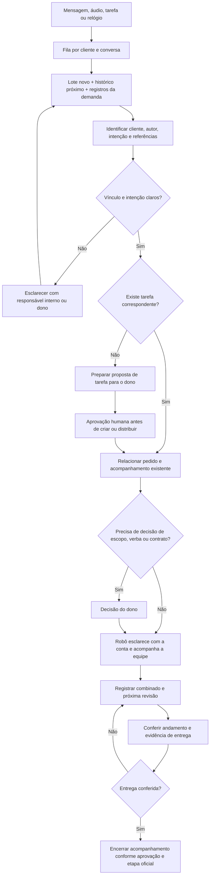

# Plano do Atlas por gatilhos e contexto

Desenho solicitado por Josias em 16/10/2026: analisar acontecimentos do WhatsApp e da operação com histórico suficiente, identificar cliente e tarefa, esclarecer com o responsável interno da conta e acompanhar até a entrega. O escopo inclui explicitamente a ligação áudio → pedido → cliente → tarefa → responsável, exemplificada pela Poliana.

**Estado atualizado: primeira implementação no piloto privado, em observação; sem ativação em produção.** Leitor/fila/vínculo e passagem ao robô foram implementados e validados em dados fictícios. Consulte [resultado, provas e limites do piloto](atlas-gatilhos-piloto-2026-10-16.md). O desenho abaixo continua orientando as etapas restantes: proposta estruturada, caso real, busca por assunto/documentos, integração e orçamento produtivos. Os limites atuais de produção e a aprovação de criação/transferência de tarefas permanecem vigentes.

## O contexto de cada análise

O evento novo abre uma investigação com contexto. Não deve ser enviado isoladamente à IA nem provocar releitura integral e repetida de todo o cliente.

| Camada | Conteúdo e regra proposta |
| --- | --- |
| Novidade | Todas as mensagens novas ainda não processadas daquele grupo, em ordem cronológica, com autor, data, ID e referências de resposta. Áudio utiliza a transcrição com ligação ao original. |
| Conversa próxima | Janela inicial de até **100 mensagens anteriores do mesmo grupo**, configurável. É referência de partida, não garantia de contexto completo nem quantidade obrigatória a cada análise. |
| Referências e assunto | Buscar a mensagem respondida/citada mesmo se estiver fora da janela e recuperar trechos anteriores ligados à demanda. Se continuar ambíguo, ampliar por assunto/período ou perguntar ao responsável interno. |
| Cliente | Objetivo, escopo, responsáveis cadastrados, operação JB Apex/Ápice Noivas pela etiqueta explícita, decisões e documentos pertinentes com origem. Memórias privadas do dono respeitam o acesso e não são copiadas integralmente para a equipe. |
| Trabalho | Tarefas/projetos relacionados, briefing, etapas, responsáveis, prazos, comentários, anexos e acompanhamentos existentes, inclusive trabalho concluído quando o pedido se refere a alteração posterior. |
| Continuidade | Resumo versionado da demanda, decisões já confirmadas, pendências, última revisão e quais fontes já foram processadas. Resumo ajuda a localizar; o original continua consultável. |

As 100 mensagens são de contexto anterior, além do lote novo. Contagem de mensagens não mede tamanho do conteúdo: um áudio longo pode exigir processamento separado. O contexto deve ser montado por relevância e orçamento de conteúdo, com cobertura registrada. Conteúdo importante não pode ser cortado silenciosamente; fontes pendentes/inacessíveis e necessidade de ampliar a leitura ficam visíveis.

Não carregar indiscriminadamente outros clientes ou conversas. Grupos adicionais só entram quando explicitamente vinculados ao mesmo cliente e pertinentes ao assunto. Bloqueios, arquivamento, exclusão e retenção existentes devem ser respeitados.

## Gatilhos e momento da análise

Valores abaixo são parâmetros iniciais propostos, editáveis e ainda não ativos.

| Gatilho | Tratamento |
| --- | --- |
| Cliente ou equipe envia mensagem | Registrar evento e agrupar o assunto após cerca de **90 segundos** de pausa. Proposta de espera máxima de cinco minutos evita adiar indefinidamente grupos movimentados. |
| Áudio recebido | Registrar áudio pendente; conclusão da transcrição gera evento. Não inferir o conteúdo antes dela. Falha/indisponibilidade sinaliza cobertura parcial e não encerra a pendência. |
| Mensagem editada, cancelamento ou resposta posterior | Atualizar a versão do pedido com fonte. Cancelamento pode substituir o pedido anterior; não excluir nem desfazer tarefa aprovada silenciosamente. |
| Mudança em tarefa/comentário/entrega | Conferir o que mudou e relacionar à demanda; mudanças mecânicas podem ser tratadas sem IA. |
| Prazo vence ou revisão combinada chega | Conferir etapa, últimos retornos e evidências. Data vencida, por si só, não comprova falta de execução. Data sem horário mantém a semântica de prazo existente no Planeje. |
| Demanda aberta | Conferência determinística proposta a cada **uma hora**. Chamar IA se houver novidade, dúvida ou marco de acompanhamento que exija interpretação. Sem novidade e sem revisão devida, atualizar a conferência sem nova análise completa. |
| Fim do expediente | Conferir pendências de hoje **15 minutos antes do encerramento**, conforme expediente da pessoa, sem cobrar tarefas futuras indiscriminadamente. |

Rotina automática de análise e chamadas internas: seg–sex, 08h–17h, São Paulo, ou expediente individual cadastrado. Recebimento e transcrição podem continuar fora do horário; eventos ficam na fila para o próximo expediente. Consulta iniciada conscientemente pelo dono mantém o caminho manual existente.

Reações, confirmações curtas e mensagens repetidas não devem gerar chamadas isoladas sem mudança de significado. Um “ok” pode ser relevante quando responde a uma aprovação pendente; a decisão não pode depender apenas de uma lista cega de palavras ignoradas.

## Caminho entre WhatsApp e equipe

### Identificar cliente e interlocutor

Usar primeiro o vínculo explícito grupo → cliente representado, mesmo quando o WhatsApp esteja conectado no cadastro da agência. Reconciliar os vínculos hoje excluídos pelo leitor do escritório. Etiquetas definem a operação; nome parecido não confirma cliente. Grupo compartilhado, vínculo ausente/ambíguo e interlocutor desconhecido entram em esclarecimento, sem escrever memória ou mandar contexto ao cliente errado.

Classificar autor por cadastro/vínculo de participante e usuário, não pelo que a pessoa escreveu na mensagem. Distinguir pedido do cliente, compromisso da equipe, pergunta, aprovação, reclamação, cancelamento e comentário sem ação. Mensagens são fonte de informação, não autorização para mudar permissões ou executar instruções do modelo.

### Encontrar a tarefa e o responsável

Prioridade da correspondência: link/ID explícito de tarefa ou demanda; referência de resposta e trabalho já acompanhado; depois projeto, campanha, peça, canal, briefing e datas compatíveis. Exibir fontes e motivo da correspondência. Não vincular por semelhança de título apenas, inventar percentual de certeza ou duplicar trabalho para resolver uma dúvida.

Se houver várias candidatas, pedir esclarecimento ao responsável interno da conta. Sem tarefa correspondente, preparar proposta revisável com título `[Nome do cliente] Ação`, sugestão de responsável e prazo pelas regras existentes. Criação, transferência ou alteração de campos oficiais continua sujeita à aprovação do dono. Pedido posterior sobre tarefa concluída é revisão/possível novo trabalho, sem reabrir a tarefa por inferência.

O responsável interno vem do cadastro atual do cliente. Poliana é exemplo do papel, não destinatária fixa de todos os clientes. Executor vem dos vínculos reais e das permissões atuais. Uma pergunta operacional pode esclarecer o pedido; não equivale a autorizar execução de serviço novo.

### Responsabilidades e autonomia no desenho

| Situação | Destino e limite |
| --- | --- |
| Dúvida operacional sobre trabalho existente e aprovado | Robô pode perguntar ao responsável interno, conforme política habilitada para aquele fluxo/cliente. |
| Conta indica executor autorizado para esclarecer andamento | Perguntar ao executor permitido, sem transferir a tarefa nem mudar seu responsável oficial. |
| Pedido exige tarefa nova, transferência ou mudança oficial de prazo | Proposta para aprovação humana. |
| Escopo adicional, verba, contrato ou conflito estratégico | Dono decide. A equipe pode apurar informações. |
| Entrega informada | Pedir/relacionar evidência e registrar como informada; revisão e conclusão mantêm as regras humanas e da tarefa. |

A abertura automática de conversa pelo robô depende dessa política explícita, com fonte e motivo visíveis. A implementação atual exige início manual e não deve ser contornada com impersonação de usuário ou execução de função administrativa inadequada.

## Exemplo completo

Cenário ilustrativo, sem mensagem real ou tarefa criada:

1. No grupo da Impacto, o cliente manda um áudio: “troca essa logo naquela versão”.
2. O Atlas aguarda a transcrição e lê o lote recente mais a janela anterior. Uma resposta citada ou conversa anterior identifica a peça/versão; se isso não estiver claro, ele não escolhe uma por conta própria.
3. Confere vínculo do grupo com a Impacto, etiqueta da operação e tarefas/briefings candidatos. Registra a origem do pedido e a relação proposta.
4. Consulta o responsável interno cadastrado. Se for Poliana, pergunta no Planeje: “Essa alteração é na versão do vídeo que vocês discutiram? Temos o arquivo correto da logo e isso está no escopo combinado?”.
5. A resposta pode confirmar a tarefa existente, indicar executor permitido ou revelar trabalho adicional. Trabalho adicional vai para decisão do dono antes da distribuição.
6. O combinado confirmado registra próximo retorno. No horário devido, o robô pergunta o andamento no expediente, mantendo o limite de cobranças sem resposta já definido para a equipe.
7. Executor informa entrega e onde conferir. O Atlas relaciona o arquivo/link ao pedido; sem acesso autorizado à evidência, não afirma ter validado conteúdo ou qualidade.
8. Revisão humana/etapa oficial confirma o encerramento. A resposta ao cliente continua separada; o plano não autoriza enviar WhatsApp automaticamente.

Se outra mensagem cancelar a alteração antes da execução, a análise atualiza o mesmo pedido e comunica a mudança pelo fluxo permitido, preservando histórico. Confirmação de recebimento, execução, entrega informada e entrega conferida têm estados distintos.

## Organização técnica e consumo

Um motor central deve alimentar escritório, central de demandas e robô com os mesmos acontecimentos. Os sete personagens não precisam ler sete vezes a mesma conversa. A interface mantém Tarefas como fonte da execução, com registros de acompanhamento ligados às mesmas tarefas.

Fila durável, rápida no recebimento, sem chamada de IA no caminho crítico do webhook. Eventos por mensagem/versão, conclusão de transcrição, alteração da tarefa e horário de revisão; cursores por origem, agrupamento por conversa/assunto, reserva de processamento e repetição segura. Cursor só avança quando a leitura correspondente tiver resultado persistido; áudio pendente mantém referência para reprocessar quando concluir. Eventos tardios e reprocessamento não podem duplicar pedido, conversa, tarefa ou consumo indevido.

Pedidos independentes no mesmo grupo precisam continuar separados; um pedido discutido em várias mensagens precisa ficar no mesmo registro. Acompanhamento ativo da mesma tarefa deve ser reaproveitado, conservando fontes e versões sem apagar assuntos pendentes.

Substituir a contagem fixa de 12 análises como mecanismo principal exige revisar também o teto de tokens. O plano prevê consumo por evento/cliente, tentativas, fila, latência e motivo de bloqueio, com proteção contra ciclos e chamadas duplicadas. **Nenhum novo teto financeiro ou numérico foi definido por este desenho.** Mensagens podem continuar sendo coletadas quando o modelo estiver indisponível; pendências não podem ser apresentadas como clientes analisados ou disponíveis.

Antes de ativar, medir a carga em uma amostra controlada e definir orçamento/alertas configuráveis. Priorizar mudança de escopo, cancelamento, impedimento e prazo devido, sem deixar grupos muito ativos impedir a análise dos demais. Não reprocessar o acervo inteiro em cada gatilho.

## O que deve ficar visível

Na central e no perfil do cliente, o mesmo pedido deve mostrar cliente/operação, origem e mensagens consideradas, intenção, tarefa/projeto, responsável da conta, executor, fase, último retorno, próxima revisão, evidência e decisão pendente. O robô abre a conversa do assunto autorizado. Arquivos, reuniões e memórias continuam organizados no cliente, com permissões próprias.

A tela deve distinguir: aguardando transcrição, aguardando processamento, analisado com cobertura parcial, aguardando esclarecimento da conta, aguardando aprovação do dono, em acompanhamento, impedimento, entrega informada e revisão concluída. Deve mostrar última mensagem lida, período/quantidade de contexto e motivo da próxima análise. Falta de vínculo, fonte indisponível e limite atingido não podem aparecer como ausência de demanda.

## Ordem de implementação e aceite

1. **Cobertura e contexto:** corrigir vínculos explícitos de grupos, incorporar mensagens completas e transcrições, montar a janela configurável e exibir cobertura. Testar conversa com mais de 100 mensagens, resposta citada antiga e áudio pendente. Nenhuma cobrança nova nesta etapa.
2. **Gatilhos e pedidos:** implementar fila/cursor/agrupamento, intenções e histórico por demanda. Relacionar tarefas candidatas e gerar proposta revisável. Validar inicialmente em modo de observação, sem contato automático com funcionários.
3. **Conta e equipe:** ligar pedidos ao robô existente, com política explícita para perguntas internas sobre trabalho autorizado, esclarecimento da conta, executor permitido e retorno ao dono. Preservar aprovação de criação/transferência e confirmação dos combinados.
4. **Revisão e operação:** gatilhos de prazo/revisão/horário, conferência periódica, evidências, consumo e fila visíveis. Validar um caso real acompanhado de ponta a ponta antes de ampliar aos demais clientes.

Aceite deve demonstrar: cliente correto mesmo em canal da agência; separação JB Apex/Ápice por cadastro; pedido que depende de mensagem antiga; cinco mensagens e um áudio sem seis demandas; “ok” contextual; cancelamento posterior; duas solicitações independentes; tarefa já existente; ausência/ambiguidade de tarefa; ausência/ambiguidade de responsável; resposta de Poliana e indicação de executor sem transferência; link de entrega sem confirmação automática; fonte/usuário com acesso revogado; expediente e próxima revisão; repetição/falha sem duplicação e sem ocultar pendências.

## Referências de implementação atual

- [Auditoria operacional de leitura e integração](../evidencias/atlas-auditoria-operacional-2026-10-16.json).
- [Central e acompanhamento publicados](atlas-demandas-producao-2026-10-16.md).
- [Robô interno publicado](atlas-robo-equipe-producao-2026-10-16.md).
- [Robô arrastável publicado](atlas-robo-arrastavel-2026-10-16.md).

O registro original deste plano foi somente documental. Após a confirmação de Josias, houve [implementação inicial isolada](atlas-gatilhos-piloto-2026-10-16.md), com SQL/serviço/interface privados e testes. Não equivale à ativação produtiva nem à conclusão de todas as etapas acima.
