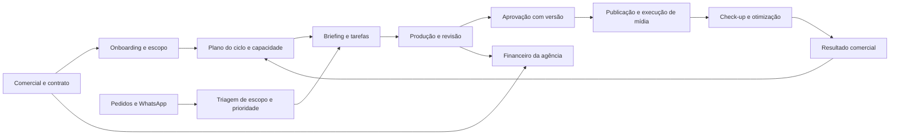

> **Referência histórica.** Consultar [a consolidação atual](../README.md) antes de retomar. Propostas, numeração de fases, contagens e próximos passos deste registro podem ter sido superados.

> **Registro de uma análise anterior.** O [mapa de preservação atualizado](mapa-preservacao-planeje.md) amplia e corrige este diagnóstico com a auditoria de 09/09, à tarde. Para planejar mudanças, usar o mapa e o plano revisado. Ele incorpora a correção de responsabilidades por etapa e confirma recursos já existentes, como publicador Meta, planejamento/calendário e painel combinado de resultados. Contagens abaixo pertencem ao recorte original.

# Planeje: diagnóstico e plano para gerir a agência

**Data:** 9 de setembro de 2026. **Modalidade:** diagnóstico em leitura, sem implementação.

**Parecer:** o Planeje tem uma base ampla para a operação da agência e merece ser consolidado. Hoje, porém, ele ainda não oferece uma visão confiável da empresa inteira. Há tarefas, atendimento, criação, tráfego e CRM, mas as passagens entre esses módulos são incompletas; alguns indicadores não representam o mesmo recorte de trabalho; e existem falhas concretas de segurança e de rotinas após a migração de infraestrutura. A evolução deve começar por confiança e conexão entre processos, antes de ampliar a execução automática de campanhas.

O objetivo deve ser conseguir responder, dentro do Planeje: **o que vendemos, o que devemos entregar, quem fará, o que está impedido, o que foi aprovado, o que está veiculando, qual resultado gerou e quanto sobrou para a agência.**

## 1. O que foi examinado

Foram examinados o servidor por SSH, a estrutura de 105 tabelas públicas do banco, contagens e definições de funções em transações somente de leitura, o código existente, as configurações de serviços e os registros agregados de rotinas. O conector Planeje foi usado para inventário e consultas; as telas de tarefas e cobertura mensal foram conferidas na sessão aberta do navegador.

O código foi copiado para análise local, excluindo arquivos de ambiente. Nenhum código do produto, configuração, cadastro, anúncio ou campanha foi alterado. Não foram disparados envios, publicações, testes de escrita ou análises de IA do Planeje. Telas de tráfego que podem gerar tarefas ou atualizar dados ao abrir foram examinadas pelo código e banco.

Os números abaixo descrevem **o que está registrado no Planeje**, não comprovam tudo que a equipe entregou em outras ferramentas. A fotografia é de 09/09, início do mês. A auditoria não equivale a testar todas as telas com todos os perfis, nem a validar as contas Meta/Google externamente.

## 2. Inventário funcional

| Área | O que já existe | Diagnóstico |
|---|---|---|
| Clientes e carteira | Cadastro, estágio comercial, responsável, serviços, fee, entregáveis, documentos e contexto | Boa base; contrato e serviço precisam de classificação e histórico por competência. |
| Projetos e planejamento | 24 projetos, referência mensal, planos de campanha, conteúdo, cronograma e estratégia | A produção cotidiana está pouco vinculada ao planejamento. |
| Tarefas | Lista, kanban, calendário, linha do tempo, responsáveis, prazos, comentários, anexos, subtarefas, histórico e tempo | É o núcleo operacional mais utilizado; precisa de estados consistentes e ligação entre demanda, entrega e publicação. |
| Briefing e onboarding | Briefing público, formulários, documentos e checklists de implantação | Existem controles úteis, mas parte do onboarding vive em checklist separado da fila de tarefas. |
| Solicitações | Entrada de pedidos, prioridade, prazo e conversão em tarefa | Falta uma relação consistente entre pedido original, execução e encerramento. |
| Atendimento e caixa pessoal | WhatsApp, conversas, filas, responsáveis, pendências, materiais e reconhecimento de equipe | Uso expressivo; algumas rotinas agendadas estão falhando. |
| Conteúdo e redes sociais | Organização de peças, calendário, visão por cliente e integração de dados Meta | Mover a tarefa para social altera tipo, conclusão e responsáveis; isso prejudica a leitura do histórico. |
| Cobertura mensal | Contratado × planejado × entregue, rascunhos e identificação de clientes descobertos | Planejamento elegível e atraso do plano excluem rascunhos; “entregue” conta `completed`, inclusive fora desses critérios. A classificação de serviço também afeta o resultado. |
| Tráfego pago | Carteira, dashboard, Hoje, situação, painel, solicitações, insights, check-up, rotina e orçamento | Recursos reais, com baixa continuidade registrada e problemas de integração/recorrência. |
| Execução Meta | Leitura de contas/campanhas/conjuntos/anúncios e alterações reais de status/verba | Precisa de autorização no servidor, limites, registro de alterações e conferência do resultado remoto. |
| Google Ads | Conta vinculada e consultas de campanhas, grupos, palavras-chave e resultados | Há integração de leitura no código; não foi identificado fluxo completo de criação/publicação paga. |
| CRM e atribuição | Leads, contatos, pipelines, etapas, vendas, rastreamento e conversões CTWA | Há captação; acompanhamento comercial e receita confirmada estão pouco preenchidos ou não conciliados. |
| Relatórios e área do cliente | Produtividade, relatórios por cliente, resultados, PGM e portal | Os números precisam compartilhar definições, recortes, fonte e data de atualização. |
| IA, automações e administração | ApexIA, documentos de referência, regras, módulos e permissões | Complementos úteis; não substituem os controles de processo e acesso. |
| Financeiro da agência | Fee e vencimento no cadastro; registros de faturamento dos clientes | Não foi identificado financeiro completo da agência com cobrança, recebimento, despesas, custos e margem. |
| Gestão de pessoas e capacidade | Perfis, responsáveis e apontamentos de tempo | Não foi identificada gestão completa de capacidade por função, disponibilidade, custo e rentabilidade. |

O conector cataloga 14 agrupamentos e 33 páginas, mas há rotas adicionais no código. Isso é inventário de navegação, não comprovação de que todas as funcionalidades estejam habilitadas e operacionais. Uma central nova de tráfego com seções de operações/criativos/relatórios aparece somente no preview de desenvolvimento; ela não deve ser contada como funcionalidade publicada.

## 3. O que os registros mostram

| Indicador | Encontrado | Implicação |
|---|---:|---|
| Clientes | 43, sendo 22 em `closed` | Base usada como carteira ativa; inclui serviços diferentes e marca interna. |
| Perfis internos | 7; 6 com login nos últimos 30 dias | Não equivale automaticamente ao tamanho real da equipe. |
| Tarefas históricas | 1.225, sendo 1.168 `completed` | Conclusão no cadastro não comprova publicação ou veiculação. |
| Tarefas abertas | 57 | Todas têm prazo e algum ID de responsável. |
| Abertas vencidas | 47 de 57 — 82,5% | Necessário triar atraso real, bloqueio e conclusão não registrada. |
| Abertas sem projeto | 51 de 57 | Falta vínculo de planejamento em boa parte da produção; tarefas simples podem legitimamente não ter projeto. |
| Abertas sem descrição / prioridade | 42 / 51 | O contexto pode estar em anexos e conversas, mas não está estruturado nesses campos. |
| Abertas em briefing rascunho | 56 de 57 | O cadastro não está acompanhando o fluxo formal de briefing. |
| Abertas com responsável não localizado em `profiles` | 23 | Ter um ID preenchido não garante um responsável válido. |
| Setembro: entregáveis contratados | 127, no cálculo atual | O escopo é o cadastro atual; não representa contrato histórico versionado. |
| Setembro: planejamento elegível | 1 tarefa, com 43 rascunhos fora da cobertura | Não significa que a equipe só planejou uma peça na prática. |
| Setembro: carteira de conteúdo | 20 clientes; 17 descobertos e 3 sem escopo no cálculo | Parte da classificação de consultoria precisa ser corrigida antes de cobrar peças. |
| Campanhas internas de mídia | 9; apenas 2 com vínculo normalizado a tarefas | A ligação entre produção e execução de mídia está pouco utilizada. |
| Contas cadastradas | 16 vínculos Meta ativos e 1 Google | Cadastro não comprova conexão funcionando. |
| Operações de tráfego | 16; 4 sem gestor principal | Falta definir o dono da rotina por conta elegível. |
| Check-ups | 6, todos de 31/08 | Nenhum registro posterior até a consulta. |
| Rotinas de relatório | 10 clientes habilitados; 0 tarefas geradas com chave de rotina | Existe configuração, mas não evidência de execução contínua. |
| Evidência de conclusão de tráfego | 0 na tabela específica | Pode haver arquivos em outros lugares; o controle formal não está sendo alimentado. |
| Leads / contatos WhatsApp | 8.163 / 8.670 | São entidades diferentes; não devem ser somadas como pessoas únicas. |
| Acompanhamento de leads | 2 com responsável e 0 com próxima ação preenchida | A captação está mais estruturada que o seguimento comercial nesse cadastro. |
| Resultados diários / vendas transacionais | 29 resultados em 2 clientes, último em 10/02; 2 vendas, última em 18/03 | Não sustentam uma visão atual do retorno comercial da carteira. |

Há 2.610 contatos com identificador CTWA. Portanto, a ausência de UTM nas colunas consultadas não significa ausência completa de atribuição. Os nove marcadores de compra encontrados também não representam o total real de vendas da agência ou dos clientes.

## 4. As melhorias mais importantes

### A. Recuperar segurança e continuidade — prioridade imediata

As permissões atuais permitem ao papel anônimo consultar todos os 43 clientes, 24 perfis, 1.361 comentários e 1.248 registros de anexos. Isso foi confirmado apenas por contagens, sem selecionar conteúdo sensível nesse teste. Também há permissão de leitura em campos de credenciais, e a listagem administrativa de clientes devolve campos de senha/segredo. Quatro tabelas públicas estão sem proteção por linha. O controle visual de módulos não resolve essa exposição.

O endpoint Meta está acessível sem autenticação no gateway, e o código publicado não valida usuário/cliente internamente no caminho de alteração de anúncios. A verificação pública foi somente um GET vazio que retornou erro de corpo inválido; nenhuma ação na Meta foi executada. Isso é uma falha de controle a corrigir, não evidência de invasão ou de alteração indevida já ocorrida. A proteção da API Supabase precisa combinar permissões de acesso e regras por registro. [Documentação oficial](https://supabase.com/docs/guides/api/securing-your-api).

Na operação agendada, entre 06/09 e 09/09, o log consultado mostra:

- **Sincronização Meta Leadgen:** 3.728 execuções, todas HTTP 400.
- **Planejamento do atendimento:** 249 execuções, todas HTTP 401.
- **Caixa diária:** duas execuções, ambas HTTP 500.

Há dez clientes ativos com erro relacionado a token no último resumo Meta registrado. Restaurar credenciais deve vir depois ou junto da proteção do endpoint, para não habilitar uma integração sensível em um caminho sem autorização.

O servidor não apresentou saturação no momento da consulta: cerca de 4,36 GB disponíveis de 7,94 GB de RAM e disco em 39% de uso. Há backups locais de banco e storage de 06 a 09/09; não foi comprovada cópia externa nem restauração de teste. Portas Docker estão publicadas em interfaces públicas e sem filtro na cadeia `DOCKER-USER`; alcance externo e firewall do provedor não foram testados. O UFW, isoladamente, não garante proteção das portas publicadas pelo Docker. [Documentação oficial](https://docs.docker.com/engine/network/packet-filtering-firewalls/).

**Resultado esperado:** permissões testadas por papel, integrações autenticadas, rotinas funcionando com monitoramento, backups recuperáveis e documentação da migração atualizada.

### B. Unificar tarefa, produção e publicação

Os estados atuais misturam etapa, pessoa, canal e espera: por exemplo, “Josias”, “Youtube”, “Stand-by”, `todo` e “A Fazer”. Isso torna filtros e automações dependentes de convenções frágeis.

A regra que move uma tarefa para redes sociais muda o tipo para `social_media`, marca como concluída e limpa os responsáveis. Isso explica a ausência de responsáveis em tarefas históricas; não é abandono. Porém, o relatório de produtividade filtra pelos responsáveis atuais antes de ler o histórico, prejudicando a atribuição do trabalho. O tipo original da peça também deixa de ser a classificação principal.

**Proposta:** preservar tipo, autoria, histórico e tempo; separar estado da produção, aprovação e publicação. Toda tarefa precisa de um dono final, podendo ter vários participantes. Uma tarefa interna simples pode usar apenas título, dono, prazo, prioridade e critério de conclusão. Projeto/ciclo torna-se necessário quando há compromisso com cliente, campanha ou conjunto de entregas.

### C. Fazer contrato virar planejamento executável

Hoje há cadastro de entregáveis e cobertura mensal, mas 19 clientes considerados de conteúdo estão sem plano do mês no cálculo. Além disso, a classificação `apenas_consultoria` não é tratada de forma consistente.

O contrato deve definir serviço, unidades de entrega, quantidade, vigência, fee, limite de revisões e responsável. A verba de mídia deve ser separada do fee. Cada competência precisa preservar o escopo vigente naquele período, inclusive extras aprovados.

O ciclo mensal deve transformar esse compromisso em tarefas e reservar capacidade da equipe. Consultoria pode ter reuniões, análises e relatórios como entregas; não deve ser julgada automaticamente pela quantidade de artes ou vídeos.

### D. Conectar atendimento, pedido, onboarding e execução

O pedido do cliente precisa continuar rastreável depois de virar tarefa: conversa → solicitação → triagem → execução → resposta/entrega. Hoje a conversão de solicitação faz duas operações separadas e não há vínculo persistido evidente no modelo inspecionado. O onboarding usa checklists próprios, fora da mesma fila de execução.

**Proposta:** manter cada entrada ligada ao trabalho que a resolve. A triagem decide responsável, prazo, urgência e se está dentro do escopo. Um pedido extra deve ter aprovação comercial antes de consumir capacidade. Resolver a tarefa deve devolver evidência ao pedido original. Espera pelo cliente deve ter motivo, responsável pela cobrança e data de retorno.

### E. Transformar tráfego em rotina controlada

Há recursos úteis de check-up, orçamento, demandas e revisão após publicação. Mas existe um defeito confirmado no banco: a chave única da rotina quinzenal não inclui o cliente. Vários clientes disputam a mesma chave, e a função descarta o erro de duplicidade. A geração também depende de abrir a central no dia previsto, sem recuperação clara de ciclos perdidos.

**Proposta:** rotinas agendadas no servidor, uma ocorrência por cliente/tipo/ciclo, recuperação de atrasos e fila visível de falhas. Cada cliente de mídia deve ter gestor, substituto, conta, objetivo, orçamento por canal, meta de negócio, próxima revisão e evidências. Alertas precisam de dono e resolução compartilhada, não apenas desaparecimento na sessão de um navegador.

Na execução, “criar campanha” internamente não equivale a publicar campanha paga na Meta ou Google. O código atual tem ações reais de status/verba Meta, mas não foi identificado um fluxo completo de publicação paga ponta a ponta. Esse fluxo deve ser evoluído com alçadas por cliente, revisão do lote, teto de verba, histórico, proteção contra repetição e confirmação do estado remoto.

### F. Tornar indicadores comparáveis e auditáveis

Na tela de cobertura, setembro mostra “0 atrasadas” e “100%” de briefing porque exclui rascunhos de parte do cálculo. São critérios diferentes dos 47 vencimentos do backlog geral. O painel precisa mostrar atraso total, atraso do plano e briefing pendente separadamente, com denominadores claros.

No relatório comercial Meta, há caminhos que agrupam campanhas pelo nome, usam gasto de recorte diferente dos filtros e deixam fora campanhas que gastaram sem gerar contatos atribuídos. A receita vem de campos de lead/contato, enquanto há outra estrutura para vendas transacionais. Isso impede usar o ROAS desse relatório como base segura para decisões automáticas de investimento.

Há ainda limite de 1.000 linhas na API; consultas de relatório sem paginação precisam ser revistas, pois o histórico já tem 1.225 tarefas. Os totais desta auditoria foram apurados diretamente no banco.

**Proposta:** venda identificada por ID, data, valor e estado; campanhas por ID estável; receita e gasto com o mesmo recorte; cobertura de atribuição explícita; dados ausentes como “indisponível”; idade e origem visíveis. Nas conversões Meta, as 17 tentativas históricas registradas falharam. É preciso validar o fluxo atual e usar fila de reenvio com identificador estável da venda; não presumir que esses registros antigos descrevem todas as conversões atuais.

### G. Acrescentar o controle da empresa

O financeiro deve distinguir três valores: **receita da agência, verba de anúncios do cliente e receita obtida pelo cliente**. O cadastro atual de fee e faturamento não substitui cobranças, recebimentos, despesas e margem da agência.

Definir uma fonte oficial para contratos e financeiro — possivelmente integrando a ferramenta já utilizada — e conectar cliente/projeto a receita, horas, custo de equipe e terceiros. A margem por cliente só deve ser apresentada quando os custos e recebimentos tiverem qualidade suficiente.

A gestão de pessoas deve começar por função, disponibilidade, capacidade semanal, substituto, estimativa e tempo realizado. Os sete registros com apontamento de tempo encontrados não permitem estimar produtividade ou custo real da equipe inteira. Evitar avaliar pessoas por um ranking construído sobre histórico incompleto.

## 5. Processo proposto para a agência

Para uma demanda completa, o registro deve manter cliente, contrato/ciclo quando aplicável, pedido de origem, dono, participantes, prazo, prioridade, próxima ação, versão aprovada, evidência da entrega e resultado associado. Bloqueios devem ser tratados à parte, sem apagar a etapa em que o trabalho parou.

**Exemplo de aceitação:** um pedido de anúncio chega pelo WhatsApp, é classificado no escopo, vira tarefa vinculada, recebe criativo aprovado, passa pela autorização de verba, é publicado, guarda os IDs da plataforma, gera revisão e devolve resultado ao ciclo do cliente. O gestor consegue acompanhar esse caminho sem reconstruí-lo em conversas.

Na navegação, recomendo concentrar os módulos existentes em espaços de trabalho: **Meu dia; Clientes; Operação; Tráfego e resultados; Comercial; Financeiro; Administração.** O colaborador começa pela própria fila; o gestor, por riscos e capacidade; a direção, por compromissos, recebimentos e margem. Isso deve reorganizar acessos e visões sem duplicar cadastros.

## 6. Plano de evolução com critérios de aceite

As janelas abaixo são uma sequência proposta, não promessa de esforço. Os responsáveis são funções a designar; não foi atribuída atividade a ninguém no sistema.

| Etapa | Entrega | Responsável a designar | Critério de aceite |
|---|---|---|---|
| **Imediato / semana 1** | Restringir leitura e ações por papel/cliente; retirar credenciais de listagens; proteger endpoints | Responsável técnico + direção | Testes por papel negam acesso indevido; ações Meta têm autorização; nenhuma credencial em respostas operacionais. |
| **Semana 1** | Recuperar crons, credenciais e migração; revisar backup e portas | Técnico + donos das integrações | Execuções registram sucesso de negócio, não só HTTP; falhas notificadas; restauração em ambiente isolado e cópia externa comprovadas. |
| **Semanas 1–2** | Triar as 57 abertas; validar responsáveis; definir status e significado de conclusão | Gestor de operações | 47 vencidas classificadas; nenhum responsável inválido; toda demanda tem próxima ação ou encerramento com evidência. |
| **Até 30 dias** | Estruturar serviços/contratos e ciclos; corrigir cobertura; integrar pedidos e onboarding | Atendimento + operações + direção | Toda conta ativa com serviço correto; todo compromisso do período rastreável; rascunhos/atrasos visíveis; extras separados. |
| **Até 30 dias** | Corrigir recorrência e implantar rotina de tráfego em piloto | Técnico + gestor de tráfego | Dez clientes elegíveis geram dez tarefas únicas no ciclo; reexecução não duplica; rotina funciona sem navegador aberto. |
| **Dias 31–60** | Unir produção, aprovação, publicação e revisão | Criação + atendimento + tráfego | Criativo tem versão aprovada; execução guarda evidência/ID; mudanças têm ator e motivo; duas semanas de rotina demonstrável. |
| **Dias 31–60** | Conciliar mídia, contatos e vendas; corrigir filtros e conversões | Tráfego + comercial + técnico | Campanhas homônimas separadas; gasto sem lead incluído; amostra fecha com fonte comercial; falhas de evento recuperáveis. |
| **Dias 61–90** | Integrar financeiro, contratos, custos e capacidade | Direção + financeiro + operações | Fee separado da verba; contratado/recebido/custo conciliados; capacidade futura visível; margem com origem documentada. |
| **Após estabilidade** | Ampliar publicação paga assistida e automações de execução | Tráfego + técnico + direção | Alçadas aprovadas, verificações remotas, prevenção de repetição, registro de falhas parciais e reversão planejada. |

Começar com dois ou três clientes representativos: um de conteúdo e mídia, um de mídia e um de consultoria/onboarding. Expandir depois de validar o processo e os números. Automatizar primeiro a detecção, a cobrança de pendência e a preparação de ações; ampliar execução após os controles estarem comprovados.

## 7. Painel que a direção precisa ter

| Pergunta da gestão | Indicador necessário |
|---|---|
| O que prometemos e ainda falta entregar? | Contratado, planejado, liberado, concluído e publicado por competência/serviço. |
| Quem está sobrecarregado? | Capacidade por função, esforço estimado, trabalho em andamento e bloqueios. |
| Onde a entrega parou? | Tempo por etapa, revisão, espera pelo cliente e próxima ação. |
| O cliente está sendo atendido? | Demandas sem resposta, SLA, dono e pedidos convertidos em entrega. |
| O tráfego está sob controle? | Contas conectadas, idade do dado, verba prevista/gasta/projetada, alertas e revisões. |
| Qual o retorno comercial? | Leads, qualificados, oportunidades e vendas confirmadas, com cobertura de atribuição. |
| A agência está ganhando dinheiro? | Receita contratada e recebida, despesas, custo de entrega, margem e vencimentos. |

Cada indicador precisa declarar período, unidade, origem, última atualização e responsável. “Sem dados” deve ser distinto de zero; “concluído” deve ser distinto de publicado; “contratado” deve ser distinto de recebido.

## 8. Decisões necessárias antes da implementação

- Definir o significado de conclusão para tarefa, peça e campanha.
- Identificar a fonte atual de contratos, cobranças, pagamentos e custos da agência.
- Confirmar serviços e entregas de cada consultoria, incluindo marcas internas.
- Validar os perfis pendentes e os responsáveis não localizados, preservando histórico. Três colaboradores `pending` acessam o sistema: esse estado não comprova inatividade.
- Definir aprovadores de conteúdo, limites de autonomia de verba e responsáveis por cada etapa.
- Escolher os clientes do piloto e as metas de prazo, atualização de dados e recuperação de serviço.

Não recomendo começar por uma reconstrução completa, por aumentar a VPS ou por novas telas de IA. O ganho mais direto está em tornar o que já existe seguro, coerente e obrigatório no fluxo diário, e acrescentar financeiro e capacidade sobre essa base.

O detalhamento de código, infraestrutura, evidências e limitações está no arquivo **anexo-tecnico-planeje.md** entregue junto deste relatório.
