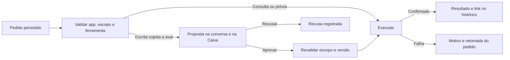

# Conversar do ScaleOS

10/11/2026. Inspeção do produto em sessão autenticada no [Conversar](https://app.usescaleos.com/conversar). Este registro descreve os contratos observáveis no navegador. Dados operacionais de clientes, IDs privados e links de artefatos ficam no produto de origem.

## Conversa e contexto

- A lateral reúne sessões recentes, favoritas e arquivadas, com busca e ações por sessão. Uma conversa tem URL própria e recebe título depois da primeira resposta.
- O campo aceita seleção de app por `@` e de cliente por `#`. A seleção altera o campo e aparece como controle removível. Patrício é o padrão. CRM IA, CS IA, Gestor IA e Social Media IA aparecem como especialistas. Marca, anexos e Brain são controles distintos.
- `#` listou clientes no Patrício e marcas no Social IA. Ao trocar de Patrício para CS IA por `@`, o cliente selecionado deixou de aparecer. Na mesma amostra, digitar `#` no campo do CS IA não abriu o seletor.
- Chat executa o pedido da conversa. Automação muda a entrada para a descrição de um fluxo, com ação, momento e destino. A sessão existente de relatório semanal documenta a preparação de gatilho e passos. O histórico anterior de Automações registrou o primeiro passo e a interrupção do segundo.

## Evidência de execução

| Cenário | Evidência observada | Alcance |
| --- | --- | --- |
| Consultar aprovações pelo Patrício | Envio abriu sessão. A mensagem exibiu leitura, depois uma resposta com `Usou 1 ferramenta`. O detalhe expandido informou consulta à fila de aprovações. A resposta retornou zero pendências. | Consulta ao recurso indicado pela interface. A contagem da Caixa pode abranger outros itens. |
| Cruzar CS IA e Gestor IA pelo Patrício | Pedido em conversa geral. A resposta foi rotulada `com CS IA e Gestor IA`. A trilha expandida mostrou uma consulta ao CS e duas ao Gestor. O texto consolidou risco, cobertura de mídia e fontes. | A trilha demonstra o uso dos dois apps no mesmo pedido. A interface não mostra a concorrência interna nem valida por si só o cruzamento gerado pelo modelo. |
| Editar e parar | `Editar e repensar` abriu o texto anterior e botões Salvar e Cancelar. Salvar substituiu a pergunta visível e iniciou nova execução. Cliquei em `Parar` durante a consulta. O campo ficou disponível, e ao recarregar ficou a pergunta editada sem a resposta em andamento. | A interface confirmou a interrupção do turno visível. O cancelamento das chamadas já disparadas não foi comprovado. |
| Repensar após interrupção | `Repensar a resposta` voltou a chamar CS e Gestor para a pergunta editada. A trilha mostrou novas consultas e o chat concluiu com a resposta no mesmo lugar. | A edição e a repetição foram exercitadas em consulta. Repetição de escrita exige verificar a execução anterior para evitar duplicidade. |
| Buscar e organizar sessões | Busquei o panorama criado nesta análise. A sessão abriu com o cartão do relatório. Favoritar e arquivar moveram a sessão para os filtros correspondentes. Desarquivei e removi o favorito, e a sessão reapareceu em Recentes com o cartão. | Foram exercitadas ações reversíveis na sessão criada nesta análise. |
| Preparar cadastro no CRM IA | Escolhi o CRM por `@`. O chat exibiu leitura, pensamento, escrita e o resumo das ferramentas. A resposta exibiu as duas consultas ao CRM, os campos propostos e a escrita pendente. O cartão `Espera você` ofereceu Aprovar, Recusar e Sempre aprovar este tipo. | A proposta persistiu ao recarregar. A Caixa abriu a mesma descrição de escrita e ofereceu decisão própria. |
| Aprovar e recusar no CRM IA | O primeiro aval consumiu o cartão original e produziu outra mensagem com um segundo cartão da mesma descrição. A busca independente no CRM por nome exato retornou zero leads. Recusei a segunda proposta. O histórico confirmou que nada foi executado nessa recusa. | Aprovação e gravação foram estados distintos. O motivo de a escrita voltar a pedir autorização não apareceu na interface. A opção de aprovação permanente permaneceu intacta. |
| Aprovar cadastro pela Caixa e conferir o CRM | Reformulei o pedido com funil e etapa explícitos e aprovei uma vez na Caixa. Ao reabrir o chat, apareceram a retomada e a confirmação de execução. A busca por nome no CRM retornou um lead. A ficha mostrou origem indicação, Comercial, Novo contato como etapa atual e nenhuma conversa. | O cadastro fictício permaneceu salvo. O pedido e a superfície de decisão mudaram, portanto a causa do comportamento diferente da primeira tentativa segue indeterminada. |
| Plano de ação e memória no Gestor IA | Sessão histórica mostra leitura de aviso, plano em texto e gravação de anotação aguardando aval. A sequência posterior anuncia ação aprovada, execução em andamento e confirmação. | Histórico do ensaio anterior com cliente fictício. |
| Arquivo no Gestor IA | Sessão histórica mostra cartão com HTML, PDF e Revogar. Registrar a prévia no arquivo interno exigiu aprovação própria. A auditoria anterior conferiu o PDF e o estado `Só gerados`. | O histórico distingue gerar, registrar e enviar. |
| Gerar HTML e PDF no Gestor IA | Pedi um panorama com números inventados e sem cliente. O especialista exibiu uma ferramenta usada e devolveu o cartão. O HTML abriu em outra aba. O botão PDF baixou um arquivo A4 com três páginas. Conferi a capa, o índice e os números na página final. | O relatório usou a marca padrão. O pedido de uma página resultou em três, pois o arquivo inclui capa e índice. |
| Montar e salvar automação | O envio em Automação abriu um editor com conversa e quadro. Primeiro apareceu o gatilho semanal, depois uma ferramenta `list_clients` e um passo de IA que lê `{{steps.s1}}`. Salvar abriu o detalhe persistido e mostrou `Ativa`, apesar do pedido de rascunho pausado. | Pausei pelo controle da própria rotina. O estado ficou `Pausada`. |
| Rodar uma vez com a agenda pausada | `Executar agora` ficou disponível. O histórico marcou sucesso, dois de dois passos em quatro segundos. O log do segundo passo mostrou um objeto com `total_clientes` numérico. | A rotina ficou pausada após abrir novamente o detalhe. O desenho contém uma leitura e uma transformação, sem ações de envio ou publicação. |
| Revisar a rotina e validar as ferramentas do quadro | Pedi condição depois da contagem e saída apenas no log. O primeiro rascunho adicionou `INBOX_POST`, que escreveria na Caixa. Corrigi antes de salvar. O quadro final manteve `list_clients`, contagem, condição e uma saída JSON produzida por IA. | O texto do pedido não impediu a escolha de uma ferramenta de escrita. O quadro permitiu identificar e substituir a ferramenta antes da execução. |
| Executar condição falsa | Salvar a primeira revisão reativou a rotina. Pausei e rodei manualmente. A condição de carteira vazia parou a execução antes da saída final. A lista mostrou `Interrompida`, dois de quatro passos. O cartão da condição explicou que o critério não foi atendido. | Um desvio esperado pode aparecer como interrupção. A última etapa não apresentou log de execução. |
| Reabrir relatório histórico após editar | A execução antiga continuou na lista como `Sucesso`, dois de dois passos. Seu relatório mostrou os quatro nós do quadro revisado. Após inverter a condição, o relatório da execução interrompida passou a mostrar `total_clientes > 0` com a mensagem antiga `Critério não atendido`, embora o disparo original usasse `total_clientes === 0`. | O relato visual aplica a definição atual a resultados anteriores. A interface não comprova como a versão foi persistida no servidor. |
| Executar condição verdadeira | Inverti a condição para uma carteira com clientes e mudei apenas o JSON final. O segundo salvamento preservou a pausa. A execução manual terminou com quatro de quatro passos em dez segundos e a saída `{"carteira_disponivel": true}` apareceu no log do último passo. | Os três disparos ficaram no histórico. O detalhe da rotina voltou a mostrar `Pausada`. |
| Recarregar texto ainda não enviado no editor | Digitei um pedido de alteração e recarreguei antes de enviar. O editor voltou para a mesma automação, com o campo vazio. | O texto em composição se perdeu neste cenário. |
| Reabrir uma revisão gerada antes de salvar | Enviei a instrução de trocar só o nome do último passo. O quadro mostrou a alteração com o rótulo `Rascunho`. Recarreguei o editor, que manteve o novo nome. O detalhe da rotina em outra aba também mostrou o novo nome, embora `Salvar automação` não tivesse sido acionado. | O campo de composição, a proposta no quadro e a definição exibida no detalhe têm comportamentos de persistência diferentes. |
| Rodar uma revisão sem acionar Salvar | Pedi ao editor que acrescentasse `conferencia: "manual"` apenas ao JSON do último passo. A página de detalhes aberta em outra aba mostrou o marcador após recarregar. Disparei a rotina pausada nessa aba. O relatório marcou sucesso e o log do quarto passo trouxe o marcador. | O executor usou a revisão que o editor ainda chamava de `Rascunho`. A saída veio entre delimitadores Markdown, embora a instrução pedisse somente JSON. Restaurei o nome e a saída anteriores, confirmei a pausa e reabri o disparo. O diagrama mostrou a definição restaurada, e o log preservou o marcador executado. |
| Diferenciar condição de espera por aprovação | O editor afirmou que não havia nó nativo de aprovação e desenhou `Aguardar aprovação do responsável` como `Condição`, em uma rotina de disparo exclusivamente manual. Salvei, pausei e rodei. O resultado foi `Interrompida`, dois de quatro passos, e o relatório informou `Critério não atendido`. O filtro `Espera você` não mostrou uma pendência para o disparo. | O nome do nó não cria uma decisão humana. O ensaio verificou o comportamento da condição gerada, sem estabelecer o comportamento de todas as ferramentas de escrita em automações. |
| Esperar aval para uma ferramenta em automação | Revisei a rotina manual para buscar um prospect fictício por nome exato, exigir um único resultado e preparar `update_lead` apenas no campo `notes`. O disparo concluiu os dois primeiros passos e ficou em `Espera você`, inclusive após recarregar. A Caixa exibiu a ação e o texto da nota. A ficha continuou sem observações antes do aval. | Uma ferramenta de escrita gerou uma pendência real no executor, diferentemente da condição. O ensaio se limita à ferramenta e ao escopo usados. |
| Recusar a escrita de uma automação | Recusei a proposta na Caixa. O mesmo disparo virou `Interrompida`, com dois de três passos. Reabri a ficha pela lista do CRM e confirmei que permaneceu sem observações. | A recusa preservou os passos já executados e impediu a gravação final. |
| Preparar a aprovação positiva de uma automação | Um segundo disparo chegou a `Espera você` com dois de três passos e uma proposta distinta na Caixa. O cartão expôs o texto da nota. A revisão automática do navegador rejeitou o clique em Aprovar por exigir autorização específica para a gravação no CRM. | A proposta aguardou até o usuário autorizar explicitamente o aval. |
| Aprovar a escrita e comparar a retomada | Com autorização explícita, aprovei o disparo que já estava pendente e conferi o mesmo relatório e a ficha. A Caixa registrou `Aprovado`, mas o disparo ficou `Interrompida`, com dois de três passos e duração total de 25 min 19 s. Como a ficha permaneceu sem a nota, rodei uma vez a mesma rotina manual e aprovei a nova proposta. A nova execução também ficou `Interrompida`, com dois de três passos em 1 min 34 s. | Após as aprovações, apareceram dois novos cartões pendentes para o mesmo identificador e texto. A ficha oficial, após recarregar, continuou sem observações. O último passo não apresentou log nas duas execuções. O ScaleOS não mostrou o motivo da interrupção. |
| Aprovar um cartão reapresentado | Confirmei novamente o identificador, a nota e a ficha vazia. Aprovei o cartão reapresentado mais recente. A Caixa registrou a decisão e informou que não conseguiu avisar a automação. O link `Ver execução` apontou para o mesmo disparo, ainda `Interrompida`. | A ficha continuou sem observações após recarregar. O outro cartão reapresentado continuou pendente. A mensagem identifica a falha de comunicação nessa aprovação. A causa interna e a retomada anunciada após reconexão não ficaram comprovadas. |
| Inspecionar confiança para aprovações futuras | O menu `Confiar nesta ação` ofereceu `Para este tipo de ação` e `Só para esta automação`. O texto informa que escolher aprova a pendência atual e autoriza execuções futuras no escopo escolhido. Ajustes → Aprovações confiadas é a área de gestão. Ela explicou que revogar volta a exigir aval e exibiu `Nenhuma confiança concedida`. | Abri e fechei o menu sem escolher. A pendência continuou aberta. Criação e revogação de uma regra de confiança seguem sem execução. |
| Revisar briefing no Social IA | A trilha indicou `Patrício chamou o Social Media IA`. O especialista devolveu briefing e os botões `Pode gerar` e `Quero mudar algo`. O clique em `Quero mudar algo` entrou como mensagem humana, desabilitou os botões anteriores e abriu uma pergunta de ajuste. | A proposta original usava a marca existente como destino, embora o briefing se referisse a outra marca. A proposta foi substituída por uma marca própria, sem canais nem contatos. |
| Confirmar marca pelo chat | `Confirmar e criar` entrou como nova mensagem. O chat pediu logo em anexo e apresentou referências visuais como opcionais. | A marca proposta ficou sem gravação comprovada. A necessidade de logo é uma condição relatada pelo agente. |
| Gerar e conferir arte no Social IA | Selecionei uma marca existente por `#` para um criativo pertinente. Uma primeira consulta de marca falhou. O briefing ainda apareceu. `Pode gerar` virou mensagem, depois apareceu uma escrita pendente. Após Aprovar, a trilha registrou execução e o cartão exibiu o progresso da imagem. | A imagem de 1080 × 1080 carregou, persistiu após recarregar e apareceu como Rascunho em Últimas criações no Social IA. A imagem oferece Baixar, Refazer, Publicar e feedback. `Gostei` ficou gravado após recarregar. |
| Refazer e decidir pela Caixa | `Refazer` iniciou um turno que pediu outra direção. A variação produziu briefing e novo cartão de aprovação após `Pode gerar`. A Caixa mostrou uma única proposta correspondente. Recusei na Caixa e recarreguei o chat, que exibiu a recusa e a confirmação de que nada foi executado. | Conversa e Caixa refletem a mesma decisão nesta amostra. O criativo original permaneceu como rascunho. |
| Brain no campo de mensagem | A gaveta exibiu lacunas em aberto e botões `Ensinar`. Clicar em um item enviou uma mensagem na conversa atual e o chat fez uma pergunta. | A abertura do fluxo de ensino é um novo turno. A entrevista ficou sem resposta e nenhuma escrita foi confirmada. |
| Gravar uma fonte no Brain pelo chat | Pedi uma convenção de nomes de arquivos para um prospect fictício. A trilha mostrou `Ação concluída — Brain`. A aba Fontes exibiu o Markdown gerado, com um trecho e a fonte ligada. | A escrita persistiu fora da conversa. A referência foi salva como documento, sem criar uma habilidade. O texto restringe a convenção a um prospect, mas a interface examinada não comprovou isolamento de acesso. |
| Desligar e recuperar uma fonte do Brain | A busca independente devolveu um trecho. Desliguei a única fonte criada nesta análise, mantive o arquivo e repeti a mesma busca, que retornou zero trechos. Religuei e consultei em conversa nova, sem fornecer o formato esperado. O Patrício trouxe o valor exato, a trilha de consulta e uma citação. | A fonte ficou ligada. O clique na citação abriu a área Brain, com a fonte visível. A lista de fontes registrou uso em uma resposta. |
| Buscar pelo assunto com outra empresa | Na busca geral do Brain, mantive o assunto e troquei o nome na pergunta por outra empresa fictícia. A mesma fonte apareceu como único trecho. | O nome no texto da pergunta e o aviso escrito no documento não funcionaram como filtro na busca geral. O ensaio não usou seleção estruturada de cliente nem outra conta. |
| Comparar Brain com e sem seleção de cliente | Usei a mesma pergunta em duas conversas novas. Sem seleção, o Patrício retornou o formato exato e citou a fonte fictícia. Na outra, confirmei o chip de um cliente diferente. A resposta informou ausência de fonte para o cliente selecionado e omitiu o formato. Mesmo assim, exibiu o botão da fonte fictícia. O botão abriu o Brain e a fonte pôde ser lida na mesma sessão autenticada. | O escopo alterou o texto da resposta, mas a citação visível não seguiu a mesma seleção nessa amostra. O operador tinha acesso ao Brain do escritório. O cenário não testa acesso entre contas ou usuários. |
| Reabrir as respostas com citações | Reabri as duas conversas. O texto e o chip de cliente persistiram. O botão que abria a fonte sumiu nas duas, inclusive na conversa sem seleção de cliente. | O desaparecimento ao reabrir ocorreu também no controle. Não comprova um filtro de acesso aplicado só ao cliente selecionado. |
| Inspecionar o campo de anexo e voz | O botão de anexo anuncia PDF, DOCX, TXT, MD, CSV, PNG, JPG e WEBP. O campo aceita seleção múltipla. O controle de voz tem o rótulo `Falar com Patrício`. | As evidências são do campo e do controle. Upload, captura e processamento exigem execução específica para comprovar o fluxo. |
| Abrir o seletor de anexo do Social IA | Com autorização no chat, abri o seletor da conversa da marca e indiquei o PNG fictício preparado. A permissão de upload do navegador para o domínio do ScaleOS foi recusada. | O seletor abriu e a conversa continuou sem o anexo. O envio e a criação da marca ficaram sem execução. |
| Acionar voz em conversa nova | Cliquei em `Falar com Patrício`. A interface manteve o botão ativo e não exibiu uma sessão de voz. O acesso ao controle nativo do Chrome não foi aprovado para conferir a permissão do microfone. Fechei a aba auxiliar. | Captura, transmissão e resposta por voz ficaram sem verificação. |
| Exercitar o compositor em tela estreita | Em viewport CSS de 390 px, recolhi o histórico e abri `@`. Seta para baixo mudou a seleção e Enter aplicou o CS IA sem enviar mensagem. Removi o app, abri `#` e fechei com Escape. Em 320 px, os controles de lateral, anexo, voz e envio ficaram dentro da viewport, sem rolagem horizontal do documento. | Medido em Chrome. Em 390 px, a instrução no topo da lista de apps ficou cortada à direita, embora as opções continuassem legíveis. O desktop e a lateral voltaram ao estado inicial. |

## Contrato a verificar no Planeje

O equivalente precisa persistir conversa, pedido, atividade das ferramentas, proposta, decisão e resultado. Selecionar um app orienta o atendimento. A permissão para consultar ou escrever precisa ser conferida por ferramenta, cliente e ator, inclusive entre a aprovação e a gravação. Cada proposta deve identificar os argumentos exatos a executar. Conversa e Caixa precisam apontar para a mesma decisão. Se a retomada mudar a ferramenta ou os argumentos, a nova proposta deve explicar a diferença. O histórico deve distinguir resultado da ferramenta, interpretação do Atlas e ação efetivamente gravada.

O Atlas já guarda conversas e missões, carrega progresso por pedido e tem procedimentos versionados para especialistas. O chat operacional já registra fontes, especialistas, bloqueios e recibos internos. Gestor IA e CS IA têm entradas com contexto. A adaptação pode usar esses pontos e chamar os serviços oficiais do Planeje para cada ação. A criação de tarefa pertence ao módulo Tarefas. A prévia de relatório e a liberação ao cliente são ações distintas.

### Estados propostos para o chat

A trilha deve mostrar o que cada ferramenta fez sem exibir raciocínio privado. Resultados que exigem arquivos usam cartões com permissões e origem. O modo Automação precisa de uma definição revisável com gatilho, entradas, dependências, resultado e estado. Salvar, ativar a agenda e executar uma vez devem ser escolhas distintas. Uma execução registra a versão da definição e o resultado de cada passo.

Na revisão de uma automação, o validador precisa mostrar o efeito de cada ferramenta no quadro. Uma saída apenas para o log deve impedir gravações na Caixa, mesmo se o modelo as sugerir. O relatório de uma execução deve usar a definição vinculada ao disparo e marcar separadamente condição atendida, caminho não percorrido e falha. O Planeje já tem validação de ações em Tarefas e um worker do Atlas com guarda de posse e progresso. Essas partes fornecem contratos de execução. Mudança de etapa e atribuição continuam no mecanismo oficial de Tarefas. Os 24 casos locais de compatibilidade e fluxo operacional passaram com dados fictícios. Eles cobrem o mecanismo existente de Tarefas, sem verificar um futuro editor de automações por chat.

Texto em composição, proposta gerada e versão autorizada para execução precisam ter estados distintos. Um rascunho pode sobreviver ao recarregamento sem alterar a definição usada por disparos manuais e agendados. Salvar deve explicitar qual revisão passa a valer e preservar a pausa. Se duas pessoas editarem a mesma base, o segundo salvamento precisa conferir se a versão ainda é atual antes de substituir o fluxo.

Passos que alimentam condições e ferramentas precisam de saída estruturada e validada. Quando o provedor devolver texto formatado em lugar do valor esperado, o executor deve registrar a falha de validação ou aplicar uma conversão explícita. A avaliação da condição não deve adivinhar o significado de uma resposta livre.

Botões de resposta rápida geram uma mensagem que o agente interpreta. Botões de aprovação decidem sobre uma ação já proposta. A interface precisa dar rótulos distintos para esses dois mecanismos e confirmar a marca ou cliente de destino antes de enviar uma escrita ao executor.

Para conhecimento, a Memória do Atlas já oferece escopo por cliente, versões, origem e retirada. O equivalente a uma fonte do Brain precisa ligar a citação ao documento, trecho e versão utilizados. Desligar a fonte deve retirá-la das buscas futuras e preservar a referência histórica. O cliente e o ator autorizados precisam ser verificados na recuperação. Uma indicação de escopo escrita no conteúdo da fonte não substitui a autorização do sistema.

A lista de trechos recuperados, a resposta e os links exibidos precisam usar o mesmo conjunto de fontes autorizadas. O histórico deve guardar a referência da citação e revalidar o acesso ao reabrir. Rodei os 22 casos locais de seleção de cliente e missões do Atlas com dados fictícios. Eles passaram e cobrem catálogo autorizado, ambiguidades, troca de escopo e proteção da memória em consultas internas. Essa suíte não cobre a futura indexação de documentos e as citações desse fluxo.

### Pontos de integração no Planeje

| Superfície | Comportamento a reproduzir | Contrato a reutilizar |
| --- | --- | --- |
| Compositor e sessão | Escolher escopo, enviar, editar, interromper, retomar e reabrir com a trilha original. | O Atlas já associa o pedido à conversa, identifica a tentativa e carrega seu progresso. O contexto dos atalhos do Gestor IA e do CS IA pode usar os mesmos identificadores e permissões. |
| Proposta e fila de decisões | Exibir a mesma proposta no chat e na fila. Diferenciar decisão humana, tentativa de execução e gravação confirmada. | A Central de Demandas já revisa o repasse e aprova a criação ou o vínculo no serviço oficial de Tarefas. A Minha caixa já leva o operador à origem de uma pendência. |
| Artefato de relatório | Abrir a prévia no histórico e decidir separadamente sobre revisão e liberação. | O arquivo de PDFs do Gestor IA já distingue geração, revisão e publicação, com a revisão da publicação conferida na gravação. |
| Execução automatizada | Validar os tipos de passo antes de salvar, preservar a versão de cada disparo e registrar o resultado por passo. | As regras e ações de Tarefas permanecem no executor atual. O worker do Atlas já registra progresso com guarda de posse. Uma decisão pendente precisa persistir mesmo quando o worker libera essa posse. |

Uma proposta precisa guardar a ação, o alvo e os argumentos revisados, além da revisão do registro de destino. Uma decisão aponta para essa proposta e identifica quem decidiu. O recibo pertence à tentativa que realmente executou. Ao retomar depois de uma espera, o executor confere a permissão atual e a revisão, recupera os passos já concluídos e usa a identidade original da ação para evitar uma gravação duplicada.

Uma condição resolve com dados já disponíveis. Uma aprovação cria uma pendência e exige uma decisão autenticada, atribuída a um operador autorizado. O executor deve persistir o ponto de retomada antes de liberar a posse do trabalho. A recusa fecha a pendência e deixa os passos anteriores no histórico. Se a revisão da ferramenta, do alvo ou das permissões mudar durante a espera, a decisão anterior precisa expirar ou ser substituída por outra proposta.

Quando a decisão for gravada e o aviso ao executor falhar, a retomada precisa localizar a mesma decisão e o mesmo disparo. A interface deve mostrar separadamente a decisão registrada e a confirmação de que o executor retomou. O reenvio do aviso não deve criar outro pedido de aprovação para a mesma ação.

Uma autorização para execuções futuras precisa de registro próprio, com escopo, autor, data e revogação. A fila deve mostrar quando uma decisão foi humana e quando a execução usou uma autorização já registrada. Revogar restaura a exigência de aval nas próximas tentativas. Uma revisão de fluxo não deve herdar autorização para efeitos que o operador ainda não revisou.

### Critérios de aceite para uma implementação

1. Abrir o Atlas a partir de uma ficha ou escolher um escopo no campo. A conversa deve exibir o app, o cliente e, quando houver, a conta e o período usados. Um cliente ambíguo precisa de seleção explícita.
2. Pedir uma leitura em dois módulos. Cada chamada precisa ter origem, estado e resultado sanitizado. Uma fonte indisponível precisa aparecer como tal no resumo.
3. Preparar uma escrita. O cartão deve mostrar o alvo e os parâmetros. Aprovar na Caixa deve atualizar o mesmo cartão na conversa. Recusar deve gerar um evento auditável. Recarregar, clicar duas vezes ou repetir após timeout não pode duplicar a escrita.
4. Abrir um artefato a partir da resposta. Identidade, escopo, período e versão precisam acompanhar o cartão. Gerar, registrar internamente e liberar para o cliente exigem decisões independentes.
5. Montar uma automação. O diagrama deve mostrar o gatilho, as ligações e os efeitos das ferramentas. Uma revisão gerada pode ser recuperada como rascunho. Um disparo regular deve usar a versão salva até o operador confirmar outra revisão. Salvar deve preservar a agenda pausada. A execução manual precisa funcionar com a agenda pausada quando o operador tem acesso. Uma condição falsa deve registrar o caminho omitido. Uma escrita sujeita a aval deve manter a execução em espera após recarregar. A decisão na fila deve atualizar o mesmo disparo e respeitar os passos que já concluíram. Ao reabrir um resultado antigo, o diagrama e os logs devem usar a definição daquele disparo.
6. Registrar uma fonte e consultá-la em nova sessão. A resposta precisa abrir a origem autorizada. Repetir a mesma busca com a fonte desligada deve removê-la dos resultados. Com outro cliente selecionado, o conteúdo e as citações privadas do primeiro precisam ficar fora da resposta. Ao reabrir, o acesso à origem de cada citação deve ser conferido de novo.
7. Usar o compositor em 390 e 320 px. A lateral deve poder ser recolhida. App e cliente precisam ser navegáveis por teclado, e Enter em uma opção deve selecionar o contexto sem enviar o pedido. Os controles principais e as instruções dos menus precisam permanecer dentro da área visível.

### Evidência necessária para fechar a análise

- Concluir anexo e criação de marca. O navegador recusou o upload do PNG fictício na conversa de cerâmica. O arquivo permaneceu local.
- Exercitar voz até a captura e a resposta. O botão foi acionado, sem sessão visível. A verificação da permissão nativa do Chrome ficou bloqueada.
- Confirmar a retomada da observação interna após a falha de comunicação entre a Caixa e a automação. A reaprovação ficou registrada, o mesmo disparo seguiu interrompido e a nota não apareceu na ficha.
- Distinguir aprovações comuns de autorização permanente. Ações externas exigem destino autorizado. Publicação, disparo, verba e exclusão têm efeitos próprios e precisam de ambiente ou registro descartável adequado.

A inspeção cobre a interface e seus resultados observáveis. Banco, prompts internos, provedores e políticas de autorização do ScaleOS continuam indeterminados. Os estados e contratos acima para o Planeje são uma proposta a partir da evidência.

Referências locais: [chat do Atlas](../../../supabase/functions/atlas-chat/index.ts), [controle de progresso](../../../src/components/atlas/useAtlas.js), [atividade no chat operacional](atlas-atividade-producao-2026-10-29.md), [Memória do Atlas](../../../src/components/atlas/AtlasMemory.jsx), [catálogo de procedimentos](../../../supabase/functions/_shared/atlasSkillCatalog.js), [worker de missões do Atlas](../../../scripts/atlas-worker.mjs), [executor de Tarefas](../../../src/lib/workflow.js), [Central de Demandas](../../../src/components/atlas/AtlasDemandCentral.jsx), [Minha caixa](../../../src/components/atlas/AtlasInbox.jsx), [arquivo de PDFs do Gestor IA](../../../src/lib/gestorIaReportArchive.js), [entrada do Gestor IA](../../../src/components/gestor-ia/GestorIaDecisionAnalysis.jsx), [checkup do Gestor IA](gestor-ia-scaleos-checkup-2026-11-07.md) e [auditoria do CS IA](cs-ia-scaleos-auditoria-2026-11-09.md).
